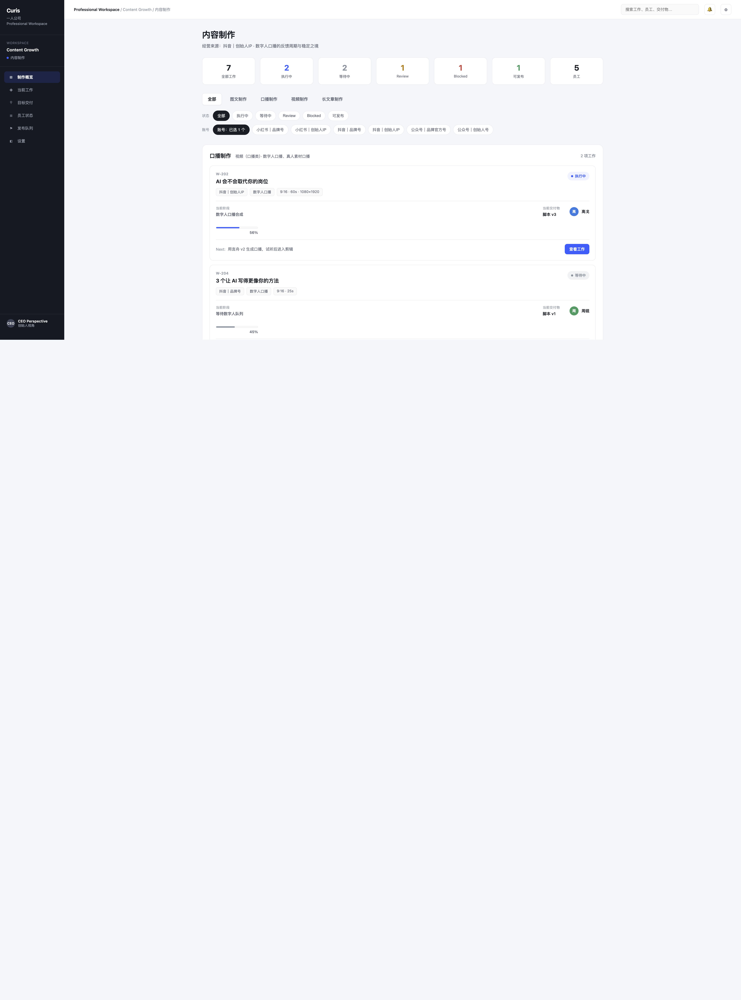
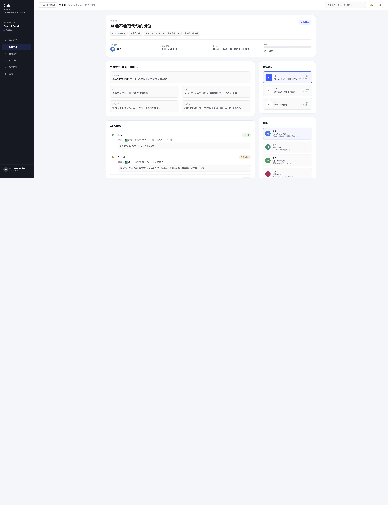
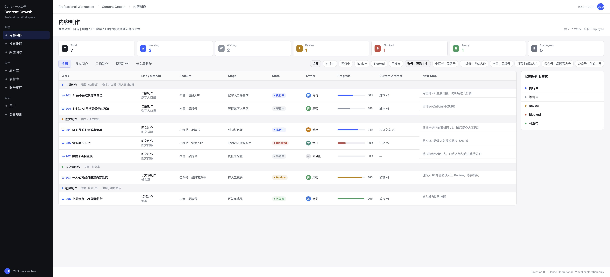
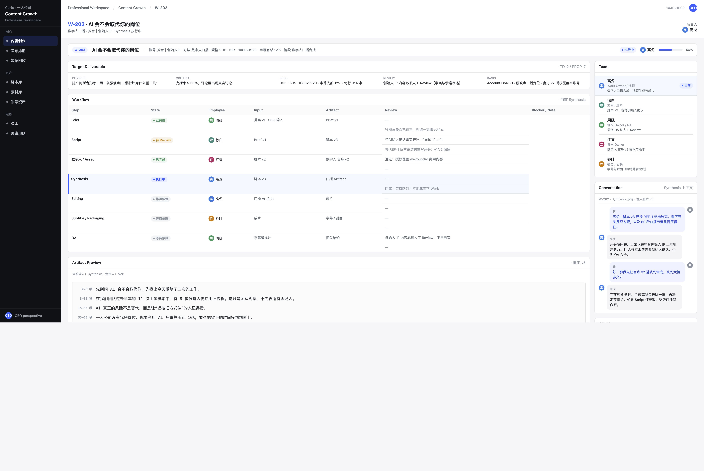
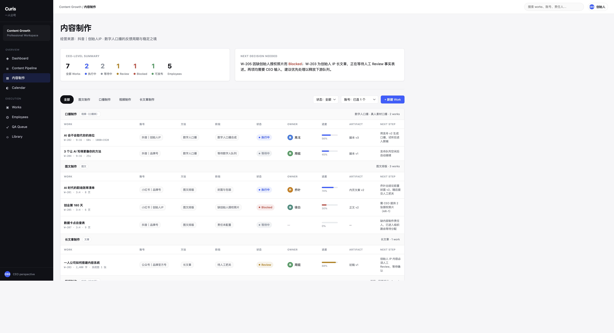
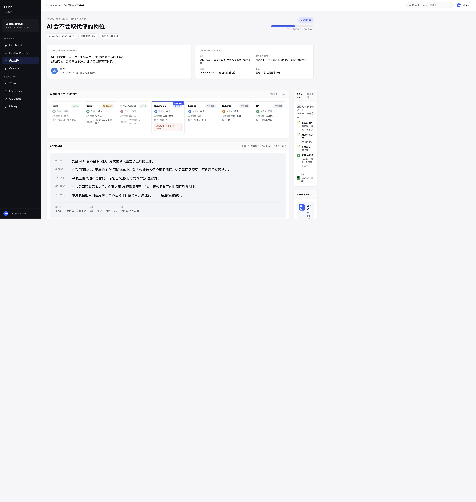

# Curis Operational Workspace Visual Direction Comparison

Authority Class: REVIEW / VISUAL EXPLORATION
Status: Review
日期：2026-09-20

本轮目标：仅改变 Visual Organization Language，不改动 Content Growth 产品结构、员工定义、Workflow 定义或 Runtime。使用同一组真实数据（W-201 至 W-207）生成 6 个 Desktop 高保真 Frame，供 CEO 比较三个方向的适用性。

---

## 样本数据一致性声明

三个方向使用同一套 Canonical Data：

- **Production Overview**：7 个 Work（W-201 ~ W-207），覆盖 图文 / 口播 / 长文章 / 视频 四条 Production Line，状态包括 执行中 / 等待中 / Review / Blocked / 可发布。
- **W-202 Production Work**：同一口播 Work，当前步骤 Synthesis（高戈），脚本 v3 为当前 Artifact，Workflow 共 7 步，QA 待人工 Review。

禁止项遵守：未新增产品功能、未改七区、未改 Authority、未进入 Figma Design System、未修改既有 HTML。

---

## Direction A — Spatial Baseline

### Frames





### Visual Thesis
当前 Curis 视觉方向做到最好时的样子：高级感来自空间、克制与明确的 Section 边界。Work、Line、Workflow、Artifact 各自有独立的 Card/区块，页面呼吸感强，适合需要远距离判断的场景。

### Density Strategy
- **疏**：页头、Line 之间、Target Deliverable 与 Workflow 之间使用较大留白。
- **密**：单个 Card 内部的信息仍较集中，但 Card 之间留有清晰边界。

### Workflow Expression
Workflow 以垂直步骤流呈现，每步是一个独立卡片/行，当前步骤用左侧色条与高亮节点标出。员工内嵌在步骤内，不另设团队墙。

### Employee Expression
员工头像与姓名出现在步骤卡片内部，点击可进入对话。Work Owner 在页头单独呈现。

### Artifact Expression
脚本 v3 正文占据一个独立大 Card，分段展示 0-60 秒口播文案，字号与行距给予内容足够视觉重量。

### Risk
当 Work 数量增加时，大 Card + 大留白会导致页面纵向过度延伸，业务连续性被空白切断；扫读多个 Work 的效率可能下降；容易看起来像“漂亮但不在运行”的静态报告。

---

## Direction B — Dense Operational

### Frames





### Visual Thesis
高级感来自秩序与密度，而不是空。通过紧凑表格、细分割线、内联状态、统一 Grid，把同一数据组织成连续工作面。目标是一天使用 8 小时也能快速扫读业务状态。

### Density Strategy
- **疏**：仅页头保留最小呼吸空间；状态筛选与标签栏紧凑排列。
- **密**：Work 队列用连续表格呈现，所有关键字段（Work / Line / Account / Stage / State / Owner / Progress / Artifact / Next Step）在同一行内可见；Workflow 用 7 行密集表呈现。

### Workflow Expression
Workflow 成为页面骨架：一行一个步骤，状态/员工/输入/产物/Review/阻塞Inline 展示。当前步骤通过左侧蓝色边条与浅蓝背景高亮，不需要独立流程图组件。

### Employee Expression
员工头像 inline 在步骤行与 Work 行中，责任与当前承担人一眼对应。没有单独的 Employee Card Wall。

### Artifact Expression
脚本 v3 以紧凑但可读的分段文本呈现，Hook / 结构 / 字数 以 meta chip  inline 标注，让内容产物在密集界面中仍保持主角地位。

### Risk
密度过高可能在初次使用时造成压迫感；如果排版精度不够，容易滑向传统后台/ERP 的廉价感；需要更严格的 Typography 与 Grid 纪律来维持 Curis 的高级感。

---

## Direction C — Hybrid Operational

### Frames





### Visual Thesis
"Space for Judgment, Density for Work"。页面顶部为判断保留空间：CEO-level summary、Next Decision Needed、Work Identity、Target Deliverable 以较宽松方式呈现。一旦进入执行层（Queue / Workflow / Artifact / QA），密度显著提高。

### Density Strategy
- **疏**：顶部 Judgment Zone —— Work 标题、目标交付、当前决策提示留白充足。
- **密**：Execution Zone —— Work 队列、Workflow Ribbon、Artifact Preview、Conversation、QA 使用紧凑表格/行/Inline 状态。

### Workflow Expression
Workflow 在 W-202 页中以横向/纵向混合 Ribbon 呈现，当前 Synthesis 步骤高亮，步骤、员工、Artifact 版本、阻塞说明 inline。Production Overview 中 Workflow 不展开，仅通过 Stage 与 Next Step 保持连续性感知。

### Employee Expression
顶部显示 Work Owner，执行步骤中 inline 显示当前承担员工。员工不是独立对象，而是 Workflow 行中的一个属性。

### Artifact Expression
脚本 v3 在宽松头部下方以较大字号分段展示，Artifact 区域在密集执行带中仍获得视觉重量；同时保持 surrounding context 紧凑。

### Risk
同一页面两种密度如果过渡生硬，会造成视觉节奏断裂；需要精确控制 Spatial Zone 与 Operational Zone 的边界（背景色、间距、字体层级）才能避免“上下两个页面”的拼接感。

---

## 跨业务扩展性评估

| 方向 | RD（Project / Employee / Work / Result / Diff）| Music（Song / Reference / Version / Employee / Result）| 结论 |
|---|---|---|---|
| A Spatial | 适合高层 Project Overview，但 Diff / Result 的连续性会被留白削弱。 | 适合 Album/Project 概览，但版本迭代密集时扫读效率低。 | 更适合判断层，而非持续执行层。 |
| B Dense | 高密度表格天然适合 Work / Result / Diff 队列；Diff 可视化可替换 Artifact 区域。 | 版本列表、编曲步骤、参考曲目都适合紧凑行/表结构。 | 扩展性最强，但需警惕密度压迫感。 |
| C Hybrid | 顶部 Project 判断 + 下方 Work/Result/Diff 高密度执行，与 RD 的“项目决策 + 密集迭代”结构契合。 | 顶部 Song Identity + 下方 Version / Reference / Employee 执行，同样契合。 | 最有潜力统一 Professional Workspace 全家。 |

判断：Direction C 的 Hybrid 结构最容易跨 Content Growth / RD / Music 统一，因为不同专业 Workspace 都存在“判断层 + 执行层”的天然分层。Direction B 可作为执行层的局部密度参考。Direction A 更适合顶层经营/Portfolio 视图，而非执行工作面。

---

## CEO 评审建议问题

1. 哪个方向最容易理解业务正在发生什么？
2. 哪个方向最容易扫读多个 Work？
3. 哪个方向最容易看懂谁在工作？
4. 哪个方向最容易进入当前 Work？
5. 哪个方向最适合一天使用 8 小时？
6. 哪个方向还能保持 Curis 的公司感？
7. 哪个方向可以扩展到 RD / Music / Writing 等 Professional Workspace？

---

## 文件清单

```
CURIS_OPERATIONAL_VISUAL_EXPLORATION/
├── _shared/canonical-data.json
├── A_SPATIAL/
│   ├── production-overview.html
│   ├── production-overview.png
│   ├── w202-work.html
│   └── w202-work.png
├── B_DENSE_OPERATIONAL/
│   ├── production-overview.html
│   ├── production-overview.png
│   ├── w202-work.html
│   └── w202-work.png
├── C_HYBRID_OPERATIONAL/
│   ├── production-overview.html
│   ├── production-overview.png
│   ├── w202-work.html
│   └── w202-work.png
└── CURIS_OPERATIONAL_VISUAL_DIRECTION_COMPARISON.md
```

---

CURIS OPERATIONAL WORKSPACE VISUAL DIRECTION EXPLORATION COMPLETE — READY FOR CEO REVIEW
