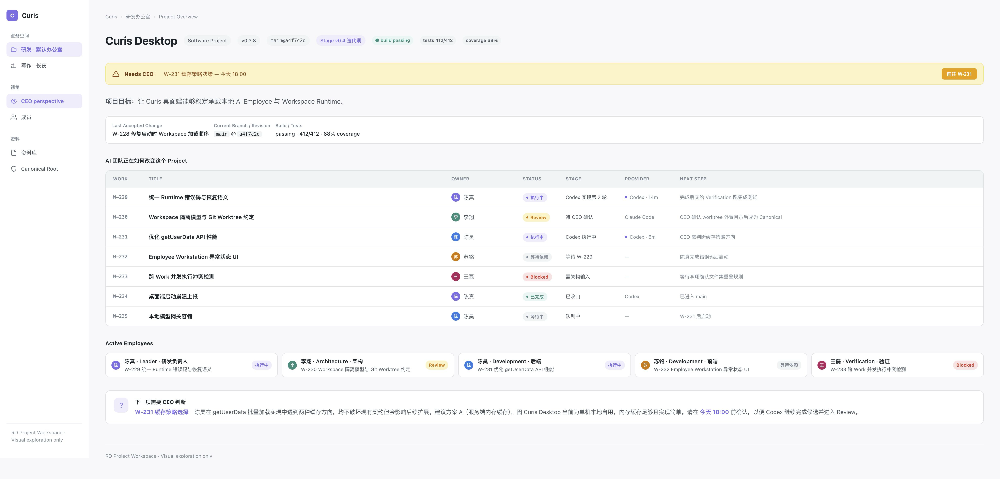
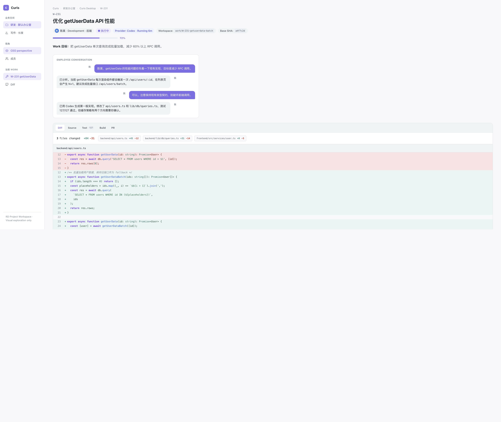
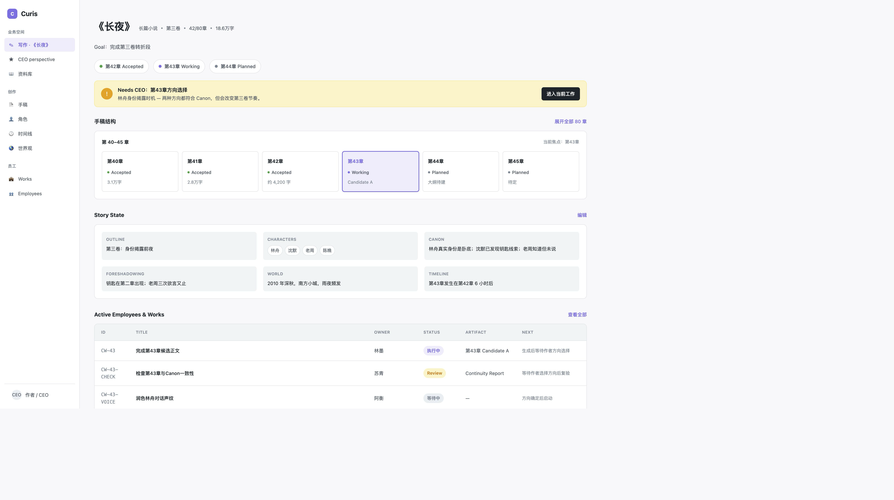
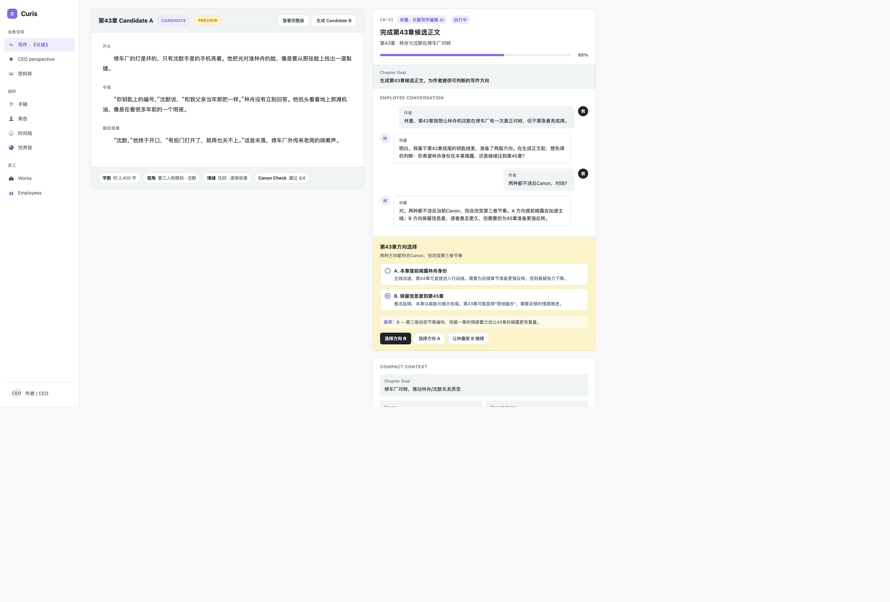

# Curis Project Workspace Visual Language Findings

Authority Class: REVIEW / VISUAL EXPLORATION
Status: Review
日期：2026-09-20

---

## 本轮范围说明

本轮探索 Curis Professional Workspace 的第二种视觉模型：Project Workspace / Artifact-centric Workspace，使用两个真实业务：

- **RD Software Development**：项目 = Curis Desktop（代码库）
- **Long-form Writing**：项目 = 长篇小说《长夜》

共输出 4 个 Desktop 高保真 Frame：

- RD / Project Overview
- RD / Current Work Surface（W-231）
- Writing / Project Overview
- Writing / Current Work Surface（CW-43）

**输入来源**：

- 上一轮 `CURIS_OPERATIONAL_VISUAL_EXPLORATION/CURIS_OPERATIONAL_VISUAL_DIRECTION_COMPARISON.md`
- RD Multi-Agent Orchestration 研究结论（`CURIS_RD_MULTI_AGENT_ORCHESTRATION_CONCLUSIONS.md` 等）
- Curis RD Workspace Instance Spec / Design Brief / Visual Standard V1
- Writing 产品输入：用户 Prompt 中 §10–§20 的详细要求（工作区中未找到用户指定的三份 Writing 文件，因此基于 Prompt 要求执行，未读取额外文档）

**禁止项遵守**：未修改 Content Growth / RD / Writing 产品结构；未改 Authority；未进入 Figma Design System；未修改既有 HTML；未 commit / push。

---

## 1. RD 与 Writing 是否真的共享 Project Workspace 工作语法？

**结论：是的，它们共享同一套上层工作语法，但 Primary Artifact 的表达形式必须完全不同。**

两业务都呈现以下稳定结构：

| 语法元素 | RD（Curis Desktop） | Writing（《长夜》） |
|---|---|---|
| **Project Identity** | 软件项目 · 版本 / 分支 / 阶段 | 长篇小说 · 卷 / 章 / 字数 |
| **Project State** | Build / Tests / Coverage / Last Accepted Change | Manuscript Status / Accepted Chapters / Story State Health |
| **Primary Artifact** | Code / Diff / Change Set | Manuscript / Candidate Text |
| **Employee** | 陈昊 · Development · 后端 | 林墨 · 长篇写作编辑 AI |
| **Current Work** | W-231 优化 getUserData API 性能 | CW-43 完成第43章候选正文 |
| **Candidate / Change** | Diff（3 files, +84 −31） | Candidate A（第43章预览） |
| **Evidence** | Test Result 127/127 | Canon Check 4/4 / Continuity Report |
| **Human Decision** | 缓存策略选择（异常 Gate） | 第43章方向选择（正常创作循环） |
| **Commit / Accepted State** | 进入 main / Canonical Branch | 作者 Accept 后成为正式 Manuscript |

因此可以统一的工作语法是：

```
Project Identity → Project State → Primary Artifact → Employee → Current Work
→ Candidate / Change → Evidence → Human Decision → Accepted Project State
```

这不是 Template，而是 Grammar：每个元素在不同专业里有不同实体，但关系稳定。

---

## 2. 哪些结构可以统一？

以下结构在 RD 与 Writing 中均可复用：

1. **项目身份头（Project Identity Header）**：项目名称 + 类型 + 阶段 + 当前版本/进度 + 下一步判断。这是判断层（Judgment Zone）的固定位置。
2. **项目状态轻量条**：只显示“现在整体是什么状态”的关键指标，不做 Dashboard。
3. **Needs CEO 注意力条**：Workspace 级，位于 Main 顶部，不是员工卡内部。
4. **Work 的可扫描行列表**：ID / Title / Owner / Status / Artifact / Next Step。不是 Kanban，不是 Card Wall。
5. **员工 Inline 表达**：头像 + 姓名 + 角色 + 当前 Work，嵌入 Work/Responsibility 上下文，不另设团队墙。
6. **Current Work Surface 的三段结构**：Work Header → Artifact/Candidate → Conversation → Decision → Utility。
7. **Candidate 视觉区分**：用 Candidate 徽章 / 浅色边框 / 状态标签区分“正式资产”与“AI 提案”。
8. **Decision 条**：选项 + 影响 + 推荐 + CTA，统一作为 Human Judgment 的交互形态。
9. **Utility Surface 入口**：Diff / Source / Test / Outline / Characters 等按需展开，不做永久侧栏。
10. **Footer 状态条**：Provider 运行状态 / Workspace 路径 / Base SHA / Chapter Goal 等执行事实。

---

## 3. 哪些必须专业化？

| 必须专业化的元素 | RD 表达 | Writing 表达 | 原因 |
|---|---|---|---|
| **Primary Artifact 形态** | Diff / Code / Files Changed | Manuscript / Candidate Text | 专业对象不同 |
| **Artifact 元数据** | Files / Additions / Deletions / Test Result | 字数 / 视角 / 情绪 / Canon Check | 判断依据不同 |
| **Project State 指标** | Build / Tests / Coverage / Branch | Chapters Accepted / Word Count / Story State | 项目健康度定义不同 |
| **Work 状态粒度** | working / review / waiting / blocked / completed | working / review / waiting / completed / planned | Writing 有 planned 状态，RD 没有 |
| **Human Decision 频率与语气** | 异常 Gate，用警示色 | 正常创作循环，用中性选择 | 业务性质不同 |
| **Context 内容** | Workspace / Branch / Base SHA / Files | Chapter Goal / Canon / Characters / Style | 执行上下文不同 |
| **Utility Tabs** | Diff / Source / Test / Build / PR | Manuscript / Outline / Characters / Canon / Timeline / Evidence | 专业工具不同 |
| **Conversation 默认位置** | 右侧或下方，Artifact（Diff）居中 | 左侧或右侧，Artifact（Manuscript）占主面 | 阅读对象的阅读方向不同 |

关键洞察：**不能共享同一套 Utility 标签，但 Utility Surface 的“按需展开、返回 Conversation”的交互契约可以共享。**

---

## 4. Primary Artifact 应该处于什么视觉地位？

**结论：Primary Artifact 必须是 Current Work Surface 的视觉主角。**

- **RD**：Diff/Code 占据主区最大面积；Conversation 与 Decision 围绕它展开。用户打开 W-231 时，第一眼看到“哪些文件被改了、改了什么”。
- **Writing**：Manuscript / Candidate 占据主区最大面积；Conversation 与 Context 在旁辅助。用户打开 CW-43 时，第一眼看到“第43章写了什么”。

Artifact 的视觉重量来自：

- 更大的阅读区域；
- 更安静的背景（surface1 / surface2），让员工/状态信息退后；
- 专业排版：代码等宽、手稿正文舒适行距；
- Candidate 徽章明确区分“AI 提案”与“正式资产”。

禁止：把 Status / Employee / Chat 做得比 Artifact 更显眼。

---

## 5. Employee 应该处于什么视觉地位？

**结论：Employee 是责任的化身，不是页面的主角。**

- Employee 出现在 Work Header、Work List 行、Conversation 发信人位置；
- 不建 Employee Card Wall；
- 不把 Provider（Codex / Claude Code）做成头像或发言者；Provider 只作为执行事实小字显示（"Codex · Running 6m"）；
- Collapsed Workstation / 员工行包含：头像 + 姓名 + 角色 + 当前 Work + 状态。

在 Project Overview 中，员工通过“谁负责哪个 Work”被感知；在 Current Work Surface 中，员工通过 Conversation 和 Work Header 被感知。

---

## 6. Conversation 应该如何存在？

**结论：Conversation 是作者/CEO 与 Employee 的持续工作关系，不是普通 AI 聊天。**

- Conversation 必须知道当前 Project、Current Work、Candidate、Decision；
- 消息体保持自然语言，但关键引用要轻量（如 "api/users.ts · 45 -12 · 查看差异 ▸"）；
- 不在 Conversation 中内嵌完整 Diff / 代码块 / 大段手稿；完整 Artifact 走 Utility / Main Artifact 区；
- Composer 锚定在活跃 Conversation 底部，显示继承的上下文（Workspace / Work）。

RD 与 Writing 的 Conversation 在结构上一致，只是引用的对象不同：RD 引用文件/Diff，Writing 引用章节/Candidate。

---

## 7. Human Decision 在两业务中有什么不同？

这是本轮最重要的发现之一：

| 维度 | RD | Writing |
|---|---|---|
| **触发频率** | 异常 Gate（较少） | 正常创作循环（高频） |
| **决策性质** | 工程选择：缓存策略、架构方向、迁移方案 | 审美选择：揭露时机、节奏、人物声纹 |
| **风险等级** | 常有不可逆/高风险操作（数据迁移、线上结构） | 风险是叙事层面的，不会破坏系统 |
| **视觉语气** | 警示 / 需要 CEO 拍板 | 中性 / 作者选择 |
| **默认动作** | 需要显式查看方案、暂缓、批准 | 可以直接选择 A/B/继续 |
| **Evidence 类型** | Test / Diff / Performance / Security | Canon / Character / Foreshadowing / Style |

**产品 implication**：Curis 的 Decision 组件必须支持两种模式：

- **Gate Mode（RD）**：默认只显示“发生了什么 + 查看方案/暂缓”，不可逆操作禁止 Layer-0 直批；
- **Choice Mode（Writing）**：默认展开选项，推荐方案，允许快速选择并继续。

不能用一个红色 Banner 表达所有 Decision。

---

## 8. Context 如何表达？

**结论：Context 是“当前工作时 AI 依据了什么”，不是 metadata panel。**

- **RD Context**：Workspace / Branch / Base SHA / 相关文件 / 依赖 Work。保持最小，完整 Context Ledger 进 Utility。
- **Writing Context**：Chapter Goal / Relevant Canon / Characters / Recent Story / World Rule / Style。同样保持最小，完整 Story State 进 Utility。

表达原则：

- 默认只显示“会影响当前判断”的关键项；
- 用 compact chips / 小列表呈现；
- 完整信息通过 Utility 标签（Source / Outline / Characters / Canon）展开；
- Context 不应与 Conversation 抢主区。

---

## 9. Utility 如何表达？

**结论：Utility 是按需展开的专业检查面，不是常驻右侧栏。**

- 默认关闭；
- 从 Result Reference 或 Work Header 触发；
- 打开后显示所属 Work，提供返回 Conversation 的锚点；
- 可以 push / overlay，具体根据 viewport 决定；
- RD Utility：Diff / Source / Test / Build / PR；Writing Utility：Manuscript / Outline / Characters / Canon / Timeline / Evidence。

重要：Utility 是**职责容器**，不是**工具墙**。每个 Utility 必须回答一个具体问题：

- Diff：改了什么？
- Source：原文件长什么样？
- Characters：这个人是谁？
- Canon：这条规则是什么？

---

## 10. Space for Judgment / Density for Work 是否仍成立？

**结论：仍然成立，但 Density 的定义需要扩展。**

上一轮 Content Growth 的 Density = 信息行紧凑、表格、Inline 状态。

本轮 Project Workspace 的 Density = **信息关系紧密**，不等于所有东西都压缩：

- **RD Diff 需要代码空间**：不能为了密度把代码行挤成一团；
- **Writing Manuscript 需要阅读空间**：正文需要舒适的行距和边距；
- **Density 体现在**：Work 列表紧凑、Employee 信息 Inline、Decision 选项紧凑对比、Context 只显示关键项。

因此更准确的表述是：

> Space for Judgment（判断层留白）+ Density for Relationships（执行层关系紧密）+ Room for Artifact（产物需要阅读/审视空间）。

---

## 11. 与 Operating Workspace 最本质的视觉差异是什么？

| 维度 | Operating Workspace（Content Growth） | Project Workspace（RD / Writing） |
|---|---|---|
| **核心对象** | Flow / Work Queue | Project State / Primary Artifact |
| **主导视觉骨架** | Production Line → Work → Workflow | Project Identity → Artifact → Decision |
| **Workflow 位置** | 页面组织骨架 | 隐藏在 Work/Employee 内部 |
| **时间感** | 连续经营周期 | 长期项目 + 离散版本 |
| **主要可扫描目标** | 谁在做什么、状态、下一步 | 项目现在是什么、当前 Artifact、待决判断 |
| **Human Decision** | 异常 Gate / Needs CEO | RD 异常 Gate；Writing 正常创作循环 |
| **状态表达方式** | Production Line / Stage / State Pill | Project State / Work Status / Candidate Badge |

最本质差异：**Operating Workspace 用 Workflow 组织页面；Project Workspace 用 Artifact + Project State 组织页面。**

这意味着 Curis 必须有两套页面级视觉语法，而不是一套模板覆盖所有业务。

---

## 12. 是否足以形成 Curis Professional Workspace Visual Language？

**结论：足以形成“Curis Professional Workspace Visual Language”的雏形，但需要把两层语法显式分开。**

建议形成的视觉语言分层：

```
Curis Professional Workspace Visual Language
├── Shared Foundation（全部通用）
│   ├── Direction D 视觉标准
│   ├── Four-Pane 职责框架
│   ├── Calm Density
│   ├── Employee = Responsibility Owner
│   ├── Conversation = Work Relationship
│   ├── Decision = Human Judgment
│   └── Utility = On-demand Professional Surface
│
├── Operating Workspace Language（Flow-centric）
│   ├── Content Growth / Music 等
│   ├── Production Line / Work Queue
│   ├── Workflow as page skeleton
│   └── Employee embedded in workflow nodes
│
└── Project Workspace Language（Artifact-centric）
    ├── RD / Writing / Design 等
    ├── Project Identity → Project State
    ├── Primary Artifact = visual center
    ├── Candidate / Change → Evidence → Decision → Accepted State
    └── Workflow hidden inside Work
```

**尚未验证、需要继续探索的点**：

1. Music 更接近 Operating 还是 Project？（有 Song / Version / Reference，可能混合）
2. Design Workspace（Figma-like / design-file-centric）更接近 RD（diff/asset）还是 Writing（canvas/version）？
3. Project Overview 中当 Work 数量超过 10 个时，列表是否需要分组/折叠？
4. Decision Gate 的 Layer 0/1/2 在不同业务中的默认展开策略。
5. Utility Surface 同时打开多个时的布局（当前只打开一个）。

---

## 文件清单

```
CURIS_PROJECT_WORKSPACE_VISUAL_EXPLORATION/
├── _shared/
│   └── canonical-data.json
├── RD/
│   ├── project-overview.html
│   ├── project-overview.png
│   ├── current-work.html
│   └── current-work.png
├── WRITING/
│   ├── project-overview.html
│   ├── project-overview.png
│   ├── current-work.html
│   └── current-work.png
└── CURIS_PROJECT_WORKSPACE_VISUAL_LANGUAGE_FINDINGS.md
```

---

## 视觉 Frame

### RD





### Writing





---

CURIS PROJECT WORKSPACE VISUAL EXPLORATION COMPLETE — READY FOR CEO REVIEW
