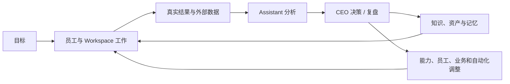

# Curis Product Rethink Reasoning

Status: REVIEW REQUIRED  
日期：2026-08-13  
文档性质：产品重新推导阶段交付  
实现边界：本轮不开发代码、不修改旧 HTML、不修改现有 Blueprint、不修改 Runtime、不修改数据库。

## 0. 本轮任务与结论

本轮不是继续补齐旧 Blueprint，也不是把现有 Runtime 状态机换一种写法。任务是站在普通桌面 App 用户的使用体验出发，重新回答：

> Curis 为什么值得被打开？普通人怎样从一句话开始拥有并使用一家 AI 公司？

重新推导后的初步结论是：

> Curis 不是更复杂的 Agent 工作台，而是一款把成熟 AI 工作能力组装成一家公司，并让普通用户能够统一使用、管理、扩张和进化这家公司的 Desktop App。

Curis 自己真正要做的不是重新实现对话、代码编辑器、浏览器、工作流引擎、模型调用或所有外部平台。Curis 要做的是把这些能力放进统一的公司关系中，让它们有业务归属、员工责任、用户上下文、目标、真实结果、复盘和下一轮经营动作。

本文件只交付产品推导，不代表目标能力已交付，也不授权任何代码实现。

---

## 1. 过去为什么偏离

### 1.1 把经营内核误当成用户产品

Curis 过去不断增加以下概念：

```text
目标 → 责任 → 边界 → 验收 → Simulation → Evidence
→ Runtime → 门禁 → 状态机 → 版本 → 恢复
```

这些概念对“怎样保证 AI 工作真实发生”有价值，但它们逐渐成为用户首先要理解的产品语言。结果是：

- 用户先看到 Company、Workspace、Blueprint、Role Slot、Capability Binding、SimulationRun、Operating Version 等内部对象。
- 创建业务被体验成一项系统装配工程，而不是“我想开始做什么业务”。
- 运行页面更像控制台，用户看见了很多状态，却不一定知道公司正在替他完成什么。
- 页面、API、测试、候选构建和静态状态容易被误读为产品完成。
- 对话被放在浮层或辅助位置，没能承担普通用户表达复杂意图的主要入口。

根本问题不是 Runtime 太多，而是 Runtime 从底层可靠性机制上浮成了前台主语义。

### 1.2 把 CEO 当成产品架构师

旧路径隐含要求用户先学会：

- 定义公司和组织。
- 创建部门、岗位和员工。
- 配置模型、Skill、Tool、Knowledge 和连接器。
- 设计工作阶段、输入、输出、验收和失败路径。
- 理解每个运行状态并选择正确的门禁动作。

但普通用户打开 App 时，通常只知道自己想完成一件事，例如：

- “我想开始做小红书。”
- “帮我把这个产品做出来。”
- “最近内容效果不好，帮我查原因。”
- “把这份资料整理成可持续的研究工作。”

产品应该把这些自然语言意图转换成公司、业务、员工和 Workspace 的最小可运行方案。用户只需要确认关键选择，不应先学习组织设计。

### 1.3 把“能力完整”误解成“全部自己重写”

市场已经验证了许多局部工作方式：

- ChatGPT 验证了对话、Project 上下文、文件、工具和可编辑成果的自然组合。
- Codex 与 Claude Code 验证了项目上下文、代码、终端、测试、Git、长任务和中途介入。
- Coze 验证了 Agent、Workflow、Knowledge、Plugin、模型与 API/SDK 资源的组合。
- OpenOPC 验证了公司、岗位、员工、招聘和执行承担者的分离。
- Relevance AI 验证了 Agent、Team、Tool、Knowledge、Trigger 和低代码创建的组合。
- EvoFlow 验证了长任务、Supervisor、子 Agent、工具渐进暴露、沙箱、恢复和观测的重要性。
- Linear 验证了 Workspace、Team、Project、搜索和快捷创建如何降低大型 App 的使用成本。
- Workbuddy 验证了跨项目上下文、线程、通知、审批和可恢复长任务如何成为日常工作层。

Curis 不应该把这些能力拆散后重新开发一遍。Curis 应该建立可替换的接入层，把成熟能力作为员工背后的工作能力。

### 1.4 把“产品形态”和“当前实现”混在一起

当前代码、Runtime、隔离数据库和浏览器证据只能回答“现在已经真实交付了什么”。它们不能单独回答“完整产品应该是什么”。

新的事实分层必须保持：

| 层 | 回答的问题 | 本轮处理方式 |
| --- | --- | --- |
| 产品愿景 | 普通用户最终能用 Curis 做什么 | 重新推导 |
| 产品模型 | 公司、员工、业务、Workspace 如何形成关系 | 重新定义 |
| 竞品参考 | 哪些成熟模式已经被验证 | 研究并标注来源 |
| 当前事实 | 代码和真实运行已经证明什么 | 只作为输入，不升级为目标 |
| Runtime | 如何让工作真实、可恢复、可审计 | 下沉为支撑，不作为入口 |
| 实现路线 | 先交付哪一条纵向闭环 | 本轮不展开开发 |

---

## 2. 新的产品推导方法

### 2.1 先从普通用户的一句话开始

每个产品模块先回答一个用户问题，而不是先定义一张表或一个页面：

| 用户问题 | Curis 应该承担的工作 |
| --- | --- |
| 我想开始做什么？ | Assistant 帮用户理解意图，并形成业务和第一步方案 |
| 谁会帮我做？ | 形成岗位、员工和承担能力，隐藏不必要的组织设计 |
| 我现在要看什么？ | 把信息整理成今日重点、结果、风险和待确认事项 |
| 工作做到哪了？ | 用业务语言显示进度、产出、阻塞、下一步和用户介入点 |
| 结果是真的吗？ | 展示来源、外部回执、用户反馈或明确的人工补录状态 |
| 有问题怎么办？ | 让用户直接介入问题环节，局部修改并继续下游工作 |
| 公司怎样变好？ | 根据结果生成分析、复盘、知识和组织/资源调整建议 |

### 2.2 先定义用户动线，再定义对象

产品推导顺序改为：

```text
用户意图
→ 可理解的方案
→ 关键确认
→ 最小可运行团队
→ 业务 Workspace
→ 自动工作
→ 结果和异常
→ 局部介入
→ CEO 决策
→ 复盘、沉淀和下一轮调整
```

对象、状态、权限、Evidence 和日志必须服务这条动线。不能因为底层有一个对象，就要求用户把对象当成产品入口。

### 2.3 用渐进式披露控制复杂度

普通用户应该看到：

- 目标是什么。
- 谁负责。
- 现在发生了什么。
- 结果是什么。
- 哪些地方需要用户确认。
- 下一步能做什么。

高级用户或业务装配角色才需要看到：

- Provider、Model、Agent Adapter、MCP、Skill 版本。
- Role Contract、Capability Binding、数据窗口和副作用等级。
- Simulation、Trace、Transition Log、Operating Version、Rollback。

复杂能力不能删除，但要从“默认前台语言”改为“按需展开的专业信息”。

### 2.4 用四个问题判断功能是否属于 Curis

任何新功能先问：

1. 它是否帮助普通用户更快开始或完成一项真实工作？
2. 它是否让多个成熟 AI 工作能力在公司关系中协同？
3. 它是否让目标、真实结果、反馈、复盘或资源调整形成连续性？
4. 它是否能在不要求用户理解内部 Runtime 的情况下使用？

只有回答“是”的功能，才进入 Curis 的产品层。纯粹为了增加控制项、状态项或平台复杂度的功能下沉到内部实现，或不做。

---

## 3. 普通用户模型

### 3.1 用户不是 CEO 专家，而是想完成事情的人

Curis 的真实用户可以是创作者、独立开发者、研究者、咨询顾问、小商家或一人公司创业者。他们可能拥有经营目标，但不一定懂公司、岗位、Agent 或 Workflow。

产品假设：

- 用户会表达目标，不会先设计组织。
- 用户愿意确认少量高影响选择，不愿填写长配置表。
- 用户希望知道结果是否可信，不希望被技术状态淹没。
- 用户希望工作继续运行，但需要在关键动作前被通知和询问。
- 用户会在发现局部问题时直接修改，不愿整条流程从头重跑。
- 用户会逐渐学会高级能力，但第一天不应被迫学习。

### 3.2 用户打开 Curis 的六种主要原因

1. **开始一项新业务**：把一个想法变成可工作的业务和团队。
2. **委派一件复杂工作**：把目标交给一个员工、一个团队或一个 Workspace。
3. **查看今天发生了什么**：只看重要变化、结果、风险和待决定事项。
4. **处理一个异常**：找到卡住的环节，补信息、改方向或接管一步。
5. **检查一个结果**：查看成果、外部数据、反馈、来源和是否需要验收。
6. **让公司变得更强**：复盘工作，沉淀知识，调整员工、能力、业务和自动化。

### 3.3 用户不应该被迫区分的概念

下列概念可以存在，但默认不要求用户先区分：

```text
业务 / Workspace / Project
Role Slot / AI Employee / Agent
Model / Provider / Adapter
Skill / Tool / MCP
Task / Workflow / Run / Cycle
Evidence / Artifact / Outcome
```

前台应该优先显示自然语言语义：

```text
这项业务
这个办公室
负责内容的人
正在使用的工作能力
当前工作
这次交付
结果依据
```

只有在需要配置、排错、替换或审计时，才展开内部映射。

---

## 4. Curis 的产品本质

### 4.1 一句话定义

> Curis 是一款 Desktop-first AI Company App：用户通过对话表达想做的事情，Curis 帮他形成公司、业务、AI 员工和业务 Workspace；成熟的 AI/Agent/自动化在其中持续工作，结果、反馈和复盘再反过来推动公司的下一轮经营。

### 4.2 Curis 不是这些东西

- 不是聊天机器人：对话只是核心入口之一，结果要进入业务和公司。
- 不是 Agent 列表：用户找的是“谁负责什么”，不是一串模型或 Agent 名称。
- 不是 Workflow 编辑器：复杂工作方式应优先由 Assistant、模板或业务工程能力生成。
- 不是统一看板：不同 Workspace 的工作方式可以完全不同。
- 不是任务管理器：Task 是内部执行记录，业务结果才是用户关心的对象。
- 不是能力市场：能力是公司资源，只有在员工、业务和权限关系中才有意义。
- 不是 BI 仪表盘：数据服务于判断、反馈和调整，不是单独的产品终点。

### 4.3 Curis 真正的差异化

成熟产品已经解决“怎样让一个 Agent 做一件工作”。Curis 要解决的是：

```text
多个成熟 AI 工作能力
→ 进入同一家公司
→ 被分配到不同员工和业务
→ 接收统一目标和上下文
→ 在不同 Workspace 中工作
→ 把真实结果和异常回收
→ 由 CEO 助理分析和复盘
→ 推动业务、组织、能力、知识和自动化持续调整
```

因此 Curis 的创新单位不是一个新 Agent，而是一个能够持续经营的 AI Company Loop。

---

## 5. Curis 的固定公司框架

### 5.1 固定的不是页面，而是公司语义

Curis 固定保留以下公司级概念：

```text
用户 / CEO
├── Company：身份、目标、规则、资源和历史
├── CEO Assistant：第一位 AI 员工，负责经营代理和协调
├── Organization：岗位、员工、汇报和共享责任
├── Business：价值方向、目标、投入、结果和阶段
├── Capability：模型、Agent、Skill、Tool、Knowledge、Connection
├── Workspace：业务的独立工作空间和工作方式
├── Meeting / Decision：讨论、判断、承诺和变化
├── Data / Evidence / Outcome：真实结果和可信依据
├── Knowledge / Memory / Assets：可复用信息和公司 IP
└── Operating Loop：目标 → 工作 → 结果 → 分析 → 调整 → 下一轮
```

固定的是这些关系和用户可以理解的公司事实，不是每个 Workspace 必须使用相同的导航、卡片、阶段或表格。

### 5.2 Company 是容器，也是长期上下文

Company 不应只是技术 Tenant 或空壳根实体。用户感受到的 Company 应包含：

- 我在做什么。
- 当前有哪些业务。
- 谁在负责。
- 哪些能力可以使用。
- 最近发生了什么。
- 哪些结果值得关注。
- 哪些决定改变了公司。
- 公司从过去的工作中学到了什么。

### 5.3 CEO Assistant 是默认经营代理

CEO Assistant 不是一个固定侧栏，也不是把所有请求转发给模型的聊天入口。它是公司的第一位 AI 员工，承担：

- 把自然语言意图整理成可执行方案。
- 维护公司级上下文和经营日。
- 汇总不同 Workspace 的进展、风险、结果和待决定事项。
- 召集合适的专业员工或外部 Agent。
- 在工作运行时继续跟进，而不是只返回一次答案。
- 在影响较小的事项上代办，在高影响事项上请求确认。
- 把复盘结果转成新的知识、建议、能力调整或组织变化。

用户可以直接对它说：

```text
“我想开始做小红书，大部分工作希望 AI 完成。”
“最近这项业务效果不好，帮我找原因。”
“把这周的工作重新安排一下。”
“准备一个我今天必须决定的事项。”
```

Assistant 不应该要求用户重复已经存在的公司、业务、Workspace 或员工上下文。

---

## 6. Workspace 重新定义

### 6.1 Workspace 是内嵌的独立应用

> Workspace 是公司里为某项业务装配的独立数字办公室；它共享 Company 的身份、员工、能力、知识、权限和经营上下文，但可以拥有完全不同的业务对象、布局、工作方式、自动化和结果窗口。

Workspace 不是：

- 一个换了标题的 Runtime 页面。
- 一套所有业务共用的看板。
- 一个让 CEO 从零拖节点的 Workflow 编辑器。
- 一个只展示内部任务状态的项目列表。

### 6.2 Workspace 统一共享的契约

不同 Workspace 至少都能：

1. 获取 Company 和业务上下文。
2. 获取负责该工作的 AI 员工身份。
3. 使用已经授权的 Capability。
4. 访问有权限的 Knowledge、Memory 和资产。
5. 接收目标、用户指令和业务约束。
6. 返回工作状态、成果、真实数据和异常。
7. 暴露用户需要介入、确认、接管或修改的位置。
8. 把结果和反馈交回 Company Operating Loop。

这是一份产品契约，不是本轮 API 设计。先固定“能传什么、能返回什么、用户在哪里介入”，再决定具体技术协议。

### 6.3 Workspace 可以完全不同

| Workspace | 更像什么 | 前台优先内容 |
| --- | --- | --- |
| 研发 Workspace | Codex / Claude Code 式项目工作台 | 对话、项目上下文、文件、Git、终端、测试、Review、长任务和中途指导 |
| 内容 Workspace | 内容运营应用 | 选题、素材、草稿、版本、发布日历、平台回执、互动和数据反馈 |
| 投资 Workspace | 研究和组合工作台 | 行情、自选、研究、报告、组合、风险和决策记录 |
| 客服 Workspace | 服务运营应用 | 会话、客户上下文、建议回复、升级、服务结果和满意度 |
| 研究 Workspace | 资料与分析应用 | 来源、问题、研究计划、协作 Agent、证据、报告和后续问题 |

这些 Workspace 可以共享员工、知识和能力，但不应为了“统一技术实现”而共享同一套前台结构。

### 6.4 Workspace 的创建方式

用户不应先进入八段装配流程。推荐体验是：

```text
用户表达意图
→ Assistant 判断业务类型和目标
→ 推荐一个成熟 Workspace 起点
→ 生成首版业务办公室、员工、能力和结果方式
→ 用户看到“会做什么 / 需要什么 / 何时询问我”
→ 用户确认或修改
→ Workspace 开始运行
```

高级配置仍然存在，但默认进入“设置这个办公室”或“高级配置”，而不是首次创建的主路径。

---

## 7. AI 员工模型

### 7.1 员工是持续存在的工作主体

AI 员工不是 Workflow 节点，也不是模型下拉菜单。一个员工应具有：

- 身份和名称。
- 岗位和责任。
- 所属部门或业务关系。
- 汇报对象。
- 工作历史。
- 可持续的记忆和经验。
- 可以调用的能力。
- 当前工作和状态。
- 可直接对话的入口。
- 结果、异常、成本和升级记录。

### 7.2 岗位、员工和承担者必须分开

三层关系：

```text
岗位：长期责任，例如“内容策略”
  ↓
AI 员工：当前承担责任的工作主体，例如“林策”
  ↓
执行承担者：GPT、Claude、Codex、Coze Agent、本地 Agent 或其他 Provider
```

更换模型或外部 Agent 不应让岗位历史消失，也不应让用户重新创建员工。用户应看到：

> 内容策略岗位仍由林策负责；本次将它的执行能力从 A 更换为 B，历史结果保留。

### 7.3 员工可以直接被找到

用户在任何业务现场都可以：

- 点击员工查看当前工作和历史。
- 直接与员工对话。
- 把一项工作交给员工。
- 只修改员工负责的环节。
- 查看员工需要什么能力或输入。
- 让员工向 CEO Assistant 汇报。

例如内容工作中只有文案有问题，用户说“这一篇重新写”，系统应只重做文案阶段并让后续审核、发布或数据回收继续，而不是整条 Workspace 从头开始。

### 7.4 组织由责任长出来

用户不应该第一天手工创建空部门。Curis 可以根据重复责任、共享能力和工作量建议：

```text
“这类工作已经连续出现。我建议形成内容团队，负责选题、创作、发布和互动。要建立吗？”
```

部门、岗位和汇报关系是帮助公司成长的结果，不是公司的入场考试。

---

## 8. 对话、UI 与自动运行

### 8.1 核心交互模型：说 → 看 → 自动运行

```text
说：用户用自然语言表达意图、问题、修改或干预
↓
看：UI 呈现方案、上下文、责任、状态、成果、风险和下一步
↓
自动运行：员工、Workspace 和触发器持续工作；需要时通知并请求用户介入
```

对话负责降低表达复杂度，UI 负责降低理解和管理复杂度，自动运行负责让公司在用户离开页面后继续工作。

### 8.2 对话按当前空间自动继承上下文

用户不应该重复解释背景。对话上下文由当前所在位置自动决定：

| 所在位置 | 默认上下文 | 示例 |
| --- | --- | --- |
| 公司级 | Company、今日经营、所有业务、Assistant | “最近公司怎么样？” |
| 业务级 | 业务目标、结果、投入、阶段和 Workspace | “这个业务为什么增长下降？” |
| Workspace 级 | 办公室工作方式、团队、当前工作和数据 | “这周内容全部换方向。” |
| 员工级 | 岗位责任、记忆、当前工作和能力 | “这篇文案重新写。” |
| 工作对象级 | 当前文档、代码、卡片、段落或函数 | “第三段改掉。” |

### 8.3 UI 的职责

UI 不是对话的装饰，也不是把所有内部对象铺出来。UI 主要负责：

- 浏览公司和业务。
- 理解谁在负责什么。
- 比较方案、版本、结果和趋势。
- 查看自动运行进度和异常。
- 找到用户介入点。
- 审查成果和证据。
- 管理员工、能力、知识和自动化。
- 回到原来的经营上下文。

### 8.4 自动运行的职责

自动运行必须有三种可理解的用户状态：

- **正在工作**：系统说明员工正在处理什么，用户可以查看进展。
- **等待用户**：说明需要什么输入或批准，给出一个明确动作。
- **已完成/需复盘**：给出成果、依据、异常和下一步，而不是只给一个绿色成功标记。

长期工作必须支持暂停、恢复、局部指导、重试、接管和留下部分成果。用户不必一直停留在页面上，但也不能在关键节点失去控制。

---

## 9. Agent / Provider 接入思想

### 9.1 Curis 不拥有所有执行能力

执行能力分为：

```text
Company 统一的员工身份与责任
        ↓
Curis 的上下文、权限、目标、结果、异常和介入契约
        ↓
Provider / Adapter
        ↓
Codex、Claude Code、ChatGPT、Coze Agent、OpenOPC、EvoFlow、本地 Agent、云端 Agent、模型或工具
```

Curis 负责“谁在公司里负责什么、为什么工作、工作结果回到哪里”。Provider 负责“具体怎样执行这份工作”。

### 9.2 Provider 的产品契约

未来每种 Agent/Provider 至少应能说明：

- 它能接受什么类型的输入。
- 它需要哪些上下文。
- 它可以使用哪些工具、文件、浏览器或模型。
- 它支持同步、异步还是长任务。
- 它如何返回状态、成果、日志和错误。
- 它是否允许中途指导、暂停、恢复或接管。
- 它需要用户在哪些动作前确认。
- 它的成本、权限和数据范围是什么。

这比一开始设计具体 API 更重要。先保证不同执行能力能够被公司统一理解、授权和替换。

### 9.3 多 Agent 协作不是平级群聊

“@ChatGPT 分析、@Codex 开发、@Claude Code 审查、@全体讨论”是用户可理解的交互，但底层需要维护：

- 责任归属。
- 工作顺序和依赖。
- 上下文窗口。
- 交接输入和输出。
- 哪些结果可直接进入下一环节。
- 哪些结果必须由用户确认。
- 失败时从哪个环节局部恢复。

用户看到的是团队协作，系统保留的是可恢复的责任链。

### 9.4 复用等级

| 等级 | 含义 | Curis 处理 |
| --- | --- | --- |
| L1 | 页面或交互可以直接借鉴 | 借用成熟布局、入口、搜索、对话、状态和确认方式 |
| L2 | 需要组合多个产品 | 例如研发 Workspace 组合 Project + Agent 对话 + 文件 + Git + Review |
| L3 | 只借产品思想 | 例如 OpenOPC 的岗位/员工/承担者分离、EvoFlow 的长任务观测 |
| L4 | 不适合 Curis | 不复制其技术栈、品牌、平台锁定、默认组织或不符合 Curis 的前台术语 |

---

## 10. 竞品产品级参考结论

以下内容区分“官方/源代码资料事实”和“Curis 产品推断”。官方资料不代表 Curis 已经拥有对应能力。

### 10.1 ChatGPT：对话是主入口，上下文自然附着

官方资料显示，ChatGPT Projects 将聊天、文件和自定义指令放在同一项目上下文中；用户可以继续一个长期工作，而不是每次重新提供资料。[Projects 官方说明](https://help.openai.com/en/articles/10169521-projects-in-chatgpt)

ChatGPT Work 的产品模型进一步把一次性工作、长期项目、文件、工具、审批和可交付成果放在同一工作入口中。[ChatGPT Work 与 Codex](https://help.openai.com/en/articles/20001275-chatgpt-work-and-codex)

可借模式：

- L1：对话框作为任何复杂动作的统一入口。
- L1：当前 Project/空间自动提供文件、指令和历史上下文。
- L1：工具和连接器从对话工具栏自然进入，不要求用户先进入后台配置。
- L1：复杂成果进入可编辑工作区，用户可以局部修改并继续对话。
- L3：把“Project”思想转译为 Curis 的业务 Workspace，而不是复制 ChatGPT 的项目对象。

Curis 必须补上 ChatGPT 单个工作空间之外的公司层：谁负责、业务结果是什么、多个 Workspace 怎样统一经营。

### 10.2 ChatGPT Agent / Work：长任务、用户介入和后台工作

官方资料描述了多步骤工作、浏览器、终端、文件和连接器的组合，并强调用户可以在任务进行中指导、暂停、接管或停止，任务完成后获得结果。[ChatGPT Agent 产品说明](https://openai.com/index/introducing-chatgpt-agent/)

ChatGPT Scheduled Tasks 也展示了另一种成熟模式：用户用自然语言创建一次性或重复任务，系统在用户不在线时运行，并通过通知返回。[Scheduled Tasks 官方说明](https://help.openai.com/en/articles/10291617-tasks-in-chatgpt)

可借模式：

- L1：用户用一句话创建自动化，不先填写调度器表单。
- L1：运行中可指导、暂停、接管和继续。
- L1：用户离开页面后任务仍可运行。
- L1：完成后以通知和成果回到用户，而不是要求用户主动轮询。
- L3：Curis 将一次性任务提升为员工和业务的持续工作责任，并将结果回收到公司经营循环。

### 10.3 Codex / Claude Code：项目上下文和长任务已经是成熟产品模式

OpenAI 对 Codex 的官方介绍强调：每项编码任务在独立环境中运行，能够读取和修改文件、运行测试，并提供可观察的进展；Codex 的方向包含实时协作与异步委派。[Codex 官方介绍](https://openai.com/index/introducing-codex/)

Claude Code 官方文档强调直接理解项目上下文、编辑代码、运行测试、执行 Git 操作，并提供继续/恢复会话和权限模式。[Claude Code CLI 参考](https://docs.anthropic.com/en/docs/claude-code/cli-usage) [Claude Code 常见工作流](https://docs.anthropic.com/en/docs/claude-code/common-tasks)

可借模式：

- L1：研发 Workspace 以项目上下文为中心，而不是先选工作流节点。
- L1：对话、文件、终端、测试、Git、Review 和长任务在同一工作现场。
- L1：用户可以在任务中途继续指导，不必重新创建任务。
- L2：把多个专业 Agent 放进一个研发 Workspace，形成分析、实现、审查和修复的协作链。
- L3：权限、沙箱和运行日志下沉为可靠性支撑，不成为普通用户的首屏语言。

Curis 不应该重新做一个“研发 Workflow”。它应该提供研发 Workspace 的统一公司上下文和 Provider 接入，再把成熟研发 Agent 放入其中。

### 10.4 Coze：把 Agent、Workflow、Knowledge、Plugin 组织成资源层

Coze Studio 官方仓库和中文说明将 Prompt、RAG、Plugin、Workflow、模型、数据库、知识库和 API/SDK 作为 Agent 开发资源，并支持通过可视化方式创建、调试和发布。[Coze Studio GitHub](https://github.com/coze-dev/coze-studio) [Coze Studio 中文说明](https://github.com/coze-dev/coze-studio/blob/main/README.zh_CN.md)

其官方 Wiki 还显示：插件可被 Agent 或 Workflow 使用，API 调用有发布和鉴权边界，工作流支持恢复运行等能力。[Coze Plugin 配置](https://github.com/coze-dev/coze-studio/wiki/4.-Plugin-Configuration) [Coze API 参考](https://github.com/coze-dev/coze-studio/wiki/6.-API-Reference)

可借模式：

- L1：把复杂能力藏在 Agent 使用体验后面。
- L2：把 Agent、Knowledge、Tool、Workflow、模型和 API 作为可组合资源。
- L3：借用 Provider/Adapter 思想，让云端 Agent、本地 Agent 和模型可以统一接入。
- L3：借用发布、鉴权、版本和调试边界，但不把 Coze 的开发者资源层直接变成 Curis 的 CEO 主导航。
- L4：不复制一个完整 Agent Builder 作为 Curis 的产品中心。

Curis 的资源层必须再加一层公司语义：能力为什么存在、分配给谁、服务哪个业务、结果如何影响经营。

### 10.5 OpenOPC：公司、岗位、员工和执行承担者分离

OpenOPC 官方产品说明把公司组织、岗位、人才、任务模式、公司模式、外部 Agent Adapter 和员工记忆放在同一套 AI Company 体验中；其 Office UI 还把会话、看板、聊天、Agent、信息和团队状态放在一个工作面中。[OpenOPC 官方站](https://www.open-opc.com/)

可借模式：

- L1：让用户看到公司/团队/岗位，而不是只有 Agent。
- L2：把岗位责任、员工身份和外部执行 Agent 分开。
- L3：从一个目标推导最小组织，而不是让用户先手工搭完整公司。
- L3：保留员工历史和经验，允许替换具体承担者。
- L4：不复制其默认组织、公司模式/任务模式的全部术语和技术架构。

OpenOPC 也提醒 Curis：组织和执行可以更直接，但“看见组织”不能替代真实外部结果、失败恢复和 CEO 验收。

### 10.6 EvoFlow：长任务的监督、工具渐进暴露和复盘

EvoFlow 官方材料把子 Agent、DAG 分支汇合、长期记忆、沙箱、Skills/MCP、任务队列、失败重试和可观测链路放在长任务执行中；其产品叙事强调 Supervisor 负责规划、依赖、监督和恢复，工具按需暴露以控制上下文复杂度。[EvoFlow 官方介绍](https://www.evovexai.com/about/) [EvoFlow 产品说明](https://www.evovexai.com/)

可借模式：

- L1：长任务必须有明确总览、当前阶段、依赖、进展和下一步。
- L1：工具按需暴露，默认不把所有能力清单塞给用户或 Agent。
- L2：把 Supervisor、子 Agent 和恢复机制组合进 Workspace 的运行底层。
- L3：将执行轨迹、决策依据和工具调用做成可复盘事实。
- L4：不把 DAG、节点和内部编排画布作为普通用户的主要工作界面。

Curis 的增量在于：EvoFlow 解决“长任务怎样跑好”，Curis 还要解决“这个任务属于哪家公司、服务哪个业务、结果怎样改变公司”。

### 10.7 Relevance AI：自然语言创建，Team/Tool/Knowledge/Trigger 组合

Relevance AI 官方文档把 Agents、Tools、Workforces、Knowledge、Triggers 和聊天体验分开，同时提供通过自然语言 Invent 生成 Agent 或 Tool，再由用户微调的路径。[Relevance AI 产品介绍](https://relevanceai.com/docs/get-started/introduction) [Tools](https://relevanceai.com/docs/get-started/core-concepts/tools) [Triggers](https://relevanceai.com/docs/build/agents/build-your-agent/triggers)

可借模式：

- L1：用户描述想要的 Agent/Tool，系统生成首版，再让用户修改。
- L1：知识、工具和触发器是 Agent 工作能力的自然组成部分。
- L2：把多个 Agent 连接成 Team/Workforce，但保留单 Agent 直接使用路径。
- L3：高级 builder 与日常 Chat 使用分开，避免所有用户都进入构建器。
- L4：不把 Workforces 直接当作 Curis 的公司组织；Curis 还需岗位、业务、结果和 CEO 决策。

### 10.8 Linear：大型桌面 App 的简洁信息架构

Linear 官方文档显示，Workspace 下可以有多个 Team，团队组织工作；搜索覆盖 issues、projects 和 documents，并提供快捷键和快速创建入口。[Linear Teams](https://linear.app/docs/teams) [Linear Search](https://linear.app/docs/search)

可借模式：

- L1：稳定的 Workspace 壳层和清晰的层级关系。
- L1：全局搜索、最近访问、快捷创建和上下文内操作。
- L1：默认少量 Team/业务，复杂度随着使用逐步展开。
- L2：把“公司 → 业务/团队 → 工作空间 → 工作对象”的导航连续性转译到 Curis。
- L4：不把 issue/project 状态体系原样搬入 Curis，避免重新回到 Task-first。

### 10.9 Workbuddy：跨工具工作层与可恢复长任务

Workbuddy 官方文档将其定位为连接分散笔记、任务、浏览器标签和项目的工作层，强调线程、通知和审批；官网还展示了决策队列、进度、重试、恢复、资产和渐进式披露等模式。[Workbuddy 官方文档](https://docs.work-buddy.ai/) [Workbuddy 产品站](https://work-buddy.ai/)

可借模式：

- L1：把跨项目变化聚合为一个用户可处理的决策队列。
- L1：审批、通知和线程让用户不必一直守在运行页面。
- L1：长任务保留进度和重试状态，恢复时继续原工作。
- L2：把“跨 Workspace 的经营关注”交给 CEO Assistant，而不是让用户打开每个办公室检查。
- L3：借渐进式披露和成本控制思想。

---

## 11. Curis 应直接借什么

### 11.1 L1：直接借交互习惯

- 对话框作为新工作、提问、修改和干预的入口。
- 当前空间自动带入上下文。
- 文件、知识、工具和连接器在需要时进入对话。
- 工作运行显示进度、当前动作、等待原因和下一步。
- 长任务支持暂停、继续、局部指导、接管和恢复。
- 完成后通过通知和成果返回用户。
- 全局搜索、最近访问、快捷创建和上下文返回。
- 结果直接进入可编辑、可审查、可复用的成果空间。

### 11.2 L2：组合成熟产品

研发 Workspace 可以组合：

```text
ChatGPT 式意图入口
+ Codex / Claude Code 式项目上下文
+ 文件、Git、终端、测试和 Review
+ OpenOPC 式岗位/员工责任
+ Workbuddy 式长任务、通知和审批
+ Curis 公司级目标、结果、复盘和经营反馈
```

内容 Workspace 可以组合：

```text
Relevance AI 式 Agent / Tool / Knowledge
+ Coze 式 Plugin / Workflow / API 资源
+ 内容工具验证过的选题、版本、发布、互动和日历视图
+ Curis 员工责任、业务目标、外部结果和 CEO 决策
```

### 11.3 L3：借底层思想

- Provider/Adapter：执行者可替换，岗位身份不变。
- Supervisor：复杂任务需要总控、依赖和恢复。
- 工具渐进暴露：按任务需要提供能力，不把复杂度一次性摊开。
- 经验和记忆：员工从工作和反馈中积累可复用能力。
- 权限和批准：高影响外部动作必须在明确的用户控制下进行。
- 可观测性：结果必须能追溯到上下文、工具、版本和运行过程。

### 11.4 L4：明确不复制

- 不复制任何竞品的默认组织结构。
- 不把 Agent、模型或插件目录变成 Curis 的首页。
- 不让用户先进入复杂的 Workflow/DAG/节点画布。
- 不把每个 Workspace 压成相同的看板和阶段。
- 不把“Agent 完成了”当作业务结果。
- 不用静态模板、假数据或成功徽章替代真实外部结果和用户验收。
- 不把竞品内部架构、模型、品牌或技术栈变成 Curis 的产品承诺。

---

## 12. Curis 自己真正需要开发什么

Curis 需要自己掌握的部分不是所有执行细节，而是以下“公司层”：

### 12.1 公司级上下文与身份

- Company 身份、目标、业务、规则和历史。
- CEO Assistant 及其经营上下文。
- AI 员工、岗位、责任、汇报、历史和可替换承担者。
- 当前 Company/Business/Workspace/Employee 对话上下文。

### 12.2 Workspace 接入层

- 统一输入：目标、业务、责任、上下文、知识、权限和用户指令。
- 统一输出：状态、成果、外部结果、异常、成本、证据和用户介入点。
- Provider/Adapter 的可替换边界。
- 异步长任务、局部恢复、暂停、接管和继续。
- 不同 Workspace 自定义前台和业务对象的能力。

### 12.3 Company Operating Loop

```text
目标 → 委派 → 自动运行 → 真实数据 → 分析 → 复盘
→ 知识/资产沉淀 → 组织/能力/业务调整 → 下一轮目标
```

这条循环是 Curis 不能外包给任何单个 Agent Provider 的核心价值。

### 12.4 CEO 助理的经营编排

- 把一句话转成方案。
- 跨 Workspace 聚合变化。
- 按影响排序提醒。
- 准备会议和决策材料。
- 将请求分派给员工或外部能力。
- 在局部问题上定位到具体责任环节。
- 将结果变成下一轮建议，而不是停在一次回复。

### 12.5 真实结果与反馈层

- 外部平台回执、业务数据或 CEO 手工输入。
- 来源、时间、版本和可信度。
- 用户验收、拒绝、修改和补充。
- 结果与业务目标、员工和 Workspace 的关联。
- 结果驱动的分析、知识、资源和组织调整。

### 12.6 统一但不打扰用户的可靠性层

Runtime 仍然需要负责：

- 状态和持久化。
- 权限、数据隔离和副作用控制。
- 失败、等待、恢复、重试、回滚和审计。
- 运行成本和容量。
- 结果证据和来源。

但这些机制应通过“事实、原因、负责人、下一步、恢复动作”呈现给普通用户；技术细节按需展开。

---

## 13. 目标 → 数据 → 分析 → 复盘 → 调整 → 自进化

### 13.1 公司级闭环



### 13.2 每一环对用户的意义

| 环节 | 用户看到什么 | AI 可以自动做什么 | CEO 保留什么 |
| --- | --- | --- | --- |
| 目标 | “这轮要达成什么” | 拆出可行路径和所需团队 | 选择方向和优先级 |
| 工作 | 谁在做、做到哪、缺什么 | 委派、协作、长任务运行 | 关键介入和资源边界 |
| 数据 | 结果、反馈、回执和来源 | 收集、整理、对比、标记异常 | 处理不确定和外部承诺 |
| 分析 | 原因、趋势、建议和置信度 | 归纳变化、发现风险和机会 | 判断是否接受建议 |
| 复盘 | 什么有效、什么失败、学到了什么 | 生成复盘草案、沉淀知识 | 确认重要经验和方向 |
| 调整 | 员工、能力、业务和 Workspace 变化方案 | 提出替换、扩容、暂停或新实验 | 批准高影响公司变化 |
| 自进化 | 下一轮更快、更稳、更符合偏好 | 改进提示、Skill、路由、分工和节奏 | 设定边界、验收结果和否决风险 |

### 13.3 自进化的边界

自进化不是 AI 静默重写公司。它必须是：

- 有来源的经验。
- 有版本的变化。
- 有对照或验证的方法。
- 有影响预览。
- 有 CEO 可见的理由。
- 高影响变化可批准、可回滚。

低影响的提示和工作顺序可以自动优化；涉及外部承诺、成本、权限、业务方向和员工责任的变化必须回到 CEO。

---

## 14. 旧 Master Map 的根假设需要推翻什么

旧 Master Map 和当前产品材料中的许多对象仍然有价值，但以下根假设必须推翻或降级：

| 旧假设 | 新判断 |
| --- | --- |
| 用户应从 Company/Workspace/组织结构进入产品 | 用户应从对话和当前意图进入；结构由 Assistant 逐步形成 |
| Workspace 主要是可验证的运行容器 | Workspace 是业务内嵌的独立应用；Runtime 只是它的可靠性底座 |
| 所有 Workspace 可以共享一套运行页面骨架 | 只共享公司契约和结果返回，不共享前台工作方式 |
| CEO 需要直接理解 Role Slot、Capability Binding、Simulation | 普通 CEO 看到岗位、员工、能力是否可用、风险和下一步；内部对象按需展开 |
| AI 员工主要是 Runtime 中的执行主体 | AI 员工是可以被用户直接找到、对话、委派和局部干预的持续工作主体 |
| Provider/Model 只是能力配置细节 | Provider/Model 是员工可替换的执行承担者，必须与员工身份分离 |
| Task/Workflow/Execution 是最自然的用户入口 | 它们是 Workspace 内部执行事实；用户入口是业务、员工、成果和结果 |
| CEO 需要先搭组织和部门 | 组织应从重复责任和共享能力中渐进形成 |
| 复杂度可以通过增加状态解释来解决 | 复杂度应通过对话代办、默认值和渐进式披露解决 |
| 成果/Artifact/Outcome 的存在足以说明结果 | 必须有真实数据、来源、用户反馈或明确的人工回退和验收 |
| 页面有动作就代表产品闭环存在 | 必须有持久化、刷新/重启连续性、失败恢复、结果读取和下一步 |
| 先完成 Blueprint 的完整内部契约，再考虑普通用户 | 先验证普通用户从意图到结果的动线，再把必要机制下沉为支撑 |

### 14.1 不需要推翻的根基

以下判断继续保留：

- Company OS 固定、Workspace 开放。
- Curis 是 AI Company，而不是普通任务管理器。
- CEO Assistant 是第一位 AI 员工。
- 岗位、员工和能力需要有责任与授权边界。
- 真实结果、Evidence、Acceptance、失败和恢复不能造假。
- Local Desktop 不等于低配功能。
- 不同业务需要独立的工作方式和业务对象。
- 目标、结果、数据、复盘和公司变化必须形成闭环。

---

## 15. 新的 Curis 顶层产品模型

### 15.1 一家公司，三种使用层

```text
第一层：普通用户体验
  说出意图、看见公司、确认方案、查看结果、处理异常

第二层：公司运营层
  Company、Business、AI Employee、Workspace、Capability、Knowledge、Decision

第三层：执行可靠性层
  Provider、Adapter、Runtime、Permission、State、Evidence、Recovery、Audit
```

第一层必须简单；第二层必须完整；第三层必须真实。三层不能互相替代。

### 15.2 用户主路径

#### 第一次使用

```text
打开 Curis
→ Assistant 介绍自己
→ 用户说“我想做什么”
→ Assistant 形成公司 / 业务 / 最小团队方案
→ 用户确认关键目标、边界和启动方式
→ 第一间 Workspace 生成并开始工作
```

#### 日常使用

```text
打开 Curis
→ 看到今天发生了什么
→ 处理少量高影响事项
→ 进入某个业务或员工查看细节
→ 直接对话、委派或局部修改
→ 回到原经营位置
```

#### 长任务使用

```text
说出目标
→ 看见计划和预计介入点
→ 确认后离开页面
→ 员工和 Workspace 继续运行
→ 收到进度、异常或成果通知
→ 局部介入 / 接管 / 接受
→ 复盘并进入下一轮
```

#### 公司成长

```text
结果持续积累
→ Assistant 发现趋势、风险和机会
→ 建议调整员工、能力、业务或 Workspace
→ CEO 查看影响并确认
→ 形成新版本和新工作方式
→ 公司继续运行并保留学习
```

### 15.3 Curis 的产品完成标准

Curis 不是“有多少页面、按钮、Agent 或 Runtime 状态”，而是普通用户能否：

1. 通过自然语言开始一项业务或复杂工作。
2. 不理解组织设计也能获得最小可运行团队。
3. 在不同 Workspace 中使用成熟的专业工作能力。
4. 在页面外持续运行，并在需要时收到清晰通知。
5. 直接找到员工，对话、委派或局部干预。
6. 看到真实结果、数据、来源、成本、风险和异常。
7. 在高影响事项上做出少量但关键的决定。
8. 让结果沉淀为知识、资产、能力和下一轮公司变化。

---

## 16. 产品判断清单：以后每个模块都要过

在设计任何页面、Workspace 或 Agent 能力前，先回答：

### 用户入口

- 普通用户为什么会打开这里？
- 他能否直接说出意图，而不是先理解结构？
- 当前 Company/Business/Workspace/Employee 上下文是否自动继承？

### 产品行为

- 这个模块是对话、UI、自动运行中的哪一种职责？
- 是否有一个明确的主动作？
- 高级配置是否可以默认隐藏？
- 出现问题时用户能否找到具体责任环节？

### 公司关系

- 它属于 Company、Business、Employee 还是 Workspace？
- 它如何影响目标、真实结果、复盘和公司变化？
- 它是否把某个外部 Agent 误当成 Curis 员工身份？

### 结果与连续性

- 工作结束后产生的是什么成果或外部结果？
- 结果如何被读取、验收、拒绝、修改和复用？
- 页面刷新、应用重启或用户离开后是否仍能继续？
- 局部失败能否局部恢复？

### 事实边界

- 这是已交付事实、目标定义还是产品建议？
- 是否使用了真实来源、真实数据或明确的人工回退？
- 是否把静态 UI、测试通过或 Runtime 对象当成产品完成？

---

## 17. 本轮不做什么

本轮明确不做：

- 不开发 Company、Workspace、Agent、Provider 或 Runtime 代码。
- 不修改现有 Blueprint HTML。
- 不修改现有 Master Map v1.0。
- 不把本文件直接升级为 Master Map v2.0。
- 不把竞品的外观、术语或内部技术架构直接复制进 Curis。
- 不新增假数据、固定演示业务、伪造外部结果或虚构 Provider 能力。
- 不把产品推导结论当作当前已交付能力。

后续只有在本文件通过产品审查后，才进入正式的 `Curis_Product_Master_Map_v2.0.md` 生成；再之后才讨论 Blueprint、Runtime、UI 和代码如何承接确认后的产品模型。

---

## 18. 待审查问题

本文件交付后，CEO/Product Review 需要重点确认：

1. “Curis 是把成熟 AI 工作能力组装成一家公司”的定义是否准确。
2. Company、CEO Assistant、AI Employee、Business、Capability、Workspace 是否是正确的固定公司框架。
3. Workspace 是否确实应该作为内嵌独立应用，而不是统一 Runtime 页面。
4. AI 员工是否应当作为持续存在、可直接对话和可局部干预的工作主体。
5. Provider/Adapter 是否应当只承担执行能力，不拥有员工身份和公司责任。
6. “说 → 看 → 自动运行”是否是普通用户的核心交互模型。
7. 竞品参考的 L1/L2/L3/L4 边界是否合理。
8. 目标 → 数据 → 分析 → 复盘 → 调整 → 自进化是否应当成为 Company 级主循环。
9. 是否同意推翻旧 Master Map 中将 Runtime 对象直接作为 CEO 前台主语义的部分假设。
10. 审查通过后，Master Map v2.0 应先覆盖哪些普通用户主路径和 Workspace 类型。

---

## 19. 参考来源

本轮优先使用官方产品说明、官方文档和官方开源仓库；对无法取得一手产品运行证据的部分，只写产品公开材料能够支持的结论，不把未验证行为写成事实。

- [ChatGPT Projects 官方说明](https://help.openai.com/en/articles/10169521-projects-in-chatgpt)
- [ChatGPT Work 与 Codex](https://help.openai.com/en/articles/20001275-chatgpt-work-and-codex)
- [ChatGPT Agent 官方说明](https://openai.com/index/introducing-chatgpt-agent/)
- [ChatGPT Scheduled Tasks](https://help.openai.com/en/articles/10291617-tasks-in-chatgpt)
- [ChatGPT Apps / Connectors](https://help.openai.com/en/articles/11487775-connectors-in)
- [Codex 官方介绍](https://openai.com/index/introducing-codex/)
- [Claude Code CLI 参考](https://docs.anthropic.com/en/docs/claude-code/cli-usage)
- [Claude Code 常见工作流](https://docs.anthropic.com/en/docs/claude-code/common-tasks)
- [Claude Code Memory](https://docs.anthropic.com/zh-CN/docs/claude-code/memory)
- [Coze Studio GitHub](https://github.com/coze-dev/coze-studio)
- [Coze Studio 中文说明](https://github.com/coze-dev/coze-studio/blob/main/README.zh_CN.md)
- [Coze Plugin 配置](https://github.com/coze-dev/coze-studio/wiki/4.-Plugin-Configuration)
- [Coze API 参考](https://github.com/coze-dev/coze-studio/wiki/6.-API-Reference)
- [OpenOPC 官方站](https://www.open-opc.com/)
- [EvoFlow 官方介绍](https://www.evovexai.com/about/)
- [EvoFlow 产品说明](https://www.evovexai.com/)
- [Relevance AI 产品介绍](https://relevanceai.com/docs/get-started/introduction)
- [Relevance AI Tools](https://relevanceai.com/docs/get-started/core-concepts/tools)
- [Relevance AI Triggers](https://relevanceai.com/docs/build/agents/build-your-agent/triggers)
- [Linear Teams](https://linear.app/docs/teams)
- [Linear Search](https://linear.app/docs/search)
- [Workbuddy 官方文档](https://docs.work-buddy.ai/)
- [Workbuddy 产品站](https://work-buddy.ai/)

---

## 20. 状态

`REVIEW REQUIRED`

本文件完成产品重新推导阶段的第一份交付。未生成 `Curis_Product_Master_Map_v2.0.md`，未修改旧 Blueprint、HTML、Runtime 或业务代码。
