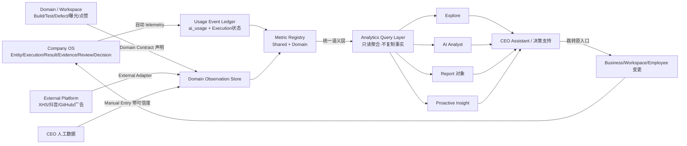
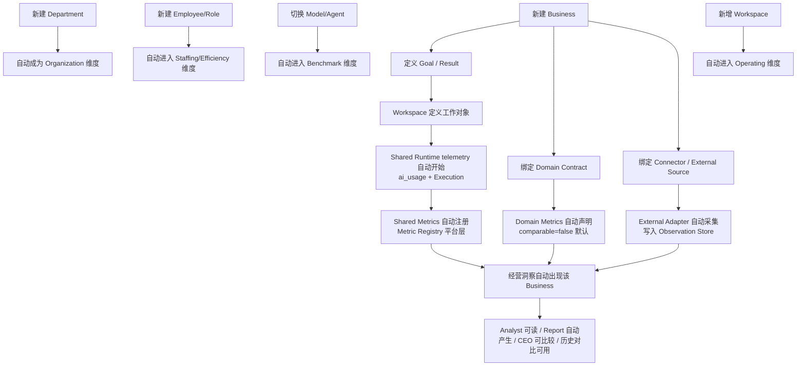

# CURIS OPERATING INTELLIGENCE / 经营洞察研究

**日期**：2026-08-18
**类型**：产品级研究（Operating Intelligence / 经营洞察体系）
**参与成员**：产品战略团队（主理人方向明 / 数析 / 竞析 / 瑞思 / 析客）
**状态**：研究完成 · STOP FOR CEO REVIEW
**Authority Class**：RESEARCH
**Disposition**：CONSUMED BY CURRENT PRODUCT TRUTH（Product Blueprint 5.3 / Master Map 3.0 / UI Blueprint）

> **Current disposition note:** 本文保留研究过程与当时的方案比较；其中“是否第七导航”等旧建议已由 CEO 最终 Delta 收口为“经营洞察是第七个一级产品空间”。本文不覆盖 Current Authority。

> ⚠️ 团队协作说明：本轮环境未提供 `TeamCreate` 原语，`Agent` 工具被团队门禁整体拦截，无法拉起专家子团队。主理人方向明按四位专家的分析视角（数据审计 / 竞品研究 / CEO 视角 / 产品综合）直接执行研究并汇编，保留"专业分析 + 主理人编排"的协作实质。所有结论均基于真实文件证据，未修改任何 Current Product Truth。

---

## 1. Executive Summary（执行摘要）

**核心目标**：研究 Curis 运行一家公司后，"数据 → 分析 → 经营研究 → 报告 → CEO 决策支持"应如何成立，并回答"新增一个完全不同的 Business 能否零代码进入经营洞察"。

**关键发现**：
- Curis 的**组织事实层（Company/Business/Workspace/Employee/Role/Capability/Task/Execution/Result/Review…）已经真实存在并可读投影**；但**经营洞察（Insights）目前只是已恢复的产品能力设计，其数据采集与运行时并未交付**（CURRENT_STATE 2026-08-18 明确："不代表 Insights 数据采集或运行时已交付"，XHS Analytics 仍 `UNAVAILABLE / no data`）。
- **Shared Metrics 的 Runtime 地基已经部分存在**：`ai_usage` 权威用量账本 + `UsageMeterService`（只读聚合）已能按 `capability_type / source / model / employee / workflow` 分组统计 token/cost/execution，这正是多维分析与 Model Benchmark 的真实数据来源。但它是"为未来 Admin Billing 设计的只读投影"，尚无 Operating Intelligence 消费层、无 Domain Metric、无外部数据接入、无 Report 对象、无主动洞察。
- **外部业务数据基本为零**：Connector 注册表存在，但 XHS 真实发布 `NOT_CONNECTED`、Analytics `UNAVAILABLE`；外部回执/平台数据目前是 `External Source Required / Manual Only`。

**推荐方向**：将历史"数据洞察 + 经营分析"统一为 **Operating Intelligence（经营洞察）** 产品体系，**不新建第七个一级导航**，而是作为横跨 CEO 工作台 / Business / Workspace / Employee / 公司版图 / Assistant 的 **scoped 分析能力 + 一个全局 Insights 空间**（沿用 2026-08-18 Delta 的 REVIEW REQUIRED 占位）。核心引擎是 **Metric Registry（Shared + Domain 两层）+ Semantic 边界 + 基于现有 ai_usage 账本的聚合层 + Report 对象 + 主动洞察规则**，严格"不建第二套 Truth / Employee / Business"。

**最终回答（第二十节末）**：在推荐架构下，**可以**——新增 Business 自动继承 Shared Metrics，Domain Metrics 通过声明式 Contract 注册，Connector 接入后自动采集，Analyst 与 Report 自动可用，历史比较能力由统一时间维度与 Before-After 数据集保证。但前提是补齐 §25 列出的 Runtime Gaps（尤其 Domain Metric Contract、外部适配层、Report 对象、基准数据集）；**若这些 Gap 不补，答案不是"可以"**。

---

## 2. Curis Current Data Audit（当前数据审计）

### 2.1 事实层（Product Defined + Runtime Available）
Curis Company OS 已有一套完整的组织与运行事实，且 CURRENT_STATE 记录：
- `SHARED-BUSINESS-WORKSPACE-READ-MODEL-001` `IMPLEMENTED / ACCEPTED`：Company / Business / Workspace / Project / Department / Role Slot / AI Employee / Responsibility Holder / Current Executor / Artifact / Evidence / Outcome 通过**单租户/公司/工作空间作用域的只读投影**呈现。
- `SHARED-EMPLOYEE-EXECUTION-TRUST-001` `IMPLEMENTED / ACCEPTED`：Provider 回调需 `usage.task_execution` + Provider session 证据；伪造事实 fail-closed。
- `WORKSPACE-ENGINEERING` 系列 `IMPLEMENTED / ACCEPTED`：Package Domain Object 通过 `runtime_entities` 持久化，复用既有 Company OS 的 Employee/Capability/Task/Execution/Evidence/Result。

结论：**组织与运行事实真实存在**（可读、可投影），但"经营洞察消费这些事实并产生分析/报告"这一层未交付。

### 2.2 用量与成本层（Runtime Available — 部分）
后端真实存在：
- `backend/app/ai_usage.py`（AIUsageService）：权威用量账本，记录每次执行 `input_tokens / output_tokens / total_tokens / cost_amount / metering_status / capability_type / capability_source / model_gateway_id / model_name / employee_id / workflow_run_id / tenant_id`。
- `backend/app/usage_meter.py`（UsageMeterService）："Read-only Workspace usage aggregation for future Admin Billing. Compatibility projection backed by the authoritative AI usage ledger." 已支持按 capability/type/model/employee/workflow 分组聚合 token/cost/execution_count，且 tenant 作用域隔离。
- `backend/app/real_rd_executor.py`：RD 执行真实持久化 `total_tokens + estimated_cost`。
- `backend/app/evolution_event_log.py`：记录 token 用量事件。

**关键缺口**：通用 capability（`capability_adapters.py`）默认 `total_tokens: 0`，即非 RD 类型的执行尚未真实计量 → `metering_status` 可能为 `unknown`。因此 Usage/Cost 是 **Runtime Available（部分）**，非全量可靠。

### 2.3 外部与业务结果层（External Source Required / Manual Only）
- Content Growth / XHS：真实 Publishing `NOT_CONNECTED / waiting`，Analytics `UNAVAILABLE / no data`（CURRENT_STATE 2026-08-16 G2）。
- Connector / MCP 注册表存在（`MCP_Connector_Registry.md`，Review），但**没有把外部平台数据接入用量账本或分析层的适配通道**。
- 外部回执、Business 外部结果、人工补录：目前无结构化采集对象。

### 2.4 分析与报告层（Product Defined，Runtime 未交付）
- Insights 空间合同已写入 UI Blueprint（2026-08-18 Delta），Master Map 扩展 12 对象含 Insights 字段合同。
- 但 CURRENT_STATE 明确："本轮只修改产品/治理文档，不代表 Insights 数据采集或运行时已交付"。
- 无 Report 对象、无主动洞察引擎、无 Benchmark 数据集、无 Domain Metric 注册。

---

## 3. CURRENT DATA CAPABILITY MATRIX（当前数据能力矩阵）

> 分类图例：`Product Defined`(产品已定义) / `Runtime Available`(运行时真实有数据) / `Provider Available`(依赖 Provider/外部能力) / `Domain Available`(某 Domain 已声明) / `External Source Required`(需外部来源) / `Manual Only`(仅人工) / `Unknown`(未知)

| 数据项 | 分类状态 | 真实证据 | 进入经营洞察就绪度 | 备注 |
|---|---|---|---|---|
| Company / Department / Business / Workspace | Product Defined + Runtime Available | Shared Business Workspace read model `IMPLEMENTED/ACCEPTED` | 高 | 事实存在，可投影；Business↔Department 直接关系仍 `UNRESOLVED` |
| Role / Role Slot | Product Defined + Runtime Available | read model 含 Role Slot | 高 | — |
| Employee（AI_EMPLOYEE） | Product Defined + Runtime Available | Shared Employee Execution Trust；read model 含真实 AI Employee | 高 | legacy `employee_instances` 与 `AI_EMPLOYEE` 仅 exactly-identifier 桥接 |
| Capability / Skill / Connector | Product Defined + Runtime Available | Capability catalog / registry（Review） | 高 | 能力真实绑定 |
| Task | Product Defined + Runtime Available | runtime_entities Task | 高 | — |
| Execution（计数/起止/时长/成功失败/重试/等待阻塞） | Product Defined + Runtime Available | workflow_runtime / execution kernel | 中高 | 部分状态机字段真实；等待/阻塞维度需确认是否持久化 |
| Handoff | Product Defined + Runtime Available | `verify_handoff_ack` 路径存在 | 中 | Handoff 自身不创建/不转移，仅验证 |
| Review / Rework | Product Defined + Runtime Available | Artifact Review / P7 Decision | 中 | RD/XHS 有；通用工作流 Review 覆盖不全 |
| Decision / Meeting | Product Defined + Runtime Available | Curis_CEO_Decision_Pattern_Review | 中 | 决策流 Product Defined，运行时部分 |
| Result / Evidence / Outcome | Product Defined + Runtime Available | Shared Result projection；真实验证 fail-closed | 高 | 证据真实性有保证；外部回执 `UNVERIFIED` 可能 |
| Artifact | Product Defined + Runtime Available | runtime_entities Artifact | 高 | — |
| Feedback | Product Defined + Runtime Available | 业务反馈闭环（部分） | 中 | 通用 Feedback 采集不全 |
| Usage（token/cost） | **Runtime Available（部分）** | ai_usage 账本 + UsageMeterService + real_rd_executor | 中 | RD 真实；通用 capability 默认 `total_tokens:0`，`metering_status=unknown` |
| Provider session evidence | Provider Available | Shared Employee Execution Trust 回调证明 | 中 | 依赖 Provider 真实回调 |
| Model / Agent / Provider | Product Defined + Provider Available | Model_Provider_Registry（Review）+ 运行时绑定 | 中高 | 注册表存在；真实调用证据随执行产生 |
| 外部回执 / Business 外部结果 | **External Source Required / Manual Only** | XHS Analytics `UNAVAILABLE`；Connector 未接入分析层 | 低 | 无结构化采集 |
| 人工补录数据 | **Manual Only** | 无结构化 Manual Entry 对象 | 无 | 需新建（作为合法路径） |
| Domain Metrics（小红书曝光/点赞/涨粉；研发 Build/Defect…） | **Product Defined / External Source Required** | Content Growth Domain Authority（Product Defined）；XHS 无数据 | 低 | 指标定义有，数据未流进来 |
| Report / Analysis 对象 | **Product Defined，Runtime 未交付** | UI Blueprint Insights 合同 | 无 | 仅有合同，无对象/存储 |
| 主动洞察 / Alert | **Unknown** | 无 | 无 | 未设计未实现 |

**审计结论红线**：不要把"产品文档里写了 Insights/Metrics 字段"误认为"运行时已有数据"。当前只有**组织事实 + 部分 Usage 账本**是真实可用的；Domain 指标、外部数据、Report、主动洞察全部缺失。

---

## 4. Data Source Taxonomy（数据来源体系）

| 类别 | 定义 | Curis 现状 | 缺口 |
|---|---|---|---|
| **A. Shared Runtime 自动产生** | Execution/Usage/Cost/Review/Handoff/Employee/Role/Model/Agent/Provider/Capability/Result/Evidence/CEO Acceptance | 组织事实 + ai_usage 账本真实存在 | Usage 仅 RD 真实；等待/阻塞/人工干预维度待确认；无统一 telemetry 事件流 |
| **B. Domain / Workspace 自产生** | 研发 Build/Test/Defect/Release；内容 曝光/点赞/涨粉；不同 Domain 不同指标 | Domain Authority 已定义指标语义；但运行时未采集 | 无 Domain Metric 注册与采集通道 |
| **C. 外部平台** | 小红书/抖音/YouTube/GitHub/广告/CRM 通过 Connector/API/Webhook/Provider Receipt/Scheduled Pull/Browser/File/Manual | Connector 注册表存在；XHS 未连接；无分析层适配 | **外部适配层完全缺失** |
| **D. AI / Employee 分析结果** | 日报/周报/月报/异常/专项/行业/竞品/成本效率报告 | 属于 Result/Report，目前无对象 | 无 Report 对象模型 |
| **E. CEO 人工数据** | 无法自动采集时 Manual Entry | 无结构化 Manual Entry | 需新建，且必须带 source/timestamp/freshness/enteredBy/confidence/note |

**原则**：A 与 B 是 Curis 自有事实，应自动进入；C 必须经适配层；D 是 Interpretation 不是事实；E 是合法但必须标注来源与可信度。

---

## 5. Shared vs Domain Metrics（共享指标 vs 域指标）

### 5.1 Shared Metrics（跨业务稳定可比，由平台统一定义）
统一在 **Metric Registry（平台层）**，定义一次、全网一致：
- Execution Duration（起/止/时长）
- Usage / Token（input/output/total/cached/reasoning）
- Cost（estimated_cost）
- Execution Count
- Success / Failure Rate
- Retry Count
- Waiting / Blocked Time
- Review Count / Rework Rate
- Acceptance Rate（CEO 验收）
- Human Intervention Count
- Result Count / Evidence Count
- Employee Workload（按执行数/时长）
- Capability Usage（按 capability_type/source）
- Model / Agent Usage（按 model_gateway_id/model_name）

这些全部可映射到现有 `ai_usage` 账本字段 + Execution 状态机，是**真正可跨 Business 比较**的。

### 5.2 Domain Metrics（由具体业务声明，不强行统一）
- 小红书：曝光、阅读、点赞、收藏、评论、涨粉、转化
- 研发：Build success、Test pass、Defect、Review cycle、Release frequency
- 未来未知 Business：由其 Domain Contract 声明

**禁止**造一个万能 KPI Schema 把一切塞成一样。Domain Metric 通过 **Domain Metric Contract**（声明式）注册：每个指标含 `name / source(adapter) / unit / aggregation / owner Domain / freshness SLA / comparable=false(默认)`。

### 5.3 统一消费方式（Domain 仍可被统一消费）
无论 Shared 还是 Domain，统一暴露：
- 时间过滤（period / range / period-vs-previous）
- 趋势（time-series）
- 对比（跨 Business/Employee/Model）
- 来源追踪（source / adapter / raw ref）
- 报告（Report 对象消费）
- CEO Assistant（自然语言查询统一指标层）

Domain Metric 默认 `comparable=false`；只有显式声明 `comparable=true` 且单位/口径一致时才跨业务比较。这避免"拿小红书涨粉和 RD 缺陷率比大小"的错误。

---

## 6. Automatic Business Registration（新 Business 零配置进入经营洞察）

**理想流程（推荐架构下）**：
```
创建 Business
  → Business 定义 Goal / Result（Product Defined，写入 Company OS）
  → Workspace 定义工作对象与 Result / Feedback
  → Shared Runtime telemetry 自动开始（ai_usage + Execution 状态已天然记录）
  → Shared Metrics 自动注册（Metric Registry 平台层，无需配置）
  → Domain Metrics 通过 Business 绑定的 Domain Contract 自动声明
  → Connector / External Source 绑定后，外部适配层自动采集
  → 经营洞察自动出现该 Business
```
CEO **不应**再去 BI 页面执行"新建数据源 / 新建 Dashboard / 手动添加业务"。

**自动注册映射**：
- 新建 Department → 自动成为 Organization Analysis 维度（事实已存在，分析层直接读取）
- 新建 Employee / Role → 自动进入 Staffing / Efficiency 维度
- 切换 Model / Agent → 自动进入 Execution Benchmark 维度（ai_usage 已按 model 记录）
- 新增 Workspace → 自动进入 Operating 维度

**关键使能**：所有维度来自 Company OS 单一事实，分析层只是"读取 + 投影 + 聚合"，**不复制事实**，因此新对象天然可见。

---

## 7. External Data Collection（外部数据采集）

### 7.1 接入方式谱系
Connector（已注册） / API（Pull） / Webhook（Push） / Provider Receipt（执行回执） / Scheduled Pull / Browser / Employee Collection / File Import / Manual Entry。

### 7.2 Curis 当前缺口与建议
- 现状：Connector 注册表存在，但**没有"外部指标适配层"**把平台数据变成可分析的 Domain Metric。XHS 真实发布未连接。
- 建议：新增 **External Metric Adapter** 抽象——每个 Connector/外部源实现一个 `pull(domain_metric) → raw observation` 接口，写入统一的 Observation 存储（带 source/adapter/timestamp/freshness/raw_ref）。这样小红书/抖音/GitHub/广告平台各自适配，但都进入同一分析层。
- **严禁**：外部数据悄悄变成 `Verified External`；未验证回执保持 `UNVERIFIED`。

---

## 8. Metric / Result / Goal 关系

```
Business Goal
  ↓ 可量化则绑定 Metric / Observation
Metric / Observation（事实量度）
  ↓
Actual Data（真实采集值）
  ↓
Result（执行/业务结果，可含外部结果）
  ↓
Analysis（AI/Analyst 解读）
  ↓
Decision（CEO）
```

**关键辨析**：
- **Goal 不一定需要 Metric**：定性 Goal（如"建立品牌信任"）靠 Review/Evidence/CEO 判断，不强制 KPI 化。禁止把所有 Business 都 KPI 化。
- **Metric ≠ Result**：Metric 是量度（如曝光 1000）；Result 是执行/业务产出（如发布成功、外部转化）。外部 Result（平台涨粉）与内部 Execution Result（任务完成）必须区分来源。
- **事实 vs AI Interpretation**：Actual Data / Result = 事实；Analysis / Report 的 Interpretation = AI 推断，必须标注且与事实分离、可溯源。
- **自动判断 vs CEO Acceptance**：Success/Failure/Usage 可自动；Quality/Value/战略意义必须 CEO Acceptance（不自动判定业务价值）。

---

## 9. Multi-dimensional Analysis Model（多维分析模型）

### 9.1 维度清单（来自 Company OS 单一事实）
Company → Department → Business → Workspace → Role → Employee → Team → Workflow/Work Stage → Model → Agent → Provider → Capability/Skill/Connector → Result → External Account/Channel → Time。

### 9.2 操作语义
- **filter**：按任意维度筛选
- **group**：按维度分组聚合
- **compare**：跨维度值比较（如两 Business 的 Cost）
- **drill-down**：Company→Business→Workspace→Execution
- **cross-filter**：在 Dashboard 选中某 Employee，其他图同步过滤
- **segment**：按维度切片（如按 Model 分段看 Duration）
- **timeline / period comparison**：当前 vs 上周期 / Before-After

### 9.3 危险组合（不能随便组合，否则错误结论）
- 把 `total_tokens` 跨不同 Role/Task Type/Input Size 直接比较 → 必须控制可比维度（见 §10）。
- 把 Domain Metric（涨粉）与 Shared Metric（Cost）直接做"效率比"而无口径对齐。
- 跨时区时间戳未归一就做日环比。
- 把 `metering_status=unknown`（total_tokens=0）的执行计入 Cost 趋势 → 会假性为 0。
- Business 复制（Duplicate）后把原 Business 历史与本 Business 混计 → 必须按独立 Business Identity 隔离。

---

## 10. Model / Agent Benchmark（模型/智能体基准）

### 10.1 为什么需要
同一"小红书策划师"长期执行相似任务；切换 GPT/Claude/Gemini 后，必须能比较 Duration/Token/Cost/Tool usage/Retry/Failure/Human intervention/Rework/Review pass/CEO Acceptance/Result Quality/External Business Result。

### 10.2 Task Comparability（可比性保证）
比较前必须锁定可比维度：**Role / Task Type / Workflow Stage / Business / Input Size / Complexity / Context / Capability**。只有这些一致的样本才进入同一 Benchmark 数据集。

### 10.3 禁止的错误结论
- "Token 少 = 模型更好" ❌（可能质量差、返工多）
- 无依据"模型排行榜" ❌

### 10.4 正确呈现（示例）
> Claude 在"小红书选题策划"中成本低 18%、一次通过率高 12%，但平均耗时高 8%。

基于 **Benchmark Dataset**（可比样本集合）+ 多维指标联合呈现，而非单一排序。现有 `ai_usage` 账本已按 model 记录，是 Benchmark 的真实数据源。

---

## 11. Business / Department / Organization Analysis（经营分析框架）

| 分析类型 | 内容 | 自动 vs 人工 |
|---|---|---|
| Company Analysis | 整体运行/成本/产出/风险/成长 | 大部分可由 Shared Metrics 直接计算；风险判断需 Analyst |
| Business Analysis | 目标/投入/效率/结果/异常/趋势 | Shared + Domain Metrics；异常解读需 Analyst |
| Department Analysis | 承担/资源/表现/组织效率 | 来自组织事实 + 执行聚合 |
| Organization Analysis | Role/Staffing/Capacity/Vacancy/Workload/协作/瓶颈 | 事实聚合；瓶颈诊断需 Analyst |
| Employee Analysis | 工作量/效率/质量/成本/返工/跨 Role 表现 | 事实聚合 |
| Model/Agent Analysis | 不同模型在不同工作的效果 | Benchmark（§10） |
| Capability Analysis | Skill/Connector/Tool 是否改善结果 | 事实 + 前后对比 |
| Workflow Analysis | 哪阶段耗时/失败/返工/等待最多 | 事实聚合 |
| Industry/External Research | 行业/竞品/政策/外部环境 | **必须由 Research Employee 完成**，非数据直接计算 |

**红线**：Industry/External Research 不是 Dashboard 能自动产生的；它属于 D 类（AI/Employee 分析结果），是 Result/Report，不是原始事实。

---

## 12. Analysis Report System（分析报告体系）

### 12.1 Report 作为 Result / Asset
Report 是带结构的 Result 对象，至少包含：`Scope / Period / Source / Facts / Interpretation / Unknown / Evidence / Findings / Recommendation / Author Employee / Model-Agent provenance / Created At`。

### 12.2 报告类型
Daily Brief / 周报 / 月报 / Business Report / Department Report / Cost Efficiency Report / Model Benchmark Report / Anomaly Report / Industry Research / Competitor Research / Custom Analysis。

### 12.3 自动生成示例
```
每天 00:00
  → 指定 Analyst Employee（如"小红书数据分析师"）
  → 自动读取当天经营数据（Shared + Domain Metrics）
  → 产出《小红书经营日报》
  → 保存为 Result / Asset（带 provenance）
  → 经营洞察出现
  → CEO Assistant 汇报
  → CEO 查看
```

### 12.4 红线
- AI 报告**不能冒充原始事实**：Facts 与 Interpretation 分离，Unknown 必须明示。
- 报告必须能追溯到原始数据（source / raw_ref）。
- Report 对象是 Curis 当前**完全缺失**的能力（Product Defined 未交付）。

---

## 13. BI Employee / BI Department Growth Model（BI 组织成长模型）

**不预设必须存在 BI Department**。组织由真实责任与工作量长出来：

| Stage | 形态 | 触发 |
|---|---|---|
| 1 | CEO 自己查看数据 + CEO Assistant 解释 | 初始 |
| 2 | 某 Business 自己配置数据分析 Role | 单业务需要 |
| 3 | 多个 Business 重复需要数据分析 | 共性出现 |
| 4 | 形成 Shared Analyst / BI Team（跨业务服务） | 复用需求 |
| 5 | 正式 BI / Operating Intelligence Department | 规模与责任固化 |

**关系与责任流转**：
- Shared Analyst 服务多个 Business：通过"被指派的分析任务"消费统一指标层，不拥有数据。
- 报告归属：Report 的 `Author Employee` 是产出它的 Analyst；但数据归属原 Business（不复制）。
- **禁止**为页面先创建 BI Department Primitive；Department 只能由真实责任长出。

---

## 14. Proactive Insight（主动洞察）

Curis 应能主动发现：成本突升 / Result 下降 / Failure 增加 / Review 返工增加 / Employee 持续阻塞 / Role 过载 / 空岗影响 Business / Model 切换后效果下降 / External Metric 异常 / Business 持续偏离 Goal。

### 14.1 检测方法适配
| 方法 | 适用 | 不适用 |
|---|---|---|
| **Threshold（阈值）** | 成本上限、失败率红线 | 无历史基线的新指标 |
| **Trend（趋势）** | 持续 N 日下滑/上升 | 噪声大的短窗口 |
| **Baseline（基线）** | 同环比偏离预期区间 | 业务本身剧烈波动期 |
| **Statistical anomaly（统计异常）** | 分布突变（z-score/IQR） | 样本不足 |
| **Rule（规则）** | 明确业务规则（如空岗超 X 天） | 需上下文判断的软信号 |
| **AI interpretation（AI 解读）** | 在以上触发后做归因叙事 | **不能**作为唯一发现机制 |

### 14.2 红线
- **禁止用 AI 随便生成 Health Score**：Health Score 若无明确、可追溯的构成公式，就是"看似合理实则无据"。
- AI 解读必须带来**可追溯证据**（哪些指标、哪些样本触发），否则不展示。

---

## 但经营洞察本身不能成为第二套 Business Editor。

---

## 15. CEO Decision Loop（CEO 决策支持闭环）

```
Data → Signal/Anomaly → Analysis → Insight → Report
  → Recommendation → Meeting/DecisionPacket → CEO Decision
  → Business/Organization/Workspace Change → 新的 Data
```

经营洞察发现问题后，CEO 可：
查看来源 / 打开 Business / 找责任 Employee / 请求专项分析 / 与 Analyst 对话 / 召开 Meeting / 创建 Decision / 调整 Strategy / 调整 Workflow / 调整 Role-Staffing / 更换 Model-Capability / 继续观察。

**红线**：经营洞察是"看与问与建议"的层，**不是操作台**；修改 Business/Workspace/Employee 必须回到对应真实入口，经营洞察只提供跳转与上下文。

---

## 16. Data Truth / Freshness / Governance（数据真实性与治理）

必须治理的维度：`Source / Freshness / Timestamp / Timezone / Missing / Unknown / Manual Entry / Verification / Duplicate / Late Data / Revision / Historical correction / External API failure / Connector revoked`。

**硬性规则**：
- 人工填入的数据**不能悄悄变成 Verified External Data**；Manual Entry 必须带 `enteredBy / confidence / note / freshness`。
- AI 推断（Interpretation）与 Fact 必须分离存储与展示。
- 报告必须能追溯到原始数据（raw_ref / source）。
- 外部 API 失败 / Connector 撤销 → 该 Domain Metric 标记 `stale / unavailable`，不编造。
- Late Data / Revision：保留版本与时间戳，不允许静默覆盖历史。

---

## 17. Historical Comparison / Before-After（历史与时间）

支持：Current / Daily / Weekly / Monthly / Quarter / Custom / Period vs Previous / Before-After Change。

**Before-After 是 Curis"自进化"的数据基础**：例如文案岗更换 Model：
```
Before 30 executions（原 Model）
After 30 executions（新 Model）
→ Cost / Duration / Review / Result 对比
```
实现依赖：统一时间维度 + Benchmark Dataset（锁定可比维度）+ 变更事件标记（如 `model_switch_event`）。无此基础则无法判断"换模型是否更好"。

---

## 18. Future Business Extensibility（未来业务扩展验证）

用三个完全不同 Domain 验证设计：
1. **Content Growth（小红书/抖音）**：Shared Metrics 直接可用；Domain Metrics 由 Content Growth Domain Contract 声明；Connector 接入后 External Adapter 自动采集；Analyst 可读；Report 自动产生；CEO 可比较。
2. **Software Development（Curis 研发）**：Shared Metrics + RD Domain Metrics（Build/Test/Defect）；已有真实 Usage 账本。
3. **全新未知 Business（假设未来安装不存在的 Business Package）**：通过 Package Domain Schema 声明 Domain Metrics → 自动注册 → Connector 接入 → 自动分析。删除/暂停/Duplicate 后历史仍按独立 Business Identity 正确隔离。

**判定**：只要 Domain Metric Contract + External Adapter + 统一指标层就位，**每新增一个 Business 不需要修改经营洞察代码**。反之，若这些缺失，方案失败。

---

## 19. Competitor / Open-source Research（竞品与开源研究）

### 19.1 关键产品模式
| 产品 | 类别 | 借鉴点 |
|---|---|---|
| Power BI Copilot | BI+AI | NL→DAX、报告叙述、MCP 接入语义模型；**教训**：曾因错误 JOIN 产生"看似合理实则错误"数字 → Curis 必须 Fact/Interpretation 分离 |
| Tableau Pulse / Inspector | BI+AI | **主动**指标监控与异常预警，进入工作流（Slack/邮件） |
| Tableau Agent / Einstein | BI+AI | 可信 AI 响应、计算解释透明 |
| ThoughtSpot Sage | 搜索式 BI | NL 搜索准确率 92%+；多轮对话；适合非技术用户 |
| Looker / LookML | Semantic Layer | 指标定义在 BI 内，但非组织级 |
| Cube / dbt MetricFlow / Malloy / AtScale | Semantic Layer | **"one metric, one definition"**：指标即代码、单一真源、AI 代理 grounding；MCP-native（Data Workers/Beehive）让 AI Agent 直连治理后指标 |
| Mixpanel / Amplitude / PostHog | Product Analytics | 事件模型、漏斗、留存、分组；适用于 Product 行为，不直接适用 Company OS |
| ThoughtSpot / Sigma / Domo / Qlik | Executive BI | 高管视图、治理、嵌入 |
| Decision Intelligence（Palantir Ontology、Energent、Tellius、Pyramid） | DI | 从"问数"到"决策闭环"；Ontology = 业务数字孪生，映射 Curis Company OS |
| FineBI NEXT / 数猎 Data Neo / 衡石 | 国内 Agentic BI | 三级溯源、置信度评分、行业分析框架、报告可审计 → Curis Report 对象参考 |

### 19.2 行业趋势（2026）
- Gartner：到 2027 年 60%+ 企业将"NL→自动化行动"作为 ChatBI 采购关键。
- Agentic BI 取代单纯 NL2SQL：自动归因、异常预警、What-if、报告生成。
- **可验证性成为准入门槛**：可追溯、可审计、可验证是底线，不是加分项。
- Semantic Layer 成为 AI Agent 消费数据的地基（无 grounding，LLM 会瞎查）。

### 19.3 对 Curis 的明确警告
- 不要照搬重型自助建模 BI（对一人公司过重）。
- **绝不**让 AI 解读伪装成事实（Power BI Copilot 前车之鉴）。
- 借鉴 Semantic Layer 的"单一指标定义"思想，但 Curis 的"语义层"应建在 Company OS 事实上，而非另建数仓。

---

## 20. Product Option A / B / C（UI 信息架构候选，仅研究）

### Option A — Analytics-first（仪表盘/探索为核心）
- CEO 第一眼：Dashboard 网格。深入分析：Explore/拖拽。Business scoped：Business 维度过滤。Employee/Model scoped：维度切片。Report 进入：侧栏列表。Assistant 协作：附加。
- 优点：信息密度高。缺点：普通用户门槛高；CEO 不想先见图表。大公司表现好，普通用户复杂。

### Option B — Analyst-first（AI Analyst + Report 为核心）
- CEO 第一眼：今日简报 + 异常。深入分析：与 Analyst 对话。Business scoped：对话上下文。Employee/Model scoped：提问。Report 进入：对话产出即 Report。Assistant 协作：核心。
- 优点：CEO 友好、主动。缺点：可信度依赖 Fact/Interpretation 分离；易被误读为"AI 替我决策"。大公司偏轻，普通用户友好。

### Option C — Hybrid Operating Intelligence（Dashboard + Explore + Analyst + Report + Decision Support）
- CEO 第一眼：结论型首页（异常/简报/待处理）+ 按需下钻。深入分析：Explore + Analyst 双通道。Business scoped：Business 分析主页。Employee/Model scoped：剖面页。Report 进入：资产库 + 自动推送。Assistant 协作：贯穿。
- 优点：兼顾主动与探索、CEO 与普通用户。缺点：实现最重、需分阶段。
- **大公司与普通用户均适配**。

### 推荐
**Option C（Hybrid Operating Intelligence）**，但**分阶段**：先打通 Shared Metrics + 结论型首页 + Report（B 的骨架），再补 Explore 与 Benchmark（A 的能力）。

---

## 21. Recommended Product Model（推荐产品模型）

**统一品牌**：**Operating Intelligence / 经营洞察**——吸收历史"数据洞察 + 经营分析"为一个体系，不分裂。

**组成**：
1. 结论型首页（CEO 第一眼：异常/简报/待处理/下一决定）
2. 多维 Explore（filter/group/compare/drill-down/cross-filter）
3. AI Analyst（对话式分析 + 归因 + 报告生成，Fact/Interpretation 分离）
4. Report 资产库（日报/周报/专项/基准报告，可溯源）
5. 主动洞察（阈值/趋势/基线/统计/规则触发 + AI 叙事）
6. 决策支持闭环（跳转原入口，不替代 Business Editor）

**核心引擎**：Metric Registry（Shared + Domain）+ 基于 ai_usage 账本的聚合层 + External Adapter + Report 对象 + Benchmark Dataset + Governance 字段。

---

## 22. Recommended Data Architecture（推荐数据架构）

```
Company OS（单一事实：Entity / Execution / Result / Evidence / Review / Decision）
   │  自动产生
   ▼
Usage Event Ledger（现有 ai_usage，扩展 metering 全覆盖）
   + Execution Telemetry（状态/时长/等待/阻塞/人工干预）
   + Domain Observation Store（External Adapter 写入，带 source/freshness/raw_ref）
   + Manual Entry Store（enteredBy/confidence/note）
   │
   ▼
Metric Registry（Shared 平台定义 + Domain Contract 声明）
   │  统一语义层（one metric one definition）
   ▼
Analytics Query Layer（读 ai_usage 式聚合；不复制事实）
   │
   ▼
Explore / Analyst / Report / Proactive Insight / CEO Assistant
```

**原则（铁律）**：
- 不建第二套 Truth（分析层只读 Company OS + Ledger）
- 不建第二套 Employee / Business（维度全部来自 Company OS）
- 不为 Analytics 复制事实（只投影/聚合）
- 指标定义单一（Metric Registry），AI 消费同一层

**是否需新建**（对照现有 Runtime）：
- Metric Registry / Domain Metric Contract：**缺失**，需建（声明式，不复制事实）
- Usage Event aggregation：**已有** UsageMeterService，扩展即可
- Time-series storage：**部分**（ai_usage 有时间戳，需补时间序列查询）
- Semantic Layer：**需建**（轻量，基于 Metric Registry，不建数仓）
- Materialized aggregate：可选（先靠查询，量大再物化）
- Event pipeline / External metric adapter：**缺失**，需建
- Analytics query layer：**部分**（UsageMeter 雏形）
- Report object：**缺失**，需建
- Scheduled analysis：**缺失**，需建（每日/周/月触发）
- Benchmark dataset：**缺失**，需建（可比样本集合）

---

## 23. Navigation Recommendation（导航结论，仅 Recommendation）

研究命名心智：
- 数据洞察 → 偏"看数"
- 经营分析 → 偏"分析解读"
- 经营洞察 → 偏"结论+主动"，最契合 Operating Intelligence
- Operating Intelligence → 国际通用，但中文用户心智弱
- Business Intelligence → 易被理解为传统 BI，不符

**推荐**：统一叫 **经营洞察（Operating Intelligence）**。

**导航归属（只能 Recommendation，不修改 Frozen 六区）**：
- **不**作为第七个一级导航（六区 Frozen，Workspace 语义仍 REVIEW REQUIRED）。
- 作为**全局 Insights 空间 + 多处 scoped 入口**：CEO 工作台（异常/简报/待处理）、Business 详情（Business 分析）、Workspace（Operating）、Employee 剖面（效率/质量）、公司版图（组织分析）、Assistant（对话式分析）。
- 研究阶段曾保留 `NAVIGATION PLACEMENT — REVIEW REQUIRED` 占位；该问题已由 CEO Final Product Architecture Delta 收口为经营洞察第七个一级产品空间。

选项：**D（Global Product Space 但不固定导航）/ C（Business Space 跨业务分析）混合**——即全局 Insights 空间 + 各上下文 scoped 入口，不占一级导航。

---

## 24. What NOT to Build（不要建什么）

- ❌ 第二套 Truth / Result / Analytics Runtime（CURRENT_STATE 已裁定）
- ❌ 第二套 Employee / Business / Company（维度必须来自 Company OS）
- ❌ 万能 KPI Schema（强行统一所有 Domain 指标）
- ❌ 为页面先创建 BI Department Primitive
- ❌ 擅自决定第七个一级导航
- ❌ 用 AI 生成无依据 Health Score
- ❌ AI 解读伪装成事实
- ❌ 重型自助建模 BI（对一人公司过重）
- ❌ 把经营洞察做成第二套 Business Editor
- ❌ 每新增 Business 就改经营洞察代码（必须靠 Contract 自动注册）
- ❌ 不修改 Product Blueprint / Master Map / UI Blueprint / Frozen Authority / Runtime / Schema / Database / 产品代码 / 高保真（本轮约束）

---

## 25. Authority / Runtime Gaps（权威与运行时缺口）

| Gap | 现状 | 是否阻塞"零配置新增 Business" |
|---|---|---|
| Domain Metric Contract | 缺失（仅 Product Defined） | **阻塞** Domain 指标自动注册 |
| External Metric Adapter | 缺失 | **阻塞** 外部数据自动采集 |
| Report 对象 | 缺失 | 阻塞报告体系（不影响基础数据） |
| Benchmark Dataset | 缺失 | 阻塞 Model Benchmark 严谨比较 |
| Usage metering 全覆盖 | 仅 RD 真实，通用 capability=0 | 部分阻塞（Cost 趋势假性为 0） |
| Manual Entry 对象 | 缺失 | 阻塞 CEO 人工数据合法路径 |
| Scheduled Analysis | 缺失 | 阻塞自动日报/周报 |
| Proactive Insight 引擎 | 缺失 | 阻塞主动洞察 |
| Business↔Department 直接关系 | 数据未解析 | 影响组织分析粒度（需 Authority 决策） |
| Workspace↔Department 关系 | UNRESOLVED | 同上 |
| Operating Team 身份/生命周期 | CORE GAP（NOT VERIFIED） | 影响 Team 维度分析 |

**结论**：基础 Shared Metrics 已具备 Runtime 地基（ai_usage + UsageMeter），但 Domain 指标、外部适配、Report、基准、人工补录、主动洞察全部缺失。要回答"新增 Business 能否零代码进入"，**必须先补 Domain Metric Contract + External Adapter + Metric Registry 消费层**；否则只能进入 Shared Metrics 部分，Domain 与外部数据仍空缺。

---

## 26. CEO Decisions Required（需 CEO 决策）

1. **命名与心智**：是否采纳"经营洞察 / Operating Intelligence"统一历史"数据洞察 + 经营分析"？
2. **导航归属**：是否接受"全局 Insights 空间 + 多处 scoped 入口、不占第七一级导航"？（REVIEW REQUIRED 待决）
3. **Domain Metric Contract 机制**：是否批准"Business Package 声明式注册 Domain Metrics"作为零配置扩展的基础？
4. **外部数据策略**：是否优先接入哪类 Connector（小红书/抖音/GitHub/广告）作为首个 External Adapter 验证？
5. **人工补录合法化**：是否接受 Manual Entry 作为"无法自动采集时的合法路径"（带可信度标注）？
6. **组织成长路径**：是否同意 BI 能力按 Stage 1→5 由真实责任长出，不预设 BI Department？
7. **主动洞察红线**：是否确认"禁止无依据 Health Score、AI 解读须带可追溯证据"？
8. **补 Runtime Gaps 的优先级**：是否授权在下一阶段补齐 §25 所列缺失（尤其 Domain Contract + External Adapter + Report 对象）？

---

## 附图 A：DATA FLOW MAP（数据流图）



## 附图 B：AUTO-ONBOARDING MAP（自动接入图）



---

## 最终回答（必须的一句）

> **如果明天给 Curis 新增一个完全不同的新 Business，是否可以在不修改经营洞察产品代码的情况下，自动获得基础经营数据、Domain 指标、分析入口和历史比较能力？**

**答案：在推荐架构（§21/§22）下——可以，但有前提。**

- **基础经营数据（Shared Metrics）**：✅ 现已具备 Runtime 地基（ai_usage 账本 + UsageMeterService + Execution 状态），新 Business 天然继承，无需改代码。
- **Domain 指标**：⚠️ 需 **Domain Metric Contract**（声明式注册）就位——这是缺失项（§25），补上后新 Business 的 Package 自带指标声明，零代码。
- **外部数据**：⚠️ 需 **External Metric Adapter** 就位——缺失项，补上后 Connector 接入即自动采集。
- **分析入口 / 历史比较**：✅ 维度全部来自 Company OS 单一事实，分析层只读投影，新对象天然可见；Before-After 依赖 Benchmark Dataset（缺失，需补）。

**结论**：只要补齐 §25 的 Domain Metric Contract + External Adapter + Metric Registry 消费层 + Report/Benchmark/Scheduled Analysis，**答案为"可以"，且每新增 Business 不修改经营洞察代码**。若这些 Gap 不补，**答案不是"可以"**——Domain 指标与外部数据仍将空缺，只能进入 Shared Metrics 部分。

---

**研究完成 · STOP FOR CEO REVIEW**

> 本报告为产品级研究，未修改任何 Current Product Truth（Product Blueprint / Master Map / UI Blueprint / Frozen Authority / Runtime / Schema / Database / 代码 / 高保真均未改动）。所有结论待 CEO 审定。
