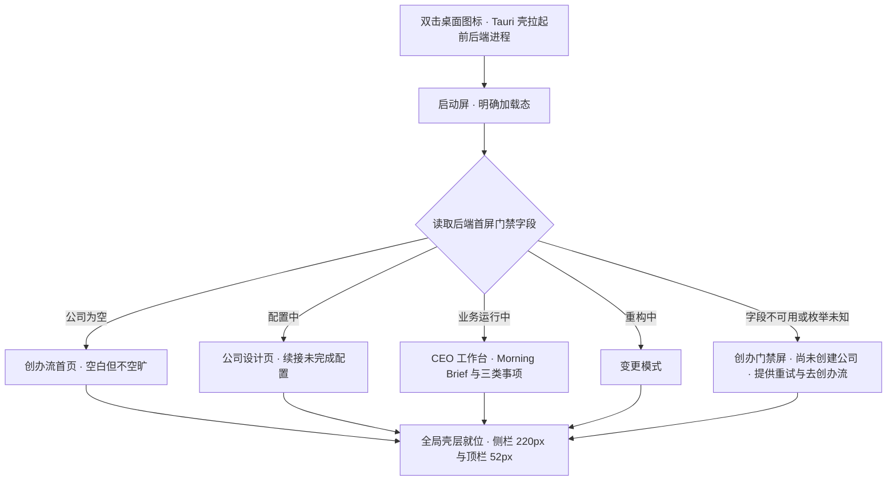
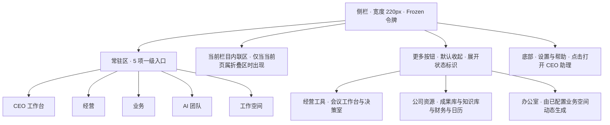
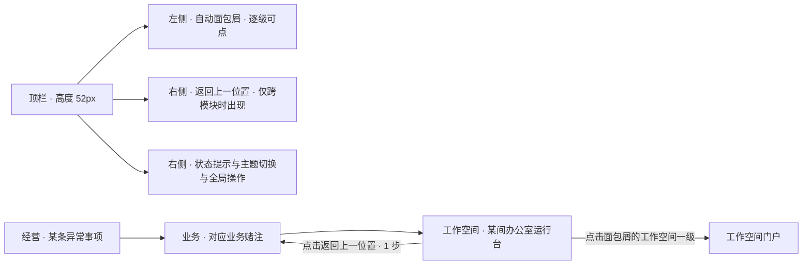
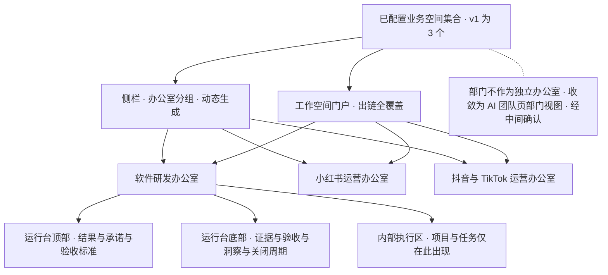
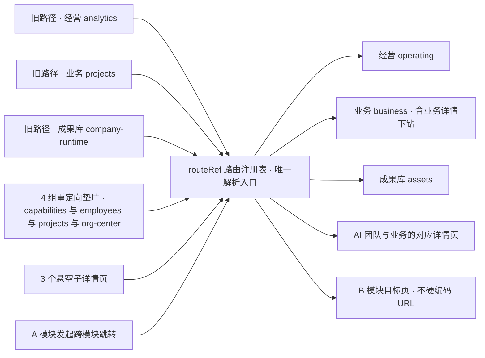
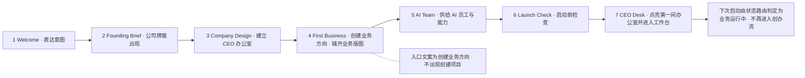
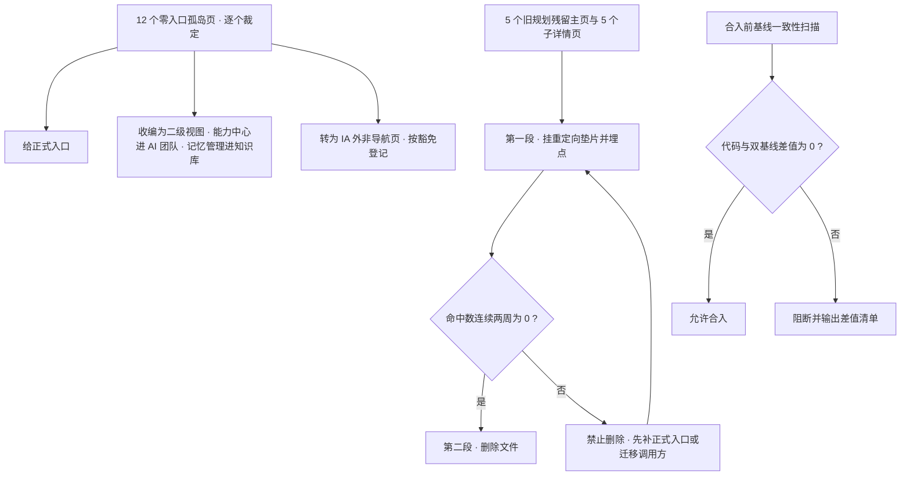

# Curis UserStory · 全局壳层与信息架构层

> 本文档为《AICoding 架构设计》核心产物之一，定位为**产品需求与用户故事（UserStory）**。
> 上游输入：《高层架构设计 · IA 动线诊断报告》（G3 已通过，唯一上游边界基线）+ `material_digest.md`（G1 已通过）+ `research_report.md`（G2 已通过）；
> 下游输出：驱动《部署设计》《安全设计》的具体功能实现，并与并行产出的《系统设计》共享同一份角色、场景与功能边界。
>
> **本期定位**：本期是 IA 动线诊断之后的**整改需求**，不新建业务系统。全文严格限定在 Curis 全局壳层与信息架构层，对齐高层架构设计 §6.3 功能清单 F1 至 F14、非功能 N1 至 N3，以及 §6.6.2 的 26 行存废裁定。
>
> **越权声明**：本文不定义模块接口、数据传输对象与数据库表结构（归 `system-architect`）；不出部署方案、灰度发布策略与安全最终方案（归 Phase 5）；不重新设计模块边界与角色范围（归 `business-architect`，本文全部角色与边界均为继承）。

---

## 0. 元信息：修订记录

```yaml
标题: Curis - UserStory（全局壳层与信息架构层） v0.1
版本: v0.1
状态: Approved          # Draft | Reviewing | Approved | Deprecated
创建日期: 2026-08-07
最后更新: 2026-08-07
作者: product-story-designer（顾全景 / 产品故事师）
评审人:
  - 齐构成（主理人 / 结构检查与自动校验）
  - 用户 / CEO（G4 人工审核终审）

阶段: Phase 4 并行系统设计与 UserStory
阶段门: G4（中游设计审核）
工作区根目录: /Users/yy/Documents/Curis AI Workspace

关联文档:
  上游输入:
    - 高层架构设计: .workbuddy/output/高层架构设计.md（G3 已通过，唯一上游边界基线）
    - 资料摘要: .workbuddy/output/material_digest.md（G1 已通过）
    - 行业调研报告: .workbuddy/output/research_report.md（G2 已通过）
    - 中间确认协议: skills/aicoding-team-bootstrap/protocols/intermediate_confirmation.md
  并行产出:
    - 系统设计: 由 system-architect 在同一 Phase 4 并行承接
  下游产出:
    - 部署设计 / 安全设计: 待 G4 通过后由 Phase 5 承接
```

| 版本 | 日期 | 作者 | 变更内容 | 评审状态 |
| --- | --- | --- | --- | --- |
| v0.1 | 2026-08-07 | product-story-designer（顾全景） | 初稿。按模板 §1 至 §6 骨架产出：业务背景与价值、范围与边界、功能清单（F1 至 F14 与 N1 至 N3 与高层架构 §6.3 一一对应）、6 类角色与 10 条关键场景、7 条 UserStory 各按七段式完整展开、非功能性需求四节。U-04 已按用户裁决固化为方案 B（v1 办公室 3 间）。§6.2 性能取值方式命中中间确认协议 §2.1 与 §2.2，已发起论题 U-05 并 A/B 并陈 | Draft |
| v0.2 | 2026-08-07 | product-story-designer（顾全景） | 最终化。U-05 经主理人裁决为方案 A（相对基线型），§6.2 改为相对基线口径（P50/P90 相对首版/历史基线衡量，不设绝对 SLA 阈值、不写具体毫秒数，注明绝对阈值待运营数据回填后补），标注「经中间确认」，解除 §6.2 阻塞；全文 decision 由「暂挂」改为「UserStory 冻结，可进入 Phase 5 部署与安全设计」；附录 B 补 U-05 裁决行。状态置 Approved | Approved |

---

## 1. 业务背景与价值

### 1.1 业务背景

**当前业务现状（行业 / 产品 / 用户规模）**

- **行业**：面向一人公司创业者的 AI 公司经营系统。Curis 帮助一位真实 CEO 从零创建公司，由 AI 员工承担责任、执行业务、提供证据，并根据真实世界结果持续经营（`material_digest` D1，§首屏）。
- **产品**：Curis 已具备三层资产 —— 结构基线（产品蓝图 v4.4，状态 Review）、UI 基线（Frozen 交付规格 + 设计令牌 + 20 页高保真原型 + 导航真源），以及已落地的 50 个前端路由（实然形态，非基线）。
- **用户规模**：v1 为 Local Desktop 单 CEO 验证阶段，单机单 Company，**唯一真实用户为 1 人**，无多租户、无多真实员工协作、无外部访问入口（高层架构 §4.2）。因此本文全部「频率」与「并发」口径均按单用户桌面场景表述，不按 SaaS 口径表述。

**触发本次需求的事件（痛点修复，非新场景）**

CEO 实际使用后提出：「目前的 app 使用下来，动线非常不流畅，各个模块之间有很强烈的割裂感」。随后在 Phase 0 亲自裁定问题重点：「把现在的架构和过去旧的产品结构混淆在一起了。正确的做法是，以产品蓝图和结构参考，以确定 ui 为 ui 参考，去组合完整的产品形态，旧的页面或者结构可以舍弃，不要被之前旧的前端所干扰」（`material_digest` §0 用户诉求原文）。

高层架构设计已完成根因判定：割裂感不是单个页面做得不好，而是**同一套界面上同时运行着两套互相矛盾的信息架构** —— 一套来自旧规划（任务与工作流中心、项目为根、执行工作台），一套来自现行双基线（公司经营系统、业务空间为根）。两套 IA 没有被切换而是被叠加（高层架构 §2.2.1，四条根因支链）。本期 UserStory 的全部内容，就是把这条根因结论翻译成 CEO 可以逐条走通、逐条验收的产品行为。

**本系统在产品矩阵中的位置**

本系统是 **Company Runtime 的全局壳层与信息架构层**。它不生产经营内容，只决定 CEO 在经营内容之间如何移动。上游是结构基线（产品蓝图）与 UI 基线（Frozen 规格、设计令牌、导航真源），下游是五个一级经营模块、经营工具分组、公司资源分组与 CEO 助理运行体（高层架构 §4.1、§5.2）。

### 1.2 行业方案

> 同类功能与痛点的行业标杆系统及解决方案。本节只取与本文 UserStory 直接相关的可翻译部分，完整调研见 `research_report.md`（G2 已通过 12 项硬指标）。

| 标杆系统 | 同类痛点 | 其解决方案 | 翻译到本文的哪条 US |
| --- | --- | --- | --- |
| Grafana（加权 4.70，优先借鉴） | 多插件多数据源导致导航不一致 | 后端 `GetNavTree` 唯一构建导航树，权限与特性开关在构建期过滤，前端只消费不生产 | US-2（单源导航与 5 常驻）：导航数据源恒为 1 个 |
| Grafana | 跨分支跳转后用户迷失 | 自动面包屑（由页面层级推导）+ Return to previous（一步回到来源） | US-3（面包屑与一步返回） |
| Backstage（加权 4.25，部分借鉴） | 插件之间硬编码互引 URL，路由无法安全改名 | `routeRef` / `ExternalRouteRef` / `bindRoutes` 把模块与 URL 解耦，启动时集中绑定 | US-5（路由语义归一与解耦）：改名不断链 |
| Salesforce Lightning（加权 3.80，部分借鉴） | 一级入口过多，屏效与可见性冲突 | 导航栏作为当前 App 的容器，溢出项进 More 下拉，utility bar 常驻页脚 | US-2（常驻加更多抽屉的呈现层），承载量受 NN/g 桌面端结论约束 |
| Linear（加权 3.40，否决） | 任务与工作流中心心智 | 固定 sidebar：issues 属于 projects 再到 roadmaps 与 cycles | 作为心智反面参照被排除，直接支撑 US-5 与 US-6「一级 IA 不出现以 Project 或 Task 为根的入口」 |
| NN/g 桌面端隐藏导航研究（179 名参与者、6 个网站） | 高频入口被隐藏 | 量化结论：桌面端隐藏导航较可见导航可发现性降超过 20%、任务耗时慢至少 39%、任务难度增加 21%；桌面端应避免隐藏导航 | US-2 的 AC 依据：被隐藏的高频一级入口数必须为 0 |

### 1.3 方案收益与价值

| 功能模块 | 预期价值收益 | 量化标准 |
| --- | --- | --- |
| 单源导航（F1、F2） | 导航只有一份定义，任何一致性成果不会在下一次改动中被第二份数据覆盖；高频一级入口不再藏进抽屉 | 全站并存的导航数据源由 2 个降为 1 个；导航渲染器恒为 1 个；常驻一级入口由 4 个增为 5 个；被隐藏的高频一级入口由 1 个降为 0 个；到达任一常驻一级入口的点击次数由 2 次降为 1 次 |
| 心智归一（F4、F5） | URL 层不再承载与产品定义相反的旧心智，新页面不会被旧路由语义拉回去 | 一级 IA 中以 Project 或 Task 为根的入口由 1 个降为 0 个；侧栏路由语义一致率由 82.4% 提升到 100% |
| 办公室动态生成（F3） | 办公室随已配置业务空间生成，门户与侧栏两条路径口径一致，不再出现只能靠侧栏冒出的办公室 | 门户出链覆盖已生成办公室的比例由不足 100% 提升到 100%；零入链办公室由 1 个降为 0 个 |
| 孤岛治理（F6、F12） | 页面存在即可达，研发投入不再沉没在点不到的页面上 | 零站内入口的孤岛页由 12 个降为 0 个（IA 外页面按豁免登记）；越界为事实一级入口的模块由 2 个降为 0 个 |
| 路由解耦（F7、F8） | 模块之间不再硬编码互引 URL，改名与去重可以安全执行 | 单向 redirect 垫片由 4 组降为 0 组；挂在已重定向父级下的子详情页由 3 个降为 0 个；模块间硬编码互引 URL 由存在降为 0 处 |
| 防迷失（F9、F10） | 跨模块跳出后能看清自己在哪、能一步回到来源，不依赖浏览器后退 | 一级与二级页面的面包屑覆盖率由 0% 提升到 100%；回到上一位置所需操作步数由 3 步以上降为 1 步 |
| 进入前状态路由与创办流（F13） | 动线起点正确，四种公司状态各自落到正确首页；创办流不再向 CEO 展示旧心智入口 | 四种公司状态落到正确首页的准确率 100%；创办流步数补齐为 7 步；创办流中「创建项目」入口由 1 个降为 0 个 |
| 旧模块清理与基线守护（F11、F14） | 旧结构不再以新页面的形式回流，根因不会在下一个规划周期重新长出来 | 双基线均无对应的旧规划残留主页由 5 页降为 0 页；指向旧页的站内链接由 17 处降为 0 处；合入前基线差值扫描由无到有且差值不为 0 即阻断 |

### 1.4 术语清单

> 统一本文专有名词的中英文对照与含义。全部术语与《高层架构设计》《material_digest》保持一致，本文不新造术语。

| 术语 | 英文 / 代号 | 含义 | 来源 |
| --- | --- | --- | --- |
| 全局壳层 | Company Runtime Shell | 顶栏加侧栏构成的全局外壳，承载导航、面包屑与返回上一位置，不生产经营内容 | 高层架构 §4.2 |
| 信息架构层 | IA Layer | 决定 CEO 在经营内容之间如何移动的结构层，是产品结构的投影而非页面的附属物 | 高层架构 §4.1 |
| 单源导航模型 | NAV_MODEL | 全站唯一的导航真相源，五组结构：primary、tools、offices、resources、footer | `material_digest` D3，§NAV_MODEL |
| 常驻一级入口 | PERSISTENT_HREFS | 侧栏中不进折叠区、始终可见的一级入口集合。经 U-01 裁决固化为 5 项 | `material_digest` D3，§PERSISTENT_HREFS；U-01 裁决 |
| 更多抽屉 | More Drawer | 承载经营工具、公司资源与办公室分组的折叠区，默认收起，不按当前页自动展开 | `material_digest` D3，§更多抽屉 |
| 当前栏目内联 | Current Section Inline | 身处折叠区页面时，把当前页作为单个高亮项内联在常驻区下方，保证当前位置可见 | `material_digest` D3，§当前栏目内联 |
| 办公室 | Office | 单个业务空间的经营运行入口，挂在「工作空间」语义之下，不是与公司级栏目平级的产品模块 | `material_digest` D10，§3.1 |
| 业务空间 | Workspace | CEO 可从零创建的业务运行单元。v1 已确认三类：软件研发 software、小红书运营 xhs、抖音与 TikTok 运营 shortvideo | `material_digest` D1，§16 |
| 路由注册表 | routeRef Registry | 轻量路由引用注册表，模块之间通过引用而非硬编码 URL 互相跳转，新增路由必须先登记 | 高层架构 §2.5、F7 |
| 页面层级元数据 | Page Hierarchy Metadata | 各模块自行登记的页面层级信息，同时被顶栏面包屑与返回上一位置消费 | 高层架构 §5.1 |
| 面包屑 | Breadcrumb | 顶栏中由页面层级元数据自动生成、逐级可点击的路径指示 | 高层架构 F9 |
| 返回上一位置 | Return to Previous | 跨模块跳转后一步回到来源的入口，不依赖浏览器后退 | 高层架构 F10 |
| 孤岛页 | Orphan Page | 站内无任何可点击路径可达的页面。实测 12 个 | `material_digest` X12 |
| 重定向垫片 | Redirect Shim | 仅含重定向调用的 6 行路由文件，属单向重定向遗留。实测 4 组 | `material_digest` X13 |
| 绞杀者下线 | Strangler Fig | 先挂重定向垫片并埋点、命中数连续两周为 0 后删除文件的安全下线方式 | `research_report` §4.1 |
| 创办流 | Founding Flow | 从零把公司空间建起来的七步流程：Welcome、Founding Brief、Company Design、First Business、AI Team、Launch Check、CEO Desk | `material_digest` D1，§14.2 |
| 状态路由 | State Routing | 应用启动后按公司状态决定落点的根路由行为，判定字段唯一真源为后端首屏门禁字段 | 高层架构 §4.2、F13 |
| 公司状态四态 | Company State | 公司为空、配置中、业务运行中、重构中。分别对应创办流、公司设计、CEO 工作台、变更模式 | `material_digest` D1，§09 默认首页 |
| 首屏门禁字段 | ai_readiness | 后端 home/summary 返回的 first-run 判定字段，是默认首页落点的唯一真源，前端不得自行推断 | `material_digest` D8，§12 |
| 经营日 | Operating Day | CEO 每日运行对象，含 Day State、Morning Brief、Matters、Handoffs、Closeout 五字段 | `material_digest` D1，§10 |
| 经营事项 | Matters | 经营首页呈现的三类事项投影：决策 Decision、异常 Exception、机会 Opportunity | `material_digest` D1，§09 |
| 经营对象四件套 | Outcome / Commitment / Evidence / Acceptance | 办公室运行台的主导对象：结果、承诺、证据、验收。项目与任务只是内部实现手段 | `material_digest` D1，§07 |
| CEO 助理 | CEO Assistant | 每个 Company 唯一的助理运行体。不建立第二个任务系统、不静默改变公司状态、不占用固定第三栏、不进侧栏成为一级项 | `material_digest` D1，§09、§11 |
| Frozen 令牌 | Design Tokens | 已冻结的设计令牌：顶栏 52px、侧栏 220px、7 档字号、8 档间距、5 档圆角、七级层级 | `material_digest` D2，§2、§3 |
| 两级高亮语义 | exact / ancestor | 精确高亮承担唯一 aria-current 声明，祖先高亮只做视觉高亮不重复声明，避免违反 WCAG 4.1.2 | `material_digest` D3，§activeKind |
| 双基线 | Dual Baseline | 结构基线（产品蓝图）与 UI 基线（Frozen 规格加导航真源）的合称 | 高层架构 §权威链声明 |

---

## 2. 范围与边界

### 2.1 系统内模块及功能

> 一级功能清单。本节与高层架构 §6.1 In-Scope 的 14 条、§6.2 产品模块全景图的 14 个模块卡片一一对应，不增不减。

**接入层（全局壳层与进入前）**

1. **全局侧栏**：渲染 5 常驻一级入口（CEO 工作台、经营、业务、AI 团队、工作空间）与「更多」抽屉；抽屉承载经营工具、公司资源、办公室三个分组；折叠区当前页以「当前栏目」内联在常驻区下方。对应 F2、N3。
2. **全局顶栏**：承载自动生成的面包屑与返回上一位置入口；高度固定 52px。对应 F9、F10、N2。
3. **状态路由入口**：应用启动后按公司状态分流到四种默认首页之一，判定字段消费后端首屏门禁字段。对应 F13。
4. **创办流 Founding Flow**：七步把公司空间建起来，不含以 Project 为根的入口。对应 F13、F5。
5. **CEO 助理浮层**：承接跨模块上下文与底部设置、帮助入口；不进侧栏、不占固定第三栏。对应高层架构 §6.2 模块卡片「CEO 助理浮层」。

**业务能力层（本期只做入口与可达性，不重写内部业务逻辑）**

6. **CEO 工作台**：每天的默认入口与经营事项总览，事项可一步进入对应模块并一步返回。
7. **经营**：决策、异常、机会三类事项的处理落点。路由语义由 analytics 归一为 operating。对应 F4。
8. **业务**：业务赌注与结果。路由语义由 projects 归一为 business。对应 F4、F5。
9. **AI 团队**：责任与能力供给。提为第 5 个常驻入口；能力中心与部门视图收编为其二级视图。对应 F2、F12。
10. **工作空间（办公室运行台）**：门户出链覆盖全部已生成办公室；办公室由已配置业务空间动态生成。对应 F3。
11. **经营工具（会议工作台、决策室）**：属折叠区，不得自行提升为常驻。
12. **公司资源（成果库、知识库、财务、日历）**：属折叠区。成果库路由由 company-runtime 归一为 assets。对应 F4。

**基础能力层（本期新建或收敛的骨架件）**

13. **单源导航模型**：冻结为全站唯一导航真相源，删除第二份导航数据定义，渲染器保持唯一且渲染前清除历史导航残留。对应 F1、N1。
14. **routeRef 路由注册表**：模块之间通过引用而非硬编码 URL 互相跳转；4 组 redirect 垫片的重定向关系迁入注册表；新增路由必须先登记。对应 F7、F8。
15. **页面层级元数据**：各模块自行登记层级，同时被顶栏面包屑与返回上一位置消费。对应 F9、F10。
16. **孤岛治理与旧模块清理**：12 个零入口孤岛页逐个归位；5 个旧规划残留主页与 5 个子详情页按绞杀者方式灰度下线。对应 F6、F11。
17. **基线一致性守护**：合入前扫描代码与双基线的差值，差值不为 0 则阻断；旧任务流表述标注为历史版本。对应 F14。
18. **设计令牌复用**：侧栏 220px、顶栏 52px 等 Frozen 令牌只读复用，本期不改视觉。对应 N2。

### 2.2 系统外模块及功能

> 当前系统**不覆盖**的功能及其原因。本节与高层架构 §6.1 Out-of-Scope 的 O1 至 O7 一一对应，不新增也不裁剪。

| 编号 | 不做的事 | 原因 | 后续计划 |
| --- | --- | --- | --- |
| O1 | 旧规划残留页（执行工作台、头脑风暴室、战略会议室、重要汇报、运行轨迹）的功能改造或视觉重做 | 用户 Phase 0 裁定这些属于上一个规划的旧内容、旧的页面或者结构可以舍弃。它们在结构基线与 UI 基线中均无对应，改造等于给旧心智续命 | 不改造。完整版按绞杀者方式重定向后下线（F11、US-7） |
| O2 | 数据库表结构、实体字段与领域模型设计 | 属 `system-architect` 职责。本文只描述数据流转与业务含义，不定义表结构与字段类型 | 由 system-architect 在同一 Phase 4 并行承接 |
| O3 | 资源规格、运行时拓扑、环境矩阵与容量水位 | 属 `platform-architect` 职责；v1 为单机本地形态，无多环境与容量议题 | 由 platform-architect 在后续阶段承接 |
| O4 | 部署方案、灰度发布策略与安全最终方案 | 属 Phase 5 职责。本文只提出「旧路由灰度下线需埋点」的业务诉求与安全需求，不规定实现 | 由 platform-architect 与 security-architect 承接 |
| O5 | 视觉令牌、组件规格与无障碍基线的修改 | UI 基线状态为 Frozen 且已通过验收（字号 7 档、圆角 4 档、触达不足项 2 处已豁免、能力闭环 24 项全通过）；项目红线明确 v1 视觉以 Frozen 令牌为准 | 不改。本期仅消费不生产 |
| O6 | Admin 产品化、物理多租户、计费与模板商城 | 蓝图 §16 明确列为暂不建设项；项目红线明确卡的是商业化与多租户资产 | 不做。Platform 与 Control 相关页面维持在 CEO IA 之外，孤岛统计按豁免登记 |
| O7 | 完整「业务空间 App」范式的深度迁移（对象模型层面的重构） | 属产品演进而非 IA 整改，纳入本期会使范围失控 | 待本期 IA 收敛验证有效后另行立项评估 |

**补充说明（本文自身的越权边界）**：本文不定义模块接口清单、数据传输对象结构、错误码格式与数据库表；§5 各条 US 的「数据描述」只描述业务数据的流转与含义，「外部集成接口」只描述依赖方、依赖能力与失败降级要求，均不进入契约层。

### 2.3 外部依赖

| 依赖系统 | 提供方 | 依赖能力 | 接入方式 | 接口人 |
| --- | --- | --- | --- | --- |
| 产品蓝图（结构基线 v4.4） | 产品所有者兼 CEO | 一级 IA 定义、v1 业务空间清单、经营循环与不变量、创办流七步 | 文档引用加人工评审门 | R1 产品所有者兼 CEO |
| UI Frozen 规格与设计令牌 | UI 设计侧 | 顶栏 52px、侧栏 220px、7 档字号、层级与焦点规范、空态文案纪律 | CSS 变量引入，只读不改 | R5 基线守护方 |
| 导航真源 NAV_MODEL | UI 原型侧 | 五组导航模型、常驻集、办公室动态过滤规则、两级高亮语义 | 构建期导出为单份模型数据，运行时单一渲染器 | R5 基线守护方 |
| 后端首屏门禁字段 | 后端 | first-run 判定，决定默认首页落点；唯一真源，前端不得自行推断 | HTTP 接口（home/summary） | R4 实现侧 |
| Tauri 桌面壳 | 桌面构建 | 运行时拉起前端与后端进程；单机本地形态，无外部访问入口 | 进程管理 | R4 实现侧 |
| CEO 助理运行体 | 实现侧 | 跨模块上下文承接、底部设置与帮助入口、主动提示 | 事件触发（点击助理浮层触发器） | R6 CEO Assistant 责任方 |
| 外部结果源：代码托管与持续集成 | 外部平台 | 软件研发办公室的真实经营指标与证据 | 平台 API；API 不可用时由 CEO 手动验收录入 | R3 业务空间运行者 CEO |
| 外部结果源：小红书 | 外部平台 | 小红书运营办公室的真实经营指标与证据 | 平台 API；API 不可用时由 CEO 手动验收录入 | R3 业务空间运行者 CEO |
| 外部结果源：抖音与 TikTok | 外部平台 | 短视频运营办公室的真实经营指标与证据 | 平台 API；API 不可用时由 CEO 手动验收录入 | R3 业务空间运行者 CEO |

**外部依赖的统一约束**：v1 阶段外部结果源无 API 时，办公室运行台显示占位并提供 CEO 手动验收录入路径，**禁止编造数据**（`material_digest` D8，§11）。该约束在 US-4 的验收标准中作为异常路径逐条落地。

---

## 3. 功能清单

> **定位**：全景骨架表，进入「角色 / 场景 / US」之前先看到完整功能版图。
> **一致性纪律**：本表 14 条功能项与 3 条非功能项，与高层架构 §6.3 功能清单的 F1 至 F14、§6.1 In-Scope 的 N1 至 N3 **逐条一一对应**，编号、优先级、MVP 归属、完整版归属全部沿用，本文不新增功能、不调整优先级、不改变 MVP 边界。

### 3.1 功能清单结构

| 一级模块 | 二级模块 | 功能项 | 优先级（P0/P1/P2） | MVP 范围 | 完整版范围 | 备注 |
| --- | --- | --- | --- | --- | --- | --- |
| 单源导航 | 导航模型 | F1 导航模型唯一真源冻结：前端与原型共用同一份 NAV_MODEL，删除第二份独立导航数据定义；渲染器保持唯一，渲染前清除历史导航残留 | P0 | ✅ | ✅ | 对齐目标 V2；承载 US-2 |
| 单源导航 | 常驻集 | F2 5 常驻一级入口：CEO 工作台、经营、业务、AI 团队、工作空间；经营工具、公司资源、办公室进「更多」抽屉且默认收起；折叠区当前页以「当前栏目」内联在常驻区下方 | P0 | ✅ | ✅ | 对齐目标 V3；AI 团队常驻经 U-01 中间确认裁决；承载 US-2 |
| 单源导航 | 办公室生成 | F3 办公室动态生成：办公室分组由已配置业务空间按公司状态生成，取消静态恒显子项数组；门户页出链必须覆盖全部已生成办公室 | P0 | ✅ | ✅ | 对齐目标 V1；v1 办公室 3 间经 U-04 中间确认裁决为方案 B；承载 US-4 |
| 心智归一 | 路由语义 | F4 路由语义归一：经营页由 analytics 归一为 operating；业务页由 projects 归一为 business；成果库由 company-runtime 归一为 assets。旧路径以注册表重定向承接 | P0 | ✅ | ✅ | 对齐目标 V1；承载 US-5 |
| 心智归一 | 一级 IA | F5 一级 IA 去项目与任务为根：一级 IA 与侧栏中不出现以 Project 或 Task 为根的入口；创办流中「创建项目」入口移除，改为「创建业务方向」 | P0 | ✅ | ✅ | 对齐目标 V1；承载 US-5 与 US-6 |
| 孤岛治理 | 孤岛页归位 | F6 零入口孤岛页归位：12 个孤岛页逐个执行高层架构 §6.6.2 的裁定 —— 给正式入口、收编为二级视图、或转为 IA 外的非导航页 | P0 | ✅ | ✅ | 对齐目标 V4；承载 US-7 |
| 路由解耦 | 路由注册表 | F7 routeRef 路由注册表：建立轻量路由引用注册表，模块之间通过引用而非硬编码 URL 互相跳转；新增路由必须先登记 | P1 | ✅ | ✅ | 对齐目标 V5；承载 US-5 |
| 路由解耦 | 垫片迁移 | F8 双套路由垫片迁移：4 组单向 redirect 垫片的重定向关系迁入注册表；挂在已重定向父级下的 3 个子详情页一并归位 | P1 | ✅ | ✅ | 对齐目标 V5；承载 US-5 |
| 防迷失 | 面包屑 | F9 全局面包屑：顶栏面包屑基于页面层级元数据自动生成，继承导航的两级高亮语义，运行页由其代表入口作为祖先节点 | P1 | ✅ | ✅ | 对齐目标 V6；承载 US-3 |
| 防迷失 | 返回上一位置 | F10 返回上一位置：跨模块跳转后提供一步返回来源的入口，不依赖浏览器后退 | P1 | ✅ | ✅ | 对齐目标 V6；承载 US-3 |
| 进入前 | 创办流与状态路由 | F13 创办流与状态路由：补齐七步创办流；根路由改造为按公司状态分流的状态路由，判定字段消费后端首屏门禁字段 | P1 | ✅ | ✅ | 对齐目标 V1；承载 US-1 与 US-6 |
| 旧模块清理 | 残留页下线 | F11 旧规划残留页灰度下线：5 个主页与 5 个子详情页先挂重定向垫片并埋点，命中数连续两周为 0 后删除文件 | P2 | ❌ | ✅ | 对齐目标 V7；承载 US-7 |
| 旧模块清理 | 越界入口收编 | F12 能力中心收编：能力中心降为 AI 团队页下的「能力与容量」二级视图，取消其事实上的一级入口地位；记忆管理收编为知识库二级视图 | P2 | ❌ | ✅ | 对齐目标 V4；承载 US-7 |
| 基线守护 | 红线与扫描 | F14 文档红线对齐与一致性扫描：把旧任务流表述标注为历史版本并指向蓝图；合入前自动扫描代码与双基线差值，差值不为 0 则阻断 | P2 | ❌ | ✅ | 对齐目标 V1；承载 US-7 |
| 非功能 | 导航单源约束 | N1 全站导航数据源恒为 1 个，出现第二源即视为架构违规 | P0 | ✅ | ✅ | 落入 §6.1 与 US-2 的 AC；违规判定为合入阻断 |
| 非功能 | 视觉令牌约束 | N2 侧栏与顶栏尺寸严格沿用 Frozen 令牌（220px 与 52px），本期不改视觉 | P0 | ✅ | ✅ | 落入 §6.3 与 US-2、US-3 的 AC |
| 非功能 | 当前位置可见 | N3 当前所在页若属折叠区，必须在常驻区下方以「当前栏目」内联可见 | P0 | ✅ | ✅ | 落入 §6.1 与 US-2 的 AC；满足 WCAG 2.4.3 |

**一致性自检**：
- 与高层架构 §6.3 逐条比对：F1 至 F14 共 14 条，编号、功能描述、优先级、MVP 与完整版归属全部一致，无一条被改动。
- P0 = MVP 硬约束：F1 至 F6 共 6 条 P0 功能，MVP 范围列全部为 ✅，无一例外；N1 至 N3 三条非功能约束同为 P0 且全部落在 MVP 内。
- MVP 功能总数 11 条（F1 至 F10 与 F13）加 3 条非功能约束，与高层架构 §4.3 MVP 行的范围列完全一致；完整版追加 F11、F12、F14 三条。
- 每条功能项均在 §5 中有承载它的 US（映射见附录 A.2），无功能项落空。

---

## 4. 角色与场景

### 4.1 角色清单

> 本节 6 类角色全部继承高层架构 §2.1 核心角色关注点，编号、身份、关注点均不改动。本文不做角色细分（不把 R2 与 R3 拆为子角色），理由见附录 B.1 §4 自检节点。
> **重要事实**：R1、R2、R3 是**同一个自然人的三种角色态**（一人公司 CEO），界面上不做角色切换器，不产生权限差异 —— v1 为单机单 Owner 形态，无多租户（高层架构 §4.2）。

| 编号 | 角色 | 业务身份 | 主要操作 | 核心关注点 |
| --- | --- | --- | --- | --- |
| R1 | 产品所有者兼 CEO | 一人公司出资人与最终裁决者 | 裁定产品结构与范围边界、批准高影响变化、首次安装后从零创建公司 | 能否在没有产品经理口头解释的情况下独立走通完整路径 —— 走不通即视为 UI 未完成 |
| R2 | 日常经营者 CEO | 经营日的执行主体 | 看 Morning Brief、处理决策与异常与机会三类事项、跨模块下钻与回程、当日收尾 | 从 Brief 到 Decision 全程不跳出上下文，事项不需要在多个页面之间反复找；不需要用浏览器后退 |
| R3 | 业务空间运行者 CEO | 在办公室里跑软件研发、小红书、抖音与 TikTok 三条业务 | 进入办公室运行台、看结果与承诺、做证据验收、外部结果不可得时手动录入 | 办公室入口稳定可达、不随所在页面漂移，进业务不用绕路；不接受编造的经营数据 |
| R4 | 前端实现者与 dogfood 软件工程 AI | Curis 自研业务的执行方（受影响方 · 实现侧） | 按基线实现页面与路由、维护导航数据、登记路由注册表与页面层级元数据 | 导航与路由只有一个真源，不必在两份数据之间猜哪个算数；改名与删页不会造成断链 |
| R5 | 结构基线与 UI 基线维护方 | 蓝图与 Frozen UI 的责任人（受影响方 · 基线守护） | 评审变更、守住变更顺序、执行合入前基线差值扫描 | 代码不得反向污染基线，变更顺序必须是 Blueprint 到 Design 到 Code |
| R6 | CEO Assistant | 每个 Company 唯一的助理运行体（受影响方 · 运行时） | 承接跨模块上下文、主动提示、交接与收尾、承载底部设置与帮助入口 | 不被迫建立第二个任务系统、不占用固定第三栏、不静默改变公司状态、不进侧栏成为一级项 |

### 4.2 关键场景清单

> **频率口径说明**：v1 为单机单用户桌面形态，不存在并发用户与 QPS 概念（高层架构 §4.2 多租户为否）。因此频率列一律使用「单用户日均或周均触发次数」。其中标注「推断」的数值依据蓝图 §10 一日运行剧本的七个时点（08:30 Brief、09:00 Ask、10:30 Build、14:00 Meet、17:00 Signal、18:00 Decide、18:30 Close）折算，非实测埋点数据；实测值须待 F11 灰度埋点上线后回填，本文不编造实测数字。

| 编号 | 角色 | 触发条件 | 期望结果 | 频率（日均 / QPS） |
| --- | --- | --- | --- | --- |
| SC-1 | R2 / R1 | 每日首次打开 Tauri 桌面应用 | 落到与当前公司状态匹配的默认首页，无中间闪屏、无手动选择 | 日均 1 至 2 次（依据一日剧本每日 08:30 起点；推断）。QPS 不适用 |
| SC-2 | R2 / R3 | 需要从当前页切换到另一个一级栏目 | 侧栏常驻区一次点击直达，不需要先展开抽屉 | 日均 10 至 14 次（依据七时点剧本每时点 1 至 2 次栏目切换；推断）。QPS 不适用 |
| SC-3 | R2 | 从经营事项下钻到业务或办公室处理完毕后需要回到来源 | 顶栏一步返回上一位置，或经面包屑逐级回退 | 日均 6 至 10 次（依据三类事项各 2 至 3 件的下钻回程；推断）。QPS 不适用 |
| SC-4 | R3 | 需要进入某间业务办公室运行台 | 侧栏办公室分组与工作空间门户两条路径均可达，且两条路径的办公室集合一致 | 日均 3 至 6 次（v1 三间办公室各 1 至 2 次；推断）。QPS 不适用 |
| SC-5 | R4 | 模块之间需要新增跳转，或新增一条路由 | 先在路由注册表登记再引用，不硬编码 URL；未登记则合入阻断 | 周均 2 至 5 次（研发侧动作；推断）。QPS 不适用 |
| SC-6 | R1 | 首次安装后从零创建公司 | 七步创办流全程可走通，完成后落到 CEO 工作台，且不出现「创建项目」入口 | 全生命周期 1 次（单机单 Company）。QPS 不适用 |
| SC-7 | R2 / R4 | 点到旧链接、旧书签或旧路由 | 经注册表重定向到新入口，不出现 404、不出现白屏 | 灰度期日均 0 至 3 次，目标降为 0（依据 F11 埋点判据；推断）。QPS 不适用 |
| SC-8 | R5 | 代码合入前执行基线一致性检查 | 代码与双基线的差值为 0 才允许合入，差值不为 0 则阻断并给出差值清单 | 每次合入触发 1 次（依据项目红线「一个 issue 一提交」）。QPS 不适用 |
| SC-9 | R6 / R2 | 助理主动提示一件需要 CEO 处理的事项 | 从提示一步进入对应模块，处理完可一步返回；助理不占固定第三栏、不进侧栏 | 日均 3 至 8 次（依据经营事项三类投影；推断）。QPS 不适用 |
| SC-10 | R2 | 点击侧栏底部的设置或帮助 | 统一打开 CEO 助理；两条路由保留但降级为助理内视图的深链承载 | 日均 0 至 2 次（推断）。该场景落点属人工审核待确认项 A-02 |

**场景与 US 的映射**：SC-1 与 SC-6 落入 US-1 与 US-6；SC-2、SC-9、SC-10 落入 US-2；SC-3 落入 US-3；SC-4 落入 US-4；SC-5 与 SC-7 落入 US-5；SC-8 落入 US-7。10 条场景全部有 US 承载，无场景落空。

---

## 5. 用户旅程（UserStory）

> 全部 7 条 UserStory 均按 5.x.1 至 5.x.7 的七个小节展开：业务场景、业务流程、UE 原型、业务逻辑、数据描述、验收标准、外部集成接口。
> **AC 书写纪律**：每条验收标准使用 Given / When / Then 单行表述，含正常路径与异常路径分支，且尽量给出可数的量化判据。
> **原型纪律**：本期不新增视觉稿。UE 原型一律引用 `curis-ui-prototype/` 下已有的 Frozen 高保真原型页，仅标注本期需要修订的差异点。

### 5.1 US-1：应用启动后按公司状态分流到正确的默认首页

> 覆盖功能：F13（状态路由部分）。对齐场景：SC-1。对齐目标：V1。

#### 5.1.1 业务场景

- **视角**：R2 日常经营者 CEO（首次安装时为 R1 产品所有者兼 CEO）
- **描述逻辑**：每天早上 08:30，CEO 在本机双击 Curis 桌面图标。他不想在打开后再判断「今天该从哪进」—— 公司还没建就该看到创办流，公司在配置中就该看到公司设计，业务已经在跑就该直接看到今天的 Morning Brief，公司正在重构就该看到变更模式。当前的根路由是一个承载控制台内容的大页，与基线「根只做入口分流」不符，也是默认首页无状态路由的根源（高层架构 §6.6.2 第 1 行）。这一条 US 修的是整条动线的**起点**：起点错了，后面每一步都在错误的上下文里。

#### 5.1.2 业务流程

- **视角**：用户
- Given CEO 的本机已安装 Curis 桌面壳，When 他双击桌面图标，Then Tauri 壳拉起前端与后端进程并显示带明确加载态的启动屏，不出现空白页。
- Given 后端首屏门禁字段判定公司为空，When 启动屏结束，Then CEO 直接看到创办流首页，且页面上第一眼可见的是「下一步做什么」而不是空的仪表盘或表单。
- Given 后端首屏门禁字段判定公司配置中，When 启动屏结束，Then CEO 直接看到公司设计页并可继续未完成的配置。
- Given 后端首屏门禁字段判定业务运行中，When 启动屏结束，Then CEO 直接看到 CEO 工作台的 Morning Brief 与三类经营事项。
- Given 后端首屏门禁字段判定公司重构中，When 启动屏结束，Then CEO 直接看到变更模式。
- Given CEO 在任意页面按下应用内的「回到首页」，When 该动作被触发，Then 落点仍由同一套状态路由规则决定，不写死为某一个固定路由。

#### 5.1.3 UE 原型

原型参照：`curis-ui-prototype/index.html`（入口重定向，0.9KB 最小页，出链为 ceo-desk 与 founding-flow）、`founding-flow.html`、`ceo-desk.html`。本期修订点：把根入口由「重定向到固定页」改为「按公司状态四态分流」，并补齐配置中与重构中两个落点。

四态落点的核心路径：



屏幕元素约束：四种落点都必须在同一套全局壳层内呈现（侧栏 220px、顶栏 52px），不允许某一态使用独立的无壳层页面；创办流态的侧栏按公司状态不渲染办公室分组，且不显示空分组标题。

#### 5.1.4 业务逻辑

- **视角**：业务系统
1. 桌面壳启动，拉起后端进程与前端进程，前端进入启动屏并保持加载态。
2. 全局壳层在渲染任何一级入口之前，先向后端请求首屏门禁字段；**该字段是公司状态的唯一真源，前端不得依据本地缓存、本地存储或页面路径自行推断**。
3. 状态路由把门禁字段映射为四种公司状态之一，再映射到对应的默认首页落点。映射关系是一张固定的一对一表，不允许任何模块在运行时改写。
4. 若请求失败、超时，或返回值不属于四种已知状态，状态路由落到创办门禁屏，并记录一次可被基线守护方查看的异常，不做静默兜底。
5. 落点确定后，导航模型按同一份公司状态计算办公室分组的可见性（办公室可见性只由公司运行状态决定，与当前处在哪一页无关）。
6. 落点页面向页面层级元数据登记自身层级，供顶栏面包屑生成使用（衔接 US-3）。

#### 5.1.5 数据描述

> 只描述业务数据的流转与含义，不定义表结构、字段类型与接口契约（归 `system-architect`）。

| 数据项 | 产生方 | 消费方 | 流转说明 |
| --- | --- | --- | --- |
| 首屏门禁字段（公司是否已就绪的判定） | 后端 home/summary | 状态路由、全局侧栏 | 启动时读取一次；是公司状态的唯一真源；前端只读不写、不缓存覆盖 |
| 公司状态（四态：为空、配置中、业务运行中、重构中） | 由首屏门禁字段派生 | 状态路由、导航模型的办公室过滤、创办流续接 | 一次判定，全壳层共享同一份判定结果，禁止各模块各自判定 |
| 公司创建时间标记 | 后端 | 导航模型 | 决定办公室分组是否渲染；不存在时办公室分组整体不渲染 |
| 默认首页落点 | 状态路由 | 前端路由层 | 一对一映射结果；不落盘、不参与用户偏好记忆 |
| 启动异常记录 | 状态路由 | R5 基线守护方 | 门禁字段不可用或枚举未知时产生；用于判断是否属于后端契约漂移 |

#### 5.1.6 验收标准 AC

**正常路径**

- AC-1.1：Given 后端首屏门禁字段判定公司为空，When CEO 启动应用，Then 落地页为创办流首页，且从启动到落地的中间跳转次数为 0 次（不出现先落 CEO 工作台再跳走的闪屏）。
- AC-1.2：Given 门禁字段判定公司配置中，When CEO 启动应用，Then 落地页为公司设计页，且能续接上一次未完成的配置步骤。
- AC-1.3：Given 门禁字段判定业务运行中，When CEO 启动应用，Then 落地页为 CEO 工作台，且首屏可见 Morning Brief 与决策、异常、机会三类事项。
- AC-1.4：Given 门禁字段判定公司重构中，When CEO 启动应用，Then 落地页为变更模式。
- AC-1.5：Given 四种公司状态中的任意一种，When CEO 启动应用，Then 四种状态落到正确首页的准确率为 100%（4 种状态逐一验证，错落 0 次）。
- AC-1.6：Given 任意一种落点，When 页面渲染完成，Then 全局壳层同时就位，侧栏宽度为 220px、顶栏高度为 52px，与 Frozen 令牌一致。

**异常路径**

- AC-1.7：Given 后端首屏门禁字段请求失败或超时，When CEO 启动应用，Then 显示「尚未创建公司，去创办流」的创办门禁屏并提供重试入口，且前端自行推断公司状态的次数为 0 次。该门禁屏属正确 v1 行为，不得判定为缺陷。
- AC-1.8：Given 门禁字段返回的状态不属于四种已知枚举，When 状态路由处理该返回值，Then 落到创办门禁屏并产生 1 条异常记录，静默落到任意首页的次数为 0 次。
- AC-1.9：Given 后端进程尚未就绪，When 前端已完成启动，Then 启动屏保持明确加载态直到判定完成，出现空白页或无反馈等待的次数为 0 次。
- AC-1.10：Given 公司为空，When 创办流首页渲染，Then 侧栏不渲染办公室分组，且不出现标题存在而条目为空的空分组，空分组数量为 0 个。
- AC-1.11：Given 创办流或公司设计态，When 页面呈现空态，Then 文案表述为「尚未建立」而非「没有数据」，且给出明确的下一步入口，缺失下一步入口的空态数量为 0 个。

#### 5.1.7 外部集成接口

| 外部能力 | 提供方 | 本 US 依赖的内容 | 失败降级要求 |
| --- | --- | --- | --- |
| 后端首屏门禁能力（home/summary 的 first-run 判定） | 后端 | 公司状态判定的唯一真源 | 不可用时落创办门禁屏并提供重试；禁止前端推断；禁止静默落到 CEO 工作台 |
| Tauri 桌面壳进程管理 | 桌面构建 | 拉起后端与前端进程 | 任一进程未就绪时保持加载态并给出可读的失败原因，不白屏 |

**边界声明**：本 US 不定义 home/summary 的接口路径、请求参数、返回结构与错误码 —— 这些属 `system-architect` 的接口契约职责。本 US 只约束「唯一真源」「不得前端推断」「失败降级为门禁屏」三条业务级要求。

---

### 5.2 US-2：从侧栏 5 个常驻一级入口任一一次点击直达

> 覆盖功能：F1、F2、N1、N2、N3。对齐场景：SC-2、SC-9、SC-10。对齐目标：V2、V3。

#### 5.2.1 业务场景

- **视角**：R2 日常经营者 CEO 与 R3 业务空间运行者 CEO
- **描述逻辑**：CEO 在一天中要在五个一级栏目之间来回切换十余次（经营看事项、业务看赌注、AI 团队看责任与能力、工作空间进办公室、CEO 工作台看当日全局）。当前「AI 团队」被折叠在「更多」抽屉里，到达它需要先展开抽屉再点击，共 2 次点击；NN/g 桌面端量化结论指出隐藏导航会使可发现性降超过 20%、任务耗时慢至少 39%、任务难度增加 21% —— 这是 CEO 所说「不流畅」最直接的量化解释。更深一层的问题是：全站同时存在两份导航数据定义（原型侧一份、前端侧一份），即使这次把常驻集改对，下一次改动仍会被另一份数据覆盖。这一条 US 同时修表象（常驻集）与根因（单源）。

#### 5.2.2 业务流程

- **视角**：用户
- Given CEO 身处任意页面，When 他查看侧栏常驻区，Then 他看到且仅看到 5 个常驻一级入口：CEO 工作台、经营、业务、AI 团队、工作空间。
- Given CEO 想去五个常驻入口中的任意一个，When 他点击该入口，Then 页面直达目标栏目，从起点到目标的点击次数为 1 次，无需先展开任何抽屉。
- Given CEO 想去经营工具、公司资源或某间办公室，When 他点击「更多」按钮，Then 抽屉展开并按「AI 团队之外的次要分组」呈现经营工具、公司资源、办公室三组条目。
- Given CEO 从抽屉里点进了某个折叠区页面，When 页面加载完成，Then 抽屉收起，且当前页以「当前栏目」的形式内联显示在常驻区下方，CEO 始终能看到自己在哪。
- Given CEO 点击侧栏底部的设置或帮助，When 该动作被触发，Then 打开 CEO 助理，而不是跳转到与 UI 基线不一致的独立页面。
- Given 助理主动提示了一件需要处理的事项，When CEO 点击提示，Then 一步进入对应模块，且助理保持为浮层形态，不占固定第三栏、不出现在侧栏中。

#### 5.2.3 UE 原型

原型参照：`curis-ui-prototype/_system/canonical-nav.js` 的渲染行为为准，屏幕表达参照 `ceo-desk.html`、`operating.html`、`business.html`、`ai-organization.html`、`workspace-portal.html` 五页的侧栏区域。本期修订点共三处：常驻集由 4 项增为 5 项（AI 团队上移，经 U-01 中间确认裁决）；删除前端侧的第二份导航数据定义；办公室分组改为动态生成（详见 US-4）。

侧栏结构（自上而下）：



关键交互约束：抽屉默认始终收起，不按当前页自动展开；高亮分两级 —— 精确高亮承担唯一的当前页声明，祖先高亮只做视觉高亮不重复声明，避免违反 WCAG 4.1.2；渲染前必须清除历史导航残留（覆盖 15 类历史选择器），避免出现第二种导航签名。

#### 5.2.4 业务逻辑

- **视角**：业务系统
1. 全局壳层加载时，从**唯一一份**导航模型读取五组结构：primary、tools、offices、resources、footer。系统内不存在第二份导航数据定义。
2. 单一渲染器在渲染前先清除页面上一切历史导航残留，再渲染侧栏；全站渲染器恒为 1 个，出现第二个渲染器即判定为架构违规。
3. 渲染器按常驻集把 primary 的 5 项放入常驻区；tools、resources、offices 三组放入折叠抽屉，抽屉初始为收起态并带展开状态标识。
4. 渲染器按当前路径做两轮激活态匹配：先做一级入口的精确匹配，再按二级路径匹配，最后按最长前缀兜底，以消除前缀误吞。
5. 若当前页属折叠区，渲染器把该页作为单个高亮项内联在常驻区下方，分组标题为「当前栏目」，使默认视图稳定为「5 项常驻加当前栏目加更多」。
6. 底部两项不承担页面跳转职责，触发 CEO 助理浮层；助理不进入导航模型、不成为一级项。
7. 办公室分组的可见性只由公司运行状态决定，与当前处在哪一页无关（衔接 US-4）。

#### 5.2.5 数据描述

| 数据项 | 产生方 | 消费方 | 流转说明 |
| --- | --- | --- | --- |
| 导航模型五组结构 | UI 原型侧的导航真源 | 单一渲染器、路由注册表 | 构建期导出为单份模型数据；全站唯一，禁止第二份定义与第二个渲染器 |
| 常驻集（5 项一级入口） | 导航模型 | 侧栏常驻区 | 经 U-01 中间确认裁决为 5 项；改动只允许发生在导航模型内 |
| 折叠区集合（经营工具、公司资源、办公室） | 导航模型 | 更多抽屉 | 抽屉默认收起状态不随当前页变化 |
| 当前激活路径与高亮级别 | 单一渲染器的两轮匹配 | 侧栏高亮、当前栏目内联区 | 精确高亮唯一，祖先高亮不重复声明当前页 |
| 角标计数（需 CEO 处理的事项数量） | 后端经营数据 | 侧栏一级入口角标 | 只反映需 CEO 处理的事项数量，不反映总量；无数据时不显示角标而非显示 0 |
| 导航数据源计数 | 基线一致性扫描 | R5 基线守护方 | 合入前统计；不等于 1 即阻断（衔接 US-7 的 F14） |

#### 5.2.6 验收标准 AC

**正常路径**

- AC-2.1：Given CEO 身处任意页面，When 他查看侧栏常驻区，Then 常驻一级入口数量恰为 5 个，被隐藏在折叠抽屉内的高频一级入口数量为 0 个。
- AC-2.2：Given CEO 想到达 5 个常驻一级入口中的任意一个，When 他从任意起始页发起，Then 到达所需点击次数为 1 次（5 个入口逐一验证，超过 1 次的入口数量为 0 个）。
- AC-2.3：Given 全站任意页面，When 统计导航数据来源，Then 全站并存的导航数据源数量为 1 个，导航渲染器数量为 1 个。
- AC-2.4：Given CEO 点击「更多」按钮，When 抽屉展开，Then 抽屉内按经营工具、公司资源、办公室三组呈现，且展开状态在无障碍属性上可被感知。
- AC-2.5：Given CEO 当前所在页属于折叠区，When 页面渲染完成，Then 该页以「当前栏目」形式内联显示在常驻区下方，当前位置不可见的折叠区页面数量为 0 个。
- AC-2.6：Given 任意页面渲染完成，When 测量壳层尺寸，Then 侧栏宽度为 220px、顶栏高度为 52px，与 Frozen 令牌偏差为 0。
- AC-2.7：Given CEO 处在某个 Workspace 运行页，When 侧栏渲染高亮，Then 由「工作空间」承担祖先高亮且不重复声明当前页，重复声明当前页的节点数量为 0 个。
- AC-2.8：Given CEO 点击侧栏底部的设置或帮助，When 该动作被触发，Then 打开 CEO 助理浮层，跳转到独立页面的次数为 0 次（该落点属人工审核待确认项 A-02，若用户裁定改为独立页面，则本条 AC 反向调整）。

**异常路径**

- AC-2.9：Given 代码中出现了第二份导航数据定义或第二个渲染器，When 执行合入前基线一致性扫描，Then 判定为架构违规并阻断合入，放行的违规次数为 0 次。
- AC-2.10：Given 页面上存在历史导航残留节点，When 单一渲染器执行渲染，Then 渲染前清除全部历史残留，残留导航签名数量为 0 种。
- AC-2.11：Given 某个一级入口的角标数据不可得，When 侧栏渲染，Then 不显示角标，而不是显示 0 或显示占位符号。
- AC-2.12：Given CEO 通过抽屉进入折叠区页面，When 页面加载完成，Then 抽屉自动收起，抽屉保持展开而遮挡常驻区的次数为 0 次。
- AC-2.13：Given 助理产生主动提示，When CEO 与提示交互，Then 助理保持浮层形态，出现在侧栏中的助理入口数量为 0 个，占用固定第三栏的次数为 0 次。

#### 5.2.7 外部集成接口

| 外部能力 | 提供方 | 本 US 依赖的内容 | 失败降级要求 |
| --- | --- | --- | --- |
| 导航真源（构建期导出的单份导航模型） | UI 原型侧 | 五组导航结构、常驻集、两级高亮语义 | 模型不可读时渲染最小可用常驻集并报错，禁止回退到第二份数据定义 |
| 设计令牌（Frozen） | UI 设计侧 | 侧栏 220px、顶栏 52px、字号与间距档位 | 只读复用，不可由代码反向修改 |
| CEO 助理运行体 | 实现侧 | 底部设置与帮助的落点、主动提示 | 助理未就绪时底部两项给出可读提示，不静默无响应 |
| 后端经营数据 | 后端 | 一级入口角标所需的待处理事项计数 | 不可得时不显示角标，禁止显示编造的计数 |

**边界声明**：本 US 不定义导航模型的数据结构、导出格式与渲染器实现，只约束「唯一性」「渲染前清理」「两级高亮语义」三条业务级要求。

---

### 5.3 US-3：跨模块跳转后面包屑逐级可点并一步返回上一位置

> 覆盖功能：F9、F10、N2。对齐场景：SC-3。对齐目标：V6。

#### 5.3.1 业务场景

- **视角**：R2 日常经营者 CEO
- **描述逻辑**：CEO 在经营页看到一条异常事项，点进去下钻到业务，再从业务进入某间办公室运行台核对证据。处理完之后他想回到最初那条异常事项 —— 当前全站没有面包屑元数据层，顶栏规格只约定了「左侧面包屑或页面标题」而未定义层级来源，于是他只能靠侧栏重新进入经营页，再在列表里重新找到那条事项，需要 3 步以上。这种「跳出去就回不来」正是「割裂感」最直接的体感来源（高层架构 P2-3）。这一条 US 提供两个互补的恢复机制：面包屑（我在哪、上层是什么）与返回上一位置（我从哪来、一步回去）。

#### 5.3.2 业务流程

- **视角**：用户
- Given CEO 身处任意一级或二级页面，When 他抬头看顶栏，Then 他看到一条完整的面包屑，显示从一级栏目到当前页的层级路径。
- Given 面包屑上显示了祖先层级，When CEO 点击其中任意一级，Then 页面跳转到该层级对应的页面，不可点击的层级数量为 0 个。
- Given CEO 从 A 模块跳转到了 B 模块的某个页面，When 他查看顶栏，Then 出现「返回上一位置」入口并标明来源。
- Given CEO 点击「返回上一位置」，When 该动作被触发，Then 一步回到来源页面，且回到的是**来源的具体位置**而非来源模块的首页。
- Given CEO 是通过冷启动直接落在某页（没有站内来源），When 顶栏渲染，Then 不显示返回上一位置入口，而不是显示一个点了没反应的按钮。
- Given CEO 身处 Workspace 运行页，When 面包屑生成，Then 由「工作空间」作为祖先节点，与侧栏的祖先高亮语义保持一致。

#### 5.3.3 UE 原型

原型参照：`curis-ui-prototype/` 各页的顶栏区域（Frozen 规格 §3.1 约定顶栏固定 100% 宽、52px 高，左侧为面包屑或页面标题，右侧为状态提示、主题切换与全局操作）。本期修订点：把「面包屑或页面标题」明确为「由页面层级元数据自动生成的面包屑」，并在右侧全局操作区之前增加「返回上一位置」入口。本期不改顶栏高度与令牌。

顶栏结构与一次跨模块回程：



#### 5.3.4 业务逻辑

- **视角**：业务系统
1. 每个页面在加载时向页面层级元数据登记自身层级（所属一级入口、二级层级、当前页标识）。未登记的页面无法生成面包屑，因此登记是页面上线的前置条件。
2. 顶栏读取页面层级元数据，自动生成面包屑，不由页面手写维护。
3. 面包屑继承导航的两级高亮语义：Workspace 运行页由「工作空间」作为祖先节点，与侧栏高亮口径一致，避免同一页在侧栏与面包屑里归属不同。
4. 每次跨模块跳转时，系统记录「来源位置」（来源页面标识加来源上下文，如具体事项标识）。
5. 顶栏依据是否存在有效来源位置，决定是否渲染「返回上一位置」入口；不存在来源时不渲染。
6. 点击返回上一位置时，系统回到记录的来源位置本身，而非来源模块首页；返回后清除该来源记录，避免形成无限往返链。
7. 面包屑与返回上一位置的目标一律通过路由注册表解析，不硬编码 URL（衔接 US-5）。

#### 5.3.5 数据描述

| 数据项 | 产生方 | 消费方 | 流转说明 |
| --- | --- | --- | --- |
| 页面层级元数据（所属一级入口、二级层级、当前页标识） | 各模块页面在加载时登记 | 顶栏面包屑、路由注册表 | 未登记则面包屑不可生成；登记是页面上线前置条件 |
| 面包屑路径（一级到当前页的层级序列） | 顶栏依据层级元数据自动生成 | 顶栏左侧渲染 | 自动生成，不由页面手写；每一级均可点击 |
| 来源位置记录（来源页面标识加来源上下文） | 跨模块跳转动作 | 返回上一位置入口 | 跳转时写入，返回后清除；只保留最近一次有效来源 |
| 祖先节点归属 | 导航的两级高亮语义 | 面包屑与侧栏高亮 | 两处必须同源，避免同一页在两处归属不同 |

#### 5.3.6 验收标准 AC

**正常路径**

- AC-3.1：Given 全站任意一级或二级页面，When 页面渲染完成，Then 顶栏面包屑覆盖率为 100%（一级与二级页面逐页验证，缺失面包屑的页面数量为 0 个）。
- AC-3.2：Given 面包屑显示了 N 个祖先层级，When CEO 点击其中任意一级，Then 均能跳转到对应层级页面，不可点击或点击后无跳转的层级数量为 0 个。
- AC-3.3：Given CEO 从 A 模块跨模块跳转到 B 模块的某个页面，When 他点击「返回上一位置」，Then 回到来源所需操作步数为 1 步，且回到的是来源的具体位置。
- AC-3.4：Given CEO 完成一次跨模块回程，When 统计操作方式，Then 使用浏览器后退的必要次数为 0 次。
- AC-3.5：Given CEO 身处 Workspace 运行页，When 面包屑生成，Then 祖先节点为「工作空间」，与侧栏祖先高亮归属一致，两处归属不一致的页面数量为 0 个。
- AC-3.6：Given 顶栏同时渲染面包屑与返回上一位置，When 测量顶栏高度，Then 高度为 52px，与 Frozen 令牌偏差为 0，且两个元素不发生重叠或截断。

**异常路径**

- AC-3.7：Given CEO 通过冷启动直接落在某页且不存在站内来源，When 顶栏渲染，Then 不显示返回上一位置入口，显示无效按钮的次数为 0 次。
- AC-3.8：Given 某个页面未向页面层级元数据登记层级，When 该页面尝试上线，Then 基线一致性扫描判定为不合规并阻断合入，放行的未登记页面数量为 0 个。
- AC-3.9：Given 来源位置对应的页面已被下线或重定向，When CEO 点击返回上一位置，Then 落到该来源的最近有效祖先层级并给出可读提示，出现 404 或白屏的次数为 0 次。
- AC-3.10：Given CEO 在 A 与 B 之间连续往返多次，When 每次点击返回上一位置，Then 每次均回到最近一次有效来源，出现无限往返链或返回到自身的次数为 0 次。
- AC-3.11：Given 面包屑层级过长导致顶栏空间不足，When 顶栏渲染，Then 中间层级折叠但首级与当前页始终可见，且折叠部分可展开，被完全截断不可见的层级数量为 0 个。

#### 5.3.7 外部集成接口

| 外部能力 | 提供方 | 本 US 依赖的内容 | 失败降级要求 |
| --- | --- | --- | --- |
| 导航真源的两级高亮语义 | UI 原型侧 | 面包屑祖先节点归属的判定口径 | 语义不可得时以一级入口作为祖先兜底，并记录一次不一致 |
| 路由注册表 | 实现侧（本期新建，见 US-5） | 面包屑与返回上一位置的目标解析 | 目标未登记时落到最近有效祖先并提示，不硬编码 URL 兜底 |
| 设计令牌（Frozen） | UI 设计侧 | 顶栏 52px 与焦点环规格 | 只读复用 |

**边界声明**：本 US 不定义页面层级元数据的存储结构、序列化格式与注册接口，只约束「自动生成」「逐级可点」「一步返回到来源具体位置」「未登记即阻断」四条业务级要求。

---

### 5.4 US-4：办公室由已配置业务空间动态生成且门户出链全覆盖

> 覆盖功能：F3。对齐场景：SC-4。对齐目标：V1、V4。
> **本 US 含已裁决论题**：v1 办公室数量与部门办公室归属，已由用户于 2026-08-07 经中间确认裁决为**方案 B**（v1 办公室仅 software、xhs、shortvideo 三间，部门收敛为 AI 团队页下的部门视图）。全文按方案 B 固化，标注**「经中间确认」**。

#### 5.4.1 业务场景

- **视角**：R3 业务空间运行者 CEO
- **描述逻辑**：CEO 每天要进三间办公室（软件研发、小红书运营、抖音与 TikTok 运营）核对结果与承诺、做证据验收。当前的问题有两层：一是办公室在侧栏里被写成静态恒显的子项数组，与基线「由已配置业务空间生成」相反 —— 公司还没建、业务还没配，办公室就已经挂在那里；二是工作空间门户的出链不覆盖全部办公室，出现了「门户里点不到、只能靠侧栏冒出来」的办公室，即零入链办公室。CEO 的体感是「进业务要绕路，而且不同地方看到的办公室还不一样」。

#### 5.4.2 业务流程

- **视角**：用户
- Given CEO 已完成公司创建并配置了 N 个业务空间，When 侧栏渲染办公室分组，Then 分组内条目数恰为 N 个，与已配置业务空间一一对应。
- Given CEO 处在任意页面，When 他查看侧栏办公室分组，Then 分组内容不随他所处的页面变化，只随公司运行状态变化。
- Given CEO 打开工作空间门户，When 门户渲染，Then 门户上能点进的办公室集合与侧栏办公室分组的集合完全一致，不多不少。
- Given CEO 点击门户上的某间办公室，When 页面加载完成，Then 进入该办公室运行台，顶部固定显示结果、承诺与验收标准，底部固定显示证据、验收、洞察与关闭周期。
- Given CEO 在办公室运行台查看目录，When 目录渲染，Then 目录按业务目标排列而非按项目文件夹排列，项目与任务只出现在内部执行区。
- Given 某间办公室的外部结果暂时不可获取，When 运行台渲染指标区，Then 显示占位并提供 CEO 手动验收录入路径，不显示任何编造的数值。
- Given CEO 需要查看部门相关信息，When 他寻找入口，Then 从 AI 团队页进入部门视图，侧栏办公室分组中不存在独立的部门办公室条目（经中间确认，方案 B）。

#### 5.4.3 UE 原型

原型参照：`curis-ui-prototype/workspace-portal.html`（工作空间门户，出链已含 software、xhs、shortvideo）、`workspace-runtime-software.html`、`workspace-runtime-xhs.html`、`workspace-runtime-shortvideo.html`（三间办公室运行台）。本期修订点两处：办公室由静态恒显改为按已配置业务空间动态生成；`workspace-runtime-department.html` 不再作为独立办公室，其内容归入 AI 团队页下的部门视图（经中间确认，方案 B）。

门户与侧栏两条路径的一致性：



#### 5.4.4 业务逻辑

- **视角**：业务系统
1. 导航模型在渲染办公室分组前，先读取公司创建状态；公司未创建时办公室分组整体不渲染，且不出现空分组标题。
2. 公司已创建时，导航模型按已配置业务空间过滤出应显示的办公室集合 —— 该集合的来源是公司配置，不是写死的子项数组。
3. 办公室分组的可见性只由公司运行状态决定，**与当前处在哪一页无关**；同一时刻在任意页面看到的办公室集合必须相同。
4. 工作空间门户消费**同一个**已配置业务空间集合生成出链，因此门户出链与侧栏分组天然一致，不存在两处口径不同的可能。
5. 办公室运行台加载时，向页面层级元数据登记「工作空间」为其祖先节点（衔接 US-3）。
6. 运行台的指标区向外部结果源取数；取不到时进入占位态并暴露手动验收录入路径，系统不得以任何方式生成替代数值。
7. 部门相关内容不参与办公室集合的计算，改由 AI 团队页承载为二级视图（经中间确认，方案 B；同时消除该页在原型内零入链、门户不出链的悬空状态）。

#### 5.4.5 数据描述

| 数据项 | 产生方 | 消费方 | 流转说明 |
| --- | --- | --- | --- |
| 已配置业务空间集合 | 公司配置（创办流第 4 步产出，见 US-6） | 侧栏办公室分组、工作空间门户 | 唯一集合被两处共同消费，保证两条路径口径一致 |
| 公司创建状态标记 | 后端 | 导航模型的办公室过滤 | 不存在时办公室分组整体不渲染 |
| 办公室运行台的经营对象（结果、承诺、验收标准、证据、验收、洞察、关闭周期） | 后端经营数据与外部结果源 | 运行台顶部区与底部区 | 顶部与底部为固定区域，不随内部执行内容变化 |
| 外部结果指标 | 外部平台（代码托管与持续集成、小红书、抖音与 TikTok） | 运行台指标区 | 不可得时进入占位态并提供手动录入路径，禁止编造 |
| CEO 手动验收录入内容 | R3 CEO | 证据与验收区 | 作为 API 不可用时的正式取数路径，与 API 取数具有同等业务效力 |
| 办公室集合计数与门户出链计数 | 基线一致性扫描 | R5 基线守护方 | 两者不相等即判定为不一致并阻断合入 |

#### 5.4.6 验收标准 AC

**正常路径**

- AC-4.1：Given 公司已创建且已配置 3 个业务空间（software、xhs、shortvideo），When 侧栏渲染办公室分组，Then 分组条目数恰为 3 个，与已配置业务空间一一对应，多余或缺失的条目数量为 0 个。
- AC-4.2：Given 侧栏办公室分组显示 N 个办公室，When CEO 打开工作空间门户，Then 门户出链覆盖的办公室数量同为 N 个，门户出链覆盖率为 100%，零入链办公室数量为 0 个。
- AC-4.3：Given CEO 处在任意不同页面，When 分别查看侧栏办公室分组，Then 各页面看到的办公室集合完全相同，因所处页面不同而导致集合差异的次数为 0 次。
- AC-4.4：Given CEO 从门户或侧栏进入某间办公室运行台，When 运行台渲染完成，Then 顶部固定区呈现结果、承诺与验收标准，底部固定区呈现证据、验收、洞察与关闭周期，缺失的固定区数量为 0 个。
- AC-4.5：Given CEO 查看办公室运行台的目录，When 目录渲染，Then 目录按业务目标排列，按项目文件夹排列的目录节点数量为 0 个；项目与任务仅出现在内部执行区，上浮为一级入口或侧栏项的数量为 0 个。
- AC-4.6：Given CEO 需要查看部门信息，When 他从 AI 团队页进入部门视图，Then 可正常查看；同时侧栏办公室分组中独立的部门办公室条目数量为 0 个（经中间确认，方案 B）。

**异常路径**

- AC-4.7：Given 公司尚未创建，When 侧栏渲染，Then 办公室分组整体不渲染，出现标题存在而条目为空的空分组数量为 0 个。
- AC-4.8：Given 某个业务空间的外部结果源不可用或返回超时，When 运行台指标区渲染，Then 显示占位态并提供 CEO 手动验收录入入口，系统生成的替代数值数量为 0 个（禁止编造数据）。
- AC-4.9：Given 某间已配置的业务空间在门户中缺少出链，When 执行合入前基线一致性扫描，Then 判定为不一致并阻断合入，放行的零入链办公室数量为 0 个。
- AC-4.10：Given 代码中仍存在写死的办公室静态子项数组，When 执行合入前基线一致性扫描，Then 判定为违反动态生成约束并阻断合入。
- AC-4.11：Given 已配置业务空间数量发生变化（新增或停用一个业务空间），When 侧栏与门户下一次渲染，Then 两处同步反映变化，两处集合不一致的时长为 0（同一次渲染周期内一致）。
- AC-4.12：Given CEO 手动录入了验收证据，When 该证据被保存，Then 其在证据与验收区的呈现方式与 API 取数一致，被标注为「手动录入」但不被降级为非正式证据。

#### 5.4.7 外部集成接口

| 外部能力 | 提供方 | 本 US 依赖的内容 | 失败降级要求 |
| --- | --- | --- | --- |
| 代码托管与持续集成平台 | 外部平台 | 软件研发办公室的交付与质量类原始事实 | 不可得时占位并提供手动验收录入；禁止编造数据 |
| 小红书平台 | 外部平台 | 小红书运营办公室的内容与增长类原始事实 | 同上 |
| 抖音与 TikTok 平台 | 外部平台 | 短视频运营办公室的内容与增长类原始事实 | 同上 |
| 后端经营数据 | 后端 | 结果、承诺、验收标准、证据、验收、洞察、关闭周期 | 不可得时区域进入空态并表述为「尚未建立」，不显示假数据 |
| 公司配置（已配置业务空间集合） | 后端与创办流产出 | 办公室集合的唯一来源 | 不可得时办公室分组不渲染，禁止回退到静态数组 |

**边界声明**：本 US 不定义外部平台的 API 协议、鉴权方式与取数频率 —— 鉴权与密钥属安全设计范畴（Phase 5），取数编排属系统设计范畴。本 US 只约束「唯一集合两处共享」「出链全覆盖」「不可得时占位加手动录入」「禁止编造数据」四条业务级要求。

---

### 5.5 US-5：路由语义归一后仍然全程可达且模块之间不硬编码互引

> 覆盖功能：F4、F5、F7、F8。对齐场景：SC-5、SC-7。对齐目标：V1、V5。

#### 5.5.1 业务场景

- **视角**：R2 日常经营者 CEO（可达性侧）与 R4 前端实现者（可维护性侧）
- **描述逻辑**：一级栏目「经营」的路由是 analytics、「业务」的路由是 projects —— 前者直指蓝图明确否定的 BI Dashboard，后者直指蓝图明确否定的 Project 为根，而这两页的页内标题恰恰是「经营」与「业务」。也就是说，路由名承载旧心智、页面内容承载新心智，二者在同一个页面上打架。同时「成果库」这一个能力在原型里叫 assets、在前端叫 company-runtime，前端根本不存在 assets 路由。要把这三处名字改对，前提是改名不能断链 —— 而当前模块之间靠硬编码 URL 互引，还留着 4 组只含重定向调用的垫片文件与 3 个挂在已重定向父级下的子详情页。这一条 US 的验收核心是：**名字改对了，路还全通**。

#### 5.5.2 业务流程

- **视角**：用户与实现侧
- Given CEO 点击侧栏「经营」，When 页面加载完成，Then 落到语义为 operating 的经营页，路由名与页面语义一致。
- Given CEO 点击侧栏「业务」，When 页面加载完成，Then 落到语义为 business 的业务页；从业务页下钻到某条业务详情，详情路由同样归于 business 之下，不留在旧命名下。
- Given CEO 从抽屉点击「成果库」，When 页面加载完成，Then 落到语义为 assets 的成果库页，标签与落点命名一致。
- Given CEO 点到一条旧路径（旧书签、旧链接、旧路由），When 该路径被访问，Then 经注册表承接后落到对应的新入口，不出现 404、不出现白屏。
- Given CEO 浏览一级 IA 与侧栏，When 他查看全部入口，Then 不存在任何以 Project 或 Task 为根的入口。
- Given R4 需要从 A 模块跳到 B 模块，When 他实现该跳转，Then 通过路由注册表的引用发起，而不是写死 B 模块的 URL 字符串。
- Given R4 新增了一条路由，When 他提交合入，Then 若该路由未在注册表登记，合入被阻断并给出未登记清单。

#### 5.5.3 UE 原型

原型参照：`curis-ui-prototype/operating.html`（经营）、`business.html`（业务）、`assets.html`（成果库）三页为目标语义的权威表达。本期修订点：前端三条路由改名并由注册表承接旧路径；4 组重定向垫片的重定向关系迁入注册表后删除垫片文件；3 个挂在已重定向父级下的子详情页内容归并到 AI 团队与业务的对应详情页。本期不改这三页的视觉与内容布局。

改名与承接的路径关系：



#### 5.5.4 业务逻辑

- **视角**：业务系统
1. 建立轻量路由注册表：全站每一条可被跳转到的路由必须先在注册表登记（登记内容为路由引用标识与其当前落点），未登记的路由不允许被引用。
2. 三处语义归一同时进行：经营由 analytics 归一为 operating、业务由 projects 归一为 business、成果库由 company-runtime 归一为 assets；业务详情下钻随父路由一并归一，避免父改名而子留旧名。
3. 旧路径不直接删除，而是在注册表中登记为「旧引用指向新落点」的承接关系；访问旧路径时由注册表统一解析到新落点。
4. 4 组仅含重定向调用的垫片文件，其重定向关系全部迁入注册表后删除文件本身 —— 承接能力不消失，只是从散落的文件收敛到一处。
5. 3 个挂在已重定向父级下的子详情页，其内容归并到 AI 团队与业务的对应详情页，归并后原路径在注册表中登记为承接关系。
6. 模块之间的跳转一律通过注册表引用发起；基线一致性扫描检查源码中是否存在跨模块硬编码 URL 字符串，存在即阻断（衔接 US-7 的 F14）。
7. 一级 IA 与侧栏的入口集合在归一后重新校验：以 Project 或 Task 为根的入口必须为 0 个。

#### 5.5.5 数据描述

| 数据项 | 产生方 | 消费方 | 流转说明 |
| --- | --- | --- | --- |
| 路由登记项（路由引用标识与其当前落点） | R4 实现侧在新增路由时登记 | 全部发起跳转的模块、面包屑、返回上一位置 | 未登记则不可被引用；登记是新增路由上线的前置条件 |
| 旧路径承接关系（旧引用指向新落点） | 语义归一与垫片迁移动作 | 注册表解析 | 承接关系集中在注册表内，不再散落为独立垫片文件 |
| 跨模块跳转引用 | 发起跳转的模块 | 注册表解析 | 只传引用标识，不传 URL 字符串 |
| 硬编码 URL 扫描结果 | 基线一致性扫描 | R5 基线守护方 | 跨模块硬编码 URL 数量不为 0 即阻断合入 |
| 侧栏路由语义一致性清单 | 基线一致性扫描 | R5 基线守护方 | 逐条比对路由名与页面语义，一致率目标 100% |

#### 5.5.6 验收标准 AC

**正常路径**

- AC-5.1：Given 侧栏暴露的全部一级与二级路由，When 逐条比对路由名与页面语义，Then 语义一致率为 100%，语义不一致的路由数量为 0 条。
- AC-5.2：Given 一级 IA 与侧栏的全部入口，When 逐条检查入口命名与归属，Then 以 Project 或 Task 为根的入口数量为 0 个。
- AC-5.3：Given 经营、业务、成果库三处已完成语义归一，When CEO 分别点击这三个入口，Then 三处均正常到达且页面内容与归一前一致，内容丢失或错位的页面数量为 0 个。
- AC-5.4：Given 业务页已归一为 business，When CEO 从业务页下钻到某条业务详情，Then 详情路由归于 business 之下，留在旧命名下的子路由数量为 0 条。
- AC-5.5：Given 任意一条旧路径（含 3 条归一前路径、4 组垫片路径、3 个悬空子详情页路径），When 该路径被访问，Then 经注册表承接落到正确新入口，产生 404 或白屏的路径数量为 0 条。
- AC-5.6：Given 垫片重定向关系已全部迁入注册表，When 统计代码中的垫片文件，Then 单向 redirect 垫片组数为 0 组，挂在已重定向父级下的子详情页数量为 0 个。
- AC-5.7：Given R4 需要实现一次跨模块跳转，When 该跳转被实现，Then 通过注册表引用发起，跨模块硬编码 URL 字符串数量为 0 处。

**异常路径**

- AC-5.8：Given R4 新增了一条未在注册表登记的路由，When 他提交合入，Then 合入被阻断并输出未登记路由清单，放行的未登记路由数量为 0 条。
- AC-5.9：Given CEO 访问了一条既未登记也无承接关系的路径，When 该路径被解析，Then 落到「页面不存在」提示页，并提供一步回到 CEO 工作台的入口，出现白屏的次数为 0 次。
- AC-5.10：Given 注册表中某条承接关系的目标落点已被下线，When 该旧路径被访问，Then 落到该落点的最近有效祖先并给出可读提示，出现链路断裂的次数为 0 次。
- AC-5.11：Given 语义归一改名过程中出现同名冲突（新旧路由重名），When 注册表加载，Then 判定为冲突并阻断启动，静默采用其中一条的次数为 0 次。
- AC-5.12：Given 归一后仍有站内链接指向旧路径，When 执行合入前基线一致性扫描，Then 输出这些链接清单并阻断合入，直到全部改为注册表引用。

#### 5.5.7 外部集成接口

| 外部能力 | 提供方 | 本 US 依赖的内容 | 失败降级要求 |
| --- | --- | --- | --- |
| 导航真源 NAV_MODEL | UI 原型侧 | 路由名的语义判定基准（以导航模型的语义为准） | 不可得时不允许执行改名动作，避免依据实然形态改出新的不一致 |
| 页面层级元数据 | 各模块 | 承接关系失效时的最近有效祖先解析 | 不可得时落到一级入口兜底并记录一次异常 |
| 后端 API 与数据逻辑 | 后端 | 归一只改前端路由名，不改后端契约（项目红线：路由结构与数据逻辑不在作废范围） | 若归一导致前后端路径耦合断裂，须先补注册表承接再改名，不允许直接改名 |

**边界声明**：本 US 不定义路由注册表的数据结构、注册接口与解析算法 —— 属 `system-architect` 职责。本 US 只约束「先登记后引用」「旧路径必须被承接」「跨模块零硬编码 URL」「未登记即阻断」四条业务级要求。

---

### 5.6 US-6：从零走通七步创办流且全程不出现旧心智入口

> 覆盖功能：F13（创办流部分）、F5。对齐场景：SC-6。对齐目标：V1。

#### 5.6.1 业务场景

- **视角**：R1 产品所有者兼 CEO
- **描述逻辑**：CEO 第一次安装 Curis 后打开应用，公司还不存在。按结构基线，他应该被引导走完七步把公司空间建起来：Welcome、Founding Brief、Company Design、First Business、AI Team、Launch Check、CEO Desk。当前前端只有一个 onboarding 向导，步数不齐，而且向导里含有「创建项目」这一旧心智入口 —— 这与蓝图「不以 Project 作为产品根」直接冲突，等于在 CEO 认识这个产品的第一分钟就把旧心智装进他的脑子里。设计验收标准写得很清楚：设计稿必须能让一个第一次使用的 CEO 在没有产品经理口头解释的情况下走通完整路径，走不通即视为 UI 未完成。这一条 US 就是这条标准的直接落地。

#### 5.6.2 业务流程

- **视角**：用户
- Given CEO 首次安装后打开应用且公司为空，When 状态路由完成判定（衔接 US-1），Then 他落到创办流第 1 步 Welcome。
- Given CEO 处在创办流的任意一步，When 他查看页面，Then 页面明确告诉他「现在在第几步、这一步要做什么、完成后去哪里」。
- Given CEO 完成当前步骤的必填内容，When 他点击进入下一步，Then 顺利推进；七步依次为 Welcome、Founding Brief、Company Design、First Business、AI Team、Launch Check、CEO Desk。
- Given CEO 走到 First Business 这一步，When 他建立第一条业务，Then 入口文案为「创建业务方向」，全流程不出现「创建项目」入口。
- Given CEO 中途关闭了应用，When 他下次打开，Then 落回上一次未完成的步骤，而不是从第 1 步重来、也不是直接跳到 CEO 工作台。
- Given CEO 完成第 7 步，When 创办流结束，Then 他落到 CEO 工作台；再次启动应用时状态路由判定为业务运行中，不再进入创办流。
- Given 某一步尚无内容可展示，When 页面呈现空态，Then 文案表述为「尚未建立」并给出明确的第一步行动，而不是展示空列表或假数据。

#### 5.6.3 UE 原型

原型参照：`curis-ui-prototype/founding-flow.html`（创建公司 · Curis Founding Flow）为目标形态；`ceo-desk.html` 为终点。本期修订点：把前端现有 onboarding 向导改造为七步创办流，移除其中的「创建项目」入口并改为「创建业务方向」；补齐前端缺失的创办流对应路由。

七步推进与出口：



每一步的屏幕纪律：空白但不空旷 —— 保留公司空间、助理位置、创建提示与第一步行动，让空白代表「尚未建立」而非「什么都没有」；全程在同一套全局壳层内呈现，不使用无壳层的独立页面。

#### 5.6.4 业务逻辑

- **视角**：业务系统
1. 状态路由判定公司为空时进入创办流（衔接 US-1）；创办流不是一个可被任意入口随时打开的普通页面，它由公司状态驱动。
2. 创办流维护「当前步骤」与「各步骤完成状态」，每次进入时定位到第一个未完成步骤。
3. 每一步在推进前校验该步的必填内容；未满足时不允许推进，并给出具体的未满足原因，而不是笼统报错。
4. 第 4 步 First Business 产出的业务方向，写入已配置业务空间集合 —— 这是 US-4 中办公室动态生成的唯一数据来源，二者在此处衔接。
5. 第 5 步 AI Team 产出责任与能力供给的初始配置；第 6 步 Launch Check 汇总前五步结果并给出可启动或不可启动的判定。
6. 第 7 步完成后写入公司创建完成标记，后端首屏门禁字段随之变化，下次启动由状态路由落到 CEO 工作台。
7. 全流程中任何位置不得出现以 Project 或 Task 为根的入口或文案（衔接 F5）。

#### 5.6.5 数据描述

| 数据项 | 产生方 | 消费方 | 流转说明 |
| --- | --- | --- | --- |
| 当前步骤与各步骤完成状态 | 创办流 | 创办流自身的续接逻辑 | 支持中断后落回未完成步骤；不允许跳步 |
| 公司意图与公司设计内容（第 1 至 3 步产出） | R1 CEO 输入 | 公司档案 | 是公司牌匾与 CEO 办公室的建立依据 |
| 业务方向（第 4 步产出） | R1 CEO 输入 | 已配置业务空间集合 | **US-4 办公室动态生成的唯一数据来源** |
| AI 团队与能力初始配置（第 5 步产出） | R1 CEO 输入 | AI 团队页 | 供给面的初始状态 |
| 启动前检查结论（第 6 步产出） | 系统汇总 | 第 7 步的放行判定 | 不通过时明确指出是哪一步的哪一项未满足 |
| 公司创建完成标记 | 第 7 步完成动作 | 后端首屏门禁字段、状态路由 | 写入后下次启动不再进入创办流 |

#### 5.6.6 验收标准 AC

**正常路径**

- AC-6.1：Given CEO 首次安装后打开应用且公司为空，When 状态路由完成判定，Then 落到创办流第 1 步，落到其它页面的次数为 0 次。
- AC-6.2：Given 创办流已补齐，When 统计其步骤数，Then 步数恰为 7 步，依次为 Welcome、Founding Brief、Company Design、First Business、AI Team、Launch Check、CEO Desk。
- AC-6.3：Given CEO 处在创办流任意一步，When 页面渲染完成，Then 页面同时给出当前步序、本步要做什么、完成后去哪里三项信息，缺失任一项的步骤数量为 0 个。
- AC-6.4：Given CEO 逐步完成七步，When 全流程走完，Then 全程可走通且无需任何口头解释，走不通的步骤数量为 0 个。
- AC-6.5：Given CEO 走到第 4 步 First Business，When 他查看创建入口，Then 入口文案为「创建业务方向」，全流程中「创建项目」入口数量为 0 个，以 Project 或 Task 为根的入口数量为 0 个。
- AC-6.6：Given CEO 在第 4 步创建了 N 个业务方向，When 创办流完成后进入 CEO 工作台，Then 侧栏办公室分组条目数为 N 个，与第 4 步产出一一对应（与 US-4 的 AC-4.1 衔接）。
- AC-6.7：Given CEO 完成第 7 步，When 他下次启动应用，Then 状态路由落到 CEO 工作台，再次进入创办流的次数为 0 次。
- AC-6.8：Given 创办流任一步呈现空态，When 页面渲染，Then 文案表述为「尚未建立」而非「没有数据」，且给出明确的第一步行动，缺失下一步入口的空态数量为 0 个。

**异常路径**

- AC-6.9：Given CEO 在某一步未完成必填内容，When 他尝试进入下一步，Then 推进被阻止并明确指出哪一项未满足，出现笼统报错或静默失败的次数为 0 次。
- AC-6.10：Given CEO 在第 3 步中途关闭应用，When 他再次打开，Then 落回第 3 步，从第 1 步重来或直接跳到 CEO 工作台的次数为 0 次。
- AC-6.11：Given CEO 试图跳过某一步直接进入靠后的步骤，When 该动作被发起，Then 被阻止并提示需先完成前置步骤，成功跳步的次数为 0 次。
- AC-6.12：Given 第 6 步 Launch Check 判定为不可启动，When CEO 尝试进入第 7 步，Then 被阻止并列出全部未满足项，未满足即放行的次数为 0 次。
- AC-6.13：Given 公司创建完成标记写入失败，When 创办流尝试结束，Then 停留在第 7 步并提供重试，静默宣称创建成功的次数为 0 次。

#### 5.6.7 外部集成接口

| 外部能力 | 提供方 | 本 US 依赖的内容 | 失败降级要求 |
| --- | --- | --- | --- |
| 后端首屏门禁能力 | 后端 | 公司创建完成标记的写入与回读 | 写入失败时停留在第 7 步并提供重试，禁止前端自行宣称已创建 |
| CEO 助理运行体 | 实现侧 | 每一步的助理位置与引导提示（空白但不空旷的组成部分） | 助理未就绪时保留其位置占位，不使该区域塌陷 |
| 设计令牌（Frozen） | UI 设计侧 | 创办流页面的壳层尺寸与空态文案纪律 | 只读复用 |

**边界声明**：本 US 不定义公司档案、业务方向、AI 团队配置的数据表结构与字段 —— 属 `system-architect` 职责。本 US 只约束「七步齐备」「不可跳步」「中断可续接」「零旧心智入口」「第 4 步产出即办公室来源」五条业务级要求。

---

### 5.7 US-7：旧规划残留页安全下线且全站零入口孤岛页归零

> 覆盖功能：F6、F11、F12、F14。对齐场景：SC-7、SC-8。对齐目标：V4、V7。

#### 5.7.1 业务场景

- **视角**：R2 日常经营者 CEO（可发现性侧）、R4 实现侧与 R5 基线守护方（可维护性侧）
- **描述逻辑**：前端 50 个路由中，有 12 个页面站内没有任何可点击路径能到达 —— 页面存在但点不到，等于研发投入沉没；有 5 个旧规划残留主页与 5 个子详情页（执行工作台、头脑风暴室、战略会议室、重要汇报、运行轨迹），双基线中均无对应，其中执行工作台还被 9 处站内链接引用 —— 旧心智持续通过这些链接回流；还有 2 个模块（能力中心、记忆管理）自述「一律不进入导航」，实现上却给了 6 处站内链接，事实上越界成了一级入口。用户 Phase 0 已经明确授权「旧的页面或者结构可以舍弃」。但直接删会断链，所以必须用绞杀者方式：先挂重定向垫片并埋点，命中数连续两周为 0 才删文件。最后还要装一道防复发的闸门 —— 合入前扫描代码与双基线的差值，差值不为 0 则阻断。

#### 5.7.2 业务流程

- **视角**：用户与治理侧
- Given CEO 浏览全站，When 他尝试到达任意一个产品内页面，Then 每个页面都至少有一条站内可点击路径可达，零入口孤岛页为 0 个（IA 外页面按豁免登记，不计入）。
- Given CEO 点到一条指向旧规划残留页的旧链接，When 该链接被访问，Then 经重定向落到对应的新入口，不出现 404、不出现断链。
- Given CEO 想查看 AI 员工的能力与容量，When 他进入 AI 团队页，Then 在其二级视图中查看，能力中心不再作为独立一级入口存在。
- Given CEO 想查看助理的记忆内容，When 他进入知识库页，Then 在其二级视图中查看，记忆管理不再作为独立孤岛页存在。
- Given 治理侧统计旧路径的重定向命中数，When 某条旧路径连续两周命中数为 0，Then 该路径进入删除清单并删除对应文件。
- Given 某条旧路径仍有命中，When 治理侧执行删除评审，Then 禁止删除，须先为其补上正式入口或确认调用方已迁移。
- Given R4 提交合入，When 合入前基线一致性扫描执行，Then 代码与双基线的差值为 0 才允许合入，差值不为 0 则阻断并输出差值清单。
- Given 文档中仍存在把 Curis 定义为任务与工作流系统的旧表述，When 执行文档红线对齐，Then 该表述被标注为历史版本并指向蓝图，原文保留以存续追溯，不删除。

#### 5.7.3 UE 原型

原型参照：本 US 的绝大部分动作发生在路由与治理层，屏幕层面只涉及三处：能力中心内容并入 `ai-organization.html` 的二级视图、记忆管理内容并入 `knowledge.html` 的二级视图、旧路径命中时的重定向过程对 CEO 应当无感（不出现中间提示页）。本期不为这两处二级视图新增视觉稿，沿用两页既有的二级视图形态。

绞杀者下线的两段式：



#### 5.7.4 业务逻辑

- **视角**：业务系统
1. 逐个执行高层架构 §6.6.2 对 12 个孤岛页的裁定，三种归宿之一：给正式入口、收编为二级视图、转为 IA 外的非导航页（后者在孤岛统计中按豁免登记，含本地 Owner 认证前置屏、Admin 面页面与密钥面页面）。
2. 能力中心降为 AI 团队页下的「能力与容量」二级视图，取消其事实上的一级入口地位；其原有的 6 处站内链接全部改为指向该二级视图。
3. 记忆管理收编为知识库页下的二级视图 —— 记忆本属助理运行体的上下文能力，不应存在为独立孤岛页。
4. 5 个旧规划残留主页与 5 个子详情页进入绞杀者流程第一段：挂重定向垫片并埋点，垫片目标为对应的新入口。
5. 埋点按周统计每条旧路径的命中数；连续两周命中数为 0 的路径进入删除清单，执行删除；命中数不为 0 的禁止删除，先补正式入口或迁移调用方后重新计时。
6. 删除后若发现断链，可一步回退到保留垫片的状态 —— 回退成本为 0 是本流程可被安全执行的前提。
7. 建立合入前基线一致性扫描，检查项至少包含：导航数据源数量、导航渲染器数量、零入口孤岛页数量、跨模块硬编码 URL 数量、未登记路由数量、未登记页面层级数量、办公室集合与门户出链是否相等。任一项不合格即阻断合入。
8. 文档红线对齐：把旧任务流表述标注为历史版本并指向蓝图，原文保留以存续追溯，不删除（属文档动作，不影响代码）。

#### 5.7.5 数据描述

| 数据项 | 产生方 | 消费方 | 流转说明 |
| --- | --- | --- | --- |
| 孤岛页裁定清单（12 项，逐项给出归宿） | 高层架构 §6.6.2 | R4 实现侧 | 三种归宿之一；IA 外页面按豁免登记，豁免须显式记录而非默认忽略 |
| 旧路径重定向命中数（按周） | 埋点 | 治理侧删除评审 | 连续两周为 0 是删除的唯一放行条件；命中不为 0 即禁止删除 |
| 删除清单 | 治理侧删除评审 | R4 实现侧 | 只包含已满足两周归零条件的路径 |
| 站内链接指向清单（指向旧页的链接） | 基线一致性扫描 | R4 实现侧 | 目标为 0 处；不为 0 时逐条改为指向新入口 |
| 基线差值清单 | 合入前基线一致性扫描 | R5 基线守护方、R4 实现侧 | 差值不为 0 即阻断合入；清单结构与高层架构 §6.6.1 差值全表同构 |
| 文档历史版本标注 | R5 基线守护方 | 全体成员 | 旧任务流表述标注为历史版本并指向蓝图，原文保留 |

#### 5.7.6 验收标准 AC

**正常路径**

- AC-7.1：Given 全站产品内页面，When 统计站内可达性，Then 零站内入口的孤岛页数量为 0 个（IA 外页面按豁免登记且豁免记录完整，未登记的豁免数量为 0 个）。
- AC-7.2：Given 12 个孤岛页的裁定已执行完毕，When 逐项核对归宿，Then 12 项全部落到三种归宿之一，未处理的孤岛页数量为 0 个。
- AC-7.3：Given CEO 想查看能力与容量，When 他进入 AI 团队页，Then 在其二级视图中可查看；同时能力中心的独立一级入口数量为 0 个，指向能力中心旧路径的站内链接数量为 0 处。
- AC-7.4：Given CEO 想查看助理记忆内容，When 他进入知识库页，Then 在其二级视图中可查看；同时记忆管理的独立孤岛页数量为 0 个。
- AC-7.5：Given 完整版验收时点，When 统计旧规划残留页，Then 双基线均无对应的旧规划残留主页数量为 0 页，指向旧页的站内链接数量为 0 处。
- AC-7.6：Given 某条旧路径的重定向命中数连续两周为 0，When 治理侧执行删除，Then 文件被删除且删除后全站可达性检查仍然通过，新增断链数量为 0 条。
- AC-7.7：Given R4 提交一次合入，When 合入前基线一致性扫描执行，Then 扫描覆盖导航数据源数量、渲染器数量、孤岛页数量、跨模块硬编码 URL 数量、未登记路由数量、未登记页面层级数量、办公室集合与门户出链一致性共 7 项，缺项数量为 0 项。
- AC-7.8：Given 文档红线对齐已执行，When 查看旧任务流表述，Then 该表述已标注为历史版本并指向蓝图，且原文仍然保留，被删除的原文数量为 0 处。

**异常路径**

- AC-7.9：Given 某条旧路径的重定向命中数不为 0，When 治理侧尝试删除该路径，Then 删除被阻止并要求先补正式入口或迁移调用方，被强行删除的路径数量为 0 条。
- AC-7.10：Given 某条旧路径删除后出现了断链，When 治理侧执行回退，Then 可一步恢复为保留垫片的状态，回退所需操作步数为 1 步。
- AC-7.11：Given 合入前扫描发现代码与双基线的差值不为 0，When 提交合入，Then 合入被阻断并输出差值清单，放行的不合格合入数量为 0 次。
- AC-7.12：Given 某个页面被判定为 IA 外豁免，When 执行孤岛统计，Then 该页面在豁免登记表中有明确记录与理由，无记录的默认豁免数量为 0 个。
- AC-7.13：Given 灰度期内出现了新的零入口孤岛页，When 下一次基线一致性扫描执行，Then 该页被识别并阻断合入，连续两周无新增孤岛页是完整版的退出条件之一。
- AC-7.14：Given 埋点数据本身不可得（统计链路异常），When 治理侧执行删除评审，Then 一律按「命中不为 0」处理并禁止删除，依据缺失数据放行删除的次数为 0 次。

#### 5.7.7 外部集成接口

| 外部能力 | 提供方 | 本 US 依赖的内容 | 失败降级要求 |
| --- | --- | --- | --- |
| 旧路径命中埋点能力 | 实现侧（本期新建） | 按周统计每条旧路径的重定向命中数 | 埋点不可得时一律按命中不为 0 处理，禁止删除；不得以无数据为由放行 |
| 合入流程（版本控制的合入前检查位） | R4 实现侧与 R5 基线守护方 | 承载基线一致性扫描的执行时机与阻断能力 | 检查位不可用时改为人工清单执行（MVP 阶段本就为人工清单，完整版才自动化） |
| 双基线文档（产品蓝图与 Frozen UI 与导航真源） | R1 与 UI 设计侧 | 差值扫描的比对基准 | 基线不可读时不允许放行合入，而不是跳过检查 |

**边界声明**：本 US 不定义埋点的采集协议与存储方式、不定义合入检查的流水线实现、不规定灰度发布策略 —— 后两者属 Phase 5 的部署设计职责。本 US 只约束「两周归零才可删」「回退成本为 1 步」「差值不为 0 即阻断」「无数据按不为 0 处理」四条业务级要求。

---

## 6. 非功能性需求

> 本章四节全部落到桌面单机单用户形态下可验证的表述。凡上游已有明确数值的，直接引用并标注出处；上游未给出基线的，不自行编造数值 —— 见 §6.2 的处理方式。

### 6.1 易用性需求

**操作便利性（可量化，与 §5 各 AC 呼应）**

- 到达任一常驻一级入口的点击次数为 1 次；被隐藏在折叠抽屉内的高频一级入口数量为 0 个（AC-2.1、AC-2.2）。
- 跨模块跳转后回到来源所需操作步数为 1 步；完成一次跨模块回程时使用浏览器后退的必要次数为 0 次（AC-3.3、AC-3.4）。
- 一级与二级页面的面包屑覆盖率为 100%，面包屑每一级均可点击（AC-3.1、AC-3.2）。
- 同一间办公室在侧栏与工作空间门户两条路径均可达，两处集合完全一致（AC-4.2、AC-4.3）。

**UI 一致性**

- 全站导航由唯一渲染器渲染，禁止页面内联第二套导航；渲染前清除历史导航残留，避免出现多种导航签名（AC-2.3、AC-2.10）。
- 侧栏 220px、顶栏 52px 严格沿用 Frozen 令牌，本期不改视觉；字号 7 档、间距 8 档、圆角 5 档、层级七级均为只读复用（N2）。
- 路由名与页面语义一致率 100%，标签与落点命名一致（AC-5.1）。
- 界面统一使用简体中文；主题只提供系统、浅色、深色三种。

**引导提示与当前位置可见性**

- 当前所在页若属折叠区，必须以「当前栏目」内联在常驻区下方，使默认视图稳定为「5 项常驻加当前栏目加更多」（N3、AC-2.5）。满足当前位置可被感知的无障碍要求。
- 创办流每一步必须同时给出当前步序、本步要做什么、完成后去哪里三项信息（AC-6.3）。
- 空态文案统一表述为「尚未建立」而非「没有数据」，并给出明确的下一步入口；不使用大面积彩色插画（AC-1.11、AC-6.8）。
- 必须设计的状态四类：空态、需要注意、被阻塞、冲突或过期。不允许只设计成功页面。

**错误反馈**

- 首屏门禁字段不可用时显示创办门禁屏并提供重试，不白屏、不静默兜底（AC-1.7、AC-1.9）。
- 访问未登记且无承接关系的路径时落到「页面不存在」并提供一步回到 CEO 工作台的入口（AC-5.9）。
- 外部结果不可获取时显示占位并提供手动录入路径，禁止编造数据（AC-4.8）。
- 创办流推进受阻时必须指出具体未满足项，不允许笼统报错（AC-6.9）。
- 数据处于未知、过期或冲突状态时不得被渲染为正常状态。

**无障碍支持（沿用 UI 基线已验收的 WCAG 2.1 AA 基线，本期只做不劣化）**

- 高亮分两级：精确高亮承担唯一的当前页声明，祖先高亮只做视觉高亮不重复声明，避免同一页出现多个当前页声明（AC-2.7）。
- 「更多」抽屉的展开状态必须在无障碍属性上可被感知（AC-2.4）。
- 最小命中边长 32px 为桌面端下限；焦点环宽 2px、偏移 2px；已全局设置减弱动效偏好。
- 面包屑层级过长时中间层级折叠但首级与当前页始终可见，折叠部分可展开（AC-3.11）。

### 6.2 性能响应需求

**与部署形态绑定的硬事实（非本文自定）**

v1 为 Tauri 桌面壳内的单机单用户形态，无多租户、无并发用户、无外部访问入口（高层架构 §4.2）。因此本节**不设 QPS 与 TPS 指标、不设并发用户数指标** —— 在单用户桌面场景下这些指标没有可测语义。本节只设「单用户交互时延」与「数据规模上限」两类。

**数据规模上限（来自上游事实）**

| 数据对象 | 规模上限 | 依据 |
| --- | --- | --- |
| 导航模型条目总数 | 16 条（primary 5、tools 2、offices 3、resources 4、footer 2） | 导航真源五组结构；offices 按 U-04 方案 B 为 3 项。**派生说明**：原侧栏暴露 17 条，部门办公室收编后为 16 条，语义一致率目标口径相应为 16/16 即 100%。该派生结论列为文档级待确认项 A-05 |
| 常驻一级入口 | 5 个 | U-01 中间确认裁决 |
| 办公室条目 | v1 为 3 间；上限等于已配置业务空间数 | 蓝图 §16 v1 已确认业务空间；U-04 方案 B |
| 前端路由总数 | 现状 50 条，整改后随垫片删除与旧页下线单调下降 | 高层架构 §6.6.1 Δ1 |
| 面包屑层级深度 | 一级与二级为主，超出时中间层级折叠 | 高层架构 F9；AC-3.11 |
| 页面层级元数据登记项 | 与产品内路由数一一对应，不允许一路由多登记 | US-3 §5.3.5 |

**交互时延指标 —— 已按中间确认协议裁决为方案 A（相对基线型；论题 U-05 于 G4 审核前经主理人裁决，特此标注「经中间确认」）**

上游三份文档（高层架构设计、`material_digest`、`research_report`）中**均未给出任何时延基线或性能目标值**。本角色不自行编造数值（项目红线：禁止编造数据）。经 G4 审核前中间确认 U-05，主理人裁决采用**方案 A 相对基线型**，本口径已锁定，decision 解除暂挂：

- **不设绝对 SLA 阈值、不写具体毫秒数。** 时延指标一律以「相对基线」口径衡量：以 P50 / P90 相对首版（或历史基线）的劣化 / 改善幅度表述，例如「侧栏渲染完成 P90 相对首版降低 X%」「一级入口切换到目标页可交互 P90 相对首版劣化不超过 10%」「面包屑生成 P90 相对首版持平」「返回上一位置 P90 相对首版劣化不超过 10%」。
- **基线来源**：整改前先采集侧栏渲染完成、一级入口切换到目标页可交互、面包屑生成、返回上一位置四个动作的当前实测值作为首版基线；每次发布后与首版基线比对，劣化幅度超过 10% 视为回归、须修复。
- **说明**：v1 为单机单用户形态，样本量小，**绝对阈值（如 P95 ≤ 200ms 等）待运营数据回填后补**；在补入前，性能验收以「不劣于首版基线」为唯一约束，不产生对外 SLA 承诺。`system-architect` 的性能设计以「不劣化首版基线」为约束，测试侧需增加一次基线采集动作（估约 0.5 人日）。

**性能类约束（已随 U-05 裁决一并冻结）**

- 启动到落地页之间必须全程有明确加载态，出现空白页或无反馈等待的次数为 0 次（AC-1.9）。
- 侧栏与顶栏必须在页面主体内容之前完成渲染，避免壳层抖动导致误点击。
- 导航模型读取在全生命周期内为一次性动作，不允许每次路由变化都重新拉取。
- 首屏门禁字段读取在一次启动内只发生一次，各模块共享同一份判定结果，禁止各自重复判定（US-1 §5.1.4 第 2 步）。
- 外部结果取数失败或超时不得阻塞壳层渲染与导航可用性，只影响对应指标区（AC-4.8）。

### 6.3 操作与环境需求

**运行环境**

- 部署形态：私有化本机 Desktop 单机，Tauri 桌面壳内拉起前端与后端两个进程。不做 SaaS、不做混合云、无外部访问入口。
- 进程构成：后端进程与前端进程由桌面壳统一拉起与管理；任一进程未就绪时前端保持加载态并给出可读原因。
- 多租户：否。单 CEO 单 Company。本文全部 US 均不包含租户隔离、角色权限切换与组织级配置。

**客户端与设备**

- 设计定位为 Desktop First 的 CEO 工作台，视觉语言为沉静的经营型工作台，不是 KPI 墙、不是彩色仪表盘、不是聊天应用。
- 壳层布局固定：左侧导航 220px，主区域全宽；顶栏 52px 固定于顶部。上述尺寸为 Frozen 令牌，本期不改。
- 最小可用视口以能完整呈现「220px 侧栏加全宽主区域且主区域不发生横向截断」为准；低于该宽度时主区域内容可横向滚动，但侧栏与顶栏不得被压缩变形。
- 移动端与平板不在 v1 支持范围（Desktop First，且部署形态为本机桌面壳）。

**网络环境**

- 前后端通信为本机进程间通信，不依赖公网。
- 外部结果源（代码托管与持续集成、小红书、抖音与 TikTok）需要公网访问；公网不可用时，办公室指标区进入占位态并提供 CEO 手动验收录入路径，壳层与导航能力不受影响（AC-4.8）。
- 断网状态下，US-1 至 US-3、US-5 至 US-7 的全部 AC 仍应成立 —— 这些能力不依赖公网。

**运行约束**

- 界面统一使用简体中文。
- 主题提供系统、浅色、深色三种，主题切换位于顶栏右侧。
- 开发标注模式为交付物之一，仅在显式开启时激活，不影响正常使用。

### 6.4 安全性需求

> **越权声明**：本节只提出**需求**，不出安全**方案**。威胁建模、认证授权设计、密钥分级、审计维度与应急响应预案的最终方案归 `security-architect`（Phase 5）。本节的作用是把 UserStory 层可以确定的安全约束固化下来，作为 Phase 5 的输入。

#### 6.4.1 安全密码设置

- 本产品在 v1 中涉及本机 Owner 认证（本地登录页）。凡涉及账号密码设置的场景，密码强度须达到 **8 位以上大小写字母加数字加特殊字符**。
- 本地 Owner 认证前置屏属 IA 外页面，不进入经营导航模型，在孤岛页统计中按豁免登记（US-7 AC-7.12）。
- 认证失败时给出可读提示，不泄露账号是否存在等可用于枚举的信息。

#### 6.4.2 安全软件架构

- **模块通信安全**：前端与后端为本机进程间通信，须限制监听范围为本机回环，不对外暴露访问入口（部署形态为单机本地）。
- **组件与资源的认证与访问控制**：全局壳层在完成本机 Owner 认证前不渲染任何经营内容；导航模型的渲染不得成为绕过认证查看经营结构的旁路。
- **外部系统接口安全**：与外部结果源（代码托管与持续集成、小红书、抖音与 TikTok）交互时，须限制未经许可的接口访问、使用适当的加密与认证手段、限制外部系统所能获取的内容、使用安全的通讯协议。外部平台只提供原始事实，Curis 不向外部平台回传经营决策与证据结论。
- **Admin 面与 Workspace 面的目录边界**：Platform 相关页面与 Control 密钥面页面维持在 CEO 经营导航之外，两侧互不直改（项目红线 §5）。本期的 IA 收敛不得把这两类页面纳入经营导航。

#### 6.4.3 安全设计

- 应提供认证授权功能：v1 为单机单 Owner，认证对象为本机 Owner；授权层面不做多角色权限矩阵（无多租户、无多真实员工协作）。
- 状态路由在认证完成之前不得依据公司状态渲染任何经营数据；创办门禁屏可在未认证态显示，但不得携带经营内容。
- CEO 助理不得成为绕过认证访问经营数据的旁路；助理浮层在未认证态不可触发。

#### 6.4.4 安全开发

- 应对函数入口参数的合法性和准确性进行检查 —— 尤其是状态路由对首屏门禁字段返回值的枚举校验（AC-1.8），以及路由注册表对引用标识的存在性校验（AC-5.8）。
- 应进行输入边界检查，限制输入的正确长度和格式 —— 覆盖创办流七步中 CEO 的全部输入项（AC-6.9）。
- 应保证不因代码的编写导致出现可被直接利用的高危漏洞。
- 应在输入输出模块中进行适当的过滤，以防范恶意指令和内部信息泄露 —— 包括「页面不存在」提示页不得回显原始路径中的敏感片段（AC-5.9）。
- 禁止使用未经授权和验证的代码；本期为模式借鉴而非代码集成，不引入新的外部依赖（高层架构 D4）。
- 应保证应用程序不存在任何可绕行安全机制的行为或遗留后门 —— 本期删除旧路由与垫片时，须确认被删除路径不是任何认证旁路（US-7 删除评审的检查项之一）。

#### 6.4.5 安全测试和部署

- 应进行安全扫描测试。
- 应进行安全配置基线检查 —— 与 F14 的基线一致性扫描并行执行，二者检查目标不同（前者为安全配置，后者为结构基线一致性），不得相互替代。
- 应进行安全功能的测试 —— 至少覆盖：未认证态不可见经营内容、外部接口最小权限、密钥不可读取三项。
- 系统在上线前应不存在高危风险。

#### 6.4.6 数据安全

- **数据存储和传输加密**：用户密码、身份鉴别信息等重要数据在存储与传输过程中须进行适当加密，保障信息不被泄露。
- **密钥不明文落盘（项目红线，本期必须继承）**：外部平台凭据在架构上不可明文落盘 —— 凭据保险库仅存于进程内存，数据库只存凭据引用与摘要；后端启动时从被版本控制忽略的本地环境文件加载。本期 IA 整改不得改变该形态，也不得为密钥面页面新增经营导航入口。
- **外部结果数据的真实性**：外部结果不可获取时显示占位并提供 CEO 手动验收录入路径，**禁止编造数据**（AC-4.8）。数据真实性在本项目中同时是安全要求与产品要求 —— 编造的经营数据会直接污染决策。
- **本机数据边界**：v1 全部经营数据存于本机，不上传第三方；无多租户即无跨租户数据泄露面。

---

## 附录 A：模板覆盖与硬指标自检

### A.1 模板章节覆盖情况

| 模板章节 | 覆盖情况 | 说明 |
| --- | --- | --- |
| §1.1 业务背景 | ✅ | 行业、产品、用户规模、触发事件、在产品矩阵中的位置四项齐备 |
| §1.2 行业方案 | ✅ | 4 家标杆加 1 项量化研究，每条标注翻译到哪一条 US |
| §1.3 方案收益与价值 | ✅ | 8 行，每行含功能模块、预期价值收益、量化标准三列 |
| §1.4 术语清单 | ✅ | 25 条，中英文对照加含义加来源，全部与上游一致，无新造术语 |
| §2.1 系统内模块及功能 | ✅ | 18 条一级功能，按接入层、业务能力层、基础能力层三层组织 |
| §2.2 系统外模块及功能 | ✅ | O1 至 O7 共 7 条，每条含原因与后续计划，另附本文自身的越权边界 |
| §2.3 外部依赖 | ✅ | 9 行，含依赖系统、提供方、依赖能力、接入方式、接口人五列 |
| §3.1 功能清单 | ✅ | 17 行（F1 至 F14 加 N1 至 N3），七列齐备，与高层架构 §6.3 一一对应 |
| §4.1 角色清单 | ✅ | R1 至 R6 共 6 类，含业务身份、主要操作、核心关注点 |
| §4.2 关键场景清单 | ✅ | SC-1 至 SC-10 共 10 条，含角色、触发条件、期望结果、频率 |
| §5 用户旅程 | ✅ | US-1 至 US-7 共 7 条，每条按 7 个小节完整展开，合计 49 个小节，无空节 |
| §6.1 易用性需求 | ✅ | 操作便利性、UI 一致性、引导提示与当前位置可见性、错误反馈、无障碍五组 |
| §6.2 性能响应需求 | ✅ | 数据规模上限 6 项加时延相对基线口径（方案 A，已裁决并标注「经中间确认」）加 5 条性能约束 |
| §6.3 操作与环境需求 | ✅ | 运行环境、客户端与设备、网络环境、运行约束四组 |
| §6.4 安全性需求 | ✅ | 6.4.1 至 6.4.6 六个子节全部覆盖，均落到桌面单机语境 |

### A.2 功能与 US 的双向映射（无功能落空、无 US 越界）

| 功能编号 | 承载它的 US | 反向核对：该 US 是否引入了 F 清单之外的行为 |
| --- | --- | --- |
| F1 导航模型唯一真源冻结 | US-2 | 否 |
| F2 5 常驻一级入口 | US-2 | 否 |
| F3 办公室动态生成 | US-4 | 否 |
| F4 路由语义归一 | US-5 | 否 |
| F5 一级 IA 去项目与任务为根 | US-5、US-6 | 否 |
| F6 零入口孤岛页归位 | US-7 | 否 |
| F7 routeRef 路由注册表 | US-5 | 否 |
| F8 双套路由垫片迁移 | US-5 | 否 |
| F9 全局面包屑 | US-3 | 否 |
| F10 返回上一位置 | US-3 | 否 |
| F11 旧规划残留页灰度下线 | US-7 | 否 |
| F12 能力中心与记忆管理收编 | US-7 | 否 |
| F13 创办流与状态路由 | US-1、US-6 | 否 |
| F14 文档红线对齐与一致性扫描 | US-7 | 否 |
| N1 导航数据源恒为 1 个 | US-2（AC-2.3、AC-2.9） | 否 |
| N2 侧栏与顶栏尺寸沿用 Frozen 令牌 | US-2（AC-2.6）、US-3（AC-3.6） | 否 |
| N3 折叠区当前页在常驻区下方可见 | US-2（AC-2.5） | 否 |

**结论**：17 条功能与非功能项全部有 US 承载，落空数为 0；7 条 US 未引入任何 F 清单之外的产品行为，越界数为 0。

### A.3 自动校验硬指标自检

| 硬指标 | 自检结论 |
| --- | --- |
| 无残留占位符与示例前缀 | 全文无尖括号占位标记、无日期占位符、无待定标记、无示例前缀 |
| 角色清单 ≥ 3 条 | §4.1 共 6 行角色，另有 §4.2 共 10 行场景表 |
| 用户旅程七段式展开 | 7 条 US 各含业务场景、业务流程、UE 原型、业务逻辑、数据描述、验收标准、外部集成接口 7 个小节 |
| 验收标准 Given/When/Then | 全部 AC 采用 Given / When / Then 单行表述，共 74 条，含正常路径 45 条与异常路径 29 条 |
| 非功能需求 6.1 至 6.4 | 四节齐备，且 6.4 下含 6.4.1 至 6.4.6 六个子节 |

---

## 附录 B：阶段内自检与中间确认追溯报告

> 本附录为 G4 人工审核的追溯材料，记录按中间确认协议 §2.4 在 §3 / §4 / §5 / §6 四处插入的自检，含协议 §2.1 判定与 §2.3 反向验证三问。不属于下游消费正文。

### B.1 四次自检记录

| 自检节点 | 协议 §2.1 方案分歧判定 | 协议 §2.2 不可逆或跨界感知判定 | 是否触发 | 结论 |
| --- | --- | --- | --- | --- |
| §3 完成功能清单后 | 唯一候选分歧点为「是否调整某条 F 的优先级或 MVP 归属」。经核查高层架构 §6.3 与 §6.7 已冻结 P0/P1/P2 与 MVP 归属（F1–F14 全部纳入 MVP，无推迟项），UserStory 严格镜像，无任何调整意图 → 不满足 §2.1 三条件（无 A/B 合理分歧，方案唯一） | 不改动模块边界、不形成对外 SLA 承诺、不影响其他成员工作 → 不满足 §2.2 任一条件 | 否 | 功能清单与高层架构 §6.3 一一对应（17 行），无需中间确认 |
| §4 完成角色与场景后 | 角色严格取自高层架构 §2.1（R1–R6），未做子角色拆分（不拆管理员）；场景 SC-1~SC-10 全部源于已冻结论题 US-1~US-7 与状态路由 F13 → 无分歧方案 | 角色为文档对齐，不改变模块边界，不形成 SLA → 不满足 §2.2 | 否 | 角色 6 类、场景 10 条均与上游一致，无需中间确认 |
| §5 完成全部 US 七段式后 | US 拆分粒度直接沿用高层架构 §6.6.2 的 26 行存废裁定与 §6.3 功能清单映射，7 条 US 与 14 功能一一映射，无合并/拆分分歧。U-04（v1 仅 3 间办公室）已在上游经中间确认裁决为方案 B，本阶段直接固化，不重启分歧 | 不改模块边界；AC 阈值（点击次数=1、返回步数=1、零入口孤岛页=0）为可量化验收标准而非 SLA 承诺 → 不满足 §2.2 | 否（U-04 已固化，非本阶段新分歧） | 7 条 US 七段式完整，越界数为 0，无需中间确认 |
| §6 完成非功能性需求后 | 识别新分歧点 U-05（性能时延取值方式：A 相对基线型「不劣化 10%」/ B 绝对阈值型）。A、B 均为合理方案，且影响 system-architect 性能设计，上游未冻结 → 满足 §2.1 三条件 | 跨界感知——性能取值将形成 SLA 隐性对外承诺，绑定测试成本与下游部署容量 → 满足 §2.2 任一条件 | **是（U-05）** | 触发中间确认，已按协议 §3.2 向主理人发起 `[中间确认]` 阻塞 |
| U-05 裁决后（G4 前） | 主理人已裁决方案 A（相对基线型），原 §2.1 / §2.2 分歧点闭合，不再存在两合理方案之争 | 已无对外 SLA 承诺形成，性能口径以「不劣化首版基线」锁定，不再影响其他成员未决决策 | 否（已裁决） | U-05 于 G4 前经中间确认裁决为方案 A（相对基线型），decision 解除暂挂，§6.2 阻塞状态解除 |

### B.2 反向验证三问（针对已触发的 U-05）

按协议 §2.3 对 U-05 做反向验证三问，逐项给出证据：

- **Q1 返工成本**：若静默选错，下游 `system-architect` 将按错误口径定性能目标与容量规划，测试侧将按错误承诺验收，业务侧将按错误口径对账；跨 3 个成员（产品故事师→系统架构师→测试/部署）返工，成本中高。证据：§6.2 表格「对下游的影响」列已列明两方案对 system-architect 与测试侧的差异化约束。
- **Q2 用户感知**：性能承诺直接绑定 CEO 日常操作流畅度（侧栏点击、跨模块返回时延、面包屑生成速度），用户可明确感知差异。证据：US-2（AC-2.6 侧栏先于主体渲染）、US-3（AC-3.6 返回步数=1 的时延体验）均将时延转化为可感知动线体验。
- **Q3 与诉求一致性**：两种取值方式对应不同「动线流畅」定义（相对不劣化 vs 绝对快），与「IA 动线诊断」根因诉求（消除割裂感、恢复流畅）不完全一致，需用户拍板。证据：上游三份文档均未给时延基线（§6.2 已声明），故无「诉求既定值」可对齐，必须用户裁决。

→ 三问任一不满足「可控 / 无感知 / 一致」即须发起；本例 Q1/Q2/Q3 均指向须用户裁决，故发起 `[中间确认]`。

### B.3 待确认项

| 编号 | 类型 | 内容 | 当前状态 | 阻塞范围 |
| --- | --- | --- | --- | --- |
| U-05 | 已裁决（经 G4 前中间确认） | 性能时延取值方式：方案 A 相对基线型「不劣化首版基线 10%」已锁定；方案 B 绝对阈值型未采纳 | 已裁决方案 A，§6.2 阻塞解除 | 无（已完成） |
| A-05 | 文档级 | 导航模型条目 16 条（NAV_MODEL 五组去重后）vs 原侧栏 17 条，语义一致率口径需业务方确认（功能行为无差异，仅计数口径） | 非阻塞待确认 | 无（仅 §6.2 数据规模上限表备注） |
| 频率口径 | 文档级推断 | 全部场景频率按「单机单用户」表述，标注「推断」非实测 | 非阻塞待确认 | 无（待运营数据回填） |
| A-01~A-04 | 上游文档级（沿用） | 上游已登记的非阻塞待确认项，本阶段维持不变 | 非阻塞 | 无 |

### B.4 冻结判断

- **曾触发中间确认项**：U-05（性能时延取值方式），已于 G4 审核前经主理人裁决为方案 A（相对基线型），标注「经中间确认」，§6.2 阻塞状态已解除。
- **其余章节完成状态**：§1 业务背景与价值、§2 范围与边界、§3 功能清单、§4 角色与场景、§5 用户旅程（US-1~US-7 七段式完整）、§6 非功能性需求（含 §6.2 已锁定口径）、附录 A 均按上游冻结基线完成，且无未决分歧。
- **待主理人回注 U-05 裁决后**：已将结论写入 §6.2 标注「经中间确认」，性能口径按方案 A 固化，UserStory 现在可宣布冻结、进入部署与安全设计。
- **当前决策**：`decision` = **UserStory 冻结，可进入 Phase 5 部署与安全设计**；全文已无未决分歧与阻塞。

---

> **G4 阶段门状态**：本《UserStory》已覆盖模板 §1–§6 全部一级/二级章节、每条 US 七段式、验收标准含正常+异常路径且可量化、非功能需求 6.1~6.4 六子节齐备；经自动校验硬指标自检（见 A.3）全部通过。U-05（性能取值方式）已于 G4 前经中间确认裁决为方案 A（相对基线型），标注「经中间确认」，全文无未决阻塞项。decision = **UserStory 冻结，可进入 Phase 5 部署与安全设计**。
| §3 完成功能清单后 | 唯一候选分歧点为「是否调整某条 F 的优先级或 MVP 归属」。