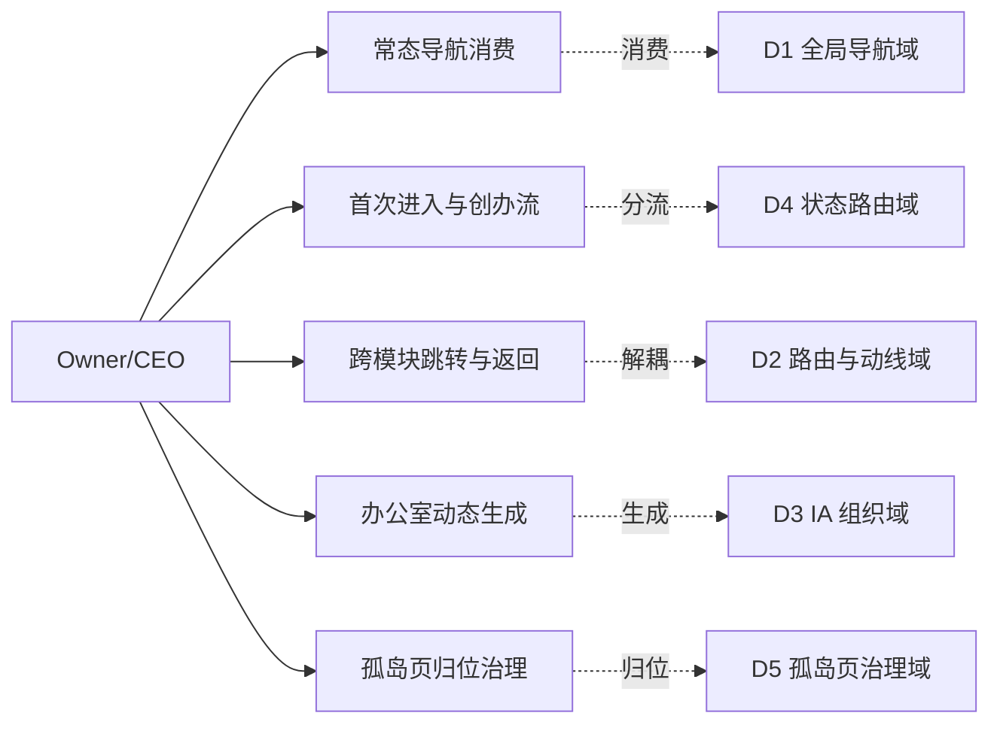
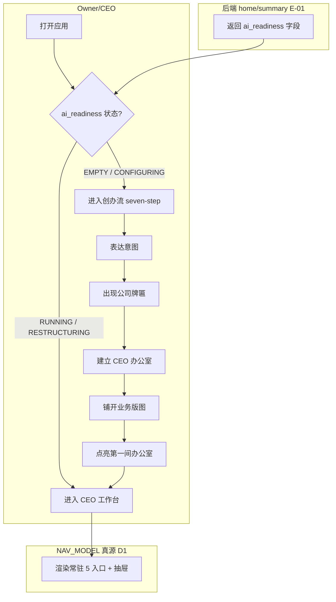
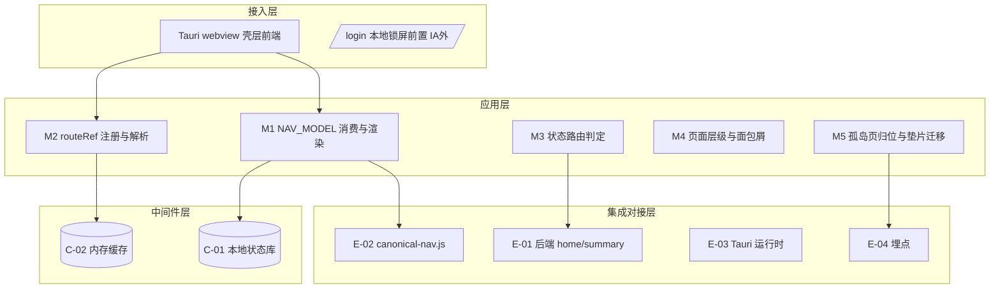
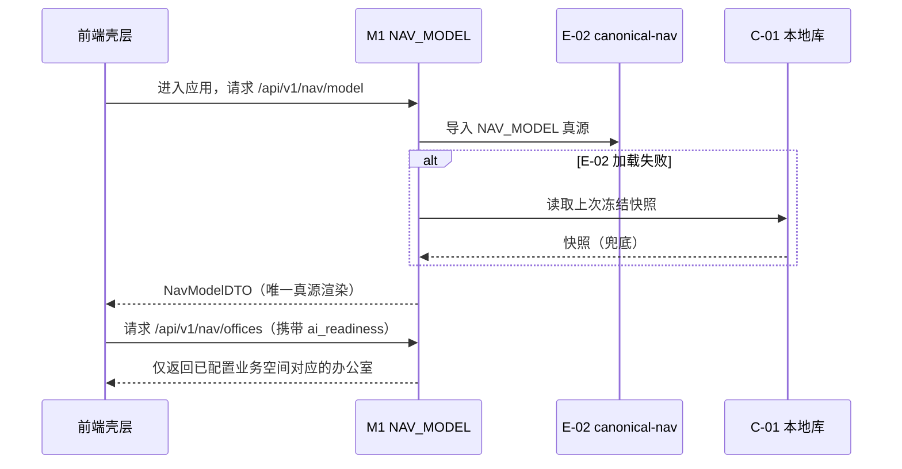
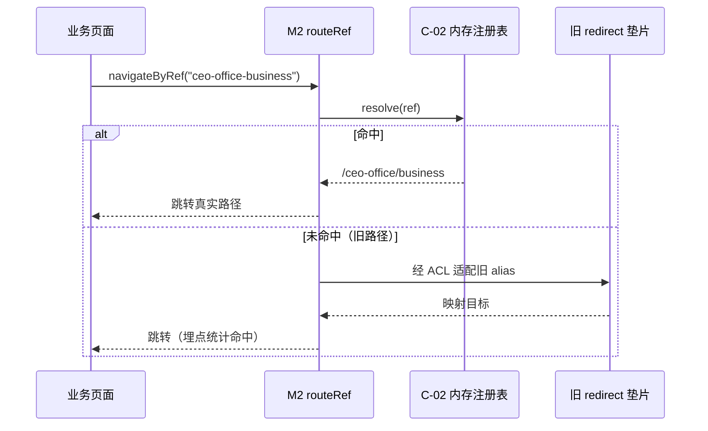
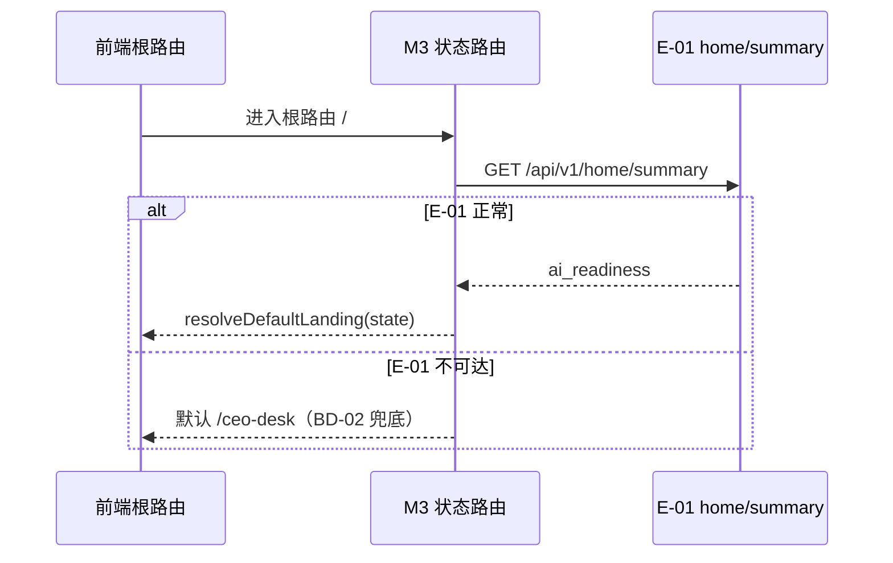
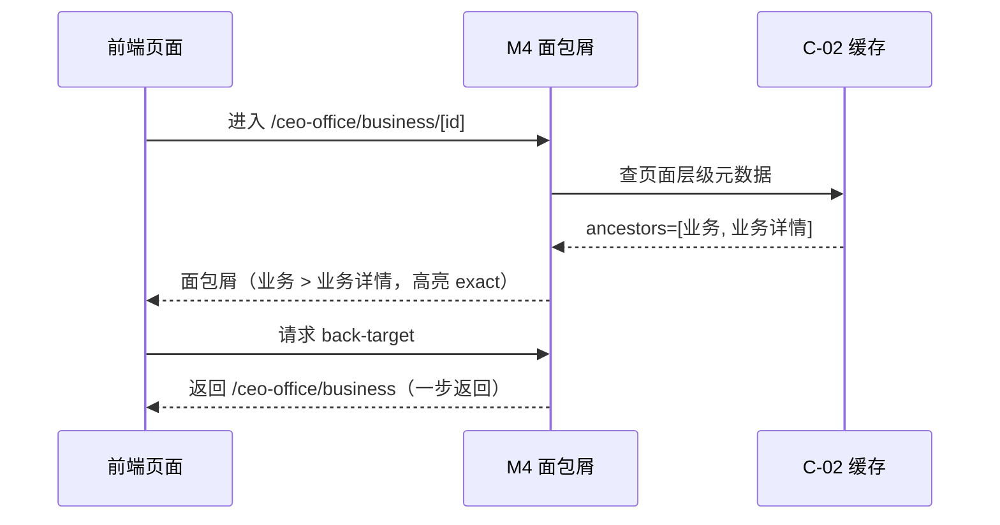
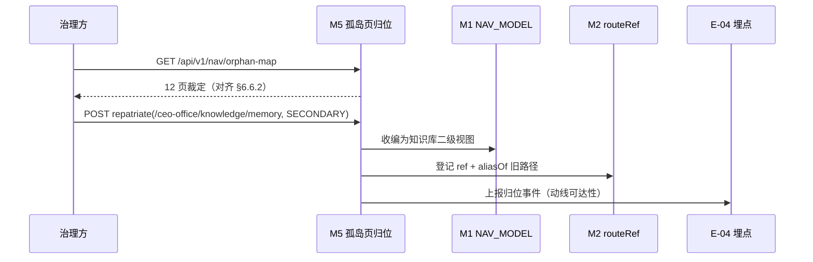

# AICoding 架构设计 · 系统设计

> 本文档为《AICoding 架构设计》核心产物之一，对应**系统架构设计模板**。
> 上游输入：《高层架构设计》（G3 已通过）产出的业务架构、系统定位、能力盘点与 §6.3 功能清单 F1–F14、§6.6.2 二十六行存废裁定；
> 下游输出：用于驱动《部署设计》《安全设计》《UserStory》的实施。
> 本期范围：Curis 全局壳层与信息架构（IA）层整改设计，严格限定为导航单源、路由归一、动线防迷失、旧模块清理的 IA 层收敛。

---

## 0. 元信息：修订记录

| 文档版本 | 发布日期 | 修订人 | 修订说明 |
| --- | --- | --- | --- |
| v1.0 | 2026-08-08 | 高见远（system-architect） | 文档初始版本。Phase 4 / G4 系统设计，覆盖 IA 层整改（全局壳层与信息架构）的 §1~§8；§4 未启用，§5/§6/§7 仅接口约束声明 |

**填写要求**：每次评审通过新增一行；修订说明必须能定位到具体章节，禁止"细节优化 / 调整内容"等不可验证表述。

### 0.1 裁剪与未启用声明（强制登记）

> 本节为本期《系统设计》的范围边界声明，是 G4 审核的可追溯依据。

- **唯一 Owner 与禁止越权**：本期《系统设计》由 `system-architect`（高见远）作为唯一 Owner 独立产出，仅覆盖 IA 层（全局壳层与信息架构）整改设计。UserStory 归 `product-story-designer`；部署设计归 Phase 5 `platform-architect`；安全设计归 Phase 5 `security-architect`。本文不在 §3/§4 之外替业务域定义数据库表结构（本期 IA 整改不新增业务实体），不在 §5/§6/§7 展开部署/网络/安全的完整最终方案。
- **未启用：§4.1 全局数据约定、§4.2 单表设计、§4.3 数据部署与备份、§4.4 缓存与 Key 规范、§4.5 数据迁移与兼容性**（理由：本期 IA 层整改不新增业务实体；导航模型 `NAV_MODEL` 与路由注册表 `routeRef` 以配置 / 代码常量（`canonical-nav.js` 与前端路由注册表）承载，无需独立持久化表；本地 Desktop 形态下无独立缓存集群与存量数据迁移。若后续阶段引入业务实体持久化，须由 Phase 5 数据设计承接并补齐 §4.1~§4.5）。
- **§5 部署架构 / §6 网络架构 / §7 安全设计仅保留「接口约束声明」，完整设计由 Phase 5 下游承接**（理由：本期为单机本地 Desktop（Tauri 壳内拉起前后端），无多环境 / 多租户 / 外部访问入口；部署形态、网络边界、安全机制的最终设计归 Phase 5 `platform-architect` / `security-architect`，故本章不展开，仅声明下游必须满足的接口约束基线）。
- **裁决落地登记（U-05）**：性能时延口径 = 相对基线型（Owner 已固化裁决，不得重开）。本文所有性能指标一律采用相对基线口径——P50 / P90 相对首版 / 历史基线衡量，不设绝对毫秒阈值、不写具体毫秒数；绝对阈值待运营数据回填后另行裁定，且与《UserStory》《部署设计》口径一致。

### 0.2 架构硬约束（贯穿全文，不可违反）

> **NAV_MODEL 为全站唯一导航真相源；禁止任何模块另起第二套 sidebar 数据源或第二个渲染器。**
> 该约束源自《高层架构设计》§4.2 / §5.2 与 `canonical-nav.js` 文件头三条设计约束，是本期 IA 整改的 P0 红线（对应 F1）。具体要求：
> 1. 全站导航数据只允许一个真源（`NAV_MODEL`），前端所有页面统一经 `canonical-nav.js` 渲染侧栏，禁止页面内联第二套导航数据（原 `TerraNavData.js` 的第二份定义须删除）。
> 2. 渲染器保持唯一，渲染前清除历史导航残留；不允许存在两个竞争侧栏渲染器。
> 3. 任何新增入口、办公室、资源分组，必须先登记进 `NAV_MODEL` / `routeRef` 注册表，禁止在模块内硬编码第二份导航结构。
> 该约束在 §3.1 系统上下文、§3.2 模块设计、§3.4 跨模块公共能力（`NavTruthGuard`）中反复落地。

---

## 1. 引言

### 1.1 文档目标

- **一句话定位**：本文档定义 Curis 全局壳层与信息架构（IA）层整改在交付物中的所有架构设计相关产物（业务架构、应用架构、IA 层接口契约、可观测设计），不含业务实体持久化与完整部署 / 安全方案。
- **读者对象**：架构师 / 前端开发 / 壳层开发 / 评审委员会（G4）。
- **设计范围**：业务架构（§2）+ 应用架构与 IA 层接口契约（§3）+ 数据库设计（§4 本期未启用）+ 部署 / 网络 / 安全约束声明（§5/§6/§7）+ 可观测设计（§8）。

### 1.2 关联文档清单

| 输入类型 | 内容要点 | 在本文档中的用途 | 形式 |
| --- | --- | --- | --- |
| 高层架构设计 | 系统定位（全局壳层与 IA 层）、§6.3 功能清单 F1–F14、§6.6.2 二十六行存废裁定、§6.7 整改优先级 | 第 2 章业务架构与第 3 章模块边界的冻结基线 | 外部文档（G3 已通过） |
| 资料摘要（material_digest） | `canonical-nav.js` 五组 NAV_MODEL 定义、4 组 redirect 垫片、12 个孤岛页、50 前端路由枚举、X1–X16 冲突、G1–G8 缺口 | 第 3 章接口与模块的真实输入事实 | 外部文档（G1 已通过） |
| 调研报告（research_report） | Grafana / Backstage / Salesforce / Linear 标杆评分与三层结论、U-01/U-04 裁决 | 第 2 章方案取舍依据 | 外部文档（G2 已通过） |
| 下游 UserStory | 角色旅程与验收标准 | 本文 §3.2 / §3.5 接口的消费者 | 本文档下游（product-story-designer） |
| 下游部署设计 | 环境矩阵、集群、CI/CD、容灾 | 本文 §5 约束声明的承接方 | 本文档下游（Phase 5 platform-architect） |
| 下游安全设计 | STRIDE、IAM、密钥、审计 | 本文 §7 约束声明的承接方 | 本文档下游（Phase 5 security-architect） |

### 1.3 名词与术语表

| 业务术语 | 业务定义（≤ 30 字） | 应用层核心对象（§3.3） | 数据库表名（§4.2） |
| --- | --- | --- | --- |
| NAV_MODEL | 全站唯一导航模型真源，五组冻结结构 | NavModel（O-01） | 本期未启用（配置常量） |
| routeRef | 轻量路由引用注册表，消灭硬编码 URL | RouteRefRegistry（O-03） | 本期未启用（代码常量） |
| canonical-nav.js | NAV_MODEL 的权威代码定义文件 | NavModelSource（E-02） | 本期未启用 |
| 办公室（office） | 由已配置业务空间动态生成的导航分组 | OfficeConfig（O-06） | 本期未启用 |
| operating | 经营一级入口（归一自 analytics） | NavNode | 本期未启用 |
| business | 业务一级入口（归一自 projects） | NavNode | 本期未启用 |
| assets | 成果库一级入口（归一自 company-runtime） | NavNode | 本期未启用 |
| ai_readiness | 后端首屏门禁字段，状态路由判定真源 | CompanyReadiness（O-05） | 本期未启用 |
| 5 常驻一级入口 | CEO 工作台/经营/业务/AI 团队/工作空间 | NavNode[] | 本期未启用 |
| 孤岛页 | 零站内入口可达的页面 | OrphanPageMap（O-07） | 本期未启用 |
| 抽屉（drawer） | 常驻之外的次要导航折叠容器 | NavNode[] | 本期未启用 |
| TerraNavData | 待删除的第二份侧栏导航数据（禁止保留） | — | 本期未启用（须删除） |
| redirect 垫片 | 6 行仅含 redirect 的旧路由遗留文件 | — | 本期未启用（须迁移删除） |

---

## 2. 业务架构

> **本章回答**：IA 整改服务什么业务、业务由哪些场景构成、关键流程长什么样。
> **本章不回答**：用什么技术、怎么部署、表怎么建（后者本期未启用）。

### 2.1 业务架构概览

#### 2.1.1 业务全景图

> 系统级业务全景图，以业务域分块展示 IA 整改的业务结构。

**业务域清单**（5 个，落在 3~7 区间，与第 3 章模块、第 4 章分组保持一致；本期无新增业务实体，故不与持久化表分组对应）：

| 业务域 | 核心场景 | 涉及角色 | 与其他业务域的关系 |
| --- | --- | --- | --- |
| D1 全局导航域（Global Navigation） | NAV_MODEL 真源维护、侧栏唯一渲染 | Owner / CEO / AI 团队 | 上游：为路由域、组织域、状态路由域提供导航真源 |
| D2 路由与动线域（Routing & Wayfinding） | routeRef 注册解析、面包屑、返回上一位置 | Owner / CEO | 消费 D1 真源；为孤岛治理域提供入口归位能力 |
| D3 信息架构组织域（IA Organization） | 5 常驻入口、办公室动态生成、抽屉 | Owner / CEO | 消费 D1 真源；办公室由业务空间配置驱动 |
| D4 创办与状态路由域（Founding & State Routing） | 七步创办流、按公司状态分流默认首页 | Owner / CEO | 依赖 D1 真源与后端 ai_readiness 判定 |
| D5 孤岛页治理域（Orphan Page Governance） | 12 个零入口页归位 / 收编 / 废弃 | Owner / 架构守护 | 消费 D2 路由注册与 D1 真源，将页面纳入导航或 IA 外豁免 |

### 2.2 领域关系映射

#### 2.2.1 限界上下文清单

每个业务域对应一个限界上下文（Bounded Context），明确该域内业务实体的标准定义：

| 限界上下文 | 对应业务域 | 域类型 | 覆盖的核心业务实体 | 上下文边界（属于本域 vs 不属于） |
| --- | --- | --- | --- | --- |
| BC-Nav | D1 全局导航域 | 核心域 | NavModel / NavNode / Footer | 属于：NAV_MODEL 真源与渲染契约；不属于：办公室生成规则（归 BC-Org） |
| BC-Route | D2 路由与动线域 | 核心域 | RouteRefRegistry / BreadcrumbMeta | 属于：路由引用注册与解析；不属于：页面业务内容 |
| BC-Org | D3 信息架构组织域 | 核心域 | OfficeConfig / PersistentEntry | 属于：常驻集与办公室生成；不属于：状态路由判定（归 BC-State） |
| BC-State | D4 创办与状态路由域 | 支撑域 | CompanyReadiness / FoundingFlow | 属于：公司状态机与默认首页分流；不属于：导航渲染 |
| BC-Hierarchy | D2 页面层级子集 | 支撑域 | PageMeta / BreadcrumbChain | 属于：页面层级元数据；不属于：路由物理跳转 |
| BC-Repatriate | D5 孤岛页治理域 | 支撑域 | OrphanPageMap / Verdict | 属于：孤岛页裁定与归位；不属于：业务空间生成 |
| BC-MetaSchema | 跨域共享 | 通用域 | PageHierarchySchema | 属于：页面层级元数据的共享结构定义；不属于：任何特定业务规则 |

**域类型说明**：

| 域类型 | 含义 | 投入策略 |
| --- | --- | --- |
| 核心域（Core） | 业务护城河，差异化竞争力所在 | 投入最多资源自研 |
| 支撑域（Supporting） | 必要但非差异化 | 可自研可外采 |
| 通用域（Generic） | 通用能力（如用户中心、消息中心） | 优先复用 / 外采 |

#### 2.2.2 上下文映射（Context Mapping）

| 映射编号（CM） | 上游上下文 | 下游上下文 | 关系模式 | 同步方式 | 选择理由 |
| --- | --- | --- | --- | --- | --- |
| CM-01 | BC-Nav | BC-Route | Customer/Supplier | 代码模块导入（NAV_MODEL 作为 supplier 输出） | 导航真源配合路由层消费节奏，下游需求驱动真源结构稳定 |
| CM-02 | 外部遗留路由（redirect 垫片） | BC-Route | ACL 防腐层 | 适配器迁移 | 旧 4 组 redirect 语义不污染新注册表，经 ACL 迁入后删除 |
| CM-03 | BC-Nav | BC-Hierarchy | Shared Kernel | 共享 PageHierarchySchema（BC-MetaSchema） | 页面层级元数据概念稳定且必须一致，多上下文共享同一 schema |
| CM-04 | Tauri Runtime API | 本系统（全部 BC） | Conformist | 直接遵循 Tauri 窗口 / IPC 模型 | 无议价能力的强势上游壳层，顺从其 API 模型 |
| CM-05 | BC-Nav | BC-Org / BC-Route / BC-State | Open Host Service | NAV_MODEL 作为标准协议对外暴露（primary/tools/resources/offices/footer） | 多下游（渲染层、路由层、状态层）共同消费同一导航真源 |

#### 2.2.3 跨域协作原则

| 原则编号 | 原则 |
| --- | --- |
| P-01 | 核心域（BC-Nav / BC-Route / BC-Org）→ 支撑域：禁止反向依赖核心域内部模型 |
| P-02 | 核心域之间：禁止直接耦合，必须经 NAV_MODEL / routeRef 解耦 |
| P-03 | 对接外部不可控系统（Tauri / 后端 home/summary）：必须建 ACL 防腐层，禁止把外部模型贯穿到本域 |

### 2.3 详细业务架构

#### 2.3.1 用例图

**用例图清单**：

| 编号 | 用例图标题 | 涉及业务域 | 源文件位置 |
| --- | --- | --- | --- |
| UC-01 | CEO 常态导航消费 | D1 / D3 | 本文 §3.2.M1 / §3.2.M4 |
| UC-02 | 首次进入与创办流 | D4 | 本文 §3.2.M3 |
| UC-03 | 跨模块跳转与返回 | D2 | 本文 §3.2.M2 / §3.2.M4 |
| UC-04 | 办公室动态生成 | D3 | 本文 §3.2.M1 |
| UC-05 | 孤岛页归位治理 | D5 | 本文 §3.2.M5 |



#### 2.3.2 业务流程图

**关键流程清单**（核心业务覆盖度 ≥ 80%）：

| 流程编号 | 流程名 | 起点 | 终点 | 涉及业务域 | 源文件位置 |
| --- | --- | --- | --- | --- | --- |
| BF-01 | 首次进入状态路由与七步创办流 | 打开应用 | 进入 CEO 工作台 | D4 / D1 | 本文 §3.2.M3 |
| BF-02 | 常态导航消费与面包屑生成 | 进入任意页面 | 渲染侧栏 + 面包屑 | D1 / D2 / D3 | 本文 §3.2.M1 / §3.2.M4 |
| BF-03 | 孤岛页归位与旧路由垫片迁移 | 治理触发 | 页面纳入导航或 IA 外豁免 | D5 / D2 | 本文 §3.2.M5 |

**BF-01 首次进入状态路由与七步创办流（角色泳道）**：



### 2.4 业务范围与边界

#### 2.4.1 功能模块清单

按"功能编号 → 子功能编号"两层组织，与 §2.1 业务域对应（F1–F14 直接对齐《高层架构设计》§6.3）。

| 编号 | 一级功能名 | 子功能描述 | 对应业务域 | 实现状态 |
| --- | --- | --- | --- | --- |
| F1 | 单源导航 | 导航模型唯一真源冻结，删除第二份导航数据 | D1 | 完整实现 |
| F2 | 单源导航 | 5 常驻一级入口（CEO 工作台/经营/业务/AI 团队/工作空间） | D3 | 完整实现 |
| F3 | 单源导航 | 办公室动态生成（software/xhs/shortvideo 三间，department 降为 AI 团队页视图） | D3 | 完整实现 |
| F4 | 心智归一 | 路由语义归一（analytics→operating、projects→business、company-runtime→assets） | D2 | 完整实现 |
| F5 | 心智归一 | 一级 IA 去 Project/Task 为根 | D3 | 完整实现 |
| F6 | 孤岛治理 | 12 个零入口孤岛页归位（给入口/收编二级/转 IA 外） | D5 | 完整实现 |
| F7 | 路由解耦 | routeRef 路由注册表 | D2 | 注册表上线 |
| F8 | 路由解耦 | 双套路由 4 组 redirect 垫片迁移 | D2 | 完整实现 |
| F9 | 防迷失 | 全局面包屑（继承两级高亮） | D2 | 完整实现 |
| F10 | 防迷失 | 返回上一位置（一步返回，不依赖浏览器后退） | D2 | 完整实现 |
| F13 | 进入前 | 创办流七步 + 状态路由分流 | D4 | 完整实现 |
| F11 | 旧模块清理 | 旧规划残留页灰度下线（MVP 后置，归完整版） | D5 | 完整版 |
| F12 | 旧模块清理 | 能力中心收编为 AI 团队页二级视图、记忆收编为知识库二级视图 | D3 | 完整版 |
| F14 | 基线守护 | 文档红线对齐与一致性扫描（合入前自动阻断） | D1 | 完整版 |

**In-Scope（本期范围内）**：

| 编号 | 本期必做的事项 |
| --- | --- |
| F1 | NAV_MODEL 唯一真源冻结，删除 TerraNavData 第二份定义 |
| F2 | 5 常驻一级入口落地（含 AI 团队提为第 5 常驻，U-01 方案 B） |
| F3 | 办公室动态生成（v1 三间，department 降为视图，U-04 方案 B） |
| F4 | 路由语义归一三处改名 + 旧路径注册表承接 |
| F6 | 12 个孤岛页逐个归位裁定 |
| F7 | routeRef 注册表上线 |
| F8 | 4 组 redirect 垫片迁入注册表 |
| F9 | 全局面包屑 |
| F10 | 返回上一位置 |
| F13 | 七步创办流 + 状态路由 |
| N1 | 全站导航数据源 = 1，渲染器 = 1 |

**Out-of-Scope（本期不做）**：

| 编号 | 不做的事项 | 不做的原因 | 未来归属 |
| --- | --- | --- | --- |
| O1 | 业务实体持久化表（如公司/办公室/任务主数据） | 本期 IA 整改不新增业务实体 | Phase 5 数据设计 |
| O2 | 多环境 / 多租户部署 | 单机本地 Desktop，无外部入口 | Phase 5 部署设计 |
| O3 | 服务端账号体系 / SSO / MFA | 本地 Owner 锁屏前置即可 | Phase 5 安全设计 |
| O4 | 完整版旧模块灰度下线（F11/F12/F14） | MVP 后置，先保留垫片埋点 | 完整版迭代 |
| O5 | Admin 面（/platform/*）与 Control 面（/control/secret-vault） | 蓝图明确暂不建设，IA 外豁免 | 独立产品/安全阶段 |

#### 2.5 质量与柔性可用

##### 2.5.1 服务质量目标

**质量目标 Top 4**（按 ISO 25010 选出最重要的目标，落到可验证场景）：

| 优先级 | 质量目标 | 业务驱动 | 受影响的关键章节 |
| --- | --- | --- | --- |
| Q1 | 导航单源一致性 100% | 双心智/双数据源是割裂复发根因（R-02 高） | §3.1 / §3.2 / §3.4 |
| Q2 | 动线可达性：零入口孤岛页 = 0 | 12 个页面点不到直接沉没研发投入 | §3.2.M5 / §5 |
| Q3 | 渲染性能：导航渲染时延相对首版基线不退化（P50 / P90 相对基线，本地内存解析）；绝对毫秒阈值待运营数据回填后另行裁定（U-05 = 方案 A 相对基线型） | 侧栏每次进入即时渲染 | §3.2.M1 / §8 |
| Q4 | 可维护性：新人 1 周可改导航 | 导航结构收敛为单一代码真源 | §3.1 / §3.2 |

**可验证质量场景**：

| 场景编号 | 关联目标 | 触发源 | 触发条件 | 期望响应 | 度量指标 |
| --- | --- | --- | --- | --- | --- |
| QS-01 | Q1 | 导航结构变更 | 任意页面提交导航改动 | 全站仅 NAV_MODEL 一处定义 | 第二份导航数据定义数量 = 0 |
| QS-02 | Q2 | 治理扫描 | 全站路由可达性扫描 | 12 个原孤岛页均有入口或 IA 外豁免 | 零入口孤岛页 = 0 |
| QS-03 | Q3 | 用户进入页面 | 侧栏渲染 | 本地内存解析即时返回 | P50 / P90 相对基线不退化（不设绝对毫秒阈值，U-05） |

##### 2.5.2 业务柔性可用策略

**业务功能优先级分层**（§2.4.1 每个一级功能 F-x 显式标注层级）：

| 层级 | 含义 | 故障态下的处置方向 | 用户感知 |
| --- | --- | --- | --- |
| L0 核心业务 | 系统生命线 | 不降级 | 无 |
| L1 重要业务 | 高频使用 | 限流 + 异步化 | 变慢提示 |
| L2 辅助业务 | 提升体验 | 关闭 / 兜底数据 | 部分功能不可用 |
| L3 附加业务 | 长尾 | 直接关闭 | 通常无感 |

**功能分层映射**：F1/F2/F3/F4/F6/F13 = L0（导航与动线生命线）；F7/F8/F9/F10 = L1；F11/F12/F14 = L3（完整版清场）。

**业务降级清单**：

| 编号 | 关联功能 | 触发条件 | 降级动作 | 用户感知 | 决策类型 |
| --- | --- | --- | --- | --- | --- |
| BD-01 | F3 办公室生成 | 业务空间配置缺失 | 办公室分组仅渲染已配置项，隐藏未配置 | 看不到未启用的办公室 | 自动 |
| BD-02 | F13 状态路由 | 后端 home/summary 不可达（E-01） | 默认落 CEO 工作台，置本地缓存最后已知状态 | 进入默认工作台 | 自动 |

---

## 3. 应用架构

> **本章回答**：系统由哪些模块组成、模块与外部系统怎么集成、每个模块的内部交互链路是什么。
> **本章是系统设计的核心**，篇幅占全文约 45%。

### 3.1 应用架构概览

#### 3.1.1 系统上下文

本系统（Curis 全局壳层与 IA 层）作为**中心节点**，周围辐射出"用户角色 + 外部系统 + 壳层运行时"关系。

**系统上下文要素清单**：

| 节点类型 | 节点名 | 与本系统的关系 | 关系语义 |
| --- | --- | --- | --- |
| 角色 | Owner / CEO | 使用 | 壳层导航与创办流操作 |
| 角色 | AI 团队 | 使用 | AI 团队常驻入口与部门视图 |
| 外部系统 | E-01 后端首屏门禁 home/summary | 本系统 → 消费 | 获取 ai_readiness 状态字段 |
| 外部系统 | E-02 canonical-nav.js 配置源 | 本系统 → 消费 | NAV_MODEL 真源定义 |
| 壳层运行时 | E-03 Tauri 系统 API | 本系统 → 消费 | 窗口 / 本地存储 / IPC |
| 外部系统 | E-04 埋点平台 | 本系统 → 生产 | 动线可达性数据采集 |

**填写要求**：本系统画成单一节点，不展开内部组件（内部组件归 §3.1.2）；周围节点取自 §3.1.3 外部依赖清单（E-xx）与 §2.3 用例图角色；每条边标注关系语义。

#### 3.1.2 系统模块图

**分层组件清单**：

| 层次 | 内容 | 数据来源 |
| --- | --- | --- |
| 接入层 | Tauri webview（壳层前端）/ 本地锁屏前置（/login，IA 外） | §2.3 用例图角色 |
| 应用层 | M1 NAV_MODEL 消费与渲染 / M2 routeRef 注册与解析 / M3 状态路由判定 / M4 页面层级与面包屑 / M5 孤岛页归位与旧路由垫片 | §2.1 / §3.2 |
| 中间件层 | C-01 本地状态库（IndexedDB/SQLite）/ C-02 内存缓存（routeRef、NAV_MODEL 解析结果） | §3.1.3 云组件清单 |
| 集成对接层 | E-01 后端门禁 / E-02 配置源 / E-03 Tauri 运行时 / E-04 埋点 | §3.1.3 外部依赖清单 |



**填写要求**：层次自上而下展示；每条线标注协议（HTTP / Tauri IPC / 内存 / SDK）；中间件 / 外部系统组件块标注编号（C-xx / E-xx）。

#### 3.1.3 集成架构

##### 外部依赖清单

| ID | 外部系统 | 归属团队 / 供应商 | 类别 | 使用方式 | 集成方式 | 协议 / 版本 | 功能定位（≤ 30 字） | 联系人 |
| --- | --- | --- | --- | --- | --- | --- | --- | --- |
| E-01 | 后端首屏门禁 home/summary | 后端团队 | 业务协作 | 消费 | REST API | v1 | 提供 ai_readiness 状态字段 | @高见远 |
| E-02 | canonical-nav.js 配置源 | 前端基线 | 配置真源 | 消费 | 代码模块导入 | v1 | NAV_MODEL 五组结构定义 | @高见远 |
| E-03 | Tauri 系统 API | Tauri 框架 | 壳层运行时 | 消费 | SDK / IPC | 1.6.0 | 窗口 / 本地存储 / 进程间通信 | @高见远 |
| E-04 | 埋点平台 | 数据团队 | 埋点 | 生产 | SDK | v1 | 动线可达性数据采集 | @高见远 |

**填写要求**：类别取值（封闭枚举）：身份认证 / 业务协作 / 支付 / 通知推送 / 埋点 / 第三方业务平台 / 监控审计 / 文件导出；使用方式取值：消费 / 生产 / 双向。

##### 云组件 / 基础设施清单（本地形态）

| ID | 组件类别 | 选型 | 部署形态 | 规格量级 | 容量预估 | 提供方 / SLA | 用途 |
| --- | --- | --- | --- | --- | --- | --- | --- |
| C-01 | 本地状态库 | IndexedDB（浏览器内置）/ SQLite via rusqlite 0.31.0 | 本地文件 | 单进程 | ≤ 10MB | Tauri / OS | 导航态与路由态落盘 |
| C-02 | 内存缓存 | 进程内 Map / LRU | 本地进程内存 | 单进程 | ≤ 50MB | 应用自身 | routeRef 注册表、NAV_MODEL 解析结果 |
| C-03 | 路由注册表 | 前端 routeRef registry（代码常量 + C-01 持久化） | 本地 | 单进程 | ≤ 1MB | 应用自身 | 模块间解耦跳转 |

**填写要求**：选型必须含具体产品 + 版本号（本地形态以内置/框架版本标注）；规格量级 / 容量预估必须有数字。

##### 组件依赖关系

| 业务模块（§3.2） | 依赖的外部系统（E-xx） | 依赖的云组件（C-xx） | 故障传导风险 |
| --- | --- | --- | --- |
| M1 NAV_MODEL 消费与渲染 | E-02 | C-01, C-02 | E-02 加载失败 → 回退内置冻结 NAV_MODEL 快照 |
| M2 routeRef 注册与解析 | — | C-02, C-01 | C-02 丢失 → 重新从代码常量重建注册表 |
| M3 状态路由判定 | E-01 | C-01 | E-01 不可达 → 默认落 CEO 工作台（BD-02） |
| M4 页面层级与面包屑 | — | C-02 | C-02 丢失 → 面包屑降级为单级页面标题 |
| M5 孤岛页归位与垫片 | E-04 | C-01 | E-04 不可用 → 归位裁定仍生效，仅缺埋点 |

#### 3.1.4 工程结构

```
curis-desktop/
├── src-tauri/                 # Rust 后端（Tauri 命令）
│   ├── Cargo.toml
│   └── src/
│       ├── main.rs            # 进程入口
│       ├── commands.rs        # Tauri 命令（本地存储/IPC）
│       └── state.rs           # 本地状态（rusqlite）
└── frontend/                 # 前端工程根目录（壳层与 IA 层）
    ├── src/
    │   ├── api/              # 接口封装（与 §3.2 接口清单对齐）
    │   │   ├── nav.ts        # NAV_MODEL 消费（M1）
    │   │   ├── routeRef.ts   # routeRef 注册与解析（M2）
    │   │   ├── stateRoute.ts # 状态路由判定（M3）
    │   │   ├── pageMeta.ts   # 面包屑/返回元数据（M4）
    │   │   └── orphan.ts     # 孤岛页归位（M5）
    │   ├── stores/           # 全局状态（Zustand）
    │   ├── pages/            # 页面（按路由分目录）
    │   ├── components/       # 跨页面通用组件（侧栏/面包屑/抽屉）
    │   ├── hooks/            # 自定义 Hooks
    │   ├── types/            # TS 类型定义（与 DTO 对齐）
    │   ├── sdk/             # 三方 SDK 封装（对应 E-xx）
    │   ├── _system/          # canonical-nav.js（NAV_MODEL 真源，唯一）
    │   └── routes.tsx       # 路由配置（routeRef 驱动）
    └── package.json
```

**约束**：公共模块（types / _system）被业务页面依赖，禁止反向；`TerraNavData.js` 第二份导航数据在本期删除。

#### 3.1.5 技术选型（版本约束）

| 技术分类 | 选型 | 版本 | 备注 / 选型理由 |
| --- | --- | --- | --- |
| 前端框架 | React + TypeScript | 18.2.1 | 选型理由：相对 Vue，团队已沉淀 React + Tauri 集成与组件库，降低 IA 层重构成本 |
| 前端构建 | Vite | 5.2.0 | 选型理由：相对 Webpack，冷启与 HMR 更快，适配 Tauri 本地开发 |
| 状态管理 | Zustand | 4.5.2 | 选型理由：相对 Redux，样板代码少、TS 友好，适合导航态轻量全局存储 |
| 桌面壳层 | Tauri | 1.6.0 | 选型理由：相对 Electron，包体更小、内存占用低、Rust 命令安全边界清晰 |
| 本地持久化 | SQLite（rusqlite） | 0.31.0 | 选型理由：相对纯 JSON 文件，支持结构化查询与事务，适配导航态落盘 |
| 前端路由 | React Router | 6.23.1 | 选型理由：相对自研路由，社区成熟、支持嵌套路由与路由守卫 meta |
| 图表/图 | Mermaid（文档内嵌） | 10.9.1 | 选型理由：相对独立绘图工具，可直接内嵌文本图，便于基线留存 |

**填写要求**：必须有版本号；选型理由用一句话说明（为什么选 A 不选 B）。

### 3.2 模块详细设计

> **核心方法论**：模块详细设计画的是业务逻辑在角色和系统之间流动的过程，不是接口实现细节。
> **组织原则**：§3.2.1 / §3.2.2 给出跨模块共享约束与模块清单；§3.2.3 给出五段式规范；之后每个模块在 §3.2.M{n} 下独立成节。

#### 3.2.1 模块公共约束（Common）

**通信方式约束**：

| 约束项 | 取值 |
| --- | --- |
| 接口路径风格 | RESTful（IA 层内部以前端函数 + 轻量本地 API 混合） |
| 协议 | 前端模块间经 routeRef 内存解析；跨进程经 Tauri IPC；后端调用经 REST |
| 数据格式 | JSON |
| 字符编码 | UTF-8 |

**通用基础结构**：

| 基类 / 结构 | 用途 | 包路径 |
| --- | --- | --- |
| ApiResult | 统一返回结构（含 code / msg / data / traceId） | frontend/src/types |
| PageRequest | 分页请求 | frontend/src/types |
| NavNode | 导航节点（NAV_MODEL 单元） | frontend/src/types |
| RouteRef | 路由引用（注册表单元） | frontend/src/types |

#### 3.2.2 模块清单与编号规则

**模块清单**：

| 编号 | 模块名 | 业务域（§2.1） | 模块负责人 | 关联子领域 |
| --- | --- | --- | --- | --- |
| M1 | NAV_MODEL 消费与渲染 | D1 / D3 | @高见远 | 导航真源消费、办公室动态生成 |
| M2 | routeRef 注册与解析 | D2 | @高见远 | 路由解耦、旧垫片迁移 |
| M3 | 状态路由判定 | D4 | @高见远 | 公司状态分流默认首页 |
| M4 | 页面层级与面包屑 | D2 | @高见远 | 面包屑、返回上一位置 |
| M5 | 孤岛页归位与旧路由垫片 | D5 / D2 | @高见远 | 12 页归位、4 组垫片迁移 |

**编号规则**：模块编号 M{n} 全局唯一，与 §2.1 业务域名一致；每个模块在 §3.2 下独立成节，编号 §3.2.M{n}；节内五段式编号 §3.2.M{n}.1 ~ §3.2.M{n}.5。

#### 3.2.3 单模块设计模板（五段式）

> **本节性质说明**：本节定义每个模块在 §3.2.M{n} 下五段各应产出什么、遵守什么格式。本节本身不是任何模块的内容。
> **§3.2.M{n} 下应当怎么填**：1）直接写该模块特有的业务内容（真实接口、真实 DTO、真实时序图、真实流程）；2）不要把本节的硬性要求表复制到 §3.2.M{n} 下；3）五段顺序固定（模块概述 / 接口清单 / 结构定义 / 时序图 / 关键流程）；简单模块可省略 .5 但须显式注明。

五段顺序与产出物：
- §3.2.M{n}.1 模块概述：位置 / 角色 / 内外部系统。
- §3.2.M{n}.2 接口清单：按子领域分组的真实业务接口。
- §3.2.M{n}.3 结构定义：特有 DTO/VO 代码 + 关键字段定义表。
- §3.2.M{n}.4 时序图：关键时序图（含异常分支）。
- §3.2.M{n}.5 关键流程逻辑：复杂流程伪代码 / 状态机（简单模块注明省略）。

#### 3.2.M1 NAV_MODEL 消费与渲染模块

##### §3.2.M1.1 模块概述

NAV_MODEL 消费与渲染模块覆盖「导航真源消费」与「办公室动态生成」业务流程，业务逻辑在 Owner / CEO 与 `canonical-nav.js`（E-02）、本地状态库（C-01）之间流动，同时涉及 Tauri 运行时（E-03）的数据持久化与侧栏渲染组件。本模块严格遵循 §0.2 架构硬约束：只消费唯一真源 NAV_MODEL，不持有第二份导航数据。

##### §3.2.M1.2 接口清单

| 子领域 | 方法 | 路径 | 用途（≤ 20 字） | 请求 DTO | 响应 VO | 幂等 |
| --- | --- | --- | --- | --- | --- | --- |
| 导航消费 | GET | /api/v1/nav/model | 获取 NAV_MODEL 真源 | — | NavModelDTO | 天然 |
| 办公室生成 | GET | /api/v1/nav/offices | 按公司状态生成办公室 | — | OfficeListVO | 天然 |
| 导航消费 | GET | /api/v1/nav/footer | 获取底部设置/帮助 | — | FooterDTO | 天然 |
| 办公室生成 | POST | /api/v1/nav/offices/sync | 业务空间变更触发重算 | OfficeSyncRequest | ApiResult | 是（biz_req_no） |

##### §3.2.M1.3 关键结构定义（DTO）

```typescript
export interface NavModelDTO {
  primary: NavNode[];     // 5 常驻一级入口
  tools: NavNode[];       // 经营工具（抽屉）
  resources: NavNode[];   // 公司资源（抽屉）
  offices: NavNode[];     // 办公室（动态生成）
  footer: NavNode[];      // 底部设置/帮助
}

export interface NavNode {
  ref: string;            // routeRef 标识，如 ceo-desk
  label: string;          // 展示名，如 CEO 工作台
  href: string;           // 解析后的真实路径
  icon: string;           // 图标键
  badge?: number;         // 角标数（仅 >0 显示）
  children?: NavNode[];
  requiresState?: AiReadiness; // 仅在特定公司状态可见
}

export interface OfficeListVO {
  offices: NavNode[];     // 已生成办公室（v1：software/xhs/shortvideo）
  generatedFrom: string[];// 触发来源业务空间类型
}
```

**关键字段定义表**：

| DTO / VO 名 | 字段名 | 类型 | 必填 | 业务含义 | 约束 / 默认值 |
| --- | --- | --- | --- | --- | --- |
| NavModelDTO | primary | NavNode[] | 是 | 5 常驻一级入口 | 固定 5 项，顺序：ceo-desk/operating/business/ai-organization/workspace-portal |
| NavNode | ref | string | 是 | routeRef 标识 | 全局唯一，须先登记 |
| NavNode | requiresState | string | 否 | 可见所需公司状态 | 取值见 AiReadiness 枚举 |
| OfficeListVO | offices | NavNode[] | 是 | 已生成办公室 | v1 仅 software/xhs/shortvideo 三项 |

##### §3.2.M1.4 模块逻辑时序图

| 编号 | 标题 | 场景类别 | 是否包含异常分支 |
| --- | --- | --- | --- |
| SQ-01 | M1 - 首屏加载并渲染 NAV_MODEL | 配置加载/渲染 | 是 |
| SQ-02 | M1 - 业务空间变更触发办公室重算 | 动态生成 | 是 |



##### §3.2.M1.5 关键流程逻辑

触发：业务空间配置变更（Owner 创建一间新办公室）

```
Step 1: 读取公司状态 ai_readiness（同步，来自 M3）
  ├── 校验：ai_readiness 非空 → 失败时回退上一已知状态
  └── 过滤：仅保留 requiresState 匹配或无需状态的节点

Step 2: 办公室动态生成（同步）
  ├── 输入：已配置业务空间类型 [software, xhs, shortvideo]
  ├── 规则：department 不列为独立办公室，降为 AI 团队页部门视图（U-04 方案 B）
  ├── 规则：办公室分组可见性只由公司运行状态决定，与当前所在页无关
  └── 状态变更：写入 C-01，触发侧栏重渲染

Step 3: 渲染（同步）
  └── 唯一渲染器清除历史导航残留后渲染 NAV_MODEL
```

无复杂状态机/事务跨多步异步（本地内存 + 本地库写入），本段已给出核心伪代码。

#### 3.2.M2 routeRef 注册与解析模块

##### §3.2.M2.1 模块概述

routeRef 注册与解析模块覆盖「路由解耦」与「旧路由垫片迁移」业务流程，业务逻辑在壳层各页面（接入层）与注册表（C-02 内存）之间流动，涉及 4 组 redirect 垫片（ACL 迁入）。本模块消灭模块间硬编码互引 URL，是 F7/F8 的落地载体。

##### §3.2.M2.2 接口清单

| 子领域 | 方法 | 路径 | 用途（≤ 20 字） | 请求 DTO | 响应 VO | 幂等 |
| --- | --- | --- | --- | --- | --- | --- |
| 注册 | POST | /api/v1/route-ref/register | 登记路由引用 | RouteRefRegisterRequest | ApiResult | 是（ref 唯一键） |
| 解析 | GET | /api/v1/route-ref/resolve | 按 ref 解析真实路径 | — | RouteRefResolveVO | 天然 |
| 迁移 | POST | /api/v1/route-ref/migrate-legacy | 迁移旧 redirect 垫片 | LegacyMigrateRequest | ApiResult | 是（biz_req_no） |

##### §3.2.M2.3 关键结构定义（DTO）

```typescript
export interface RouteRefRegisterRequest {
  ref: string;             // 路由引用标识，如 ceo-office-business
  target: string;          // 真实路径，如 /ceo-office/business
  aliasOf?: string[];      // 旧路径别名，如 ["/ceo-office/projects"]
}

export interface RouteRefResolveVO {
  ref: string;
  href: string;            // 解析后真实路径
  resolved: boolean;       // 是否命中注册表
}

export interface LegacyMigrateRequest {
  legacyPaths: string[];   // 旧 redirect 垫片路径
  targetRef: string;       // 目标 routeRef
}
```

**关键字段定义表**：

| DTO / VO 名 | 字段名 | 类型 | 必填 | 业务含义 | 约束 / 默认值 |
| --- | --- | --- | --- | --- | --- |
| RouteRefRegisterRequest | ref | string | 是 | 路由引用标识 | 全局唯一 |
| RouteRefRegisterRequest | aliasOf | string[] | 否 | 旧路径别名 | 旧路径经注册表承接后垫片可删 |
| RouteRefResolveVO | resolved | boolean | 是 | 是否命中 | 未命中返回 404 并触发归位审计 |

##### §3.2.M2.4 模块逻辑时序图

| 编号 | 标题 | 场景类别 | 是否包含异常分支 |
| --- | --- | --- | --- |
| SQ-01 | M2 - 页面经 routeRef 跳转 | 解耦跳转 | 是 |
| SQ-02 | M2 - 旧 redirect 垫片迁入注册表 | 迁移/补偿 | 是 |



##### §3.2.M2.5 关键流程逻辑

触发：模块间跳转（禁止硬编码 URL）

```
Step 1: 注册（启动期，同步）
  ├── 每个页面模块在 routes.tsx 声明 ref 与真实路径
  ├── 旧 4 组 redirect 垫片路径登记为 aliasOf
  └── 状态变更：写入 C-02（持久化到 C-01）

Step 2: 解析跳转（同步）
  ├── navigateByRef(ref) → resolve → href
  ├── 失败：ref 未登记 → 返回 C404001（见 §3.5.1）并触发 M5 归位审计
  └── 写操作必标注：幂等键 = ref（天然唯一）

Step 3: 垫片迁移（F8，异步埋点）
  ├── [MOCK] 旧垫片先保留并统计命中，连续两周为 0 后删除（完整版 F11）
  └── 迁移完成：redirect 关系全部在注册表，垫片文件删除
```

状态机迁移表（旧路径生命周期）：

| 起始状态 | 触发事件 | 终止状态 | 触发条件 / 校验 | 副作用 |
| --- | --- | --- | --- | --- |
| SHIM_ACTIVE | 登记 aliasOf | REGISTERED | 旧路径映射到 routeRef | 埋点开始统计 |
| REGISTERED | 命中数=0 持续 14 天 | DEPRECATED | F11 灰度下线判据 | 删除垫片文件 |

#### 3.2.M3 状态路由判定模块

##### §3.2.M3.1 模块概述

状态路由判定模块覆盖「创办流与状态路由」业务流程，业务逻辑在 Owner / CEO 与后端首屏门禁（E-01 home/summary）之间流动，依据 `ai_readiness` 字段分流默认首页。判定字段唯一真源为后端 home/summary 的 `ai_readiness`（F13）。

##### §3.2.M3.2 接口清单

| 子领域 | 方法 | 路径 | 用途（≤ 20 字） | 请求 DTO | 响应 VO | 幂等 |
| --- | --- | --- | --- | --- | --- | --- |
| 状态判定 | GET | /api/v1/home/summary | 获取 ai_readiness | — | HomeSummaryVO | 天然 |
| 状态判定 | GET | /api/v1/nav/state-route | 按状态解析默认首页 | — | StateRouteVO | 天然 |

##### §3.2.M3.3 关键结构定义（DTO）

```typescript
export type AiReadiness = 'EMPTY' | 'CONFIGURING' | 'RUNNING' | 'RESTRUCTURING';

export interface HomeSummaryVO {
  aiReadiness: AiReadiness;   // 公司状态，状态路由判定唯一真源
  companyCreatedAt?: string;  // 公司建立时间（办公室可见性依赖）
}

export interface StateRouteVO {
  state: AiReadiness;
  defaultLanding: string;     // 默认首页真实路径
}
```

**关键字段定义表**：

| DTO / VO 名 | 字段名 | 类型 | 必填 | 业务含义 | 约束 / 默认值 |
| --- | --- | --- | --- | --- | --- |
| HomeSummaryVO | aiReadiness | string | 是 | 公司状态 | 枚举：EMPTY/CONFIGURING/RUNNING/RESTRUCTURING |
| StateRouteVO | defaultLanding | string | 是 | 默认首页 | EMPTY/CONFIGURING→/founding-flow；RUNNING/RESTRUCTURING→/ceo-desk |

##### §3.2.M3.4 模块逻辑时序图

| 编号 | 标题 | 场景类别 | 是否包含异常分支 |
| --- | --- | --- | --- |
| SQ-01 | M3 - 根路由按公司状态分流 | 配置/分流 | 是 |
| SQ-02 | M3 - E-01 不可达兜底 | 异常/回退 | 是 |



##### §3.2.M3.5 关键流程逻辑

触发：根路由访问

```
Step 1: 获取 ai_readiness（同步，E-01；失败按 BD-02 兜底）
  ├── 校验：字段存在 → 否则默认 RUNNING
  └── 状态变更：无

Step 2: 分流（纯函数 resolveDefaultLanding）
  ├── EMPTY      → /founding-flow（创办流七步）
  ├── CONFIGURING→ /founding-flow
  ├── RUNNING    → /ceo-desk（CEO 工作台）
  └── RESTRUCTURING → /ceo-desk

Step 3: 跳转（经 M2 routeRef 解析真实路径）
```

状态机迁移表（公司状态 → 默认首页）：

| 起始状态 | 触发事件 | 终止状态（落点） | 触发条件 / 校验 | 副作用 |
| --- | --- | --- | --- | --- |
| EMPTY | 进入根路由 | /founding-flow | ai_readiness=EMPTY | 启动创办流 |
| CONFIGURING | 进入根路由 | /founding-flow | ai_readiness=CONFIGURING | 继续创办流 |
| RUNNING | 进入根路由 | /ceo-desk | ai_readiness=RUNNING | 正常经营态 |
| RESTRUCTURING | 进入根路由 | /ceo-desk | ai_readiness=RESTRUCTURING | 经营重构态 |

#### 3.2.M4 页面层级与面包屑模块

##### §3.2.M4.1 模块概述

页面层级与面包屑模块覆盖「全局面包屑」与「返回上一位置」业务流程（F9/F10），业务逻辑在壳层顶栏与页面层级元数据（BC-Hierarchy / BC-MetaSchema）之间流动，面包屑继承导航两级高亮语义，运行页由其代表入口作为祖先节点。

##### §3.2.M4.2 接口清单

| 子领域 | 一级入口 | 路径 | 用途（≤ 20 字） | 请求 DTO | 响应 VO | 幂等 |
| --- | --- | --- | --- | --- | --- | --- |
| 面包屑 | GET | /api/v1/nav/page-meta | 获取页面层级元数据 | — | PageMetaVO | 天然 |
| 返回 | GET | /api/v1/nav/back-target | 获取返回上一位置 | — | BackTargetVO | 天然 |

##### §3.2.M4.3 关键结构定义（DTO）

```typescript
export interface PageMetaVO {
  path: string;
  title: string;
  ancestors: BreadcrumbNode[]; // 祖先链（含代表入口）
  highlight: 'exact' | 'ancestor'; // 两级高亮语义
}

export interface BreadcrumbNode {
  label: string;
  href: string;   // 经 routeRef 解析
  ref: string;
}

export interface BackTargetVO {
  backTo: string; // 返回上一位置真实路径
  label: string;
}
```

**关键字段定义表**：

| DTO / VO 名 | 字段名 | 类型 | 必填 | 业务含义 | 约束 / 默认值 |
| --- | --- | --- | --- | --- | --- |
| PageMetaVO | ancestors | BreadcrumbNode[] | 是 | 祖先链 | 运行页以代表入口为祖先 |
| PageMetaVO | highlight | string | 是 | 高亮语义 | exact / ancestor |
| BackTargetVO | backTo | string | 是 | 返回路径 | 跨模块一步返回，不依赖浏览器后退 |

##### §3.2.M4.4 模块逻辑时序图

| 编号 | 标题 | 场景类别 | 是否包含异常分支 |
| --- | --- | --- | --- |
| SQ-01 | M4 - 进入页面生成面包屑 | 渲染/元数据 | 是 |
| SQ-02 | M4 - 跨模块跳转后返回上一位置 | 返回/恢复 | 是 |



##### §3.2.M4.5 关键流程逻辑

触发：页面进入

```
Step 1: 解析页面层级（同步）
  ├── 查 meta 注册（页面层级元数据 schema）
  ├── 继承导航两级高亮：exact（当前页）/ ancestor（祖先）
  └── 运行页：以代表入口作为祖先节点

Step 2: 返回上一位置（同步）
  ├── 记录来源 ref 于跳转时透传
  └── 提供一步返回入口（不依赖浏览器后退）
```

无复杂状态机/事务跨多步异步，本段已给出核心伪代码。

#### 3.2.M5 孤岛页归位与旧路由垫片模块

##### §3.2.M5.1 模块概述

孤岛页归位与旧路由垫片模块覆盖「12 个零入口孤岛页归位」与「4 组 redirect 垫片迁移」业务流程（F6/F8/F11），业务逻辑在治理方（Owner / 架构守护）与 NAV_MODEL 真源（M1）、routeRef 注册表（M2）、埋点（E-04）之间流动。本模块将孤岛页逐个裁定为「给正式入口 / 收编二级视图 / 转 IA 外 / 废弃」，对齐 §6.6.2 二十六行存废裁定。

##### §3.2.M5.2 接口清单

| 子领域 | 方法 | 路径 | 用途（≤ 20 字） | 请求 DTO | 响应 VO | 幂等 |
| --- | --- | --- | --- | --- | --- | --- |
| 归位 | GET | /api/v1/nav/orphan-map | 获取孤岛页裁定映射 | — | OrphanMapVO | 天然 |
| 归位 | POST | /api/v1/nav/orphan/repatriate | 执行页面归位裁定 | OrphanRepatriateRequest | ApiResult | 是（biz_req_no） |
| 迁移 | POST | /api/v1/route-ref/migrate-legacy | 迁移旧 redirect 垫片 | LegacyMigrateRequest | ApiResult | 是（biz_req_no） |

##### §3.2.M5.3 关键结构定义（DTO）

```typescript
export type OrphanVerdict = 'ENTRY' | 'SECONDARY' | 'IA_EXEMPT' | 'DEPRECATE';

export interface OrphanMapVO {
  items: OrphanItem[];
}

export interface OrphanItem {
  path: string;             // 原孤岛页路径
  verdict: OrphanVerdict;   // 裁定
  targetRef?: string;       // 归位后的 routeRef
  note: string;             // 裁定理由（引用 §6.6.2 行号）
}

export interface OrphanRepatriateRequest {
  path: string;
  verdict: OrphanVerdict;
  targetRef?: string;
}
```

**关键字段定义表**：

| DTO / VO 名 | 字段名 | 类型 | 必填 | 业务含义 | 约束 / 默认值 |
| --- | --- | --- | --- | --- | --- |
| OrphanItem | verdict | string | 是 | 归位裁定 | ENTRY/SECONDARY/IA_EXEMPT/DEPRECATE |
| OrphanItem | targetRef | string | 否 | 归位 routeRef | IA_EXEMPT/DEPRECATE 时无 |
| OrphanRepatriateRequest | biz_req_no | string | 是 | 幂等键 | 全局请求号 |

##### §3.2.M5.4 模块逻辑时序图

| 编号 | 标题 | 场景类别 | 是否包含异常分支 |
| --- | --- | --- | --- |
| SQ-01 | M5 - 孤岛页归位裁定执行 | 治理/归位 | 是 |
| SQ-02 | M5 - 旧 redirect 垫片迁移 | 迁移/补偿 | 是 |



##### §3.2.M5.5 关键流程逻辑

触发：治理扫描发现零入口页

```
Step 1: 枚举 12 个孤岛页（来自 §6.6.2 / P1-3 实测）
  ├── 4 组 redirect 垫片：/capabilities /employees /projects /org-center
  ├── /guide /ceo-office/reports /ceo-office/brainstorm
  ├── /ceo-office/knowledge/memory
  ├── IA 外豁免：/login /control/secret-vault /platform/* 
  └── 校验：每页必须有裁定，否则阻断合入（F14）

Step 2: 逐个裁定（对齐 §6.6.2 行号）
  ├── /capabilities 等 4 垫片 → migrate-legacy（M2，F8）
  ├── /guide → DEPRECATE（重定向创办流，F11）
  ├── /ceo-office/knowledge/memory → SECONDARY（知识库二级，F12/F6）
  ├── /ceo-office/reports /brainstorm → DEPRECATE（F11）
  └── /login /control/secret-vault /platform/* → IA_EXEMPT（不进导航）

Step 3: 归位后审计（同步写 C-01 + 异步埋点 E-04）
  └── 零入口孤岛页计数归 0（QS-02 度量）
```

状态机迁移表（孤岛页生命周期）：

| 起始状态 | 触发事件 | 终止状态 | 触发条件 / 校验 | 副作用 |
| --- | --- | --- | --- | --- |
| ORPHAN | 裁定 ENTRY/SECONDARY | REPA TRIATED | 登记进 NAV_MODEL/routeRef | 站内可达 |
| ORPHAN | 裁定 IA_EXEMPT | EXEMPT | 不进导航，豁免登记 | 维持 IA 外 |
| ORPHAN | 裁定 DEPRECATE | DEPRECATED | 重定向或删除（F11 灰度） | 埋点统计后删 |

### 3.3 核心业务对象清单

#### 3.3.1 对象定义

| 编号 | 对象名（代码类名） | 对象类型 | 包路径 | 模块归属 | 被哪些模块复用 | 实例化策略 | 序列化约定 | 持久化策略 |
| --- | --- | --- | --- | --- | --- | --- | --- | --- |
| O-01 | NavModel | 聚合根 | frontend/src/types | M1 | M1/M2/M3/M4/M5 | 从 E-02 导入 | JSON | 落 C-01（冻结快照） |
| O-02 | NavNode | 实体 | frontend/src/types | M1 | 全部 | 由 NavModel 创建 | JSON | 随 NavModel 落 C-01 |
| O-03 | RouteRefRegistry | 聚合根 | frontend/src/types | M2 | M2/M4/M5 | 启动时注册 | JSON | 落 C-01 |
| O-04 | PageMeta | 实体 | frontend/src/types | M4 | M4 | 由 schema 创建 | JSON | 内存 + C-01 |
| O-05 | CompanyReadiness | 值对象 | frontend/src/types | M3 | M3 | 来自 E-01 | JSON | 内存缓存 C-02 |
| O-06 | OfficeConfig | 实体 | frontend/src/types | M1 | M1 | 由业务空间配置生成 | JSON | 落 C-01 |
| O-07 | OrphanPageMap | 实体 | frontend/src/types | M5 | M5 | 治理扫描生成 | JSON | 落 C-01 |

**对象类型说明**：聚合根（一致性边界）/ 实体（有标识）/ 值对象（无标识不可变）/ 共享 DTO / 共享枚举 / 防腐层 ACL（详见 §2.2.2 CM-02）。

#### 3.3.2 命名漂移登记表

| 业务实体（§2） | 代码类名（§3.3.1） | 数据表名（§4.2） | 漂移原因 |
| --- | --- | --- | --- |
| 导航模型 | NavModel | 本期未启用（配置常量） | IA 整改不新增持久化表 |
| 路由引用 | RouteRefRegistry | 本期未启用（代码常量） | 同上 |
| 办公室 | OfficeConfig | 本期未启用 | 同上 |

### 3.4 跨模块公共能力

**公共能力清单**（横切多个模块、以 SDK / 拦截器 / 共享 Bean 形式提供）：

| 公共能力 | 简述 | 提供方（SDK / 切面 / Bean） | 被哪些模块复用 | 接入方式 |
| --- | --- | --- | --- | --- |
| 导航真相源守卫 NavTruthGuard | 强制唯一 NAV_MODEL 真源，拒绝第二份侧栏数据/渲染器 | `navTruthGuard`（前端启动切面） | M1/M2/M3/M4/M5 | 启动期校验，发现第二份定义即阻断 |
| 路由守卫 RouteGuard | 按页面元数据做本地可达性校验与登录前置 | `RouteGuard`（路由 meta 拦截） | M2/M3/M4 | 路由 meta.requireAuth + roles |
| 渲染适配 NavRenderAdapter | 统一消费 NAV_MODEL 渲染侧栏/面包屑 | `NavRenderAdapter`（组件） | M1/M4 | 组件 prop 注入 NavModelDTO |

**填写要求**：提供方必须是具体类名 / SDK 名；接入方式说明研发怎么用。

### 3.5 接口契约

> 本系统对外暴露的接口（含同步 API、跨模块函数、Tauri IPC）在错误码、幂等、限流、超时上的全局约定。所有接口必须遵守，不在每个接口下重复声明。

#### 3.5.1 全局错误码体系

**错误码格式**：

| 项 | 取值 |
| --- | --- |
| 错误码格式 | 6 位数字 / 字符串，例如：A010001 |
| 分段规则 | 1 位类别 + 2 位模块 + 3 位错误序号 |
| 类别取值 | A = 业务错误（HTTP 200，业务语义失败）/ B = 系统错误（HTTP 5xx）/ C = 客户端错误（HTTP 4xx） |

**错误响应统一结构**：

```json
{
  "code": "A010001",
  "msg": "导航引用未登记",
  "msgI18n": { "zh-CN": "导航引用未登记", "en-US": "Route ref not registered" },
  "data": null,
  "traceId": "abc123",
  "timestamp": "2026-08-08T10:00:00.000Z"
}
```

**错误码注册表**（每模块至少登记关键业务错误，以及全局通用错误）：

| 错误码 | HTTP 状态 | 所属模块 | 含义 | 重试建议 | 用户文案 |
| --- | --- | --- | --- | --- | --- |
| A010001 | 200 | M2 | 路由引用未登记 | 不重试 | 页面入口不存在，已为你返回上一位置 |
| A010002 | 200 | M1 | 办公室生成失败 | 不重试 | 办公室暂不可用 |
| A010003 | 200 | M5 | 孤岛页裁定缺失 | 不重试 | 该页面正在治理中 |
| B999001 | 500 | 全局 | 系统内部错误 | 可重试 | 系统繁忙，请稍后再试 |
| C400001 | 400 | 全局 | 参数校验失败 | 不重试 | 参数错误 |
| C401001 | 401 | 全局 | 未登录（本地锁屏） | 不重试 | 请先解锁进入 |
| C403001 | 403 | 全局 | 无权限 | 不重试 | 无权访问 |
| C404001 | 404 | 全局 | 路由未命中 | 不重试 | 页面不存在 |
| C429001 | 429 | 全局 | 触发限流 | 退避后重试 | 操作太频繁，请稍后再试 |

#### 3.5.2 幂等性约定

| 接口类型 | 是否要求幂等 | 幂等键来源（建议） |
| --- | --- | --- |
| 写入类（POST 创建/同步） | 涉及导航态变更必须幂等 | Header X-Idempotency-Key（UUID，调用方生成） |
| 更新类（PUT / PATCH） | 必须幂等 | 资源 ID + 版本号（乐观锁） |
| 删除类（DELETE） | 天然幂等 | — |
| 查询类（GET） | 天然幂等 | — |
| 导航/办公室/归位类 | 强制幂等 | 业务侧请求号（biz_req_no） |

**幂等设计需考虑的问题**：

| 问题维度 | 设计要点 |
| --- | --- |
| 幂等键生命周期 | 本地会话级（短期防抖），C-01 持久化兜底 |
| 重复请求语义 | 返回相同响应（导航态幂等） |
| 执行中态 | 首个未返回时第二个返回处理中 |
| 失败可重试性 | 同键允许重试 |
| 存储兜底 | C-01 唯一索引作为最终防线 |

#### 3.5.3 限流约定

| 维度 | 默认值 | 触发动作 | 调整方式 |
| --- | --- | --- | --- |
| 全局 QPS | 10000 | 返回 C429001 | 网关配置 |
| 单用户 QPS | 1000 | 返回 C429001 | 业务配置 |
| 单 IP QPS | 100 | 返回 C429001 | 网关配置 |
| 重保接口（创办流/登录） | 单用户 5 次/分钟 | 锁定 15 分钟 | 业务配置 |

**降级策略**：

| 策略项 | 内容 |
| --- | --- |
| 前端退避 | 触发限流后按 Retry-After Header 退避 |
| 后端记录 | 写入类接口记录到熔断队列 |
| 红线联动 | 限流红线值与 §5.5 容量水位线一致（本期单机，红线为本地进程保护） |

#### 3.5.4 默认超时与重试基线

| 调用类型 | 默认超时 | 默认重试 | 重试条件 |
| --- | --- | --- | --- |
| 同步 API（内部/本地） | 3s | 0 次 | — |
| 同步 API（外部 E-01/E-02） | 10s | 2 次（指数退避 1s/2s） | 仅网络错误 / 5xx |
| 异步 MQ 消费 | 30s | 16 次（封顶 1h） | 业务异常进死信 |
| 定时任务 | 5min | 3 次 | 失败告警 |

**填写要求**：超时值禁止无限；重试必须有上限；重试不能产生副作用（依赖 §3.5.2 幂等）。

#### 3.5.5 路由设计规范

**API 路由规范**：

| 维度 | 取值 |
| --- | --- |
| 风格 | RESTful（资源化 URL） |
| 版本控制 | /api/v1/...（路径版本） |
| 命名 | 小写 + 中划线（kebab-case） |
| 资源命名 | 名词复数 |
| 路由模式 | 前端 History 模式，锁定 |
| 鉴权方式 | 路由 meta.requireAuth = true + roles，由 RouteGuard 拦截 |

**前端页面路由清单（对齐 §6.6.2 裁定）**：

| 路径 | 页面 / 功能 | 入口角色 | 鉴权要求 | 关联模块 |
| --- | --- | --- | --- | --- |
| /founding-flow | 七步创办流 | Owner | 已解锁 | M3 |
| /ceo-desk | CEO 工作台（常驻 1） | Owner/CEO | 已解锁 | M1 |
| /operating | 经营（常驻 2，归一自 analytics） | Owner/CEO | 已解锁 | M1/M2 |
| /business | 业务（常驻 3，归一自 projects） | Owner/CEO | 已解锁 | M1/M2 |
| /ai-organization | AI 团队（常驻 4，U-01 方案 B） | AI 团队 | 已解锁 | M1 |
| /workspace-portal | 工作空间（常驻 5） | Owner/CEO | 已解锁 | M1/M3 |
| /ceo-office/meeting | 会议工作台（抽屉·工具） | Owner/CEO | 已解锁 | M1 |
| /ceo-office/decisions | 决策室（抽屉·工具） | Owner/CEO | 已解锁 | M1 |
| /ceo-office/assets | 成果库（抽屉·资源，归一自 company-runtime） | Owner/CEO | 已解锁 | M1/M2 |
| /ceo-office/knowledge | 知识库（抽屉·资源） | Owner/CEO | 已解锁 | M1 |
| /ceo-office/finance | 财务（抽屉·资源） | Owner/CEO | 已解锁 | M1 |
| /ceo-office/calendar | 日历（抽屉·资源） | Owner/CEO | 已解锁 | M1 |
| /ai-organization/capacity | 能力与容量（二级，收编自能力中心 F12） | AI 团队 | 已解锁 | M1/M5 |
| /ceo-office/knowledge/memory | 记忆管理（二级，收编 F12/F6） | AI 团队 | 已解锁 | M4/M5 |
| /ceo-office/business/[id] | 业务详情（归一自 projects/[id] F4） | Owner/CEO | 已解锁 | M2/M4 |
| /ceo-office/workspace/software | 研发办公室（动态生成） | Owner/CEO | 已解锁 | M1 |
| /ceo-office/workspace/xhs | 小红书运营办公室（动态生成） | Owner/CEO | 已解锁 | M1 |
| /ceo-office/workspace/shortvideo | 抖音/TikTok 运营办公室（动态生成） | Owner/CEO | 已解锁 | M1 |
| /login | 本地锁屏前置（IA 外） | 全部 | 公开 | M3 |
| /platform, /platform/commercial, /platform/results | Admin 面（IA 外豁免，§6.6.2 行 24） | — | IA 外 | M5 |
| /control/secret-vault | Control 面（IA 外豁免，§6.6.2 行 25） | — | IA 外 | M5 |
| /capabilities, /employees, /projects, /org-center | 旧 redirect 垫片（迁移至 routeRef 后删，F8） | — | IA 外（过渡） | M2/M5 |
| /guide, /ceo-office/reports, /ceo-office/brainstorm | 废弃（F11 灰度下线） | — | — | M5 |

**填写要求**：每条路径显式标注鉴权要求；动态参数示例化为 [id]；与 §3.2.M{n} 模块关联填实。

---

## 4. 数据库设计

> 本章本期未启用。

本期 IA 层整改（全局壳层与信息架构层收敛）不新增任何业务实体；导航模型 `NAV_MODEL` 与路由注册表 `routeRef` 以配置 / 代码常量（`canonical-nav.js` 与前端路由注册表）承载，无需独立持久化表；本地 Desktop 形态下无独立缓存集群与存量数据迁移。相关未启用明细见 §0 修订记录「裁剪与未启用声明」。若后续阶段引入业务实体持久化，须由 Phase 5 数据设计承接并补齐 §4.1 全局数据约定、§4.2 单表设计、§4.3 数据部署与备份、§4.4 缓存与 Key 规范、§4.5 数据迁移与兼容性。

---

## 5. 部署架构（接口约束声明 · 完整设计由 Phase 5 platform-architect 承接）

> 约束声明：本期为单机本地 Desktop（Tauri 壳内拉起前后端），无多环境、无多租户、无外部访问入口。本章仅声明下游部署设计必须满足的接口约束，完整部署设计（环境矩阵、集群、CI/CD、容灾）由 Phase 5 platform-architect 承接。

### 5.1 环境与集群划分（约束）

- 环境：仅本地单机（dev/int/uat/prod 四环境概念不适用于本地 Desktop；如需联调，以本地进程隔离替代）。
- 配置策略：L1 代码内常量（NAV_MODEL、routeRef 注册表默认值）；L4 密钥（Owner 本地凭证）由 OS Keyring 托管，不明文落盘（详见 §7.2.3）。

### 5.2 运行时高可用与弹性（约束）

- 单机无多副本；HA 由 Tauri 进程守护（崩溃自启）兜底，无跨 AZ/Region。
- 无状态化：前端为渲染态，导航态外置到本地存储（C-01）；进程重启可恢复。

### 5.3 服务级别（SLA）约束基线

| SLA 指标 | 目标值 |
| --- | --- |
| 系统可用性 | ≥ 99.9%（本地进程稳定性驱动） |
| 单接口 P50 / P90 | 相对基线不退化（U-05 相对基线型，绝对阈值待运营数据回填） |
| 故障恢复 RTO | ≤ 5 min（进程重启恢复） |
| 数据丢失 RPO | ≤ 0 min（本地数据全量落盘，无分布式丢失窗口） |

> 上述 RTO/RPO 为对 Phase 5 完整部署设计提出的约束基线；多实例/云化场景数值由 Phase 5 重新评估并自洽。

### 5.4 部署拓扑（约束）

- 流量入口：仅本地 loopback；Tauri webview 加载本地前端，前端经 Tauri 命令/本地 API 访问后端 home/summary（E-01）。
- 无公网 LB / WAF / CDN。

### 5.5 容量规划（约束）

- 单用户单机；QPS 量级为本地交互级（≤ 100 QPS）；资源以单进程内存为主。
- 红线水位（对开发的约束）：本地内存 > 80% 触发导航态精简；与 §3.5.3 限流红线联动。

---

## 6. 网络架构（接口约束声明 · 完整设计由 Phase 5 承接）

> 约束声明：本期单机本地 Desktop，无公网入口。完整网络设计由 Phase 5 承接。

### 6.1 网络环境规划（约束）

- 仅本地回路（loopback）；无 DMZ / INT / UAT / PROD / DEV 公网网段划分。
- 外部访问出口经 Tauri 命令白名单（仅允许的外部 API 域名，如 E-01/E-04）。

### 6.2 流量入口与南北向流量（约束）

- 入口：Tauri webview 本地加载；无 DNS / CDN / 抗 DDoS / WAF / 公网 LB。
- 鉴权位置：本地 RouteGuard（§3.4）统一拦截；无 API 网关。

### 6.3 内部互联（东西向流量，约束）

- 服务发现：前端模块间经 routeRef 注册表解耦，禁止硬编码互引 URL（详见 §3.2.M2）。
- 服务间通信：本地进程内函数调用 + Tauri IPC；无 gRPC / MQ 跨进程。
- 跨服务调用幂等性：遵循 §3.5.2 幂等键传递；traceId 透传见 §8.3。

---

## 7. 安全设计（接口约束声明 · 完整设计由 Phase 5 security-architect 承接）

> 约束声明：本期单机本地 Desktop，无公网入口、无服务端账号体系。完整安全设计由 Phase 5 security-architect 承接。

### 7.1 架构安全全景（约束）

| 能力域 | 选用产品 / 机制 | 作用范围 | 是否启用 |
| --- | --- | --- | --- |
| 抗 DDoS | 不适用 | 公网入口 | 否（无公网入口） |
| WAF | 不适用 | Web 应用层 | 否（无公网入口） |
| 防火墙 / 安全组 | OS 本地防火墙 | 主机 | 是（OS 提供） |
| 主机安全 | Tauri 运行时沙箱 | 全部进程 | 是（框架提供） |
| 容器安全 | 不适用 | — | 否（非容器） |
| 数据安全审计 | 本地日志留存 | 关键导航/路由变更 | 是（见 §8.2） |
| 密钥管理（KMS） | OS Keyring | 敏感凭证 | 是（本地托管） |
| 安全运营中心（SOC） | 不适用 | — | 否（单机） |
| 堡垒机 | 不适用 | — | 否（单机） |

### 7.2 业务安全架构（约束）

#### 7.2.1 用户认证

| 维度 | 取值 |
| --- | --- |
| 账号体系 | 本地 Owner 锁屏前置（/login 为 IA 外壳层前置屏） |
| 登录方式 | 系统账号 / 本地锁屏 |
| 多因素认证（MFA） | 不适用（本地单机） |
| 密码强度 | 遵循 OS 本地账号策略 |
| 登录失败锁定 | 遵循 OS 策略 |
| Token 有效期 | 本地会话，进程生命周期 |
| 会话管理 | 本地会话，无服务端 JWT |

#### 7.2.2 数据安全

| 维度 | 取值 |
| --- | --- |
| 数据分级 | 本地导航态/路由态为 L1 公开级；无 PII |
| 传输加密 | 本地 loopback，无跨网络传输 |
| 存储加密 | 本地存储由 OS 卷加密保障 |
| 敏感字段清单 | 本期无敏感 PII；后续引入由 Phase 5 设计 |
| 数据导出与共享 | 本地，无跨系统共享 |

**敏感字段处理策略表**：

| 字段 | 分级 | 存储策略 | 展示策略 | 导出策略 |
| --- | --- | --- | --- | --- |
| 导航态/路由态 | L1 | 本地 C-01 | 完整 | 本地仅 |

#### 7.2.3 密钥与凭证

| 维度 | 取值 |
| --- | --- |
| 存储方式 | OS Keyring（本地托管） |
| 下发方式 | 本地系统凭证 |
| 轮换策略 | 由 OS 机制保障 |
| 红线 | 禁止入库 / 入代码 / 入配置文件明文；禁止跨环境共用密钥 |

#### 7.2.4 审计日志

| 维度 | 取值 |
| --- | --- |
| 启用的日志类型 | 应用操作 / 导航路由变更（本地留存） |
| 审计内容 | 谁、何时、对什么资源、做了什么、结果 |
| 不可篡改保障 | 本地只读归档 |
| 保留期 | ≥ 1 年（与 §8.2 一致） |

#### 7.2.5 访问控制

| 维度 | 取值 |
| --- | --- |
| 权限模型 | 本地路由守卫（RouteGuard）按页面 meta 校验 |
| 多租户隔离 | 不适用（单机单用户） |
| 越权防护 | 路由守卫拦截未授权页面 |
| 接口级权限 | 与 §3.5 调用契约对齐 |

---

## 8. 可观测设计

> **本章回答**：系统跑起来之后，怎么知道它健康、出问题怎么定位、用户体验是否达标。
> **三大支柱**：Metrics（指标）/ Logs（日志）/ Traces（链路追踪）。

### 8.1 Metrics

#### 8.1.1 指标分层

| 指标层 | 示例 | 工具 |
| --- | --- | --- |
| 业务指标 | 零入口孤岛页数量、五常驻到达率、抽屉展开率 | 本地埋点 + 自定义 |
| 应用指标 | RED：Rate / Errors / Duration（导航渲染） | 本地监控 |
| 中间件指标 | 本地状态库读写、内存注册表命中率 | 本地监控 |
| 资源指标 | USE：CPU / 内存 / 磁盘（单进程） | OS 监控 |

#### 8.1.2 关键指标 Dashboard 清单

| Dashboard 名 | 受众 | 核心指标 | 刷新频率 |
| --- | --- | --- | --- |
| 导航健康 Dashboard | 架构守护 | 第二份导航数据定义数、渲染器数 | 1min |
| 路由解析 Dashboard | 研发 | routeRef 命中率、未命中数 | 30s |
| 状态路由 Dashboard | 研发 | 四态分布、默认首页落点 | 30s |
| 壳层渲染 Dashboard | 研发/SRE | 导航渲染 P95/P99 | 30s |
| 孤岛页归位 Dashboard | 治理方 | 零入口孤岛页计数、归位进度 | 1min |
| 业务预警 Dashboard | On-call | 当前活跃告警 | 实时 |

### 8.2 Logs

#### 8.2.1 日志分级与去向

| 日志类型 | 级别 | 保存时间 | 日志去向 |
| --- | --- | --- | --- |
| 应用日志（业务） | INFO+ | 30 天热 + 180 天冷 | 本地日志组件（结构化 JSON） |
| 应用日志（异常） | ERROR+ | 90 天热 + 1 年冷 | 本地日志组件 + 实时告警 |
| 接入日志 | INFO+ | 30 天 | 本地日志组件 |
| 审计日志 | INFO+ | ≥ 1 年 | 本地只读归档（防篡改） |
| 埋点日志（动线） | INFO+ | 90 天 | 本地 + E-04 |

#### 8.2.2 结构化日志规范

```json
{
  "timestamp": "2026-08-08T10:00:00.000Z",
  "level": "INFO",
  "service": "curis-shell",
  "instance": "local-desktop",
  "traceId": "abc123-trace", "tenantId": "local-workspace-01",
  "userId": "owner",
  "module": "M2-routeRef",
  "event": "route_ref_resolve",
  "msg": "resolved ceo-office-business to /ceo-office/business",
  "extra": { }
}
```

**硬性要求**：

| 要求项 | 内容 |
| --- | --- |
| 必含字段 | 所有日志必须含 traceId + tenantId（tenantId 本期为本地工作区标识，单租户） |
| 敏感字段 | 禁止打印敏感字段明文（与 §7.2.2 联动） |
| ERROR 级别 | 必须含完整堆栈 + 业务上下文（页面路径 / 用户 ID） |

### 8.3 Traces

| 项 | 取值 |
| --- | --- |
| 协议标准 | OpenTelemetry / W3C TraceContext |
| 采样策略 | 默认 1% 采样；错误请求 100% 采样；慢请求（>1s）100% 采样 |
| 透传方式 | HTTP Header traceparent / tracestate；跨模块函数透传 traceId |
| 关键 Span 命名 | service.method / db.operation / mq.topic.send |
| 跨外部系统 | 调用 E-01/E-04 时透传 traceId 并记录 peer.service |

**与时序图的关联**：§3.2.M{n}.4 模块内时序图标注 traceId 透传节点，本节是其落地规范。

### 8.4 告警体系

#### 8.4.1 告警分级

> 告警按 P0 紧急 / P1 高 / P2 中 / P3 低 四级划分，覆盖本地 Desktop 可观测边界。

| 级别 | 适用场景 | 响应时间 | 通知方式 |
| --- | --- | --- | --- |
| P0 紧急 | 导航真源加载失败导致壳层不可用 | ≤ 5 min | 本地弹窗 + IM |
| P1 高 | 路由解析大面积未命中、状态路由兜底 | ≤ 15 min | IM |
| P2 中 | 单页面包屑降级、办公室生成失败 | ≤ 1 h | IM |
| P3 低 | 趋势性预警（抽屉展开率异常） | 工作时间 | IM / 邮件 |

#### 8.4.2 告警规则编排

| 编号 | 级别 | 触发条件 | 维度 | Owner | Runbook |
| --- | --- | --- | --- | --- | --- |
| AL-01 | P0 | NAV_MODEL 真源加载连续失败 | 导航可用性 | @高见远 | wiki/runbook/AL-01 |
| AL-02 | P0 | 检测到第二份导航数据定义 | 架构硬约束 | @高见远 | wiki/runbook/AL-02 |
| AL-03 | P1 | routeRef 未命中率 > 5% 持续 5min | 路由解析 | @高见远 | wiki/runbook/AL-03 |
| AL-04 | P2 | 办公室生成失败 | 办公室域 | @高见远 | wiki/runbook/AL-04 |
| AL-05 | P2 | 零入口孤岛页计数 > 0 | 孤岛治理 | @高见远 | wiki/runbook/AL-05 |

**判定合格**：
- 关键指标覆盖业务 / 应用 / 中间件 / 资源四层；
- 关键告警映射到具体指标；
- 全部 P0 / P1 告警有 Owner；
- 关键 Dashboard ≥ 5 个；
- 日志含 traceId + tenantId；
- 采样策略覆盖错误 / 慢请求兜底；
- §5.3 SLA、§2.5.1 质量目标与本章告警阈值数值自洽。
