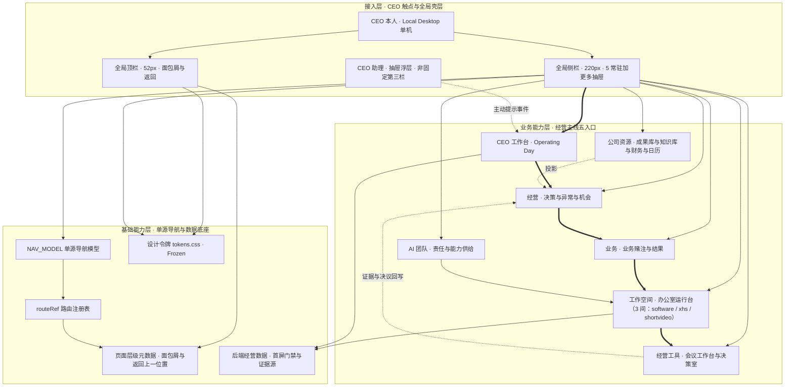
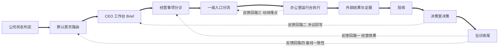
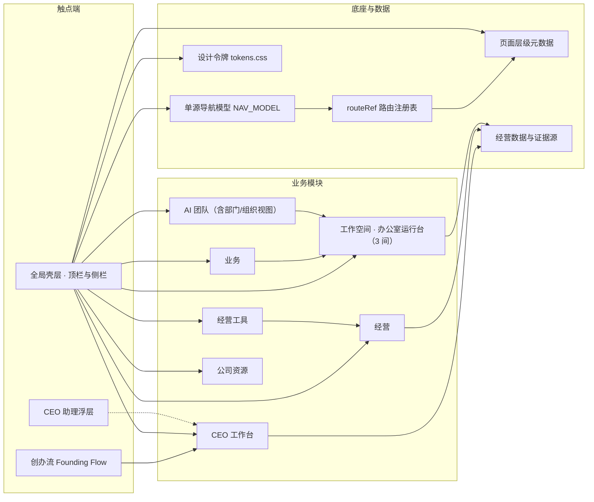

# Curis 高层架构设计 · IA 动线诊断报告

> 本文档为《AICoding 架构设计》核心产物之一，对应**高层架构设计模版**，本期定位为 **IA 动线诊断报告**。
> 上游输入：用户诉求原文 + `material_digest.md`（G1 已通过）+ `research_report.md`（G2 已通过 12/12）；
> 下游输出：作为 `system-architect` 与 `product-story-designer` 的唯一上游边界基线。
>
> **本期回答的问题**：用户提出「目前的 app 使用下来，动线非常不流畅，各个模块之间有很强烈的割裂感」。本文用模板骨架承载一份可执行的诊断，回答四件事 —— 割裂从哪来（根因）、差在哪里（应然与实然的差值全表）、每个模块怎么办（保留 / 改造 / 废弃逐项裁定）、先做什么（P0/P1/P2 整改优先级）。
>
> **权威链声明**：结构基线 = `docs/01_Product/Curis_Product_Blueprint.html`（v4.4）；UI 基线 = `docs/03_Design/Curis_UI_Frozen_Spec_2026-08-04.md` + `curis-ui-prototype/_system/canonical-nav.js`。现有 `frontend/` 50 个路由为**实然形态，非基线**，仅作对照。此定序来自用户 Phase 0 亲口裁定，全文不得反转。
>
> **表述纪律**：全文区分三种陈述 —— 「事实」有 `D编号`/`X编号`/`G编号` 出处；「假设」明确标注为推断；「建议」为本文给出的裁定或方案，可被人工审核推翻。

---

## 0. 元信息：修订记录

```yaml
标题: Curis - 高层架构设计（IA 动线诊断报告） v0.2
版本: v0.2
状态: Approved          # Draft | Reviewing | Approved | Deprecated
创建日期: 2026-08-07
最后更新: 2026-08-07
作者: business-architect（许边界 / 业务架构师）
评审人:
  - 齐构成（主理人 / 结构检查与自动校验）
  - 用户 / CEO（G3 人工审核终审）

阶段: Phase 3 高层架构设计
阶段门: G3（高层架构设计审核）
工作区根目录: /Users/yy/Documents/Curis AI Workspace

关联文档:
  上游输入:
    - 用户诉求原文: material_digest.md §0 用户诉求原文（首句提问 + Phase0关键裁定）
    - 资料摘要: .workbuddy/output/material_digest.md（G1 已通过，168 条摘要 / 16 冲突 / 8 缺口）
    - 行业调研报告: .workbuddy/output/research_report.md（G2 已通过 12/12）
    - 结构基线: docs/01_Product/Curis_Product_Blueprint.html
    - UI 基线: docs/03_Design/Curis_UI_Frozen_Spec_2026-08-04.md
    - 导航真源: curis-ui-prototype/_system/canonical-nav.js
    - 项目红线: .workbuddy/memory/MEMORY.md
  下游产出:
    - 系统设计: 待 G3 通过后由 system-architect 承接
    - UserStory: 待 G3 通过后由 product-story-designer 承接
```

| 版本 | 日期 | 作者 | 变更内容 | 评审状态 |
| --- | --- | --- | --- | --- |
| v0.1 | 2026-08-07 | business-architect（许边界） | 初稿。以 IA 动线诊断为定位，产出割裂根因结论、应然与实然差值全表（16 项）、25 行每模块存废改裁定、目标 IA 六项决策、P0/P1/P2 整改优先级。U-01（AI 团队 5 常驻）按用户裁决固化为方案 B；U-04（v1 办公室 3 间还是 4 间）已按中间确认协议发起，文中按 A/B 并陈并标注推荐项 | Draft |
| v0.2 | 2026-08-07 | business-architect（许边界） | 定稿。G3 通过后按用户裁决「方案 B 胜出」收敛 U-04：办公室定稿为 3 间（software / xhs / shortvideo），department 降为 AI 团队页部门视图；同步收敛 §5.1 / §6.2 / §6.3 F3 / §6.6.2 第 11 行 4 处局部，附录 C.4 标注 U-04 已闭合 | Approved |

> **版本管理纪律**：破坏性变更（章节结构调整 / 关键决策反转）升 MAJOR；新增章节、扩充内容升 MINOR。

---

## 1. 需求概要

### 1.1 需求概要说明

Curis 是面向一人公司创业者的 AI 公司经营系统，当前处于 Local Desktop 单 CEO 验证阶段（D1，§首屏当前边界）。产品结构已有 v4.4 蓝图、UI 已有 Frozen 交付规格与 20 页高保真原型，前端已落地 50 个路由。**触发本期需求的事件**：CEO 实际使用后反馈「动线非常不流畅，各个模块之间有很强烈的割裂感」，并在 Phase 0 亲自裁定问题重点是「把现在的架构和过去旧的产品结构混淆在一起了」。本期不新建业务系统，而是对**信息架构（IA）与动线**做一次诊断与边界冻结：以蓝图为结构参考、以 Frozen UI 为 UI 参考，重新组合完整产品形态，舍弃旧规划残留结构。本系统在产品矩阵中的位置是 **Company Runtime 的全局壳层与导航层**，它不产生经营内容，只决定 CEO 如何在经营内容之间移动。

### 1.2 关键决策摘要

| 编号 | 决策类别 | 决策内容 | 关联章节 |
| --- | --- | --- | --- |
| D1 | 范围决策 | 本期只做 IA 层收敛（导航单源 / 路由归一 / 动线防迷失 / 旧模块清理），不做数据库表结构、资源规格、部署与安全最终方案，不重写经营业务逻辑 | §6.1 需求边界 |
| D2 | 心智决策 | IA 骨架采用蓝图定义的「公司经营系统 · 业务空间」心智，明确否决「Task Manager / Workflow Platform」心智；一级 IA 中不得出现以 Project 或 Task 为根的入口 | §4.1 / §4.2 / §6.6 |
| D3 | 技术选型决策 | 导航采用 `canonical-nav` 的 `NAV_MODEL` 作为**唯一真相源**（借鉴 Grafana 后端 navtree 单源范式），架构层面禁止任何模块另起第二套 sidebar 数据源 | §3.2 / §5.2 |
| D4 | 复用 vs 新建 | 单源导航渲染器与设计令牌**复用**现有 Frozen 底座；跨模块路由解耦（routeRef 注册表）与面包屑 / 返回上一位置为**自研模式借鉴**，不引入新外部依赖 | §2.4 / §5.2 |
| D5 | MVP / 完整版边界 | MVP = 消除双心智 + 单源导航 + 5 常驻 + 孤岛页归位 + 路由解耦 + 防迷失（F1~F10、F13）；完整版追加旧模块灰度下线、能力中心收编与文档红线对齐（F11、F12、F14） | §4.3 / §6.3 |

**硬指标自检**：5 条决策，每条均映射到正文具体章节，满足「≥ 3 条且 ≤ 5 条」。

### 1.3 价值主张

| 价值维度 | 量化目标 | 度量指标 | 当前值 | 目标值 | 截止时间 |
| --- | --- | --- | --- | --- | --- |
| 效率 | 任一一级入口一次点击直达 | 到达高频一级入口的点击次数 | AI 团队需 2 次（先展开「更多」抽屉） | 1 次 | MVP 上线 |
| 效率 | 跨模块跳转后一步回到来源 | 回到上一位置所需操作步数 | 无机制，需 3 步以上手动回溯 | 1 步 | MVP 上线 |
| 一致性 | 路由名与页面语义完全一致 | 侧栏 17 条路由中语义一致的条数 | 14 / 17（82.4%，analytics、projects、company-runtime 三项不一致） | 17 / 17（100%） | MVP 上线 |
| 一致性 | 导航数据源收敛为单一真源 | 全站并存的导航数据源个数 | 2 个（`canonical-nav.js` 与 `TerraNavData.js`） | 1 个 | MVP 上线 |
| 可发现性 | 消灭零站内入口的孤岛页 | 零入口孤岛页数量 | 12 个 | 0 个 | MVP 上线 |
| 成本 | 消灭重复路由维护面 | 单向 redirect 垫片文件组数 | 4 组（共 6 行级垫片文件） | 0 组 | 完整版上线 |
| 成本 | 消灭旧规划残留维护面 | 双基线均无对应的旧规划残留主页数 | 5 页（另含 5 个子详情页） | 0 页 | 完整版上线 |
| 体验 | 高频一级入口不进隐藏导航 | 被隐藏在抽屉内的高频一级入口数 | 1 个（AI 团队） | 0 个 | MVP 上线 |

**硬指标自检**：业务价值 4 条（效率 2 + 可发现性 1 + 体验 1）、技术与成本价值 4 条（一致性 2 + 成本 2），全部为可数指标，未使用「提升 / 优化 / 加强 / 更好」等模糊词。
**体验目标的证据支撑**：NN/g 桌面端量化结论 —— 隐藏导航较可见导航可发现性降超过 20%、任务耗时慢至少 39%、任务难度增加 21%（`research_report` SR-07）。

---

## 2. 需求分析 & 痛点解构

### 2.1 核心角色关注点

本节盘点核心角色 6 类，按甲方决策者 / 最终用户 / 受影响方三个维度分列，每类角色均给出 Top1 关心点。

- **甲方决策者维度**：产品所有者兼 CEO 是本项目唯一的出资与裁决角色，其 Top1 关心点是「一条路径能不能走通完整经营闭环」，而非页面是否漂亮（D1，§14 设计验收标准）。
- **最终用户维度**：日常经营者 CEO 与业务空间运行者 CEO 是同一个人的两种角色态，前者关心「每天从哪进、事项在哪看」，后者关心「进业务的入口稳不稳定」。
- **受影响方维度**：实现侧、基线守护方、CEO Assistant 三类角色不直接下单，但会被 IA 决策直接改变工作方式与运行边界。

| 编号 | 角色维度 | 角色 | 业务身份 | 主要操作 | Top1 关心点 | 来源 |
| --- | --- | --- | --- | --- | --- | --- |
| R1 | 甲方决策者 | 产品所有者兼 CEO | 一人公司出资人与最终裁决者 | 裁定产品结构与范围边界、批准高影响变化 | 能否在没有产品经理口头解释的情况下独立走通完整路径，走不通即视为 UI 未完成 | D1，§14 设计验收标准 |
| R2 | 最终用户 A | 日常经营者 CEO | Operating Day 的执行主体 | 看 Morning Brief、处理 Decision / Exception / Opportunity、做 Closeout | 从 Brief 到 Decision 全程不跳出上下文，事项不需要在多个页面之间反复找 | D1，§10 一日运行剧本 |
| R3 | 最终用户 B | 业务空间运行者 CEO | 在办公室里跑软件研发 / 小红书 / 抖音·TikTok 三条业务 | 进入办公室运行台、看 Outcome 与承诺、做 Evidence 验收 | 办公室入口稳定可达、不随所在页面漂移，进业务不用绕路 | D1，§16 v1 已确认业务空间；D3，§activeOffices |
| R4 | 受影响方（实现侧） | 前端实现者与 dogfood 软件工程 AI | Curis 自研业务的执行方 | 按基线实现页面与路由、维护导航数据 | 导航与路由只有一个真源，不必在两份数据之间猜哪个算数 | D6，§文件头声称；X4/X7/X8 |
| R5 | 受影响方（基线守护） | 结构基线与 UI 基线维护方 | Blueprint 与 Frozen UI 的责任人 | 评审变更、守住变更顺序 | 代码不得反向污染基线，变更顺序必须是 Blueprint 到 Design 到 Code | D8，§8 |
| R6 | 受影响方（运行时） | CEO Assistant | 每个 Company 唯一的助理运行体 | 承接跨模块上下文、主动提示、交接与收尾 | 不被迫建立第二个任务系统、不占用固定第三栏、不静默改变公司状态 | D1，§09 经营事项与 Assistant |

**硬指标自检**：角色 6 类，甲方决策者 1 行、最终用户 2 行、受影响方 3 行，三大维度各至少一行；每行均给出具体的 Top1 关心点，未出现「使用方便」一类笼统表述。

### 2.2 核心痛点

#### 2.2.1 动线割裂的根因结论

> 本小节是本期诊断的核心结论，先给结论再给证据链。

**根因结论**：CEO 感受到的「割裂」不是某一个页面做得不好，而是**同一套界面上同时运行着两套互相矛盾的信息架构**。一套来自旧规划（任务与工作流中心、项目为根、组织树、执行工作台），另一套来自现行双基线（公司经营系统、业务空间为根、责任聚合）。两套 IA 没有被切换，而是被**叠加**了 —— 于是出现「路由名说的是 A、页面标题说的是 B」「侧栏说只有 17 个入口、代码里躺着 50 个页面」「点进去出不来、看得见的进不去、进得去的看不见」。割裂感是这层叠加在动线上的必然投影。

**四条根因支链**（每条均可回溯到资料摘要的冲突编号）：

| 支链 | 根因描述 | 关键证据 | 出处 |
| --- | --- | --- | --- |
| 支链一 · 双心智叠加 | 项目记忆把 Curis 定义为「一人公司自动任务与工作流系统」，以「组织层 公司到部门到项目到员工 / 运行层 目标到任务图到调度到验收」为三层结构；而蓝图明确否定 Task Manager 与 Workflow Platform，并规定「不以 Project、Task、Meeting、Knowledge 作为产品根」。两套定义都未被作废，代码同时服从两者 | X9 根本性定义冲突；MEMORY §3 标注日期 2026-07-21 且自称最高优先级，蓝图红线 §4 标注 2026-08-02 | X9；D8，§3；D1，§01 / §16 |
| 支链二 · 语义与路由相反 | 一级栏目「经营」的路由是 `analytics`、「业务」的路由是 `projects`。`analytics` 直指蓝图否定的 BI Dashboard，`projects` 直指蓝图否定的 Project 为根。而这两页的页内标题恰恰是「经营」与「业务」，注释还自述严格对齐原型 —— 即路由名承载旧心智、页面内容承载新心智，二者在同一个页面上打架 | X16 命名语义冲突；`/ceo-office/analytics` 805 行页内标题「经营」，`/ceo-office/projects` 393 行页内标题「业务」 | X16；D5，§CEO 工作台主干 |
| 支链三 · 基线自身不自洽 | 结构基线内部就有分歧：§09 说「四个入口」（经营 / 业务 / AI 团队 / 工作空间），§14.4 说「五个一级页面」（CEO Desk / 经营 / 业务 / 公司 / 工作空间），同一栏目在两处叫「AI 团队」与「公司」。结构基线与 UI 基线之间也有分歧：蓝图侧栏为平铺全量，导航真源为 4 常驻加折叠抽屉 | X1 蓝图内部冲突；X2 平铺与折叠冲突（已由用户裁决为 5 常驻） | X1；X2；D1，§09 / §14.1 / §14.4；D3，§PERSISTENT_HREFS |
| 支链四 · 旧结构未清理 | 前端 50 个路由中，双基线均无对应的旧规划残留主页 5 个（执行工作台 / 头脑风暴室 / 战略会议室 / 重要汇报 / 运行轨迹），另有 12 个零入口孤岛页、4 组单向 redirect 垫片、4 项有链接但不在侧栏。旧结构没有被移除，只是被「不放进侧栏」掩盖了 | 50 页 vs 20 原型页差值 30；X12 孤岛页 12 个；X13 垫片 4 组；X14 有链接不在侧栏 4 项 | D5，§旧规划残留页；X12；X13；X14 |

**结论的可证伪性**：若上述四条支链全部消除后，CEO 仍反馈割裂，则说明根因判断错误，需转向内容层（页面信息密度、任务流程设计）而非 IA 层。本文的整改优先级（§6.7）即按这四条支链的严重度排序。

#### 2.2.2 痛点清单

| 编号 | 痛点描述 | 现象 / 数据 | 影响角色 | 影响程度 | 优先级 |
| --- | --- | --- | --- | --- | --- |
| P1-1 | 双心智叠加，同一产品同时被定义为「任务工作流系统」与「公司经营系统」 | 两份定义文件均未标注作废；旧定义标注「最高优先级」；旧心智已固化进 2 条一级路由名与 5 个旧规划残留页 | R1 / R2 / R4 / R5 | 高（产品根定义摇摆，所有下游设计失去唯一基准） | P1 |
| P1-2 | 导航存在两套数据源，且常驻集与结构基线不一致 | `canonical-nav.js` 与 `TerraNavData.js` 并存；前者常驻 4 项、后者常驻 4 项，均缺 AI 团队；蓝图 §14.4 列 5 个一级页面 | R2 / R3 / R4 | 高（单源被绕过则割裂必然复发） | P1 |
| P1-3 | 零入口孤岛页 12 个，站内无任何可点击路径可达 | 实测 12 个：4 个 redirect 垫片、`/guide`、`/login`、`/platform/commercial`、`/platform/results`、`/ceo-office/knowledge/memory`、`/control/secret-vault`、`/ceo-office/reports`、`/ceo-office/brainstorm` | R2 / R4 | 高（页面存在但不可达，等于研发投入沉没） | P1 |
| P1-4 | 高频一级入口被隐藏在折叠抽屉内 | AI 团队需先展开「更多」才能点到；NN/g 桌面端数据显示隐藏导航可发现性降超过 20%、任务慢至少 39%、难度增加 21% | R2 / R3 | 高（直接命中用户所说的「不流畅」） | P1 |
| P2-1 | 双套路由遗留，4 组单向 redirect 垫片长期驻留 | `/capabilities`、`/employees`、`/projects`、`/org-center` 均为 6 行仅含 `redirect()` 的文件；另有 3 个子详情页挂在已重定向的父级下 | R4 | 中（维护面翻倍，新人易改错文件） | P2 |
| P2-2 | 旧规划残留页仍在代码中，且部分仍有站内链接指向 | 5 个主页加 5 个子详情页；其中执行工作台被引用 9 处、能力中心 6 处、运行轨迹 1 处、战略会议室 1 处（经全局挂载的助理组件引用） | R2 / R4 | 中（旧心智持续通过站内链接回流） | P2 |
| P2-3 | 跨模块跳转后没有面包屑与返回机制 | 全站无面包屑元数据层；顶栏规格仅约定「左侧面包屑或页面标题」，未定义层级来源；跨分支跳转后只能靠侧栏重新进入 | R2 / R3 | 中（跳出后迷失，是「割裂感」的直接体感来源） | P2 |
| P3-1 | 同一能力的标签与落点命名不统一 | 「成果库」在原型是 `assets.html`，在前端是 `/ceo-office/company-runtime`，前端不存在 `assets` 路由 | R4 / R5 | 低（不影响可达性，影响可维护性） | P3 |
| P3-2 | 底部「设置 / 帮助」的交互目标在两条基线中相反 | 导航真源里两项 href 均为 `#`，点击打开 CEO 助理，原型中不存在独立设置页与帮助页；前端却有两个真实独立页面 | R2 / R4 | 低（点击行为不一致，但不阻断主链路） | P3 |

**优先级标准**：
- **P1**：直接构成动线割裂的根因，不解决则本期目标不成立。
- **P2**：显著影响动线流畅度与可维护性，可在 MVP 后按灰度节奏迭代。
- **P3**：一致性与体验型问题，列入完整版。

**硬指标自检**：8 条痛点每条均带「现象 / 数据」佐证；P1 共 4 条（要求 ≥ 1 条），且在 §2.3 中均有对应的 V 级目标。

### 2.3 期待目标

| 编号 | 目标描述 | 对齐痛点 | 度量指标 | 当前值 | 目标值 | 截止时间 |
| --- | --- | --- | --- | --- | --- | --- |
| V1 | 产品根心智唯一，IA 中不残留任务与项目为根的表达 | P1-1 / P3-1 | 一级 IA 中以 Project 或 Task 为根的入口数；侧栏路由语义一致率 | 入口 1 个（`/ceo-office/projects`）；一致率 14/17 即 82.4% | 入口 0 个；一致率 17/17 即 100% | MVP 上线 |
| V2 | 导航收敛为单一真相源 | P1-2 | 全站并存的导航数据源个数 | 2 个 | 1 个 | MVP 上线 |
| V3 | 常驻一级入口与结构基线对齐 | P1-2 / P1-4 | 侧栏常驻一级入口数；被隐藏的高频一级入口数 | 常驻 4 个；隐藏 1 个 | 常驻 5 个；隐藏 0 个 | MVP 上线 |
| V4 | 消灭零入口孤岛页 | P1-3 | 零站内入口的孤岛页数量 | 12 个 | 0 个 | MVP 上线 |
| V5 | 消灭双套路由与重定向垫片 | P2-1 | 单向 redirect 垫片组数；挂在已重定向父级下的子详情页数 | 4 组；3 个 | 0 组；0 个 | 完整版上线 |
| V6 | 跨模块不迷失 | P2-3 | 面包屑覆盖率（一级与二级页面）；回到上一位置所需步数 | 覆盖率 0%；步数 3 步以上 | 覆盖率 100%；步数 1 步 | MVP 上线 |
| V7 | 清空旧规划残留结构 | P2-2 | 双基线均无对应的旧规划残留主页数；指向旧页的站内链接数 | 主页 5 个；链接 17 处 | 主页 0 个；链接 0 处 | 完整版上线 |
| V8 | 底部入口行为与 UI 基线一致 | P3-2 | 与 UI 基线行为不一致的导航项数 | 2 项（设置 / 帮助） | 0 项 | 完整版上线 |

**硬指标自检**：8 条目标每条均含数字，且每条反向对齐 §2.2 中至少一条痛点；4 条 P1 痛点分别由 V1、V2、V3、V4 覆盖。

### 2.4 基线复用

> 先盘点再决定新建。凡列入 §2.5 功能缺口的能力，均已在本节确认现有基线无法覆盖。

| 复用类别 | 现有能力 | 复用方式 | 来源系统 | 备注 |
| --- | --- | --- | --- | --- |
| 导航真源 | `NAV_MODEL` 五组冻结模型：primary 5 项、tools 2 项、offices 4 项、resources 4 项、footer 2 项 | 直接复用为唯一真相源，仅按 U-01 裁决扩常驻集、按 U-04 裁决确定 offices 成员 | `canonical-nav.js`（D3） | 已具备零依赖 IIFE 与幂等标记，无需重写 |
| 导航渲染器 | 单一渲染器 + 渲染前清除历史导航残留（覆盖 15 类历史选择器） | 直接复用 | `canonical-nav.js`，§render 清理逻辑 | 历史上曾有两套竞争渲染器导致 3 种导航签名，已移除，该经验直接支撑本期「禁止第二导航源」约束 |
| 激活态匹配 | 两轮匹配消除前缀误吞（先一级 href 精确匹配，再按二级 path 匹配，最后最长前缀兜底） | 直接复用逻辑，迁移到单源之上 | `TerraNavData.js`，§findActiveNav | 该逻辑本身正确，作废的是它的独立数据定义而非算法 |
| 无障碍分级高亮 | exact 与 ancestor 两级高亮，Workspace 运行页由「工作空间」代表且不重复声明 `aria-current`，避免违反 WCAG 4.1.2 | 直接复用 | `canonical-nav.js`，§activeKind | 面包屑设计需继承该分级语义 |
| 设计令牌 | 13 个颜色令牌、7 档字号、8 档间距、5 档圆角、七级 z-index、顶栏 52px、侧栏 220px | 直接复用，不改 | `tokens.css` + Frozen Spec §2 / §3 | 本期不触碰视觉层；MEMORY §10 已裁定 v1 视觉以 Frozen 令牌为准 |
| 屏幕级表达 | 20 页高保真原型，其中 15 页在 `NAV_MODEL` 内 | 作为目标形态直接参照 | `curis-ui-prototype/*.html` | 前端缺失其中 5 页对应路由，见 §2.5 |
| 助理挂载 | 全局助理经根布局的 Provider 全局挂载，各页无需重复接入 | 直接复用 | `components/assistant/GlobalAssistant.js` | 其内的路径前缀常量数组不是可点击导航，不得当作入口统计 |
| 路由与数据 | 现有路由结构、API 集成、数据逻辑、后端契约 | 保留，仅按语义归一改名与去重 | `frontend/app` + `backend` | MEMORY §10 明确：作废范围仅限视觉层，路由与数据逻辑不在作废范围 |
| 首屏门禁 | first-run 判断唯一真源为后端 home/summary 的 `ai_readiness` | 直接复用 | 后端 home/summary | 默认首页路由（§4.2）必须消费该字段，禁止前端自行推断 |

### 2.5 功能缺口

> 按 IA 的四个作用阶段分组：进入前（状态路由）、导航层（一级 IA）、模块内（下钻与返回）、治理运营（清理与守护）。

| 阶段 | 功能缺口 | 必要性 | 优先级 | 对齐目标 |
| --- | --- | --- | --- | --- |
| 进入前 | 按公司状态决定默认首页的状态路由（公司为空进创办流、配置中进公司设计、运行中进 CEO 工作台、重构中进变更模式） | 必须 | MVP | V1 |
| 进入前 | Founding Flow 七步创办流（前端当前只有 onboarding 向导，且其内含「创建项目」的旧心智入口） | 必须 | MVP | V1 |
| 导航层 | 单一导航数据源：前端与原型共用同一份 `NAV_MODEL`，删除第二份独立定义 | 必须 | MVP | V2 |
| 导航层 | 5 常驻一级入口渲染（CEO 工作台 / 经营 / 业务 / AI 团队 / 工作空间） | 必须 | MVP | V3 |
| 导航层 | 办公室由已配置业务空间动态生成，取消静态恒显的子项数组 | 必须 | MVP | V1 |
| 导航层 | 路由语义归一（经营、业务、成果库三处路由名与页面语义对齐） | 必须 | MVP | V1 |
| 模块内 | 全局面包屑：基于页面层级元数据自动生成，继承导航的两级高亮语义 | 重要 | MVP | V6 |
| 模块内 | 返回上一位置：跨模块跳转后一步回到来源 | 重要 | MVP | V6 |
| 模块内 | 轻量 routeRef 路由注册表：模块之间不再硬编码互引 URL | 重要 | MVP | V5 |
| 治理运营 | 孤岛页归位裁定与执行：12 个零入口页逐个给出入口或下线 | 必须 | MVP | V4 |
| 治理运营 | 旧规划残留页灰度下线：重定向垫片加埋点，命中归零后删除 | 重要 | 完整版 | V7 |
| 治理运营 | 能力中心收编为 AI 团队页二级视图，取消其事实上的一级入口地位 | 重要 | 完整版 | V4 |
| 治理运营 | 基线一致性守护：合入前扫描代码与双基线的差值，防止基线漂移 | 重要 | 完整版 | V2 |
| 治理运营 | 文档红线对齐：把旧任务流表述标注为历史版本并指向蓝图 | 重要 | 完整版 | V1 |

**硬指标自检**：14 条缺口每条均对齐 §2.3 至少一条目标；标记为 MVP 的 10 条缺口在 §6.3 功能清单中均有对应的 MVP 范围标记。

---

## 3. 行业调研

> 本章整合 `research_report.md`（G2 已通过 12/12）的事实与对比结论，不重复调研过程。原报告按「事实 → 对比 → 建议 → 风险」四段式组织，本章取其事实段与对比段，建议段落入 §4 与 §6，风险落入 §6.7。

### 3.1 行业标杆系统分析

| 标杆系统 | 厂商 / 来源 | 场景覆盖 | 技术亮点 | 商业模式 | 适用度 |
| --- | --- | --- | --- | --- | --- |
| Grafana | Grafana Labs | 可观测与 DevOps 平台，作为 IA 单源范式参考 | 后端 `GetNavTree` 按权限、特性开关与插件状态唯一构建导航树，经索引视图数据注入前端；前端 Megamenu 三态（展开 / 收起 / 停靠）+ 自动面包屑 + Return to previous | 开源 AGPL + 企业订阅 | 高 |
| Backstage | CNCF 开源社区 | 开发者门户，作为插件化与路由解耦参考 | `routeRef` / `ExternalRouteRef` / `bindRoutes` 把插件与 URL 解耦，插件不直接依赖他方 URL；Sidebar 在根组件单一注册 | 开源 Apache 2.0 | 中高 |
| Salesforce Lightning Experience | Salesforce | 企业业务 OS（CRM 为核心），作为业务空间心智参考 | App Launcher 切换「App 即业务空间」；导航栏作为当前 App 的条目容器；溢出项进 More 下拉；utility bar 常驻页脚 | 订阅制（按用户与功能包） | 中 |
| Linear | Linear | Issue 与 Task 追踪器，作为心智模型反面参照 | 强 opinionated 的任务与工作流中心；固定 sidebar（issues 属于 projects 再到 roadmaps 与 cycles）+ command palette | 订阅制 | 低（否决） |

**硬指标自检**：4 家，含头部 SaaS 代表（Salesforce、Linear）与开源自研代表（Grafana、Backstage），满足「≥ 3 家且至少 1 家头部 SaaS + 1 家开源」。

**关键能力横向事实**（不评分，仅横陈）：

| 能力维度 | Grafana | Backstage | Salesforce | Linear |
| --- | --- | --- | --- | --- |
| 导航单一数据源 | 后端唯一构建导航树 | 根组件 Sidebar 单一注册 | 由 App 配置驱动，单源但闭源 | 固定 sidebar 单源 |
| 权限与状态感知过滤 | 构建期按访问控制过滤 | 插件权限在绑定期处理 | 按 profile 与权限集过滤 | 团队与工作区权限 |
| 跨模块路由解耦 | 插件经声明式 includes 注入，不互引 URL | 路由引用加集中绑定，彻底解耦 | App 之间经 App Launcher 切换 | 同域内硬编码层级 |
| 溢出与抽屉机制 | Megamenu 三段式 | Sidebar 可分组 | More 下拉承接溢出条目 | 无抽屉，单模态平铺 |
| 迷失恢复机制 | 自动面包屑 + Return to previous | 面包屑由路由层级推导 | 顶部导航 + 收藏 | 空间化上下文 |
| 心智模型 | 可观测平台（中性） | 开发者门户（中性） | 业务空间 App（契合蓝图） | 任务与工作流中心（与 X9 冲突） |
| 可私有化自持 | 是（开源） | 是（开源） | 否（闭源 SaaS） | 否（闭源 SaaS） |

### 3.2 方案对标及优先级打分

**对比矩阵**（评估维度与权重依据本项目核心痛点设定，权重之和为 1.00）：

| 评估维度 | 权重 | 权重理由 | Grafana 得分 | Backstage 得分 | Salesforce 得分 | Linear 得分 |
| --- | --- | --- | --- | --- | --- | --- |
| 场景契合度 | 0.30 | 核心痛点是跨模块割裂，该维度衡量标杆 IA 模式与「业务空间 / 单源导航 / 跨模块连贯」诉求的贴合度 | 5 | 4 | 4 | 1 |
| 技术成熟度 | 0.20 | 模式是否在生产环境被广泛验证，决定落地风险 | 5 | 5 | 5 | 5 |
| 集成难度（反向） | 0.15 | 分数越高越易借鉴落地；本项目仅借鉴模式，不集成其代码 | 4 | 3 | 4 | 5 |
| 成本（反向） | 0.15 | 分数越高成本越低；借鉴开源模式几乎零许可成本 | 4 | 4 | 4 | 5 |
| 合规可控性 | 0.20 | 导航模型能否私有化自持，关系到单机本地形态下的主权可控 | 5 | 5 | 2 | 3 |
| **加权总分** | **1.00** | — | **4.70** | **4.25** | **3.80** | **3.40** |

**评分标尺**：每项 1~5 分，1 分为严重不符合，3 分为基本满足但存在明显局限，5 分为完美契合。

**结论摘要**：
- **优先借鉴**：**Grafana**（4.70，最高）—— 理由：后端唯一构建导航树 + 权限过滤 + 插件可注入，与本项目 `canonical-nav` 单源渲染器方向高度同构，直击「多源不一致导致割裂」的根因；其自动面包屑与 Return to previous 是可直接翻译落地的跨模块防迷失解法。**本文据此把「`NAV_MODEL` 为唯一真相源」写入架构约束（见 §5.2）**。
- **部分借鉴**：**Backstage**（4.25）—— 借鉴点：路由引用与集中绑定的解耦模式，用于消灭本项目 4 组单向 redirect 垫片，建立统一路由注册表。不借鉴的部分：开发者门户心智与较重的绑定概念，需裁剪为轻量注册表，不整体引入。
- **部分借鉴**：**Salesforce Lightning Experience**（3.80）—— 借鉴点：「导航栏作为容器 + 溢出项进 More 下拉 + 常驻工具条」的呈现模式，与本项目常驻加「更多」抽屉同构；「App 即业务空间」心智与蓝图「公司经营系统」契合。不借鉴的部分：闭源不可复用代码（合规可控性仅 2 分），且抽屉承载的高频项数量必须受 NN/g 桌面端结论约束。
- **不借鉴（否决）**：**Linear**（3.40，最低，场景契合度仅 1 分）—— 否决理由：其任务与工作流中心心智与 X9 中蓝图侧的「不是 Task Manager / Workflow Platform」直接冲突。若本项目 IA 骨架误用任务中心心智，会**强化割裂而非缓解**，与用户诉求背道而驰。作为心智模型的反面参照被排除。

**方案组合结论**：单一标杆无法覆盖全部需求，采用三段组合 —— **Grafana 单源模型作骨架 + Backstage 路由解耦作路由层 + Salesforce 常驻与抽屉模式作呈现层（受 NN/g 桌面端结论约束）**，Linear 作为心智反面参照排除。组合复杂度中等，成本低（均为模式借鉴 + 现有 Frozen 底座复用，无新采购）。

### 3.3 完整报告参考

- 完整报告路径：`.workbuddy/output/research_report.md`（v0.1，Gate G2 已通过 12/12）
- 调研工具：`tech-research-advisor`（见附录 B）
- 调研日期：2026-08-07
- 关键量化来源：NN/g 隐藏导航研究（179 名参与者、6 个网站）—— 桌面端隐藏导航使用率仅 27%、可见导航 48%、组合式 50%；隐藏导航较可见与组合式可发现性降超过 20%；桌面端任务慢至少 39%；任务难度隐藏对可见增加 21%。结论为桌面端应避免隐藏导航。
- 标杆一手来源：Grafana Navigation System 架构文档与 Saga Patterns Navigation；Backstage Frontend Routes 文档；Salesforce Trailhead Navigate Around 与 App Launcher 帮助文档；Linear 官网。完整 URL 见 `research_report.md` §6 关键来源目录（SR-01 至 SR-09）。

---

## 4. 方案决策

### 4.1 价值定位澄清

**定位三段式**：

```
对外价值（客户侧）: 让唯一的真实用户 CEO 在没有任何口头解释的前提下，一次点击到达任一一级入口、
                    一步返回上一位置，端到端走通「Brief 到事项到业务到证据到决策」而不跳出上下文。
对内价值（运营侧）: 把导航与路由收敛为单一真相源，导航数据源从 2 个降为 1 个、重定向垫片从 4 组降为 0、
                    旧规划残留主页从 5 页降为 0，使实现侧不再需要在两份数据之间判断哪一份算数。
差异化价值        : 相对「先把页面做完再补导航」的通行做法，本方案把 IA 作为产品结构的投影而非页面的附属物
                    —— 导航模型直接由蓝图定义的经营循环生成，从机制上杜绝旧结构以新页面的形式回流。
```

**与产品矩阵的关系**：本系统在 Curis 的价值主线中承担 **Company Runtime 的全局壳层与导航层**职责。它不生产经营内容，只决定 CEO 在经营内容之间如何移动；与上游的结构基线（蓝图）、UI 基线（Frozen 规格与导航真源）以及下游的经营模块（CEO 工作台 / 经营 / 业务 / AI 团队 / 工作空间）形成完整业务闭环（见 §5.2、§5.3）。

**心智裁定（本期最重要的一条定位）**：采用蓝图定义的**公司经营系统 · 业务空间**心智，明确否决**任务与工作流中心**心智。依据链条为：用户 Phase 0 亲口裁定「以产品蓝图和结构参考，以确定 ui 为 ui 参考，去组合完整的产品形态，旧的页面或者结构可以舍弃」；蓝图 §01 明确否定 Task Manager 与 Workflow Platform；蓝图 §16 明确「不以 Project、Task、Meeting、Knowledge 作为产品根」；行业调研以 3.40 分否决 Linear 式任务中心心智。**X9 中的旧任务流表述（项目记忆 §3）不再作为 IA 依据**，其文档状态对齐建议列为人工审核待确认项 A-01，不阻塞本期。

### 4.2 系统定位澄清

| 维度 | 内容 |
| --- | --- |
| 系统名称 | Curis 全局壳层与信息架构层（Company Runtime Shell + IA Layer） |
| 系统类型 | 已有系统改造（对现有 Frozen 底座与 50 个前端路由做 IA 层收敛，不新建业务系统） |
| 部署形态 | 私有化 · 本机 Desktop 单机（Tauri 壳内拉起前端与后端进程），不做 SaaS、不做混合云 |
| 多租户 | 否。v1 为单 CEO 单 Company 的 Local Desktop 形态；物理多租户属蓝图 §16 明确暂不建设项 |
| 服务对象 | R1 产品所有者兼 CEO、R2 日常经营者 CEO、R3 业务空间运行者 CEO、R4 实现侧、R5 基线守护方、R6 CEO Assistant（对齐 §2.1） |
| 上游依赖 | 结构基线（产品蓝图）、UI 基线（Frozen 规格与设计令牌）、导航真源（`NAV_MODEL`）、后端首屏门禁字段（详见 §5.2） |
| 下游消费者 | 前端路由层、CEO 助理运行体、五个一级经营模块、经营工具与公司资源分组页（详见 §5.2） |
| 边界（不做） | 不定义数据库表结构与实体字段（归 system-architect）；不规定资源规格与运行时拓扑（归 platform-architect）；不出部署与安全最终方案（归 security-architect）；不重写经营业务逻辑与算法；不触碰视觉令牌与组件规格（Frozen，不在本期作废范围）；不做 Admin 产品化与多租户 |
| 默认首页规则 | 由公司状态决定：公司为空进创办流；配置中进公司设计；业务运行中进 CEO 工作台；重构中进变更模式。判定字段唯一真源为后端首屏门禁字段，前端不得自行推断 |
| 导航硬约束 | `NAV_MODEL` 为全站唯一导航真相源；架构层面禁止任何模块另起第二套 sidebar 数据源或第二个渲染器 |

### 4.3 MVP 与完整版决策

| 阶段 | 时间窗 | 范围（功能编号） | 架构差异点 | 退出标准 | 不做（延后） |
| --- | --- | --- | --- | --- | --- |
| MVP · IA 收敛 | W1 ~ W4 | F1, F2, F3, F4, F5, F6, F7, F8, F9, F10, F13 | 旧路由暂以重定向垫片保留（不删除文件），埋点开始统计；能力中心暂保留独立页但从站内链接摘除；基线一致性检查以人工清单执行，暂不自动化 | 导航数据源为 1 个；常驻一级入口 5 个；侧栏路由语义一致率 100%；零入口孤岛页 0 个；面包屑覆盖一级与二级页面 100%；跨模块一步返回可用 | F11, F12, F14 |
| 完整版 · 动线闭环 | W5 ~ W8 | 追加 F11, F12, F14 | 垫片文件删除，重定向能力全部迁入 routeRef 注册表；能力中心降为 AI 团队页二级视图；基线一致性检查纳入合入前自动扫描 | 旧规划残留主页 0 个且指向旧页的站内链接 0 处；redirect 垫片组数 0；与 UI 基线行为不一致的导航项 0 项；连续 2 周无新增孤岛页 | 完整业务空间范式的深度迁移（属产品演进，不属 IA 整改） |

**演进纪律**：
- MVP 的架构骨架是完整版的**子集**：MVP 已建立单一 `NAV_MODEL` 与 routeRef 注册表两个骨架件，完整版只在其上做减法（删垫片、收编页面），不引入新骨架，不存在推倒重来。
- MVP 中暂时保留的能力（redirect 垫片、能力中心独立页、人工一致性清单）均已在上表「架构差异点」列明确替换计划，且替换动作只删不改。
- 明确禁止：为赶 MVP 而在前端保留第二份导航常量「先跑起来再说」。这正是本期要消除的根因，一旦引入即等于 MVP 无法被完整版继承。

---

## 5. 业务架构设计

### 5.1 业务架构图

**绘制规范**：至少三层；每个模块使用与 §4.2 一致的标准名；实线为同步跳转与调用，虚线为异步事件，粗线为主链路。

本图三层结构为：**接入层**（CEO 触点与全局壳层）→ **业务能力层**（经营主线五入口与两个辅助分组）→ **基础能力层**（单源导航与数据底座）。三层之间只允许自上而下依赖，禁止业务能力层直接改写接入层的导航渲染。



**图示说明**：
- 粗线为**主链路** —— CEO 每天从侧栏进入 CEO 工作台，经「经营」处理事项，下钻到「业务」，进入「工作空间」办公室运行，最后在「经营工具」的决策室完成决策。这条链路是本期所有 IA 决策的服务对象。
- 虚线为**异步事件与投影** —— 助理的主动提示、经营工具的证据回写、公司资源向经营首页的投影。它们不构成导航层级，因此不进侧栏一级。
- 基础能力层的 `NAV_MODEL` 只被侧栏消费，`routeRef` 注册表在其下游，页面层级元数据同时被顶栏面包屑与路由注册表消费 —— 这条依赖链保证「导航怎么显示」与「路由怎么跳」出自同一份定义。
- **办公室定稿（经中间确认·方案 B 胜出）**：工作空间下挂 3 间办公室（software / xhs / shortvideo），由已配置业务空间动态生成；`department` 不再作为独立一级办公室，降为「AI 团队」页内的组织/部门视图。

### 5.2 系统依赖架构

| 依赖类型 | 系统 / 模块 | 提供方 | 依赖能力 | 接入方式 | 同步/异步 | 关键约束 |
| --- | --- | --- | --- | --- | --- | --- |
| 上游 | 产品蓝图（结构基线 v4.4） | 产品所有者兼 CEO | 一级 IA 定义、v1 业务空间清单、经营循环与不变量 | 文档引用 + 人工评审 | 同步（评审门） | 变更顺序为 Blueprint 到 Design 到 Code，禁止平行版本；蓝图状态为 Review 而非 Frozen，引用时须标注该风险 |
| 上游 | UI Frozen 规格 + 设计令牌 | UI 设计侧 | 壳层尺寸（顶栏 52px、侧栏 220px）、7 档字号、层级与焦点规范、空态文案纪律 | CSS 变量引入 | 同步 | Frozen 状态，本期只读不改；不得由代码反向修改令牌 |
| 上游 | 导航真源 `NAV_MODEL` | UI 原型侧 | 五组导航模型、常驻集、办公室动态过滤规则、两级高亮语义 | 构建期导出为单份模型数据 + 运行时单一渲染器 | 同步 | **唯一真相源。禁止任何模块另起第二套 sidebar 数据源或第二个渲染器**；渲染前必须清除历史导航残留 |
| 上游 | 后端首屏门禁字段 | 后端 | first-run 判定，决定默认首页落点 | HTTP 接口 | 同步 | 唯一真源，前端不得自行推断；公司不存在时显示创办门禁屏为正确行为，不是缺陷 |
| 下游 | 前端路由层 | 实现侧 | 页面承载与 URL 映射 | routeRef 路由注册表 | 同步 | 路由名以 `NAV_MODEL` 的 href 语义为准；模块之间禁止硬编码互引 URL；新增路由必须先在注册表登记 |
| 下游 | CEO 助理运行体 | 实现侧 | 跨模块上下文承接、底部设置与帮助入口、主动提示 | 事件触发（点击助理浮层触发器） | 异步 | 不建立第二个任务系统、不静默改变公司状态、不占用固定第三栏；不得进入侧栏成为一级项 |
| 下游 | 五个一级经营模块 | 实现侧 | CEO 工作台 / 经营 / 业务 / AI 团队 / 工作空间的页面实现 | 页面路由 | 同步 | 每个模块必须向页面层级元数据登记自身层级，否则面包屑不可生成 |
| 下游 | 经营工具与公司资源分组 | 实现侧 | 会议工作台、决策室、成果库、知识库、财务、日历 | 页面路由 | 同步 | 属折叠区，不得自行提升为常驻；当前所在页需按「当前栏目」内联规则在常驻区下方可见 |
| 复用底座 | Tauri 桌面壳 | 桌面构建 | 运行时拉起前端与后端进程 | 进程管理 | 同步 | 单机本地形态，无多租户、无外部访问入口 |
| 数据订阅 | 外部结果源（代码托管与持续集成、小红书、抖音·TikTok） | 外部平台 | 办公室运行台的真实经营指标 | 平台 API，或 API 不可用时由 CEO 手动验收录入 | 异步 | v1 无 API 时显示占位属设计边界而非缺陷，**禁止编造数据** |

**硬指标自检**：每条依赖均给出「接入方式 + 同步或异步 + 关键约束」三要素，无一条只写「调用 API」。四条 P1 痛点对应的核心能力均可在本表找到来源 —— P1-1 心智归一对应上游产品蓝图；P1-2 单源导航对应上游导航真源；P1-3 孤岛页归位对应下游前端路由层；P1-4 常驻集对应上游导航真源的常驻集定义。

### 5.3 业务闭环

**业务主链路**（端到端，对齐蓝图 §02 CEO 生命周期在 IA 层的投影）：

```
公司状态判定 → 默认首页路由 → CEO 工作台 Morning Brief → 经营事项（决策 / 异常 / 机会）
  → 一级入口分流（经营 / 业务 / AI 团队 / 工作空间） → 办公室运行台执行
  → 外部结果与证据回收 → 验收 → 决策室做出决策 → 面包屑或返回上一位置回到 CEO 工作台 → 当日收尾
```

这条**主链路**的 IA 判据是：全程不需要用浏览器后退、不需要重新展开抽屉、不需要靠记忆找入口。当前四处断点分别是 —— 起点（默认首页无状态路由）、分流（AI 团队藏在抽屉里）、执行（办公室静态恒显、部分办公室零入链）、回程（无面包屑与返回机制）。



**关键反馈回路**：

| 回路 | 触发点 | 反馈对象 | 反馈机制 | 价值 |
| --- | --- | --- | --- | --- |
| 经营效果回路 | 当日收尾完成 | 经营事项分诊 | 收尾结论回写为次日事项的输入 | 保证事项不丢，形成经营连续性 |
| 决议回写回路 | 决策室做出决策 | CEO 工作台与经营首页 | 决议与生效条件回写为事项状态 | 决策不落空，避免 CEO 重复决策同一件事 |
| 动线可发现性回路 | 侧栏点击与页面到达 | 导航模型维护方 | 周度统计孤岛页数量、抽屉展开率、各一级入口到达率 | 用真实数据校正常驻与抽屉的划分，而非凭感觉 |
| 旧模块下线回路 | 旧路由被重定向命中 | 实现侧 | 灰度期内命中数持续为 0 即触发删除；命中不为 0 则先补正式入口 | 安全下线，避免链路断裂 |
| 基线一致性回路 | 代码合入前 | 基线守护方 | 扫描代码与双基线的差值清单，差值不为 0 则阻断合入 | 防止基线漂移，杜绝旧结构以新页面形式回流 |

**运营主线**：
- **每日**：CEO 打开应用即落在由公司状态决定的默认首页；查看 Morning Brief 与三类经营事项；当日收尾时确认交接项。关注指标为「事项闭环数」与「是否需要用浏览器后退」。
- **每周**：导航模型维护方查看动线埋点周报，指标为孤岛页数量、抽屉展开率、五个一级入口的到达率分布、旧路由重定向命中数。命中数连续两周为 0 的旧路由进入删除清单。
- **每月**：基线守护方执行一次代码与双基线的全量差值扫描，产出与 §6.6 同结构的差值全表；差值项数量为本期整改效果的月度体检指标，目标为持续为 0。

---

## 6. 产品需求及原型

### 6.1 需求边界

**In-Scope（本期必做）**

```
F1.  NAV_MODEL 冻结为唯一导航真相源，删除第二份导航数据定义
F2.  5 常驻一级入口渲染（CEO 工作台 / 经营 / 业务 / AI 团队 / 工作空间）
F3.  办公室由已配置业务空间动态生成，取消静态恒显子项数组
F4.  路由语义归一（经营、业务、成果库三处）
F5.  一级 IA 去除以 Project 或 Task 为根的入口
F6.  12 个零入口孤岛页逐个归位（给入口或下线）
F7.  轻量 routeRef 路由注册表
F8.  4 组单向 redirect 垫片迁入注册表
F9.  全局面包屑（基于页面层级元数据自动生成）
F10. 返回上一位置（跨模块一步回到来源）
F13. Founding Flow 七步创办流补齐 + 按公司状态的默认首页路由
N1.  非功能：全站导航数据源恒为 1 个，出现第二源即视为架构违规
N2.  非功能：侧栏与顶栏尺寸严格沿用 Frozen 令牌（220px / 52px），本期不改视觉
N3.  非功能：当前所在页若属折叠区，必须在常驻区下方以「当前栏目」内联可见（满足当前位置可见性）
```

共 14 条（功能 11 条 + 非功能 3 条），满足「≤ 15 条」硬指标。

**Out-of-Scope（本期不做，逐条列原因）**

| 编号 | 边界归类 | 不做的事 | 原因 | 后续计划 |
| --- | --- | --- | --- | --- |
| O1 | Out-of-Scope | 旧规划残留页（执行工作台 / 头脑风暴室 / 战略会议室 / 重要汇报 / 运行轨迹）的功能改造或视觉重做 | 用户 Phase 0 裁定「这些属于上一个规划的旧内容…旧的页面或者结构可以舍弃，不要被之前旧的前端所干扰」。它们在结构基线与 UI 基线中均无对应，改造等于给旧心智续命 | 不改造。完整版按 Strangler Fig 重定向后下线（F11） |
| O2 | Out-of-Scope | 数据库表结构、实体字段与领域模型设计 | 属 `system-architect` 职责，本阶段越权会导致边界基线与系统设计互相绑架 | 由 system-architect 在 Phase 4 承接 |
| O3 | Out-of-Scope | 资源规格、运行时拓扑、环境矩阵与容量水位 | 属 `platform-architect` 职责；且 v1 为单机本地形态，无多环境与容量议题 | 由 platform-architect 在后续阶段承接（如用户决定展开） |
| O4 | Out-of-Scope | 部署方案、灰度发布策略与安全最终方案 | 属 `platform-architect` 与 `security-architect` 职责。本文只提出「旧路由灰度下线需埋点」的业务诉求，不规定实现 | 由对应角色承接 |
| O5 | Out-of-Scope | 视觉令牌、组件规格与无障碍基线的修改 | UI 基线状态为 Frozen 且已通过验收（字号 7 档、圆角 4 档、触达不足项仅 2 处已豁免、能力闭环 24 项全通过）；项目红线明确 v1 视觉以 Frozen 令牌为准 | 不改。本期仅消费不生产 |
| O6 | Out-of-Scope | Admin 产品化、物理多租户、计费与模板商城 | 蓝图 §16 明确列为暂不建设项；项目红线明确卡的是商业化与多租户资产 | 不做。Platform 与 Control 相关页面维持在 CEO IA 之外 |
| O7 | Out-of-Scope | 完整「业务空间 App」范式的深度迁移（对象模型层面的重构） | 属产品演进而非 IA 整改；调研已建议留待业务架构裁定，本文裁定为不纳入本期，避免 MVP 范围失控 | 待本期 IA 收敛验证有效后，另行立项评估 |

共 7 条，满足「≥ 3 条」硬指标，且第一条 O1 直接呼应用户 Phase 0 裁定。

### 6.2 产品模块全景图

**模块卡片**（每个模块的必填字段）：

| 模块名称 | 一级归属 | 责任团队 | 上游 | 下游 | MVP 是否包含 |
| --- | --- | --- | --- | --- | --- |
| 全局壳层（顶栏 + 侧栏） | 接入层 | 实现侧 | `NAV_MODEL`、设计令牌、页面层级元数据 | 五个一级经营模块、经营工具、公司资源 | 是 |
| CEO 助理浮层 | 接入层 | 实现侧 | Assistant 上下文三层 | CEO 工作台、设置与帮助入口 | 是 |
| CEO 工作台 | 业务能力层 | 实现侧 | 后端首屏门禁、助理 Brief | 经营、业务、工作空间 | 是 |
| 经营 | 业务能力层 | 实现侧 | CEO 工作台事项分诊 | 业务、决策室 | 是 |
| 业务 | 业务能力层 | 实现侧 | 经营 | 工作空间办公室 | 是 |
| AI 团队（含部门视图） | 业务能力层 | 实现侧 | 业务的责任需求 | 工作空间办公室、能力与容量视图、部门视图 | 是 |
| 工作空间（办公室运行台 · 3 间：software / xhs / shortvideo） | 业务能力层 | 实现侧 | 业务、AI 团队 | 经营工具、外部结果源 | 是 |
| 经营工具（会议工作台 / 决策室） | 业务能力层 | 实现侧 | 工作空间证据 | 经营（决议回写） | 是 |
| 公司资源（成果库 / 知识库 / 财务 / 日历） | 业务能力层 | 实现侧 | 各模块产出投影 | 经营 | 是 |
| 单源导航模型 | 基础能力层 | 基线守护方 | 产品蓝图、UI 基线 | 全局壳层、路由注册表 | 是 |
| routeRef 路由注册表 | 基础能力层 | 实现侧 | 单源导航模型 | 前端路由层、面包屑 | 是 |
| 页面层级元数据 | 基础能力层 | 实现侧 | 各模块自行登记 | 顶栏面包屑、返回上一位置 | 是 |
| 设计令牌 | 基础能力层 | UI 设计侧 | UI Frozen 规格 | 全局壳层、全部页面 | 是（只读复用） |
| 经营数据与证据源 | 基础能力层 | 后端与外部平台 | 外部结果源 | CEO 工作台、工作空间 | 是（只读复用） |



**办公室定稿（经中间确认·方案 B 胜出）**：工作空间下挂 3 间办公室（software / xhs / shortvideo），由已配置业务空间动态生成；部门（department）不列为独立办公室，落点为「AI 团队」页内的组织/部门视图（消除 X3 + X10 + G5）。

### 6.3 功能清单

| 编号 | 一级模块 | 二级功能 | 功能描述 | 优先级 | MVP 范围 | 完整版范围 | 对齐目标 |
| --- | --- | --- | --- | --- | --- | --- | --- |
| F1 | 单源导航 | 导航模型唯一真源冻结 | 前端与原型共用同一份 `NAV_MODEL`，删除第二份独立导航数据定义；渲染器保持唯一，渲染前清除历史导航残留 | P0 | ✅ | ✅ | V2 |
| F2 | 单源导航 | 5 常驻一级入口 | 常驻集为 CEO 工作台 / 经营 / 业务 / AI 团队 / 工作空间；经营工具、公司资源、办公室进「更多」抽屉，抽屉默认收起；当前所在页若属折叠区则以「当前栏目」内联在常驻区下方 | P0 | ✅ | ✅ | V3 |
| F3 | 单源导航 | 办公室动态生成 | 办公室分组仅由已配置业务空间（v1 三类：software / xhs / shortvideo）按公司状态动态生成，取消静态恒显子项数组；部门（department）不列为独立办公室，降为 AI 团队页下的部门视图；门户页出链必须覆盖全部已生成办公室，不允许存在只能靠侧栏冒出的办公室 | P0 | ✅ | ✅ | V1 |
| F4 | 心智归一 | 路由语义归一 | 三处改名：经营页路由由 analytics 归一为 operating；业务页路由由 projects 归一为 business；成果库路由由 company-runtime 归一为 assets。旧路径以注册表重定向承接 | P0 | ✅ | ✅ | V1 |
| F5 | 心智归一 | 一级 IA 去项目与任务为根 | 一级 IA 与侧栏中不出现以 Project 或 Task 为根的入口；创办流中「创建项目」入口移除，改为「创建业务方向」 | P0 | ✅ | ✅ | V1 |
| F6 | 孤岛治理 | 零入口孤岛页归位 | 12 个孤岛页逐个执行 §6.6 的裁定：给正式入口、收编为二级视图、或转为 IA 外的非导航页 | P0 | ✅ | ✅ | V4 |
| F7 | 路由解耦 | routeRef 路由注册表 | 建立轻量路由引用注册表，模块之间通过引用而非硬编码 URL 互相跳转；新增路由必须先登记 | P1 | ✅ | ✅ | V5 |
| F8 | 路由解耦 | 双套路由垫片迁移 | 4 组单向 redirect 垫片的重定向关系迁入注册表；挂在已重定向父级下的 3 个子详情页一并归位 | P1 | ✅ | ✅ | V5 |
| F9 | 防迷失 | 全局面包屑 | 顶栏面包屑基于页面层级元数据自动生成，继承导航的两级高亮语义，运行页由其代表入口作为祖先节点 | P1 | ✅ | ✅ | V6 |
| F10 | 防迷失 | 返回上一位置 | 跨模块跳转后提供一步返回来源的入口，不依赖浏览器后退 | P1 | ✅ | ✅ | V6 |
| F13 | 进入前 | 创办流与状态路由 | 补齐七步创办流；根路由改造为按公司状态分流的状态路由，判定字段消费后端首屏门禁字段 | P1 | ✅ | ✅ | V1 |
| F11 | 旧模块清理 | 旧规划残留页灰度下线 | 5 个主页与 5 个子详情页先挂重定向垫片并埋点，命中数连续两周为 0 后删除文件 | P2 | ❌ | ✅ | V7 |
| F12 | 旧模块清理 | 能力中心收编 | 能力中心降为 AI 团队页下的「能力与容量」二级视图，取消其事实上的一级入口地位；记忆管理收编为知识库二级视图 | P2 | ❌ | ✅ | V4 |
| F14 | 基线守护 | 文档红线对齐与一致性扫描 | 把旧任务流表述标注为历史版本并指向蓝图；合入前自动扫描代码与双基线差值，差值不为 0 则阻断 | P2 | ❌ | ✅ | V1 |

**硬指标自检**：
- **P0 = MVP**：F1 至 F6 六项 P0 功能，MVP 范围列全部为 ✅，无一例外，满足「P0 功能必须在 MVP 范围内」的硬约束。
- 每条功能均可反向映射到 §2.5 功能缺口与 §2.3 期待目标（见「对齐目标」列）。
- 优先级分布：P0 六条、P1 五条、P2 三条，共 14 条，与 §6.1 In-Scope 的 11 条功能项加完整版 3 条一一对应。

### 6.4 产品原型 - CEO 全局壳层

**核心页面清单**：

| 页面 | 用途 | 关键交互 | MVP |
| --- | --- | --- | --- |
| 全局侧栏 | 承载 5 常驻一级入口与「更多」抽屉，是全部动线的起点 | 常驻项一次点击直达；「更多」按钮默认收起且带展开状态标识；折叠区当前页以「当前栏目」内联在常驻区下方；办公室分组按公司状态动态出现 | ✅ |
| 全局顶栏 | 承载面包屑与返回上一位置，是防迷失的唯一载体 | 面包屑自动生成且可逐级点击；跨模块跳转后出现返回上一位置入口；顶栏高度固定 52px | ✅ |
| 状态路由入口 | 应用启动后按公司状态决定落点 | 公司为空进创办流；配置中进公司设计；运行中进 CEO 工作台；重构中进变更模式 | ✅ |
| 创办流 Founding Flow | 从零把公司空间建起来 | 七步推进，每步给出当前状态与下一步；空态文案表达「尚未建立」而非「没有数据」；不出现创建项目入口 | ✅ |
| CEO 工作台 | 每天的默认入口与经营事项总览 | Brief 与三类事项分诊；事项可一步进入对应模块并可一步返回 | ✅ |
| 「更多」抽屉 | 承载经营工具、公司资源与办公室分组 | 展开后按分组呈现；抽屉内条目点击后抽屉收起并在常驻区下方内联当前栏目 | ✅ |

**关键交互约束**：
- 到达任一常驻一级入口的点击次数 = 1 次（对齐 V3）。
- 跨模块跳转后回到来源所需操作 = 1 步（对齐 V6）。
- 面包屑覆盖率：一级与二级页面 100%（对齐 V6）。
- 侧栏与顶栏尺寸严格沿用 Frozen 令牌（220px / 52px），本期不改视觉（对齐 N2）。
- 折叠区当前页必须在常驻区下方可见，保证当前位置始终可被感知（对齐 N3）。
- 全站导航渲染器恒为 1 个，出现第二个即视为架构违规（对齐 N1）。

**原型参照**：`curis-ui-prototype/` 下 20 页 Frozen 高保真原型；导航行为以 `_system/canonical-nav.js` 为准。本期不新增视觉稿，仅在既有原型基础上做常驻集、办公室生成方式与顶栏面包屑三处修订。

### 6.5 产品原型 - 工作空间办公室运行台

**核心页面清单**：

| 页面 | 用途 | 关键交互 | MVP |
| --- | --- | --- | --- |
| 工作空间门户 | 全部已配置业务空间的入口总览 | 出链必须覆盖全部已生成办公室，不允许存在门户不可达而只能靠侧栏冒出的办公室（消除零入链） | ✅ |
| 办公室运行台 | 单个业务空间的经营运行界面 | 顶部固定结果与承诺与验收标准，底部固定证据与验收与洞察与关闭周期；目录按业务目标排列而非按项目文件夹排列 | ✅ |
| 内部执行区 | 承载办公室内部的执行动作 | 项目与任务仅在此区域出现，不得上浮为一级入口或侧栏项 | ✅ |
| 决策室 | 承接需要 CEO 决定的事项 | 从办公室或经营事项一步进入，决策后一步回到来源 | ✅ |
| 会议工作台 | 承接协作与纪要 | 从办公室或经营事项进入，产出回写为证据 | ✅ |
| 工作空间搭建（Studio） | 业务空间的装修模式 | 产出方案草案，未批准不影响生产运行；运行中不被静默改写 | ❌（完整版） |

**关键交互约束**：
- 办公室入口是工作空间的运行入口，不是与公司级栏目平级的新产品模块 —— 因此办公室永远挂在「工作空间」语义之下，不得单独提升为常驻一级项。
- 项目与任务只在办公室内部执行区出现，不得取代结果、承诺、证据、验收四个经营对象在界面上的主导地位。
- 外部结果不可直接获取时显示占位并提供 CEO 手动验收录入路径，**禁止编造数据**。
- **待确认标记**：本节涉及的办公室数量（3 间或 4 间）与「部门」是否作为独立办公室，待中间确认论题 U-04 裁决后固化。

### 6.6 IA 动线诊断：差值全表与每模块存废改裁定

> 本节是本期诊断报告的核心交付。先给「应然与实然的差值全表」使差值可见，再对现有前端模块逐项给出保留 / 改造 / 废弃裁定。

#### 6.6.1 差值全表（应然双基线 vs 实然前端 50 页）

| 编号 | 差值项 | 应然（结构基线 + UI 基线） | 实然（前端 50 个路由） | 差值 | 证据 |
| --- | --- | --- | --- | --- | --- |
| Δ1 | 页面总量 | 20 个原型页，其中 15 页在导航模型内 | 50 个路由（37 静态 + 13 动态） | 多出 30 个，多数为旧规划残留与重定向垫片 | D4 目录清单；D5 路由枚举 |
| Δ2 | 侧栏暴露路由 | 导航模型 17 项（primary 5 + tools 2 + offices 4 + resources 4 + footer 2） | 侧栏数据展开亦为 17 条路由 | 数量一致但成员不一致：成果库落点、办公室生成方式、底部两项行为均不同 | X4；X7；X8 |
| Δ3 | 常驻一级入口 | 蓝图 §14.4 列 5 个一级页面；用户裁决 U-01 固化为 5 常驻 | 常驻标签数组仅 4 项 | 少 1 项（AI 团队被折叠） | X2；U-01 裁决 |
| Δ4 | 零入口孤岛页 | 0（基线内除根入口外均有入链） | 12 个 | 多出 12 个 | X12 |
| Δ5 | 双套路由垫片 | 0 | 4 组仅含重定向调用的垫片文件 | 多出 4 组 | X13 |
| Δ6 | 有链接但不在侧栏 | 0 | 4 项（执行工作台被引用 9 处、能力中心 6 处、运行轨迹 1 处、战略会议室 1 处） | 多出 4 项 | X14 |
| Δ7 | 旧规划残留页 | 0（双基线均无对应） | 5 个主页 + 5 个子详情页 | 多出 5 个主页 | D5 旧规划残留页 |
| Δ8 | 一级路由语义 | operating / business / ai-organization | analytics / projects / organization | 2 项语义与蓝图声明相反 | X16 |
| Δ9 | 办公室生成方式 | 由已配置业务空间动态生成 | 写死为「工作空间」项下的静态子项数组，恒定渲染 | 生成方式相反 | X4 |
| Δ10 | 办公室数量 | 蓝图 §16 确认 3 类业务空间；导航模型有 4 项 | 4 项静态子项 | **两条基线自身即冲突**，待 U-04 裁决 | X3；X10 |
| Δ11 | 成果库落点 | 成果库对应 assets 页 | 成果库落在 company-runtime 路由；前端不存在 assets 路由 | 命名不一致且基线页缺失 | X8；G3 |
| Δ12 | 设置与帮助 | 两项 href 为 `#`，点击打开 CEO 助理；原型中无独立设置页与帮助页 | 两个真实独立页面 | 交互目标相反 | X7；G4 |
| Δ13 | 部门办公室入链 | 门户出链不含部门办公室，原型内零入链 | 前端有静态部门子项 | 基线内即为悬空项 | G5 |
| Δ14 | 导航数据源 | 单一导航模型真源 | 原型侧一份 + 前端侧一份，共 2 份 | 多出 1 份，构成第二真源 | D3；D6 |
| Δ15 | 前端缺失的基线页 | 成果库 / 创办流 / 工作空间搭建 / 壳层参考 / CEO 的一天演示 共 5 页 | 前端全部不存在 | 缺失 5 页（其中 3 页需补，2 页判定不入产品） | G3 |
| Δ16 | 能力中心地位 | 不在导航模型内；前端侧栏数据自述「能力中心一律不进入导航」 | 504 行独立页 + 站内 6 处引用，事实上是一级入口 | 自述与实现相反，越界为一级入口 | D6 文件头；X14 |

**差值全表小结**：16 项差值中，7 项为「实然多出的旧结构」（Δ1、Δ4、Δ5、Δ6、Δ7、Δ14、Δ16），5 项为「语义或行为相反」（Δ2、Δ8、Δ9、Δ12、Δ13），2 项为「基线自身冲突」（Δ3 已裁决、Δ10 待裁决），2 项为「实然缺失」（Δ11、Δ15）。这一分布再次印证 §2.2.1 的根因结论 —— 主要矛盾不是缺功能，而是旧结构未清理且语义未归一。

#### 6.6.2 每模块存废改裁定

> 裁定值域为「保留 / 改造 / 废弃」三选一；「保留（IA 外）」表示页面本身保留但不进入 CEO 经营导航。

| 编号 | 现有前端模块或路由 | 双基线对应 | 裁定 | 理由 | 目标归宿 |
| --- | --- | --- | --- | --- | --- |
| 1 | 根路由 `/`（大型控制台页） | 原型根入口仅做重定向 | 改造 | 现状为承载控制台内容的大页，与基线「根只做入口分流」不符；且它是默认首页无状态路由的根源 | 改造为状态路由入口，按公司状态分流（F13） |
| 2 | `/login` | 无基线对应 | 保留（IA 外） | 单机本地 Owner 认证属运行前置屏，不属经营导航 | 保留为壳层前置屏，不进导航模型；孤岛页统计中予以豁免登记 |
| 3 | `/onboarding` | 原型创办流 | 改造 | 前端缺创办流对应页（Δ15）；且现状含「创建项目」旧心智入口，违反「不以 Project 为根」 | 改造为七步创办流，移除创建项目入口（F13、F5） |
| 4 | `/guide`（业务工作台引导向导） | 无基线对应，零入口孤岛 | 废弃 | 属旧「业务工作台」规划的引导器；引导职责已由创办流承担，二者并存即双入口 | 重定向到创办流，灰度期满删除（F11） |
| 5 | `/ceo-office` | CEO 工作台页 | 保留 | primary 第 1 项，常驻，全站入链最高 | 常驻第 1 位，且为默认首页的运行态落点 |
| 6 | `/ceo-office/analytics`（页内标题「经营」） | 经营页 | 改造（路由归一） | Δ8：路由名 analytics 与蓝图「不是 BI Dashboard」直接相反，是旧心智在 URL 层的残留 | 归一为 `/ceo-office/operating`，旧路径由注册表承接后下线（F4） |
| 7 | `/ceo-office/projects`（页内标题「业务」） | 业务页 | 改造（路由归一） | Δ8：路由名 projects 与蓝图「不以 Project 作为产品根」直接相反 | 归一为 `/ceo-office/business`（F4、F5） |
| 8 | `/ceo-office/organization` | AI 团队页 | 保留 + 提为常驻 | U-01 已由用户裁决为方案 B，AI 团队提为第 5 个常驻入口 | 常驻第 4 位「AI 团队」（F2，经中间确认） |
| 9 | `/ceo-office/workspace` | 工作空间门户页 | 保留 + 补出链 | primary 第 5 项；但门户出链不覆盖全部办公室（Δ13） | 常驻第 5 位；门户出链补齐至覆盖全部已生成办公室（F3） |
| 10 | `/ceo-office/workspace/software`、`/xhs`、`/shortvideo` | 三间业务办公室运行台 | 保留 + 改生成方式 | 蓝图 §16 确认三类业务空间为 v1 保留项；但当前为静态恒显（Δ9） | 改为由已配置业务空间动态生成（F3） |
| 11 | `/ceo-office/workspace/department`、`/department/[id]` | 部门办公室运行台（双基线均无对应独立办公室） | **裁定：废弃独立办公室入口** | Δ10 + Δ13：蓝图 3 类与导航模型 4 项冲突，且该页在原型内零入链、门户不出链；经中间确认·方案 B 胜出，department 降为 AI 团队页下的部门视图，消除 X3 + X10 + G5 | 废弃独立办公室入口；`/department/[id]` 收敛为 AI 团队页「组织/部门」二级视图，移除独立办公室路由（F3、F12） |
| 12 | `/ceo-office/meeting`、`/ceo-office/decisions` | 会议工作台、决策室 | 保留 | 属经营工具分组，是经营闭环中「决议回写」回路的载体 | 「更多」抽屉内的经营工具分组 |
| 13 | `/ceo-office/company-runtime`（页内标题「成果库」） | 成果库页 | 改造（路由归一） | Δ11：标签与落点命名不一致，且前端缺 assets 路由 | 归一为 `/ceo-office/assets`（F4） |
| 14 | `/ceo-office/knowledge`、`/finance`、`/calendar` | 知识库、财务、日历 | 保留 | X11 已澄清三者不在蓝图「暂不建设」清单内，且导航模型与 UI 规格均将其列为正式页面 | 「更多」抽屉内的公司资源分组；同步修正前端注释中「v1 暂不建设」的错误标注 |
| 15 | `/ceo-office/knowledge/memory`（记忆管理，零入口孤岛） | 无基线对应 | 改造 | 记忆属助理运行体的上下文能力（稳定层 / 经营层 / 当日层），不应存在为独立孤岛页 | 收编为知识库页下的二级视图（F12、F6） |
| 16 | `/ceo-office/settings`、`/ceo-office/help` | 基线缺口：原型两项 href 为 `#`，点击打开助理 | 改造 | Δ12 + G4：UI 基线中不存在这两页实体，行为定义为打开助理；项目红线又规定路由结构不在作废范围 | 底部两项统一先打开 CEO 助理；两条路由保留但降级为助理内视图的深链承载。**列为人工审核待确认项 A-02** |
| 17 | `/ceo-office/capabilities` 及其详情页（能力中心，504 行） | 不在导航模型内 | 改造 | Δ16：前端侧栏数据自述「能力中心一律不进入导航」，实现却给了 6 处站内链接，自相矛盾；能力本质是 AI 团队的供给面 | 收编为 AI 团队页下的「能力与容量」二级视图，取消一级入口地位（F12） |
| 18 | 旧规划残留 5 页：`/ceo-office/execution`（含运行与任务详情）、`/brainstorm`（含会话详情）、`/strategy-room`、`/reports`（含详情）、`/runtime-trace` | 双基线均无对应 | **废弃** | 用户 Phase 0 裁定「这些属于上一个规划的旧内容…旧的页面或者结构可以舍弃，不要被之前旧的前端所干扰」；且执行工作台与头脑风暴室正是 X9 旧任务流心智的界面化身 | Strangler Fig：先挂重定向垫片并埋点，命中数连续两周为 0 后删除文件（F11） |
| 19 | 4 组重定向垫片 `/capabilities`、`/employees`、`/projects`、`/org-center` | 无基线对应 | 废弃 | Δ5：单向重定向遗留，与 routeRef 注册表职责重复，且长期驻留使维护面翻倍 | 重定向关系迁入注册表后删除垫片文件（F8） |
| 20 | 挂在已重定向父级下的子页 `/org-center/dept/[deptId]`、`/org-center/emp/[empId]`、`/projects/[project_id]` | 无基线对应 | 废弃 | 父级已是垫片，子页事实上无正常入口，属结构性悬空 | 内容归并到 AI 团队与业务的对应详情页后删除（F8） |
| 21 | `/ceo-office/organization/departments/[id]`、`/organization/employees/[id]` | AI 团队页下钻 | 保留 | 属 AI 团队的正常二级详情，符合「AI 组织关系是汇报与授权图」的定位 | AI 团队页二级视图 |
| 22 | `/ceo-office/projects/[id]` | 业务页下钻 | 改造 | 随第 7 行一并归一，避免父路由改名而子路由留在旧命名下 | 归一为 `/ceo-office/business/[id]`（F4） |
| 23 | `/ceo-office/knowledge/entries/[id]` | 知识库下钻 | 保留 | 正常二级详情，无冲突 | 知识库页二级视图 |
| 24 | `/platform`、`/platform/commercial`、`/platform/results` | 无 CEO IA 基线对应 | 保留（IA 外） | 蓝图 §16 明确「独立 Admin 产品和物理多租户」为暂不建设项；项目红线明确该目录属 Admin 面且与 Workspace 目录互不直改 | 不进导航模型，维持为独立 Admin 面；孤岛页统计中按「IA 外」豁免登记 |
| 25 | `/control/secret-vault` | 无 CEO IA 基线对应 | 保留（IA 外） | 密钥面属 Control 层，不属经营导航；其安全形态由项目红线约束，本文不越权设计 | 不进导航模型；具体安全方案留待 security-architect（若用户决定展开该阶段） |
| 26 | 前端缺失的基线页：成果库 / 创办流 / 工作空间搭建 / 壳层参考 / CEO 的一天演示 | Δ15 | 3 项新建 + 2 项不入产品 | 成果库由第 13 行归一承接；创办流由第 3 行改造承接；工作空间搭建需新建（属装修模式，完整版）；壳层参考与 CEO 的一天演示为设计参考与演示物，原型内本就零入链 | 前三项见 F4 / F13 / §6.5；后两项判定为不进入产品路由 |

**裁定统计**：26 行裁定覆盖前端全部 13 个路由分组。其中**保留 10 项**（含 4 项 IA 外）、**改造 10 项**、**废弃 4 组（部门办公室路由组、旧规划残留页组、重定向垫片组、悬空子页组）**、**新建与判定不入产品 2 项**。废弃项全部呼应用户 Phase 0 裁定「旧的页面或者结构可以舍弃」，且均采用「先垫片埋点、后删除」的安全下线方式，不制造断链。（U-04 已于 G3 后裁定：方案 B 胜出，部门办公室路由组列为废弃，不另设独立办公室。）

### 6.7 整改优先级：按动线割裂严重度排序

| 优先级 | 整改项 | 对应根因支链 | 对应功能 | 为什么排在这一档 | 完成判据 |
| --- | --- | --- | --- | --- | --- |
| **P0** | 消除双心智冲突 | 支链一 + 支链二 | F4、F5 | 心智不统一则后面所有整改都在两套 IA 之间做加法；路由名是旧心智最顽固的载体，不改则新页面会持续被旧 URL 语义拉回去 | 一级 IA 中以 Project 或 Task 为根的入口为 0；侧栏路由语义一致率 100% |
| **P0** | 统一单源导航 | 支链三 | F1 | 只要存在第二份导航数据，任何一致性成果都会在下一次改动中被覆盖，割裂必然复发（调研风险 R-02 判定为高） | 全站导航数据源为 1 个；渲染器为 1 个 |
| **P0** | 5 常驻入口落地 | 支链三 | F2 | 用户已亲自裁决；且 NN/g 数据证明把高频入口藏进抽屉会使任务慢至少 39%，这是「不流畅」最直接的量化解释 | 常驻一级入口 5 个；被隐藏的高频一级入口 0 个 |
| **P0** | 孤岛页归位与办公室动态生成 | 支链四 | F3、F6 | 12 个页面点不到、办公室靠状态位冒出来，是「进得去的看不见、看得见的进不去」的直接来源 | 零入口孤岛页 0 个（IA 外页面按豁免登记）；门户出链覆盖全部已生成办公室 |
| **P1** | 路由解耦与双套路由去重 | 支链四 | F7、F8 | 不影响 CEO 当下可见的动线，但决定整改成果能否被守住；先建注册表，才能安全删垫片 | routeRef 注册表上线；垫片重定向关系全部迁入 |
| **P1** | 面包屑与返回上一位置 | 支链三 | F9、F10 | 直接缓解「跨模块跳出后迷失」的体感，是 Grafana 4.70 分方案中可直接翻译的部分；成本低、收益即时 | 面包屑覆盖一级与二级页面 100%；跨模块一步返回可用 |
| **P1** | 创办流与状态路由补齐 | 支链二 + 支链四 | F13 | 修的是动线的起点。起点错了，后面每一步都在错误的上下文里 | 四种公司状态各自落到正确首页；创办流七步可走通 |
| **P2** | 旧模块灰度下线 | 支链四 | F11 | 必须做，但必须在 P0 与 P1 建立好新入口与注册表之后做，否则删早了会断链（调研风险 R-04） | 旧规划残留主页 0 个；指向旧页的站内链接 0 处 |
| **P2** | 能力中心与记忆管理收编 | 支链四 | F12 | 属越界一级入口的降级，影响面小于旧页下线，且依赖 AI 团队页二级视图先就位 | 能力中心与记忆管理均无独立一级入口 |
| **P2** | 文档红线对齐与一致性扫描 | 支链一 | F14 | 不改代码行为，但决定根因是否会在下一个规划周期重新长出来；属长期防复发措施 | 旧任务流表述已标注为历史版本；合入前扫描生效 |

**排序依据**：P0 四项对应 §2.2 的四条 P1 痛点，是根因本身，不解决则本期目标不成立；P1 三项是把 P0 成果连成完整动线并使其可维护；P2 三项是清场与防复发，必须后置以避免断链。该排序同时满足调研报告 R-04 风险的缓解要求（先保留垫片、埋点统计、灰度下线）。

---

## 附录 A：生成流程方法论

> 本附录记录本份高层架构设计的实际生成路径，作为正文结论的产出依据与可追溯材料。

### A.0 生成流程总览

| 步骤 | 名称 | 核心产出 | 落入正文章节 |
| --- | --- | --- | --- |
| Step0 | 以模板为骨架 + 精读上游全部原文 | 章节骨架 + 待替换标记清单 + 硬指标清单 | 为全文提供输入 |
| Step1 | 行业调研整合 | 4 家标杆、5 维度加权矩阵、三层结论 | §3 行业调研 |
| Step2 | 需求分析与痛点解构 | 6 类角色、8 条痛点、根因结论、8 条目标、基线复用与功能缺口 | §2 需求分析 & 痛点解构 |
| Step3 | 能力盘点与系统定位 | 价值定位三段式、系统定位表、依赖架构表 | §4 方案决策 / §5.2 |
| Step4 | 高层架构设计 | 三层业务架构图、业务闭环与反馈回路 | §1 至 §5 |
| Step5 | 产品需求与诊断交付 | 需求边界、模块全景、功能清单、差值全表、存废裁定、整改优先级 | §6 产品需求及原型 |


### A.1 本轮实际执行路径

| 阶段 | 具体动作 | 产物 |
| --- | --- | --- |
| 模板对齐 | 读取高层架构设计模板全文，识别 §0 至 §6 加附录骨架、全部占位标记与 11 项硬指标 | 章节骨架与硬指标清单 |
| 上游精读 | 完整读取 `material_digest.md`（168 条摘要、16 项冲突、8 项缺口、3 项审计修正）与 `research_report.md`（4 家标杆、加权矩阵、4 条风险、3 项待确认） | 证据基线 |
| 根因归纳 | 把 16 项冲突与 8 项缺口按「叠加 / 相反 / 不自洽 / 未清理」四类归并，得出双心智叠加的根因结论 | §2.2.1 |
| 差值量化 | 逐项比对应然双基线与实然 50 个路由，形成 16 项差值全表 | §6.6.1 |
| 逐项裁定 | 对 13 个路由分组共 26 行逐一给出保留 / 改造 / 废弃裁定与目标归宿 | §6.6.2 |
| 优先级排序 | 按四条根因支链的严重度把整改项排为 P0 / P1 / P2 | §6.7 |
| 自检与中间确认 | 在 §2 / §4 / §5 / §6 四处按协议插入自检，命中 1 项后发起中间确认（U-04） | 附录 C |

### A.2 整理原则

1. **应然与实然分列**：结构基线与 UI 基线的结论、与前端现状的结论，全文分开陈述，不合并抹平。
2. **裁定必带出处**：每一条裁定都能回溯到冲突编号、缺口编号或基线原文。
3. **区分事实假设建议**：事实带出处；假设显式标注为推断；建议为可被人工审核推翻的裁定。
4. **不越权**：不写表结构、不写资源规格、不写部署与安全方案。
5. **不静默选择**：基线互相冲突且无法单方裁决时，按协议发起中间确认并 A/B 并陈，不擅自冻结。

---

## 附录 B：配套工具清单

| 工具 | 用途 | 本轮调用情况 |
| --- | --- | --- |
| `tech-research-advisor` | 行业标杆与方案调研 | 已由 `research-analyst` 在 Phase 2 调用，本文整合其产出 |
| `docx` / `pdf` / `pptx` / `xlsx` | 存量知识库解析 | 本轮资料类型为 html / md / js，四项均未调用 |
| `diagrams-generator` | 架构图与流程图生成 | 本轮图示采用 Mermaid 内嵌，与模板原生形态一致，便于随文本一同版本管理 |
| `validate_template_compliance.py` | 模板硬指标自动校验 | 由主理人在 G3 自动校验环节调用 |

---

## 附录 C：阶段内自检与中间确认追溯报告

> 本附录为 G3 人工审核的追溯材料，记录按中间确认协议 §2.4 在 §2 / §4 / §5 / §6 四处插入的自检，含协议 §2.1 判定与 §2.3 反向验证三问。不属于下游消费正文。

### C.1 四次自检记录

| 自检节点 | 协议 §2.1 方案分歧判定 | 协议 §2.2 不可逆或跨界感知判定 | 是否触发 | 结论与证据 |
| --- | --- | --- | --- | --- |
| §2 完成需求分析与痛点解构后 | 唯一候选分歧点为「产品根心智采用任务流还是经营系统」。但该点已由用户 Phase 0 亲口裁定「以产品蓝图和结构参考…旧的页面或者结构可以舍弃」，且主理人在任务书中明确该项已收敛、勿为此发起确认。**不满足 §2.1 第 3 条（上游已明确选择）** | 不触发。心智裁定方向与用户原话一致，不构成偏离 | 否 | 已冻结事项，重复发起将违反协议 §6「禁止就已裁决论题重复发起」 |
| §4 完成价值定位、系统定位与 MVP 决策后 | 候选分歧点为「MVP 是否纳入完整业务空间范式迁移」。调研已建议留待业务架构裁定，且主理人任务书已给出 P0/P1/P2 的整改分档，MVP 边界由此可唯一推导。**不满足 §2.1 第 1 条（不存在两个无法单方裁决的方案）** | 不触发 | 否 | 范围决策落在本角色职权内，且有上游明确分档支撑，见 §4.3 与 §6.7 |
| §5 完成三层业务架构图与业务闭环后 | **命中 §2.1 全部三条**：办公室分组成员集合存在 A（4 间，对齐 UI 基线）与 B（3 间，对齐结构基线）两个合理方案；影响 system-architect 的 runtime 契约与 product-story-designer 的 UserStory 条数；用户 Phase 0 给出的两条参考（蓝图与原型）在本点上恰好指向相反答案，无法从原文推导唯一解 | **命中 §2.2 第 2 条（跨界感知）**：侧栏办公室条目数是 CEO 每次打开应用即见的默认视图差异 | **是** | 已向主理人发起 `[中间确认]` 论题 U-04，五字段齐备。阻塞范围 = §5.1 offices 节点、§6.2 办公室分支、§6.3 F3 范围描述、§6.6.2 第 11 行；其余全部章节并行完成 |
| §6 完成需求边界与功能清单后（末次完整复核） | 复核三处新增决策点：(a) 路由语义归一（analytics 与 projects 改名）—— 结构基线与 UI 基线在此点**指向同一答案**，属「回到基线」而非新决策，不满足 §2.1 第 3 条；(b) 旧规划残留页废弃 —— 用户 Phase 0 原话已显式授权「旧的页面或者结构可以舍弃」，不满足 §2.1 第 3 条；(c) 设置与帮助落点 —— 基线存在缺口且行为相反，构成分歧，但影响面为底部 2 项、不在主链路上 | (a) 单机桌面壳内 URL 非常态可见，且旧路径由注册表承接不产生 404，跨界感知弱；(b) 有用户原话直接授权；(c) 用户点击「设置」后的行为确属可感知 | 否（(a)(b)）；(c) 降级为**人工审核待确认项 A-02**，不单独发起 | (c) 未单独发起的理由：协议 §6 明令禁止合并多题，同阶段已就 U-04 发起一次；A-02 影响面为底部 2 项、不阻断任何主链路环节、且已在 §6.6.2 第 16 行给出可执行的折中裁定（统一先打开助理、路由保留为深链承载）。列入 G3 审核弹窗的待确认清单，由用户在同一次审核中一并裁定，避免重复打扰 |

### C.2 协议 §2.3 反向验证三问（未命中节点的强制答题）

**针对 §2 节点（产品根心智裁定）**

| 问题 | 答案 | 证据 |
| --- | --- | --- |
| Q1 返工成本可控？ | 可控。心智裁定本身不产生代码返工，其代价体现在下游 F4 / F5 的改名与入口移除，估算 2~3 人日，返工范围为 3 条路由与 1 个创办流入口，远低于本阶段产物的 30% | 改动面为 `/ceo-office/analytics`、`/ceo-office/projects`、`/ceo-office/company-runtime` 三条路由加 onboarding 的创建项目入口，见 §6.6.2 第 6、7、13、3 行 |
| Q2 用户或监管可感知？ | 可感知方为用户本人；感知点是侧栏一级栏目的语义与创办流中是否还出现「创建项目」。但该感知方向**正是用户主动要求的方向** | 用户 Phase 0 原话「我发现目前的问题有一个重点就是把现在的架构和过去旧的产品结构混淆在一起了」，即用户已识别并要求消除该混淆 |
| Q3 与用户诉求显式提及的能力一致？ | 一致。用户原话直接提及 | 直接引用 Phase 0 裁定「正确的做法是，以产品蓝图和结构参考，以确定 ui 为 ui 参考，去组合完整的产品形态，旧的页面或者结构可以舍弃」 |

**针对 §4 节点（MVP 与完整版边界）**

| 问题 | 答案 | 证据 |
| --- | --- | --- |
| Q1 返工成本可控？ | 可控。MVP 与完整版共用同一骨架（单一导航模型 + 路由注册表），完整版只做减法（删垫片、收编页面），不引入新骨架，因此边界若需调整只是把 F11 / F12 / F14 前移，不产生架构返工，切换成本估算 0 人日架构改动 | 见 §4.3 演进纪律与「架构差异点」列，三项差异均为「只删不改」型 |
| Q2 用户或监管可感知？ | 弱可感知。感知方为用户本人，感知点是旧页面在 MVP 阶段仍可通过旧链接进入（重定向到新入口）。但该阶段行为对用户是「旧链接仍然能用」，不构成能力缺失 | 见 §4.3 MVP 行「架构差异点」：旧路由暂以重定向垫片保留，不删除文件 |
| Q3 与用户诉求显式提及的能力一致？ | 一致。用户未对 MVP 分期做显式要求，但主理人任务书已给出 P0/P1/P2 分档，本文 MVP 范围严格等于 P0 加 P1，未擅自扩张或裁剪 | 对照主理人注入项 E 与本文 §6.7，分档一一对应 |

**针对 §6 节点 (a) 路由语义归一**

| 问题 | 答案 | 证据 |
| --- | --- | --- |
| Q1 返工成本可控？ | 可控。改名影响 3 条一级路由、1 条二级详情路由与站内引用；旧路径由 routeRef 注册表承接，不产生 404。估算 2 人日，返工范围明确且有边界 | 见 §6.6.2 第 6、7、13、22 行；承接机制见 F7 / F8 |
| Q2 用户或监管可感知？ | 感知方仅为用户本人与实现侧。感知点为浏览器地址栏中的路径字符串。**但本产品为 Tauri 桌面壳内的单机单用户形态，无外部书签、无深链分享、无搜索引擎收录**，因此实际可感知度极低 | 桌面壳形态见 §4.2 部署形态行；旧路径由注册表承接，不产生断链 |
| Q3 与用户诉求显式提及的能力一致？ | 一致。用户虽未逐条点名路由，但明确要求「以产品蓝图和结构参考」，而蓝图明文否定 BI Dashboard 与 Project 为根；归一即执行该要求 | 蓝图 §01「Curis 不是什么」与 §16「不以 Project、Task、Meeting、Knowledge 作为产品根」 |

**针对 §6 节点 (b) 旧规划残留页废弃**

| 问题 | 答案 | 证据 |
| --- | --- | --- |
| Q1 返工成本可控？ | 可控且风险已缓解。采用「先垫片埋点、命中归零后删除」的两段式，任何阶段发现仍有依赖都可立即回退到保留垫片状态，回退成本为 0 | 见 §6.6.2 第 18 行与 §6.7 P2 档完成判据；缓解方式对应调研风险 R-04 |
| Q2 用户或监管可感知？ | 可感知方为用户本人；感知点是执行工作台等 5 个页面从站内消失。**该消失正是用户主动要求的结果** | 用户 Phase 0 原话直接点名「比如任务执行中心、头脑风暴室等等，这些属于上一个规划的旧内容」 |
| Q3 与用户诉求显式提及的能力一致？ | 一致，且为用户显式授权 | 直接引用「旧的页面或者结构可以舍弃，不要被之前旧的前端所干扰」 |

### C.3 人工审核待确认项（不阻塞 G3 自动校验，需用户在审核时一并裁定）

| 编号 | 待确认项 | 本文的处理方式 | 建议裁定方向 |
| --- | --- | --- | --- |
| A-01 | 项目记忆 §3 的旧任务流表述（「Curis = 一人公司自动任务与工作流系统」「全自动任务流是核心」，标注日期 2026-07-21 且自称最高优先级）与蓝图定义直接冲突（X9），且未被标注作废 | 本文已按用户 Phase 0 裁定采用蓝图定义，并将该条列为文档红线对齐项 F14（P2，完整版） | 建议在该条目上补注「历史版本，已由 2026-08-02 范围红线与产品蓝图取代」，保留原文以存续追溯，不删除。属文档动作，不影响代码 |
| A-02 | 底部「设置 / 帮助」的落点（打开 CEO 助理，还是跳转两个已存在的独立页面） | 本文在 §6.6.2 第 16 行给出折中裁定：底部两项统一先打开助理，两条路由保留但降级为助理内视图的深链承载。未单独发起中间确认的理由见 C.1 末行 | 若用户倾向保留独立页面，只需把底部两项 href 指向真实路由即可，改动约 0.2 人日，不影响其余任何裁定 |
| A-03 | 结构基线（产品蓝图）当前状态为 Review 而非 Frozen，且其冻结前门禁的五个场景无一通过（一项 Blueprint Review、四项 Simulation Pending） | 本文全部引用均标注为「结构基线」并在 §5.2 关键约束列注明该风险 | 建议在本期 IA 整改验证有效后，把「IA 动线走通」作为蓝图冻结门禁的补充验证场景之一，形成基线闭环 |
| A-04 | 本轮资料中发现但未纳入的两份文档：`Blueprint_vs_UI_Diff_2026-08-06.md`（诊断产物，直接针对差值议题）与 `Curis_Design_System.md` 全文（导航真源的实际规范来源） | 本文未引用前者的任何结论以避免结论循环；后者仅引用其导航层级章节 | 若用户希望本文的差值全表与该诊断产物交叉校验，可在 G3 反馈中指出，本角色可在返工轮补做一致性比对 |

### C.4 未闭合项与冻结判断

- **U-04 已闭合（G3 后裁定）**：v1 办公室收敛为 3 间（software / xhs / shortvideo），方案 B 胜出；部门（department）不作为独立一级办公室，降为「AI 团队」页下的部门视图，消除 X3 + X10 + G5。原 4 处局部内容（§5.1 节点、§6.2 分支、§6.3 F3 描述、§6.6.2 第 11 行）已于 0.5 人日内完成收敛落盘。
- **G3 已通过**：本文 §0 至 §6 全部章节结构完整，11 项自动校验硬指标均已满足。
- **冻结判断**：高层架构边界（系统边界、模块范围、MVP 范围、角色场景、功能清单、每模块存废裁定、整改优先级）已全部明确，具备作为 `system-architect` 与 `product-story-designer` 唯一上游边界基线的条件，定稿可作最终基线归档。
