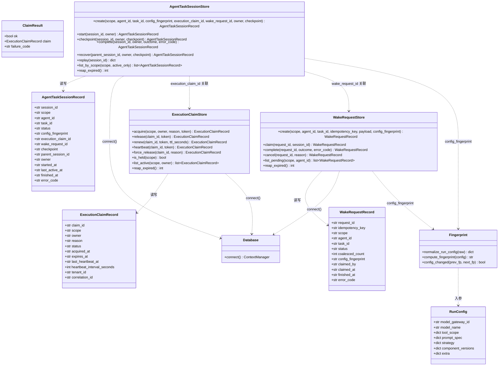
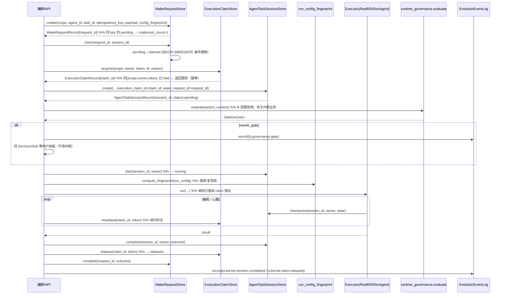
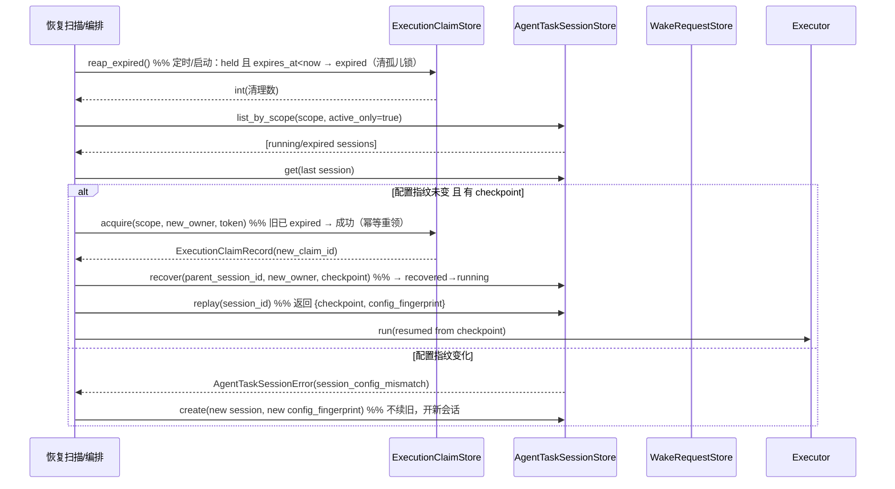
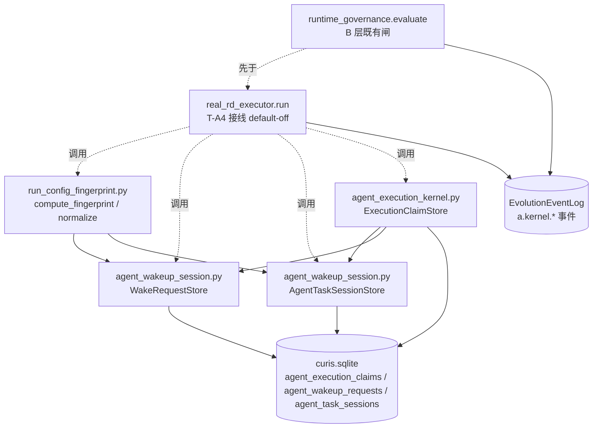
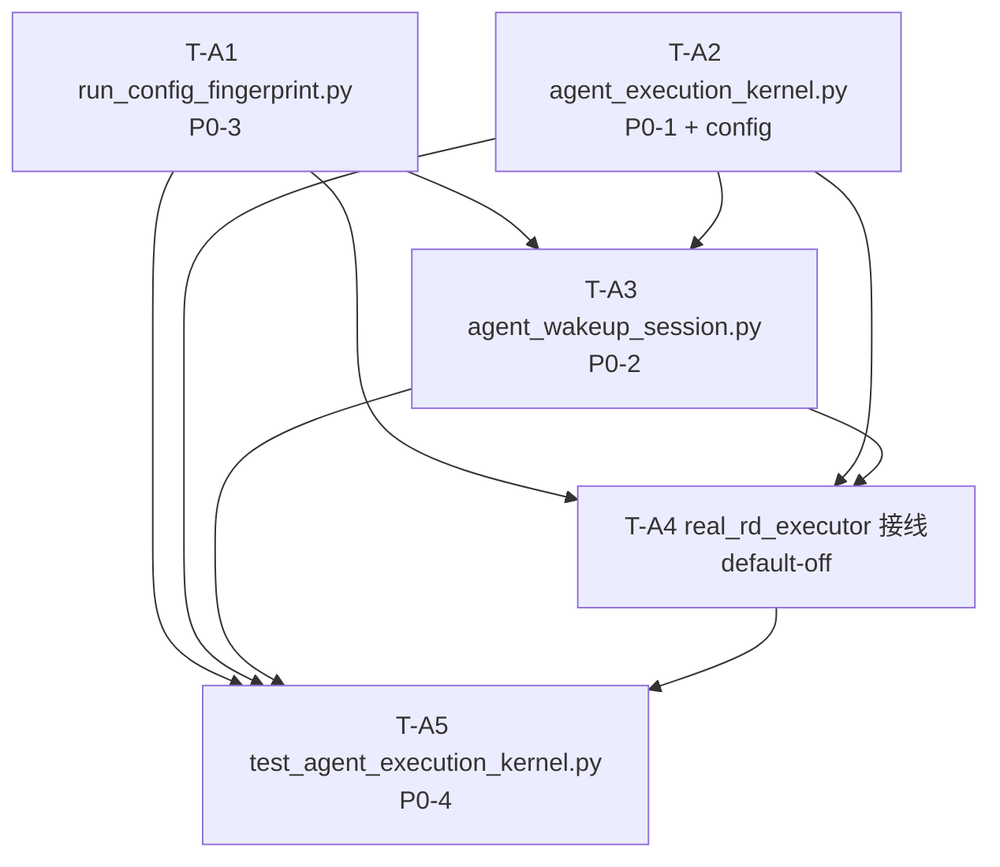

# Issue A · 通用 Agent Execution Kernel（实现级架构设计）

> 作者：架构师 高见远（software-architect）
> 受众：工程师 寇豆码（编码）、QA 严过关（测试）
> 性质：**实现级设计 + 有序任务列表**，**不含实现代码**，仅定义文件落点、数据结构契约、函数签名、调用流程与验收要点
> 权威输入：`docs/architecture/paperclip-conclusion-gap-analysis.md`（commit `1dc9da75`，M1/P0-1~P0-4 差距核对）
> 协同设计：`docs/architecture/b-layer-runtime-governance-impl-plan.md`（B 层闸引擎，须共存不破坏）
> 团队边界：**仅后端 / 不越 Workspace UI**；所有判定沿用「系统做技术决断、用户做业务拍板」

---

## 0. 范围与铁律（最高约束，不可妥协）

### 0.1 本次交付（4 项 P0，全后端）

| 编号 | 交付物 | 能力 |
|---|---|---|
| P0-1 | `ExecutionClaim` 通用执行锁 | idempotent 获取/释放/续约/强释放；TTL / heartbeat；区分 owner / scope / reason；防重复执行与孤儿锁 |
| P0-2 | `agent_wakeup_requests` / `agent_task_sessions` 表 | 持久化唤醒请求与运行会话；pending/running/completed/failed/recovered 等状态；可查询 / 可重放 / 可恢复 |
| P0-3 | 运行配置指纹 `run_config_fingerprint` | 对影响运行结果的配置（模型 / 工具 / prompt / 策略参数）算 SHA-256；缓存失效 / 恢复校验 / 运行复现 |
| P0-4 | 恢复异常测试套件 | 断点恢复、锁丢失、重复执行、配置指纹变化、会话过期等异常场景，含用例与验收标准 |

### 0.2 硬约束（不可违反）

1. **零新依赖**：仅用 Python 标准库（`sqlite3` / `threading` / `hashlib` / `json` / `datetime` / `uuid` / `typing` / `dataclasses` / `re`）+ 项目已装依赖；**不引入任何新包**（同 B 层 `runtime_governance.py` / `decision_sink.py` 风格）。
2. **不触发 `LOCKED_ACTIONS`**：本设计**不 import / 不调用** 任何解除 A 层锁定的路径（`auto_modify_code` / `lift_human_approval_gate`，见 `governance.py`）。
3. **不碰 L2 冻结域**：不引入 Marketplace / 真实计费 / 多租户 / 外部 Agent 生态 / Employee CRUD；不写商业/价格/套餐逻辑。
4. **与 B 层治理共存**：内核调用点**置于 `runtime_governance.evaluate()` 之后**，仅负责单执行者 + 恢复；不重评 gate、不绕过 `b.governance.gate` 决策链；内核自记脱敏事件 `a.kernel.*`，与 `b.governance.gate` 并列、不混。
5. **Admin / Workspace 共享后端**：新增表入**共享 `curis.sqlite`**（同 `Database` 实例）；不新增 FastAPI 路由（端点归 Issue B），不改 Workspace 执行链；store 接受 `Database | str`，与现有 `EvolutionEventLog(Database)` 一致。
6. **不代写代码**：本文仅定义契约与流程，**不含实现体**。

---

## 1. 实现方案与框架选型

### 1.1 总体方案

| 维度 | 选型 | 理由 |
|---|---|---|
| 数据结构 | 标准库 `dataclass`（**不引 pydantic**） | 与 B 层 `RuntimeGovernanceConfig` / `PendingDecisionRecord` 一致，import-light、零新依赖 |
| 持久化 | SQLite + `CREATE TABLE IF NOT EXISTS` + `threading.Lock` | 复用 `decision_sink.PendingDecisionStore` 既成范式；表自管理、增量、不与 `database.py` 受保护 schema 耦合 |
| 原子性 | `BEGIN IMMEDIATE` + 条件写 | 复用 `real_rd_executor._claim_once`（L447-486）单主占锁范式，提升为通用机制 |
| 幂等 | `idempotency_key` + 条件更新 | 复用 `EvolutionEventLog.record`（L29-39）去重范式；唤醒合并 / 重复领取同构 |
| 孤儿锁 | TTL + heartbeat + `reap_expired()` | owner 须周期性续约；进程死亡 → 心跳停 → TTL 过 → 标 `expired` → 可重领；`force_release()` 备手清孤儿 |
| 指纹 | 归一化（去噪 + 脱敏）→ canonical JSON → `sha256` | 直译 Paperclip 算法；digest 前缀 `sha256:` 与 `credential_vault` 一致 |
| 共存 | 内核接线点置于 `evaluate()` 之后、`DecisionSink` 之外 | 不破坏既有 gate/审批/决策链；内核只保证单执行者 + 可恢复 |

### 1.2 关键设计决策

- **store 接受 `database: Database | str`**：接线点（如 `RealRDExecutor`）传入既有的 `self.event_log.database`，保证与共享后端同库同文件；独立恢复脚本可传 `str` 路径。
- **脱敏贯穿**：所有落库 payload 仅含 `failure_code` / 状态 / 指纹 / 范围键，**无路径 / Key / 参数 / 原始 Secret**。
- **default-off 接线**：`real_rd_executor.py` 仅在 `agent_kernel_enabled=True` 时调用内核，默认 `False`，保证既有 `test_real_rd_executor.py` 8 passed 基线**零回归**。
- **事件分离**：内核记 `a.kernel.*` 系列；B 层记 `b.governance.gate`；二者独立追加写，互不改写。

---

## 2. 文件列表及相对路径

### 2.1 新增文件（3 模块 + 1 配置落点 + 1 测试）

| 文件 | 职责 | 对应 P0 |
|---|---|---|
| `backend/app/run_config_fingerprint.py` | `RunConfig` + `normalize_run_config()` + `compute_fingerprint()`（去噪/脱敏 → canonical JSON → SHA-256） | P0-3 |
| `backend/app/agent_execution_kernel.py` | `ExecutionClaim` 通用执行锁：`ExecutionClaimStore`（获取/释放/续约/强释放/heartbeat/reap）+ `agent_execution_kernel_config.json` 默认阈值读取 | P0-1 |
| `backend/app/agent_wakeup_session.py` | `WakeRequestStore`（`agent_wakeup_requests`）+ `AgentTaskSessionStore`（`agent_task_sessions`）：唤醒合并/幂等/状态机/续接/重放 | P0-2 |
| `backend/app/agent_execution_kernel_config.json` | 内核默认配置：`enabled=false`、`claim_ttl_seconds`、`claim_heartbeat_interval_seconds`、`wake_ttl_seconds`、`session_ttl_seconds`、`reap_interval_seconds` | P0-1/P0-2 |
| `backend/tests/test_agent_execution_kernel.py` | P0-4 恢复异常测试套件（离线 unittest + temp sqlite，复用 `test_b_layer_*` 的 mock 前置） | P0-4 |

### 2.2 最小改动的现有文件（仅插入调用，default-off，不改受保护核心）

| 文件 | 插入点 | 触发类别 | 改动性质 |
|---|---|---|---|
| `backend/app/real_rd_executor.py` | ① `run()` 入口（`_claim_once` 之后，约 L143 后）插入「内核领取 + 建唤醒请求 + 建会话 + 算指纹」；② `run()` 的 `finally`/完成分支插入「释放锁 + 完成会话 + 落 `a.kernel.*` 事件」 | 单执行者保证 + 恢复记录 | 在入口/收尾增 default-off 接线；`_claim_once` 原样保留（不重写受保护占锁逻辑） |

> **不改动**：`database.py`（schema 受保护，内核表自管理、不并入 `initialize()`）、`decision_sink.py` / `runtime_governance.py` / `gate_prompt.py`（仅复用，不重写）、`local_rd_toolset.py` / `model_gateway.py` / `evolution_event_log.py` / `d1_single_model_toolchain.py`（受保护，只复用）。

---

## 3. 数据结构与接口（类 / 表 / 字段 / 函数签名）

> 全部用标准库 `dataclass`；错误信息仅携带 `failure_code`（脱敏）。以下为**契约签名**，非实现体。

### 3.1 P0-1 · `ExecutionClaim` 通用执行锁

**表 `agent_execution_claims`**（DDL 字段）：

| 字段 | 类型 | 约束 | 说明 |
|---|---|---|---|
| `claim_id` | `TEXT` | PK | uuid4 hex |
| `scope` | `TEXT` | 索引 | 锁作用域（如 `{tenant_id}:{run_id}`），同 scope 仅一个 held |
| `owner` | `TEXT` | | 持有者（进程/会话/agent id） |
| `reason` | `TEXT` | | 脱敏原因（如 `real_rd.run`） |
| `token` | `TEXT` | | 不透明持有令牌；释放/续约须出示；防非 owner 误操作 |
| `status` | `TEXT` | `held\|released\|expired\|force_released` | 状态机 |
| `acquired_at` | `TEXT` | ISO UTC | 获取时刻 |
| `expires_at` | `TEXT` | ISO UTC | TTL 截止（续约/heartbeat 顺延） |
| `last_heartbeat_at` | `TEXT` | ISO UTC | 最近存活信号 |
| `heartbeat_interval_seconds` | `INT` | | 期望续约周期 |
| `tenant_id` | `TEXT` | | 租户（单租户 `selfuse`） |
| `correlation_id` | `TEXT` | | 审计关联 |

**记录 / 结果 dataclass**：

```python
@dataclass
class ExecutionClaimRecord:
    claim_id: str
    scope: str
    owner: str
    reason: str
    status: str            # held|released|expired|force_released
    acquired_at: str
    expires_at: str
    last_heartbeat_at: str
    heartbeat_interval_seconds: int
    tenant_id: str = ""
    correlation_id: str = ""

@dataclass
class ClaimResult:
    ok: bool
    claim: ExecutionClaimRecord | None = None
    failure_code: str | None = None   # claim_already_held|claim_token_mismatch|claim_not_found|claim_expired

class ExecutionClaimError(Exception):
    """脱敏错误：仅携带 failure_code，无路径/Key/参数。"""
    def __init__(self, failure_code: str, *, message: str | None = None) -> None: ...
```

**`ExecutionClaimStore` 函数签名**：

```python
class ExecutionClaimStore:
    def __init__(self, database: "Database | str",
                 *, default_ttl_seconds: int | None = None,
                 default_heartbeat_interval_seconds: int | None = None) -> None: ...

    # —— 幂等获取：同 (scope, owner, token) 已 held → 返回既有（不双执行）；
    #     他 owner 正 held → 抛 ExecutionClaimError("claim_already_held") ——
    def acquire(self, scope: str, owner: str, reason: str, *,
                ttl_seconds: int | None = None,
                heartbeat_interval_seconds: int | None = None,
                token: str, tenant_id: str = "",
                correlation_id: str = "") -> ExecutionClaimRecord: ...

    # —— 仅 owner+token 可释放；非持有/令牌错 → 抛错 ——
    def release(self, claim_id: str, token: str) -> ExecutionClaimRecord: ...

    # —— owner 续约：顺延 expires_at + 刷新 last_heartbeat_at；幂等 ——
    def renew(self, claim_id: str, token: str, *,
              ttl_seconds: int | None = None) -> ExecutionClaimRecord: ...

    # —— 存活心跳：仅刷新 last_heartbeat_at（不延 TTL 也可，由 renew 延 TTL）——
    def heartbeat(self, claim_id: str, token: str) -> ExecutionClaimRecord: ...

    # —— 强释放：管理员/恢复清孤儿用，可无视 token 将 held→force_released ——
    def force_release(self, claim_id: str, *, reason: str = "force_release") -> ExecutionClaimRecord: ...

    # —— 查询 ——
    def is_held(self, scope: str) -> bool: ...                 # status==held 且 expires_at>now
    def get(self, claim_id: str) -> ExecutionClaimRecord | None: ...
    def list_active(self, scope: str | None = None,
                    owner: str | None = None) -> list[ExecutionClaimRecord]: ...

    # —— 孤儿锁清理：held 且 expires_at<now → expired（TTL 自然过期，无需强释放）——
    def reap_expired(self) -> int: ...
```

### 3.2 P0-2 · `agent_wakeup_requests` / `agent_task_sessions`

**表 `agent_wakeup_requests`**：

| 字段 | 类型 | 约束 | 说明 |
|---|---|---|---|
| `request_id` | `TEXT` | PK | uuid4 hex |
| `idempotency_key` | `TEXT` | 索引 | 合并键（如 `{scope}:{task_id}:{config_fingerprint}`） |
| `scope` | `TEXT` | | 唤醒作用域 |
| `agent_id` | `TEXT` | | 目标 agent |
| `task_id` | `TEXT` | | 目标任务 |
| `tenant_id` | `TEXT` | | 租户 |
| `priority` | `INT` | default 5 | 优先级 |
| `status` | `TEXT` | `pending\|claimed\|completed\|failed\|cancelled\|coalesced` | 状态机 |
| `coalesced_count` | `INT` | default 1 | 合并计数（幂等合并） |
| `payload` | `TEXT` | JSON | 脱敏唤醒参数 |
| `config_fingerprint` | `TEXT` | | 运行配置指纹（链 P0-3） |
| `claimed_by` | `TEXT` | | 领取的 session_id |
| `claimed_at` | `TEXT` | ISO | 领取时刻 |
| `finished_at` | `TEXT` | ISO | 完成时刻 |
| `expires_at` | `TEXT` | ISO | 唤醒 TTL |
| `error_code` | `TEXT` | | 失败码（脱敏） |
| `correlation_id` | `TEXT` | | 审计关联 |
| `created_at` | `TEXT` | ISO | 创建时刻 |

**表 `agent_task_sessions`**：

| 字段 | 类型 | 约束 | 说明 |
|---|---|---|---|
| `session_id` | `TEXT` | PK | uuid4 hex |
| `scope` | `TEXT` | 索引 | 会话作用域 |
| `agent_id` | `TEXT` | | agent |
| `task_id` | `TEXT` | | 任务 |
| `tenant_id` | `TEXT` | | 租户 |
| `status` | `TEXT` | `pending\|running\|completed\|failed\|recovered\|expired` | 状态机 |
| `config_fingerprint` | `TEXT` | | 运行配置指纹 |
| `execution_claim_id` | `TEXT` | | 关联 `agent_execution_claims.claim_id` |
| `wake_request_id` | `TEXT` | | 关联 `agent_wakeup_requests.request_id` |
| `checkpoint` | `TEXT` | JSON | 可续接状态（脱敏） |
| `parent_session_id` | `TEXT` | | 续接自（recovered 用） |
| `owner` | `TEXT` | | 锁持有者 |
| `started_at` | `TEXT` | ISO | 开始时刻 |
| `last_active_at` | `TEXT` | ISO | 最近 checkpoint/心跳 |
| `finished_at` | `TEXT` | ISO | 结束时刻 |
| `expires_at` | `TEXT` | ISO | 会话 TTL |
| `error_code` | `TEXT` | | 失败码（脱敏） |
| `correlation_id` | `TEXT` | | 审计关联 |
| `created_at` | `TEXT` | ISO | 创建时刻 |

**记录 / 结果 dataclass**：

```python
@dataclass
class WakeRequestRecord:
    request_id: str
    idempotency_key: str
    scope: str
    agent_id: str
    task_id: str
    status: str               # pending|claimed|completed|failed|cancelled|coalesced
    coalesced_count: int = 1
    config_fingerprint: str = ""
    claimed_by: str = ""
    claimed_at: str = ""
    finished_at: str = ""
    error_code: str = ""
    tenant_id: str = ""
    correlation_id: str = ""
    expires_at: str = ""
    created_at: str = ""

@dataclass
class AgentTaskSessionRecord:
    session_id: str
    scope: str
    agent_id: str
    task_id: str
    status: str               # pending|running|completed|failed|recovered|expired
    config_fingerprint: str = ""
    execution_claim_id: str = ""
    wake_request_id: str = ""
    checkpoint: str = "{}"    # JSON
    parent_session_id: str = ""
    owner: str = ""
    started_at: str = ""
    last_active_at: str = ""
    finished_at: str = ""
    expires_at: str = ""
    error_code: str = ""
    tenant_id: str = ""
    correlation_id: str = ""
    created_at: str = ""

class WakeRequestError(Exception):
    def __init__(self, failure_code: str, *, message: str | None = None) -> None: ...
    # wake_not_found|wake_already_claimed|wake_expired|wake_coalesced

class AgentTaskSessionError(Exception):
    def __init__(self, failure_code: str, *, message: str | None = None) -> None: ...
    # session_not_found|session_already_terminal|session_expired|session_config_mismatch|session_owner_mismatch
```

**`WakeRequestStore` 函数签名**：

```python
class WakeRequestStore:
    def __init__(self, database: "Database | str", *,
                 default_ttl_seconds: int | None = None) -> None: ...

    # —— 幂等 + 合并：同 idempotency_key 仍 pending → coalesced_count+1 返回既有；
    #     否则插入 pending ——
    def create(self, scope: str, agent_id: str, task_id: str, *,
               idempotency_key: str, priority: int = 5,
               payload: dict, config_fingerprint: str = "",
               tenant_id: str = "", correlation_id: str = "",
               ttl_seconds: int | None = None) -> WakeRequestRecord: ...

    # —— 原子领取：BEGIN IMMEDIATE + 条件更新 pending→claimed；
    #     已 claimed 同 session → 返回既有（幂等）；他 session 已 claimed → 抛 wake_already_claimed ——
    def claim(self, request_id: str, session_id: str, *,
              ttl_seconds: int | None = None) -> WakeRequestRecord: ...

    def complete(self, request_id: str, *, outcome: str,
                 error_code: str = "") -> WakeRequestRecord: ...   # claimed→completed|failed
    def cancel(self, request_id: str, *, reason: str = "") -> WakeRequestRecord: ...
    def get(self, request_id: str) -> WakeRequestRecord | None: ...
    def list_pending(self, scope: str | None = None,
                     agent_id: str | None = None) -> list[WakeRequestRecord]: ...
    def reap_expired(self) -> int: ...   # pending/claimed 且 expires_at<now → cancelled/expired
```

**`AgentTaskSessionStore` 函数签名**：

```python
class AgentTaskSessionStore:
    def __init__(self, database: "Database | str", *,
                 default_ttl_seconds: int | None = None) -> None: ...

    def create(self, scope: str, agent_id: str, task_id: str, *,
               config_fingerprint: str, execution_claim_id: str,
               wake_request_id: str, owner: str, checkpoint: dict | None = None,
               tenant_id: str = "", correlation_id: str = "",
               ttl_seconds: int | None = None) -> AgentTaskSessionRecord: ...   # → pending

    def start(self, session_id: str, owner: str) -> AgentTaskSessionRecord: ...  # pending→running
    def checkpoint(self, session_id: str, owner: str,
                   checkpoint: dict) -> AgentTaskSessionRecord: ...              # 续接状态 + last_active_at
    def complete(self, session_id: str, owner: str, *,
                 outcome: str, error_code: str = "") -> AgentTaskSessionRecord: ...  # running→completed|failed

    # —— 断点恢复：基于 parent 最近 checkpoint 建新会话（status=recovered→running），
    #     携带 parent_session_id；若 config_fingerprint 变化 → 抛 session_config_mismatch（禁止续旧）——
    def recover(self, parent_session_id: str, owner: str, *,
                checkpoint: dict | None = None) -> AgentTaskSessionRecord: ...

    def replay(self, session_id: str) -> dict: ...   # 返回 {checkpoint, config_fingerprint} 供重跑
    def get(self, session_id: str) -> AgentTaskSessionRecord | None: ...
    def list_by_scope(self, scope: str,
                      active_only: bool = False) -> list[AgentTaskSessionRecord]: ...
    def reap_expired(self) -> int: ...   # running 且 expires_at<now 且无近期 checkpoint → expired
```

### 3.3 P0-3 · 运行配置指纹 `run_config_fingerprint`

```python
@dataclass
class RunConfig:
    model_gateway_id: str                             # 如 "anthropic" / "openai" / "workbuddy"
    model_name: str                                   # 如 "claude-sonnet-4-20250514" / "gpt-4o"
    tool_scope: dict                                  # {"sandbox_mode": "git", "allow_paths": [...]}
    prompt_spec: dict                                 # 归一化任务规格（去 run_id/时间戳/绝对路径）
    strategy: dict                                    # {"max_rounds":3, "test_command_id":"...", "test_command_argv":[...], "temperature":0.0}
    component_versions: dict[str, str]                # skill/tool/adapter 版本标签（影响结果）
    extra: dict = field(default_factory=dict)         # 其它确定性旋钮

# —— 归一化：递归排序键、剔除 None/空、剔除噪声字段（timestamp/path/request_id/run_id）、
#     脱敏 Secret（api_key/secret/token/password → "<redacted>"，且不计入哈希）——
def normalize_run_config(raw: "RunConfig | dict") -> dict: ...

# —— 去噪 + 脱敏 → canonical JSON（sort_keys, separators） → sha256 → "sha256:<hex>" ——
def compute_fingerprint(config: "RunConfig | dict") -> str: ...

def config_changed(prev_fp: str, next_fp: str) -> bool: ...   # 仅比较相等性
```

> 指纹字段集（影响运行结果）：模型网关+模型名、工具作用域（sandbox 模式+允许路径）、任务 prompt 规格、策略参数（轮次/测试命令/温度）、组件版本（skill/tool/adapter）。**明确排除**：时间戳、绝对路径、request_id、run_id、原始 Secret、随机 nonce。

### 3.4 类图（Mermaid）



---

## 4. 程序调用流程

### 4.1 唤醒 → 领取 → 运行 → 完成（正常路径）



### 4.2 断点恢复 + 锁丢失 / 过期清理



### 4.3 `real_rd_executor.py` 接线步骤（default-off）

1. `run()` 入口（`_claim_once` 之后）：当 `agent_kernel_enabled` 为真，计算 `run_config` → `compute_fingerprint()`；构造 `idempotency_key`；`WakeRequestStore.create()` → `claim()`；`ExecutionClaimStore.acquire()`；`AgentTaskSessionStore.create()` + `start()`；落 `a.kernel.wake.created` / `a.kernel.claim.acquired` / `a.kernel.session.started`。
2. 主循环内（每轮后）：`AgentTaskSessionStore.checkpoint()` + `ExecutionClaimStore.heartbeat()`。
3. `finally`/完成分支：`AgentTaskSessionStore.complete()` + `ExecutionClaimStore.release()` + `WakeRequestStore.complete()`；落 `a.kernel.*` 事件。
4. **受保护保持**：`_claim_once` 原样保留；`enabled=False`（默认）时上述全跳过，`test_real_rd_executor.py` 8 passed 零回归。

---

## 5. 任务列表（按实现顺序，含依赖）

> 规则：T-A1 / T-A2 为地基（并行，零依赖）；T-A3 依赖 T-A1+T-A2；T-A4 依赖 T-A1~T-A3；T-A5 测试依赖 T-A1~T-A4。每个 T 标注：依赖 / 文件 / 触 L2 或红线（预期**全否**）/ 验收要点。

### T-A1 · `run_config_fingerprint.py`（P0-3 运行配置指纹 SHA-256）
- **依赖**：无
- **文件**：新增 `backend/app/run_config_fingerprint.py`
- **触 L2 / 红线**：否（纯函数，不触 `LOCKED_ACTIONS`、不引入计费/多租户）
- **验收要点**：
  - `compute_fingerprint()` 对同输入恒定返回相同 `sha256:<hex>`；`config_changed()` 正确判等。
  - 归一化剔除时间戳 / 绝对路径 / `request_id` / `run_id` / 随机 nonce。
  - **脱敏**：含 `api_key` / `secret` / `token` / `password` 的值被 `"<redacted>"` 替换且**不进入**哈希；断言返回的 fingerprint 字符串与归一化 JSON 均不含原始 Secret。

### T-A2 · `agent_execution_kernel.py`（P0-1 ExecutionClaim 通用执行锁 + 配置落点）
- **依赖**：无（与 T-A1 并行）
- **文件**：新增 `backend/app/agent_execution_kernel.py`、`backend/app/agent_execution_kernel_config.json`
- **触 L2 / 红线**：否
- **验收要点**：
  - `acquire()` 幂等：同 `(scope, owner, token)` 已 held → 返回既有 `claim_id`（不新建、不双执行）；他 owner 正 held → 抛 `ExecutionClaimError("claim_already_held")`。
  - `release()` / `renew()` / `heartbeat()` 须 `token` 匹配；错令牌 → 抛 `claim_token_mismatch`；非持有 → `claim_not_found`。
  - `force_release()` 可无视 token 将 held→`force_released`（清孤儿备用）。
  - `reap_expired()`：held 且 `expires_at<now` → `expired`（TTL 自然过期，无心跳即孤儿）。
  - 原子性：`acquire` 用 `BEGIN IMMEDIATE` + 条件插入（沿用 `_claim_once` 范式）。
  - 配置默认值：`enabled=false`、`claim_ttl_seconds=300`、`claim_heartbeat_interval_seconds=60`、`reap_interval_seconds=60`。

### T-A3 · `agent_wakeup_session.py`（P0-2 两表 + 唤醒合并/幂等/续接）
- **依赖**：T-A1（指纹链接）、T-A2（claim 链接）
- **文件**：新增 `backend/app/agent_wakeup_session.py`
- **触 L2 / 红线**：否
- **验收要点**：
  - `WakeRequestStore.create()` 幂等合并：同 `idempotency_key` 仍 pending → `coalesced_count+1` 返回既有（不双执行）；否则插 pending。
  - `WakeRequestStore.claim()` 原子 `pending→claimed`（BEGIN IMMEDIATE 条件更新）；同 session 已 claimed → 返回既有；他 session → `wake_already_claimed`。
  - `AgentTaskSessionStore` 状态机：`create→pending`、`start→running`、`checkpoint`（续接 + `last_active_at`）、`complete→completed|failed`。
  - `recover(parent, owner)`：`status=recovered→running`，带 `parent_session_id` 与 replay checkpoint；**配置指纹变化 → `session_config_mismatch`**（禁止续旧）。
  - `replay()` 返回 `{checkpoint, config_fingerprint}`；`list_by_scope(active_only=)` 支持恢复查询。
  - `reap_expired()`：pending/claimed（wake）与 running（session）过期 → 终态。

### T-A4 · `real_rd_executor.py` 接线 + 内核事件落库（default-off）
- **依赖**：T-A1、T-A2、T-A3
- **文件**：改 `backend/app/real_rd_executor.py`（入口 + `finally` 两处插入，default-off）
- **触 L2 / 红线**：否（接线点在 `evaluate()` 之后；不解除 `LOCKED_ACTIONS`；事件脱敏 `a.kernel.*`）
- **验收要点**：
  - `agent_kernel_enabled=False`（默认）→ 全跳过，既有 `test_real_rd_executor.py` 8 passed **零回归**。
  - `enabled=True` 时：入口建 wake→claim→session（带 `config_fingerprint`），收尾 `complete`+`release`+`WakeRequestStore.complete`，落 `a.kernel.*` 事件（脱敏）。
  - 既有 `_claim_once` / agent 分支 / 沙箱回滚 **不改**；B 层 `b.governance.gate` 落库 **不变**。

### T-A5 · `test_agent_execution_kernel.py`（P0-4 恢复异常测试套件）
- **依赖**：T-A1、T-A2、T-A3、T-A4
- **文件**：新增 `backend/tests/test_agent_execution_kernel.py`
- **触 L2 / 红线**：否（测试自身不触 L2；不依赖未实现模块）
- **验收要点**：见 §4 用例表 + §8 验收清单（断点恢复 / 锁丢失 / 重复执行 / 指纹变化 / 会话过期 / 终止释放 / Wake 合并 / Secret 不进指纹/日志 / 非 Git 降级边界）。

---

## 6. 依赖包列表

| 包 / 模块 | 来源 | 用途 | 是否新增 |
|---|---|---|---|
| `sqlite3` / `threading` / `hashlib` / `json` / `datetime` / `uuid` / `typing` / `dataclasses` / `re` | Python 标准库 | 持久化 / 锁 / 指纹 / 校验 | 否 |
| `pydantic` | 随 fastapi 间接可用 | **刻意不引**，改用 stdlib dataclass（与 B 层一致） | 否 |
| 新增第三方重依赖 | — | — | **无** |

> 结论：**零新依赖**。内核模块仅依赖标准库 + 项目既有 `Database` / `EvolutionEventLog` / `runtime_governance`（仅复用、不重写）。

---

## 7. 共享知识（跨文件约定）

### 7.1 统一事件类型（脱敏，追加写 `EvolutionEventLog`）
- 锁：`a.kernel.claim.acquired` / `a.kernel.claim.released` / `a.kernel.claim.renewed` / `a.kernel.claim.expired` / `a.kernel.claim.force_released`
- 唤醒：`a.kernel.wake.created` / `a.kernel.wake.coalesced` / `a.kernel.wake.claimed` / `a.kernel.wake.completed`
- 会话：`a.kernel.session.created` / `a.kernel.session.started` / `a.kernel.session.checkpoint` / `a.kernel.session.recovered` / `a.kernel.session.completed` / `a.kernel.session.expired`
- 与 `b.governance.gate` **并列独立**，互不改写。

### 7.2 错误码（脱敏，`failure_code` only）
- Claim：`claim_already_held` / `claim_token_mismatch` / `claim_not_found` / `claim_expired`
- Wake：`wake_not_found` / `wake_already_claimed` / `wake_expired` / `wake_coalesced`
- Session：`session_not_found` / `session_already_terminal` / `session_expired` / `session_config_mismatch` / `session_owner_mismatch`
- 所有错误类（`ExecutionClaimError` / `WakeRequestError` / `AgentTaskSessionError`）**不携带路径 / Key / 参数**，仅固定 `failure_code`。

### 7.3 常量（集中在各模块顶部，命名一致）
```
DEFAULT_CLAIM_TTL_SECONDS = 300
DEFAULT_CLAIM_HEARTBEAT_INTERVAL_SECONDS = 60
DEFAULT_WAKE_TTL_SECONDS = 3600
DEFAULT_SESSION_TTL_SECONDS = 3600
DEFAULT_REAP_INTERVAL_SECONDS = 60
EXPIRED_GRACE_SECONDS = 30
FINGERPRINT_PREFIX = "sha256:"
```

### 7.4 命名 / 表 / 记录约定
- 表名：`agent_execution_claims` / `agent_wakeup_requests` / `agent_task_sessions`（全员 `agent_` 前缀，避免与现有 `evolution_events` / `tasks` / `executions` 冲突）。
- 记录 dataclass：`ExecutionClaimRecord` / `WakeRequestRecord` / `AgentTaskSessionRecord`；store：`ExecutionClaimStore` / `WakeRequestStore` / `AgentTaskSessionStore`。
- store 均接受 `database: Database | str`，经 `connect()` 上下文管理器访问；每操作包 `threading.Lock` 串行化（复用 `decision_sink` 范式）。
- 时间统一 ISO 8601 UTC（`datetime.now(timezone.utc).isoformat()`），复用 B 层 `_now_iso()` 风格；过期判定 `_expired_at()` 风格（非法时间视作未过期，fail-open 读取侧）。

### 7.5 幂等键构造
- Claim：`{scope}:{owner}`（同 owner 重领返回既有）。
- Wake：`{scope}:{task_id}:{config_fingerprint}`（同配置重唤醒合并）。
- 均经 `build_idempotency_key(*parts)` 统一拼接（lower + 冒号分隔）。

### 7.6 TTL / heartbeat 语义（孤儿锁核心）
- 一条 claim **active** ⟺ `status=="held"` 且 `expires_at > now`。
- owner 须周期性 `heartbeat()` / `renew()` 顺延 `expires_at`；进程死亡 → 心跳停 → TTL 过 → `reap_expired()` 标 `expired` → 可重领（**无双执行**）。
- `force_release()` 仅用于运维清孤儿，不在正常路径调用。

### 7.7 指纹格式与脱敏
- 返回 `"sha256:" + hexdigest`（与 `credential_vault` digest 前缀一致）。
- 归一化递归排序键、剔除噪声（时间戳/路径/request_id/run_id/nonce）、脱敏 Secret（`api_key|secret|token|password` → `"<redacted>"`，且不计入哈希）。
- 指纹用于：缓存失效（fp 未变可跳重跑）、恢复校验（`recover()` 比对 parent fp）、运行复现（会话落 fp + `a.kernel.*` 事件）。

### 7.8 与 B 层治理共存铁律
1. 内核接线点**置于 `runtime_governance.evaluate()` 之后**；内核**不重评** gate、**不绕过** `b.governance.gate` 决策链。
2. 内核模块**不得 import / 调用** `governance.LOCKED_ACTIONS` 任何解除路径；`real_rd_executor` 接线不改 A 层 human-approval gate。
3. 事件分离：内核记 `a.kernel.*`，B 层记 `b.governance.gate`；脱敏标准一致（无路径/Key/参数）。
4. fail-closed 贯穿：内核任何异常 → 抛脱敏 `failure_code` 错误，绝不静默放行 / 双执行。

---

## 8. 待明确事项 / 风险

### 风险① · 共享 DB 路径解析（Admin/Workspace 同库）
- **事实**：`decision_sink` 用独立 `data/b_layer_pending_decisions.sqlite`；但 Issue A 需 Admin 与 Workspace **同库**查询/恢复。
- **方案**：store 接受 `Database` 实例（接线点传 `self.event_log.database`），保证同文件；独立恢复脚本可传 `str` 路径。
- **需主理人确认**：独立恢复扫描进程（cron/worker）的 DB 路径来源（`CURIS_DB_PATH` 环境变量 or 与 app 同解析），确保与运行时同文件。

### 风险② · 非 RealRD 执行器的指纹字段范围
- **事实**：本设计以 `RealRDExecutor` 的 `run_config`（model/tool_scope/prompt_spec/strategy/component_versions）为样本；`ContentWorkflowRuntime` / `DevAgent` 另类执行器的"影响结果的配置"字段集未穷举。
- **方案**：`RunConfig` 用开放 `extra: dict` 承载；各执行器自行填充归一化后的确定性字段。
- **需主理人确认**：是否本期仅对 RealRD 路径接指纹（default-off），其余执行器后续补 `extra` 映射。

### 风险③ · 恢复编排者（recovery orchestrator）归属
- **事实**：`reap_expired()` + `recover()` 机制已定义，但"谁定时触发扫描 / 谁决策 recover vs 新会话"尚缺上层编排。
- **方案**：本期仅交付**机制层**（store 方法 + `reap_expired` 可被任意调用方触发）；上层定时 sweeper / Workspace 恢复 UI 归后续任务（不越界本期）。
- **需主理人确认**：扫描触发方式（进程内定时线程 / 外部 cron / 启动期一次性），本期是否附带最小 sweeper 桩。

### 风险④ · 非 Git 工作区降级边界
- **事实**：PRD P0-4 要求"非 Git 工作区明确降级或拒绝"。`LocalRDToolset` / `SandboxMode` 已有降级（既有测试覆盖）；内核层是 workspace-agnostic。
- **方案**：内核在 `complete(session, owner, outcome="failed", error_code="workspace_not_git")` 记录并释放 claim（不双执行）；深层 non-git 降级断言复用 `real_rd_executor` / `local_rd_toolset` 既有测试，**不在本测试套件重写**。
- **需主理人确认**：内核是否仅做"错误码记录 + 释放"，把 non-git 实际判定继续留给 `LocalRDToolset`（保持边界）。

### 风险⑤ · 与 B 层 `test_b_layer_*` 守卫一致
- 测试须包含：**断言 `governance.LOCKED_ACTIONS` 长度/内容不变**；内核不引入 `budget_guard`、不解除 `auto_modify_code` / `lift_human_approval_gate`；不新增 L2 逻辑（Marketplace/计费/多租户/Employee CRUD）。
- 复用 `test_real_rd_executor.py` 8 passed 基线不回归（default-off 保证）。

---

## 9. 落地模块依赖图（Mermaid）



## 10. 任务依赖图（Mermaid）


