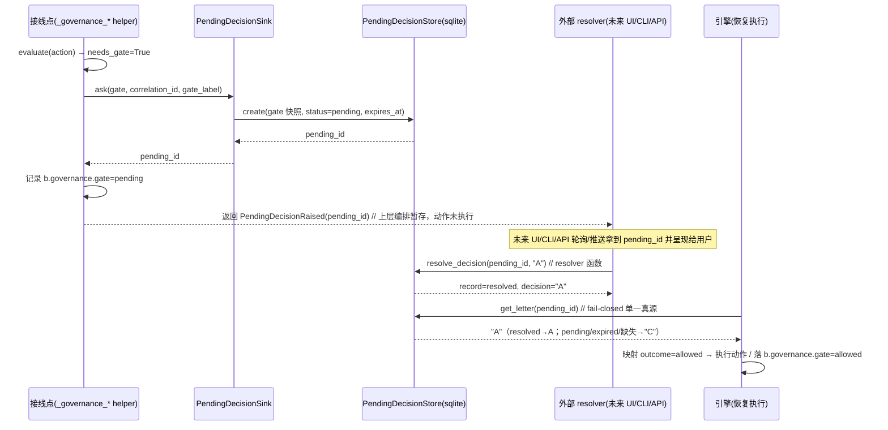
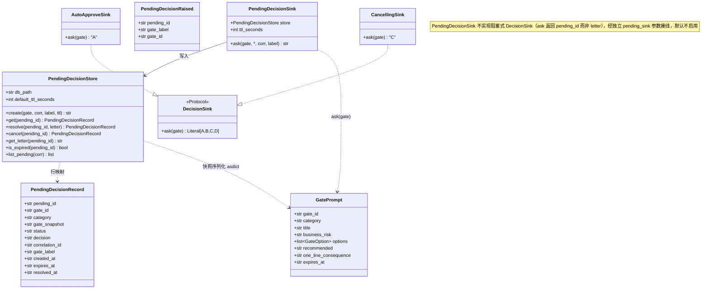
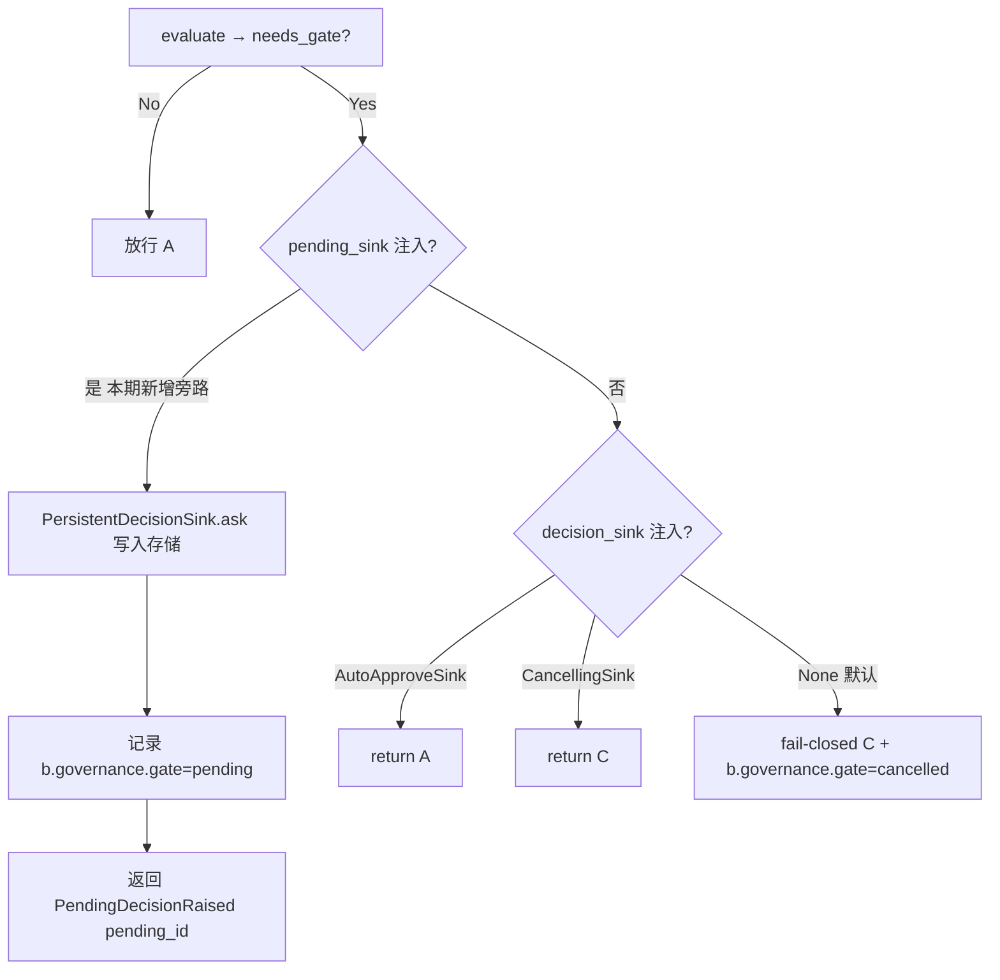

# B 层运行时治理 · 真实 DecisionSink 增量设计（后端机制）

> 作者：架构师 高见远（software-architect）
> 受众：工程师 寇豆码（编码）、QA 严过关（测试）、主理人 齐活林（收口评审）
> 性质：**增量架构设计（仅设计，不含实现代码）**，净新增能力
> 上游权威源：`docs/architecture/b-layer-runtime-governance.md`（设计源）、`docs/architecture/b-layer-runtime-governance-impl-plan.md`（已实现代码设计，§2.3 / §3.2 / §6 第 6 条 / §7 风险②）
> 关联代码：`backend/app/runtime_governance.py`、`backend/app/real_rd_executor.py`、`backend/app/content_workflow_runtime.py`、`backend/app/governance.py`、`backend/app/local_rd_toolset.py`
> 生成日期：2026-07-20（增量）

---

## 0. 本次增量的定位（最高约束）

impl plan §7 风险② 把「真实 DecisionSink」明确列为**后续独立任务**。本设计补上它：把现有「要么注入 `AutoApproveSink`（一律 A）／要么无 sink 时 fail-closed 默认 C 取消（不落等待）」升级为「**真实等用户拍板**」——闸弹出时把决策请求**持久化**，由外部调用方（未来的 Workspace 终端用户 UI / CLI / API）回填 A/B/C/D，引擎据此继续或 fail-closed。

**本增量只交付后端机制 + 可测试桩**。UI 呈现与 resolver 的前端调用属 Workspace 前端团队职责（2026-07-13 裁定本团队不主导 Workspace 端 UI），本设计**不交付、仅留接口与明确边界**。

### 0.1 硬约束（不可妥协）

1. **不建 UI**：UI 呈现、resolver 前端调用属 Workspace 前端团队；本设计只交付后端机制 + headless 测试桩，并显式标注边界。
2. **不改坏既有行为**：不得破坏 agent 分支（`is_agent` / `_build_agent_prompt` / `_make_agent_rollback`）、沙箱回滚、既有同步循环。
3. **fail-closed 贯穿**：resolver 超时 / 缺失 / 异常 → 默认 C 取消，落 `b.governance.gate=cancelled`（脱敏，无路径/Key/参数）。
4. **零新依赖**：仅标准库（`sqlite3` / `threading` / `time` / `uuid` / `dataclasses` / `json` / `os`）；不引 pydantic / websocket 等。
5. **不触 L2**：不引入计费 / 多租户 / 商业。
6. **同步兼容**：不在本期耦合 WebSocket / 事件流。

---

## 1. 选定集成姿态

### 1.1 两种可选姿态

impl plan §7 风险② 给出两种姿态，由本设计权衡推荐其一：

- **(a) 阻塞式 `PendingDecisionSink`**：`ask()` 把请求写入存储并**阻塞等待** resolver 回填（带超时 → fail-closed C）。简单、同步兼容，但会占用调用线程。
- **(b) 预检闸 + 异步 resolver（推荐）**：`PendingDecisionSink.ask()` 把请求写入存储即返回 `pending_decision_id`（**不阻塞**）；接线点在「动作执行前」弹出预检闸；真实的「等待 + 恢复」由上层编排（未来的 UI/API）驱动。本期仅提供存储 + resolver 函数 + 一个 headless 测试桩验证「写入 → resolver 回填 → 引擎读回决策」闭环。

### 1.2 推荐 (b) 的理由与风险边界

**选 (b)。** 关键依据：

1. **既有同步循环不能被卡死**。四个接线点当前都在请求处理 / executor 循环内**同步**执行（`RealRDExecutor.run` 主循环可跑多轮、含模型网关调用；`content_workflow_runtime.run` 在发布循环前；`governance.apply_proposal` 在 human-approval gate 前）。若 `ask()` 在这类上下文内**阻塞**等用户拍板，会占用调用线程、饿死反应器 / 触发看门狗或请求超时，对**长耗时 agent 循环**风险尤其高（见 §1.3）。
2. **resolver 是跨进程实体**。未来回填决策的是 Workspace UI / CLI / API（独立进程），必须靠**持久化存储**而非进程内阻塞来桥接。sqlite 文件存储天然跨进程。
3. **本期不耦合 WebSocket / 事件流**（impl plan §7 风险② 明示），(b) 的「存储 + resolver 函数 + 测试桩」恰好满足，且零新依赖。
4. **默认行为零改动**。本期生产调用方仍 `decision_sink=None → fail-closed C`；`PendingDecisionSink` 仅经**独立可选参数** `pending_sink` 接线，默认不传 → 既有同步循环与 fail-closed 完全不变。

**(a) 的适用边界（本期不做，留作未来可选）**：仅适合「短耗时、有 tty 的交互式 CLI 预检闸」且调用方可接受线程占用；长耗时 agent 循环禁止用 (a)。本期不实现 (a)，避免误用于长循环。

### 1.3 (b) 的残留风险与缓解

| 风险 | 说明 | 缓解（本期 / 未来） |
|---|---|---|
| 生产调用方未注入 `pending_sink` 时仍是 fail-closed C | 本期真实用户拍板**不会**自动生效（需未来 Workspace 端接线） | 本期仅交付机制 + 旁路 + 测试桩；收口文档标注「未来由 Workspace UI/API 团队启用 resume 编排」 |
| `PendingDecisionRaised` 信号若被误注入到未改造的循环边界会「吞掉」动作 | 接线 helper 在 `pending_sink` 注入时返回信号而非执行动作 | 信号仅在 `pending_sink is not None` 时产生；本期无生产调用方传 `pending_sink`；未来编排层负责捕获并 resume |
| 存储成为单点 / 文件锁竞争 | sqlite 单文件并发写 | `threading.Lock` 串行化写；每操作独立连接（`check_same_thread` 无虞）；本期并发量极低 |

---

## 2. 新增 / 改动文件清单与相对路径

### 2.1 新增文件

| 文件 | 职责 | 性质 |
|---|---|---|
| `backend/app/decision_sink.py` | **本期核心**：`PendingDecisionStore`（sqlite 持久化）、`PendingDecisionSink`（实现 `ask` 但返回 `pending_id`，非阻塞）、`PendingDecisionRaised`（接线信号）、`resolve_decision()`（resolver 函数）、`PendingDecisionError`、`PendingDecisionRecord`（dataclass）。import-light、零新依赖 | **新增** |
| `backend/tests/test_b_layer_decisionsink.py` | headless 闭环测试桩：写入 → resolver 回填 → 引擎读回决策；fail-closed（超时/缺失/异常→C）；与 `AutoApproveSink` / `CancellingSink` 共存断言；L2 不触发断言 | **新增** |
| `data/b_layer_pending_decisions.sqlite` | `PendingDecisionStore` 默认持久化文件（运行时由 store 自动建表；不入 git，加 `.gitignore` 或运行时生成） | **运行时生成** |

### 2.2 最小改动的现有文件（仅插旁路，默认关闭）

| 文件 | 插入点 | 改动性质 |
|---|---|---|
| `backend/app/real_rd_executor.py` | `_governance_evaluate()`（约 L741）增加 `pending_sink` 参数与分支：当 `pending_sink is not None and decision.needs_gate` → 持久化 + 记录 `b.governance.gate=pending` + 返回 `PendingDecisionRaised(pending_id)`；`run()` 签名（约 L122）加 `pending_sink: Any = None` 并透传 | 仅加旁路，默认 `None` 时行为与当前完全一致 |
| `backend/app/content_workflow_runtime.py` | `_resolve_gate()`（约 L232）/ `_governance_gate_before_publish()`（约 L214）增加 `pending_sink` 参数与分支；`run()` 签名（约 L75）加 `pending_sink: Any = None` 并透传 | 同上 |
| `backend/app/governance.py` | `_governance_present()`（约 L329）增加 `pending_sink` 参数与分支；`apply_proposal()` 签名（约 L263）加 `pending_sink: Any = None` 并透传 | 同上 |
| `backend/app/local_rd_toolset.py` | **无需改动**。`_governance_precheck()`（约 L491）恒 `external=False` → `needs_gate=False`，预检闸永不触发；为保持与既有四个接线点对称、避免未来 outbound-capable 本地工具漏接，可（可选、非强制）同样加 `pending_sink` 旁路，但本期**不要求** | 无强制改动 |

> **不改动**：`dev_agent.py`、沙箱回滚、`_reject_sensitive` / `_reject_forbidden_path` / 网络隔离等既有受控能力；`runtime_governance.py` 的 `evaluate` / `DecisionSink` 协议**不变**（新增 sink 不修改既有协议）。`PendingDecisionSink` 经独立 `pending_sink` 参数接线，不污染既有 `DecisionSink` 注入路径。

---

## 3. 数据结构 / 函数签名（dataclass + 函数，设计级，不含实现）

> 全部标准库；`GatePrompt` 复用 `backend/app/gate_prompt.py`（序列化用 `dataclasses.asdict`）。

### 3.1 `PendingDecisionRecord`（持久化行映射）

```python
@dataclass
class PendingDecisionRecord:
    pending_id: str            # uuid4 hex（主键）
    gate_id: str               # 来自 GatePrompt.gate_id（对外关联）
    category: str              # GatePrompt.category（业务风险类别，供 UI 分组）
    gate_snapshot: str         # JSON(GatePrompt) —— 脱敏快照，无路径/Key/参数
    status: str                # "pending" | "resolved" | "cancelled"
    decision: str              # "" | "A" | "B" | "C" | "D"（resolver 回填）
    correlation_id: str        # 接线点 correlation_id（审计关联）
    gate_label: str            # 接线点 gate_label（如 "G1-deploy" / "G4-token"）
    created_at: str            # ISO 8601 UTC
    expires_at: str            # ISO 8601 UTC（status=pending 时有效）
    resolved_at: str | None    # ISO 8601 UTC（resolve/cancel 时写）
```

> `gate_snapshot` 为脱敏后的 `GatePrompt` JSON——既有的禁词红线在 `render_gate_prompt()` 已 enforcement，落库的快照天然不含技术术语。存储本身不新增任何路径/Key/参数。

### 3.2 `PendingDecisionStore`（持久化，sqlite3 + threading.Lock）

```python
class PendingDecisionStore:
    def __init__(self, db_path: str, default_ttl_seconds: int = 3600) -> None:
        """db_path 缺省指向 data/b_layer_pending_decisions.sqlite（可构造时覆盖）。
        default_ttl_seconds：pending 默认存活（覆盖 GatePrompt.expires_at 缺省 None）。"""

    def create(self, gate: "GatePrompt", *, correlation_id: str,
               gate_label: str, ttl_seconds: int | None = None) -> str:
        """写入一条 pending 决策，返回 pending_id。
        expires_at = gate.expires_at or now + (ttl_seconds or default_ttl)。"""

    def get(self, pending_id: str) -> "PendingDecisionRecord | None":
        """按 id 取记录；不存在返 None。"""

    def resolve(self, pending_id: str, letter: str) -> "PendingDecisionRecord":
        """resolver 回填：status→resolved、decision=letter、resolved_at=now。
        前置：记录须存在且 status==pending 且未过期；否则抛 PendingDecisionError。"""

    def cancel(self, pending_id: str) -> "PendingDecisionRecord":
        """fail-closed 显式取消：status→cancelled、decision="C"、resolved_at=now。
        记录缺失/已终态 → 抛 PendingDecisionError（或幂等 no-op，见 §8 待明确）。"""

    def get_letter(self, pending_id: str) -> str:
        """引擎读回决策（fail-closed 单一真源）：
        status==resolved → decision；
        其余（pending 未回填 / 过期 / 缺失 / cancelled）→ "C"。"""

    def is_expired(self, pending_id: str) -> bool:
        """expires_at < now 且 status==pending → True。"""

    def list_pending(self, correlation_id: str | None = None) -> list["PendingDecisionRecord"]:
        """供未来 UI 轮询未决决策（可选，本期测试桩可用）。"""
```

### 3.3 `PendingDecisionSink`（非阻塞式 sink）

```python
class PendingDecisionSink:
    """真实 DecisionSink 后端机制：把闸请求持久化，返回 pending_id（**不阻塞**）。

    注意：本类 **不** 实现阻塞式 DecisionSink Protocol（ask 返回 str 而非 letter），
    因此必须经独立参数 pending_sink 接线，或由接线点 isinstance 识别。"""

    def __init__(self, store: "PendingDecisionStore", ttl_seconds: int | None = None) -> None:
        ...

    def ask(self, gate: "GatePrompt", *, correlation_id: str | None = None,
            gate_label: str | None = None) -> str:
        """写入存储并返回 pending_id（**非阻塞**）。
        接线点据此返回 PendingDecisionRaised(pending_id) 信号，不在此等待。"""
```

### 3.4 接线信号与 resolver 函数

```python
@dataclass
class PendingDecisionRaised:
    """接线点向『上层编排』返回的信号：动作尚未执行，需等 resolver 回填后 resume。"""
    pending_id: str
    gate_label: str
    gate_id: str

class PendingDecisionError(Exception):
    """脱敏错误：记录缺失 / 已终态 / 已过期 / letter 非法。不携路径/Key/参数。"""

def resolve_decision(pending_id: str, letter: str,
                     store: "PendingDecisionStore | None" = None) -> "PendingDecisionRecord":
    """resolver 函数（供未来 Workspace UI/CLI/API 调用）。
    未传 store 时用模块级默认 store 单例（lazy init）。委托 store.resolve()。"""
```

### 3.5 接线 helper 的派发语义（设计级示意，非实现）

四个接线点的 `_governance_*` helper 统一按以下优先级派发（默认 `decision_sink=None`、`pending_sink=None` 时 = 当前 fail-closed C）：

```
if not decision.needs_gate:
    return "A"                                   # 自治边界内，放行
if pending_sink is not None:                     # 本期新增旁路（默认不触发）
    pid = pending_sink.ask(decision.gate,
                           correlation_id=corr, gate_label=label)
    record b.governance.gate=pending             # 新 outcome
    return PendingDecisionRaised(pid, label, gate.gate_id)
if decision_sink is not None:                    # 既有阻塞式 sink（AutoApprove/Cancelling/自定义）
    letter = decision_sink.ask(decision.gate)
    record b.governance.gate={allowed|cancelled|simulated|alternative}
    return letter
# 默认（无 sink）→ fail-closed C
record b.governance.gate=cancelled
return "C"
```

> 未来 Workspace 编排层（**非本期**）在捕获 `PendingDecisionRaised` 后：① 把 `pending_id` 返回给前端；② 暴露 `resolve_decision` 端点；③ 用户拍板后按 `store.get_letter(pending_id)`（fail-closed 单一真源）映射 outcome 并 resume 动作执行（A 继续 / B 模拟 / C 取消 / D 换做法）。

> ⚠️ **本期启用边界（重要）**：`pending_sink` 旁路本期只在 **helper 层**（`_governance_evaluate` / `_resolve_gate` / `_governance_present`）落地并测证明；**不要**在本期把 `pending_sink` 透传到顶层 `run()` / `apply_proposal()` 并期望端到端生效——因为「捕获 `PendingDecisionRaised` → 暂存 pending_id → 等 resolver 回填 → resume 动作」的循环边界（即上面派发语义里的 resume 段）属于**未来 Workspace 编排层**，本期未建。若本期在 `run()` 直接传 `pending_sink`，helper 返回 `PendingDecisionRaised` 而 `run()` 仍按旧逻辑把它当作非 C/D 处理 → 会**不经等待就继续执行**（静默误用）。本期测试桩应**直调 helper** 并断言信号，而非经 `run()` 顶层触发；生产默认 `pending_sink=None` → 既有 fail-closed 完全不变。

---

## 4. 调用流程（时序图：pending 写入 → 外部 resolver → 引擎读回）



> **fail-closed 闭环**：若 resolver 永不回填 / 超时 / `resolve` 异常 → `get_letter` 返 `"C"` → 引擎按取消处理并落 `b.governance.gate=cancelled`。

---

## 5. 有序任务列表（供工程师实现）

> 规则：T-DS1 为地基（机制核心）；T-DS2 三个接线点旁路**仅依赖 T-DS1**，可并行改；T-DS3 测试桩依赖 T-DS1+T-DS2；T-DS4 收口（文档与 impl plan 对齐）。每个 T 标注：依赖 / 涉及文件 / 是否触 L2 或禁词红线（预期**全否**）/ 验收要点。

### T-DS1 · 新增 `backend/app/decision_sink.py`（真实 sink 机制核心）
- **依赖**：无（仅依赖既有 `runtime_governance` 的 `GatePrompt` 复用概念与 `gate_prompt.GatePrompt`；标准库）
- **涉及文件**：新增 `backend/app/decision_sink.py`（含 `PendingDecisionRecord` / `PendingDecisionStore` / `PendingDecisionSink` / `PendingDecisionRaised` / `resolve_decision` / `PendingDecisionError`）；运行时生成 `data/b_layer_pending_decisions.sqlite`（建表语句 `CREATE TABLE IF NOT EXISTS` 幂等）
- **触 L2 / 红线**：否（仅持久化脱敏 GatePrompt 快照 + 决策字母；不引入计费/多租户/商业）
- **验收要点**：
  - `store.create(gate, ...)` 返 `pending_id`，行 `status=pending`、`decision=""`、`expires_at` 合理（尊重 `gate.expires_at`）。
  - `resolve_decision(pid, "A")` → `status=resolved, decision="A", resolved_at` 非空；对同一 `pid` 二次 resolve / 对已 cancelled / 对缺失 id → 抛 `PendingDecisionError`（脱敏）。
  - `store.get_letter(pid)`：resolved→回填字母；pending/过期/缺失/cancelled→`"C"`（**fail-closed 单一真源**）。
  - `PendingDecisionSink.ask(gate, correlation_id=, gate_label=)` 返回 `pending_id` 且**不阻塞**（单测可在 ask 后立即 resolve）。
  - 线程安全：`threading.Lock` 串行化写；每操作独立 sqlite 连接。
  - 零新第三方依赖（仅 stdlib）。

### T-DS2 · 四个接线点可选 `pending_sink` 注入旁路（默认关闭，行为不变）
- **依赖**：T-DS1
- **涉及文件**：改 `real_rd_executor.py`（`_governance_evaluate` + `run` 签名透传）、`content_workflow_runtime.py`（`_resolve_gate` + `_governance_gate_before_publish` + `run` 签名透传）、`governance.py`（`_governance_present` + `apply_proposal` 签名透传）；`local_rd_toolset.py` **无需改**（恒直通，可选对称加旁路但非强制）
- **触 L2 / 红线**：否（仅新增 `b.governance.gate=pending` outcome 事件，不触 L2；不改 agent 分支 / 沙箱回滚 / 同步循环）
- **验收要点**：
  - 三处 helper 增加 `pending_sink` 参数与 §3.5 派发分支；`run`/`apply_proposal` 公开签名加 `pending_sink: Any = None` 并透传。
  - `pending_sink is not None and needs_gate` → `PendingDecisionSink.ask` 持久化 + 记录 `b.governance.gate=pending` + 返回 `PendingDecisionRaised(pending_id, label, gate_id)`。
  - **默认（不传 `pending_sink`，`decision_sink=None`）→ 行为与当前完全一致**：fail-closed C、落 `b.governance.gate=cancelled`。
  - `decision_sink=AutoApproveSink` → 仍返 `"A"`；`CancellingSink` → 仍返 `"C"`（共存不变）。
  - 既有 agent 分支（`is_agent` / `_build_agent_prompt` / `_make_agent_rollback`）、沙箱回滚、同步循环**零改动**。

### T-DS3 · headless 闭环测试桩
- **依赖**：T-DS1、T-DS2
- **涉及文件**：新增 `backend/tests/test_b_layer_decisionsink.py`（mock `event_log` / 直连 `PendingDecisionStore` / 直调三处 helper 传 `pending_sink`）
- **触 L2 / 红线**：否（测试本身不触 L2）
- **验收要点**（QA 严过关核心用例）：
  1. **闭环**：`evaluate(needs_gate=True)` → helper 传 `pending_sink` → 返 `PendingDecisionRaised` → `resolve_decision(pid,"A")` → `store.get_letter(pid)=="A"`；引擎据此映射 outcome=allowed。
  2. **fail-closed**：`get_letter` 在 pending/过期/缺失 → `"C"`；`cancel(pid)` → `"C"`；resolver 异常路径不泄露路径/Key。
  3. **共存**：`AutoApproveSink` → `"A"`、`CancellingSink` → `"C"`、默认 None → `"C"`，与 `PendingDecisionSink` 三态互不干扰。
  4. **脱敏**：落库 `gate_snapshot` 为 GatePrompt JSON，断言不含 `FORBIDDEN_TERMS`（禁词红线在 `render_gate_prompt` 已 enforcement，快照天然合规）；`b.governance.gate` 事件 payload 无路径/Key/参数。
  5. **L2 不触发断言**：无新计费/多租户/商业逻辑；`governance.LOCKED_ACTIONS` 不变。

### T-DS4 · 增量收口（文档与 impl plan 对齐）
- **依赖**：T-DS1、T-DS2、T-DS3（文档随实现沉淀）
- **涉及文件**：本设计文档 `docs/architecture/b-layer-runtime-governance-decisionsink.md`（落盘即本期架构师交付物）；更新 `b-layer-runtime-governance-impl-plan.md` §6 第 6 条（DecisionSink 协议）补充「新增 `PendingDecisionSink`，经 `pending_sink` 旁路接线，默认不启用」；§7 风险② 标注「已由本增量交付真实 sink 机制，resume 编排属未来 Workspace 团队」；可选：`runtime_governance_config.json` 新增 `pending_decision.ttl_seconds` 扩展位（非强制）
- **触 L2 / 红线**：否
- **验收要点**：文档齐备、标注「UI 呈现与 resolver 前端调用属 Workspace 前端团队，本设计不交付」；impl plan 风险② 状态更新为已交付机制 / 待未来启用。

---

## 6. UI / 前端职责边界（明确标注）

> ⚠️ **本设计不交付 UI**。以下职责属 **Workspace 前端团队**（2026-07-13 裁定），不在本团队范围：

1. **闸的呈现**：把 `PendingDecisionStore` 中的 `gate_snapshot`（脱敏 `GatePrompt` JSON）渲染成小白可读的拍板 UI（文案已由 `render_gate_prompt` 生成，禁词合规，前端只需展示，不得自行拼装）。
2. **resolver 前端调用**：提供让用户选 A/B/C/D 的界面，并调用后端 `resolve_decision(pending_id, letter)` 端点回填。
3. **resume 编排**：捕获 `PendingDecisionRaised(pending_id)`，把 `pending_id` 返回前端，待用户拍板后按 `store.get_letter(pending_id)`（fail-closed 单一真源）映射 outcome 并 resume 动作执行。
4. **轮询 / 推送**：从 `list_pending()` 或事件流取未决决策呈现给用户。

本团队本期仅提供：存储 + 非阻塞 sink + `resolve_decision` resolver 函数 + headless 测试桩 + 接线旁路（默认关闭）。

---

## 7. 与现有 `AutoApproveSink` / `CancellingSink` 的共存说明

| Sink | 语义 | 适用场景 | 本期状态 |
|---|---|---|---|
| `decision_sink=None`（默认） | fail-closed 默认 C 取消 | 生产默认（无人工审批路径） | **不变** |
| `AutoApproveSink` | 一律 A（继续） | 测试 / verify 脚本 / 无人工审批自动化流水线 | **不变**（仍有效，非废弃） |
| `CancellingSink` | 一律 C（取消） | 负向测试 | **不变** |
| `PendingDecisionSink`（新增） | 持久化 + 返 `pending_id`，**非阻塞** | 真实等用户拍板（未来 Workspace UI/API 经 `pending_sink` 启用） | **新增**，默认不接线 |

- **协议不冲突**：`PendingDecisionSink.ask` 返回 `str`（pending_id）而非 `Literal["A","B","C","D"]`，**不**实现阻塞式 `DecisionSink` Protocol，因此必须经独立 `pending_sink` 参数接线（或由 helper `isinstance` 识别），不污染既有 `decision_sink` 注入路径。
- **默认零影响**：生产调用方不传 `pending_sink` → 走既有 `None → C` / `AutoApprove` / `Cancelling` 路径，行为完全不变。
- **三态可并存**：同一进程内可同时注入不同 sink 到不同接线点（如 headless 测试用 `AutoApproveSink`，未来生产用 `PendingDecisionSink`），互不影响。

---

## 8. 待明确事项

1. **`cancel()` 幂等性**：对「已终态 / 缺失」记录，`cancel` 应抛 `PendingDecisionError` 还是静默 no-op？建议：缺失 → 抛错（便于发现误调用）；已 `resolved`/`cancelled` → no-op（幂等）。需工程师实现时定。
2. **默认存储路径与迁移**：`data/b_layer_pending_decisions.sqlite` 是否纳入备份 / 清理策略？本期单机 `selfuse`，建议运行时自动建表、不入 git（加 `.gitignore` 或运行时生成）。
3. **`pending` 事件的 tenant 归属**：`b.governance.gate=pending` 事件的 `tenant_id` 取自接线点 `correlation_id` 解析（与既有 `_record_governance_gate` 一致），单租户 `selfuse` 现状无歧义；多租户化时需在 `PendingDecisionRecord` 增 `tenant_id` 列（本期不触 L2，留扩展位）。
4. **TTL 默认值**：建议 `default_ttl_seconds=3600`（1h）；是否需经 `runtime_governance_config.json` 的 `pending_decision.ttl_seconds` 配置化？本期 sink 构造参数可覆盖即可，配置化留 T-DS4 可选扩展。
5. **resume 编排归属确认**：「捕获 `PendingDecisionRaised` → 返回 pending_id → 暴露 resolve 端点 → 按 `get_letter` resume」属 Workspace 前端/API 团队未来任务，本设计不实现；是否需要在本团队 backlog 留一个「启用 pending_sink 的生产接线」跟踪项？建议：留，但排期在 Workspace 端 UI 就绪后。
6. **(a) 阻塞式变体是否本期一并预留接口**：本期不实现 (a)；若未来短 CLI 预检闸需要，建议另起 `BlockingDecisionSink`（独立类，不复用 `PendingDecisionSink`），避免长循环误用。

---

## 附：Mermaid 图

### 附 A · 类图（decision_sink.py + 与 GatePrompt / DecisionSink 的关系）



### 附 B · 接线派发（决策取用协议扩展）


