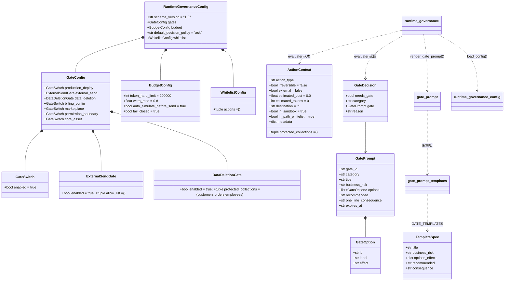
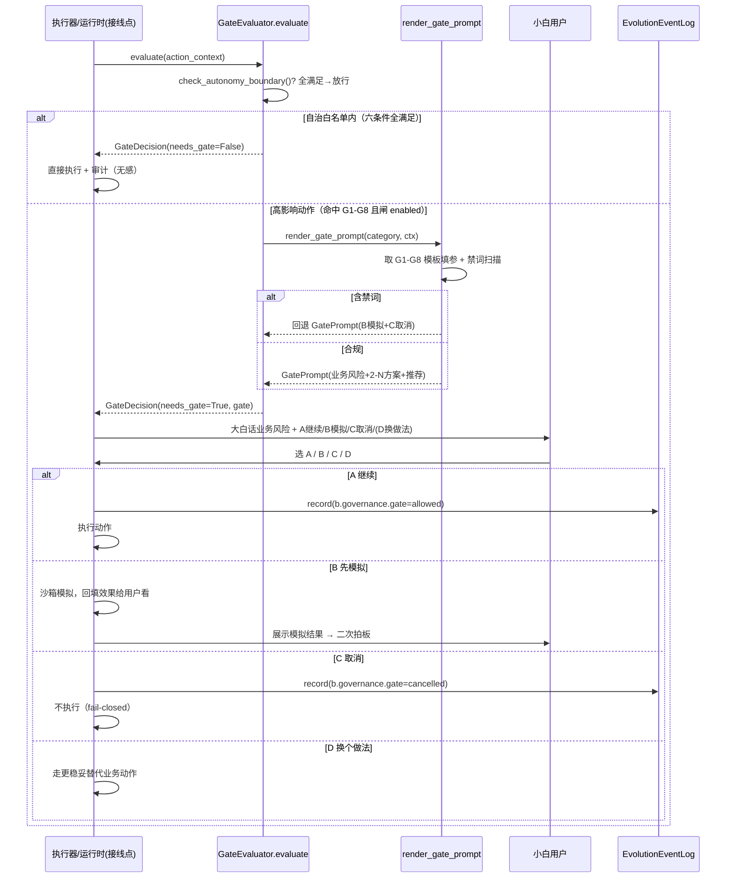
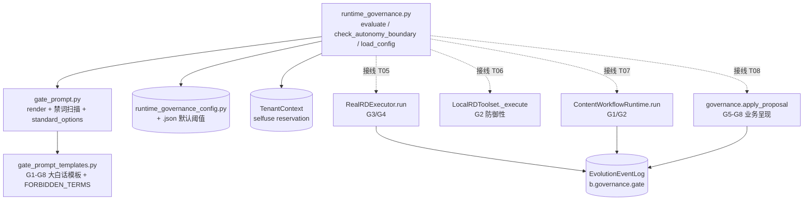

# B 层运行时治理边界 · 实现级任务分解（Impl Plan）

> 作者：架构师 高见远（software-architect）
> 受众：工程师 寇豆码（编码）、QA 严过关（测试）
> 性质：**实现级设计 + 有序任务列表**，**不含实现代码**，仅定义文件落点、数据结构契约、函数签名、调用流程与验收要点
> 权威设计源：`docs/architecture/b-layer-runtime-governance.md`（2026-07-20）
> 配套原则：`docs/product-governance-principle.md`（总控 2026-07-20 拍板阈值）
> 关联参照：`docs/architecture/paperclip-curis-mapping-report.md`（budget_guard 设计，尚未落地）

---

## 0. 范围与铁律（最高约束，不可妥协）

1. **系统替用户做全部技术决断**；B 层闸只问"业务后果"（钱 / 数据 / 对外声誉 / 不可逆 / 外部），**绝不**让用户判断技术细节。
2. **禁词红线**：任何呈现给用户的闸文本若含 `sandbox | schema | API | token | diff | 回滚 | 部署 | 端点 | 进程 | 权限位` → 视为生成失败，回退"先模拟(B) + 取消(C)"二元安全闸。
3. **fail-closed**：任何高影响动作"真正发出前"先评估；未评估 = 当作高影响 = 弹闸。
4. **B 层无权解除 A 层锁定**：`auto_modify_code` / `lift_human_approval_gate` 仍锁在 `governance.LOCKED_ACTIONS`；B 层配置只能调用户业务侧阈值与文案，**不得触碰**。
5. **本设计不触 L2 Gate 七项**：仅定义边界呈现与配置，不引入计费 / 多租户 / 商业。

---

## 1. 文件清单与相对路径

### 1.1 新增文件（4 个模块 + 1 个配置落点）

| 文件 | 职责 | 性质 |
|---|---|---|
| `backend/app/runtime_governance.py` | B 层闸评估引擎：`evaluate()` / `check_autonomy_boundary()` / `load_config()`；fail-closed 默认；落 `b.governance.gate` 事件 | **新增** |
| `backend/app/gate_prompt.py` | `GatePrompt` / `GateOption` 数据结构 + `render_gate_prompt()`（业务语义→大白话）+ `禁词扫描回退` + `standard_options()` 工厂 + JSON Schema 校验 | **新增** |
| `backend/app/gate_prompt_templates.py` | G1–G8 八类高影响动作大白话模板 + 标准选项效果文案 + `FORBIDDEN_TERMS` 常量 | **新增** |
| `backend/app/runtime_governance_config.py` | `RuntimeGovernanceConfig` 及嵌套 dataclass 定义 + `load_config(tenant_id)`（tenant-scoped，复用 `TenantContext` reservation）+ 默认阈值 + JSON 校验 | **新增** |
| `backend/app/runtime_governance_config.json` | 单租户 `selfuse` 默认配置落点（与 `RuntimeGovernanceConfig` JSON Schema 对齐，默认值即总控拍板值） | **新增** |

### 1.2 最小改动的现有文件（仅插入调用，不改受保护核心逻辑）

| 文件 | 插入点（函数 + 行号/位置） | 触发类别 | 改动性质 |
|---|---|---|---|
| `backend/app/real_rd_executor.py` | ① `run()` 内 `_validate_spec` 之后、`_claim_once` 之前（约 L128–L143）插入"运行前评估"；② 主循环内 `total_tokens += …`（L207）之后插入 G4 token 预算评估 | G3（删/覆盖受保护数据）/ G4（超预算 token） | 在入口/循环内增 2 处 `evaluate()` 调用 + `DecisionSink` 阻塞/回退 |
| `backend/app/local_rd_toolset.py` | `LocalRDToolset._execute()` 入口（`self._assert_root()` 之后，约 L322）插入通用前置闸 chokepoint | G2（防御性；本地工具 `external=False` 时恒放行） | 在 `_execute` 顶部增 1 处 `evaluate()` 调用（对本地工具为安全 no-op 直通） |
| `backend/app/content_workflow_runtime.py` | `run()` 内发布循环 `for platform in platforms:`（约 L106）**之前**插入 G1 评估；`aitoearn.generate`（L86）/ `sau.publish`（L109）属对外出站，亦作 G2 触发 | G1（真实上线/发布）+ G2（对外发） | 在发布循环前增 1 处 `evaluate()` 调用 + `DecisionSink` 阻塞/回退 |
| `backend/app/governance.py` | `CompanyGovernance.apply_proposal()` 入口（取回 proposal 之后、human-approval gate 之前，约 L273–L277）插入 G5–G8 业务风险呈现 | G5（计费）/ G6（Marketplace）/ G7（权限边界）/ G8（核心资产） | 在 `apply_proposal` 顶部增 1 处 `evaluate()` 调用（仅呈现，不解除 A 层门控） |

> **不改动**：`dev_agent.py`（仅参考：`DevAgent` 协议 / `mutates_filesystem` / `no_api_key` 降级，B 层闸不依赖其实现）；`_reject_sensitive` / `_reject_forbidden_path` / sandbox 网络隔离等既有受控能力**只复用、不重写**。

---

## 2. 数据结构 / 接口（类图级契约）

> 全部用 **标准库 `dataclass`**（零新依赖、与现有 `D1ToolchainConfig` / `LocalRDToolScope` 风格一致；`pydantic` 虽随 fastapi 间接可用，但刻意不选以避免框架耦合，保持闸引擎 import-light）。

### 2.1 `RuntimeGovernanceConfig`（严格对齐总控拍板阈值）

| 字段 | 类型 | 默认值 | 说明 |
|---|---|---|---|
| `schema_version` | `str` | `"1.0"` | 配置 schema 版本 |
| `gates` | `GateConfig` | 见下 | 各高影响类别闸开关 |
| `budget` | `BudgetConfig` | 见下 | G4 token 预算 |
| `default_decision_policy` | `Literal["ask","simulate_first","auto_allow_whitelisted"]` | `"ask"` | 默认决策策略 |
| `whitelist` | `WhitelistConfig` | `actions=()` | 免确认动作清单 |

`GateConfig` 子结构（字段 / 类型 / 默认）：

| 字段 | 类型 | 默认 | 说明 |
|---|---|---|---|
| `production_deploy` | `GateSwitch` | `enabled=True` | G1 |
| `external_send` | `ExternalSendGate` | `enabled=True, allow_list=()` | G2（含白名单目的地） |
| `data_deletion` | `DataDeletionGate` | `enabled=True, protected_collections=("customers","orders","employees")` | G3（受保护集合） |
| `billing_config` | `GateSwitch` | `enabled=True` | G5 |
| `marketplace` | `GateSwitch` | `enabled=True` | G6 |
| `permission_boundary` | `GateSwitch` | `enabled=True` | G7 |
| `core_asset` | `GateSwitch` | `enabled=True` | G8 |

`BudgetConfig`：`token_hard_limit:int=200000` · `warn_ratio:float=0.8` · `auto_simulate_before_send:bool=True` · `fail_closed:bool=True`
`GateSwitch`：`enabled:bool=True`
`ExternalSendGate`：`enabled:bool=True` · `allow_list:tuple[str,...]=()`
`DataDeletionGate`：`enabled:bool=True` · `protected_collections:tuple[str,...]=("customers","orders","employees")`
`WhitelistConfig`：`actions:tuple[str,...]=()`

> JSON Schema 契约见设计文档 §2.1（完全一致，此处不复述）；`runtime_governance_config.py` 提供 `validate_config_dict()` 做加载期校验。

### 2.2 `GatePrompt` / `GateOption`（呈现给小白的数据结构）

| 字段 | 类型 | 约束 | 说明 |
|---|---|---|---|
| `gate_id` | `str` | — | 闸实例唯一 id（如 `g2-send-<corrId>`） |
| `category` | `Literal["money","data","reputation","irreversible","external"]` | 必填 | 业务风险类别（决定语气） |
| `title` | `str` | `maxLength=40` | 给小白看的一句话标题（大白话） |
| `business_risk` | `str` | `maxLength=120` | ① 大白话业务风险；为空时由 options 承担效果对比 |
| `options` | `list[GateOption]` | `2..4` 项 | ② 方案效果对比 |
| `recommended` | `Literal["A","B","C","D"]` | 必填 | 推荐选项（基于业务后果） |
| `one_line_consequence` | `str` | `maxLength=80` | 一句话后果 |
| `expires_at` | `str \| None` | ISO date-time，可选 | 超时自动按 recommended 处理（防卡死） |

`GateOption`：`id:Literal["A","B","C","D"]` · `label:str(maxLength=24)` · `effect:str(maxLength=80)`

> JSON Schema 契约见设计文档 §3.4（完全一致）。

### 2.3 `runtime_governance.py` 核心函数签名

```python
# —— 输入契约 ——
@dataclass
class ActionContext:
    action_type: str                     # deploy|external_send|data_delete|token_spend|
                                         # billing_config|marketplace|permission|core_asset|tool_call
    irreversible: bool = False
    external: bool = False
    estimated_cost: float = 0.0
    estimated_tokens: int = 0
    destination: str = ""                # G2 allow_list 匹配用
    protected_collections: tuple[str, ...] = ()   # G3 命中集合
    in_sandbox: bool = True
    in_path_whitelist: bool = True
    metadata: dict = field(default_factory=dict)

# —— 输出契约（全工程统一返回类型）——
@dataclass
class GateDecision:
    needs_gate: bool
    category: str | None                 # "G1".."G8" 或 None
    gate: GatePrompt | None              # needs_gate=True 时填充
    reason: str = ""                     # 内部脱敏说明，绝不透给用户

# —— 核心 API ——
def load_config(tenant_id: str | None = None) -> RuntimeGovernanceConfig:
    """tenant-scoped 加载：tenant_id 缺省取 TenantContext.current_tenant_id()；
    读 runtime_governance_config.json（selfuse 单租户），环境/缺省回退到拍板默认值；
    校验失败 fail-closed 回退默认配置（绝不抛裸异常透路径）。"""

def check_autonomy_boundary(action_context: ActionContext,
                            config: RuntimeGovernanceConfig | None = None) -> bool:
    """§5.2 自治边界六条件：全满足 → True（全自治、不弹闸）；任一不满足 → False。
    1) in_sandbox/in_path_whitelist  2) not external  3) action_type!=data_delete
    4) estimated_tokens <= budget.token_hard_limit  5) action_type 不碰 L2(G5-G8)
    6) not irreversible"""

def evaluate(action_context: ActionContext,
             config: RuntimeGovernanceConfig | None = None) -> GateDecision:
    """fail-closed 主入口：
    ① check_autonomy_boundary==True → needs_gate=False；
    ② 否则按 action_type 归类 G1-G8；
    ③ 该闸 enabled? 命中 whitelist.actions / external_send.allow_list? → 否就不弹；
    ④ 需弹 → render_gate_prompt() 生成 GatePrompt（含禁词扫描回退）；
    ⑤ 返回 GateDecision。"""

# 别名（兼容设计文档 §6.1 的 GateEvaluator.should_gate 命名）
def should_gate(action_context, config=None) -> GateDecision:
    return evaluate(action_context, config)
```

### 2.4 `gate_prompt.py` 接口

```python
FORBIDDEN_TERMS: tuple[str, ...] = (
    "sandbox", "schema", "API", "token", "diff",
    "回滚", "部署", "端点", "进程", "权限位",
)

def render_gate_prompt(category: str,
                       action_context: ActionContext,
                       config: RuntimeGovernanceConfig | None = None) -> GatePrompt:
    """唯一呈现出口（禁词红线唯一 enforcement 点）：
    ① 取 gate_prompt_templates 中对应 G1-G8 模板并填参（成本/集合/目的地等）；
    ② 组装 GatePrompt（title/business_risk/options/recommended/one_line_consequence）；
    ③ 禁词扫描：title+business_risk+各 option.label/effect+consequence 任一含 FORBIDDEN_TERMS
       → 丢弃生成结果，回退"先模拟(B)+取消(C)"二元安全闸（绝不把技术语言透给用户）；
    ④ 返回 GatePrompt。"""

def standard_options(category: str, *, allow_d: bool = False) -> list[GateOption]:
    """§3.2 标准选项工厂：A 继续 ⭐ / B 先模拟看看 / C 取消 /（可选）D 换个做法。
    按 category 注入各选项的大白话 effect（文案来自 gate_prompt_templates）。"""

def scan_forbidden_terms(text: str) -> list[str]:
    """返回 text 中命中的禁词列表（空列表=合规）。"""

def validate_gate_prompt(prompt: GatePrompt) -> None:
    """加载/落库前 JSON Schema 校验（maxLength / 2..4 选项 / required）；
    违规抛脱敏 GatePromptValidationError。"""
```

### 2.5 `gate_prompt_templates.py` 接口

```python
# G1-G8 各自大白话模板（从设计文档 §3.3 提炼为可填参模板字符串，严禁技术术语）
GATE_TEMPLATES: dict[str, TemplateSpec] = {
    "G1": TemplateSpec(                           # 真实上线/发布
        title="这条内容马上要公开发出去",
        business_risk="发出去后别人都能看到、很难收回",
        options_effects={"A": "直接对所有人公开可见", "B": "先发到内部预览，只有你自己先看成品", "C": "先存着，不改不动"},
        recommended="A",                          # 默认推荐 A；可配置
        consequence="公开后任何人都能截图传播，想改口要花很大力气"),
    "G2": TemplateSpec(                           # 对外发消息/调外部接口
        title="这次可能要花约 ¥X 以你的名义对外发消息",
        business_risk="可能以公司名义承诺、泄露数据、触发费用、损害声誉",
        options_effects={"A": "马上发出，对方会真实收到", "B": "先不出真货，把将要发出去的内容给你过目", "C": "这次不发"},
        recommended="A",
        consequence="发出后对方立刻能看到，且可能产生费用、无法悄悄撤回"),
    "G3": TemplateSpec(                           # 删/覆盖业务数据
        title="这份名单删了就找不回来",
        business_risk="里面可能有正在跟进的生意，删了业务直接停滞",
        options_effects={"A": "先备份再删，以后还能找得回", "B": "直接彻底清空，没法恢复", "C": "先不删，想清楚再说"},
        recommended="A",
        consequence="删了之后这笔生意的联系方式就没了，很难再接上"),
    "G4": TemplateSpec(                           # 超预算 token/算力
        title="这次可能要花掉远超预期的算力钱",
        business_risk="可能花掉远超你预期的钱",
        options_effects={"A": "按系统建议继续用", "B": "先看看预计花多少再决定", "C": "先停一下"},
        recommended="B",
        consequence="一旦用掉，费用马上产生、很难退回"),
    "G5": TemplateSpec(...),                      # 改计费/商业配置
    "G6": TemplateSpec(...),                      # 开放 Marketplace/外部生态
    "G7": TemplateSpec(...),                      # 改权限/Workspace 边界
    "G8": TemplateSpec(...),                      # 改新核心资产体系
}
# 每个 TemplateSpec 仅含大白话字段；填参函数把 ¥X / 集合名等注入 title/business_risk。
# FORBIDDEN_TERMS 常量同步导出（与 gate_prompt.py 同一份，单一真源在 gate_prompt.py）。
```

### 2.6 类图（Mermaid）



---

## 3. 程序调用流程（时序图）

### 3.1 高影响动作流转（agent 想执行 → 评估 → 呈现 → 用户拍板）



### 3.2 四个接线点的调用归口

| 接线点 | 调用位置 | 构建的 `ActionContext` | 期望类别 |
|---|---|---|---|
| `RealRDExecutor.run` | 运行前 / token 循环 | `data_delete`(若涉受保护集合) / `token_spend`(estimated_tokens=累计) | G3 / G4 |
| `LocalRDToolset._execute` | 工具入口 | `tool_call`(external=False) | G2（防御性直通，本地恒放行） |
| `ContentWorkflowRuntime.run` | 发布循环前 | `deploy`(external=True, irreversible=True) + `external_send` | G1 / G2 |
| `governance.apply_proposal` | 写 L2 前 | `billing_config`/`marketplace`/`permission`/`core_asset`（按 capability 映射） | G5–G8 |

> `DecisionSink`（详见 §7 共享知识）：接线点拿到 `GateDecision(needs_gate=True)` 后，通过注入的 `DecisionSink.ask(gate)->str` 向用户取决策；**未注入 sink 时 fail-closed 默认按 C 取消**并落 `b.governance.gate=cancelled`，不阻塞现有同步循环、不耦合事件/WebSocket 流。

---

## 4. 任务列表（有序、含依赖、按实现顺序）

> 规则：T01–T04 为地基（依赖链 T01→T02→T03→T04）；T05–T08 四接线点**均仅依赖 T04**，可并行；T09 串联冒烟测试，依赖 T05–T08。
> 每个 T 标注：依赖 / 涉及文件 / 是否触 L2 或禁词红线（预期**全否**）/ 验收要点。

### T01 · 配置 schema + `RuntimeGovernanceConfig` + `load_config`（tenant-scoped）
- **依赖**：无
- **涉及文件**：新增 `runtime_governance_config.py`、`runtime_governance_config.json`
- **触 L2 / 红线**：否（仅阈值与文案配置，不引入计费/多租户）
- **验收要点**：
  - `RuntimeGovernanceConfig` 默认值 == 总控拍板值（`token_hard_limit=200000`、`protected_collections=["customers","orders","employees"]`、`default_decision_policy="ask"`）。
  - `load_config()` 缺省走 `TenantContext.current_tenant_id()`（单租户 `selfuse`），读 JSON 失败 fail-closed 回退默认、不抛路径异常。
  - `validate_config_dict()` 拒绝 `additionalProperties`、类型/枚举错误。

### T02 · `gate_prompt_templates.py`（G1–G8 大白话模板 + 禁词常量）
- **依赖**：无（与 T01 并行；类别键 G1–G8 为共享常量，建议抽到本模块顶部 `G_CATEGORIES`）
- **涉及文件**：新增 `gate_prompt_templates.py`
- **触 L2 / 红线**：否（纯文案，不含技术术语）
- **验收要点**：
  - G1–G8 各 `TemplateSpec` 的 `title/business_risk/options_effects/consequence` 均大白话，人工评审零技术术语。
  - `FORBIDDEN_TERMS` 含设计文档 §3.4 全部禁词（sandbox/schema/API/token/diff/回滚/部署/端点/进程/权限位）。
  - 每个模板可被填参（¥X / 集合名）且填参后仍不含禁词。

### T03 · `gate_prompt.py`（render + 禁词扫描回退 + 标准选项工厂）
- **依赖**：T01（读 config 取 recommended/默认）、T02（取模板）
- **涉及文件**：新增 `gate_prompt.py`
- **触 L2 / 红线**：否（**唯一**禁词 enforcement 点，自身合规）
- **验收要点**：
  - `render_gate_prompt()` 输出 `GatePrompt` 满足 JSON Schema（maxLength / 2–4 选项 / required）。
  - 注入含禁词文本 → 自动回退 `B模拟+C取消` 二元闸，且回退闸本身禁词合规。
  - `standard_options()` 产出 A/B/C/(D)，推荐项标注 ⭐，effect 为大白话。

### T04 · `runtime_governance.py`（`evaluate` + `check_autonomy_boundary` + token 硬限衔接）
- **依赖**：T01、T02、T03
- **涉及文件**：新增 `runtime_governance.py`
- **触 L2 / 红线**：否
- **验收要点**：
  - `check_autonomy_boundary()` 六条件全满足 → `True`；任一不满足 → `False`。
  - `evaluate()` fail-closed：未评估/归类失败 → `needs_gate=True`。
  - G2 命中 `external_send.allow_list` / G3 命中 `protected_collections` 且 `enabled` → 弹闸；闸 `enabled=False` 或 `action_type∈whitelist.actions` → 不弹。
  - **G4 token 衔接（临时桥）**：`evaluate(token_spend)` 用 `config.budget.token_hard_limit` 对比 `action_context.estimated_tokens`；`warn_ratio` 达阈值仅提示不阻断。budget_guard 未实现（grep 无匹配），此桥为临时方案，接口不依赖 budget_guard（详见 §7 风险①）。

### T05 · 接线点① `RealRDExecutor.run`（G3/G4）
- **依赖**：T04
- **涉及文件**：改 `real_rd_executor.py`（2 处插入，不改 agent 分支/`_make_agent_rollback` 核心）
- **触 L2 / 红线**：否
- **验收要点**：
  - 运行前评估插入 `_validate_spec` 之后；token 评估插入 `total_tokens +=` 之后。
  - 触 G3/G4 时经 `DecisionSink` 取决策；无 sink → fail-closed 取消并落 `b.governance.gate=cancelled`。
  - 既有 agent 分支（`is_agent`/`_build_agent_prompt`/`_make_agent_rollback`）与沙箱回滚行为**不变**。

### T06 · 接线点② `LocalRDToolset._execute`（G2 防御性 chokepoint）
- **依赖**：T04
- **涉及文件**：改 `local_rd_toolset.py`（`_execute` 入口 1 处插入）
- **触 L2 / 红线**：否
- **验收要点**：
  - 插入 `evaluate(ActionContext(action_type="tool_call", external=False))`；本地 5 工具 `external=False` → 恒 `needs_gate=False`（安全直通）。
  - 既有 `_audit` / `_reject_sensitive` / `_reject_forbidden_path` / sandbox 网络隔离**不改**。
  - 说明：真实 G2 出站点在 T07 的 connector；此处为未来 outbound-capable 本地工具的防御性覆盖（详见 §7 风险③）。

### T07 · 接线点③ `ContentWorkflowRuntime.run`（G1 + G2）
- **依赖**：T04
- **涉及文件**：改 `content_workflow_runtime.py`（发布循环前 1 处插入）
- **触 L2 / 红线**：否
- **验收要点**：
  - 在 `for platform in platforms:`（约 L106）前插入 `evaluate(deploy/external_send)`；用户选 A 才执行 `sau.publish`，B 先内部预览，C 取消。
  - `aitoearn.generate`（L86）/ `sau.publish`（L109）属对外出站，归 G2 触发。
  - 既有 connector 调用 / Vault 解析 / 事件写**不改**；经 `self.event_log` 落 `b.governance.gate`。

### T08 · 接线点④ `governance.apply_proposal`（G5–G8 业务风险呈现）
- **依赖**：T04
- **涉及文件**：改 `governance.py`（`apply_proposal` 入口 1 处插入）
- **触 L2 / 红线**：否（**仅呈现**，不解除 A 层门控）
- **验收要点**：
  - 插入点在取回 proposal（L273）之后、human-approval gate（L277）之前；按 capability 映射 G5–G8 并 `evaluate()`。
  - **不得触碰** `LOCKED_ACTIONS`（`lift_human_approval_gate`/`auto_modify_code`）；A 层 human-approval gate 保持原状。
  - 用户选 C → 中止，不进入 `apply_proposal` 写链路；选 A → 照常走 A 层批准流。

### T09 · 串联冒烟测试种子
- **依赖**：T05、T06、T07、T08（及传递 T01–T04）
- **涉及文件**：新增 `backend/tests/test_b_layer_runtime_governance.py`（mock `event_log` / `DecisionSink`）
- **触 L2 / 红线**：否（测试本身不触 L2）
- **验收要点**（QA 严过关核心用例）：
  1. 自治白名单六条件全满足 → `needs_gate=False`，无 `b.governance.gate` 事件。
  2. 逐类 G1–G8 触发 → 各自生成**禁词合规**的 `GatePrompt`（断言无 `FORBIDDEN_TERMS`）。
  3. 注入含禁词模板 → 回退 `B+C` 二元闸且合规。
  4. 关闸（`enabled=False`）/ 加 `whitelist.actions` / G2 命中 `allow_list` → 不弹。
  5. G4：`estimated_tokens` 跨 `token_hard_limit` → 弹；跨 `warn_ratio` → 仅提示。
  6. **L2 不触发断言**：`LOCKED_ACTIONS` 未被改；无新计费/多租户/商业逻辑引入；`governance.LOCKED_ACTIONS` 长度与内容不变。
  7. 四个接线点均落 `b.governance.gate` 事件（allowed/cancelled/simulated），且脱敏（无路径/Key/参数）。

---

## 5. 依赖包列表

| 包 | 来源 | 用途 | 是否新增 |
|---|---|---|---|
| `dataclasses` / `json` / `re` / `typing` / `datetime` | Python 标准库 | 数据结构 / 校验 / 禁词扫描 | 否 |
| `pyyaml` | 既有（`requirements.txt`） | 可选，配置若改 YAML 用；**本设计用 JSON，不需** | 否 |
| `pydantic` | 随 fastapi 间接可用 | **刻意不引**，改用 stdlib dataclass | 否 |
| 新增第三方重依赖 | — | — | **无** |

> 结论：**零新依赖**。闸引擎 `runtime_governance.py` / `gate_prompt.py` 仅依赖标准库，与现有 app 模块风格一致，便于独立单测。

---

## 6. 共享知识（跨文件约定）

1. **统一返回类型**：所有接线点的闸评估**只**返回 `GateDecision`；不得各写一套布尔+文案。
2. **唯一呈现出口**：所有呈现给用户的文本**只**经 `gate_prompt.render_gate_prompt()` 生成——**禁词红线唯一 enforcement 点**在此。任何模块不得自行拼装 `GatePrompt` 文案（防禁词泄漏）。
3. **配置统一读取**：接线点**不得**直读 JSON；一律 `runtime_governance.load_config()`，内部经 `TenantContext.current_tenant_id()` 解析租户（单租户 `selfuse`，design-only reservation）。
4. **事件统一落点**：闸结果经 `EvolutionEventLog.record(event_type="b.governance.gate", payload={decision,category,gate_id,outcome})` 追加写；脱敏（无路径/Key/参数）。
5. **B 层无权解除 A 层锁定**：`runtime_governance` 模块**不得 import / 调用** 任何解除 `LOCKED_ACTIONS` 的路径；T08 仅做"业务风险呈现"，human-approval gate 原样保留。
6. **决策取用协议**：新增 `DecisionSink`（Protocol，`ask(gate: GatePrompt) -> Literal["A","B","C","D"]`），由接线点构造时可选注入；**未注入 → fail-closed 默认 C 取消**。UI/WebSocket 层未来再接真实 sink，闸引擎本身不耦合传输层。
7. **fail-closed 贯穿**：评估异常 / 归类失败 / sink 缺失 → 一律当作高影响 → 弹闸或取消，绝不静默放行。

---

## 7. 待明确事项 / 风险

### 风险① · `budget_guard` 尚未实现（G4 临时桥）
- **事实**：全仓 grep `budget_guard|BudgetGuard|token_hard_limit|token_budget` **无匹配**——paperclip 3.1 的 budget_guard 未落地。
- **临时方案**：G4 评估以 `RuntimeGovernanceConfig.budget.token_hard_limit` 为硬限，对比接线点传入的 `action_context.estimated_tokens`（如 `RealRDExecutor.total_tokens` 累加值）。`warn_ratio` 达阈值仅提示不阻断。
- **衔接约定**：`evaluate()` 的 token 入参接口**不依赖** budget_guard；未来 budget_guard 落地后，仅把 token 数据源从"调用方累加"切换为"budget_guard 权威累加器"，`evaluate` 签名不变。
- **需主理人确认**：是否接受本期以"配置硬限 + 调用方累加"作为 G4 实现，待 budget_guard 补完后切换。

### 风险② · 接线点与现有同步/事件流的阻塞冲突
- **事实**：四个接线点当前都在请求处理 / executor 循环内**同步**执行；若在此处"等用户拍板"会卡住循环。
- **最小改动方案**：`evaluate()` 同步返回 `GateDecision`；**呈现+等待决策**由 `DecisionSink` 承担。接线点构造时注入 sink：
  - 有 sink → 阻塞取决策（交互态）；
  - **无 sink → fail-closed 默认 C 取消**并落 `b.governance.gate=cancelled`，循环不卡、闸不漏。
- 不在本期耦合 WebSocket/事件流；真实交互 UI 作为后续独立任务接 `DecisionSink`。

### 风险③ · G2 真实出站点不在 `LocalRDToolset`
- **事实**：`LocalRDToolset` 5 个工具全是本地（file read/write、search、test-run sandbox、git read-only），**无 outbound HTTP**；网络隔离仅在 `run_test` 的 sandbox-exec `(deny network*)`。
- **处理**：T06 在 `_execute` 入口插"通用前置闸"，但对本地工具 `external=False` → 恒放行（防御性 chokepoint，覆盖未来 outbound-capable 本地工具）。**真正的 G2（对外发消息/调外部接口）在 T07 的 connector 边界**（`aitoearn.generate` / `sau.publish`）触发。已在 §3.2 与 T06/T07 标注清楚，避免误以为 LocalRDToolset 已覆盖全部 G2。

### 风险④ · T08 与 A 层 human-approval 的职责边界
- **事实**：`apply_proposal` 现有 human-approval gate（status=="approved" 才落地），属 A 层（平台/CEO 技术批准）。
- **处理**：B 层闸在 `apply_proposal` **入口**呈现"业务风险"给小白用户（不同主体、不同目的），**不解除也不绕过** A 层 gate；用户选 C 则中止、不进入 `apply_proposal`。两者不冲突（设计文档 §4 已论证）。

### 风险⑤ · 配置变更与总控签字
- 默认阈值 + 禁词红字属**产品原则级**，已随 `product-governance-principle.md` 由总控 2026-07-20 拍板；若未来调整 `token_hard_limit` / `protected_collections` / `FORBIDDEN_TERMS`，需重新走总控决策席签字。本设计不触 L2，常规 SOP 即可落地，但阈值/禁词变更须留痕。

---

## 8. 落地模块依赖图（Mermaid）


