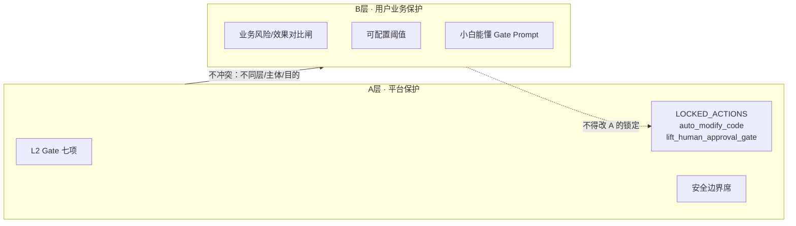
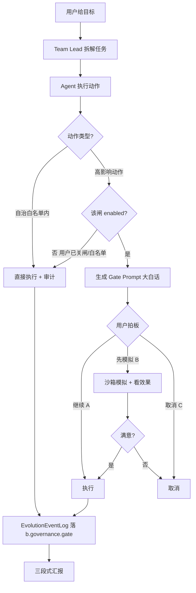
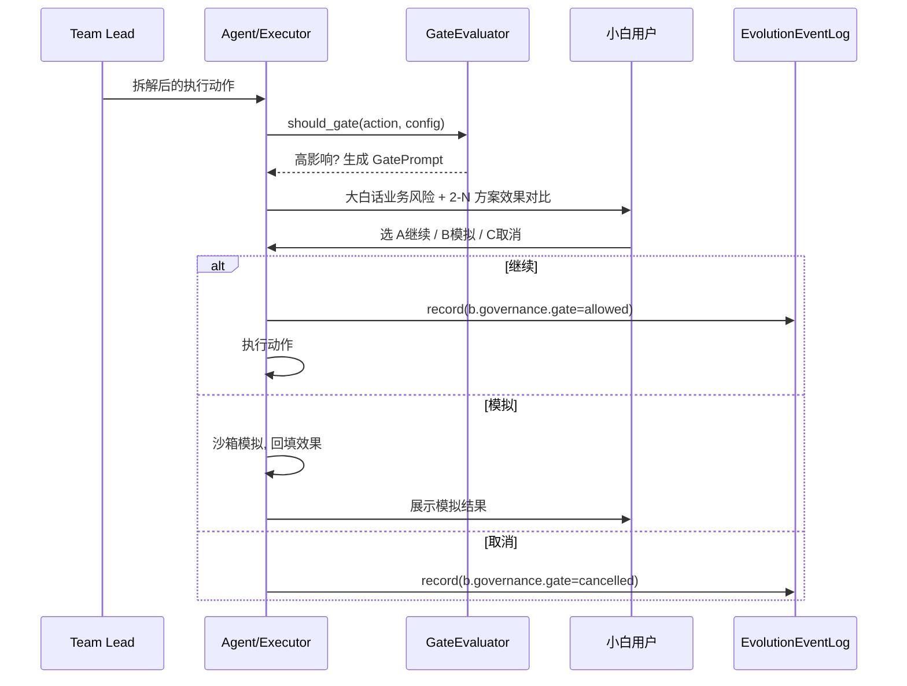
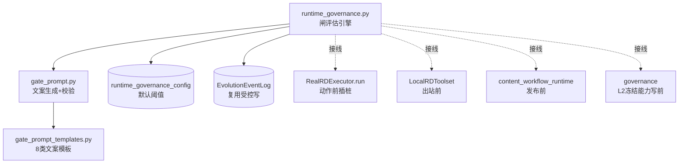

# B 层运行时治理边界设计（产品级"拍板闸"）

> 作者：架构师 高见远（software-architect）
> 受众：主理人 齐活林（向总控决策席报备用，产品原则级）
> 性质：**轻量设计文档**，**不含实现代码**，仅定义边界、呈现规范与配置
> 关联决策：A 层 L2 Gate 七项、`governance.LOCKED_ACTIONS`、`RealRDExecutor` 自治循环、`paperclip-curis-mapping-report.md`
> 生成日期：2026-07-20

---

## 0. 一句话定位（最高约束）

**终端用户是技术小白**：系统替他做**所有技术决断**；只有当某个动作**跨越高影响业务边界**（钱 / 数据 / 对外声誉 / 不可逆 / 外部）时，才弹一次"拍板闸"。

这个闸**不是技术审批闸**，而是**业务风险 / 效果对比闸**——用大白话告诉用户"可能的业务危险"，或"几种方案各自产生的不一样效果"，让他基于**业务后果**做选择。**绝不**让他判断技术细节（"要不要改 schema""用哪个 API""是否绕过沙箱"）。

---

## 1. 高影响动作分类（默认 fail-closed）

> **铁律**：下表每一类动作，**默认必须弹闸**（fail-closed）。只有用户在自己配置里**显式关掉该闸**或把它加进"免确认白名单"，才不弹。系统在任何高影响动作**真正发出前**先评估，未评估 = 当作高影响 = 弹闸。

| # | 高影响动作（产品语言） | 触发条件（runtime 可探测） | 为何对小白有业务危险 | 系统已自主做的技术部分（用户无需管） | 映射 runtime 原语 |
|---|---|---|---|---|---|
| **G1** | 真实部署 / 上线（把东西公开发到真实渠道） | 动作目标 = 生产环境 endpoint / 真实发布通道，且**非** sandbox 内 | 一旦上线，内容 / 服务对真实客户或公众可见；错发 = 声誉受损、且**很难收回** | 构建、测试、打包、沙箱验证全自主；仅"是否对外"需拍板 | `RealRDExecutor` agent 分支（`mutates_filesystem`）；`content_workflow_runtime` 发布状态机；`LocalRDToolset` sandbox `AUTO/ENFORCE` 网络隔离 |
| **G2** | 用你的名义对外发消息 / 调外部接口 | 出站网络调用落 sandbox 外；或经 connector 触外部 API；或向真实用户发消息 | 可能以公司名义**承诺、泄露数据、触发费用、损害声誉** | 限流、重试、格式、凭证注入全自主；仅"是否以你名义发出"需拍板 | `LocalRDToolset` sandbox 网络隔离 + `_reject_sensitive`；`credential_vault`；connector 框架 |
| **G3** | 删除 / 覆盖你的业务数据 | 不可逆写：删文件 / 库表 / 覆盖用户资产，且**超出** sandbox 路径白名单 | 数据没了就真没了，业务直接停滞 | 路径白名单、sandbox、`git checkout` 回滚已自主；仅"是否真删 / 覆盖"需拍板 | `LocalRDToolset` 路径白名单 + sandbox；`RealRDExecutor` `_make_agent_rollback`（`git checkout --`）；`EvolutionEventLog` |
| **G4** | 超预算的高额 token / 算力消耗 | 单次或累计 `total_tokens` 逼近 `token_budget.hard_limit` | 可能花掉远超预期的**钱** | 预算熔断已自主（基于 `total_tokens`，fail-closed）；仅"是否突破你设的硬限"需拍板 | `budget_guard`（paperclip 3.1）；`RealRDExecutor` 累计 `total_tokens` |
| **G5** | 改动你的收费 / 计费 / 商业配置 | 写 `billing/plan/pricing/quota` 等 L2 #1 / #2 冻结能力 | 改错 = 钱收错 / 漏收 / 违规，且常**不可逆** | 配置 schema 校验、回滚、审计已自主；仅"是否改商业规则"需拍板 | L2 #1 商业模式 / #2 收费规则（USER_CAPABILITY_LEDGER G2–G6）；`governance` human-approval 流 |
| **G6** | 开放 Marketplace / 接入外部生态 | 启用 Marketplace、导入外部 agent 生态、上架 skill · tool · 模板 | 一旦开放 = **别人 / 外部代码进你的公司**，安全面扩大、你可能担责 | 目录校验、受控写、人工批准流已自主；仅"是否开放"需拍板 | L2 #4 Marketplace；`governance.manage_department_types` / `cross_company_policy` |
| **G7** | 改动权限边界 / Admin-Workspace 边界 | 改员工 / 部门权限、跨 workspace、提权 | 权限错配 = 数据被看光 / 被改、责任不清 | 权限 schema、人工批准、审计已自主；仅"是否改边界"需拍板 | L2 #5 权限边界 / #6 外部服务；`CompanyGovernance.LOCKED_ACTIONS` |
| **G8** | 改动新核心资产体系 | 改核心资产目录 / 能力飞轮 / 资产工厂写链路 | 核心资产是公司根基，改错 = **全公司能力塌方** | 资产 schema、契约校验、审计已自主；仅"是否动根基"需拍板 | L2 #7 新核心资产体系（资产体系 10 类 catalog） |

**横切规则 —— "不可逆"标记**：任何动作只要**不可被 `git checkout` 或备份回滚**（如真实对外发送、真删生产数据、公开承诺），一律在所属类别基础上**强制弹闸**，且选项里必须给出"先备份 / 先模拟 / 先内部预览"的安全项。

> 说明：G1–G7 直接对应 brief 清单；G8 是为**完整覆盖 L2 七项**补上的第 8 类，确保 A 层冻结能力在 B 层都有对应的"业务风险闸"语义。

---

## 2. 可配置闸 + 默认阈值

用户可自调的闸与默认值。配置以 `RuntimeGovernanceConfig` 承载，tenant-scoped（经 `TenantContext` 的 design-only reservation，当前单租户 `selfuse`）。

| 配置项 | 含义 | 默认值 | 用户可调？ |
|---|---|---|---|
| `gates.production_deploy.enabled` | G1 真实上线是否弹闸 | `true` | 是 |
| `gates.external_send.enabled` | G2 对外发消息 / 调外部接口是否弹闸 | `true` | 是 |
| `gates.external_send.allow_list` | 白名单目的地（命中则免确认） | `[]` | 是 |
| `gates.data_deletion.enabled` | G3 删 / 覆盖数据是否弹闸 | `true` | 是 |
| `gates.data_deletion.protected_collections` | 受保护数据集合（动则必弹） | `["customers","orders","employees"]` | 是 |
| `gates.billing_config.enabled` | G5 商业 / 计费配置是否弹闸 | `true` | 是 |
| `gates.marketplace.enabled` | G6 开放 Marketplace / 外部生态是否弹闸 | `true` | 是 |
| `gates.permission_boundary.enabled` | G7 权限 / Workspace 边界是否弹闸 | `true` | 是 |
| `gates.core_asset.enabled` | G8 核心资产体系是否弹闸 | `true` | 是 |
| `budget.token_hard_limit` | G4 单轮 token 硬限（超则弹闸询问） | `200000` | 是 |
| `budget.warn_ratio` | 预警比例（到达即提示，不阻断） | `0.8` | 是 |
| `budget.auto_simulate_before_send` | 对外发送前是否默认先模拟 | `true` | 是 |
| `default_decision_policy` | 默认决策策略 | `"ask"` | 是（见下） |
| `whitelist.actions` | 免确认动作清单（用户显式关闸） | `[]` | 是 |

`default_decision_policy` 枚举：
- `"ask"`（默认）：所有未关闸的高影响动作 → 弹 Gate Prompt 等用户拍板。
- `"simulate_first"`：高影响动作先自动沙箱模拟、把效果回填给用户看，再弹闸。
- `"auto_allow_whitelisted"`：仅 `whitelist.actions` / `allow_list` 内的动作免确认；其余仍弹。

### 2.1 RuntimeGovernanceConfig JSON Schema

```json
{
  "$schema": "http://json-schema.org/draft-07/schema#",
  "title": "RuntimeGovernanceConfig",
  "type": "object",
  "additionalProperties": false,
  "properties": {
    "schema_version": { "type": "string", "default": "1.0" },
    "gates": {
      "type": "object",
      "additionalProperties": false,
      "properties": {
        "production_deploy":  { "$ref": "#/definitions/gate" },
        "external_send": {
          "type": "object", "additionalProperties": false,
          "properties": {
            "enabled": { "type": "boolean", "default": true },
            "allow_list": { "type": "array", "items": { "type": "string" }, "default": [] }
          }
        },
        "data_deletion": {
          "type": "object", "additionalProperties": false,
          "properties": {
            "enabled": { "type": "boolean", "default": true },
            "protected_collections": { "type": "array", "items": { "type": "string" },
              "default": ["customers","orders","employees"] }
          }
        },
        "billing_config":        { "$ref": "#/definitions/gate" },
        "marketplace":           { "$ref": "#/definitions/gate" },
        "permission_boundary":   { "$ref": "#/definitions/gate" },
        "core_asset":            { "$ref": "#/definitions/gate" }
      }
    },
    "budget": {
      "type": "object", "additionalProperties": false,
      "properties": {
        "token_hard_limit": { "type": "integer", "minimum": 1, "default": 200000 },
        "warn_ratio": { "type": "number", "minimum": 0, "maximum": 1, "default": 0.8 },
        "auto_simulate_before_send": { "type": "boolean", "default": true },
        "fail_closed": { "type": "boolean", "default": true }
      }
    },
    "default_decision_policy": {
      "type": "string",
      "enum": ["ask","simulate_first","auto_allow_whitelisted"],
      "default": "ask"
    },
    "whitelist": {
      "type": "object", "additionalProperties": false,
      "properties": {
        "actions": { "type": "array", "items": { "type": "string" }, "default": [] }
      }
    }
  },
  "definitions": {
    "gate": {
      "type": "object", "additionalProperties": false,
      "properties": { "enabled": { "type": "boolean", "default": true } }
    }
  },
  "required": ["gates","budget","default_decision_policy","whitelist"]
}
```

---

## 3. 闸的呈现模板（**重点 · 最高约束**）

### 3.1 Gate Prompt 数据结构

系统生成给小白看的"拍板闸"内容，必须包含**二选一**：
- **① 大白话的业务风险**（钱 / 数据 / 对外声誉 / 不可逆）；或
- **② 2–N 个方案各自的效果对比（含推荐项）+ 一句话后果**。

**严禁**（硬性禁词约束）：
- 技术术语（sandbox / schema / API / token / diff / 回滚 / 部署 / 端点 / 进程 / 权限位 …）
- 代码、内部机制、路径、配置键
- 要求用户在**技术选项之间**做选择
- 任何"你是否允许系统做 X 技术动作"的措辞

**语气**：像朋友提醒，不说教、不吓人，但把**代价**说清。

### 3.2 标准选项工厂

所有 Gate Prompt 选项**统一三档**，按场景增删但不超过 4 个：
- **A 继续** —— 按系统建议直接做（推荐项时标 ⭐）
- **B 先模拟看看** —— 在不出真货的前提下看效果（对外发送 / 上线类默认提供）
- **C 取消** —— 这次不做
- （可选）**D 换个做法** —— 给出更稳妥的替代业务动作

### 3.3 三个具体示例

**示例 1 · 对外发消息花钱（G2 / money+external）**
> **这次要花约 ¥X 去调一个外部接口，可能会以你的名义对外发消息。**
> - **A 继续** ⭐：马上发出，对方会真实收到。
> - **B 先模拟看效果**：先不出真货，把将要发出去的内容给你过目。
> - **C 取消**：这次不发。
> **一句话后果**：发出后对方立刻能看到，且可能产生费用、无法悄悄撤回。

**示例 2 · 删除客户数据（G3 / data+irreversible）**
> **你要删掉的这份客户名单删了就找不回来了，里面可能有正在跟进的生意。**
> - **A 先备份再删** ⭐：留一份底，以后还能找得回。
> - **B 直接删**：彻底清空，没法恢复。
> - **C 先不删**：先放着，想清楚再说。
> **一句话后果**：删了之后这笔生意的联系方式就没了，很难再接上。

**示例 3 · 真实上线内容（G1 / reputation+irreversible）**
> **这条内容马上会公开发出去，发出去后别人都能看到、很难收回。**
> - **A 公开发** ⭐：直接对所有人可见。
> - **B 先发到内部预览**：只有你自己先看到成品效果。
> - **C 暂不发布**：先存着，不改不动。
> **一句话后果**：公开后任何人都能截图传播，想改口要花很大力气。

### 3.4 GatePrompt JSON Schema（落地契约）

```json
{
  "$schema": "http://json-schema.org/draft-07/schema#",
  "title": "GatePrompt",
  "type": "object",
  "additionalProperties": false,
  "required": ["gate_id","category","title","business_risk","options","recommended","one_line_consequence"],
  "properties": {
    "gate_id": {
      "type": "string",
      "description": "闸实例唯一 id（如 g2-send-<corrId>）"
    },
    "category": {
      "type": "string",
      "enum": ["money","data","reputation","irreversible","external"],
      "description": "业务风险类别，决定默认文案语气"
    },
    "title": {
      "type": "string",
      "maxLength": 40,
      "description": "给小白看的一句话标题（大白话）"
    },
    "business_risk": {
      "type": "string",
      "maxLength": 120,
      "description": "①大白话业务风险；绝不出现技术术语。为空时须由 options 承担效果对比"
    },
    "options": {
      "type": "array",
      "minItems": 2,
      "maxItems": 4,
      "items": {
        "type": "object",
        "additionalProperties": false,
        "required": ["id","label","effect"],
        "properties": {
          "id": { "type": "string", "enum": ["A","B","C","D"] },
          "label": { "type": "string", "maxLength": 24, "description": "选项短标签（大白话）" },
          "effect": { "type": "string", "maxLength": 80, "description": "②该选项带来的业务效果（大白话，非技术）" }
        }
      }
    },
    "recommended": {
      "type": "string",
      "enum": ["A","B","C","D"],
      "description": "推荐选项 id（系统基于业务后果给出，非技术偏好）"
    },
    "one_line_consequence": {
      "type": "string",
      "maxLength": 80,
      "description": "一句话后果，说清代价"
    },
    "expires_at": {
      "type": "string",
      "format": "date-time",
      "description": "可选：闸超时自动按 recommended 处理（防卡死）"
    }
  }
}
```

> **校验红线**：任何 GatePrompt 实例若含 `sandbox|schema|API|token|diff|回滚|部署|端点|进程|权限位` 等禁词 → 视为**生成失败**，回退到"先模拟看看（B）+ 取消（C）"的安全二元闸，绝不把技术语言透给用户。

---

## 4. 与 A 层纪律的对齐说明

### 4.1 三层对照

| 维度 | A 层（平台保护） | B 层（用户业务保护） |
|---|---|---|
| 保护对象 | 我们在建的 workspace 平台 | 终端用户自己的 AI 公司 |
| 主体 | 开发团队 / 平台 | 小白用户 |
| 闸的性质 | **技术审批闸**（是否解除门控 / 改生产码） | **业务风险 / 效果对比闸**（钱 / 数据 / 声誉 / 不可逆） |
| 原语 | L2 Gate 七项、`LOCKED_ACTIONS`、`安全边界席` | 本文档的 `RuntimeGovernanceConfig` + `GatePrompt` |
| 默认 | 生产变更需人工批准 | 高影响业务动作需用户拍板（业务级） |

### 4.2 为什么不冲突

- **不同层、不同主体、不同目的**：A 层管"平台怎么被我们改"，B 层管"用户公司怎么自治跑"。两者保护面不重叠。
- **B 层配置不得触碰 A 层锁定**：`auto_modify_code` / `lift_human_approval_gate` 仍锁在 `governance.LOCKED_ACTIONS`，B 层的"可配置闸"只能调**用户业务侧**的阈值与文案，**无权解除平台级锁定**。
- **技术决断始终由系统做**：B 层闸出现时，系统已把"怎么做"全做完了，只把"做不做 / 选哪个业务后果"留给用户。

### 4.3 "不采用自主执行"如何被精确收敛

此前 paperclip 映射报告的结论是：**不采用自主执行 / 自动雇佣**——那是指 **A 层纪律**：我们自己的 dev runtime 不能自动改生产码、不能自动解除人工批准门控（撞 `LOCKED_ACTIONS` + 席位链铁律）。

这个结论**没有被推翻**，而是被**精确收敛**：
- A 层纪律 → 依然是"平台在建工程受控，生产变更需人工批准"。
- B 层产品 → 本来目标就是"用户给目标 → team lead 自行拆解 → 自动执行 → 反馈"的**自治循环**（我们自己的 `RealRDExecutor` 已证明可行）。
- 二者并集的精确表述：**系统替用户做所有技术决断，但当用户业务跨越高影响边界时，由用户基于业务后果拍板**。"不采用自主执行"从"系统什么都不替用户决定"收敛为"系统决定技术、用户决定高影响业务"——用户仍是最终业务决策者，只是从技术泥潭里被解放出来。

---

## 5. 不需要闸的地方（自治白名单）

> **核心**：正常的 operational loop **全自治、零逐步审批**。闸只在"跨高影响业务边界"时出现，平时用户无感。

### 5.1 自治白名单（默认不弹闸）

| 动作 | 说明 | 复用原语 |
|---|---|---|
| 目标拆解 | team lead 把目标拆成任务 | `RealRDExecutor` 主循环、`DevAgent` 编排 |
| 改文件 / 写代码 / 跑测试 | 在 sandbox 内自主完成 | `RealRDExecutor` agent 分支（`is_agent` 跳过 diff） |
| commit | workspace 内 git 提交 | 既有 git 工具 |
| 内部推理 / 决策 / 重试 / 回滚 | `git checkout` 回滚、指数退避 | `_make_agent_rollback` / `_safe_rollback` |
| 调用内部工具 | sandbox + 路径白名单 + 敏感信息拦截内 | `LocalRDToolset`（`_reject_sensitive` / sandbox / 白名单） |
| 三段式汇报 | 结论 → 原因 → 建议（中文白话） | 既有汇报规范 |
| 内部 agent 间通信 | 不触外部网络 | `DevAgent` 6 后端、`no_api_key` 优雅降级 |
| 预算内 token 消耗 | 未超 `token_hard_limit` | `budget_guard`（fail-closed） |

### 5.2 自治边界（明确描述）

一个动作**满足以下全部条件** → 全自治、不弹闸：
1. 在 sandbox 内 / 路径白名单内；
2. 不跨出 workspace 本地边界（不触外部网络 / 外部 API）；
3. 不删 / 不覆盖用户业务数据；
4. 在 token 预算内；
5. 不碰 L2 冻结能力（G5–G8）；
6. **可逆**（`git checkout` 或备份可回滚）。

任一条件不满足 → 进入第 1 节高影响分类评估 → 命中则弹闸。

---

## 6. 落地建议（非实现）

### 6.1 建议新增模块 / 文件

| 文件 | 职责 | 性质 |
|---|---|---|
| `backend/app/runtime_governance.py` | B 层闸评估引擎（fail-closed 默认）：扫高影响分类、读配置、生成 `GatePrompt`、落 `b.governance.gate` 事件 | **新增** |
| `backend/app/gate_prompt.py` | `GatePrompt` 数据结构 + 中文白话文案生成器（业务语义 → 大白话，禁词校验）+ JSON Schema 校验 | **新增** |
| `backend/app/gate_prompt_templates.py` | G1–G8 八类高影响动作文案模板 + 标准选项工厂（A 继续 / B 模拟 / C 取消 / D 换做法） | **新增** |
| `backend/app/runtime_governance_config.py` + `runtime_governance_config.json` | 默认阈值与配置项；tenant-scoped（经 `TenantContext` reservation，单租户 `selfuse`） | **新增** |

**接线点**（仅在"动作发出前"插桩，不改受保护逻辑）：
- `RealRDExecutor.run` 主循环 —— 高影响动作执行前调 `GateEvaluator.should_gate(action)`；
- `LocalRDToolset` 出站调用前 —— G2 评估；
- `content_workflow_runtime` 发布状态机前 —— G1 评估；
- `governance` 写 L2 冻结能力前 —— G5–G8 评估。

### 6.2 复用 vs 新增 vs 红线

| 类别 | 内容 |
|---|---|
| **复用（既有原语）** | `RealRDExecutor`（agent 分支 / `git checkout` 回滚）、`EvolutionEventLog`（`_audit` / 受控写）、`LocalRDToolset`（`_reject_sensitive` / sandbox / 白名单）、`DevAgent`（`mutates_filesystem` / `no_api_key` 降级）、三段式汇报、`tenant_context`（reservation） |
| **新增** | `runtime_governance.py` / `gate_prompt.py` / `gate_prompt_templates.py` / 配置项 |
| **不触 L2** | 本设计**不引入计费 / 多租户 / 商业**，仅定义"边界呈现与配置"，故本身不触发 L2 Gate 七项 |
| **需总控签字（产品原则级）** | ① 默认阈值（如 `token_hard_limit=200000`、`protected_collections` 默认值）；② 文案规范与禁词红线 —— 因涉及"小白最高约束"落地，须总控决策席确认 |
| **未来若真开放** | B 层闸若有一天要"真正开放 Marketplace / 启用计费"，仍走对应 L2 Gate + 安全边界席；`auto_modify_code` / `lift_human_approval_gate` 锁定在 A 层，B 层配置无权改 |

### 6.3 预期评审路径

本设计作为"产品级边界呈现规范"，预期走**常规设计评审 / SOP issue** 即可，**不触发 L2 gate**；但其中"默认阈值 + 文案禁词"属产品原则级，需**总控决策席签字**后生效。与 `paperclip-curis-mapping-report.md` 一致：本期最划算的事都落在"自用安全 + 可观测"范畴，不碰红线。

---

## 附：Mermaid 图

### 附 A · A 层 vs B 层治理（不冲突）



### 附 B · B 层自治循环 + 闸插入点



### 附 C · Gate 决策流（sequence）



### 附 D · 落地模块依赖


