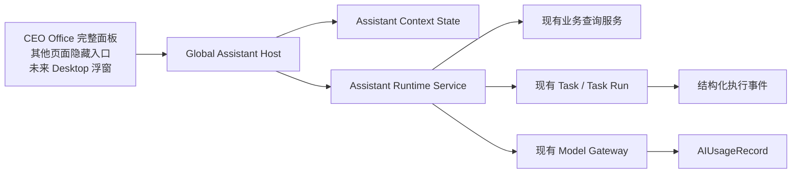

# Curis Assistant Architecture Review

Status: Deprecated

Date: 2026-07-30

Historical Status: READ-ONLY ARCHITECTURE REVIEW

Scope: 当前 AI 秘书实现、已有能力、数据来源与 Global Assistant Runtime 演进方案

## Executive Conclusion

当前 Curis AI 秘书还不是系统级 Assistant。

它目前是 CEO Office `TerraShell` 内的占位抽屉：

- 24 个 CEO Office 页面都能看到入口；
- 没有独立 Assistant Service；
- 没有全局 Assistant 状态；
- 没有指令、简报、提醒或通知运行时；
- 路由切换后组件状态重置；
- CEO Office 以外页面没有该入口。

Curis 已经具备 Company、Business Department、Project、Task、Employee、
Capability、Artifact、Memory、AI Usage 和执行事件等基础服务。因此可以在不重建
产品系统的前提下，将现有页面入口升级为 `Global Assistant Runtime`。

## A. 当前实现情况

| 检查项 | 当前结论 |
|---|---|
| 是否绑定 CEO Office | 是。入口位于每个页面自行渲染的 `TerraShell` 中 |
| 是否已有独立 Assistant Service | 否 |
| 是否有独立状态管理 | 否。仅有组件内部 `assistantOpen` |
| 是否可以被其他页面调用 | 只有使用 `TerraShell` 的 CEO Office 页面能打开同一个占位抽屉，不能调用真实 Assistant |
| 是否保持跨页面状态 | 否。路由切换会卸载当前 Shell，打开状态和输入状态无法保留 |
| 是否已有对话或指令接口 | 否 |
| 是否已有 Assistant 数据聚合接口 | 否 |

当前入口实现明确写着“对话服务尚未接入”，也不会发送内容或执行操作：

- `frontend/components/terra/TerraShell.js`

当前状态只有：

```text
assistantOpen: boolean
```

根布局没有 Assistant Provider、Store 或 Runtime Host：

- `frontend/app/layout.js`

当前链路是：

```text
CEO Office 页面
→ TerraShell
→ AI 秘书按钮
→ 空 Drawer
```

而不是：

```text
Global Assistant Runtime
→ 多页面共享状态
→ 业务上下文
→ Assistant Service
→ Task / Event / AI Usage
```

## B. 已具备能力

### B.1 秘书产品能力

| 能力 | 当前情况 | 可复用基础 |
|---|---|---|
| 今日简报 | 未实现 | `home/summary` 已聚合公司、部门、项目、员工、最近成果 |
| 待处理 | 未实现真实聚合 | Task 状态、`awaiting_input`、`human_handoff`、失败事件可作为来源 |
| 风险提示 | 部分底层事实存在 | 首页能识别 `blocked` Project；Task 失败、重试、未计量成本也可派生风险 |
| 指令输入 | 未实现 | 可复用现有 Task 创建、Task Run 和执行控制闭环 |
| AI 会议室调用 | 未实现 | 战略会议室页面存在，但当前使用示例会议，发起按钮无运行时 |
| Task 提醒 | 未实现 | Task Run 时间线和持久化控制状态已存在 |
| Event 通知 | 未实现 | `evolution_events` 存在，但没有 Assistant 通知投影、未读状态或安全订阅 |

CEO 首页已经读取真实经营对象和成果，但它是首页展示逻辑，不是 Assistant 简报服务：

- `frontend/app/ceo-office/page.js`
- `backend/app/routers/home.py`

当前下列页面仍包含示例数据，不能作为秘书真实能力：

- `frontend/app/ceo-office/strategy-room/page.js`
- `frontend/app/ceo-office/decisions/page.js`
- `frontend/app/ceo-office/reports/page.js`

通知偏好也明确标注为未接入真实配置：

- `frontend/app/ceo-office/settings/page.js`

## C. 数据来源检查

结论是：数据基础基本齐全，但目前没有任何一类数据真正接入 AI 秘书。

| 数据 | 系统是否已有 | Assistant 是否已接入 |
|---|---:|---:|
| Company | 是 | 否 |
| Business Department | 是 | 否 |
| Project | 是 | 否 |
| Task / Task Run | 是 | 否 |
| Employee | 是 | 否 |
| Capability | 是 | 否 |
| Result / Artifact | 是 | 否 |
| Memory / Context Package | 是 | 否 |
| Cost / Token | 是 | 否 |
| 执行 Event | 是 | 否 |

### C.1 可复用数据入口

- Company、Department、Project、Employee、Task、Capability、Artifact：
  `frontend/lib/api.js`
- Memory 与 Context Package：
  `frontend/lib/memory.js`
- AI Usage Record 和成本聚合：
  `backend/app/ai_usage.py`
- Task Run 结构化事件和执行控制：
  `backend/app/task_execution_control.py`

### C.2 Event 安全边界

通用 `/api/evolution-events` 当前调用的 `get_all()` 查询本身没有 tenant 条件：

- `backend/app/evolution_event_log.py`

它不能直接作为未来 Global Assistant 的通知数据源。Assistant 必须使用 tenant
fail-closed、字段白名单化的通知投影，不得直接返回原始事件 payload。

## D. 是否需要重构

需要，但属于架构收敛式重构，不需要重建产品系统。

需要改变的是：

```text
TerraShell 内部占位 Drawer
↓
全局 Assistant Host + 共享状态 + Backend Assistant Runtime
```

不需要改变的是：

- Employee
- Capability
- Task / Task Run
- Workflow
- Event
- Artifact
- Memory
- Model Gateway
- AIUsageRecord
- TenantContext
- Local Owner 认证

不建议新增：

- Assistant 专属 Agent 系统
- Assistant Session 数据库
- 第二套聊天记录体系
- 第二套通知事件表
- 独立微服务
- 新状态管理依赖
- Assistant 专属 Token/成本表

现有 `frontend/design-spec/Curis-Desktop-Design-System-v1.0.md` 已经定义全局
Floating Assistant、跨页面状态和 CEO Office 特殊展示方式，只是当前代码尚未实现。

对于“CEO Office 固定展示完整秘书栏”，推荐解释为：

- CEO Office 默认展开完整 Assistant Panel；
- Panel 仍属于全局浮层；
- 不写成页面 Grid 的第三列；
- 其他页面默认隐藏，只保留统一入口。

这样既满足当前产品目标，也不破坏现有全宽工作区规范。

## E. 推荐技术方案



### E.1 前端：Global Assistant Host

在认证后的 Workspace Layout 挂载一次：

```text
AssistantProvider
├── AssistantHost
├── FloatingAssistantEntry
└── FloatingAssistantPanel
```

使用 React Context + `useReducer` 即可，不需要 Redux、Zustand 或其他新依赖。

最小状态：

```text
open / minimized
display_mode
unread_count
draft_command
current_page_context
selected_entity
last_refresh_at
```

页面只提供安全的结构化上下文：

```json
{
  "page": "project",
  "project_id": "...",
  "task_id": null
}
```

Assistant 不读取 DOM，不抓取页面文本，不复制页面私有状态。

### E.2 后端：Assistant Runtime Service

在现有 Backend 内增加薄应用层服务，不拆独立微服务：

```text
AssistantRuntimeService
- get_snapshot()
- submit_command()
- get_notifications()
```

`get_snapshot()` 聚合：

- 今日简报
- 待处理
- 风险
- Task 提醒
- Event 通知
- 成本健康摘要

该服务只调用现有业务服务，不拥有新的业务事实数据。

### E.3 指令执行

所有会改变系统状态的秘书指令都必须进入现有 Task：

```text
用户指令
→ Assistant 解析为安全结构
→ 用户确认
→ 创建或操作现有 Task
→ Task Run
→ Capability / Model Gateway
→ AIUsageRecord
→ 结构化 Event
→ Assistant 展示结果摘要
```

Assistant 不得绕过 Task 直接调用任意工具或修改业务对象。

### E.4 最小 API

建议提供：

```text
GET  /api/workspace/assistant/snapshot
GET  /api/workspace/assistant/notifications
POST /api/workspace/assistant/commands
```

要求：

- 简报、待处理和风险优先使用确定性规则聚合；
- LLM 只负责摘要和指令理解；
- 成本只能读取 `AIUsageService.aggregate()`；
- 通知只返回安全事件摘要；
- 不返回 Prompt、模型完整回答、隐藏思维链、Credential 或原始事件 payload；
- 所有读写必须通过现有 Local Owner、TenantContext 和 tenant fail-closed 边界。

### E.5 AI 会议室

当前战略会议室仍是示例页面。第一阶段的“召集 AI 会议室”只能：

- 导航到会议室入口；
- 或明确显示会议运行时尚未接入。

真实会议 Runtime 应保持独立 Issue，不能在 Assistant 重构中顺带伪造。

### E.6 Desktop Floating Assistant

未来 Desktop 浮窗只增加新的展示适配器：

```text
Desktop Floating Window
→ 调用同一个 Assistant Runtime
```

不得复制 Assistant 业务逻辑，也不得让 Desktop 浮窗直接读取数据库。

## Recommended Delivery Order

1. Assistant Runtime Contract 与只读 Snapshot。
2. Global Assistant Host、共享状态和 CEO Office 默认展开模式。
3. 待处理、风险、Task 提醒和安全 Event 通知投影。
4. 指令确认后进入现有 Task / Task Run。
5. 真实 AI 会议室和 Desktop Floating Window 分别建立独立 Issue。

## Final Assessment

Curis 当前不具备系统级 AI 秘书，但已经具备大部分业务数据与执行底座。下一步应升级
入口、共享状态和聚合运行时，而不是重建 Employee、Task、Memory、Event 或 AI Usage
系统。

本 Review 只形成架构结论，不授权代码、API、数据库或产品页面修改。
