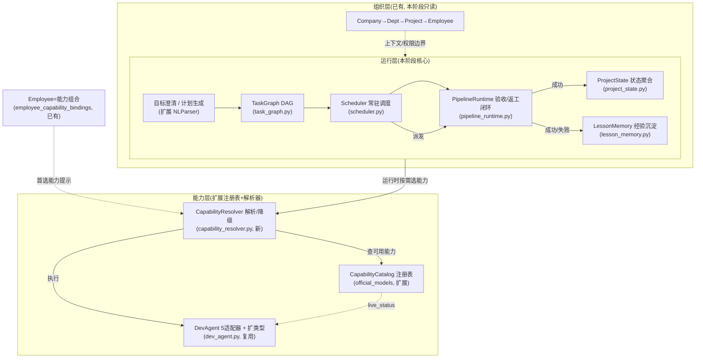
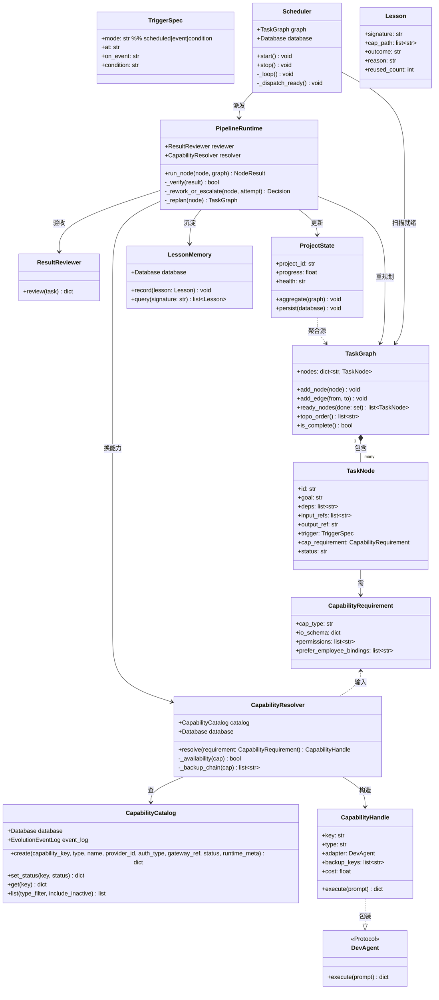
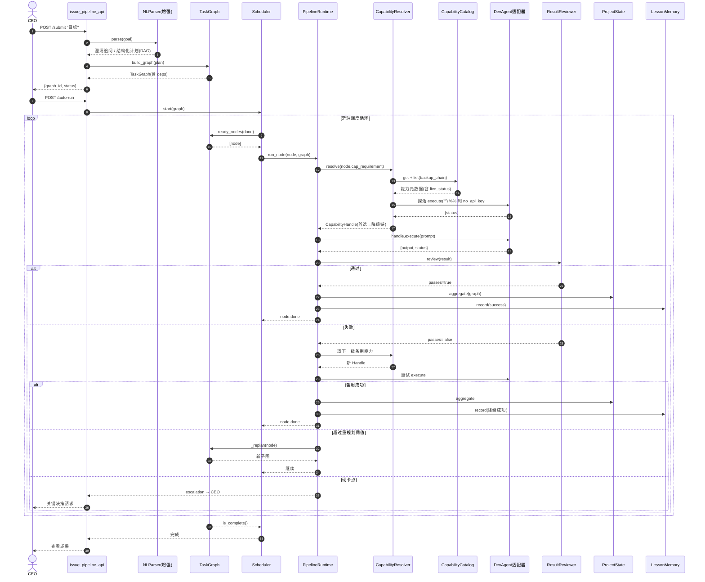
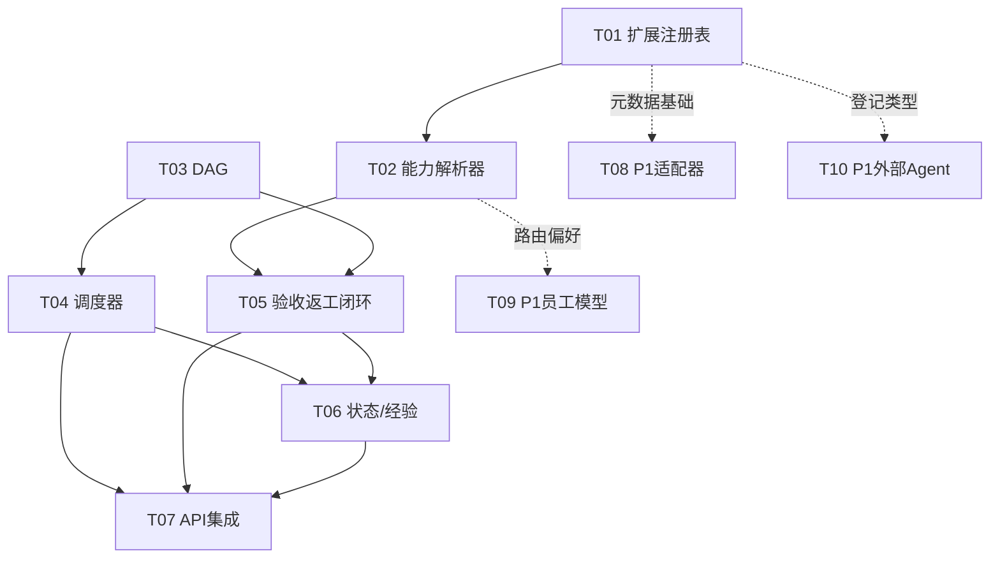

# Curis 后端核心架构蓝图（本阶段：自动任务流核心 + 能力路由降级）

> **文档性质**：后端架构设计 + 任务分解（一次性产出）
> **作者**：架构师高见远 ｜ **输入基准**：`docs/product/curis-product-vision-current-stage.md`
> **范围**：本阶段 ONLY 后端自动任务流核心 + 能力路由降级；前端后置。
> **核查方式**：本文所有"工程现状"结论均基于 2026-07-21 对 `backend/app/` 源码的逐文件实地核查，非沿用 PRD 描述。

---

## 0. 工程现状实地核查结论（关键，已与 PRD 前提校正）

PRD §3 的前提是"适配器零抽象、注册表/路由缺失"。**实测代码后该前提已过时**——`backend/app/` 当前已存在一套相当完整的运行时基座。下表是"PRD 描述 vs 实测"的差异，这是本设计能"复用而非重写"的根本依据。

| PRD/主理人前提 | 实测代码（已存在） | 结论 |
|---|---|---|
| DevAgent 5 适配器但无统一抽象 | `dev_agent.py` 已有 `DevAgent` Protocol + 5 适配器（Claude / OpenAI-Codex / WorkBuddy-API / Codex-CLI / WorkBuddy-CLI），且每个适配器内部自带 `no_api_key` / CLI→SDK 优雅降级 | ✅ 复用，不重写 |
| 无统一能力注册表 | `capability_catalog.py` 的 **`CapabilityCatalog`** 已是统一注册表，落在 `official_models` 表，覆盖 `model/tool/connector` 三类，含 active/inactive 状态机 + 审计事件 | ✅ 扩展，不新建 |
| 无路由/降级 | `tool_router.py` 的 **`ToolRouter`** 已有 `fallback_chain`（codex→gpt→claude→default）与关键词路由；`workflow_runtime.py` / `rd_workflow_runtime.py` 已按步骤编排执行 | 🟡 仅限"模型工具类关键词路由"，缺跨类型 + 实时可用性感知 |
| 动态任务图缺失 | `issue_pipeline.py` 是**扁平队列**（无依赖）；`workflow_runtime.py` 是**顺序步骤**（step_order，无任意 DAG 依赖） | ❌ 真正缺口：DAG + 就绪判定 |
| 自动调度缺失 | `issue_pipeline_api.py` 需人工 `/dispatch`；`orchestrator.py` 按任务单次编排；**无常驻后台调度器按就绪态自动拉取** | ❌ 真正缺口：常驻自动调度器 |
| 验收/返工靠人工 | `ResultReviewer` + `/approve` `/reject` `/rework` 端点，返工依赖人工 | ❌ 真正缺口：自动闭环（自动重试/换能力/重规划，仅卡点上报 CEO） |
| 项目状态/经验沉淀很弱 | `project_progress` 等 widget 存在；`orchestrator.py` 有 `_learn_from_execution`/`_learn_from_failure` 但**仅内存、非持久记忆** | ❌ 真正缺口：项目级状态聚合 + lessons-learned 持久记忆 |
| 员工=固定 Agent | `employee_capability_bindings` 表 + `employee_templates.preferred_capability_for_employee` 已存在"岗位绑定能力 + 首选能力" | 🟡 P1-2 已部分具备，本阶段仅标注边界 |

### 0.1 因此本设计的唯一策略

> **复用既有 `CapabilityCatalog` / `ToolRouter` / `DevAgent` / `WorkflowRuntime` / `employee_capability_bindings`，只补齐 5 个真正缺口，零新依赖。**
> 不新建 `capability_registry.py`（与现有 `CapabilityCatalog` 重复），而是**扩展注册表元数据 + 新增一层"运行时可用性感知的能力解析器（CapabilityResolver）"**；DAG、调度器、验收返工闭环、记忆存储为净新增。

### 0.2 净新增 vs 扩展 一览

| 缺口 | 处置 | 产物 |
|---|---|---|
| 跨类型 + 实时可用性 + 降级链 | **扩展** registry 元数据 + **新增** resolver | `capability_resolver.py`（新）；`official_models` 增加 `runtime_meta_json` 列 |
| 统一能力类型扩展到 Skill/Tool/MCP/API/CLI/Webhook | **扩展** `CapabilityCatalog` + `catalog_constants.CAPABILITY_TYPE` | 修改 `catalog_constants.py` / `capability_catalog.py` |
| 动态任务图 DAG | **净新增** | `task_graph.py` |
| 常驻自动调度器 | **净新增** | `scheduler.py` |
| 验收/返工自动闭环 | **净新增**（复用 `ResultReviewer`） | `pipeline_runtime.py`（编排闭环） |
| 项目状态聚合 + 经验沉淀 | **净新增**（复用 `ProjectState`/`company_project_runtime`） | `project_state.py` + `lesson_memory.py` |

---

## 1. 实现方案 + 框架选型

### 1.1 复用清单（不重写）

- **`DevAgent` Protocol + 5 适配器**（`dev_agent.py`）：作为所有"执行型能力"的统一执行入口。`execute(prompt) -> {output, status, ...}`，其中 `status` 已含 `no_api_key` / `cli_not_found` 等降级信号——这正是 resolver 判定"能力是否可用"的天然来源。
- **`CapabilityCatalog`**（`capability_catalog.py`）：统一能力注册表，落 `official_models` 表。本阶段扩展其 `type` 枚举与元数据，不再建第二套注册表。
- **`ToolRouter`**（`tool_router.py`）：保留其关键词→工具初筛作为 resolver 的一路输入；但 resolver 在其之上叠加"可用性 + 备用链"决策。
- **`ResultReviewer`**（`issue_pipeline.py`）：复用其 diff/test 校验逻辑作为验收器。
- **`employee_capability_bindings` + `preferred_capability_for_employee`**：作为"员工=能力组合"的数据基座（P1-2 边界，本阶段只读取、不重写）。
- **`Database` + `TenantContext`**（`database.py`）：所有持久化与租户隔离统一走它（见 §7）。

### 1.2 新增/扩展模块与职责

| 模块 | 类型 | 职责 |
|---|---|---|
| `capability_resolver.py` | **新** | 运行时能力解析器：给定任务需求（类型/IO/权限），查 `CapabilityCatalog` → 按 `backup_chain` + 实时可用性（调 `DevAgent.execute` 探活或读 `runtime_meta.live_status`）选首选→降级；返回可执行的 `CapabilityHandle`。这是 P0-4 的系统级降级链。 |
| `task_graph.py` | **新** | DAG 数据结构 `TaskGraph` / `TaskNode`：声明依赖、IO、触发条件；提供 `ready_nodes()` 就绪判定与拓扑展开。P0-1。 |
| `scheduler.py` | **新** | 常驻调度器（线程/asyncio 后台循环）：周期性扫描就绪 `TaskNode` → 派发执行；支持最小集触发（定时/事件/条件）。P0-2。 |
| `pipeline_runtime.py` | **新** | 验收/返工自动闭环编排：执行→`ResultReviewer`→失败则自动重试→自动换能力（调 resolver 下一级）→超限自动重规划→仍失败才升级 CEO。复用 `ResultReviewer` 与 `dev_agent` 适配器。P0-5。 |
| `project_state.py` | **新** | 项目级状态聚合：从任务图/步骤聚合进度、健康度、成本；写回 `projects` 表与 `project_progress` widget。P0-6 前半。 |
| `lesson_memory.py` | **新** | lessons-learned 记忆存储：把成功路径/失败原因/有效降级链持久化到新表 `capability_lessons`，供后续任务检索复用。P0-6 后半。 |
| `catalog_constants.py` | **改** | `CAPABILITY_TYPE` 由 `["model","tool","connector"]` 扩展为 `["model","tool","skill","mcp","api","cli","webhook","workflow"]`。 |
| `capability_catalog.py` | **改** | `create()` 增加 `runtime_meta`（cost/permissions/io/backup_chain/credentials_ref）入参，写 `runtime_meta_json` 列。 |
| `database.py` | **改** | 为 `official_models` 增加 `runtime_meta_json` 列（沿用 `_ensure_column` 迁移模式）；新增 `capability_lessons` 表。 |
| `issue_pipeline.py` | **改** | `PipelineDispatcher` 接入 `CapabilityResolver` 与 `pipeline_runtime` 闭环；`NLParser` 增强为"澄清→结构化计划（DAG）"的最小生成。 |
| `issue_pipeline_api.py` | **改** | 新增 `/api/pipeline/{id}/graph` 查看 DAG、`/api/pipeline/{id}/auto-run` 启动常驻自动执行、`/api/lessons` 查询经验。 |

### 1.3 框架选型（零新依赖）

| 维度 | 选型 | 理由 |
|---|---|---|
| Web 框架 | **FastAPI + pydantic**（已存在） | 复用现有 API 层，不引入新框架 |
| 持久化 | **SQLite（stdlib `sqlite3`）+ 现有 `Database`** | 沿用仓库既有模式（`_ensure_column` 迁移、`WAL`、`_db_lock` 串行写）；多进程一致性靠单写者 + 行级事务 |
| 并发 | **`threading` / `asyncio`**（stdlib） | 调度器用后台线程循环（与现有 `issue_pipeline_api` 的 `threading.Thread(daemon=True)` 一致）；执行器异步化复用 `async def run` 既有模式 |
| 能力执行 | **复用 `dev_agent.py`（httpx 已 lazily import）** | 不新增 HTTP 客户端 |
| DAG/调度 | **自研轻量拓扑 + 轮询**（stdlib） | 本阶段只需最小可用 DAG 与就绪轮询，不需要 networkx / APScheduler |
| 配置 | **环境变量 + 现有 `TenantContext`** | 沿用既有租户与配置读取方式 |

> **结论：零新第三方依赖。** 全部基于 Python 标准库 + 已安装的 FastAPI/pydantic/httpx。

### 1.4 分层架构图



---

## 2. 文件列表（相对路径：均位于 `backend/app/`）

### 新增文件

| 文件 | 说明 |
|---|---|
| `backend/app/capability_resolver.py` | 运行时能力解析器（P0-4 系统级降级链） |
| `backend/app/task_graph.py` | DAG 数据结构与就绪判定（P0-1） |
| `backend/app/scheduler.py` | 常驻自动调度器（P0-2） |
| `backend/app/pipeline_runtime.py` | 验收/返工自动闭环编排（P0-5） |
| `backend/app/project_state.py` | 项目级状态聚合（P0-6 前半） |
| `backend/app/lesson_memory.py` | lessons-learned 记忆存储（P0-6 后半） |

### 修改文件

| 文件 | 修改点 |
|---|---|
| `backend/app/catalog_constants.py` | `CAPABILITY_TYPE` 扩展 8 类；新增 `is_valid_capability_type` 已自动覆盖 |
| `backend/app/capability_catalog.py` | `create()` 增加 `runtime_meta`；读/写 `runtime_meta_json`；`list()` 反序列化 |
| `backend/app/database.py` | `official_models` 增 `runtime_meta_json` 列（迁移）；新增 `capability_lessons` 表 + 读写方法 |
| `backend/app/dev_agent.py` | 不重写；仅确保 `execute` 返回 `status`/`model_gateway_id` 供 resolver 探活（已具备） |
| `backend/app/issue_pipeline.py` | `NLParser` 增强为"澄清→DAG 计划"；`PipelineDispatcher` 接入 resolver + pipeline_runtime |
| `backend/app/issue_pipeline_api.py` | 新增 DAG 查看 / 自动运行 / 经验查询端点 |
| `backend/app/main.py` | 注册常驻调度器生命周期（startup 启动 / shutdown 停止） |

---

## 3. 数据结构与接口（类图）



### 3.1 关键数据结构 JSON Schema（节选）

**`official_models.runtime_meta_json`（新增列，扩展注册表元数据）**
```json
{
  "cost_per_unit": 0.002,
  "io_schema": { "input": ["prompt"], "output": ["diff", "report"] },
  "permissions": ["repo.write", "network.egress"],
  "credentials_ref": "env:OPENAI_API_KEY",
  "backup_chain": ["openai-gpt4o", "claude-sonnet", "workbuddy-cli"],
  "live_status": "available"   // available | unavailable | unknown（resolver 探活刷新）
}
```

**`TaskNode`（DAG 节点）**
```json
{
  "id": "n3",
  "goal": "为模块 X 编写单元测试并跑通",
  "deps": ["n1", "n2"],
  "input_refs": ["n1.output", "n2.output"],
  "output_ref": "n3.output",
  "trigger": { "mode": "condition", "condition": "n1.done && n2.done" },
  "cap_requirement": { "cap_type": "tool", "io_schema": {...}, "permissions": ["repo.write"] },
  "status": "pending"   // pending|ready|running|review|approved|failed|done
}
```

**`capability_lessons`（新表）**
```json
{
  "signature": "sha256(task_type+cap_type)",
  "cap_path": ["openai-gpt4o", "claude-sonnet"],
  "outcome": "success|fail",
  "reason": "首选无 key，降级后成功",
  "reused_count": 3
}
```

---

## 4. 程序调用流程（时序图）



---

## 5. 任务列表（有序、含依赖、按实现顺序）

> 优先级说明：**P0 = 本阶段必须**；**P1 = 标注本阶段边界（列出但不实现）**。任务粒度按"可独立交付、有清晰验收"切分，不人为限制数量（与"少而精"的工程直觉一致）。

### P0 任务（核心闭环）

| ID | 任务 | 源文件 | 依赖 | 优先级 |
|---|---|---|---|---|
| **T01** | 扩展统一能力注册表：扩 `CAPABILITY_TYPE` 到 8 类；`official_models` 增 `runtime_meta_json` 列（迁移）；`CapabilityCatalog.create` 支持 `runtime_meta`（cost/permissions/io/backup_chain/credentials_ref/live_status） | `catalog_constants.py`, `database.py`, `capability_catalog.py` | — | P0 |
| **T02** | 新增能力解析器 `CapabilityResolver`：查 catalog → 按 `backup_chain` + 实时可用性（`DevAgent.execute("")` 探活/读 `live_status`）选首选→降级，返回 `CapabilityHandle`；与既有 `ToolRouter` 关键词初筛协同 | `capability_resolver.py`（新）, 复用 `dev_agent.py`/`tool_router.py` | T01 | P0 |
| **T03** | 新增动态任务图 `task_graph.py`：`TaskGraph`/`TaskNode`/`TriggerSpec`，支持声明依赖、IO、触发条件；提供 `ready_nodes()` 就绪判定与拓扑展开 | `task_graph.py`（新） | — | P0 |
| **T04** | 新增常驻自动调度器 `scheduler.py`：后台线程循环扫描 `ready_nodes` 自动派发；支持定时/事件/条件触发最小集；在 `main.py` 注册生命周期 | `scheduler.py`（新）, `main.py` | T03 | P0 |
| **T05** | 验收/返工自动闭环 `pipeline_runtime.py`：复用 `ResultReviewer`，失败自动重试→自动换能力（调 T02 resolver 下一级）→超阈自动重规划→硬卡点升级 CEO；`PipelineDispatcher`/`NLParser` 接入 | `pipeline_runtime.py`（新）, `issue_pipeline.py` | T02, T03 | P0 |
| **T06** | 项目状态聚合 + 经验沉淀：`project_state.py` 聚合进度/健康/成本；`lesson_memory.py` + `capability_lessons` 表，持久化成功路径/失败原因/有效降级链供复用 | `project_state.py`（新）, `lesson_memory.py`（新）, `database.py` | T04, T05 | P0 |
| **T07** | API 与集成收尾：`issue_pipeline_api.py` 新增 `/graph`、`/auto-run`、`/lessons` 端点；`main.py` 启动调度器；端到端联调"目标→执行→验收→返工→完成" | `issue_pipeline_api.py`, `main.py` | T04, T05, T06 | P0 |

### P1 任务（本阶段边界：列出但标注，不实现）

| ID | 任务 | 边界说明 |
|---|---|---|
| **T08** | 5 类适配器抽象（CLI / HTTP API / MCP / Webhook / Local Process）统一为 `Capability` 接口 | 本阶段仅复用 `dev_agent.py` 的 `DevAgent` 协议承载"执行型能力"；MCP/Webhook/API 类型先在 `CapabilityCatalog` 登记元数据（T01），**真实适配器实现后置**到 P1 |
| **T09** | 员工 = 能力组合模型增强 | 数据基座 `employee_capability_bindings` + `preferred_capability_for_employee` 已存在；本阶段 resolver 仅"读取"员工首选能力作为路由偏好（T02），**不重写绑定模型** |
| **T10** | 外部 Agent 统一适配器接入 | 复用 `dev_agent.py` 已有 5 适配器雏形，泛化为标准 `Capability`；**本阶段只登记、不新接外部 Agent** |

### 依赖关系图



---

## 6. 依赖包列表（零新依赖）

| 包 | 版本/来源 | 用途 | 复用状态 |
|---|---|---|---|
| `fastapi` | 已安装 | API 层 | 复用 |
| `pydantic` | 已安装 | 请求/响应模型 | 复用 |
| `httpx` | 已安装（dev_agent lazily import） | 能力 HTTP 调用 | 复用 |
| `sqlite3` | Python 标准库 | 持久化 | 复用（`Database`） |
| `threading` / `asyncio` | Python 标准库 | 调度器/异步执行 | 复用（与现有 `_run` 后台线程一致） |
| `json` / `uuid` / `hashlib` / `datetime` | Python 标准库 | 序列化/ID/指纹 | 复用 |

> **无新增第三方依赖。** DAG 与调度均为自研轻量实现，避免引入 networkx / APScheduler。

---

## 7. 共享知识（跨文件约定）

1. **DB 表命名**：沿用现有蛇形命名 + 单数/复数混用现状（如 `official_models`、`workflow_runs`、`employee_capability_bindings`）。新表 `capability_lessons` 遵循同风格。新增列一律走 `database.py` 的 `_ensure_column()` 迁移（幂等），**禁止破坏性 `ALTER`**。
2. **租户隔离**：统一经 `TenantContext.current_tenant_id()`（全局固定 `'selfuse'`/`'default'` 单账号现状）。所有新表必须含 `tenant_id text not null` 列，写操作带 `tenant_id` 过滤。注：PRD 提到的 `CURIS_DB` 环境变量在 `database.py` 中未直接出现——**待确认**其是否为连接串覆盖点；本设计默认沿用现有 `Database.connect()` 行为，不引入新环境变量。
3. **错误结构（FastAPI `detail` 规范）**：所有 API 错误返回 `{detail: "<message>"}`，便于前端极简入口解析；业务校验失败用 `422`，未找到用 `404`，能力不可用/降级耗尽用 `409/503` 并附 `detail.reason`。沿用 `issue_pipeline_api.py` 现有风格。
4. **密钥不落库**：能力凭证只存 `credentials_ref` 形态的 `scheme:reference`（如 `env:OPENAI_API_KEY`），绝不存明文 key（沿用 `catalog_constants._CREDENTIAL_REF_PATTERN` 与 `CapabilityCatalog._reject_secret_like_metadata`）。
5. **能力执行契约**：所有执行型能力实现 `DevAgent.execute(prompt) -> {output, status, model_gateway_id, ...}`，`status` 必须含 `no_api_key`/`cli_not_found`/`timeout`/`error:*` 等降级信号——这是 resolver 探活的唯一依据。
6. **审计**：能力增删/状态变更/降级发生，写入 `evolution_events`（`capability.*` 事件类型），复用 `EvolutionEventLog`。
7. **降级默认**：首选不可用时的行为由 §8 的"待 CEO 拍板 ②"决定；默认实现采用**可配置策略**（静默降级 / 上报二选一由配置开关控制），代码层面两个分支都预留。

---

## 8. 待明确事项（带入 PRD §5 三问 + 架构师推荐默认）

> 以下三问 PRD 标注"需 CEO 拍板"。作为架构师，我给出**推荐默认**（基于"原则④：一切以更自动为判据"与"零新依赖/单进程现状"），供主理人转 CEO 决策。

### ① 能力注册表持久化策略
- **实测现状**：`CapabilityCatalog` 已落库（`official_models`，SQLite + `Database`）。调度器若常驻后台线程（同进程），库内一致性已由 `_db_lock` 串行写保证。
- **推荐默认**：**直接落库（复用 `official_models`）**，不另起内存注册表。理由：注册表已是库表，且多进程一致性靠单写者 + 行级事务即可满足本阶段；若未来多进程，再升级为 DB 行锁/乐观锁，无需改接口。
- **待 CEO 确认**：是否接受本阶段单写者 SQLite 模型（vs 提前上 Redis/独立服务）？

### ② 降级链自动化边界（首选不可用时的行为）
- **推荐默认**：**默认"静默自动降级"到备用能力**（实现原则④"无人盯守"），但**保留配置开关 `AUTO_DEGRADE_SILENT`**：
  - 静默降级成功 → 记 `capability_lessons`（供复用），不上报；
  - 降级链耗尽 / 触及硬卡点（如验收连续 N 次失败、需外部凭证） → **必须上报 CEO**（与 PRD 红线"仅关键事项交给 CEO"一致）。
- **待 CEO 确认**：默认静默降级是否可接受？还是"任何降级都必须先上报"？

### ③ 动态任务图触发模式默认项 + 重规划触发时机
- **推荐默认（本阶段）**：
  - **默认触发模式 = "固定工作流 + 简单依赖 DAG"**（即 PRD 的"Agent 自主规划"后置）。理由：`WorkflowRuntime` 已有顺序步骤引擎，本阶段把"顺序步骤"升级为"带依赖的 DAG + 就绪调度"即可，风险最低、最快跑通原则④闭环。
  - **重规划触发时机（执行中重新规划）**：
    - 验收失败 ≥ `MAX_REWORK`（默认 2，沿用 `ResultReviewer.escalated` 阈值）→ 自动换能力；
    - 换能力仍失败 ≥ `MAX_CAP_SWITCH`（默认 2）→ **自动重规划**（局部重生成受影响子图）；
    - 超时（`node.timeout`，默认 900s，复用 `DevAgent` 超时）→ 标记失败进入重规划；
    - 以上均无法收敛 → 升级 CEO。
- **待 CEO 确认**：默认 `MAX_REWORK=2` / `MAX_CAP_SWITCH=2` / `timeout=900s` 是否合适？是否本阶段就允许"Agent 自主规划"作为可选模式？

---

## 9. 风险与备注

1. **调度器并发模型**：本阶段用单进程后台线程轮询（与现有 `issue_pipeline_api` 的 daemon 线程一致），不支持跨进程并行；若 CEO 在 ① 选择多进程，需升级为 DB 行锁派发（列为后续）。
2. **`WorkflowRuntime` vs `issue_pipeline` 双路径**：实测存在两套执行入口（顺序步骤引擎 vs 扁平队列）。本设计**以 `issue_pipeline` 路径为 P0 改造主线的承载**（因其更靠近"自然语言→任务"且无固定 7 步约束），`WorkflowRuntime` 的 DAG 化列为后续融合，避免本阶段范围膨胀。
3. **`orchestrator.py` 的 `_learn_from_*`**：已有内存学习雏形，本阶段 `lesson_memory.py` 将其**持久化**，二者可逐步合并，不冲突。
4. **能力类型扩展的向后兼容**：`CAPABILITY_TYPE` 扩展后，既有 `model/tool/connector` 数据不受影响；新类型（`skill/mcp/api/cli/webhook/workflow`）本阶段仅在注册表登记元数据，真实适配器（T08/T10）后置。
