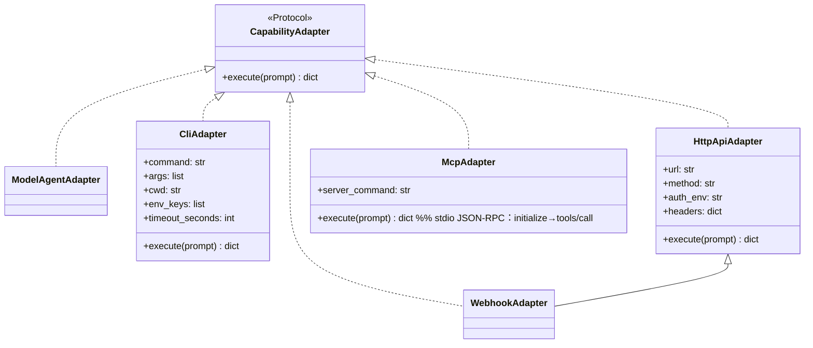

# Curis P1 增量设计：适配器抽象 + 员工=能力组合

> **文档性质**：P1 增量架构设计 + 任务分解（一次性产出，作为工程师实现契约）
> **作者**：主理人齐活林（架构师子代理本轮 prompt 投递故障，由主理人代出设计基准，工程师/QA 仍走标准路径）
> **输入基准**：`docs/architecture/curis-backend-core-arch.md`（P0 蓝图）、`docs/product/curis-product-vision-current-stage.md`（愿景 PRD）
> **范围**：仅后端。P1 = 适配器抽象（CLI/HTTP/MCP/Webhook/Local）+ 员工=能力组合模型 + 外部 Agent 统一接入机制。
> **核查方式**：所有"工程现状"均基于 2026-07-21/22 对 `backend/app/` 源码的逐文件实地核查。

---

## 0. 工程现状核查（P0 已落地，P1 缺口明确）

| 项 | P0 现状 | P1 缺口 |
|---|---|---|
| 能力执行 | `dev_agent.py` 有 `DevAgent` Protocol + 5 适配器（Claude/OpenAI/WorkBuddy-API/Codex-CLI/WorkBuddy-CLI），`execute(prompt)->{output,status,...}`，`status` 含降级信号 | 仅覆盖 model/agent 类型；非 model（skill/tool/mcp/api/cli/webhook）在 `CapabilityResolver.DevAgentFactory.build` 中一律回落 `NullDevAgent` 占位（不触网、恒 success）。**T08 要补齐真适配器。** |
| 员工能力 | `employee_capability_bindings` 表引用 `capability_binding_id`（skill/tool 绑定概念），与 `official_models.capability_key` **不是同一套 key** | T09 需新增「员工 → official_models 能力 key」桥接，使员工成为可调用能力的组合 |
| 解析器 | `CapabilityResolver` 有 `prefer_employee_bindings` 软偏好，但未被员工模型驱动 | T09 增强 `resolve(req, employee_id=None)`：员工能力组合驱动候选过滤/首选 |
| 外部 Agent | 既有 5 适配器已是外部 Agent（Claude/OpenAI/WorkBuddy/Codex），但新增一个需改代码 | T10：使「登记外部 Agent 为能力」成为纯配置操作（adapter_kind+adapter_config），无需改代码 |

**策略（沿用 P0 §0.1）**：复用 `DevAgent` 协议与 `CapabilityCatalog`，只补齐适配器 + 员工能力组合桥接 + 配置化登记。**零新依赖。**

---

## 1. T08：统一适配器抽象（CLI / HTTP API / MCP / Webhook / Local Process）

### 1.1 `CapabilityAdapter` 协议（泛化 DevAgent）

新适配器与既有 `DevAgent` **同一协议**，保证 `CapabilityHandle.execute` 不变：

```python
# capability_adapters.py
class CapabilityAdapter(Protocol):
    def execute(self, prompt: str) -> dict[str, Any]:
        """执行能力，返回 {output, status, model_gateway_id?, ...}。
        status ∈ {success, no_api_key, cli_not_found, timeout, error:*}。
        """
        ...
```

各适配器在构造时从 `adapter_config` 读取命令/URL/参数；`prompt` 是任务指令文本（与既有模型适配器一致），由适配器自行装配 CLI 参数或 HTTP body。

### 1.2 具体适配器（零新依赖，仅 stdlib + 已装 httpx）



- **`CliAdapter`（= Local Process Adapter）**：`subprocess.run([command, *args, prompt?], cwd, env, timeout, capture_output=True)`，stdout 为 `output`。`env` 仅注入 `env_keys` 中凭证 env 名（从 `credentials_ref` 解析为真实 env 名，如 `env:OPENAI_API_KEY` → 读取 os.environ，绝不落明文）。`status`：`cli_not_found`（FileNotFoundError）/ `timeout`（TimeoutExpired）/ `error:*`。
- **`HttpApiAdapter`（= HTTP API Adapter）**：`httpx.request(method, url, json={"prompt": prompt, **body_extra}, headers, auth=Bearer(env_val))`。响应文本（或 `json()["output"]`）为 `output`。`status`：`error:*`（异常）/ `success`。
- **`WebhookAdapter`**：`HttpApiAdapter` 子类，默认 `method=POST`，fire-and-forget（不等业务回执，返回 `{output: "dispatched", status: "success"}`）。
- **`McpAdapter`**：最小可用。以 `server_command` 经 stdio 启 MCP server 子进程，用 stdlib 做 **JSON-RPC over stdin/stdout**（初始化 → `tools/call` 执行 prompt 对应工具）。**务实取舍**：若零依赖下完整 MCP 客户端（tools/list 协商 + 多轮）风险过高，第一版实现为「`initialize` + `tools/call` 单次调用」的最小路径，并把「完整 tools 发现/多工具编排」标为后续补全点；文档需明确此取舍。

### 1.3 `CapabilityAdapterFactory`（重构 `DevAgentFactory`）

按 catalog 条目的 `runtime_meta.adapter_kind` 分派：

| adapter_kind | 适配器 |
|---|---|
| `model` / `agent` | 复用 `dev_agent.py` 既有 5 适配器（按 key/provider 启发式） |
| `cli` / `local` | `CliAdapter` |
| `http` | `HttpApiAdapter` |
| `webhook` | `WebhookAdapter` |
| `mcp` | `McpAdapter` |

`adapter_config`（command/url/args/env_keys/timeout/method/headers/auth_env）从 `runtime_meta` 读取。`build(cap)` 返回 `CapabilityAdapter` 实例。

---

## 2. T09：员工 = 能力组合模型

### 2.1 数据模型

新增表 `employee_capabilities`（与既有 `employee_capability_bindings` 并列、区分清楚——后者是 skill/tool 绑定，本表是 official_models 能力 key 绑定）：

```json
{
  "tenant_id": "selfuse",
  "employee_id": "emp_xxx",
  "capability_key": "official.openai.gpt4o",   // 指向 official_models.capability_key
  "is_preferred": 1,
  "sort_order": 0,
  "created_at": "ISO"
}
```

### 2.2 `employee_capability_model.py`

```python
class EmployeeCapabilityModel:
    def set_employee_capabilities(self, employee_id, cap_keys: list[str], preferred: str | None) -> None
    def get_employee_capabilities(self, employee_id) -> list[str]      # 按 sort_order
    def get_employee_preferred(self, employee_id) -> str | None
```

- 写/读均带 `tenant_id` 过滤（沿用 `TenantContext.current_tenant_id()`）。
- 新列幂等迁移（`database._ensure_column` 模式不适用整表，用 `create table if not exists` + 索引）。

### 2.3 解析器增强

`CapabilityResolver.resolve(req, employee_id=None, exclude_keys=None)`：
- 若 `employee_id` 非空：`cap_keys = EmployeeCapabilityModel.get_employee_capabilities(employee_id)`。
- `_candidates(cap_type)` 结果**用 `cap_keys` 过滤**（仅该员工可调用能力可选）或作为**强偏好**（员工首选置于 `_select_primary` 首位）。
- 仍保留静默降级：员工能力不可用 → 沿 `backup_chain` 降级；耗尽 → `CapabilityExhausted` 升级 CEO。

### 2.4 `TaskNode.employee_id`

`TaskNode` 增可选 `employee_id` 字段（`task_graph.py` + `issue_pipeline.py` 的 plan→graph 转换）。调度器 `PipelineRuntime.run_node(node, graph)` 执行时，将 `node.employee_id` 透传给 `resolver.resolve(req, employee_id=node.employee_id)`。计划阶段（NLParser）暂不强制绑定员工，留空即走全局能力池。

---

## 3. T10：外部 Agent 统一接入（机制，非资产导入）

- `CapabilityCatalog.register_external_agent(name, kind, config, backup_chain, credentials_ref=None)`：封装 `create()`，装配 `runtime_meta = {adapter_kind: kind, adapter_config: config, backup_chain, credentials_ref, live_status: "unknown"}`。**新增外部 Agent = 一条 catalog 记录，零代码改动。**
- 可选：在 `issue_pipeline_api.py` 暴露 `POST /api/catalog/external-agent` 轻量登记端点（请求体含 name/kind/config/backup_chain），便于运行时登记。
- **L2 红线（强制）**：本阶段**绝不**做「把外部 Agent 生态批量导入为 Package/Department/Employee/Skill/Workflow 资产」。T10 仅把外部 Agent 作为**可调用能力**登记进 `official_models`，属能力层机制，已获愿景预授权（用户原话：「外部 Agent 以后统一通过适配器接入」）。

---

## 4. `runtime_meta` 扩展字段规范（JSON schema 增量）

```json
{
  "cost_per_unit": 0.002,
  "io_schema": {"input": ["prompt"], "output": ["text"]},
  "permissions": ["repo.write"],
  "credentials_ref": "env:OPENAI_API_KEY",
  "backup_chain": ["b", "c"],
  "live_status": "unknown",
  "adapter_kind": "cli | http | webhook | mcp | local | model | agent",
  "adapter_config": {
    "command": "python",
    "args": ["-m", "my_skill"],
    "cwd": null,
    "url": "https://api.example.com/run",
    "method": "POST",
    "auth_env": "env:MY_API_KEY",
    "headers": {},
    "env_keys": ["MY_API_KEY"],
    "timeout": 900,
    "server_command": "npx -y @my/mcp-server"
  }
}
```

---

## 5. 文件列表（均 `backend/app/`）

### 新增
| 文件 | 说明 |
|---|---|
| `capability_adapters.py` | `CapabilityAdapter` 协议 + `CliAdapter`/`HttpApiAdapter`/`WebhookAdapter`/`McpAdapter` + `CapabilityAdapterFactory`（重构原 `DevAgentFactory`） |
| `employee_capability_model.py` | 员工→official_models 能力组合模型（表 `employee_capabilities` + 方法） |

### 修改
| 文件 | 修改点 |
|---|---|
| `capability_resolver.py` | 用 `CapabilityAdapterFactory` 替换 `DevAgentFactory` 导入；`resolve` 增 `employee_id` 参数与员工能力过滤/首选逻辑 |
| `task_graph.py` | `TaskNode` 增 `employee_id` 字段与 `TaskGraph.from_plan` 透传 |
| `issue_pipeline.py` | plan→graph 转换透传 `employee_id`（若节点含）；`PipelineDispatcher`/`pipeline_runtime` 执行时把 `node.employee_id` 传给 resolver |
| `capability_catalog.py` | `create` 接受并落 `adapter_kind`/`adapter_config`；新增 `register_external_agent` |
| `database.py` | 新增 `employee_capabilities` 表 + 读写方法（tenant_id 过滤） |
| `issue_pipeline_api.py` | 可选：`POST /api/catalog/external-agent` 登记端点（T10） |

---

## 6. 任务分解（有序，按实现顺序）

| ID | 任务 | 源文件 | 依赖 | 优先级 |
|---|---|---|---|---|
| **T08-1** | `capability_adapters.py`：协议 + Cli/Http/Webhook/Mcp 适配器 + Factory（按 adapter_kind 分派） | 新增 `capability_adapters.py` | P0(DevAgent 存在) | P1 |
| **T08-2** | `capability_catalog.create` 落 `adapter_kind`/`adapter_config`；新增 `register_external_agent` | `capability_catalog.py` | T08-1(adapter_kind 约定) | P1 |
| **T08-3** | `capability_resolver` 改用 `CapabilityAdapterFactory`（替换 `DevAgentFactory`）；非 model 类型不再回落 NullDevAgent | `capability_resolver.py` | T08-1 | P1 |
| **T09-1** | `employee_capabilities` 表 + `employee_capability_model.py`（set/get/preferred，tenant_id 过滤） | 新增 `employee_capability_model.py` + `database.py` | — | P1 |
| **T09-2** | `TaskNode.employee_id`；resolver `resolve(employee_id)` 过滤/首选；运行层透传 | `task_graph.py`,`capability_resolver.py`,`issue_pipeline.py` | T09-1 | P1 |
| **T10-1** | `register_external_agent` 接线 + 可选登记端点 | `capability_catalog.py`,`issue_pipeline_api.py` | T08-2 | P1 |
| **T-QA** | 单元测试：各适配器（Cli/Http 用本地 mock server/subprocess）、Factory 分派、员工能力过滤、register_external_agent；回归 P0 既有测试 | `tests/test_p1_adapters.py` 等 | 全部 | P1 |

---

## 7. 共享约定（沿用 P0 §7）

1. **租户隔离**：所有新表含 `tenant_id text not null`，写带过滤（沿用 `TenantContext.current_tenant_id()`）。
2. **密钥不落库**：适配器 env 仅取 `credentials_ref` 解析出的 env 名（`env:XXX` → `os.environ["XXX"]`），绝不存明文。
3. **错误结构**：沿用 `{detail: ...}`，能力不可用映射 409/503。
4. **零新依赖**：仅 Python 标准库 + 已装 FastAPI/pydantic/httpx。MCP stdio JSON-RPC 用 stdlib `subprocess` + `json` 实现。
5. **审计**：降级/登记写 `evolution_events`（`capability.*` 类型）。
6. **降级默认**：沿用 `AUTO_DEGRADE_SILENT=True`，耗尽才升级 CEO。

---

## 8. 红线与待确认

- **L2 红线**：T10 不做外部 Agent 资产批量导入（冻结项）。仅能力层配置化登记。
- **MCP 取舍**：第一版 `McpAdapter` 走 stdio JSON-RPC 最小路径（initialize + tools/call 单次），完整 tools 发现/编排标后续。
- **员工能力表**：新增 `employee_capabilities` 表（不与 `employee_capability_bindings` 混用），二者语义明确区分（前者 official_models 能力 key，后者 skill/tool 绑定）。
- **需 CEO 拍板点（1 个）**：`McpAdapter` 是否接受首版「stdio JSON-RPC 最小路径」实现（推荐 Yes，后续补全工具发现）——属实现深度，不影响 P1 范围，可默认采用。
