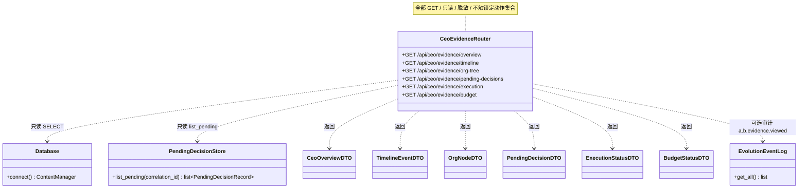
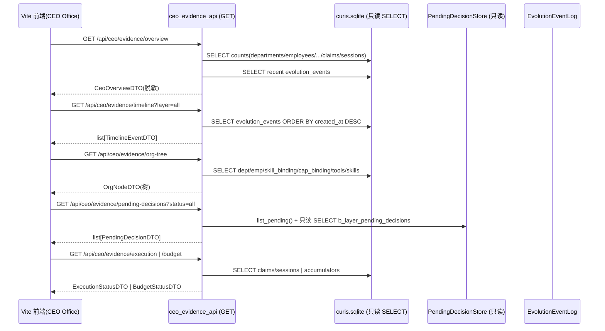
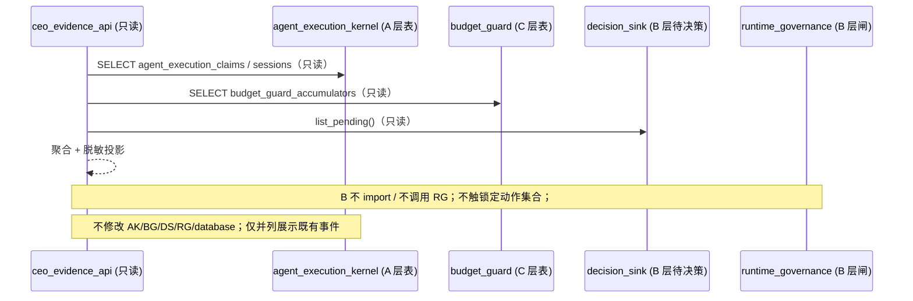
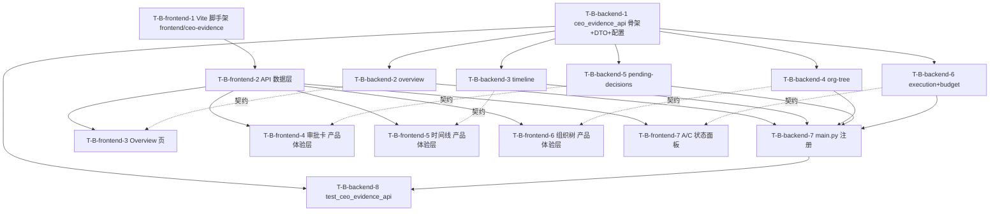

# Issue B · CEO Office 真实运行证据（实现级架构设计）

> 作者：架构师 高见远（software-architect 职责，由 b-architect-3 代执行）
> 受众：工程师 寇豆码（编码）、QA 严过关（测试）、前端工程师（Vite+MUI+Tailwind）、frontend-dev 技能 + general-purpose 临时 UI 队友（产品体验层）
> 性质：**实现级设计 + 有序任务列表**，**不含实现代码**，仅定义文件落点、数据结构契约、接口签名、调用流程与验收要点
> 权威输入：
> - `docs/architecture/paperclip-conclusion-gap-analysis.md`（§P1-1 / §P1-2 / §P1-3 / §Issue B，commit `1dc9da75` 差距核对）
> - `docs/architecture/paperclip-curis-mapping-report.md`（§CEO Decision Center / 审批卡 / 组织图 映射，commit `581ed7d6`）
> - `docs/architecture/agent-execution-kernel-impl-plan.md`（Issue A impl-plan，**结构模板 + 确认 B 须只读共存 A/C 内核表与事件**）
> - `docs/architecture/issue-c-budget-guard-impl-plan.md`（Issue C impl-plan，**端点归 Issue B 的确认来源**）
> - 真实数据源（已 Read 核对）：`decision_sink.py`（`PendingDecisionStore`）、`evolution_event_log.py`（`evolution_events`）、`department_catalog.py`、`employee.py`、`agent_execution_kernel.py`、`agent_wakeup_session.py`、`budget_guard.py`、`main.py`（`/api/ceo/overview`）、`database.py`（`employee_skill_bindings` / `employee_capability_bindings` / `tools` / `skills`）
> 协同设计：`docs/architecture/b-layer-runtime-governance-impl-plan.md`、`b-layer-runtime-governance-decisionsink.md`（B 层闸引擎 + 待决策持久化，须只读共存不破坏）
> 团队边界：**本 Issue 横跨后端（只读聚合）+ 前端（Workspace 端 CEO Office 运行证据）**；沿用「系统做技术决断、用户做业务拍板」；2026-07-17 裁定反转——本团队**现接手 Workspace 前端**，B 的 UI 落点 `frontend/`（Workspace 端），不碰 `frontend/app/platform/**`（Admin 端）。

---

## 0. 范围与铁律（最高约束，不可妥协）

### 0.1 本次交付（4 大能力，后端只读聚合 + 前端展示）

| 编号 | 交付物 | 能力 |
|---|---|---|
| B1 | 后端只读聚合层 `ceo_evidence_api.py` + 只读 GET 端点 | 从既有数据源**只读**聚合「CEO 运行证据」，供前端拉取；不写、不审批、不触锁定动作集合 |
| B2 | CEO Overview 聚合 | 公司 / 项目 / 部门 / 员工 / Agent 的运行态势概览（计数、最近活动），含 A 层执行锁、C 层预算状态、B 层待拍板决策的汇总 |
| B3 | 运行证据 / 时间线投影 | 基于 `evolution_events` + A 层 `a.kernel.*` + C 层 `a.budget.*` + B 层 `b.governance.gate` 事件，按时间线展示执行 / 预算 / 治理事件（**脱敏**：无路径 / Key / 参数 / Secret） |
| B4 | 组织树投影 | Company → Department → Employee → Skill / Tool 层级（复用 `department_instances` / `employee_instances` / `employee_skill_bindings` / `employee_capability_bindings` / `skills` / `tools` 等），前端树形布局 |
| B5 | B 层治理 pending 决策投影 | 从 `decision_sink.PendingDecisionStore` **只读**读出待 A/B/C/D 拍板的决策，展示状态 / 上下文（只读，不审批、不修改） |
| B6 | 前端（functional-first，Vite+React+MUI+Tailwind） | CEO Office 总览 / 运行证据·时间线 / 组织树 / 治理 pending 决策 等页面，数据经上面后端只读端点拉取；本机起 Vite dev server 自测 |

### 0.2 硬约束（不可违反，逐条对应 A/C）

1. **依赖边界**：后端仅标准库 + 项目已装依赖（同 A/C 风格），**零新依赖**；前端使用**用户已授权默认栈 Vite+React+MUI+Tailwind**（2026-07-21 UI 方向裁定，属授权范围，不视为「新依赖违规」——但须在 §6 注明前端依赖是该授权栈；后端仍零新依赖）。
2. **不触发锁定动作集合**：B 只读展示，**不 import / 不调用** 任何解除 A 层锁定的路径（`auto_modify_code` / `lift_human_approval_gate`）；docstring 与正文**避免字面量 `LOCKED_ACTIONS`**（用「锁定动作集合」「不解除人工批准闸」措辞，与 A/C 一致——Issue A 文档因用该字面量导致字面 grep 非「零命中」，C 已规避，B 同样规避）。
3. **不碰 L2 冻结域**：B 是**只读展示既有运行证据**，不引入 Marketplace / 真实计费 / 多租户 / 外部 Agent 生态 / Employee CRUD；不写商业 / 价格 / 套餐逻辑。
4. **与 A/C 内核 + B 层治理共存（关键）**：B **只读聚合**，不修改 `agent_execution_kernel.py` / `agent_wakeup_session.py` / `budget_guard.py` / `runtime_governance.py` / `decision_sink.py` / `database.py`；事件脱敏、并列独立追加写、不混；B 可新增自己的只读端点与（如需）`a.b.*` 展示事件，但**脱敏**、不混写 `a.kernel.*` / `a.budget.*` / `b.governance.gate`。
5. **Admin / Workspace 部署边界**：B 是 Workspace 端（CEO Office 运行证据）；尊重 2026-07-17 隔离纪律——**不修改** `frontend/app/platform/**`（Admin 端）；B 前端 / 端点落在 Workspace 端目录（`frontend/`，具体见 §2 / §8 风险①）。
6. **不代写代码**：本文仅定义契约与流程，**不含实现体**。

---

## 1. 实现方案与框架选型

### 1.1 总体方案

| 维度 | 选型 | 理由 |
|---|---|---|
| 后端聚合形态 | FastAPI 只读 `GET` 端点（`/api/ceo/evidence/*`），由新建 `ceo_evidence_api.py` 暴露 | Issue A/C impl-plan 明确「不新增 FastAPI 路由（端点归 Issue B）」——B 是**唯一**有权新增只读 GET 端点的 Issue |
| 后端数据结构 | 标准库 `dataclass`（**不引 pydantic**）承载投影 DTO | 与 A/C（`RunConfig` / `BudgetGuardConfig`）一致，import-light、零新依赖 |
| 后端读取方式 | 对既有表做**只读 `SELECT` 聚合**；pending 决策复用 `PendingDecisionStore.list_pending()`（只读） | 不写、不触发任何 writer；与受保护文件解耦，不 import `governance` / `runtime_governance` |
| 脱敏 | 复用既有事件脱敏规范：投影 payload 仅含聚合值 / 状态 / 范围键，**无路径 / Key / 参数 / 原始 Secret** | 与 `a.kernel.*` / `a.budget.*` / `b.governance.gate` 一致 |
| 前端框架 | Vite + React + MUI + Tailwind（用户 2026-07-21 硬裁定默认栈） | 用户明确裁定；`本机起 Vite dev server 自测`，local-first |
| 前端数据获取 | `fetch` / React Query 风格 hooks 调上面后端只读端点 | 数据全部来自 B1 只读聚合，前端不直连写库 |
| 前端编队 | 工程师直做基础骨架 + 数据层；**产品体验层**（CEO 决策中心 / 组织图 / 运行时间线）由 **frontend-dev 技能 + general-purpose 临时 UI 队友** 做 | 用户 2026-07-21 裁定 |

### 1.2 关键设计决策

- **B 是唯一端点 Owner**：A/C 内核表（`agent_execution_claims` / `agent_task_sessions` / `agent_wakeup_requests` / `budget_guard_accumulators`）与 B 层 `b_layer_pending_decisions` 全部由 B 的只读端点暴露给前端，A/C 不新增路由（与 A/C impl-plan §0.2#5 / §2.2 一致）。
- **只读聚合，零副作用**：所有端点仅 `SELECT`；pending 决策经 `PendingDecisionStore`（只读 `list_pending`）。**不提供任何 resolver / approve POST 端点**——B 严格「只读展示、不审批、不修改」（呼应任务铁律与 §0.2#4）。resolver / 审批 UI 属未来 Workspace 任务，不在 B 内。
- **脱敏贯穿**：时间线 / org-tree / overview 投影剥离一切路径 / Key / 参数 / Secret；`gate_snapshot`（来自 `PendingDecisionStore`，已脱敏）原样投影，不追加任何原始字段。
- **默认开启（非 default-off）**：B 端点是只读 GET，无运行副作用、不触锁定动作集合，故**默认开启**；不引入 A/C 的 `enabled=False` 开关（A/C 因会改变运行链才 default-off，B 无此风险）。
- **与既有 `/api/ceo/overview` 并存不冲突**：B 新增的是 `/api/ceo/evidence/*` 一组端点；既有 `/api/ceo/overview`（main.py L3199）**不改**，老前端（Next.js `frontend/app/ceo-office/`）继续可用，新 Vite 应用消费新端点。
- **事件分离**：B 展示既有 `a.kernel.*` / `a.budget.*` / `b.governance.gate` / `usage.*`；若 B 需记自身访问审计，仅追加 `a.b.evidence.viewed`（脱敏，并列独立），不混写上述前缀。

---

## 2. 文件列表及相对路径

### 2.1 新增文件（后端只读聚合 + 前端 Vite 应用 + 测试）

| 文件 | 职责 | 对应 B |
|---|---|---|
| `backend/app/ceo_evidence_api.py` | 只读聚合模块：`CeoEvidenceRouter`（FastAPI `APIRouter`）+ 投影 DTO（`dataclass`）+ 各聚合函数（overview / timeline / org-tree / pending-decisions / execution / budget）；仅 `SELECT` + 复用 `PendingDecisionStore.list_pending()` | B1/B2/B3/B4/B5 |
| `backend/app/ceo_evidence_api_config.json` | 聚合默认配置：`enabled=true`、`timeline_default_limit=200`、`timeline_max_limit=1000`、`org_tree_include_skills=true`、`org_tree_include_tools=true`、`pending_include_resolved_recent_days=7` | B1 |
| `backend/tests/test_ceo_evidence_api.py` | 只读端点断言 + 源码守卫（见 §8 风险⑦）：端点返回脱敏结构；`import ceo_evidence_api`（顶层）仍 `ModuleNotFoundError`；源文件不含 `锁定动作集合` 字面量、不 import `governance` / `runtime_governance` | B1 |
| `frontend/ceo-evidence/` | **新建 Vite+React+MUI+Tailwind 应用**（Workspace 端 CEO 运行证据 UI）：`package.json` / `vite.config.ts` / `tsconfig.json` / `index.html` / `src/main.tsx` / `src/App.tsx` / `src/api/`(只读端点 client) / `src/pages/`(Overview / Timeline / OrgTree / PendingDecisions) / `src/components/` | B6 |

### 2.2 最小改动的现有文件（仅插入路由注册，不改受保护核心）

| 文件 | 插入点 | 改动性质 |
|---|---|---|
| `backend/app/main.py` | 在既有路由区（邻近 `/api/ceo/overview`，约 L3251 后）插入 1~2 行：`from .ceo_evidence_api import ceo_evidence_router` + `app.include_router(ceo_evidence_router)`（或等价 `@app.get` 注册） | 仅注册只读路由；不改任何受保护 writer / schema / 既有 `/api/ceo/overview` |

> **不改动**：`agent_execution_kernel.py` / `agent_wakeup_session.py` / `budget_guard.py` / `runtime_governance.py` / `gate_prompt.py` / `decision_sink.py` / `database.py`（仅只读复用，不重写）；`frontend/app/platform/**`（Admin 端，禁止触碰）；既有 `/api/ceo/overview` 与 `frontend/app/ceo-office/`（Next.js 老前端保留，不强制替换）。

---

## 3. 数据结构与接口（类 / 表 / 字段 / 函数签名）

> 全部用标准库 `dataclass`；错误信息仅携带 `failure_code`（脱敏）。以下为**契约签名**，非实现体。后端仅 `SELECT` 聚合，不写任何表。

### 3.1 投影 DTO（后端 → 前端）

```python
@dataclass
class CeoOverviewDTO:
    tenant_id: str
    generated_at: str                       # ISO UTC
    counts: dict                           # {departments, employees, workflows,
                                           #  active_execution_claims, active_sessions,
                                           #  pending_wake_requests, pending_decisions,
                                           #  budget_accumulators}
    recent_activity: list["TimelineEventDTO"]   # 最近 N 条（脱敏）
    layer_status: dict                     # A 层锁/会话、C 层预算、B 层待拍板 汇总

@dataclass
class TimelineEventDTO:
    event_id: int
    created_at: str                        # ISO UTC，排序键
    event_type: str                        # 如 a.kernel.claim.acquired
    layer: str                             # a.kernel | a.budget | b.governance | usage | other
    scope: str                             # 脱敏范围键（correlation_id / run_id 前缀）
    status_dimension: str                  # ok | waiting | blocked | failed | recovered
    digest: dict                           # 脱敏聚合（仅状态/计数/范围键，无路径/Key/参数）

@dataclass
class OrgNodeDTO:
    node_id: str
    kind: str                              # company | department | employee | skill | tool
    label: str
    status: str = ""                       # active/disabled/...
    meta: dict = field(default_factory=dict)    # 脱敏附属（role/counts/type_key）
    children: list["OrgNodeDTO"] = field(default_factory=list)

@dataclass
class PendingDecisionDTO:
    pending_id: str
    gate_id: str
    category: str                          # money|data|reputation|irreversible|external
    gate_label: str                        # 如 G1-deploy / G4-token
    status: str                            # pending | resolved | cancelled
    decision: str                          # ""|A|B|C|D
    created_at: str
    expires_at: str
    resolved_at: str | None
    title: str                             # 来自脱敏 gate_snapshot
    business_risk: str                    # 来自脱敏 gate_snapshot
    recommended_option: str                # A|B|C|D（来自脱敏 gate_snapshot）
    awaiting_letter: str                   # pending 时恒为待 A/B/C/D 拍板

@dataclass
class ExecutionStatusDTO:                  # A 层可视化
    held_claims: int
    active_sessions: int
    pending_wake_requests: int
    claims_sample: list[dict]              # 脱敏（scope/owner/reason/status，无 token）
    sessions_sample: list[dict]            # 脱敏（scope/agent_id/task_id/status）

@dataclass
class BudgetStatusDTO:                    # C 层可视化
    accumulators: list[dict]               # {scope, accumulated_tokens, updated_at}（脱敏范围键）
    recent_events: list["TimelineEventDTO"]   # 最近 a.budget.* 事件
    guard_enabled: bool                    # 来自 budget_guard_config（只读读取）
```

### 3.2 只读端点签名（FastAPI `GET`，全部脱敏）

```
GET /api/ceo/evidence/overview
    → CeoOverviewDTO
    （聚合 department_instances / employee_instances / workflow_instances /
      agent_execution_claims / agent_task_sessions / agent_wakeup_requests /
      budget_guard_accumulators / b_layer_pending_decisions / evolution_events 计数）

GET /api/ceo/evidence/timeline
    query: ?layer=a.kernel|a.budget|b.governance|usage|all
           &since=ISO &until=ISO &limit=200 &status_dimension=...
    → list[TimelineEventDTO]
    （SELECT evolution_events ORDER BY created_at DESC，按 event_type 前缀归类 layer，
      推导 status_dimension；脱敏 payload）

GET /api/ceo/evidence/org-tree
    query: ?include_skills=1 &include_tools=1
    → OrgNodeDTO（company→departments→employees→skills/tools）
    （源：department_instances / employee_instances / employee_skill_bindings
      JOIN skills / employee_capability_bindings JOIN tools / workflow_instances）

GET /api/ceo/evidence/pending-decisions
    query: ?status=pending|resolved|cancelled|all &limit=100
    → list[PendingDecisionDTO]
    （复用 PendingDecisionStore.list_pending() 读 pending；
       resolved/cancelled 经只读 SELECT b_layer_pending_decisions；
       gate_snapshot 已脱敏，仅投影 title/business_risk/recommended）

GET /api/ceo/evidence/execution
    → ExecutionStatusDTO
    （SELECT agent_execution_claims(status=held) / agent_task_sessions /
      agent_wakeup_requests(status=pending)，脱敏）

GET /api/ceo/evidence/budget
    → BudgetStatusDTO
    （SELECT budget_guard_accumulators；最近 a.budget.* 事件；
      只读读取 budget_guard_config.json 的 enabled）
```

### 3.3 只读数据源映射（B 只读聚合的权威来源，全部 `SELECT`/`list_pending`）

| 投影 | 数据源（只读） | 备注 |
|---|---|---|
| overview.counts.departments/employees/workflows | `department_instances` / `employee_instances` / `workflow_instances` | **复用既有 `/api/ceo/overview`（main.py L3207-3227）同表同查询**，保证与老前端一致 |
| overview / execution | `agent_execution_claims` / `agent_task_sessions` / `agent_wakeup_requests` | A 层内核表（Issue A 落地），B 仅 `SELECT` |
| timeline | `evolution_events` | `created_at` 排序；`a.kernel.*`(A) / `a.budget.*`(C) / `b.governance.gate`(B) / `usage.*` |
| org-tree | `department_instances` / `employee_instances` / `employee_skill_bindings`+`skills` / `employee_capability_bindings`+`tools` / `workflow_instances` | 叶子 Skill/Tool 经绑定表 JOIN |
| pending-decisions | `b_layer_pending_decisions`（独立 sqlite） | 经 `PendingDecisionStore(db_path).list_pending()` 只读；路径同 `decision_sink._default_db_path()` 约定（`{repo_root}/data/b_layer_pending_decisions.sqlite`） |
| budget | `budget_guard_accumulators` + `budget_guard_config.json` | C 层累加表（curis.sqlite）；config 只读读取 `enabled` |

### 3.4 类图（Mermaid）



---

## 4. 程序调用流程

### 4.1 前端拉取 CEO 运行证据（正常路径）



### 4.2 只读共存边界（与 A/C 内核 + B 层治理）



---

## 5. 任务列表（按实现顺序，含依赖）

> 规则：T-B-backend-* 为后端只读聚合（零依赖、可并行起手）；T-B-frontend-* 为前端（依赖后端端点契约，建议后端 T-B-backend-1~6 先落地或并行契约先行）。每个 T 标注：依赖 / 文件 / 触 L2 或红线（预期**全否**）/ 验收要点 / 编队方（工程师直做 vs frontend-dev 技能 + general-purpose 临时 UI 队友）。

### T-B-backend-1 · `ceo_evidence_api.py` 模块骨架 + DTO + 配置落点
- **依赖**：无
- **文件**：新增 `backend/app/ceo_evidence_api.py`、`backend/app/ceo_evidence_api_config.json`
- **编队方**：工程师直做
- **触 L2 / 红线**：否（纯只读 SELECT + dataclass，不触锁定动作集合、不引新依赖、不写库）
- **验收要点**：定义 §3.1 全部 DTO（dataclass）；定义 `ceo_evidence_router = APIRouter()`；config 默认 `enabled=true`、各项 limit；模块经 `from .ceo_evidence_api import ceo_evidence_router` 可导入；`import ceo_evidence_api`（顶层）仍 `ModuleNotFoundError`（与 C §2.2 守卫一致，模块置于 `backend/app/`）。

### T-B-backend-2 · `/api/ceo/evidence/overview`（CEO Overview 聚合）
- **依赖**：T-B-backend-1
- **文件**：改 `backend/app/ceo_evidence_api.py`（加路由 + 聚合函数）
- **编队方**：工程师直做
- **触 L2 / 红线**：否（只读 SELECT `department_instances`/`employee_instances`/`workflow_instances`/A 层表/`budget_guard_accumulators`/`b_layer_pending_decisions`/`evolution_events`）
- **验收要点**：返回 `CeoOverviewDTO`；counts 含部门/员工/工作流/A 层活跃锁与会话/C 层累加器计数/B 层 pending 计数；recent_activity 取最近 N 条脱敏 `TimelineEventDTO`；**复用既有 `/api/ceo/overview` 同表同查询**保证一致；无路径/Key/参数/Secret 出参。

### T-B-backend-3 · `/api/ceo/evidence/timeline`（运行时间线投影）
- **依赖**：T-B-backend-1
- **文件**：改 `backend/app/ceo_evidence_api.py`
- **编队方**：工程师直做
- **触 L2 / 红线**：否
- **验收要点**：`SELECT evolution_events ORDER BY created_at DESC`；按 `event_type` 前缀归类 `layer`（`a.kernel`/`a.budget`/`b.governance`/`usage`/`other`）；推导 `status_dimension`（`ok|waiting|blocked|failed|recovered`，映射表见 §7.4）；支持 `layer`/`since`/`until`/`limit`/`status_dimension` 过滤；payload 仅脱敏 `digest`；断言无原始路径/Key/参数。

### T-B-backend-4 · `/api/ceo/evidence/org-tree`（组织树投影）
- **依赖**：T-B-backend-1
- **文件**：改 `backend/app/ceo_evidence_api.py`
- **编队方**：工程师直做（基础树）+ 产品体验层（树形布局见 T-B-frontend-6）
- **触 L2 / 红线**：否（只读 SELECT 既有表，不建新表、不碰 Employee CRUD）
- **验收要点**：返回 `OrgNodeDTO`：company→departments（`department_instances`）→employees（`employee_instances.department_id` 关联）→skills（`employee_skill_bindings` JOIN `skills`）/tools（`employee_capability_bindings` JOIN `tools`）；支持 `include_skills`/`include_tools`；节点 `meta` 仅脱敏（role/type_key/counts）。

### T-B-backend-5 · `/api/ceo/evidence/pending-decisions`（B 层待拍板决策，只读）
- **依赖**：T-B-backend-1
- **文件**：改 `backend/app/ceo_evidence_api.py`
- **编队方**：工程师直做（数据）+ 产品体验层（审批卡 UI 见 T-B-frontend-4）
- **触 L2 / 红线**：否（只读：`PendingDecisionStore.list_pending()` + 只读 SELECT `b_layer_pending_decisions`；**不提供任何 resolve/approve 写端点**）
- **验收要点**：pending 经 `PendingDecisionStore(db_path).list_pending()`；resolved/cancelled 经只读 SELECT；投影 `PendingDecisionDTO`（含 `title`/`business_risk`/`recommended_option` 来自已脱敏 `gate_snapshot`）；`awaiting_letter` 对 pending 恒显「待 A/B/C/D 拍板」；db_path 与 `decision_sink._default_db_path()` 约定一致（`{repo_root}/data/b_layer_pending_decisions.sqlite`）；**不调用 `resolve_decision`、不修改 store**。

### T-B-backend-6 · `/api/ceo/evidence/execution` + `/api/ceo/evidence/budget`（A/C 层状态可视化）
- **依赖**：T-B-backend-1
- **文件**：改 `backend/app/ceo_evidence_api.py`
- **编队方**：工程师直做
- **触 L2 / 红线**：否（只读 SELECT A 层表 / C 层累加表；`budget_guard_config.json` 仅读 `enabled`，不调 `check`）
- **验收要点**：`/execution` → `ExecutionStatusDTO`（held claims 计数 / active sessions / pending wake；samples 脱敏，无 token）；`/budget` → `BudgetStatusDTO`（accumulators 脱敏范围键 + 最近 `a.budget.*` 事件 + 只读 `guard_enabled`）。**不调用 `BudgetGuard.check()`、不触发硬停、不触锁定动作集合**。

### T-B-backend-7 · `main.py` 路由注册（最小插入）
- **依赖**：T-B-backend-1~6
- **文件**：改 `backend/app/main.py`（约 L3251 后插入 `from .ceo_evidence_api import ceo_evidence_router` + `app.include_router(ceo_evidence_router)`）
- **编队方**：工程师直做
- **触 L2 / 红线**：否（仅注册只读路由；不改既有 `/api/ceo/overview`、不改受保护文件）
- **验收要点**：启动后 6 个 `/api/ceo/evidence/*` GET 均可达且返回脱敏结构；既有端点零回归。

### T-B-backend-8 · `test_ceo_evidence_api.py`（只读端点 + 源码守卫）
- **依赖**：T-B-backend-1~7
- **文件**：新增 `backend/tests/test_ceo_evidence_api.py`
- **编队方**：工程师直做
- **触 L2 / 红线**：否（测试自身不触 L2）
- **验收要点**：6 端点返回结构经单测断言（脱敏、字段齐全）；**源码守卫**——断言 `ceo_evidence_api.py` 不含字面量 `LOCKED_ACTIONS`、不 `import governance` / `runtime_governance` / 不调用 `auto_modify_code` / `lift_human_approval_gate`；断言 `import ceo_evidence_api`（顶层）仍 `ModuleNotFoundError`；断言各端点无写库副作用（运行前后相关表行数不变）。

### T-B-frontend-1 · 脚手架 Vite+React+MUI+Tailwind 应用（`frontend/ceo-evidence/`）
- **依赖**：无（契约先行，可与后端并行）
- **文件**：新增 `frontend/ceo-evidence/`（package.json / vite.config.ts / tsconfig.json / index.html / src/main.tsx / src/App.tsx / Tailwind+MUI 配置）
- **编队方**：工程师直做
- **触 L2 / 红线**：否（前端仅消费只读端点；前端依赖为授权栈，非新依赖违规）
- **验收要点**：`pnpm install && pnpm dev` 本机起 Vite dev server 自测可达；MUI + Tailwind 已接入；作为 `frontend/` Workspace 端 pnpm workspace 成员（不改动 `frontend/app/platform/**`）。

### T-B-frontend-2 · 只读端点数据层（API client + hooks）
- **依赖**：T-B-frontend-1、T-B-backend-1~7（契约）
- **文件**：`frontend/ceo-evidence/src/api/`（client 封装 6 个 GET + React Query / 自定义 hooks）
- **编队方**：工程师直做
- **触 L2 / 红线**：否
- **验收要点**：封装 `fetch('/api/ceo/evidence/*')`；类型对齐 §3.1 DTO；loading/error 状态；本地自测能拉到脱敏数据。

### T-B-frontend-3 · CEO Overview 页面（基础版）
- **依赖**：T-B-frontend-2
- **文件**：`frontend/ceo-evidence/src/pages/Overview.tsx` + 组件
- **编队方**：工程师直做
- **触 L2 / 红线**：否
- **验收要点**：展示 counts 卡片 + 最近活动列表（脱敏）；MUI 基础组件；本机自测可见。

### T-B-frontend-4 · 治理 pending 决策（审批卡）视图 —— 产品体验层
- **依赖**：T-B-frontend-2、T-B-backend-5
- **文件**：`frontend/ceo-evidence/src/pages/PendingDecisions.tsx` + 审批卡组件
- **编队方**：**frontend-dev 技能 + general-purpose 临时 UI 队友做产品体验层**（工程师提供数据层与基础卡片，UI 队友打磨审批卡视觉/交互）
- **触 L2 / 红线**：否（只读展示；**不含 approve/resolve 按钮写后端**——仅展示待 A/B/C/D 拍板状态与上下文）
- **验收要点**：卡片展示 `title` / `business_risk` / 推荐选项 / 状态 / 待拍板字母；只读，无写操作；本机自测。

### T-B-frontend-5 · 运行证据·时间线视图 —— 产品体验层
- **依赖**：T-B-frontend-2、T-B-backend-3
- **文件**：`frontend/ceo-evidence/src/pages/Timeline.tsx` + 时间线组件
- **编队方**：**frontend-dev 技能 + general-purpose 临时 UI 队友做产品体验层**
- **触 L2 / 红线**：否
- **验收要点**：按 `created_at` 时序展示，带 `layer` 着色（A 内核 / C 预算 / B 治理 / usage）与 `status_dimension`（waiting/blocked/failed/recovered）；支持 layer 过滤；本机自测。

### T-B-frontend-6 · 组织树视图 —— 产品体验层
- **依赖**：T-B-frontend-2、T-B-backend-4
- **文件**：`frontend/ceo-evidence/src/pages/OrgTree.tsx` + 树形布局组件
- **编队方**：**frontend-dev 技能 + general-purpose 临时 UI 队友做产品体验层**（树形布局/展开交互）
- **触 L2 / 红线**：否（复用既有 catalog 关系，不建新表、不碰 Employee CRUD）
- **验收要点**：Company→Department→Employee→Skill/Tool 树形渲染，Skill/Tool 可展开；本机自测。

### T-B-frontend-7 · A/C 层状态面板（执行锁 / 会话 / 预算）
- **依赖**：T-B-frontend-2、T-B-backend-6
- **文件**：`frontend/ceo-evidence/src/pages/` 下 Execution / Budget 面板组件
- **编队方**：工程师直做基础面板 + UI 队友可选打磨
- **触 L2 / 红线**：否
- **验收要点**：展示 A 层活跃锁/会话、C 层预算累加器与最近 `a.budget.*` 事件（只读）；本机自测。

---

## 6. 依赖包列表

| 包 / 模块 | 来源 | 用途 | 是否新增 |
|---|---|---|---|
| `sqlite3` / `json` / `dataclasses` / `typing` / `datetime` / `os` | Python 标准库 | 只读 SELECT / DTO / 路径解析 | 否 |
| `fastapi.APIRouter` | 项目已装（main.py 同依赖） | 暴露只读 GET 端点 | 否 |
| `PendingDecisionStore`（来自 `decision_sink`） | 项目既有 | 只读 `list_pending()` | 否（仅复用，不重写） |
| **前端**：`vite` / `react` / `react-dom` / `@mui/material` / `@emotion/*` / `tailwindcss` / `typescript` | **用户 2026-07-21 授权默认栈** | CEO 运行证据 UI | **授权范围内**，不视为「新依赖违规」（须在 PR 说明此为裁定栈） |
| 新增第三方后端重依赖 | — | — | **无** |

> 结论：**后端零新依赖**；前端依赖是用户明确裁定的默认栈（Vite+React+MUI+Tailwind），属授权范围。

---

## 7. 共享知识（跨文件约定）

### 7.1 统一事件类型（时间线展示，沿用既有脱敏事件）
- A 层：`a.kernel.*`（claim / wake / session）
- C 层：`a.budget.*`（ok / warn / exceeded / config_error）
- B 层：`b.governance.gate`（闸评估 / 待决策落库）
- 用量：`usage.*`
- 与既有事件**并列独立**；B 若记访问审计仅追加 `a.b.evidence.viewed`（脱敏），不混写上述前缀。

### 7.2 时间线 `status_dimension` 推导映射（契约）
| event_type 模式 | status_dimension |
|---|---|
| `*.*.completed` / `*.resolved` / `a.budget.ok` | `ok` |
| `*.created` / `*.pending` / `*.claimed` | `waiting` |
| `b.governance.gate` / `*.blocked` | `blocked` |
| `*.failed` / `budget_exceeded` / `a.budget.exceeded` | `failed` |
| `*.recovered` / `*.recover` | `recovered` |

### 7.3 脱敏标准（全端点）
- 出参仅含聚合值 / 状态 / 范围键（correlation_id / run_id 前缀 / scope）；**无路径 / Key / 参数 / 原始 Secret**。
- `PendingDecisionDTO` 的 `title` / `business_risk` / `recommended_option` 直接来自 `PendingDecisionStore` 已脱敏的 `gate_snapshot`，B **不追加任何原始字段**。
- 错误响应仅含 `failure_code`（如 `evidence_source_unavailable`），不携带路径/Key。

### 7.4 命名 / 路由 / DTO 约定
- 路由前缀统一 `/api/ceo/evidence/*`（与既有 `/api/ceo/overview` 并存，不覆盖）。
- DTO 用标准库 `dataclass`，命名 `XxxDTO`；store 接受 `Database`（共享 curis.sqlite）与 `PendingDecisionStore`（独立 sqlite）。
- 时间统一 ISO 8601 UTC（复用 B 层 `_now_iso()` 风格）；排序用 `created_at` / `event_id`。

### 7.5 pending 决策 db_path 约定
- 解析 `{repo_root}/data/b_layer_pending_decisions.sqlite`，与 `decision_sink._default_db_path()` 同约定（repo_root = `backend/app/` 向上三级）。B 构造 `PendingDecisionStore(db_path)` 仅调用 `list_pending()`（只读）。

### 7.6 与 A/C 内核 + B 层治理共存铁律
1. B **只读聚合**：仅 `SELECT` + `PendingDecisionStore.list_pending()`；**不修改** `agent_execution_kernel.py` / `agent_wakeup_session.py` / `budget_guard.py` / `runtime_governance.py` / `gate_prompt.py` / `decision_sink.py` / `database.py`。
2. B 模块**不得 import / 调用**任何解除 A 层锁定的路径（`auto_modify_code` / `lift_human_approval_gate`）；正文与 docstring**避免字面量 `LOCKED_ACTIONS`**（用「锁定动作集合」「不解除人工批准闸」）。
3. 事件分离：展示既有 `a.kernel.*` / `a.budget.*` / `b.governance.gate`，脱敏标准一致；B 不混写上述前缀。
4. **不提供任何写端点**（无 resolver / approve / modify）；resolver 与审批写操作属未来 Workspace 任务，不在 B 范围内。
5. fail-closed 读取侧：源不可用时返回脱敏错误 `evidence_source_unavailable`，绝不抛路径/Key、绝不静默放行写操作。

---

## 8. 待明确事项 / 风险

### 风险① · 前端框架落点冲突（Vite 裁定 vs 现有 Next.js `frontend/`）—— **首要待主理人确认**
- **事实**：用户 2026-07-21 硬裁定默认栈 **Vite+React+MUI+Tailwind**，且明确「本机起 Vite dev server 自测」；但现有 Workspace 前端 `frontend/` 是 **Next.js App Router + Tailwind**（`app/ceo-office/`、`app/employees/`、`app/platform/**`），全仓**无任何 Vite 脚手架**（已 `find` 确认）。CEO Office 老页面已在 `frontend/app/ceo-office/page.js` 渲染 `/api/ceo/overview`。
- **方案（推荐）**：B 前端 = **新建 Vite+React+MUI+Tailwind SPA，落点 `frontend/ceo-evidence/`**（作为 `frontend/` Workspace 端 pnpm workspace 成员），**完全不碰 `frontend/app/**`**（含 `frontend/app/platform/**` Admin 端）。理由：① 严格满足用户 Vite 硬裁定 + 「本机起 Vite dev server 自测」；② 满足「落点 `frontend/`（Workspace 端）」「不碰 `frontend/app/platform/**`」；③ 与老 Next.js CEO Office 并存，老页面可后续退役。
- **备选（若主理人坚持单一前端）**：扩展现有 Next.js `frontend/app/ceo-office/`（加 `/evidence` 路由 + MUI+Tailwind），放弃 Vite；代价是偏离用户 Vite 裁定。
- **需主理人确认**：选**推荐（新 Vite 应用 `frontend/ceo-evidence/`）**还是**备选（扩展 Next.js）**。本设计默认按推荐写，但任务列表已使前端任务框架中立（React+MUI+Tailwind + 调只读端点），无论哪种落点均可对接。

### 风险② · `PendingDecisionStore` 独立 sqlite 路径解析
- **事实**：B 层待决策存于独立 `data/b_layer_pending_decisions.sqlite`（非共享 curis.sqlite）。
- **方案**：B 解析 `{repo_root}/data/b_layer_pending_decisions.sqlite`，与 `decision_sink._default_db_path()` 同约定；构造 `PendingDecisionStore(db_path)` 仅 `list_pending()`（只读）。**不修改 `decision_sink.py`**。
- **需主理人确认**：无（约定已对齐）。

### 风险③ · 时间线 `status_dimension` 推导覆盖度
- **事实**：`evolution_events` 事件类型多样（A/C/B/usage），需稳定的 `status_dimension` 映射。
- **方案**：§7.2 给出映射表；未知模式默认 `waiting`（fail-open 读取侧，仅影响着色）。
- **需主理人确认**：映射表是否需补充特定业务事件（如 `content.workflow.*` 子类）。

### 风险④ · 组织树 Skill/Tool 叶子 JOIN
- **事实**：员工→Skill 经 `employee_skill_bindings` JOIN `skills`；员工→Tool 经 `employee_capability_bindings` JOIN `tools`（database.py L695/730）。部门→员工经 `employee_instances.department_id`。
- **方案**：B 只读 JOIN 这些既有表构建树；不建新表、不碰 Employee CRUD（遵守 `department_catalog.py` 禁止区精神）。
- **需主理人确认**：Skill/Tool 叶子是否需展示 `capability_type` / `tool_source` 等元数据（默认仅 label + status）。

### 风险⑤ · 数据源表漂移（`department_instances` vs `departments`）
- **事实**：`/api/ceo/overview` 读 `department_instances`（main.py L3209），而 `department_catalog.list_departments()` 读 `departments`（不同表）。B 须与老前端一致。
- **方案**：B 的 org-tree / overview **复用 `department_instances` / `employee_instances` / `workflow_instances`**（同 `/api/ceo/overview`），不改用 `department_catalog.list_departments()`，避免双源不一致。
- **需主理人确认**：无。

### 风险⑥ · 默认开启端点的回归/副作用
- **事实**：B 端点默认开启（非 default-off），须确保零写副作用。
- **方案**：全端点 `SELECT` / `list_pending` 只读；`test_ceo_evidence_api.py` 断言运行前后相关表行数不变；不调用任何 writer。
- **需主理人确认**：无。

### 风险⑦ · 与 B 层守卫测试兼容（顶层 import + 字面量规避）
- **事实**：`test_b_layer_runtime_governance.py::test_no_budget_guard_dependency` 断言 `import budget_guard`（顶层）抛 `ModuleNotFoundError`；`test_runtime_governance_does_not_lift_locks` 守卫锁定动作集合。
- **方案**：`ceo_evidence_api.py` 置于 `backend/app/`，**仅 `from .ceo_evidence_api` / `from app.ceo_evidence_api` 导入**，绝不把 `backend/app` 加入 `sys.path`；源文件**不含字面量 `LOCKED_ACTIONS`**、不 import `governance` / `runtime_governance`；`T-B-backend-8` 含对应源码守卫断言。
- **需主理人确认**：无。

---

## 9. 落地模块依赖图（Mermaid）

```mermaid
flowchart TD
    CFG[ceo_evidence_api_config.json<br/>enabled=true 默认] --> API[backend/app/ceo_evidence_api.py<br/>CeoEvidenceRouter / DTO]
    DB[(curis.sqlite<br/>department_instances / employee_instances / workflow_instances / agent_execution_claims / agent_task_sessions / agent_wakeup_requests / budget_guard_accumulators / evolution_events)] --> API
    PD[(data/b_layer_pending_decisions.sqlite<br/>PendingDecisionStore 只读)] --> API
    MAIN[main.py<br/>app.include_router(ceo_evidence_router)] --> API
    API --> FE[frontend/ceo-evidence/<br/>Vite+React+MUI+Tailwind]
    FE -. 调 .-> API
    note for API "全部 GET / 只读 SELECT / 脱敏 / 不触锁定动作集合"
    note for FE "Workspace 端；不碰 frontend/app/platform/**"
```

## 10. 任务依赖图（Mermaid）


