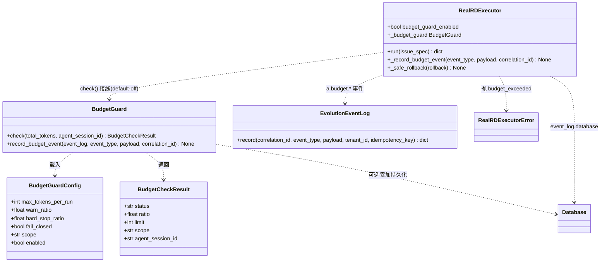
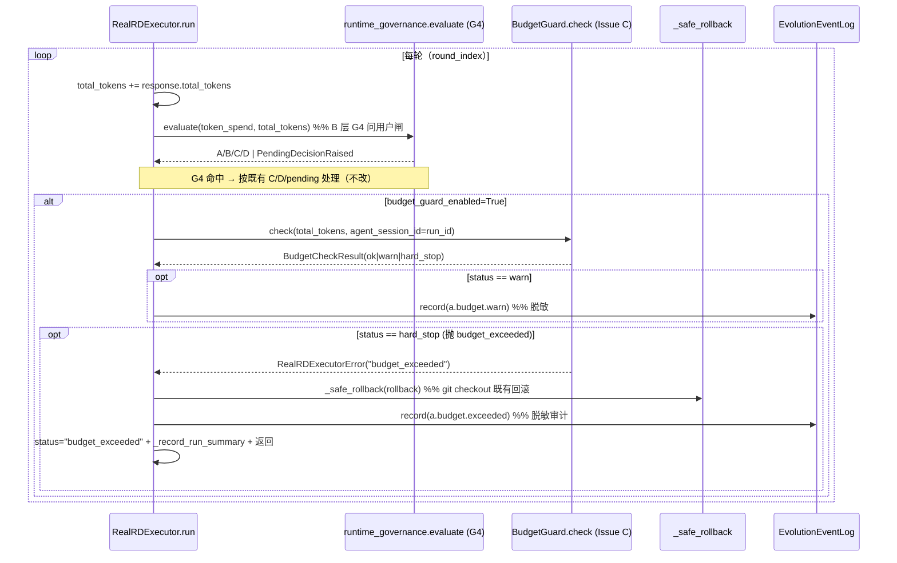
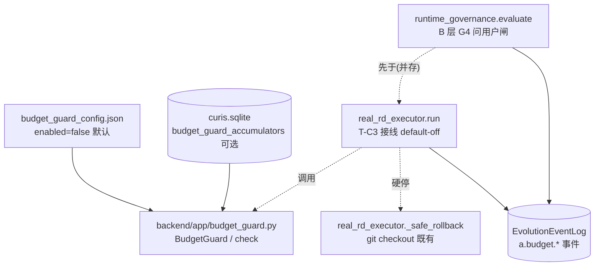
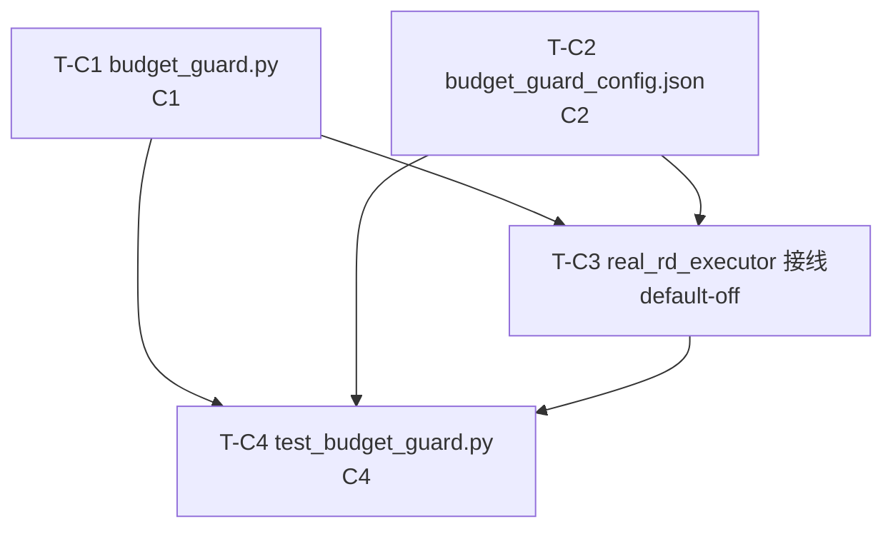

# Issue C · 内部预算硬停（实现级架构设计）

> 作者：架构师 高见远（software-architect 职责，由 c-architect 代执行）
> 受众：工程师 寇豆码（编码）、QA 严过关（测试）
> 性质：**实现级设计 + 有序任务列表**，**不含实现代码**，仅定义文件落点、数据结构契约、函数签名、调用流程与验收要点
> 权威输入：
> - `docs/architecture/paperclip-conclusion-gap-analysis.md`（§P2-2 内部预算硬停、§Issue C，commit `1dc9da75` 差距核对）
> - `docs/architecture/paperclip-curis-mapping-report.md`（§3.1 per-agent 硬预算熔断、§5.2 BudgetGuard 配置、§4 风险冲突，commit `581ed7d6`）
> - `docs/architecture/agent-execution-kernel-impl-plan.md`（Issue A 的 impl-plan，**结构模板**）
> 协同设计：`docs/architecture/b-layer-runtime-governance-impl-plan.md`（B 层闸引擎，须共存不破坏）
> 团队边界：**仅后端 / 不越 Workspace UI**；沿用「系统做技术决断、用户做业务拍板」

---

## 0. 范围与铁律（最高约束，不可妥协）

### 0.1 本次交付（4 项 C，全后端）

| 编号 | 交付物 | 能力 |
|---|---|---|
| C1 | `BudgetGuard`（`backend/app/budget_guard.py`） | `BudgetGuardConfig` + `BudgetCheckResult` + `BudgetGuard.check()`；基于 `total_tokens` 的软提醒 + 硬暂停（fail-closed）；不引入价格/计费 |
| C2 | 配置落点 `backend/app/budget_guard_config.json` | `enabled=false` 默认关闭 → 零回归；`max_tokens_per_run` / `warn_ratio` / `hard_stop_ratio` / `fail_closed` / `scope` |
| C3 | `real_rd_executor.py` 接线（default-off） | 在 `runtime_governance.evaluate()`（G4-token）**之后**插入 `budget_guard.check(total_tokens)`；硬停 → 脱敏 `budget_exceeded` + 既有 `_safe_rollback`(git checkout) + 落 `a.budget.*` 审计 |
| C4 | `backend/tests/test_budget_guard.py` | P0-4 级异常覆盖：软提醒阈值、硬停回滚、CLI 后端 `total_tokens=0` 盲视、fail-closed 坏配置、与 B 层共存（不 import governance）、default-off 对 `test_real_rd_executor.py` 8 passed 零回归 |

### 0.2 硬约束（不可违反）

1. **零新依赖**：仅用 Python 标准库（`sqlite3` / `threading` / `hashlib` / `json` / `datetime` / `uuid` / `typing` / `dataclasses` / `re`）+ 项目已装依赖；**不引入任何新包**（同 B 层 `runtime_governance.py` / `decision_sink.py` 风格）。
2. **不触发锁定动作集合**：本设计**不 import / 不调用**任何解除 A 层锁定的路径（`auto_modify_code` / `lift_human_approval_gate`）。**重要**：docstring 与正文**避免使用字面量 「锁定动作集合」**（Issue A 文档因用了该字面量导致字面 grep 非「零命中」；语义虽成立但 C 须规避，改用「锁定动作集合」「不解除人工批准闸」等措辞）。BudgetGuard 仅吸收「硬上限熔断」这一安全子集，不采用预算内自主改码模型。
3. **不碰 L2 冻结域**：不引入 Marketplace / 真实计费 / 多租户 / 外部 Agent 生态 / Employee CRUD；**不写价格表/计费/套餐/Quota 逻辑**。BudgetGuard **仅基于 `total_tokens`**，绝不引入 cost/price。
4. **与 B 层治理共存（关键）**：BudgetGuard 是**独立**的自主硬停机制，**绝不调用 G4 用户询问路径**。G4 问用户、C 自主停——两者独立触发、互不改写。`runtime_governance.py` / `gate_prompt.py` / `decision_sink.py` 只复用不重写；C 自记脱敏事件 `a.budget.*`，与 `b.governance.gate` 并列追加写、不混。
5. **Admin / Workspace 共享后端**：若需新增表，入共享 `curis.sqlite`（同 `Database` 实例）；不新增 FastAPI 路由（端点归 Issue B）；store 接受 `Database | str`，与 `EvolutionEventLog(Database)` 一致。
6. **不代写代码**：本文仅定义契约与流程，**不含实现体**。

---

## 1. 实现方案与框架选型

### 1.1 总体方案

| 维度 | 选型 | 理由 |
|---|---|---|
| 数据结构 | 标准库 `dataclass`（**不引 pydantic**） | 与 B 层 `RuntimeGovernanceConfig` / 内核 `RunConfig` 一致，import-light、零新依赖 |
| 阈值判定 | 纯函数 `ratio = total_tokens / max_tokens_per_run` | 仅基于既有累加 `total_tokens`，**绝不引价格/成本**；与 `estimated_cost` 解耦 |
| 持久化（per_agent_session 累加） | 进程内 `dict` 累加器（可选 + 共享库表 `budget_guard_accumulators` 持久化） | 默认 `scope=per_run` 无需累加；`per_agent_session` 需跨轮/跨调用累加，键 `f"{scope}:{agent_session_id}"` |
| 脱敏错误 | 复用既有 `RealRDExecutorError(failure_code)`（`real_rd_executor.py:97`） | 硬停抛 `RealRDExecutorError("budget_exceeded")`，不携带路径/Key/参数 |
| 回滚 | 复用既有 `RealRDExecutor._safe_rollback(rollback)`（`real_rd_executor.py:785`） | 硬停走 git checkout 既有回滚，不动受保护回滚逻辑 |
| 审计 | 追加写 `EvolutionEventLog.record()`（`a.budget.*`） | 与 `b.governance.gate` 并列独立，互不改写；脱敏标准一致 |
| 共存 | 接线点置于 `runtime_governance.evaluate()`（G4-token）**之后**、独立开关 | 不破坏既有 gate/审批/决策链；G4 问用户、C 自主停并存不冲突 |
| default-off | `budget_guard_enabled: bool = False`（镜像 A 的 `agent_kernel_enabled`） | 默认 `False` → 既有 `test_real_rd_executor.py` 8 passed **零回归** |

### 1.2 关键设计决策

- **独立自主硬停**：BudgetGuard **不调用** `runtime_governance.evaluate` / `decision_sink` / `gate_prompt`；其 `check()` 直接基于 `total_tokens` 做 ok/warn/hard_stop 三态判定。`runtime_governance.py` / `gate_prompt.py` / `decision_sink.py` 只读不重写。
- **事件分离**：C 记 `a.budget.*` 系列；B 层记 `b.governance.gate`；二者独立追加写，互不改写。
- **脱敏贯穿**：`check()` 抛出的错误仅携带固定 `failure_code="budget_exceeded"`；落库 payload 仅含 `scope` / `status` / `ratio` / `limit` 等聚合值，**无路径 / Key / 参数 / 原始 Secret**；`agent_session_id` 仅以「范围键」形式出现，不落原始业务 id。
- **default-off 接线**：`real_rd_executor.py` 仅在 `budget_guard_enabled=True` 时调用 `budget_guard.check()`，默认 `False`，保证基线零回归。
- **fail-closed 确定性语义**（详见 §3.1）：`enabled=true` 且配置加载失败时，`fail_closed=true`（默认）→ 进入硬停模式（`check()` 直接抛 `budget_exceeded`）；`fail_closed=false` → 自禁用（fail-open：跳过检查，仅落一条 `a.budget.config_error` 审计）。`enabled=false` 时无论配置健康度均为惰性（no-op）。

---

## 2. 文件列表及相对路径

### 2.1 新增文件（2 模块落点 + 1 配置 + 1 测试）

| 文件 | 职责 | 对应 C |
|---|---|---|
| `backend/app/budget_guard.py` | `BudgetGuardConfig` dataclass + `BudgetCheckResult` dataclass + `BudgetGuard` 类（配置加载 / `check()` 三态 / `per_agent_session` 累加 / `record_budget_event()` 脱敏写） | C1 |
| `backend/app/budget_guard_config.json` | 护栏默认配置：`enabled=false`、`max_tokens_per_run=100000`、`warn_ratio=0.8`、`hard_stop_ratio=1.0`、`fail_closed=true`、`scope=per_run` | C2 |
| `backend/tests/test_budget_guard.py` | C4 异常测试套件（离线 unittest + temp sqlite，复用 `test_b_layer_*` 的 mock 前置） | C4 |

### 2.2 最小改动的现有文件（仅插入调用，default-off，不改受保护核心）

| 文件 | 插入点 | 触发类别 | 改动性质 |
|---|---|---|---|
| `backend/app/real_rd_executor.py` | ① `__init__`（`agent_kernel_enabled: bool = False` 之后，约 L141 后）新增 `budget_guard_enabled: bool = False` 形参 + `self.budget_guard_enabled` 绑定 + 构造 `self._budget_guard`（按配置 default-off）；② `run()` 主循环内、G4-token `evaluate` **之后**（约 L310 后）插入 `if self.budget_guard_enabled: self._budget_guard.check(total_tokens, agent_session_id=...)`；③ 同文件新增辅助方法 `_record_budget_event(...)`（镜像 `_record_kernel_event`，落 `a.budget.*`）；④ 硬停分支（`check()` 抛 `budget_exceeded`）→ `_safe_rollback(rollback)`（rollback 为 None 时 `_safe_rollback` 自带空处理）+ 落 `a.budget.exceeded` + 标记 `status="budget_exceeded"` + `_record_run_summary` + `_kernel_finish`（若 kernel_ctx）+ 返回标准脱敏 dict | 自主硬停 + 回滚 + 审计 | 仅插入调用与辅助方法，default-off；既有 `_claim_once` / `_safe_rollback` / G4 `evaluate` / agent 分支 / 沙箱回滚 **不改**；`b.governance.gate` 落库 **不变** |

> **不改动**：`runtime_governance.py` / `gate_prompt.py` / `decision_sink.py`（受保护，仅复用、不重写）；`database.py`（schema 受保护，若需 `budget_guard_accumulators` 表则由 BudgetGuard 自管理、不并入 `initialize()`）；`local_rd_toolset.py` / `model_gateway.py` / `evolution_event_log.py` / `d1_single_model_toolchain.py`（受保护，只复用）。

> **关键放置约束（与 B 层守卫测试兼容）**：模块必须置于 `backend/app/budget_guard.py`，并**仅以相对导入 `from .budget_guard import BudgetGuard` 或 `from app.budget_guard import BudgetGuard` 引用**。`backend/tests/conftest.py` 仅将 `backend/`（而非 `backend/app/`）加入 `sys.path`，因此 `import budget_guard`（顶层）会持续抛出 `ModuleNotFoundError`——从而保持 `test_b_layer_runtime_governance.py::test_no_budget_guard_dependency` 断言绿。**绝不可**将 `backend/app` 加入 `sys.path` 或把模块放到 `backend/budget_guard.py`，否则该 B 层守卫测试将退化。

---

## 3. 数据结构与接口（类 / 表 / 字段 / 函数签名）

> 全部用标准库 `dataclass`；错误信息仅携带 `failure_code`（脱敏）。以下为**契约签名**，非实现体。

### 3.1 C1 · `BudgetGuard`（`backend/app/budget_guard.py`）

**配置 dataclass**：

```python
@dataclass
class BudgetGuardConfig:
    max_tokens_per_run: int                 # ≥ 1（必填；CLI/配置缺失时回退默认 100000）
    warn_ratio: float = 0.8                 # 软提醒阈值（0~1）
    hard_stop_ratio: float = 1.0            # 硬暂停阈值（0~1，默认 1.0 = 达上限即停）
    fail_closed: bool = True                # 配置不可用时是否硬停（见下「fail-closed 确定性语义」）
    scope: str = "per_run"                  # per_run | per_agent_session
    enabled: bool = False                   # 总开关，默认关闭 → 零回归
```

**结果 dataclass**：

```python
@dataclass
class BudgetCheckResult:
    status: str            # ok | warn | hard_stop
    ratio: float           # total_tokens / max_tokens_per_run（per_agent_session 为累加后比值）
    limit: int             # 生效上限（max_tokens_per_run）
    scope: str             # per_run | per_agent_session
    agent_session_id: str = ""   # 仅范围键（脱敏后的会话标识前缀），不落原始业务 id
```

**`BudgetGuard` 函数签名**：

```python
class BudgetGuard:
    # database: 用于 per_agent_session 跨调用累加持久化（共享 curis.sqlite）；
    #           None 时 per_agent_session 退化为进程内 dict 累加（跨进程不耐久）。
    def __init__(self, *, config: "BudgetGuardConfig | None" = None,
                 config_path: str | None = None,
                 database: "Database | str | None" = None) -> None: ...

    # —— 三态判定（纯函数 + 可选累加）——
    # total_tokens: 本次累计 token（RealRDExecutor.total_tokens）。
    # agent_session_id: 仅 per_agent_session 生效；作为累加键（脱敏范围键）。
    # 返回 ok | warn | hard_stop 的 BudgetCheckResult；
    # 超 hard_stop_ratio 时抛**脱敏** RealRDExecutorError("budget_exceeded")（fail-closed）；
    # 不携带路径 / Key / 参数。
    def check(self, total_tokens: int, *,
              agent_session_id: str = "") -> BudgetCheckResult: ...

    # —— 脱敏事件写（best-effort，绝不阻断主流程）——
    # 仅发 a.budget.* 系列，与 b.governance.gate 并列独立追加写、不混。
    # event_log 为注入的 EvolutionEventLog（Any，避免 BudgetGuard 依赖具体类型）；
    # payload 仅含 status / ratio / limit / scope / 范围键，无路径 / Key / 参数。
    def record_budget_event(self, event_log: Any, event_type: str,
                            payload: dict, correlation_id: str) -> None: ...
```

**`check()` 判定逻辑（契约）**：

- 前置：`enabled=False` → 直接返回 `BudgetCheckResult(status="ok", ...)` 且**不累加、不写事件**（惰性 no-op）。
- 计算 `limit = config.max_tokens_per_run`；
  - `scope == "per_run"`：`effective = total_tokens`（单 run 直接比对）。
  - `scope == "per_agent_session"`：`effective = 累加器[f"{scope}:{agent_session_id}"] + total_tokens`（跨轮/跨调用累加；累加键仅含范围键，不含原始业务 id），并在 store 中持久化累加值。
- `ratio = effective / limit`。
- `ratio >= hard_stop_ratio` → **抛 `RealRDExecutorError("budget_exceeded")`**（fail-closed，脱敏）；
- `warn_ratio <= ratio < hard_stop_ratio` → 返回 `BudgetCheckResult(status="warn", ...)`（建议调用方落 `a.budget.warn`）；
- `ratio < warn_ratio` → 返回 `BudgetCheckResult(status="ok", ...)`。

**fail-closed 确定性语义（配置加载失败）**：

- `enabled=False`（默认或显式）→ 护栏惰性（no-op），不受配置健康度影响。
- `enabled=True` 且配置**加载成功** → 按上述三态正常判定。
- `enabled=True` 且配置**加载失败**（文件缺失 / JSON 损坏 / `max_tokens_per_run` 非法）：
  - `fail_closed=True`（**默认**）→ 进入**硬停模式**：`check()` 立即抛 `RealRDExecutorError("budget_exceeded")`（fail-closed = 状态未知时拒绝执行，防止无上限消耗）；调用方走既有 `_safe_rollback` + 落 `a.budget.exceeded`。
  - `fail_closed=False` → **自禁用**（fail-open）：`check()` 返回 `ok` 且不累加，仅经 `record_budget_event` 落一条 `a.budget.config_error` 审计事件供运维排查。
- 该语义是**确定的**：实现时不得「视情况二选一」；按上表穷尽 `enabled × 配置可用` 组合给出唯一行为。

**`per_agent_session` 累加 store 键设计（契约）**：

- 进程内累加器：`self._acc: dict[str, int]`，键 `key = f"{scope}:{agent_session_id}"`，值为跨调用累计 token。
- 可选持久化：若构造时传入 `database`（共享 `curis.sqlite`），则累加落 `budget_guard_accumulators` 表（见下），跨进程耐久；`database=None` 时仅进程内 `dict`（跨进程不耐久，属已知简化，per_run 默认值不受影响）。
- 仅 `scope=per_agent_session` 触发累加；`per_run`（默认）不累加，每次 `check()` 直接比对传入的 `total_tokens`。

**累加表 `budget_guard_accumulators`**（仅在 `database` 传入且 `scope=per_agent_session` 时自管理建表；`CREATE TABLE IF NOT EXISTS`，不并入 `database.initialize()`）：

| 字段 | 类型 | 约束 | 说明 |
|---|---|---|---|
| `acc_key` | `TEXT` | PK | `f"{scope}:{agent_session_id}"`（脱敏范围键） |
| `scope` | `TEXT` | | `per_agent_session` |
| `accumulated_tokens` | `INT` | | 跨调用累计 token |
| `updated_at` | `TEXT` | ISO UTC | 最近累加时刻 |

### 3.2 C2 · 配置落点 `budget_guard_config.json`

```json
{
  "enabled": false,
  "max_tokens_per_run": 100000,
  "warn_ratio": 0.8,
  "hard_stop_ratio": 1.0,
  "fail_closed": true,
  "scope": "per_run"
}
```

- 仅 `max_tokens_per_run` 为必填（≥1）；`enabled` 默认 `false` → **零回归**。
- `note`（写入文档与注释）：本期仅基于 `total_tokens`（非价格）；CLI agent 后端 `total_tokens=0` 时本护栏对其盲视（见 §8 风险②）。

### 3.3 C3 · `real_rd_executor.py` 接线契约

**`__init__` 新增形参（紧随 `agent_kernel_enabled` 之后）**：

```python
def __init__(self, model, event_log, toolset_cls=None, *,
             sandbox_mode=None,
             agent_kernel_enabled: bool = False,
             budget_guard_enabled: bool = False) -> None:
    ...
    self.agent_kernel_enabled = agent_kernel_enabled
    # Issue C · 内部预算硬停接线总开关（default-off，镜像 agent_kernel_enabled）。
    # 仅当为 True 时，run() 主循环在 evaluate() 之后调用 budget_guard.check()；
    # 默认 False 保证既有 test_real_rd_executor.py 8 passed 零回归。
    self.budget_guard_enabled = budget_guard_enabled
    # 按配置（默认 off）构造护栏实例；配置加载失败按 fail-closed 语义处理。
    self._budget_guard = BudgetGuard(config_path=_BUDGET_GUARD_CONFIG_PATH,
                                     database=getattr(event_log, "database", None))
```

**`run()` 主循环插入点（G4-token `evaluate` 之后，约 L310 之后）**：

```python
# B 层运行时治理 · G4 token 预算评估（累计 token 超硬限 → 弹闸问用户）。
token_letter = self._governance_evaluate(
    ActionContext(action_type="token_spend", estimated_tokens=total_tokens),
    decision_sink, issue_id, "G4-token", pending_sink=pending_sink,
)
# …（既有 G4 的 C/D/pending 处理保持不变）…

# Issue C · 内部预算硬停（default-off）。接线点**置于 runtime_governance.evaluate()
# 之后**；与 B 层 G4 用户询问闸并存不冲突：G4 问用户、本 Issue 自主停。
# 超 hard_stop_ratio → BudgetGuard 抛脱敏 RealRDExecutorError("budget_exceeded")。
if self.budget_guard_enabled:
    self._budget_guard.check(total_tokens, agent_session_id=run_id)
```

> `agent_session_id` 在本接线点取 `run_id`（per-run 语义下仅作范围键；若后续启用 `per_agent_session`，由调用方传入跨 run 的稳定会话标识）。

**硬停处理分支（在 `run()` 主循环内，捕获 `RealRDExecutorError("budget_exceeded")`）**：

- 触发顺序：`_safe_rollback(rollback)`（rollback 为 None 时 `_safe_rollback` 自带空处理，仅 git checkout 既有回滚）→ `_record_budget_event("a.budget.exceeded", {scope,status,ratio,limit}, issue_id)` → 标记 `status = "budget_exceeded"` → 若有 `kernel_ctx` 调 `_kernel_finish(kernel_ctx, "budget_exceeded")` → `_record_run_summary(...)` → 返回标准脱敏 dict（`status="budget_exceeded"`）。
- 复用既有 `except RealRDExecutorError` 捕获路径时，`failure_code == "budget_exceeded"` 须走上述专属处理（不静默 re-raise 出 `run()`，而是优雅返回脱敏结果）。

**新增辅助方法 `_record_budget_event`（镜像 `_record_kernel_event`，`real_rd_executor.py:1009`）**：

```python
def _record_budget_event(self, event_type: str, payload: dict, correlation_id: str) -> None:
    """落 a.budget.* 事件（脱敏：仅 scope / status / ratio / limit / 范围键）。"""
    try:
        self.event_log.record(
            correlation_id=correlation_id or "",
            event_type=event_type,
            payload=payload,
            tenant_id=None,  # 由 EvolutionEventLog 自行解析 selfuse
            idempotency_key=f"{correlation_id}:{event_type}:{uuid.uuid4().hex[:8]}",
        )
    except Exception:  # noqa: BLE001 - 预算事件为尽力而为，绝不影响主流程
        pass
```

### 3.4 类图（Mermaid）



---

## 4. 程序调用流程

### 4.1 正常 / 软提醒 / 硬停路径（每轮）



### 4.2 `real_rd_executor.py` 接线步骤（default-off）

1. **`__init__`**：在 `agent_kernel_enabled` 形参之后新增 `budget_guard_enabled: bool = False`；绑定 `self.budget_guard_enabled`；构造 `self._budget_guard = BudgetGuard(config_path=..., database=getattr(event_log, "database", None))`（配置默认 `enabled=false` → 惰性）。
2. **`run()` 主循环（G4-token `evaluate` 之后，约 L310 后）**：当 `budget_guard_enabled=True`，调用 `self._budget_guard.check(total_tokens, agent_session_id=run_id)`。
3. **硬停处理**：`check()` 抛 `RealRDExecutorError("budget_exceeded")` → 捕获后 `_safe_rollback(rollback)` + `_record_budget_event("a.budget.exceeded", ...)` + 标记 `status="budget_exceeded"` + `_kernel_finish`（若 `kernel_ctx`）+ `_record_run_summary` + 返回标准脱敏 dict。
4. **新增辅助方法**：`_record_budget_event(...)`（镜像 `_record_kernel_event`），best-effort 落 `a.budget.*`。
5. **受保护保持**：G4 `evaluate` / `_claim_once` / `_safe_rollback` / agent 分支 / 沙箱回滚 **不改**；`b.governance.gate` 落库 **不变**；`enabled=False`（默认）时上述全跳过，`test_real_rd_executor.py` 8 passed 零回归。

---

## 5. 任务列表（按实现顺序，含依赖）

> 规则：T-C1 / T-C2 为地基（并行，零依赖）；T-C3 依赖 T-C1+T-C2；T-C4 依赖 T-C1~T-C3。每个 T 标注：依赖 / 文件 / 触 L2 或红线（预期**全否**）/ 验收要点。

### T-C1 · `budget_guard.py`（C1 · `BudgetGuard` 类 + 配置加载 + 累加 + 脱敏写）
- **依赖**：无
- **文件**：新增 `backend/app/budget_guard.py`
- **触 L2 / 红线**：否（纯函数 + 标准库，不触锁定动作集合、不引入计费/多租户；不写 「锁定动作集合」 字面量）
- **验收要点**：
  - `BudgetGuardConfig` 字段契约：`max_tokens_per_run`(≥1) / `warn_ratio=0.8` / `hard_stop_ratio=1.0` / `fail_closed=True` / `scope="per_run"` / `enabled=False`。
  - `check()` 三态：
    - `ratio < warn_ratio` → `ok`；
    - `warn_ratio <= ratio < hard_stop_ratio` → `warn`（不抛）；
    - `ratio >= hard_stop_ratio` → 抛脱敏 `RealRDExecutorError("budget_exceeded")`（**无路径/Key/参数**）。
  - `per_agent_session` 累加：键 `f"{scope}:{agent_session_id}"`；跨轮累加生效；落 `budget_guard_accumulators`（database 传入时）。
  - **fail-closed 确定性**：`enabled=true` + 配置缺失/损坏 → `fail_closed=True` 直接硬停；`fail_closed=False` 自禁用 + 落 `a.budget.config_error`。
  - `record_budget_event()` 仅发 `a.budget.*`，best-effort，payload 脱敏（无路径/Key/参数）。

### T-C2 · `budget_guard_config.json`（C2 · 默认关闭落点）
- **依赖**：无（与 T-C1 并行）
- **文件**：新增 `backend/app/budget_guard_config.json`
- **触 L2 / 红线**：否
- **验收要点**：
  - 默认 `enabled=false`、`max_tokens_per_run=100000`、`warn_ratio=0.8`、`hard_stop_ratio=1.0`、`fail_closed=true`、`scope=per_run`。
  - `enabled=false` → 全仓既有测试零回归（护栏惰性）。

### T-C3 · `real_rd_executor.py` 接线（C3 · default-off + 硬停回滚 + 审计）
- **依赖**：T-C1、T-C2
- **文件**：改 `backend/app/real_rd_executor.py`（`__init__` 加 `budget_guard_enabled` 形参 + `self._budget_guard`；`run()` 主循环 G4 之后插 `check()`；加 `_record_budget_event` 辅助；加硬停处理分支）
- **触 L2 / 红线**：否（接线点在 `evaluate()` 之后；不调用 G4 询问路径、不解除人工批准闸；事件脱敏 `a.budget.*`）
- **验收要点**：
  - `budget_guard_enabled=False`（默认）→ 全跳过，既有 `test_real_rd_executor.py` 8 passed **零回归**。
  - `enabled=True` 时：主循环 G4 之后调 `check()`；硬停 → `_safe_rollback(rollback)`（rollback 为 None 时安全空处理）+ `_record_budget_event("a.budget.exceeded", ...)` + `status="budget_exceeded"` + 标准脱敏返回。
  - 既有 `_claim_once` / `_safe_rollback` / G4 `evaluate` / agent 分支 / 沙箱回滚 **不改**；`b.governance.gate` 落库 **不变**。
  - `_record_budget_event` 与 `_record_kernel_event` 同构，仅事件前缀 `a.budget.*`。

### T-C4 · `test_budget_guard.py`（C4 · P0-4 异常测试套件）
- **依赖**：T-C1、T-C2、T-C3
- **文件**：新增 `backend/tests/test_budget_guard.py`
- **触 L2 / 红线**：否（测试自身不触 L2；不依赖未实现模块；不 import governance）
- **验收要点**：见 §8 风险②/④/⑤ 用例表 + 以下几类断言：
  - **软提醒阈值跨越**：构造 `total_tokens` 使 `ratio` 跨过 `warn_ratio` 但未达 `hard_stop_ratio` → `check()` 返回 `warn` 且不抛；落 `a.budget.warn`。
  - **硬停 + 回滚**：`ratio >= hard_stop_ratio` → 抛 `RealRDExecutorError("budget_exceeded")`；在 `RealRDExecutor.run` 接线测试中确认触发 `_safe_rollback` + `a.budget.exceeded` 事件 + `status="budget_exceeded"` 返回。
  - **CLI 后端 `total_tokens=0` 盲视（已知局限，须标注）**：用返回 `total_tokens=0` 的 CLI 风格 adapter，断言护栏对 `0` 始终返回 `ok`（ratio 0 < warn_ratio），**绝不误触发**；该用例显式注释「CLI 后端用量盲区，依赖未来解析 CLI 用量摘要」。
  - **fail-closed 坏配置**：临时改名/损坏 `budget_guard_config.json`，`enabled=true` + `fail_closed=true` → `check()` 抛 `budget_exceeded`（硬停）；`fail_closed=false` → 返回 `ok` 且落 `a.budget.config_error`。
  - **与 B 层共存（不 import governance）**：测试文件**不 import** `runtime_governance` / `governance` / `decision_sink` / `gate_prompt`；断言 `budget_guard.py` 源码不含这些 import；断言 `import budget_guard`（顶层）仍抛 `ModuleNotFoundError`（保持 `test_b_layer_runtime_governance.py::test_no_budget_guard_dependency` 绿）。
  - **default-off 零回归**：运行 `test_real_rd_executor.py` 确认 **8 passed** 不受 C 改动影响。

---

## 6. 依赖包列表

| 包 / 模块 | 来源 | 用途 | 是否新增 |
|---|---|---|---|
| `sqlite3` / `threading` / `hashlib` / `json` / `datetime` / `uuid` / `typing` / `dataclasses` / `re` | Python 标准库 | 配置解析 / 累加 / 校验 | 否 |
| `pydantic` | 随 fastapi 间接可用 | **刻意不引**，改用 stdlib dataclass（与 B 层 / A 内核一致） | 否 |
| 新增第三方重依赖 | — | — | **无** |

> 结论：**零新依赖**。BudgetGuard 仅依赖标准库 + 项目既有 `Database` / `EvolutionEventLog`（仅复用、不重写）。

---

## 7. 共享知识（跨文件约定）

### 7.1 统一事件类型（脱敏，追加写 `EvolutionEventLog`）
- 预算：`a.budget.ok` / `a.budget.warn` / `a.budget.exceeded` / `a.budget.config_error`
- 与 `b.governance.gate` **并列独立**，互不改写。

### 7.2 错误码（脱敏，`failure_code` only）
- 预算硬停：`budget_exceeded`（由 `RealRDExecutorError` 承载，复用 `real_rd_executor.py:97`）。
- 该错误**不携带路径 / Key / 参数**，仅固定 `failure_code`。

### 7.3 常量（集中在 `budget_guard.py` 顶部，命名一致）
```
DEFAULT_MAX_TOKENS_PER_RUN = 100000
DEFAULT_WARN_RATIO = 0.8
DEFAULT_HARD_STOP_RATIO = 1.0
DEFAULT_FAIL_CLOSED = True
DEFAULT_SCOPE = "per_run"
CONFIG_PATH = os.path.join(os.path.dirname(__file__), "budget_guard_config.json")
```

### 7.4 命名 / 表 / 记录约定
- 类：`BudgetGuard`；dataclass：`BudgetGuardConfig` / `BudgetCheckResult`；错误复用 `RealRDExecutorError`。
- 累加表（可选）：`budget_guard_accumulators`（仅在 `database` 传入且 `scope=per_agent_session` 时自管理 `CREATE TABLE IF NOT EXISTS`，不并入 `database.initialize()`）。
- store 接受 `database: Database | str`，经 `connect()` 上下文管理器访问（与 `EvolutionEventLog(Database)` 一致）；`database=None` 时进程内 `dict` 累加。
- 时间统一 ISO 8601 UTC（复用 B 层 `_now_iso()` 风格）。

### 7.5 `per_agent_session` 累加键
- 键：`f"{scope}:{agent_session_id}"`（`scope=per_agent_session`）；仅含脱敏范围键，不落原始业务 id。
- `per_run`（默认）不累加，每次 `check()` 直接比对传入 `total_tokens`。

### 7.6 脱敏标准
- 落库 payload 仅含 `scope` / `status` / `ratio` / `limit` 等聚合值 + 脱敏范围键；**无路径 / Key / 参数 / 原始 Secret**。
- `agent_session_id` 在事件中仅以范围键形式出现，不暴露原始会话标识。

### 7.7 与 B 层治理共存铁律
1. BudgetGuard 接线点**置于 `runtime_governance.evaluate()`（G4-token）之后**；BudgetGuard **不重评** gate、**不调用** G4 用户询问路径（`decision_sink` / `pending_sink`）。
2. BudgetGuard 模块**不得 import / 调用**任何解除 A 层锁定的路径（`auto_modify_code` / `lift_human_approval_gate`）；`real_rd_executor` 接线不改人工批准闸。docstring 与正文**避免使用字面量 「锁定动作集合」**（改用「锁定动作集合」「不解除人工批准闸」）。
3. 事件分离：C 记 `a.budget.*`，B 层记 `b.governance.gate`；脱敏标准一致（无路径/Key/参数）。
4. fail-closed 贯穿：配置不可用 → 按 §3.1 确定性语义硬停或自禁用；`check()` 异常 → 抛脱敏 `budget_exceeded`，绝不静默放行 / 无上限消耗。

---

## 8. 待明确事项 / 风险

### 风险① · 共享 DB 路径解析（Admin/Workspace 同库）
- **事实**：B 层 `decision_sink` 用独立 sqlite；BudgetGuard 的 `per_agent_session` 累加（若启用）需与 Admin/Workspace **同库**查询。
- **方案**：store 接受 `Database` 实例（接线点传 `self.event_log.database`），保证同文件；独立脚本可传 `str` 路径。
- **需主理人确认**：`per_agent_session` 累加是否本期启用（默认 `per_run` 无需累加）；若启用，累加表 `budget_guard_accumulators` 的清理/过期策略是否需 sweeper。

### 风险② · CLI agent 后端 `total_tokens=0` 盲视（已知局限）
- **事实**：`CodexAgentAdapter` / `WorkBuddyAgentAdapter` 返回 `total_tokens=0`（CLI 未解析用量），导致 BudgetGuard 对 0 始终 `ok`，**无法防护**该后端。
- **方案**：本期仅对 API 后端（`ClaudeCodeAdapter` / `OpenAICodexAdapter` 真实 `total_tokens`）生效；测试 T-C4 显式标注该盲视用例（断言对 `0` 不误触发），列为未来工作（解析 CLI 用量摘要）。
- **需主理人确认**：是否接受「CLI 后端本期不受预算护栏保护」这一已知局限（映射报告 §3.1 已记录）。

### 风险③ · fail-closed 坏配置语义
- **事实**：配置缺失/损坏时行为若不定义清楚，易导致实现者自由发挥（误判 fail-open 或 fail-closed）。
- **方案**：§3.1 已给出**确定性**语义——`enabled=true` + 配置失败 + `fail_closed=true`（默认）→ 硬停；`fail_closed=false` → 自禁用 + `a.budget.config_error`。实现须严格按表穷尽组合，不得二选一。
- **需主理人确认**：默认 `fail_closed=true` 是否符合运维预期（坏配置即阻断全部真实运行 vs 静默放行）。

### 风险④ · 与 B 层 `test_b_layer_*` 守卫一致（顶层 import 约束）
- **事实**：`test_b_layer_runtime_governance.py::test_no_budget_guard_dependency` 断言 `import budget_guard`（顶层）抛 `ModuleNotFoundError`；`test_runtime_governance_does_not_lift_locks` 断言 `runtime_governance.py` 源码不含 `budget_guard` import。
- **方案**：模块置于 `backend/app/budget_guard.py`，**仅相对/绝对 `app.` 前缀导入**，绝不把 `backend/app` 加入 `sys.path`；`runtime_governance.py` 等受保护文件**不改动**（保持不含 `budget_guard`）。T-C4 测试亦断言顶层 `import budget_guard` 仍 `ModuleNotFoundError`。
- **需主理人确认**：无（与现有 conftest `sys.path` 设置一致，已验证绿）。

### 风险⑤ · default-off 零回归 + 不解除锁定动作集合
- **事实**：既有 `test_real_rd_executor.py` 8 passed 基线须不回归；同时不得解除 A 层锁定动作集合。
- **方案**：`budget_guard_enabled` 默认 `False` → 接线全跳过；BudgetGuard 不 import `governance`、不调用 `auto_modify_code` / `lift_human_approval_gate`、docstring 规避 「锁定动作集合」 字面量；事件仅 `a.budget.*` 脱敏写。T-C4 含 default-off 回归断言。
- **需主理人确认**：无。

---

## 9. 落地模块依赖图（Mermaid）



## 10. 任务依赖图（Mermaid）


