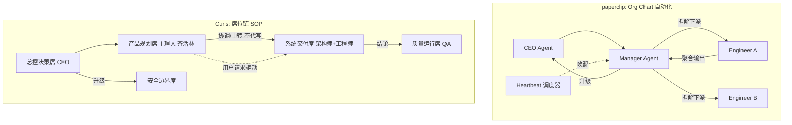
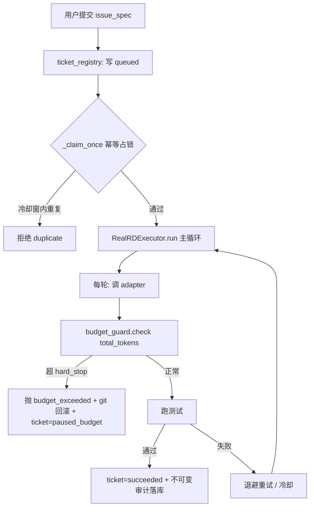

# 架构映射分析报告：paperclipai/paperclip 多 Agent 范式 → Curis 现有体系

> 作者：架构师 高见远（software-architect）
> 受众：主理人 齐活林（向总控决策席汇报用）
> 性质：分析 / 设计，**不含实现代码**
> 输入：材料 A（paperclip 机制）× 材料 B（Curis 运营记忆 + 代码实测）

---

## 0. 摘要（TL;DR）

| 维度 | 结论 |
|---|---|
| 整体成熟度 | 11 项 paperclip 机制中，**已覆盖 3 项**（Adapter/Governance/Skill）、**部分覆盖 5 项**、**缺口 3 项**（Heartbeat/Budget/Goal Alignment）。Curis 在"治理闸"与"后端可插拔"两块甚至**优于** paperclip。 |
| 最该吸收 | ① per-agent **硬预算熔断**（基于 `total_tokens`，非价格）② **Ticket 生命周期 + 不可变审计加固** ③ **幂等/去重 cooldown**。三者均落在自用安全/可观测范畴，**不触红线、不触 L2 Gate、无需总控审批**。 |
| 明确不采用 | Heartbeat 长驻调度（自用过度设计）、自主执行/自动雇佣（撞 `LOCKED_ACTIONS` + 席位链纪律）、多公司真隔离（L2 冻结，保持 reservation 列即可）。 |
| 关键风险点 | `estimated_cost` 全局恒为 `0.0`、CLI agent 后端 `total_tokens` 亦为 `0` → **硬预算若基于 cost 则无数据基础，必须基于 token 且仅对 API 后端生效**；`tenant_context.is_multi_tenant()` 返回 `True` 但仅单租户 → 命名误导，需澄清为"tenant-aware 预留"。 |

---

## 1. 映射矩阵（11 机制 × Curis 现状）

| # | paperclip 机制 | Curis 对应物（实测） | 成熟度 |
|---|---|---|---|
| 1 | **Org Chart**（角色/汇报线/层级委托） | 席位链 SOP（CEO→主理人→架构/工程→QA→安全边界）；SoftwareCompany SOP 团队（主理人+PM+架构+工程+QA） | **部分**：角色/汇报线有，但"manager 自动拆解下派 + 聚合下属输出"的**自动化层级委托未实现**（靠主理人人工中转，成员互不直连） |
| 2 | **Heartbeat 调度**（唤醒→查队列→执行→休眠） | 无；纯用户请求驱动（`RunRealRD` / 主理人触发） | **缺口**（自用 scope 下有意不引入） |
| 3 | **Ticket/Issue + 全量 tool-call tracing + 不可变审计** | `RealRDExecutor.run(issue_spec)`；git issue 文件；`EvolutionEventLog` 追加写；`LocalRDToolset._audit` | **部分**：issue 驱动 + 追加写审计有，但 tool-call 级 tracing 未聚合为可查询 ticket thread，且 `_record_run_summary` **best-effort 吞异常** |
| 4 | **Goal Alignment**（Mission→Goal→Task 三级回溯） | 资产体系 + 席位链；SOP 路由（快速/BugFix/标准） | **缺口**：无显式 Mission→Goal→Task 级联与回溯字段 |
| 5 | **Budget Control**（每 agent 月预算，80%预警/100%硬停） | `dev_agent` 返回 `estimated_cost`（**恒为 0.0**）；`real_rd` 累计 `total_tokens/estimated_cost` | **缺口**：无真实成本计量、无硬限熔断（仅占位字段；CLI agent 后端 `total_tokens` 亦为 0） |
| 6 | **Governance / Approval Gates**（雇佣/改策略/超阈值需人工审批，chain of command 上抛） | L2 Gate 七项；`governance.py` 两级治理 + human-approval 门控 + `LOCKED_ACTIONS`；安全边界席 | **已覆盖**（且更严格：`auto_modify_code` / `lift_human_approval_gate` 锁定，"生产变更仍需人工批准"） |
| 7 | **Multi-Company 隔离** | `tenant_context.py`（`tenant_id` 列 + `scope()` 注入 + `DEFAULT_TENANT="selfuse"`）；ADR-0017 D1 design-only reservation | **部分**：tenant 抽象已预留（列/注入点），但仅单租户、`evolution_events` 未过滤、真隔离属 L2 冻结 |
| 8 | **Adapter System（BYO agent）** | `DevAgent` Protocol + 6 后端（ModelGateway/ClaudeCode/OpenAICodex/WorkBuddy/CodexAgent/WorkBuddyAgent）；`mutates_filesystem` 标志；`no_api_key` 降级 | **已覆盖**（高度同构，且多了 Key 经 env 注入 + 优雅降级） |
| 9 | **Skill System**（`.agents/skills` 结构化、运行时注入） | 资产体系 10 类（Persona/Skill/Tool/Workflow/Dashboard Template 等）；skill catalog(`skl_*`) + tool catalog(`tl_*`) | **已覆盖**（结构化资产目录 + 运行时注入，无需重训） |
| 10 | **幂等/去重/恢复 cooldown**（issue-create 幂等声明、恢复 throttle） | `RealRDExecutor._claim_once`（单主占锁 + `idempotency_key` 防重入）；`git checkout` 回滚 | **部分**：幂等占锁有，但无恢复 cooldown/throttle、无 7 天 issue-create 幂等保留声明 |
| 11 | **可观测**（dashboard / attention feed / monitor） | `department_observability.py`；governance 审计；`evolution_events` 投影 | **部分**：可观测模块有（ADR-0024 D3），但无实时 attention feed / 单 agent 注意力流 |

---

## 2. 组织模型对比（Mermaid）



> 差异要点：Curis 的"经理"角色是**主理人（人工协调 + 消息中转）**，而非自动拆解下属的 manager agent。这是**主动设计选择**（席位链铁律），paperclip 的自动化层级委托可借鉴"拆解+聚合"思想，但**不得绕过主理人**。

---

## 3. 重点审视：5 个候选借鉴点（按 ROI 排序）

### 3.1 per-agent 硬预算熔断 —— 【高 ROI / 近期可吸收】

**① 它解决什么问题**：阻止 agent 在循环/失控下无限消耗 token（尤其 `mutates_filesystem` 的真 agent 后端在 `max_rounds` 内反复跑 CLI，可能刷爆配额）。

**② 我们现状**：
- `estimated_cost` 在 6 个 adapter 中**全部硬编码 `0.0`**（dev_agent.py L67/112/177/261/290/434/565）→ 无成本数据。
- `total_tokens` 仅 `ClaudeCodeAdapter`/`OpenAICodexAdapter` 有真实值；**`CodexAgentAdapter`/`WorkBuddyAgentAdapter` 返回 `total_tokens=0`**（CLI 未解析用量）。
- `RealRDExecutor.run` 已累计 `total_tokens`，但**无任何阈值判断**。

**③ 落地建议**：
- 新增 `backend/app/budget_guard.py`（`BudgetGuard` 类，基于 `total_tokens` 阈值，fail-closed）。
- 在 `real_rd_executor.py` 的 `run` 主循环每轮结束后插入 `budget_guard.check(total_tokens)`；超 `hard_stop_ratio` 抛脱敏 `RealRDExecutorError("budget_exceeded")`，走既有 `_safe_rollback`。
- **红线/L2/总控**：仅读既有 `total_tokens`，**不引入价格表** → 属自用安全护栏，**不触 L2 收费**、不动受保护文件（`local_rd_toolset.py`/`evolution_event_log.py`/`model_gateway.py`/`d1_single_model_toolchain.py`）、**无需总控审批**。
- **已知局限（写入 issue）**：对 CLI agent 后端（`total_tokens=0`）预算盲视，需后续解析 CLI 用量摘要 → 列为未来工作，本轮仅对 API 后端生效。

### 3.2 不可变审计 / Ticket tracing 加固 —— 【高 ROI / 近期可吸收】

**① 它解决什么问题**：paperclip 把每个对话/任务当作带 owner/status/thread 的 ticket，全量 tool-call tracing + append-only 日志。我们已有砖块但"未拼成 ticket"。

**② 我们现状**：
- 追加写不变式有（`EvolutionEventLog`，ADR-0016 D3）；工具级审计有（`LocalRDToolset._audit`）。
- **缺口 1**：`RealRDExecutor._record_run_summary` 为 best-effort（异常 `except: pass`，L667）→ 崩溃的运行可能**不留汇总**，破坏"不可变"承诺。
- **缺口 2**：issue 的运行态（queued/running/succeeded/failed）**未持久化为可查询 ticket**；tool-call 事件未以 `issue_id` 为主键聚合成 thread。

**③ 落地建议**：
- 新增 `backend/app/ticket_registry.py`：additive 表 `real_rd_tickets(issue_id, tenant_id, status, owner, rounds, total_tokens, created_at, updated_at, idempotency_key)` + 生命周期方法；**写入复用 `EvolutionEventLog.record()` 作为追加写 sink**（不重写受保护文件）。
- 把 `_record_run_summary` 从 best-effort 改为**先写 ticket 终态再降级**（即便汇总失败，ticket 终态必须落库）。
- **红线/L2/总控**：additive 表 + 复用 `.record()`，**不重写 `evolution_event_log.py`**；属内部可观测，**不触 L2**、**无需总控审批**。

### 3.3 幂等 / 去重 / 恢复 cooldown —— 【中 ROI / 近期可吸收】

**① 它解决什么问题**：防止同一 issue 被重复提交/重复执行、失败恢复风暴（无 throttle 的反复重试）。

**② 我们现状**：`_claim_once` 已实现单主占锁 + `idempotency_key` 防重入（real_rd_executor.py L338）→ **基础幂等有**。但无 cooldown 窗口、无"7 天幂等保留声明"、恢复重试无节流。

**③ 落地建议**：
- 扩展 `_claim_once`：对相同 `issue_id` 在 **N 分钟冷却窗**内重复提交直接拒绝（除非显式 `force`）；在 `run` 循环外层加恢复节流（连续失败时指数退避）。
- **红线/L2/总控**：仅改 `real_rd_executor.py`（非受保护），**无需总控审批**、不触 L2。可与 3.2 合并为一个 issue。

### 3.4 Heartbeat 定时唤醒 / 巡检 —— 【低 ROI / 自用 scope 不采用】

**① 它解决什么问题**：agent 不常驻，按时间表唤醒→查队列→执行→休眠，天然 checkpoint、省 token、安全。

**② 我们现状**：100% 用户请求驱动，无后台常驻进程。

**③ 结论（不采用）**：
- 自用单创始人、按需触发，**无 always-on 多 agent 舰队**，Heartbeat 的 token 节约/checkpoint 收益无法兑现。
- 引入 = 长驻守护进程 + cron + 进程生命周期管理 = **超出 selfuse scope 的过度设计**。
- 若未来确有定时需求（如夜间报表），用**一次性 cron 调用现有 `RealRDExecutor`** 即可，不必建 Heartbeat 调度内核。
- **红线/L2**：不引入即无冲突；若强建则触及"后台常驻/自动执行"边界，可能撞 `auto_modify_code` 锁定精神 → 明确 **不采用**。

### 3.5 多公司隔离 / tenant 抽象 —— 【暂缓 / 保持预留不实现】

**① 它解决什么问题**：单部署多公司，每公司独立 org chart/agents/budgets/governance，数据完全隔离。

**② 我们现状**：`tenant_context.py` 已预留 `tenant_id` 列 + `scope()` 注入 + `DEFAULT_TENANT="selfuse"`（ADR-0017 D1 design-only reservation 已部分落地）；但仅单租户、`evolution_events` 读未过滤。

**③ 结论（暂缓，保持预留）**：
- **不构建真多公司隔离**（属 L2 冻结：商业/多租户商业化）。
- **保持 reservation**：不要删除 `tenant_id` 列、保留 `scope()` 注入点（未来开多租户只是"加列 + 中间件注入"）。
- **修正误导**：`is_multi_tenant()` 返回 `True` 但仅单租户 → 建议将该 flag 重命名为 `is_tenant_aware()` 或在 docstring 明确"reservation only"，**避免未来误判已隔离而过度建设**。此为文档级修正，不改受保护逻辑。

---

## 4. 风险与冲突（明确不采用的 paperclip 模式）

| paperclip 模式 | 与 Curis 的冲突点 | 处置 |
|---|---|---|
| **预算内自主执行（within-budget autonomy）+ 100% 自动暂停** | 撞 `LOCKED_ACTIONS=["lift_human_approval_gate","auto_modify_code"]` 与"生产变更仍需人工批准"铁律。自动暂停（安全护栏）可借鉴，但"预算内自主改码"与红线冲突。 | **不采用自主执行模型**，保留人工 gate；仅吸收"硬上限熔断"这一安全子集（见 3.1） |
| **多公司计费 / per-company budget** | 触 L2 Gate（收费 / 商业模式 / 多租户商业化冻结）；"按价格计费"即触发收费审查 | **不采用**；预算若做成价格计费 → 需先走 L2 + 总控 |
| **Heartbeat 长驻守护进程** | 自用 scope（单用户按需、无后台常驻）下为过度设计 | **不采用**（见 3.4） |
| **自动雇佣 / 自由混搭外部 agent** | 撞席位链铁律（TeamCreate 仅主理人、成员互不直连、消息中转）+ 自动雇佣在治理闸外 | **不采用**；保持受控后端注册（`dev_agent.py` 白名单式 adapter），不引入运行时"自动雇佣" |
| **Org Chart 自动化层级委托（manager 自动拆解下属）** | 若照搬会绕过主理人协调/中转 → 破坏 SOP 铁律 | **可借鉴"拆解+聚合"思想，但必须落在 SOP 路由层、不绕过主理人**（见 §2 注） |
| **Goal Alignment 公司级 Mission 治理** | 若做成跨公司 Mission 治理 → 触 L2 / 新核心资产体系 | 自用内部可轻量做"任务↔issue"回溯；**不做公司级 Mission 治理** |

---

## 5. JSON Schema 片段（落地契约参考）

### 5.1 RealRD Ticket 记录（additive，`ticket_registry.py`）

```json
{
  "type": "object",
  "title": "RealRDTicket",
  "properties": {
    "issue_id":        { "type": "string" },
    "tenant_id":       { "type": "string", "default": "selfuse" },
    "status":          { "type": "string",
                         "enum": ["queued","running","succeeded","failed","paused_budget"] },
    "owner":           { "type": "string", "default": "RealRDExecutor" },
    "rounds":          { "type": "integer", "minimum": 0 },
    "total_tokens":    { "type": "integer", "minimum": 0 },
    "estimated_cost":  { "type": "number" },
    "idempotency_key": { "type": "string" },
    "created_at":      { "type": "string", "format": "date-time" },
    "updated_at":      { "type": "string", "format": "date-time" }
  },
  "required": ["issue_id","tenant_id","status"]
}
```

### 5.2 BudgetGuard 配置（additive，`budget_guard.py`）

```json
{
  "type": "object",
  "title": "BudgetGuardConfig",
  "properties": {
    "max_tokens_per_run": { "type": "integer", "minimum": 1 },
    "warn_ratio":         { "type": "number", "minimum": 0, "maximum": 1, "default": 0.8 },
    "hard_stop_ratio":    { "type": "number", "minimum": 0, "maximum": 1, "default": 1.0 },
    "fail_closed":        { "type": "boolean", "default": true },
    "scope":              { "type": "string", "enum": ["per_run","per_agent_session"], "default": "per_run" }
  },
  "required": ["max_tokens_per_run"],
  "note": "本期仅基于 total_tokens（非价格）；CLI agent 后端 total_tokens=0 时本护栏对其盲视，需后续解析 CLI 用量。"
}
```

---

## 6. 推荐落地流程（Mermaid）



---

## 7. 结论建议（三档，供主理人向总控汇报）

| 档位 | 项目 | 触红线? | 触 L2? | 需总控? | 备注 |
|---|---|---|---|---|---|
| **近期可吸收** | 3.1 per-agent 硬预算熔断（token 基准） | 否 | 否 | 否 | 新 `budget_guard.py` + 改 `real_rd_executor.py` |
| **近期可吸收** | 3.2 Ticket 生命周期 + 不可变审计加固 | 否 | 否 | 否 | 新 `ticket_registry.py`（additive 表 + 复用 `evolution_event_log.record`） |
| **近期可吸收** | 3.3 幂等/去重 cooldown | 否 | 否 | 否 | 扩展 `_claim_once`，可与 3.2 合并 issue |
| **暂缓** | 价格计费成本核算 | — | **是（收费）** | **是** | 需价格表 → 触 L2，待 future gate |
| **暂缓** | Goal Alignment 任务级回溯 | 否 | 否 | 否 | 仅任务↔issue，不做公司级 Mission |
| **暂缓** | 实时 attention feed / 单 agent 注意力流 | 否 | 否 | 否 | 增强可观测，非必需 |
| **不采用** | Heartbeat 长驻调度 | 否（但过度设计） | 否 | 否 | 自用 scope 不需要 |
| **不采用** | 自主执行 / 自动雇佣 | **是（撞 LOCKED_ACTIONS）** | 部分 | 是 | 保留人工 gate + 受控后端注册 |
| **不采用** | 多公司真隔离 | — | **是（多租户商业化）** | **是** | 保持 reservation 列即可，不实现 |
| **不采用** | 跨公司 Mission 级治理 | — | **是（新核心资产体系）** | **是** | 超出自用 scope |

### 给主理人齐活林的上报要点
1. **Curis 在"治理闸"和"后端可插拔"两处已领先 paperclip**，无需返工。
2. **本期最划算的三件事**（预算熔断 / Ticket 审计加固 / 幂等 cooldown）全部落在"自用安全 + 可观测"范畴，**不碰红线、不触 L2、无需总控审批**，可作为常规 SOP issue 直接排期。
3. **两处必须向总控升级才动**：价格计费（L2 收费）、多公司真隔离（L2 多租户商业化）——当前均保持 ADR-0017 D1 的 design-only reservation，**不提前建设**。
4. **一处命名隐患**：`tenant_context.is_multi_tenant()` 返回 `True` 但仅单租户，建议在文档层澄清为"tenant-aware 预留"，避免后续误判已隔离。
