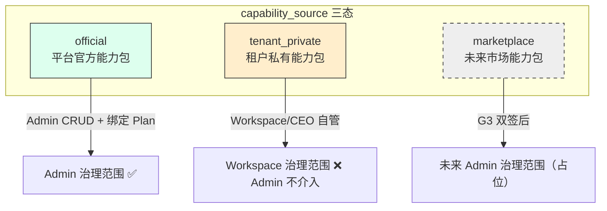
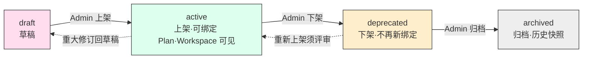
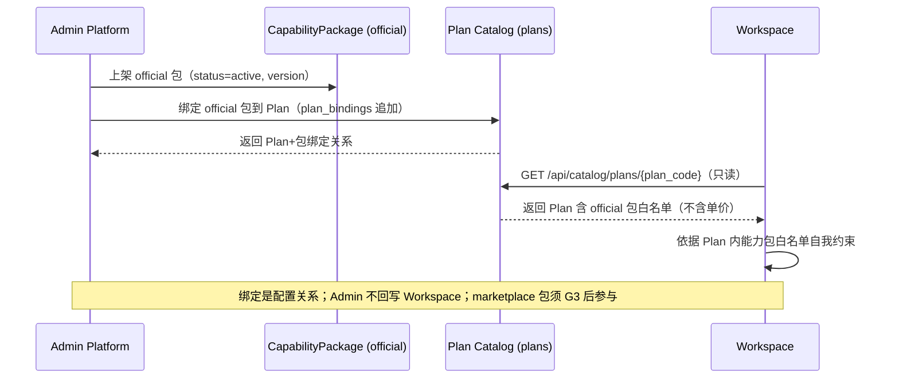

# Admin Capability Package Contract

Status: Phase-7.7 design only

Owner: Admin Platform owns future `official` / `marketplace` capability package governance. Workspace owns `tenant_private` package references only. This document is a commercial governance contract for how Admin manages official and (future) marketplace capability packages — not a Marketplace, Billing, or package install implementation.

## 0. 文档定位与引用

本契约定义 **Admin 如何治理能力包（Capability Package）**，是 Phase-7.7 Billing Readiness 评估的一部分。聚焦 **治理分工（谁管哪一类）** 与 **Admin 对 official 包的 CRUD / 上架下架 / 绑定 Plan / 版本 操作契约**。

> 能力包字段基线来自 `docs/contracts/pricing-contract.md`（§Capability Package：`package_id/name/description/source/included_capability_ids/included_template_ids/plan_tiers/status`）。
> 能力包商业契约来自 `docs/contracts/capability-package-contract.md`（source ∈ {official, marketplace, tenant_private}；与 Billing / Workspace 的关系边界）。
> 能力来源三态治理来自 `docs/contracts/capability-type-contract.md`（§capability_source 三态 Admin/Workspace 边界）与 `docs/research/domain/admin-governance-research.md`（§capability_source 三态治理边界矩阵、tenant_private 可见不可编辑、G3 双签）。
> BillingSubject 来源归属来自 `docs/contracts/billing-domain-contract.md`（source ∈ {official, tenant_private, marketplace, system}；tenant_private 须 marketplace/governance gate 方可成为 official）。
> 本契约不重复上述文档已定义的字段语义，仅补充 **Admin 治理操作契约（上架/下架/绑定 plan/版本）** 与 **三态所有权矩阵**。

---

## 1. 治理分工（关键）

能力包按 `capability_source` 三态划分治理归属，Admin **只治理 official 与未来 marketplace**，绝不介入 `tenant_private`。

### 1.1 分工矩阵

| `source` | 管理方 | Admin 写权 | Admin 可见性（读） | Workspace 角色 | 进入套餐/计费 |
| --- | --- | --- | --- | --- | --- |
| `official` | **Admin** | ✅ CRUD + 绑定 Plan | 全量（含占位串，不含租户密钥） | catalog 只读 | 可绑定 Plan（本契约 §4） |
| `tenant_private` | **Workspace（CEO）** | ❌ 不介入 / 不管理 / 不读取内容 | 仅 `usage_event` 计量 + 存在性（不含配置内容） | 全量自管（经 `/api/workspace/*`） | G1 前仅观测；不进 official 目录 |
| `marketplace` | 未来 **Admin 审核**（G3 双签） | ⛔ 当前不治理（仅占位 + 边界声明） | ⛔ 当前不在 Admin 视野 | ⛔ 当前未开放 | 须 **G3** 双签后定义 |

**铁律（沿用 `admin-governance-research.md` 三态治理边界）**：
- `official` 全局共享（tenant_id='platform'），Workspace 经 `/api/catalog/*` 只读。
- `tenant_private` 租户隔离，Admin **无 CRUD 端点、不可见配置内容**（`default_instructions`/`metadata_json`/`credential_ref` 不可见）。
- `marketplace` 须经审核流程（tenant_private → 提交 → Admin 审核 → marketplace），三态不可跨态直接修改。

---

## 2. Official 能力包：Admin 治理字段

字段对齐 `pricing-contract.md` Capability Package，并复用 `capability-package-contract.md` 的包结构；本契约补充 **Admin 治理操作所需的状态与版本**。

| 字段 | 类型 | 必填 | 来源/对齐 | Admin 治理说明 |
| --- | --- | --- | --- | --- |
| `package_id` | string | Yes | `pricing-contract.md` | 稳定主键。 |
| `name` / `description` | string | Yes | 同上 | 人类可读名称/描述。 |
| `source` | enum | Yes | 固定 `official` | 本契约仅治理 `official`（marketplace 见 §5）。 |
| `included_capability_ids` | string[] | Yes | `pricing-contract.md` | 包含的 model/tool/connector 能力 id。 |
| `included_template_ids` | string[] | Yes | `capability-package-contract.md` | 包含的 workflow/employee/department 模板 id。 |
| `plan_tiers` / `plan_bindings` | enum[] / ref[] | Yes | `pricing-contract.md` plan_tiers | **绑定到的 Plan**（本契约 §4 操作）。 |
| `status` | enum | Yes | **本契约治理态** | `draft` / `active`（上架）/ `deprecated`（下架）/ `archived`。 |
| `version` | string | Yes | **本契约新增** | 语义化版本，每次 Admin 编辑递增，支持灰度与审计。 |
| `pricing_reference` | string nullable | No | `capability-package-contract.md` | 未来定价/Plan 规则引用（G1 前仅占位）。 |

> 注：`marketplace` 包、`pricing_reference` 实际计费字段属 G1/G3 禁止区，本契约仅作目录/占位定义，不实现计费。

---

## 3. Official 能力包：Admin 生命周期与上架/下架

Admin 对 official 包拥有完整写权，状态机与 Plan 治理一致（参考 `admin-plan-management-contract.md` §3）。

### 3.1 Admin 操作契约（CRUD + 治理动作）

| 操作 | 通道（G1 后实现，设计层） | 触发方 | 约束 |
| --- | --- | --- | --- |
| 创建 `official` 包 | `POST /api/platform/capability-packages`（写） | Admin | `source=official`；须通过能力 id 合法性校验（指向 `official_models` 等已存在 official 能力）。 |
| 编辑 | `PATCH /api/platform/capability-packages/{id}` | Admin | 递增 `version`；`active` 包编辑须先 `deprecated` 旧版再 `active` 新版（原子切换）。 |
| 上架（发布） | `POST /api/platform/capability-packages/{id}/publish` | Admin | `draft → active`；写 `capability.created` / `package.published` 审计事件。 |
| 下架 | `POST /api/platform/capability-packages/{id}/deprecate` | Admin | `active → deprecated`；已绑定 Plan 须先解绑或迁移，避免在线配置突变。 |
| 绑定 Plan | `POST /api/platform/capability-packages/{id}/bind-plan` | Admin | 将包加入目标 Plan 的 `capability_packages`（见 §4）。 |
| 归档 | `POST /api/platform/capability-packages/{id}/archive` | Admin | `deprecated → archived`；仅当无在期 Plan 绑定。 |

> 审计：所有写操作须触发 `capability.*` / `package.*` 审计事件（append-only），沿用 `admin-governance-research.md` 审计白名单原则。

---

## 4. Official 包绑定 Plan（契约接口）

Admin 将 official 包绑定到 Plan，使该 Plan 的租户经 catalog 获得对应能力可用性。绑定是**目录配置关系**，不触发 Workspace 执行改动。

**边界**：
- 绑定仅写入 Plan 的 `capability_packages` / `capability_sources_json`，Workspace 经 catalog 只读感知，不回写、不接管执行。
- `marketplace` 包**当前不可绑定 Plan**（须 G3 双签后进入 Admin 治理范围，见 §5）。
- 下架 official 包时，须先解绑其关联 Plan，避免租户在线配置突变。

---

## 5. Marketplace 能力包：占位与边界声明

`marketplace` 包属**未来治理对象**，须 **G3 gate（总控决策席 + 安全边界席双签）** 解锁后才进入 Admin 治理范围。本次 Phase-7.7 **仅留占位与边界声明，不设计实现细节**。

### 5.1 未来治理占位

| 项 | 当前状态（Phase-7.7） | 解锁后（G3） |
| --- | --- | --- |
| Admin 治理范围 | ⛔ 不治理（仅占位） | ✅ 审核队列 + `marketplace.*` 审计命名空间 |
| 绑定 Plan | ⛔ 不允许 | ✅ `plans.capability_sources_json` 可含 `marketplace` |
| 收益分成 | ⛔ 不定义 | ✅ `billing_events.marketplace_revenue_share`（G1+G3） |
| 审核流程 | ⛔ 未开放 | ✅ 提交 → 审核 → 双签 → 发布 状态机 |

### 5.2 边界声明

- `tenant_private` → `marketplace` 须走审核流程（提交方租户 → Admin 审核 → 双签 → 全局发布），**三态不可跨态直接修改**。
- `tenant_private` **不得**未经审核直接成为 official（`billing-domain-contract.md` BillingSubject 边界：须 marketplace/governance gate 批准）。
- marketplace 的跨租户 usage 归属与收益分成规则 G3 后定义，当前不计量、不计费。

---

## 6. 横切章节：Usage / Billing 边界（Admin 能力包治理职责视角）

对齐 `docs/contracts/usage-value-event-boundary.md`，本契约仅明确 Admin 在能力包治理中的职责。

| 职责 | Admin（能力包治理） | Workspace |
| --- | --- | --- |
| 用量统计（只读聚合 usage_event，含 capability_source 分布） | ✅ 负责（只读，fail-closed） | 产生 `usage_event` |
| 套餐规则（official 包绑定 Plan / capability_sources 白名单） | ✅ 负责（本契约） | 只读包配置以自我约束 |
| 计费策略（rating rules / billing_event 聚合） | ✅ 负责（设计层，G1 后实现） | — |
| 管理 `tenant_private` 包内容 | ❌ 不介入 / 不管理 / 不读取内容 | ✅ 负责（CEO 经 `/api/workspace/*`） |
| 产生 usage_event | ❌ 不负责 | ✅ 负责 |

**禁止（对齐 usage-value-event-boundary.md）**：
- Admin 接管 Workspace 执行链。
- Admin 直接写 `usage_event`。
- Admin 跨租户读取 `tenant_private` 内容（仅可经 usage_event 观测存在性与计量）。

---

## 7. 横切章节：严格禁止清单（六）

本契约**严格禁止**以下六项（与 Phase-7.7 其他契约一致）：

1. **不开发 Billing 实现**：不创建 `billing_event` / `invoice`，不写计费/分成逻辑。
2. **不开发支付**：不实现扣费、支付通道、发票开具。
3. **不修改 Workspace**：不改 `main.py` / `database.py` / `result_store.py` / `evolution_event_log.py`。
4. **不修改 Credential Vault**：不解析、不持久化、不暴露凭证。
5. **不修改 Workflow**：不改 Workflow Runtime / `workflow_run` 执行。
6. **不管理 tenant_private 私有能力**：Admin 不介入、不管理、不读取 `tenant_private` 包内容（仅经 `usage_event` 观测）。

---

## 8. 横切章节：Phase-8 进入开发判定

### 8.1 设计层就绪度结论

| 对象 | 设计层就绪 | 实现前置 Gate |
| --- | --- | --- |
| `official` 包 CRUD + 上架/下架 + 绑定 Plan + 版本 | ✅ 就绪 | 目录治理（G1 前可先行，仅配置与只读）；计费绑定生效须 **G1** |
| `tenant_private` 包治理边界（Admin 不介入） | ✅ 边界已明 | 现状即满足，无需实现 |
| `marketplace` 包占位与边界声明 | ✅ 占位就绪 | 治理实现须 **G3 双签**（总控决策席 + 安全边界席） |

**结论**：能力包的治理分工（三态所有权矩阵）与 official 包操作契约**设计层已就绪**，可进入 Phase-8 设计冻结；official 包目录治理可在 G1 前先行（仅配置与只读），其计费绑定生效须 **G1 解锁**；marketplace 包须 **G3 双签** 后才进入 Admin 治理实现。

### 8.2 Phase-8 分两阶段建议

| 阶段 | 前置 Gate | 内容 |
| --- | --- | --- |
| **阶段 A：计量与规则配置** | 无（G1 前可先行） | official 包 CRUD + 上架/下架 + 绑定 Plan + 版本 + catalog 只读投影；tenant_private 治理边界固化；marketplace 占位。**仅配置与只读，不触发计费**。 |
| **阶段 B：真实计费** | **G1 解锁**（marketplace 须 **G3**） | official 包计费绑定生效；marketplace 审核队列 + 收益分成（G3）；由独立计费作业/端点承担，不并入现有 Admin 只读契约。 |

---

## 结论与 gate 边界

- **治理分工已明确（三态所有权矩阵）**：`official` → Admin（CRUD + 绑定 Plan）；`tenant_private` → Workspace/CEO（Admin 不介入、不管理、不读取内容，仅经 usage_event 观测）；`marketplace` → 未来 Admin 审核（须 G3 双签，当前仅占位与边界声明）。
- **official 包操作契约已就绪**：Admin 可创建/编辑/上架/下架/绑定 Plan/版本；状态机 `draft→active→deprecated→archived`；绑定为目录配置关系，不回写、不接管 Workspace 执行。
- **marketplace 仅占位**：不设计实现细节，明确须 G3 双签后进入 Admin 治理（审核队列 + 收益分成），`tenant_private` 不可未经审核直接成为 official。
- **Gate 边界**：official 包目录治理（阶段 A）可在 G1 前先行（仅配置与只读）；其计费绑定生效须 **G1 gate 解锁**（硬前置）；marketplace 包治理须 **G3 双签**（总控决策席 + 安全边界席）。
- **零实现承诺**：本契约不创建任何表、不修改任何 `.py` 源文件、不写计费/支付/Marketplace 代码，仅扩展并引用 `pricing-contract.md`、`capability-package-contract.md`、`capability-type-contract.md`、`billing-domain-contract.md`、`admin-governance-research.md`。

*—— Phase-7.7 Admin Capability Package Contract（纯设计/契约，无代码）。*
