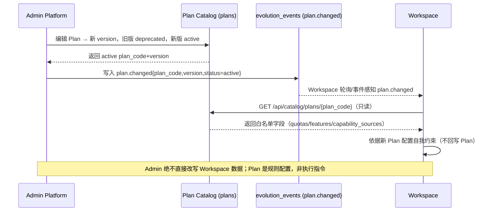

# Admin Plan Management Contract

Status: Phase-7.7 design only

Owner: Admin Platform owns the Plan catalog write authority (future Billing MVP). Workspace reads Plan config read-only to constrain its own behavior. This document is a commercial governance contract for how Admin manages Free / Pro / Enterprise Plans — not a Billing implementation.

## 0. 文档定位与引用

本契约定义 **Admin 如何治理套餐目录（Plan Catalog）**，是 Phase-7.7 Billing Readiness 评估的一部分，聚焦"Admin 侧的 Plan CRUD 与生命周期治理"，不重述商业模型本身。

> 商业模型与套餐字段基线来自 `docs/contracts/pricing-contract.md`（Phase-7.6 冻结的 Hybrid 模型与 Plan Structure）。
> 技术 Plan 实体蓝图来自 `docs/research/domain/pricing-model-research.md` Part B（§B.1 / §B.3，`plans` 实体升级、`plan_code` 与 `plan_tier` 1:1 对齐）。
> Plan 的契约字段边界来自 `docs/contracts/billing-domain-contract.md`（§Plan Contract）。
> 本契约不重复上述文档已定义的字段语义，仅补充 **Admin 治理所需的生命周期（`status` 流转）、`billing_interval`、版本化**，以及 **Admin ↔ Workspace 的 Plan 契约接口**。

---

## 1. Admin 对 Plan 的治理职责

### 1.1 职责矩阵

| 职责 | 归属 | 说明 |
| --- | --- | --- |
| Plan 目录写权（CRUD + 生命周期） | **Admin** | Admin 通过未来 `/api/platform/plans/*` 写通道创建/编辑/停用/归档 Plan。 |
| Plan 目录读权（只读投影） | Admin + Workspace（catalog 只读） | Workspace 经 `/api/catalog/*` 只读 Plan 配置（仅 active Plan、仅白名单字段），用于约束自身行为。 |
| Plan 配置的消费与执行 | **Workspace** | Workspace 读取 Plan 内的 quotas / features / capability_sources 来约束自身调用，不回写 Plan。 |
| `plan_tier` 标签（现状） | Admin 只读维护 | `tenants.plan_tier`（`free`/`pro`/`enterprise`）保持现状标签；本契约令 `plans.plan_code` 与其 1:1 对齐，保证现有 Admin 只读契约零改动。 |
| Plan 变更通知 | Admin 发布 + Workspace 订阅（只读） | Plan 变更后 Admin 发布变更事件（见 §4），Workspace 通过 catalog 轮询/事件感知新配置，但 Admin 不直接改写 Workspace 数据。 |

### 1.2 核心原则

- **Plan 是"规则配置"不是"执行指令"**：Admin 通过 Plan 表达"某套餐包含什么、限额多少、允许哪些能力来源"，Workspace 据此自我约束；Admin 不向 Workspace 下发执行命令，也不直接改写 Workspace 状态。
- **写权归 Admin，读权分两层**：Admin 写通道（`/api/platform/*`）与 Workspace 只读通道（`/api/catalog/*`）分离，沿用 `admin-governance-research.md` 的 platform/catalog 边界铁律。
- **现状零破坏**：`plan_tier` 文本标签继续存在；`plan_code` 取值与 `plan_tier` 完全一致（`free`/`pro`/`enterprise`），G1 后 additive 增加 `tenants.plan_id` 外键，迁移无破坏。

---

## 2. Plan 目录字段（Admin 治理视图）

字段对齐 `pricing-contract.md` 的 Plan Structure，并补充 Admin 治理所需的 `status` 流转、`billing_interval`、版本化。具体单价/额度数值在 G1 前仅作目录定义，不生效。

### 2.1 字段表

| 字段 | 类型 | 必填 | 来源/对齐 | Admin 治理说明 |
| --- | --- | --- | --- | --- |
| `plan_id` | string | Yes | `pricing-model-research.md` §B.3 | 稳定主键；G1 后由 `tenants.plan_id` 引用。 |
| `plan_code` | enum | Yes | 对齐 `tenants.plan_tier` | **取值 ∈ {free, pro, enterprise}，与 `plan_tier` 1:1 对齐**，保证现有 Admin 只读契约零改动。 |
| `name` / `display_name` | string | Yes | `pricing-contract.md` Plan Structure | 人类可读套餐名。 |
| `tier` | enum | Yes | `pricing-contract.md` | `free` / `pro` / `enterprise`，与 `plan_code` 同源。 |
| `status` | enum | Yes | **本契约新增治理态** | `draft` / `active` / `deprecated`（见 §3 流转）。 |
| `billing_interval` | enum | Yes | **本契约新增** | `monthly` / `annual` / `custom`；仅目录定义，G1 前不生效计费。 |
| `version` | string | Yes | **本契约新增版本化** | 语义化版本（如 `1.0.0`）；每次 Admin 编辑产生新版本，旧版本保留可归档。 |
| `features` | Feature[] | Yes | `pricing-contract.md` Feature | 计划解锁的功能键（如 `workflow_sop`、`tenant_private_capabilities`）。 |
| `quotas` | QuotaTemplate[] | Yes | `pricing-contract.md` Quota / `admin-quota-contract.md` | Plan 内配额模板（token / seat / capability / workflow），详见 `admin-quota-contract.md`。 |
| `capability_packages` | PackageRef[] | Yes | `pricing-contract.md` / `admin-capability-package-contract.md` | 绑定的能力包引用（official 可绑定；marketplace 须 G3）。 |
| `employee_seat_limit` | int | Yes | `pricing-contract.md` | AI 员工席位含包数（0 = 不限，仅 enterprise）。 |
| `created_at` / `updated_at` | datetime | Yes | `pricing-contract.md` | 时间戳。 |

> 注：`monthly_price` / `*_overage_unit_price` / `currency` 等价格字段沿用 `pricing-model-research.md` §B.3，**属 G1 禁止区，仅目录定义，MVP 不生效**。本契约不重复其定价语义。

### 2.2 与 pricing-contract.md 的字段对齐说明

`pricing-contract.md` 已定义 Plan Structure 含 `plan_id / name / tier / status / billing_interval / features / quotas / capability_packages / employee_seat_limit / created_at / updated_at`。本契约**复用并扩展**：

- `status`：原文档已列出 `draft / active / deprecated` 三态；本契约在 §3 给出 Admin 治理流转规则与不可跳变约束。
- `billing_interval`：原文档已列为字段；本契约明确其仅目录定义、G1 前不触发计费周期。
- `version`：**本契约新增**，用于 Admin 编辑审计与灰度发布（原文档 Phase-7.6 未实现）。

---

## 3. Plan 生命周期与 Status 流转

Admin 通过状态机治理 Plan 的可用性。状态仅 Admin 可写；Workspace 只读取 `active` 状态的 Plan。

### 3.1 流转规则

| 流转 | 触发方 | 约束 | 对 Workspace 的影响 |
| --- | --- | --- | --- |
| `draft → active` | Admin 发布 | 须通过字段完整性校验（plan_code 唯一、quotas 合法、版本号递增） | 新 Plan 进入 catalog 只读视野，可被新租户绑定。 |
| `active → deprecated` | Admin 停用 | 不得影响已绑定租户当期权益（存量不强制迁移） | 已绑定租户按过渡策略延续；新租户不可选。 |
| `deprecated → archived` | Admin 归档 | 仅当无在期租户引用且超过过渡期 | 仅保留历史快照，不可再分配。 |
| `active → draft`（回退） | Admin 重大修订 | 须生成新 `version`，旧 active 版本先 `deprecated` | 避免在线 Plan 配置突变；保证原子切换。 |

**不可跳变**：禁止 `draft` 直接到 `deprecated` / `archived`；禁止 `archived` 回到 `active`（须走 `draft` 重建）。

### 3.2 版本化规则

- 每次 Admin 编辑（字段变更）递增 `version`（语义化 `MAJOR.MINOR.PATCH`）。
- `active` 版本的配额/价格变更，须先 `deprecated` 旧版本再 `active` 新版本，保证租户绑定引用稳定。
- 归档版本保留只读快照，供审计与计费回溯（G1 后 `billing_event` 快照自 plan 版本）。

---

## 4. Plan 变更通知 Workspace（契约接口）

Admin 不直接改写 Workspace 数据；Plan 变更通过**契约化的只读接口 + 变更事件**通知 Workspace。Workspace 自行决定如何应用新配置。

### 4.1 契约接口

| 接口 | 通道 | 方向 | 说明 |
| --- | --- | --- | --- |
| `GET /api/catalog/plans/{plan_code}` | `/api/catalog/*`（Workspace 只读） | Admin → Workspace（拉取） | Workspace 读取 active Plan 的 quotas/features/capability_sources 白名单字段。 |
| `GET /api/catalog/plans` | `/api/catalog/*` | Admin → Workspace（拉取） | 列出全部 active Plan（白名单字段，不含单价等敏感字段）。 |
| `plan.changed` 事件 | `evolution_events`（只读事件流，独立命名空间） | Admin 发布 → Workspace 订阅（可选） | Admin 在 `active`/`deprecated` 流转时记录 `plan.changed`（payload 含 `plan_code`/`version`/`status`），Workspace 轮询/感知后刷新本地视图。 |

### 4.2 通知时序（sequenceDiagram）

### 4.3 边界

- **只读投影**：Workspace 经 catalog 仅得 `active` Plan 的配额/功能/能力来源白名单，**不得**获得单价、`currency` 等 G1 禁止区字段。
- **不回写**：Workspace 消费 Plan 配置后不得反向调用 `/api/platform/*`。
- **不突变**：Plan 状态切换采用 `deprecated` 旧版 + `active` 新版，避免 Workspace 在线配置突变。

---

## 5. 横切章节：Usage / Billing 边界（Admin 治理职责视角）

对齐 `docs/contracts/usage-value-event-boundary.md`，本契约仅明确 **Admin 在 Plan 治理中的职责**，不重定义事件本身。

| 职责 | Admin（Plan 治理） | Workspace |
| --- | --- | --- |
| 用量统计（只读聚合 usage_event） | ✅ 负责（只读，fail-closed，按 tenant_id） | 产生 `usage_event` |
| 套餐规则（Plan/Quota 配置） | ✅ 负责（本契约 + `admin-quota-contract.md`） | 只读 Plan 配置以自我约束 |
| 计费策略（rating rules / billing_event 聚合逻辑设计） | ✅ 负责（设计层，G1 后实现） | — |
| 产生 usage_event | ❌ 不负责 | ✅ 负责 |
| 产生 value_event | ❌ 不负责 | ✅ 负责（合约/验证证据） |

**禁止（对齐 usage-value-event-boundary.md）**：
- Admin 接管 Workspace 执行链。
- Admin 直接写 `usage_event`。
- Admin 跨租户读取 `tenant_private` 内容。

---

## 6. 横切章节：严格禁止清单（六）

本契约**严格禁止**以下六项（与 Phase-7.7 其他契约一致）：

1. **不开发 Billing 实现**：不创建 `billing_event` / `invoice` 实体，不写计费逻辑。
2. **不开发支付**：不实现扣费、支付通道、发票开具。
3. **不修改 Workspace**：不改 `main.py` / `database.py` / `result_store.py` / `evolution_event_log.py` 等执行链。
4. **不修改 Credential Vault**：不解析、不持久化、不暴露凭证。
5. **不修改 Workflow**：不改 Workflow Runtime / `workflow_run` 执行。
6. **不管理 tenant_private 私有能力**：Admin 仅经 `usage_event` 观测其存在与计量，不 CRUD 其内容。

---

## 7. 横切章节：Phase-8 进入开发判定

### 7.1 设计层就绪度结论

| 维度 | 结论 |
| --- | --- |
| Plan 目录治理契约（CRUD + 生命周期 + 版本化） | ✅ 设计层就绪 |
| `plan_code` ↔ `plan_tier` 1:1 对齐（零破坏现状） | ✅ 设计层就绪 |
| Plan 变更通知 Workspace 接口 | ✅ 契约接口就绪（catalog 只读 + plan.changed 事件） |
| Plan 内价格/账单字段生效 | ⛔ 须 **G1** 解锁（经济/ROI 禁止区） |
| Plan → 真实计费落地 | ⛔ 须 G1 解锁后由独立计费作业/端点承担 |

**结论**：设计层（契约）已就绪，可进入 Phase-8 设计冻结；**实现需 G1 gate 解锁**（硬前置）。

### 7.2 Phase-8 分两阶段建议

| 阶段 | 前置 Gate | 内容 |
| --- | --- | --- |
| **阶段 A：计量与规则配置** | 无（G1 前可先行） | Plan 目录 CRUD + 生命周期 + 版本化 + catalog 只读投影 + plan.changed 事件；仅配置与只读统计，**不触发计费**。 |
| **阶段 B：真实计费** | **G1 解锁** | Plan 内价格/overage 规则生效；`quotas` 运行时 + 计费聚合（`billing_event`）；由独立计费作业/端点承担，不并入现有 Admin 只读契约。 |

---

## 结论与 gate 边界

- **Plan 治理契约已就绪**：Admin 拥有 Plan 目录写权（CRUD + `draft→active→deprecated→archived` 生命周期 + 版本化）；`plan_code` 与既有 `plan_tier` 1:1 对齐，现有 Admin 只读契约零改动；Plan 变更经 catalog 只读 + `plan.changed` 事件通知 Workspace，Admin 不回写、不接管执行。
- **Plan 是规则配置而非执行指令**：Workspace 只读 Plan 配置以自我约束，Admin 不直接改写 Workspace 数据。
- **Gate 边界**：Plan 目录治理（CRUD/生命周期/版本化/只读通知）可在 G1 前先行（阶段 A，仅配置与只读统计）；Plan 内价格与真实计费（阶段 B）须 **G1 gate 解锁**（经济/ROI 禁止区硬前置）；marketplace 能力包绑定另须 **G3 双签**（见 `admin-capability-package-contract.md`）。
- **零实现承诺**：本契约不创建任何表、不修改任何 `.py` 源文件、不写计费/支付代码，仅扩展并引用 `pricing-contract.md`、`billing-domain-contract.md`、`pricing-model-research.md` Part B。

*—— Phase-7.7 Admin Plan Management Contract（纯设计/契约，无代码）。*
