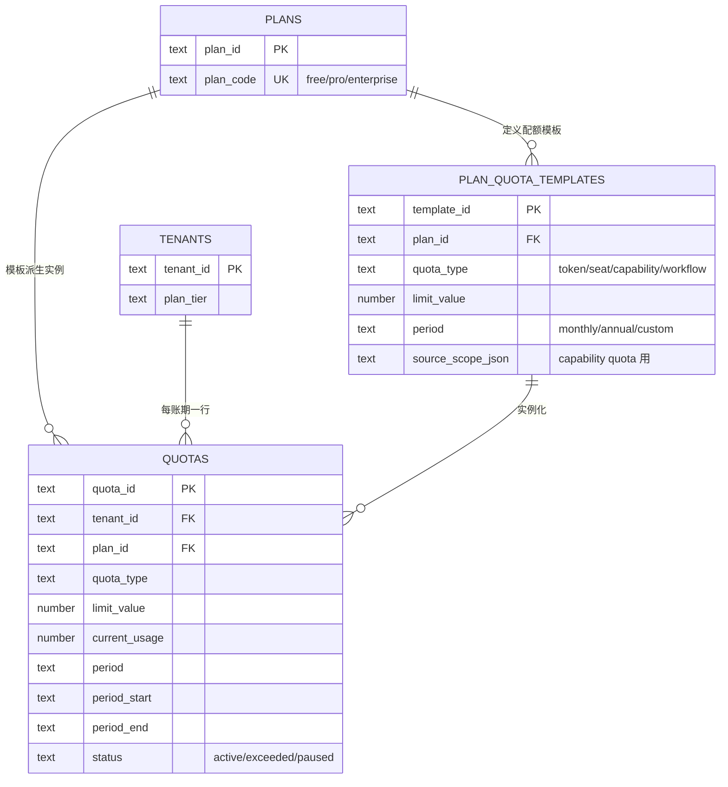
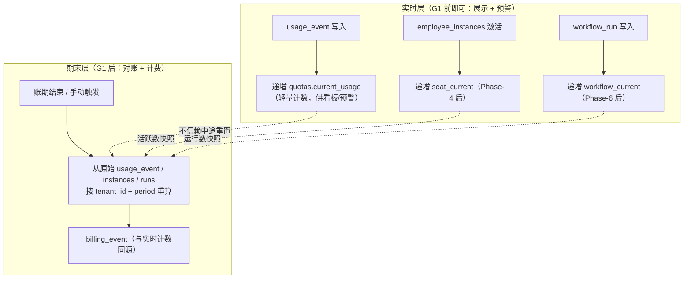
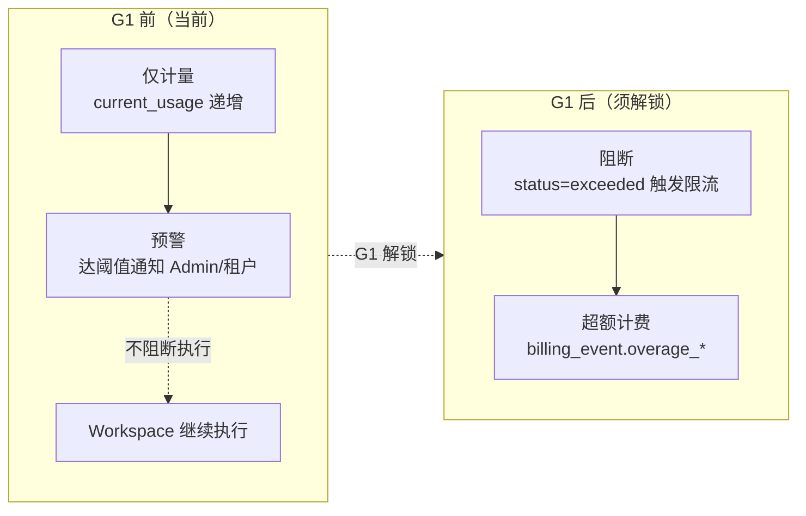

# Admin Quota Contract

Status: Phase-7.7 design only

Owner: Admin Platform owns quota template definition and per-tenant quota governance (future Billing MVP). Workspace supplies runtime evidence only. This document is a commercial governance contract for how Admin manages the four quota families — token / employee seat / capability / workflow — not a quota enforcement implementation.

## 0. 文档定位与引用

本契约定义 **Admin 如何治理四类配额**，是 Phase-7.7 Billing Readiness 评估的一部分。聚焦：每类配额的**定义方（Plan 内模板）**、**实例化方（per-tenant 派生）**、**实时计数 vs 期末重算**、**来源区分**、**超限处理策略（G1 前仅计量/预警）**。

> 配额字段基线来自 `docs/contracts/billing-domain-contract.md`（§Quota Contract：`quota_type` ∈ {token_limit, employee_seat_limit, workflow_limit, capability_limit, connector_limit}；字段 `quota_id/tenant_id/plan_id/quota_type/limit_value/period/current_usage`）。
> 运行时配额实体蓝图来自 `docs/research/domain/pricing-model-research.md` Part B（§B.4 `quotas` 表：seat/token/request 限额与实时计数、由 plan 派生、期末从原始 `usage_event` 重算对账）。
> 技术计数/聚合机制来自 `docs/research/domain/usage-billing-research.md`（配额层、实时聚合 vs 预聚合、fail-closed）。
> 席位来源与 Phase-4 依赖来自 `docs/contracts/employee-seat-contract.md`（`EmployeeInstance` 活跃数、Phase-4 解禁）。
> 套餐配额模板字段来自 `docs/contracts/pricing-contract.md`（Quota / Token Allowance / Employee Seat Reserve）。
> 本契约不重复上述文档已定义的字段语义，仅补充 **Admin 治理视角的来源区分、计数/重算职责、超限策略**。

---

## 1. 配额的两层结构：模板（定义方）与实例（实例化方）

Admin 在 Plan 内定义**配额模板**（规则配置）；租户绑定 Plan 时，由模板 **派生 per-tenant 配额实例**（运行时计数载体）。该"模板 vs 实例"分离沿用 `pricing-model-research.md` §B.1.2 决策 2。

| 层 | 定义方 | 载体（G1 后实体） | 含义 |
| --- | --- | --- | --- |
| 配额模板 | **Admin** | `plan_quota_templates`（Plan 内） | 规则配置：某 Plan 含多少 token/席位/能力来源/工作流、账期多长。 |
| 配额实例 | 系统派生（Admin 拥有规则） | `quotas`（per-tenant） | 运行时载体：某租户当前账期的限额快照 + 实时计数。 |

**实例化时机**：租户绑定 Plan（`plan_tier` → `plan_id`）时，由 `plan_quota_templates` 写入 `quotas` 的 `limit_value` / `period` / `source_scope`；一个租户每个账期一行（`unique(tenant_id, period_start)`），保留历史可审计。

---

## 2. 四类配额的治理定义

### 2.1 总览表

| 配额类型 | `quota_type` | 定义方 | 实例化方 | 实时计数来源 | 计数解锁前置 | 期末重算来源 |
| --- | --- | --- | --- | --- | --- | --- |
| Token 配额 | `token_limit` | Admin（Plan 内 `token_monthly_quota` 模板） | per-tenant `quotas` | `usage_event.total_tokens` | 现已可（usage_event 已落地） | 原始 `usage_event` 按账期聚合 |
| 员工席位配额 | `employee_seat_limit` | Admin（Plan 内 `included_seats` 模板） | per-tenant `quotas` | `employee_instances` 活跃数 | **Phase-4**（C1 解禁） | `employee_instances` 活跃数 + `usage_event.employee_id` |
| 能力配额 | `capability_limit` | Admin（Plan 内 `capability_sources_json` 白名单） | per-tenant `quotas`（`allowed_sources_json`） | `usage_event.capability_source` 统计分布 | 现已可（来源标记已落地） | 原始 `usage_event` 按 `capability_source` 聚合 |
| 工作流配额 | `workflow_limit` | Admin（Plan 内 `monthly_workflow_runs` 模板） | per-tenant `quotas` | `workflow_run` 计数 | **Phase-6** | 原始 `workflow_run` 按账期聚合 |

### 2.2 逐类说明

#### 2.2.1 Token 配额（`token_limit`）

- **定义**：Admin 在 Plan 模板设 `token_monthly_quota`（含 token/月，0 = 不限）。
- **计数**：每次 `usage_event` 写入，轻量递增 `quotas.current_usage`（实时展示/预警）。
- **重算**：期末由原始 `usage_event`（按 `tenant_id + period`）重算 `total_tokens`，与 `billing_event` 同源，保证对账准确。
- **现状**：`usage_event` 已落地（`total_tokens` 已有），G1 前可做**只读统计与预警**，不阻断、不计费。

#### 2.2.2 员工席位配额（`employee_seat_limit`）

- **定义**：Admin 在 Plan 模板设 `included_seats`（含席位数，0 = 不限）。
- **计数来源**：`employee_instances` 活跃实例数；运行时对比 `quotas.current_usage`。
- **前置**：须 **Phase-4（C1）** 解禁 `employee_instances` 计量（沿用 `employee-seat-contract.md`：席位计数为商业视图，不 mutate `usage_event`、不改 Employee Runtime）。
- **G1 前**：员工维度尚未计量，席位配额仅作**目录定义**，不计数、不阻断。

#### 2.2.3 能力配额（`capability_limit`）

- **定义**：Admin 在 Plan 模板设 `capability_sources_json`（允许来源数组 ∈ {`official`, `tenant_private`, `marketplace`}），派生成 per-tenant `allowed_sources_json`。
- **性质**：能力配额是**准入白名单**而非严格计数——约束某租户可使用的 `capability_source` 范围；`marketplace` 仅在 **G3** 后进入白名单。
- **计数（可观测）**：`usage_event.capability_source` 分布统计（official / tenant_private / marketplace 各自占比），供 Admin 只读观测与预警；`tenant_private` 仅见存在性与计量，不见配置内容（沿用 `admin-governance-research.md` 三态治理边界）。
- **G1 前**：仅观测与白名单配置，不阻断、不按来源计费。

#### 2.2.4 工作流配额（`workflow_limit`）

- **定义**：Admin 在 Plan 模板设 `monthly_workflow_runs`（含工作流运行次数/月，0 = 不限）。
- **计数来源**：`workflow_run` 运行计数。
- **前置**：须 **Phase-6** 解禁 `workflow_run` 计量（沿用 `billing-domain-contract.md` Usage Meter 映射：`workflow_run_id` → `usage`）。
- **G1 前**：工作流维度尚未计量，配额仅作**目录定义**。

---

## 3. 实时计数 vs 期末重算

四类配额统一采用"实时轻量计数（展示/预警）+ 期末从原始事件重算（对账）"双轨，与 `billing_event` **同源**（均来自原始 `usage_event` / `employee_instances` / `workflow_run`）。

| 维度 | 实时计数 | 期末重算 | 同源保证 |
| --- | --- | --- | --- |
| 用途 | 看板展示、超限预警 | 准确对账、生成 `billing_event` | 二者均来自原始事件，不引入第二数据源 |
| 容错 | 允许中途重置（`current_usage` 可能不准） | 以原始事件为准，不受重置影响 | `billing_event` 不读 `current_usage`，重算保证权威 |
| G1 前 | ✅ 可做（仅展示/预警） | ⛔ 不生成账单 | 实时计数属只读统计，不触及 G1 禁止区 |

> 计数规则沿用 `usage-billing-research.md`：失败请求默认计入（成本已发生）；聚合按 `tenant_id` fail-closed，禁止跨租户；`estimated_cost` 非账单金额。

---

## 4. 阻断 vs 仅计量（超限处理策略）

**核心边界**：G1 前配额**仅计量与预警，不阻断、不计费**。预警/阻断/超额计费策略属 **G1 后实现**，本契约仅作设计。

### 4.1 超限处理策略分级

| 策略 | 触发 | G1 前是否允许 | G1 后实现归属 |
| --- | --- | --- | --- |
| 计量（计数） | 事件写入 | ✅ 允许（只读统计） | `quotas.current_usage` |
| 预警（threshold alert） | `current_usage` 达阈值 | ✅ 允许（通知，不阻断） | 告警作业 |
| 阻断（enforcement） | `current_usage` 达 `limit_value` | ⛔ 禁止（属经济决策） | 配额中间件（G1 后） |
| 超额计费（overage） | 期末用量 > 含包量 | ⛔ 禁止（属经济计算） | `billing_event.overage_*`（G1 后） |

**原则**：Admin 配置 quota（规则），但**不接管 Workspace 执行**。阻断动作由 G1 后配额中间件在 Workspace 执行链前置检查完成，Admin 不直接下发执行指令（沿用 `admin-plan-management-contract.md` §1.2 "Plan 是规则配置不是执行指令"）。

---

## 5. 横切章节：Usage / Billing 边界（Admin 配额治理职责视角）

对齐 `docs/contracts/usage-value-event-boundary.md`，本契约仅明确 Admin 在配额治理中的职责。

| 职责 | Admin（配额治理） | Workspace |
| --- | --- | --- |
| 用量统计（只读聚合 usage_event） | ✅ 负责（只读，fail-closed） | 产生 `usage_event` |
| 套餐规则（Plan / Quota 模板配置） | ✅ 负责（本契约） | 只读配额配置以自我约束 |
| 计费策略（rating rules / billing_event 聚合） | ✅ 负责（设计层，G1 后实现） | — |
| 产生 usage_event / workflow_run / employee_instances | ❌ 不负责 | ✅ 负责 |

**禁止（对齐 usage-value-event-boundary.md）**：
- Admin 接管 Workspace 执行链（含配额阻断动作须由 G1 后独立中间件承担，不由 Admin 直接下发）。
- Admin 直接写 `usage_event`。
- Admin 跨租户读取 `tenant_private` 内容（仅可经 usage_event 观测存在性与计量）。

---

## 6. 横切章节：严格禁止清单（六）

本契约**严格禁止**以下六项（与 Phase-7.7 其他契约一致）：

1. **不开发 Billing 实现**：不创建 `billing_event` / `invoice`，不写计费/超额逻辑。
2. **不开发支付**：不实现扣费、支付通道、发票开具。
3. **不修改 Workspace**：不改 `main.py` / `database.py` / `result_store.py` / `evolution_event_log.py`。
4. **不修改 Credential Vault**：不解析、不持久化、不暴露凭证。
5. **不修改 Workflow**：不改 Workflow Runtime / `workflow_run` 执行（Phase-6 计量亦仅读，不改）。
6. **不管理 tenant_private 私有能力**：仅经 `usage_event` 观测，不 CRUD 其内容。

---

## 7. 横切章节：Phase-8 进入开发判定

### 7.1 设计层就绪度结论

| 配额类型 | 来源数据就绪度 | 设计层就绪 | 实现前置 Gate |
| --- | --- | --- | --- |
| Token 配额 | ✅ usage_event 已落地 | ✅ 就绪 | 实时计量 G1 前可；阻断/计费须 **G1** |
| 员工席位配额 | 🔴 Phase-4 未解禁 | ✅ 契约就绪（仅目录定义） | **Phase-4** + **G1** |
| 能力配额（白名单） | ✅ capability_source 已标记 | ✅ 就绪 | 观测 G1 前可；阻断须 **G1**；marketplace 须 **G3** |
| 工作流配额 | 🔴 Phase-6 未解禁 | ✅ 契约就绪（仅目录定义） | **Phase-6** + **G1** |

**结论**：四类配额的治理契约（模板/实例/来源/计数-重算/超限策略）**设计层已就绪**，可进入 Phase-8 设计冻结；**实时阻断与超额计费须 G1 gate 解锁**（硬前置）；席位/工作流计量分别须 Phase-4 / Phase-6 解禁；marketplace 来源须 G3 双签。

### 7.2 Phase-8 分两阶段建议

| 阶段 | 前置 Gate | 内容 |
| --- | --- | --- |
| **阶段 A：计量与规则配置** | 无（G1 前可先行） | Plan 内配额模板定义 + per-tenant 配额实例派生 + 实时计数（token / capability 来源观测）+ 预警通知；**仅计量与预警，不阻断、不计费**。 |
| **阶段 B：真实计费与阻断** | **G1 解锁**（席位须 Phase-4、工作流须 Phase-6、marketplace 须 G3） | 期末从原始事件重算对账 → `billing_event` 超额；配额中间件执行阻断；由独立计费作业/端点承担，不并入现有 Admin 只读契约。 |

---

## 结论与 gate 边界

- **四类配额治理契约已就绪**：Admin 在 Plan 内定义配额模板（token / employee_seat / capability / workflow），派生 per-tenant 配额实例；计数采用"实时轻量计数（展示/预警）+ 期末从原始事件重算（与 billing_event 同源）"双轨。
- **来源区分明确**：token ← `usage_event`；席位 ← `employee_instances`（Phase-4 后）；能力 ← `capability_source` 白名单（marketplace 须 G3）；工作流 ← `workflow_run`（Phase-6 后）。
- **阻断 vs 仅计量**：G1 前配额**仅计量与预警，不阻断、不计费**；预警/阻断/超额计费属 G1 后实现，Admin 配置规则但不接管 Workspace 执行。
- **Gate 边界**：计量与规则配置（阶段 A）可在 G1 前先行；真实阻断与计费（阶段 B）须 **G1 gate 解锁**（硬前置），其中席位须 **Phase-4**、工作流须 **Phase-6**、marketplace 来源须 **G3 双签**。
- **零实现承诺**：本契约不创建任何表、不修改任何 `.py` 源文件、不写计费/阻断/支付代码，仅扩展并引用 `billing-domain-contract.md`、`pricing-model-research.md` Part B、`usage-billing-research.md`、`employee-seat-contract.md`。

*—— Phase-7.7 Admin Quota Contract（纯设计/契约，无代码）。*
