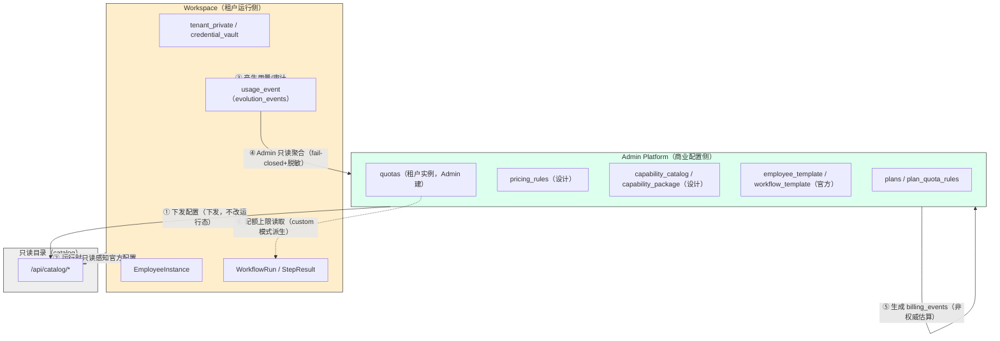

# Admin ↔ Workspace Commercial Boundary Contract（商业边界契约）

> **作者**：高见远（架构师，software-architect）
> **阶段**：Phase-8.6 Admin Commercial Configuration Audit + Design（设计审计阶段，零代码）
> **意图**：明确 Admin（商业配置侧）与 Workspace（租户运行侧）在**商业规则**上的职责边界，防止任一侧越权。
> **引用**：`admin-capability-package-contract.md`（三态治理）、`usage-value-event-boundary.md`（脱敏铁律）、`credential_vault` 边界、`phase9a-commercial-design-freeze.md`（六禁）。

---

## 1. 职责划分（核心）

| 维度 | **Admin Platform（商业配置侧）** | **Workspace（租户运行侧）** |
| --- | --- | --- |
| 官方员工模板 | ✅ 供给、上下架、绑定能力/定价引用 | ❌ 不创作官方模板；仅消费 |
| 官方研发 SOP 模板 | ✅ 供给、上下架 | ❌ 不创作官方 SOP；仅消费 |
| 套餐 / 配额规则 | ✅ 定义 Plan、QuotaRule、配额上限 | ❌ 不改官方套餐/配额定义 |
| Capability Package 组成 | ✅ 组合官方/市场能力包、绑定 Plan | ❌ 不改官方包组成 |
| AI Employee Seat 语义 | ✅ 定义 seat_type / 席位规则 / 定价引用 | ❌ 不改 Seat 商业语义 |
| Marketplace 启用策略 | ✅ 决定 marketplace 是否进入白名单（G3） | ❌ 不决策 |
| BillingEvent / Invoice | ✅ 生成/聚合 BillingEvent（非权威估算） | ❌ 不生成 BillingEvent |
| 租户私有能力（tenant_private） | ❌ **不 CRUD、不读明文** | ✅ 全量自管 |
| credential_ref / resolver | ❌ **不解析、不持久化、不暴露** | ✅ 管理与解析 |
| EmployeeInstance | ❌ 不管理运行实例 | ✅ 创建/运行/状态 |
| WorkflowRun / StepResult | ❌ 不介入执行链 | ✅ 执行与状态 |
| usage_event / audit_event | ⚠️ 只读聚合（fail-closed、脱敏） | ✅ 产生 |

---

## 2. 两条铁律（禁止）

1. **Admin 禁止修改用户公司内部运行状态**：
   - 不得写 `EmployeeInstance` / `WorkflowRun` / `WorkflowStep` / `StepResult` 的运行态；
   - 不得修改 `credential_vault`、不得解析 `credential_ref`；
   - 不得向 Workspace 执行链注入写入钩子（配额仅"读时聚合"，不 block/degrade 执行）。
2. **Workspace 禁止修改官方商业定义**：
   - 不得改 `plans` / `plan_quota_rules` / `pricing_rules` / `capability_catalog`（official）/ 官方模板；
   - 只能**只读**感知官方配置以自我约束。

---

## 3. 表与端点归属矩阵

### 3.1 表归属

| 表 | 归属侧 | 商业语义 | 说明 |
| --- | --- | --- | --- |
| `plans` | **Admin** | 套餐模板（含 quota_rules_json） | `database.py:746`；Admin CRUD |
| `plan_quota_rules`（设计） | **Admin** | 套餐配额规则（结构化） | Phase-9 提升自 quota_rules_json |
| `pricing_rules`（设计） | **Admin** | 定价规则（订阅/超量/包/席位/连接） | Phase-9 新增 |
| `capability_catalog` | **Admin** | 官方能力/能力包目录 | `main.py:1371`；official 可配 |
| `capability_package`（设计） | **Admin** | 组合能力包 | Phase-9 新增 |
| `employee_template` / `workflow_template` | **Admin（种子）/ 设计** | 官方员工/SOP 模板 | `database.py:941/1076`；Admin 作者 API 设计态 |
| `quotas` | **Admin 写（按租户配置）/ Workspace 只读** | 租户配额实例 | `database.py:763`；Admin 为企业建实例 |
| `billing_events` | **Admin 生成** | 计费事件（非权威估算） | `database.py:784`；零资金副作用 |
| `tenant_private`（能力） | **Workspace** | 租户私有能力 | Admin 仅经 usage_event 观测存在性 |
| `credential_vault` | **Workspace** | 凭证库 | Admin 不解析/不读明文 |
| `EmployeeInstance` | **Workspace** | AI 员工运行实例 | Admin 不写 |
| `WorkflowRun` / `WorkflowStep` / `StepResult` | **Workspace** | 工作流运行 | Admin 不介入 |
| `usage_event`（`evolution_events`） | **Workspace 产生 / Admin 只读聚合** | 用量事件 | fail-closed + 脱敏 |
| `audit_event` | 双侧各写各自命名空间 | 审计事件 | append-only |

### 3.2 端点归属

| 端点 | 归属侧 | 性质 |
| --- | --- | --- |
| `/api/platform/plans*`, `/quotas*`, `/capabilities*`, `/billing-events*`, `/pricing-rules*`（设计）, `/capability-packages*`（设计）, `/employee-templates*`（设计）, `/workflow-templates*`（设计） | **Admin** | 商业配置写 + 只读聚合 |
| `/api/workspace/private-capabilities*`, `/credentials*`, `/private-models*`, `/private-tools*`, `/private-connectors*` | **Workspace** | 租户私有能力/凭证自管 |
| `/api/workspace/employee-templates`, `/workflow-templates`, `/employees`, `/workflows`, `/workflows/{id}/run-next-step` | **Workspace（读官方模板 + 运行）** | 运行时消费官方配置 |
| `/api/catalog/plans/{plan_code}`, `/catalog/capabilities`, `/catalog/models` | **双侧共享（只读）** | Workspace 只读感知官方配置 |

---

## 4. 数据流说明

**数据流释义**：
1. **① 下发配置**：Admin 经 `plans`/`capability_catalog`/模板等定义商业规则，经 catalog 暴露为只读目录。
2. **② 运行时只读感知**：Workspace 经 `/api/catalog/*` 读取官方配置以自我约束（如能力白名单、套餐配额），**不回写、不接管**。
3. **③ 产生用量**：Workspace 执行产生 `usage_event` / `audit_event`。
4. **④ 只读聚合**：Admin 对 `usage_event` 做读时聚合（fail-closed + 脱敏，绝不跨租户、绝不暴露 tenant_private 明文）。
5. **⑤ 计费估算**：Admin 生成 `billing_events`（非权威估算，零资金副作用）。
6. **⑥ 配额派生**：custom 模式下 `calculate_billing_events` 读取 Admin 建的 `quotas` 租户实例作为上限，但**不修改** Workspace 运行态。

---

## 5. 跨侧调用约定

| 约定 | 说明 |
| --- | --- |
| **Admin 只下发配置** | Admin 写 `plans`/`quotas`/`capability_catalog`/模板等；经 catalog 暴露。不调用 Workspace 执行端点。 |
| **Workspace 运行时只读配置** | Workspace 经 `/api/catalog/*` 读取官方定义约束自身；不写官方表。 |
| **tenant_private 铁律** | Admin 不 CRUD、不读明文；仅经 `usage_event.capability_source='tenant_private'` 观测存在性与计量。 |
| **credential_vault 铁律** | Admin 不解析 `credential_ref`、不持久化、不暴露；仅 `(scheme:reference)` 不透明字符串校验（`catalog_constants.py:36`）。 |
| **配额不阻断执行** | 配额仅"读时聚合 + notify 预警"，不在 Workspace 执行链注入 block（真实 block 属 G1 后工程）。 |
| **审计命名空间隔离** | 双侧各写各自 `audit_event` 命名空间（如 `plan.*` / `package.*` vs `workspace.*`），append-only。 |
| **Value 不混入** | `usage_event` 不含 `value_type`/`estimated_value`；Admin 计量不计算 ROI（见 `usage-value-event-boundary.md`）。 |

---

## 6. 边界违规自检清单（红线）

- [ ] Admin 是否写了 `EmployeeInstance` / `WorkflowRun` / `StepResult`？→ 禁止
- [ ] Admin 是否解析/读取 `credential_vault` / `credential_ref` 明文？→ 禁止
- [ ] Admin 是否向 Workspace 执行链注入写入钩子？→ 禁止
- [ ] Workspace 是否改了 `plans` / `pricing_rules` / `capability_catalog`（official）/ 官方模板？→ 禁止
- [ ] 跨侧调用是否经 catalog 只读？→ 必须
- [ ] `usage_event` 聚合是否 fail-closed + 脱敏？→ 必须

> 本契约与 `admin-capability-package-contract.md`、`usage-value-event-boundary.md`、`phase9a-commercial-design-freeze.md` 的六禁一致，且不重定义其字段语义。

---

*—— Phase-8.6 Admin ↔ Workspace Commercial Boundary Contract（纯设计/契约，无代码）。Admin 只下发配置；Workspace 只读不改官方定义。*
