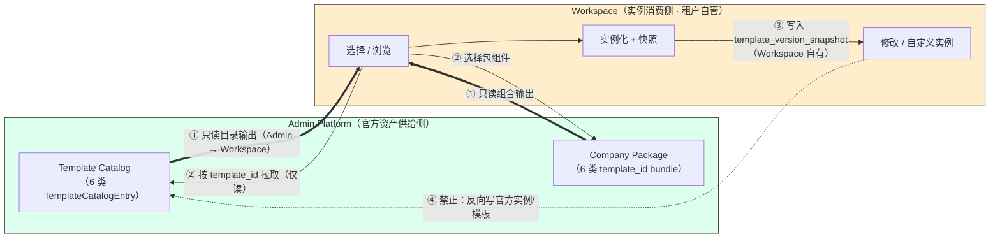

# Admin ↔ Workspace Template Boundary Contract（模板权限边界契约）

> **作者**：高见远（架构师，software-architect）
> **主理人**：齐活林（交付总监）
> **阶段**：Phase-1B Template Runtime Integration Gate（Admin 侧）—— 纯文档（design-only reservation），零代码
> **对齐**：ADR-0017；承接 `admin-workspace-commercial-boundary.md`（商业边界）；与 `template-catalog-runtime-contract.md`（输出协议）、`company-package-runtime-contract.md`（组合包）、`template-versioning-policy.md`（实例化版本）一致
> **范围说明**：本契约在"模板资产"维度明确 Admin（供给侧）与 Workspace（消费侧）的职责边界与数据流单向性。模板边界是商业边界的补充子集。

---

## 0. 文档定位与引用

- 商业边界（`admin-workspace-commercial-boundary.md`）已定义配置面 vs 运行实例面铁律；本契约把该铁律**具体到模板资产**：谁创建/发布/更新/下架模板，谁实例化/修改/自定义实例。
- 本契约与商业边界**不冲突、不重定义**：模板是官方能力资产的一种，其边界是商业边界在"模板"这一对象上的投影。

---

## 1. RBAC 职责矩阵（Admin vs Workspace）

| 维度 | **Admin Platform（官方资产供给侧）** | **Workspace（租户 · 实例消费侧）** |
| --- | --- | --- |
| 创建官方模板 | ✅ 创建 Company/Department/Employee/Workflow/Skill/Tool 官方模板 | ❌ 不创作官方模板 |
| 发布模板（active） | ✅ 将 `draft` 置 `active`，对外发布 | ❌ 不发布官方模板 |
| 更新模板 | ✅ 升级 `version`、改 `metadata`、改 `status` | ❌ 不改官方模板 |
| 下架模板 | ✅ `active`→`disabled`/`archived` | ❌ 不下架官方模板 |
| 管理 marketplace 源（预留） | ✅ 经 G3 双签 + 安全 gate 上架 | ❌ 不决策 |
| 选择模板 | ❌ 不选（Admin 只供给目录） | ✅ 从 catalog 浏览/选择模板 |
| 实例化 | ❌ **不实例化**（不生成 EmployeeInstance 等） | ✅ 按 `template_id` 拉取+快照创建实例 |
| 修改实例 | ❌ **禁止修改已存在用户实例** | ✅ 修改/自定义自身实例（实例所有权归 Workspace） |
| 版本快照 | ❌ 不持有实例快照 | ✅ 持有 `template_version_snapshot`（见版本策略） |
| Company Package 组合 | ✅ 打包 6 类 `template_id` 成 bundle | ❌ 不创作官方包 |
| 消费 Company Package | ❌ 不消费（Admin 只供给） | ✅ 选择包并实例化其组件 |

---

## 2. 两条铁律（禁止）

1. **Admin 禁止修改用户实例（实例所有权归 Workspace/租户）**：
   - 不得写 `EmployeeInstance` / `DepartmentInstance` / `CompanyInstance` / `WorkflowRun` 的运行态；
   - 不得因"官方模板升级"而主动改写任何已存在实例的字段；
   - 实例的 `template_version_snapshot` 由 Workspace 在实例化时写入，Admin 不回写。
2. **Workspace 禁止修改官方模板定义**：
   - 不得改 `template-catalog-runtime-contract.md` 描述的官方 `TemplateCatalogEntry`（`source=official`）；
   - 只能**只读**感知官方目录以自我约束，可自定义的是"实例"而非"模板"。

---

## 3. 数据流单向性

**数据流释义**：
1. **① 单向发布**：Admin → Workspace，官方目录/组合包**只读输出**。
2. **② 仅读拉取**：Workspace 按 `template_id` 从 catalog **只读**拉取模板形状。
3. **③ 实例自管**：实例化产生的 `template_version_snapshot` 与实例修改**全部落在 Workspace 侧**（租户自有存储）。
4. **④ 禁止反向**：Workspace **不得**把任何实例运行态/修改回写 Admin 官方目录或官方实例。

---

## 4. 端点 / 表归属矩阵（design-only 视角）

| 对象 / 端点 | 归属侧 | 性质 |
| --- | --- | --- |
| `template-catalog-runtime-contract.md` 输出（`/api/catalog/templates*`，设计态） | **Admin 供给 / 双侧只读** | 官方目录只读输出 |
| `company-package-runtime-contract.md` 输出（`/api/catalog/company-packages*`，设计态） | **Admin 供给 / 双侧只读** | 官方组合包只读输出 |
| 官方模板写端点（`/api/platform/*-templates`，设计态） | **Admin** | 官方资产供给侧写 |
| 实例化端点（`/api/workspace/employees`、`/workflows/{id}/run-next-step` 等，设计态） | **Workspace** | 实例消费侧 |
| `EmployeeInstance` / `DepartmentInstance` / `CompanyInstance` | **Workspace** | 运行实例面，Admin 不写 |
| `template_version_snapshot` | **Workspace** | 实例快照，Workspace 自有 |

> 注：上述端点均为**设计态（design-only）**，本阶段不建表、不加路由；仅用于界定归属。

---

## 5. 实例所有权声明

- **官方模板（`TemplateCatalogEntry`, `source=official`）所有权 = Admin（平台）**。
- **运行实例（`*Instance`、其 `template_version_snapshot`、实例自定义）所有权 = Workspace / 租户**。
- Admin 对实例**仅有只读聚合观测权**（fail-closed + 脱敏，见商业边界契约），**无任何写权**。

---

## 6. 红线与禁止区（本契约遵守）

- **不开发** UI / Marketplace / 支付 / 购买流程。
- **不写** 任何后端代码、不建表、不加 API 路由、不碰 Workspace 执行链 / Credential Vault / EmployeeRuntime / Usage Event 写入。
- **不实例化**：Admin 不生成任何用户实例；本契约仅界定职责边界。
- **实例所有权归 Workspace**：Admin 不修改任何已存在用户实例。

---

## 7. 验收映射

| # | 验收项 | 落点 |
|---|--------|------|
| 1 | RBAC 职责矩阵（Admin 供给侧 / Workspace 消费侧） | §1 |
| 2 | 两条铁律（禁止反向写实例/模板） | §2 |
| 3 | 数据流单向性（Mermaid） | §3 |
| 4 | 端点/表归属矩阵 | §4 |
| 5 | 实例所有权声明 | §5 |
| 6 | 红线遵守 | §6 |

*—— Admin ↔ Workspace Template Boundary Contract（纯设计/契约，零代码）。模板资产维度的供给侧/消费侧边界；与 ADR-0017 一致。*
