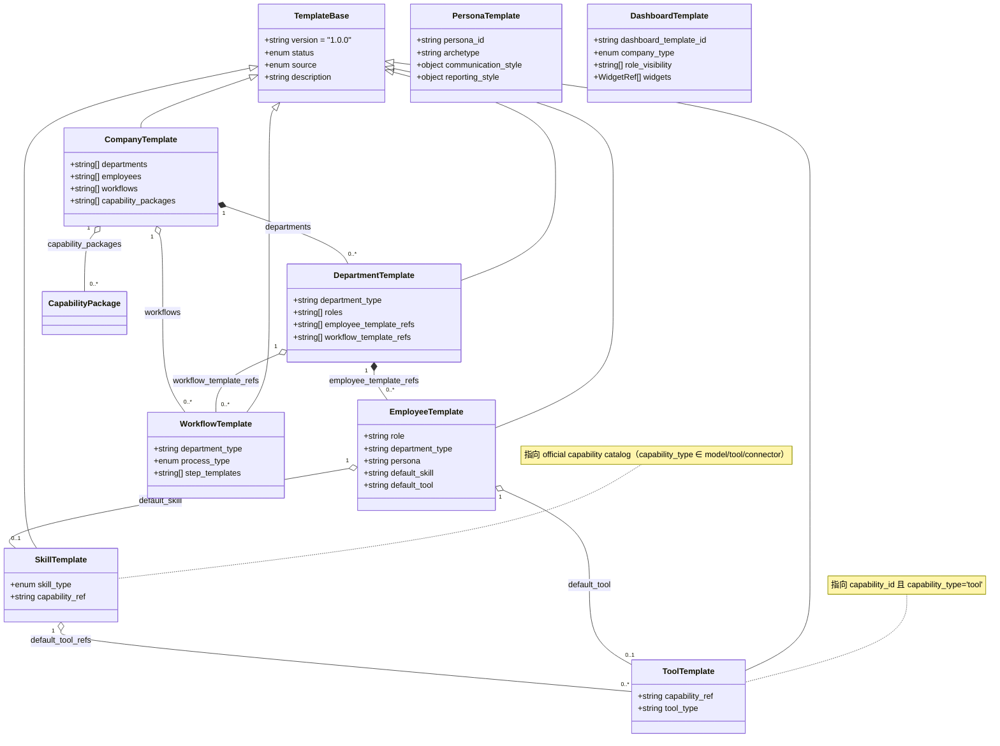

# AI Company Template System Contract（AI 公司官方模板目录总契约）

> **作者**：高见远（架构师，software-architect）
> **主理人**：齐活林（交付总监）
> **阶段**：AI Company Asset Factory Foundation —— 纯文档（design-only reservation），零代码、零后端改动
> **对齐**：ADR-0017（仅做 design-only reservation：契约 + 占位，无行为变化、无后端改动）；与 `docs/contracts/commercial-configuration-v1.md`、`capability-package-commercial-contract.md`、`employee-template-contract.md`、`department-template-contract.md`、`company-template-contract.md`、`workflow-template-contract.md`、`skill-runtime-contract.md`、`tool-runtime-contract.md` 及 `backend/app/database.py` 种子命名保持一致
> **范围说明**：本契约为「官方资产模板目录（catalog）」的**契约层定义**，非实例化数据。Employee 真实 CRUD/实例化须独立 ADR gate（见 `docs/release/admin-ai-company-asset-foundation.md` §5）。

---

## 0. 文档定位与引用

本契约是 **AI Company 官方资产模板目录** 的**权威总览**。它统一定义 8 类官方模板（含 `pt_` PersonaTemplate、`dtpl_` DashboardTemplate）的公共基类型 `TemplateBase` 与各自 JSON Schema，并用 Mermaid 类图表达组合关系。

- **本契约只引用、不重写** 既有专属契约的字段；对既有契约中 `Reserved Only` / `Phase-4` 的字段，本文给出**统一升级后的契约形状**（补齐 `version` / `status` 公共字段），供未来 `/api/platform/*-templates` 作者端点落地时对齐。
- **官方能力供给（Skill/Tool）的真相源** 是统一能力目录 `official_models` + `/api/platform/capabilities`（`capability_type ∈ {model, tool, connector}`）。`SkillTemplate` / `ToolTemplate` 是**指向该目录的轻量 catalog-reference 包装**，不引入新物理表、不重复定义能力（详见 §2.4 / §2.5）。

---

## 1. 公共基类型 TemplateBase

所有 6 类模板均继承以下 4 个公共字段。

| 字段 | 类型 | 必填 | 默认 | 枚举 / 约束 | 说明 |
|------|------|------|------|-------------|------|
| `version` | string | 否 | `"1.0.0"` | SemVer `^\d+\.\d+\.\d+$` | 官方模板版本；Admin 控制官方/marketplace 版本演进 |
| `status` | enum | 是 | `"draft"` | `draft` / `active` / `disabled` / `archived` | 生命周期状态（见 §1.1 状态机） |
| `source` | enum | 是 | `"official"` | `official` / `tenant_private` / `marketplace` | 来源决定**写权限归属**：`official`=平台 Admin；`tenant_private`=租户（须 gate）；`marketplace`=市场（须 G3/安全 gate） |
| `description` | string | 否 | `""` | 文本 | 展示/帮助文本 |

> **与现状对齐说明**：现有种子表 `employee_templates` / `department_templates` 仅有 `enabled` 标志位、**无 `status` / `version` 列**；`workflow_templates` 有 `status`（`active`/`disabled`）但无 `version`。本契约将其统一补齐为 `TemplateBase`，作为未来作者端点（issue 087 C3）的契约基线；**本阶段不回填、不建列**。

### 1.1 统一状态机（TemplateBase.status）

```
draft ──activate──▶ active ──disable──▶ disabled
  ▲                    │                  │
  └──────── enable ───┴──────────────────┘
  active/archived ◀── archive（可选，仅官方保留历史）
```

- `draft`：编辑中，未对外可用。
- `active`：已发布为可用官方模板。
- `disabled`：停用（保留历史，不物理删除）。
- `archived`：归档（官方历史保留，可选扩展）。
- `status` 独立于 `source` 演进：一个 `active` 官方模板可同时是 `marketplace` 源（待 G3 gate）。

---

## 2. 八类模板 JSON Schema

> 以下均使用 JSON Schema（draft-07 风格）。`$ref` 指 §1 `TemplateBase`。所有外键引用均以 **ID 字符串数组** 表达，运行时不强制外键（与 `CapabilityPackage` 哲学一致）。

### 2.1 CompanyTemplate（公司模板）

官方公司蓝图。例：「AI Software Company」。

```json
{
  "$schema": "http://json-schema.org/draft-07/schema#",
  "title": "CompanyTemplate",
  "type": "object",
  "additionalProperties": false,
  "required": ["id", "slug", "name", "version", "status", "source"],
  "properties": {
    "id":                  { "type": "string", "pattern": "^ct_[a-z0-9_-]+$" },
    "slug":                { "type": "string" },
    "name":                { "type": "string" },
    "version":             { "type": "string", "pattern": "^\\d+\\.\\d+\\.\\d+$", "default": "1.0.0" },
    "status":              { "type": "string", "enum": ["draft","active","disabled","archived"], "default": "draft" },
    "source":              { "type": "string", "enum": ["official","tenant_private","marketplace"], "default": "official" },
    "description":         { "type": "string", "default": "" },
    "tenant_id":           { "type": ["string","null"], "default": "platform" },
    "departments":         { "type": "array", "items": { "type": "string", "pattern": "^dt_[a-z0-9_-]+$" }, "default": [] },
    "employees":           { "type": "array", "items": { "type": "string", "pattern": "^et_[a-z0-9_-]+$" }, "default": [] },
    "workflows":           { "type": "array", "items": { "type": "string", "pattern": "^wt_[a-z0-9_-]+$" }, "default": [] },
    "capability_packages": { "type": "array", "items": { "type": "string", "pattern": "^cp_[a-z0-9_-]+$" }, "default": [] },
    "default_goals":       { "type": "array", "items": { "type": "string" }, "default": [] },
    "governance_policy_ref": { "type": ["string","null"], "default": null },
    "enabled":             { "type": "boolean", "default": true },
    "created_at":          { "type": "string", "format": "date-time" },
    "updated_at":          { "type": "string", "format": "date-time" }
  },
  "examples": [{
    "id": "ct_ai_software_company",
    "slug": "ai-software-company",
    "name": "AI Software Company",
    "version": "1.0.0",
    "status": "draft",
    "source": "official",
    "description": "标准 AI 软件公司蓝图：研发部 + 6 类研发员工 + 研发 SOP + 内容运营包。",
    "departments": ["dt_engineering"],
    "employees": ["et_backend_engineer","et_frontend_engineer","et_architect","et_tech_lead","et_product_manager","et_qa_engineer"],
    "workflows": ["wt_software_rnd_sop"],
    "capability_packages": ["cp_content_ops"],
    "default_goals": ["deliver AI software products"]
  }]
}
```

> 字段对齐：`departments` / `workflows` / `capability_packages` 对应既有 `company-template-contract.md` 的 `default_department_templates` / `default_workflow_templates` / `capability_pack_refs`（本契约统一为复数数组命名，便于作者端点一致处理）。**当前无 `company_templates` 表**——本定义为 Phase-5+ 设计预留（研究 `ai-company-template-research.md`）。

### 2.2 DepartmentTemplate（部门模板）

官方部门蓝图。例：「Engineering Department」。

```json
{
  "$schema": "http://json-schema.org/draft-07/schema#",
  "title": "DepartmentTemplate",
  "type": "object",
  "additionalProperties": false,
  "required": ["id", "slug", "name", "department_type", "version", "status", "source"],
  "properties": {
    "id":                     { "type": "string", "pattern": "^dt_[a-z0-9_-]+$" },
    "slug":                   { "type": "string" },
    "name":                   { "type": "string" },
    "department_type":        { "type": "string", "description": "引用 department_types.type_key；首个批准值 software_rnd" },
    "version":                { "type": "string", "pattern": "^\\d+\\.\\d+\\.\\d+$", "default": "1.0.0" },
    "status":                 { "type": "string", "enum": ["draft","active","disabled","archived"], "default": "draft" },
    "source":                 { "type": "string", "enum": ["official","tenant_private","marketplace"], "default": "official" },
    "description":            { "type": "string", "default": "" },
    "roles":                  { "type": "array", "items": { "type": "string" }, "default": [], "description": "本部门可用角色键，如 tech_lead/product_manager/architect/frontend_engineer/backend_engineer/qa_engineer" },
    "employee_template_refs": { "type": "array", "items": { "type": "string", "pattern": "^et_[a-z0-9_-]+$" }, "default": [], "description": "引用 EmployeeTemplate id（原 default_employee_templates_json）" },
    "workflow_template_refs": { "type": "array", "items": { "type": "string", "pattern": "^wt_[a-z0-9_-]+$" }, "default": [], "description": "引用 WorkflowTemplate id（原 default_workflow_template_id，单值→数组升级）" },
    "default_capability_types": { "type": "array", "items": { "enum": ["model","tool","connector"] }, "default": ["model","tool","connector"] },
    "tenant_id":              { "type": ["string","null"], "default": "platform" },
    "enabled":                { "type": "boolean", "default": true },
    "created_at":             { "type": "string", "format": "date-time" },
    "updated_at":             { "type": "string", "format": "date-time" }
  },
  "examples": [{
    "id": "dt_engineering",
    "slug": "engineering",
    "name": "Engineering Department",
    "department_type": "software_rnd",
    "version": "1.0.0",
    "status": "draft",
    "source": "official",
    "description": "研发部：包含产品、架构、前端、后端、质量与技术负责人。",
    "roles": ["tech_lead","product_manager","architect","frontend_engineer","backend_engineer","qa_engineer"],
    "employee_template_refs": ["et_backend_engineer","et_frontend_engineer","et_architect","et_tech_lead","et_product_manager","et_qa_engineer"],
    "workflow_template_refs": ["wt_software_rnd_sop"]
  }]
}
```

> 字段对齐：对应种子表 `department_templates`（`default_employee_templates_json` → `employee_template_refs`；`default_workflow_template_id` 单值 → `workflow_template_refs` 数组）。`roles` 为本契约新增（从 `employee_template_refs` 派生的角色键集合，便于目录检索）。

### 2.3 EmployeeTemplate（员工模板）

官方员工模板。例：「Backend Engineer AI」。

```json
{
  "$schema": "http://json-schema.org/draft-07/schema#",
  "title": "EmployeeTemplate",
  "type": "object",
  "additionalProperties": false,
  "required": ["id", "slug", "name", "role", "department_type", "persona", "version", "status", "source"],
  "properties": {
    "id":                        { "type": "string", "pattern": "^et_[a-z0-9_-]+$" },
    "slug":                      { "type": "string" },
    "name":                      { "type": "string" },
    "role":                      { "type": "string", "description": "角色标签，如 Backend Engineer" },
    "department_type":           { "type": "string", "default": "software_rnd" },
    "version":                   { "type": "string", "pattern": "^\\d+\\.\\d+\\.\\d+$", "default": "1.0.0" },
    "status":                    { "type": "string", "enum": ["draft","active","disabled","archived"], "default": "draft" },
    "source":                    { "type": "string", "enum": ["official","tenant_private","marketplace"], "default": "official" },
    "description":               { "type": "string", "default": "" },
    "persona":                   { "type": "string", "description": "员工人设/角色定位描述（本契约新增；对应既有 default_instructions 的 CEO 可读语义层）" },
    "responsibility":            { "type": "string", "default": "", "description": "来自既有 employee-template-contract" },
    "default_instructions":      { "type": "string", "default": "" },
    "default_skill":             { "type": ["string","null"], "pattern": "^st_[a-z0-9_-]+$", "description": "默认技能模板引用（SkillTemplate id）；本契约新增" },
    "default_tool":              { "type": ["string","null"], "pattern": "^tt_[a-z0-9_-]+$", "description": "默认工具模板引用（ToolTemplate id）；本契约新增" },
    "default_capability_types":  { "type": "array", "items": { "enum": ["model","tool","connector"] }, "default": ["model"] },
    "default_model_policy":      { "type": "object", "default": {} },
    "default_workflow_step_types": { "type": "array", "items": { "type": "string" }, "default": [] },
    "guardrails":                { "type": "array", "items": { "type": "string" }, "default": [] },
    "tenant_id":                 { "type": ["string","null"], "default": "platform" },
    "enabled":                   { "type": "boolean", "default": true },
    "created_at":                { "type": "string", "format": "date-time" },
    "updated_at":                { "type": "string", "format": "date-time" }
  },
  "examples": [{
    "id": "et_backend_engineer",
    "slug": "backend-engineer-ai",
    "name": "Backend Engineer AI",
    "role": "Backend Engineer",
    "department_type": "software_rnd",
    "version": "1.0.0",
    "status": "draft",
    "source": "official",
    "description": "负责后端服务开发与接口实现。",
    "persona": "严谨、注重接口契约与可观测性的后端工程师，偏好类型安全与幂等设计。",
    "responsibility": "backend delivery",
    "default_skill": "st_backend_coding",
    "default_tool": "tt_code_executor",
    "default_capability_types": ["model","tool"]
  }]
}
```

> 字段对齐：对应种子表 `employee_templates`（`role`/`department_type`/`responsibility`/`default_instructions`/`default_capability_types_json`/`default_model_policy_json`/`guardrails_json` 全部保留）。本契约**新增** `persona`（对应 `default_instructions` 的 CEO 可读语义层）、`default_skill`、`default_tool`（指向 Skill/Tool 模板引用）；并补齐 `version` / `status`。`default_skill` / `default_tool` 为引用字段（ID），**不内联能力定义**。

### 2.4 SkillTemplate（技能模板，catalog-reference 包装）

指向官方能力目录的轻量包装。`Skill ≡ Capability`（`capability-type-contract.md`）：系统**无独立 skill 实体**，能力维度即 `capability_type ∈ {model, tool, connector}`，由 `official_models` + `/api/platform/capabilities` 供给（issue 071 已实现）。`SkillTemplate` 在此目录之上叠加「技能类型 / 默认工具引用」等模板元数据。

```json
{
  "$schema": "http://json-schema.org/draft-07/schema#",
  "title": "SkillTemplate",
  "type": "object",
  "additionalProperties": false,
  "required": ["skill_template_id", "slug", "name", "skill_type", "default_capability_types", "version", "status", "source"],
  "properties": {
    "skill_template_id":       { "type": "string", "pattern": "^st_[a-z0-9_-]+$" },
    "slug":                    { "type": "string" },
    "name":                    { "type": "string" },
    "skill_type":              { "type": "string", "enum": ["planning","analysis","architecture","frontend","backend","qa","tool_operation"] },
    "version":                 { "type": "string", "pattern": "^\\d+\\.\\d+\\.\\d+$", "default": "1.0.0" },
    "status":                  { "type": "string", "enum": ["draft","active","disabled","archived"], "default": "draft" },
    "source":                  { "type": "string", "enum": ["official","tenant_private","marketplace"], "default": "official" },
    "description":             { "type": "string", "default": "" },
    "default_capability_types":{ "type": "array", "items": { "enum": ["model","tool","connector"] }, "default": ["model"] },
    "default_tool_refs":       { "type": "array", "items": { "type": "string", "pattern": "^tt_[a-z0-9_-]+$" }, "default": [], "description": "引用 ToolTemplate id / capability catalog id（type=tool）" },
    "instruction_ref":         { "type": ["string","null"], "default": null, "description": "指令引用，仅引用不内联；禁止明文密钥" },
    "capability_ref":          { "type": ["string","null"], "description": "指向 official_models.capability_id（单一真相源）" },
    "tenant_id":               { "type": ["string","null"], "default": "platform" },
    "created_at":              { "type": "string", "format": "date-time" },
    "updated_at":              { "type": "string", "format": "date-time" }
  },
  "examples": [{
    "skill_template_id": "st_backend_coding",
    "slug": "backend-coding",
    "name": "Backend Coding Skill",
    "skill_type": "backend",
    "version": "1.0.0",
    "status": "draft",
    "source": "official",
    "description": "后端编码技能：依赖模型能力 + 代码执行工具。",
    "default_capability_types": ["model","tool"],
    "default_tool_refs": ["tt_code_executor"],
    "capability_ref": "task_execution"
  }]
}
```

> 字段对齐：依据 `skill-runtime-contract.md` 的 `SkillTemplate Fields`，并补齐 `version` / `status` / `source`（公共字段）与 `capability_ref`（指向官方能力目录单一真相源）。**无独立物理表**；当前官方 skill 由 `/api/platform/capabilities` 与 `EmployeeSkillBinding` 承载。

### 2.5 ToolTemplate（工具模板，catalog-reference 包装）

指向官方能力目录中 `capability_type = tool` 条目的轻量包装。依据 `tool-runtime-contract.md`：Tool = `capability_type=tool`，官方工具目录读 `/api/catalog/tools`（issue 067 已实现），Admin 写经统一能力目录。

```json
{
  "$schema": "http://json-schema.org/draft-07/schema#",
  "title": "ToolTemplate",
  "type": "object",
  "additionalProperties": false,
  "required": ["tool_template_id", "slug", "name", "capability_ref", "version", "status", "source"],
  "properties": {
    "tool_template_id": { "type": "string", "pattern": "^tt_[a-z0-9_-]+$" },
    "slug":             { "type": "string" },
    "name":             { "type": "string" },
    "capability_ref":   { "type": "string", "description": "指向 official_models.capability_id（capability_type='tool'）——单一真相源" },
    "tool_type":        { "type": "string", "description": "工具分类（沿用既有 tool_type）" },
    "entry":            { "type": "string", "default": "", "description": "内部 entry 引用，绝不含有密钥" },
    "version":          { "type": "string", "pattern": "^\\d+\\.\\d+\\.\\d+$", "default": "1.0.0" },
    "status":           { "type": "string", "enum": ["draft","active","disabled","archived"], "default": "draft" },
    "source":           { "type": "string", "enum": ["official","tenant_private","marketplace"], "default": "official" },
    "description":      { "type": "string", "default": "" },
    "credential_ref":   { "type": ["string","null"], "default": null, "description": "仅不透明引用 scheme:reference；明文凭证仅 Credential Vault 解析" },
    "tenant_id":        { "type": ["string","null"], "default": "platform" },
    "created_at":       { "type": "string", "format": "date-time" },
    "updated_at":       { "type": "string", "format": "date-time" }
  },
  "examples": [{
    "tool_template_id": "tt_code_executor",
    "slug": "code-executor",
    "name": "Code Executor Tool",
    "capability_ref": "code_executor",
    "tool_type": "executor",
    "entry": "tools.code_executor",
    "version": "1.0.0",
    "status": "draft",
    "source": "official",
    "description": "后端代码执行工具（官方 capability catalog 中 type=tool 条目）。"
  }]
}
```

> 字段对齐：依据 `tool-runtime-contract.md` 的 `ToolRuntime Fields`（`capability_source`/`capability_id` → 合并为 `capability_ref`；`credential_ref` 仅引用）。**无独立物理表**；官方工具真相源为统一能力目录 `capability_type=tool`。

### 2.6 WorkflowTemplate（工作流模板）

官方 SOP 蓝图。例：「Software R&D SOP」。

```json
{
  "$schema": "http://json-schema.org/draft-07/schema#",
  "title": "WorkflowTemplate",
  "type": "object",
  "additionalProperties": false,
  "required": ["id", "slug", "name", "department_type", "process_type", "step_templates", "version", "status", "source"],
  "properties": {
    "id":             { "type": "string", "pattern": "^wt_[a-z0-9_-]+$" },
    "slug":           { "type": "string" },
    "name":           { "type": "string" },
    "department_type":{ "type": "string", "default": "software_rnd" },
    "process_type":   { "type": "string", "enum": ["sequential","gated","horizontal"], "default": "sequential" },
    "version":        { "type": "string", "pattern": "^\\d+\\.\\d+\\.\\d+$", "default": "1.0.0" },
    "status":         { "type": "string", "enum": ["draft","active","disabled","archived"], "default": "draft" },
    "source":         { "type": "string", "enum": ["official","tenant_private","marketplace"], "default": "official" },
    "description":    { "type": "string", "default": "" },
    "step_templates": { "type": "array", "items": { "type": "string", "pattern": "^ws_[a-z0-9_-]+$" }, "default": [], "description": "有序 WorkflowStepTemplate id 列表" },
    "tenant_id":      { "type": ["string","null"], "default": "platform" },
    "enabled":        { "type": "boolean", "default": true },
    "created_at":     { "type": "string", "format": "date-time" },
    "updated_at":     { "type": "string", "format": "date-time" }
  },
  "examples": [{
    "id": "wt_software_rnd_sop",
    "slug": "software-rnd-sop",
    "name": "Software R&D SOP",
    "department_type": "software_rnd",
    "process_type": "sequential",
    "version": "1.0.0",
    "status": "draft",
    "source": "official",
    "description": "Tech Lead、Product Manager、Architect、Frontend、Backend、QA 按顺序协作的最小研发流程。",
    "step_templates": ["ws_requirement_understanding","ws_task_breakdown","ws_architecture_design","ws_coding","ws_testing","ws_report"]
  }]
}
```

> 字段对齐：对应种子表 `workflow_templates`（`department_type`/`process_type`/`steps_json`/`status` 保留）；本契约将 `steps_json` 提升为 `step_templates`（引用 `WorkflowStepTemplate` id，与 `workflow-template-contract.md` 一致），并补齐 `version` / `status` / `source` 公共字段。

---

### 2.7 PersonaTemplate（Persona 内容实例，Gate E，Variant A）

```json
{ "title": "PersonaTemplate", "type": "object", "additionalProperties": false,
  "required": ["persona_id","slug","name","archetype","version","status","source"],
  "properties": {
    "persona_id": { "type": "string", "pattern": "^pt_[a-z0-9_-]+$" },
    "slug": { "type": "string" }, "name": { "type": "string" },
    "archetype": { "type": "string", "enum": ["supportive_coach","direct_executor","analytical_advisor","creative_explorer","balanced_facilitator","risk_aware_guardian"] },
    "traits": { "type": "array", "items": { "type": "string" }, "default": [] },
    "communication_style": { "type": "object", "default": {} },
    "reporting_style": { "type": "object", "default": {} },
    "decision_style": { "type": "string", "default": "consultative" },
    "collaboration_style": { "type": "object", "default": {} },
    "version": { "type": "string", "pattern": "^\\d+\\.\\d+\\.\\d+$", "default": "1.0.0" },
    "status": { "type": "string", "enum": ["draft","active","disabled","archived"], "default": "draft" },
    "source": { "type": "string", "enum": ["official","tenant_private","marketplace"], "default": "official" },
    "tenant_id": { "type": ["string","null"], "default": "platform" }
  } }
```

### 2.8 DashboardTemplate（Dashboard 内容实例，Gate C，Variant A，第 8 类目录项）

> 对齐 `dashboard-template-admin-contract.md` §1.2。`widget_ids`（运行时折叠为 `widget_ids`）仅引用 `dashboard_widget_catalog` 单一真相源，不内嵌 widget 定义。

```json
{ "title": "DashboardTemplate", "type": "object", "additionalProperties": false,
  "required": ["dashboard_template_id","name","company_type","role_visibility","widgets","layout","version","status"],
  "properties": {
    "dashboard_template_id": { "type": "string", "pattern": "^dtpl_[a-z0-9_-]+$" },
    "name": { "type": "string" },
    "company_type": { "type": "string", "enum": ["ai_rd","ai_content","ai_content_ops","ai_commercial","generic"] },
    "role_visibility": { "type": "array", "items": { "type": "string" }, "default": ["ceo"] },
    "widgets": { "type": "array", "items": { "type": "object" }, "default": [] },
    "layout": { "type": "object" },
    "data_source_refs": { "type": "array", "items": { "type": "string" }, "default": [] },
    "commercial_display_slot": { "type": ["object","null"], "default": null },
    "version": { "type": "string", "pattern": "^\\d+\\.\\d+\\.\\d+$", "default": "1.0.0" },
    "status": { "type": "string", "enum": ["draft","active","disabled","archived"], "default": "draft" },
    "source": { "type": "string", "enum": ["official","tenant_private","marketplace"], "default": "official" }
  } }
```

---

## 3. 组合关系类图（Company → Department → Employee，Skill/Tool/Workflow 引用）



---

## 4. 命名对齐表（契约 vs 现有种子/专属契约，标注差异/待打平项）

| 本契约字段 | 现有种子表 / 专属契约字段 | 现状 | 差异 / 待打平项 |
|---|---|---|---|
| `TemplateBase.version` | 无 | 种子表无 `version` 列 | **契约新增**；未来作者端点落列 |
| `TemplateBase.status` | `workflow_templates.status`；`employee_templates`/`department_templates` 仅 `enabled` | 部分存在 | 统一为 `status` 枚举（含 archived）；`enabled` 保留为生命周期标志 |
| `TemplateBase.source` | `source`（`official`/`tenant_private`/`marketplace`） | ✅ 已对齐 | 一致 |
| `EmployeeTemplate.persona` | `default_instructions` / `responsibility` | 仅 instructions | **契约新增** `persona`（CEO 可读语义层）；不替代 instructions |
| `EmployeeTemplate.default_skill` | 无 | — | **契约新增**（引用 SkillTemplate id） |
| `EmployeeTemplate.default_tool` | 无 | — | **契约新增**（引用 ToolTemplate id） |
| `DepartmentTemplate.roles` | 无（由 `default_employee_templates_json` 派生） | — | **契约新增**角色键集合 |
| `DepartmentTemplate.employee_template_refs` | `default_employee_templates_json` | ✅ JSON 数组 | 重命名对齐（语义不变） |
| `DepartmentTemplate.workflow_template_refs` | `default_workflow_template_id`（单值） | 单值 | 升级为数组（复数命名） |
| `CompanyTemplate.*` | `company-template-contract.md`（`default_department_templates` 等） | 无表，Reserved Only | 统一为复数数组；无 `company_templates` 表（Phase-5+） |
| `SkillTemplate.*` | `skill-runtime-contract.md` `SkillTemplate Fields` | 无表（catalog-reference） | 补齐 `version`/`status`/`source`/`capability_ref` |
| `ToolTemplate.*` | `tool-runtime-contract.md` `ToolRuntime Fields` | 无表（catalog-reference） | `capability_source`+`capability_id` → `capability_ref` |
| `WorkflowTemplate.step_templates` | `workflow_templates.steps_json` | ✅ JSON | 提升为引用 `WorkflowStepTemplate` id 数组 |

> **待打平项（需后续 gate 决策，本阶段不处理）**：
> 1. `employee_templates` 表缺 `updated_at` / `schema_version`（issue 087 §1.2 / §10）——待作者端点 gate 补列。
> 2. `status` vs `enabled` 双字段语义：本契约以 `status` 为主生命周期，`enabled` 保留为布尔开关；落表时二选一或并存需工程决定。
> 3. `company_templates` / `skill_templates` / `tool_templates` 物理表均**未建**——本契约为设计预留。

---

## 5. 红线与禁止区（本契约遵守）

- **不开发** Payment / Invoice / Billing / Marketplace 交易 / Promotion 执行 / ROI。
- **不写** 任何后端代码、不建表、不加 API 路由、不碰 Workspace 执行链 / Credential Vault / EmployeeRuntime / Usage Event 写入。
- **模板为 design-only catalog 定义，非实例化数据**：所有 `*-template` 仅为官方蓝图；`EmployeeInstance` / `DepartmentInstance` / `WorkflowRun` 等实例化由 Workspace 经 gate 后从模板拷贝产生。
- **Skill/Tool 不重复定义能力**：仅引用 `official_models` 统一能力目录（单一真相源）；不引入新能力实体。

---

## 6. 已实现 vs 待实现（与 issue 087 C3 对齐）

| 对象 | 契约状态（本阶段） | 实现状态 | 具体缺口 |
|---|---|---|---|
| Company | ✅ 本契约定义（Reserved） | 无 `company_templates` 表/API | `/api/platform/company-templates` 作者端点 |
| Department | ✅ 本契约定义 | 表+种子存在；Admin 写 API 缺失 | `/api/platform/department-templates` 作者端点 |
| Employee | ✅ 本契约定义 | 表+种子存在；Admin 写 API 缺失；缺 `updated_at`/`schema_version` | `/api/platform/employee-templates` 作者端点（须 ADR-0017 员工 CRUD 禁止区部分解禁 gate） |
| Skill（capability） | ✅ 本契约定义（catalog-reference） | ✅ `/api/platform/capabilities` 已实现 | 经统一能力目录供给，无独立模板表 |
| Tool（capability `tool`） | ✅ 本契约定义（catalog-reference） | ✅ `/api/catalog/tools` 读 + `/api/platform/capabilities` 写 | 同上 |
| Workflow | ✅ 本契约定义 | 表+种子存在；Admin 写 API 缺失；无引擎 | `/api/platform/workflow-templates` 作者端点 |

---

## 7. 验收映射

| 验收项 | 落点 |
|--------|------|
| 1. Template Catalog 总契约（6 类模板） | 本文 |
| 2. 公共基类型 TemplateBase + 枚举 | §1 |
| 3. 六类模板 JSON Schema（类型/必填/枚举/示例） | §2 |
| 4. 组合关系类图 | §3 |
| 5. 与现状命名对齐 + 差异标注 | §4 |
| 6. 红线遵守 | §5 |
| 7. 已实现/待实现映射（issue 087 C3） | §6 |

*—— AI Company Template System Contract（纯设计/契约，零代码）。与 ADR-0017 一致，仅 design-only reservation。*
