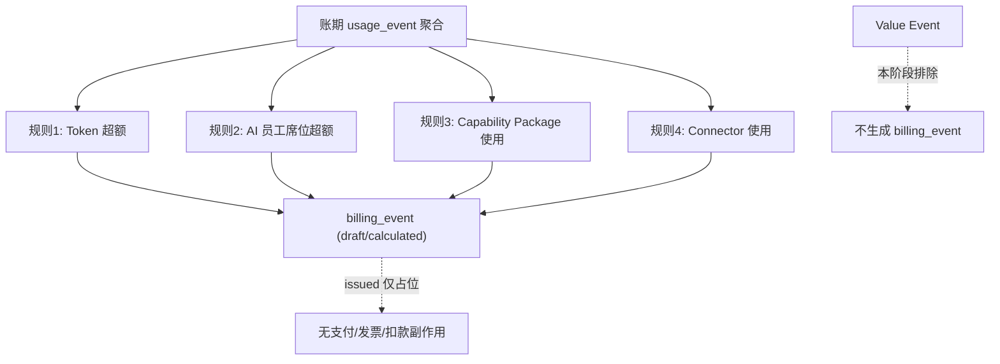

# Billing Rule Contract（计费规则契约）

Status: **Phase-8.5 Commercial Readiness** · 纯契约（无代码）
Owner: Admin Platform（计费解释层）。本文档定义"哪些行为产生 Billing Event"及其规则语义，不重定义 Phase-8 实现。
作者：架构师 高见远（software-architect）

---

## 0. 文档定位与引用

本契约定义 **哪些行为产生 Billing Event**，与 Phase-8 `calculate_billing_events` 对齐并扩展规则语义。

> - 计费事件字段/状态机来自 `docs/contracts/billing-domain-contract.md` §Billing Event Contract（`subject_type`/`subject_id`/`amount`/`currency`/`status`）。
> - Phase-8 聚合实现来自 `docs/design/phase8-billing-mvp-design.md` §4.3 / §10.4（`calculate_billing_events`：超额 = max(0, 用量 − limit)；amount = 超额 × `plan.quota_rules.overage` 单价；`subject_type ∈ {plan, quota_overage, model, capability, workflow}`）。
> - 配额维度来自 `docs/contracts/quota-rule-contract.md`（五类配额）。
> - **明确排除 Value Event 收费**：引用 `docs/contracts/usage-value-event-boundary.md` 与 `commercial-data-flow.md`（Value Event 不进 Billing；value-based pricing 属 L6/future Phase）。
> - 本契约不重复上述文档已定义的字段语义，仅补充 **"触发条件 → subject 取值 → amount 来源 → 状态机" 的规则化表达**。

---

## 1. 产生 Billing Event 的四类规则



---

## 2. 四类规则逐一定义

> 公共约定：
> - **amount 计算来源**：`amount = 超额用量 × plans.quota_rules.overage 单价`（非权威估算；= `usage_event` 聚合 × `quota_rules.overage`，与 Phase-8 `calculate_billing_events` 完全一致）。
> - **状态机**：`draft → calculated → issued`；`issued` **仅状态占位，零资金副作用**（无支付/发票/扣款）。
> - `limit_value=0` 表示"不限"，不产生该维度 overage。

### 规则 1：Token 超额
- **触发条件**：账期 `usage_event` 聚合 `total_tokens` > `plans.quota_rules.token_monthly_limit`（且 limit ≠ 0）。
- **subject_type / subject_id**：
  - Phase-8 实现：`subject_type='quota_overage'`（token 维度）或 `'model'`（按模型拆分）；`subject_id = plan_id` 或 `model_name`。
  - 概念对齐 `billing-domain-contract.md` BillingSubject：`subject_type='usage'`。
- **amount**：`overage_tokens = max(0, total_tokens − token_monthly_limit)`；`amount = overage_tokens / 1000 × quota_rules.overage.token_unit_price_per_1k`。
- **status**：`draft → calculated → issued(占位)`。

### 规则 2：AI 员工席位超额
- **触发条件**：活跃 `employee_instances(enabled=1)` 数 > `plans.quota_rules.seat_limit`（且 limit ≠ 0）。
- **subject_type / subject_id**：
  - Phase-8 实现：`subject_type='quota_overage'`（seat 维度）；`subject_id = plan_id` 或 seat quota_id。
  - 概念对齐 BillingSubject：`subject_type='employee_seat'`。
- **amount**：`overage_seats = max(0, used_seats − seat_limit)`；`amount = overage_seats × quota_rules.overage.seat_unit_price`。
- **status**：`draft → calculated → issued(占位)`。

### 规则 3：Capability Package 使用（official）
- **触发条件**：挂载/调用 `official` capability 包（命中 Plan 绑定的 `official` 包，`capability_source='official'`），按包的计费规则。
- **subject_type / subject_id**：
  - Phase-8 实现：`subject_type='capability'`；`subject_id = capability_package_id`（或 `capability_source`）。
  - 概念对齐 BillingSubject：`subject_type='capability_package'`。
- **amount**：按 official 包计费规则 × 挂载/调用次数；**当前 Phase-8 `overage.capability_unit_price=0` → `amount=0`（仅记录，不计费）**，真实单价待 G1 决策席填充。
- **status**：`draft → calculated → issued(占位)`。

### 规则 4：Connector 使用
- **触发条件**：调用 connector（`capability_type='connector'`），按 connector 计费规则。
- **subject_type / subject_id**：
  - Phase-8 实现：`subject_type='capability'`（connector 属 `capability_type=connector`）；`subject_id = connector_id`。
  - 概念对齐 BillingSubject：`subject_type='connector'`（未来专用值）。
- **amount**：按 connector 计费规则；**当前 Phase-8 未建 `connector_limit` 列，connector 计费规则待定义**（须 additive 扩展配额，对齐 `quota-rule-contract.md` §2.5）。
- **status**：`draft → calculated → issued(占位)`。

---

## 3. 规则 → Phase-8 实现映射

```mermaid
sequenceDiagram
    participant UI as BillingEventPanel
    participant API as main.py /api/platform/billing-events/calculate
    participant BS as BillingStore
    participant P as plans (quota_rules)
    participant EV as evolution_events (usage.*)

    UI->>API: POST calculate(tenant_id, period)
    API->>BS: calculate_billing_events(...)
    BS->>P: 取 plan.quota_rules (limit + overage 单价)
    BS->>EV: 聚合 total_tokens / distinct employee_id / workflow_run 计数 / capability_source
    BS->>BS: 超额 = max(0, 用量 − limit); amount = 超额 × overage 单价
    BS->>BS: 写 billing_events (subject_type ∈ {plan,quota_overage,model,capability,workflow}, status=draft|calculated)
    Note over BS: issued 仅状态占位，零资金副作用
```

| 规则 | 触发维度 | Phase-8 `subject_type` | 概念 BillingSubject | amount 来源 | 实现状态 |
| --- | --- | --- | --- | --- | --- |
| 1 Token 超额 | `total_tokens` vs `token_monthly_limit` | `quota_overage` / `model` | `usage` | `overage_tokens/1000 × token_unit_price_per_1k` | ✅ Phase-8 已实现 |
| 2 席位超额 | `employee_instances` vs `seat_limit` | `quota_overage` | `employee_seat` | `overage_seats × seat_unit_price` | ✅ Phase-8 已实现（Phase-4 后权威） |
| 3 Capability 使用 | official 包挂载/调用 | `capability` | `capability_package` | `capability_unit_price × 次数`（当前=0） | ✅ 记录，单价待填 |
| 4 Connector 使用 | connector 调用 | `capability` | `connector` | connector 计费规则（待定义） | 🔜 待 `connector_limit` 扩展 |

---

## 4. 明确不包含：Value Event 自动收费

- **声明**：本契约**不设计** Value Event 自动收费。
- **依据**：引用 `docs/contracts/usage-value-event-boundary.md`（Usage Event 与 Value Event 必须分离；Value Event 不进 Billing；`estimated_value` 不写入 `usage_event`）+ `docs/contracts/commercial-data-flow.md`（Value Event → Future Value Pricing，当前不进入 Billing）。
- **定位**：value-based pricing 属 **L6 经济层愿景 / 未来 Phase**（G4 类 gate），本阶段 `billing_event` 仅基于 `usage_event × quota_rules.overage` 估算生成，**绝不引用 `value_event`、不计算 ROI**。
- **边界**：`billing_event` 不含 `value_type` / `estimated_value` / ROI 字段；`estimated_cost`（来自 usage_event）显式标记为非权威计费金额。

---

## 5. 横切：与既有契约的对齐引用

| 维度 | 对齐契约 | 说明 |
| --- | --- | --- |
| BillingEvent 字段/状态机 | `billing-domain-contract.md` §Billing Event | `subject_type`/`amount`/`status` 对齐；`issued` 仅占位。 |
| 聚合实现 | `phase8-billing-mvp-design.md` §4.3/§10.4 | `calculate_billing_events` 口径一致。 |
| 配额维度 | `quota-rule-contract.md` | 四类数值/准入配额驱动对应规则。 |
| Value 排除 | `usage-value-event-boundary.md` / `commercial-data-flow.md` | Value Event 不进 Billing。 |

---

## 6. 边界声明 + 结论与 gate 边界

### 6.1 边界声明（五条禁止均满足）
1. **零代码**：本契约不创建任何表、不修改任何 `.py` 源文件、不写计费/支付代码，仅定义规则语义。
2. **不开发支付**：无支付通道、无订阅扣款。
3. **不开发自动扣款**：`billing_event` 的 `issued` 仅状态占位，零资金副作用。
4. **不开发 Invoice**：不生成发票/单据；`billing_event` 仅作计量与金额估算记录，不触发出账。
5. **不开发 Marketplace**：marketplace 分润须 G3 双签后定义（见 `admin-capability-package-contract.md` §5）。
6. **不开发 Value Pricing**：value-based / ROI 计费属 L6 愿景，本阶段明确排除（见 §4）。

### 6.2 结论与 gate 边界
- **四类 Billing Event 规则已定义**：Token 超额 / AI 员工席位超额 / Capability Package 使用 / Connector 使用；每条均明确触发条件、`subject_type`/`subject_id` 取值、`amount` 来源（= 超额用量 × `plan.quota_rules.overage` 单价，非权威估算）、状态机（`draft→calculated→issued`，`issued` 仅占位）。
- **与 Phase-8 完全对齐**：规则口径与 `calculate_billing_events` 一致（超额 = max(0, 用量 − limit)；amount = 超额 × overage 单价）。
- **Value Event 明确排除**：value-based / ROI 计费属 L6/future Phase，本阶段不设计。
- **Gate 边界**：Billing Event 的 `draft`/`calculated` 生成（计量+估算）可在 G1 前持续运行；`issued` 状态机占位已就位但零资金副作用；真实出账/支付须 **G1 gate 解锁**；marketplace 分润须 **G3 双签**。

*—— Phase-8.5 Commercial Readiness · Billing Rule Contract（纯设计/契约，无代码）。*
