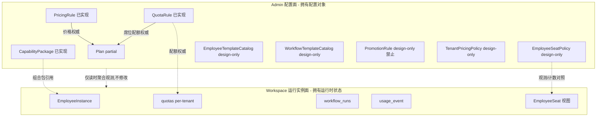

# Commercial Configuration Domain Contract v1（商业配置域总览契约 v1）

> **作者**：高见远（架构师，software-architect）
> **阶段**：Phase-9A Commercial Configuration Domain 总览（纯文档·零代码）
> **契约定位**：形成 **Admin Commercial Configuration Domain** 的总览。在 `docs/contracts/commercial-configuration-contract.md`（Phase-8.6 八对象审计）基础上**更新实现现状**，并**新增 `EmployeeSeatPolicy`** 为第 9 个对象。
> **引用不重定义**：对既有契约（`pricing-rule-contract.md` / `quota-rule-contract.md` / `capability-package-commercial-contract.md` / `employee-seat-commercial-contract.md` / `employee-seat-contract.md` / `admin-plan-management-contract.md` / `admin-quota-contract.md` / `phase9a-commercial-design-freeze.md`）**只引用、不重写其字段**。
> **红线**：不开发 payment / 自动扣款 / Invoice / Marketplace 交易 / Promotion 执行 / ROI；不修改 Workspace 执行链；不修改 Credential Vault；不把商业规则写死代码。

---

## 0. 文档定位与引用

- 本文是 Commercial Configuration Domain 的**权威总览 v1**。Phase-8.6 `commercial-configuration-contract.md` 的 8 对象现状已随 Phase-9A 落地而演进，本文以"现状更新 + 新增第 9 对象"方式呈现。
- 各对象的**字段级权威定义**见对应专属契约（下表"权威契约"列），本文**不重定义**。

---

## 1. Commercial Configuration Domain 边界

| 面 | 归属 | 含义 | 可变性 |
|----|------|------|--------|
| **配置面（Admin 拥有）** | Admin Platform | 商业规则、价格、配额、能力包、席位政策等**配置对象**。经 `/api/platform/*` 由 platform admin 读写。 | ✅ 可经 Admin API 配置（无需改码） |
| **运行实例面（Workspace 拥有）** | Workspace（租户） | `EmployeeInstance`、per-tenant `quotas`、`workflow_runs`、`usage_event`、`EmployeeSeat`（视图）等**运行时状态**。 | ❌ 配置面不反向修改；仅读时聚合观测 |

> 铁律：配置面定义"规则"，运行实例面持有"状态"。配置面的任何变更**不得修改**运行实例面的写入路径；运行实例面仅被 Admin 以**只读聚合**方式观测（见 `phase9a-commercial-design-freeze.md` §2 读时聚合原则）。

---

## 2. 商业配置对象总览表（9 对象）

| # | 对象 | 核心字段 | 当前状态 | 管理 API / 表 | 是否 Phase-9A 新增 |
| --- | --- | --- | --- | --- | --- |
| 1 | **Plan** | `plan_id, name, tier, status, features, quota_rules`（**无 `price` 列**） | `partial` | `plans` 表 + `/api/platform/plans` | 否（仍 `partial`） |
| 2 | **PricingRule** | `rule_id, subject_type, pricing_type, amount, currency, billing_cycle, status` | **已实现** | `pricing_rules` 表 + `/api/platform/pricing-rules`（GET/POST/PUT） | ✅ 已实现（Phase-9A P0） |
| 3 | **QuotaRule** | `quota_rule_id, plan_id, quota_type, limit_value, period, enforcement_mode, status` | **已实现** | `quota_rules` 表 + `/api/platform/quota-rules` + `/api/platform/plans/{id}/quotas` | ✅ 已实现（Phase-9A P1） |
| 4 | **CapabilityPackage** | `package_id, capability_ids, connector_ids, workflow_template_ids, employee_template_ids, pricing_reference, quota_reference, availability, status` | **已实现** | `capability_packages` 表 + `/api/platform/capability-packages`（GET/POST/GET{id}/PUT） | ✅ 已实现（Phase-9A P2） |
| 5 | **EmployeeSeatPolicy** | `seat_policy_id, employee_type, seat_type, pricing_reference, quota_cost, status` | **design-only**（本次新增） | 无（本契约新增设计，未落地表/API） | ✅ 本次新增设计（未实现） |
| 6 | **EmployeeTemplateCatalog** | `template_id, role, default_capabilities, seat_type, pricing_reference, status` | `design-only` | 种子数据；无 Admin 写 API | 否 |
| 7 | **WorkflowTemplateCatalog** | `workflow_template_id, type, steps, employee_roles, pricing_reference, status` | `design-only` | 种子数据；无 Admin 写 API | 否 |
| 8 | **PromotionRule** | `promotion_id, type, discount_rule, start_time, end_time, target_scope, status` | `design-only`（**禁止实现**） | 无 | 否（本阶段红线禁止） |
| 9 | **TenantPricingPolicy** | `tenant_id, plan_override, quota_override, discount_override, effective_time, status` | `design-only` | 额度近似 `quotas`；策略对象无 | 否 |

> 状态图例：`已实现` = 结构化实体 + Admin API + 测试已落地；`partial` = 部分落地/以 JSON blob 承载、关键字段缺失；`design-only` = 仅设计，无 Admin API/表。

---

## 3. 各对象实现状态摘要（对比 Phase-8.6）

| 对象 | Phase-8.6 状态 | 现状（Phase-9A 末） | 变化 |
|------|---------------|---------------------|------|
| Plan | `partial` | `partial`（仍无 `price` 列，订阅价经 PricingRule 配置化） | 不变 |
| PricingRule | `partial`（仅嵌 plan JSON overage） | **已实现**（独立 `pricing_rules` 表 + API） | ⬆ 升级 |
| QuotaRule | `partial`（plan JSON blob，无 enforcement_mode） | **已实现**（独立 `quota_rules` 表 + API + 五类 + enforcement_mode） | ⬆ 升级 |
| CapabilityPackage | `partial`（组合包 design-only） | **已实现**（独立 `capability_packages` 表 + API） | ⬆ 升级 |
| EmployeeSeatPolicy | （未列） | **design-only**（本次新增契约） | ➕ 新增 |
| EmployeeTemplateCatalog | `design-only` | `design-only` | 不变 |
| WorkflowTemplateCatalog | `design-only` | `design-only` | 不变 |
| PromotionRule | `design-only`（禁止） | `design-only`（禁止） | 不变 |
| TenantPricingPolicy | `design-only` | `design-only` | 不变 |

---

## 4. 权威契约引用（不重定义）

| 对象 | 权威契约文档 | 本文引用方式 |
|------|--------------|--------------|
| Plan | `admin-plan-management-contract.md` | 仅引用状态，不重定义字段 |
| PricingRule | `pricing-rule-contract.md` | 引用其"价格权威 + 状态机 + 401 守卫" |
| QuotaRule | `quota-rule-contract.md` | 引用其"五类 + enforcement_mode + 部分唯一索引" |
| CapabilityPackage | `capability-package-commercial-contract.md` | 引用其"pricing_reference/quota_reference 指向 plan"模式 |
| EmployeeSeatPolicy | `employee-seat-commercial-contract.md`（本文同批新增） | 引用其字段/边界/红线 |
| EmployeeSeat（实例） | `employee-seat-contract.md` | 引用其"实例视图 vs 配置政策"区分 |
| EmployeeTemplateCatalog / WorkflowTemplateCatalog | `employee-template-contract.md` / `workflow-template-contract.md` | 仅引用 design-only 状态 |
| PromotionRule / TenantPricingPolicy | （设计态，无专属契约） | 仅标注 design-only / 禁止 |

> 设计冻结基线引用：`phase9a-commercial-design-freeze.md`（三档套餐、配额模拟、六禁、路线图 9a→9b→9c→9d→9e）。

---

## 5. Domain 边界图（Admin 配置面 vs Workspace 运行实例面）

---

## 6. 未来运营场景验证（无需改码即可达成）

> 核心证明：以下场景依赖的"配置面"已具备或将在对应 gate 落地后具备，运营经 Admin API/后台即可操作，**无需改码、无需重新发布**。

| 场景 | 依赖对象 / API | 当前是否具备 | gap 与处置 |
| --- | --- | --- | --- |
| **场景1：运营配置订阅价** | PricingRule（`/api/platform/pricing-rules`） | ✅ 已实现 | 无 gap；激活新规则即覆盖旧价 |
| **场景2：运营配置配额（含五类/connector_limit 设计）** | QuotaRule（`/api/platform/quota-rules`） | ✅ 已实现 | 无 gap；enforcement_mode 仅语义存储 |
| **场景3：运营配置能力包（Connector+Workflow+Employee Template）** | CapabilityPackage（`/api/platform/capability-packages`） | ✅ 已实现 | 无 gap；价格/配额经 reference 派生 |
| **场景4：运营配置席位政策（含/增购/试用/预留）** | EmployeeSeatPolicy（本契约设计） | ⚠️ design-only | gap：表/API 未落地；Phase-9b 落地后无需改码 |
| **场景5：运营创建新套餐** | Plan（`POST /api/platform/plans`） | ✅ `partial`（可配） | `price` 列缺失，经 PricingRule 配置订阅价；无阻塞 |
| **场景6：企业客户特殊价格** | TenantPricingPolicy + PricingRule | ⚠️ design-only | gap：订阅价/折扣无落点；Phase-9 引入策略对象后无需改码 |
| **场景7：促销活动 30 天优惠** | PromotionRule（设计态） | ⚠️ design-only（禁止） | gap：本阶段红线禁止；Phase-9C 设计态落地后运营配置即生效 |

> **结论**：场景 1/2/3 现已具备（零代码即可运营配置）；场景 4/5/6/7 的依赖对象需在对应 gate 落地后具备，落地后均"无需改码"。本契约即配置面总览基础。

---

## 7. 禁止清单（Domain 红线）

Commercial Configuration Domain **不开发 / 不实现**：
- Payment / Invoice / Billing 结算 / 自动扣款。
- Marketplace 上架 / 分润（须 G3 双签）。
- Promotion 执行（须独立 gate）。
- Value Pricing / ROI 度量。
- 用户购买流程 / 前台价格页 / 订阅开通链路。
- 修改 Workspace 执行链 / Credential Vault / Shared Contract / Employee Runtime / Usage Event 写入。

---

## 8. 验收映射

| 验收项 | 落点 |
|--------|------|
| 1. Commercial Configuration Domain 总览 v1 | 本文 |
| 2. 9 对象现状总览表 | §2 |
| 3. 对比 Phase-8.6 状态演进 | §3 |
| 4. Domain 边界（Admin 配置面 vs Workspace 运行实例面） | §1 / §5 |
| 5. 引用既有契约不重定义 | §4 |
| 6. 未来运营场景验证 | §6 |

*—— Phase-9A Commercial Configuration Domain Contract v1（纯设计/契约，零代码）。在 Phase-8.6 八对象基础上更新现状并新增 EmployeeSeatPolicy 为第 9 对象。*
