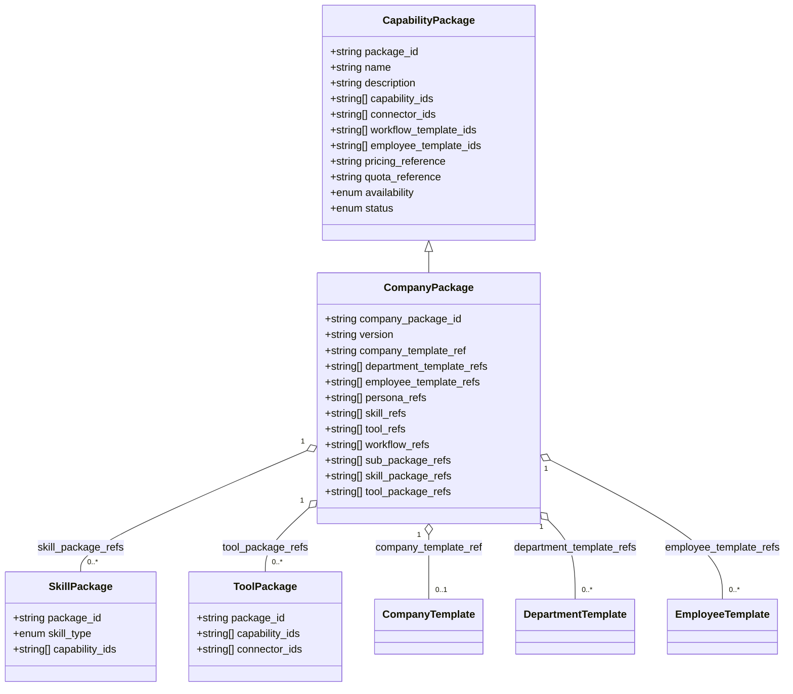

# Company Package Contract（公司包契约 · CapabilityPackage 升级）

> **作者**：高见远（架构师，software-architect）
> **主理人**：齐活林（交付总监）
> **阶段**：AI Company Asset Factory Foundation —— 纯文档（design-only reservation），零代码、零后端改动
> **基线**：继承并升级 `docs/contracts/capability-package-commercial-contract.md`（CapabilityPackage 权威 schema，已实现）；与 `docs/contracts/commercial-configuration-v1.md`（商业配置域总览）一致
> **范围说明**：Company Package 是 **CapabilityPackage 的更高层聚合升级**——复用其商业配置信封（价格/配额引用、可用范围、状态），并新增「官方资产模板组合」（Company/Department/Employee 模板 + SkillPackage/ToolPackage）。本契约为 design-only 定义，不落表、不加 API、不产生任何计费动作。

---

## 0. 文档定位与引用

- **本契约是 CapabilityPackage 的升级**，而非替代。CapabilityPackage 已实现的商业配置能力（组合包 + 价格/配额引用 + 可用状态）全部保留。
- Company Package 在其之上**向前扩展**为「公司级资产套装」：把官方 Company/Department/Employee 模板与 Skill/Tool 能力包聚合为一次性可上架/可指派的单元。
- **能力真相源不变**：SkillPackage / ToolPackage 仍指向统一能力目录 `official_models`（`capability_type ∈ {model, tool, connector}`），不重复定义能力。

> **命名澄清（待确认）**：任务描述称「既有 CapabilityPackage 见 `commercial-configuration-v1.md` 第 9 对象」。经核验，该文档 §2 九对象表中 **CapabilityPackage 为第 4 对象**，第 9 对象为 `TenantPricingPolicy`（design-only）。本契约以 `capability-package-commercial-contract.md` 的 **CapabilityPackage 权威 schema** 为升级基线；如「第 9 对象」指商业配置域最终演进的 9 对象集合（含 Company Package 占位），则本契约为其预留位置。建议主理人确认此编号口径。

---

## 1. 与 CapabilityPackage 的继承/扩展关系

Company Package **继承（`<--`）** CapabilityPackage 的全部字段，并**组合（o--）** 模板引用与 Skill/Tool 子包。



**继承语义**：
- `company_package_id` 是 Company Package 主键（`cp_` 前缀，沿用 CapabilityPackage `package_id` 命名空间，或独立 `ccp_` 前缀——见 §5 组装规则 R6）。
- `name` / `description` / `pricing_reference` / `quota_reference` / `availability` / `status` **直接复用** CapabilityPackage 定义（不重定义）。
- `capability_ids` / `connector_ids` / `workflow_template_ids` / `employee_template_ids` 在 Company Package 中**通过 SkillPackage / ToolPackage / 模板引用间接承载**，避免重复存储能力 ID（见 §3 / §4）。

---

## 2. Company Package JSON Schema

```json
{
  "$schema": "http://json-schema.org/draft-07/schema#",
  "title": "CompanyPackage",
  "type": "object",
  "additionalProperties": false,
  "required": ["company_package_id", "name", "version", "status", "availability"],
  "properties": {
    "company_package_id":      { "type": "string", "pattern": "^ccp_[a-z0-9_-]+$" },
    "name":                    { "type": "string" },
    "description":             { "type": "string", "default": "" },
    "version":                 { "type": "string", "pattern": "^\\d+\\.\\d+\\.\\d+$", "default": "1.0.0" },
    "status":                  { "type": "string", "enum": ["draft","active","disabled"], "default": "draft" },
    "availability":            { "type": "string", "enum": ["public","tenant_invite_only","enterprise_only"], "default": "public" },
    "pricing_reference":       { "type": ["string","null"], "description": "复用 CapabilityPackage：指向 plan_id（价格来自 pricing_rules）" },
    "quota_reference":         { "type": ["string","null"], "description": "复用 CapabilityPackage：指向 plan_id（配额来自 quota_rules）" },
    "company_template_ref":    { "type": ["string","null"], "pattern": "^ct_[a-z0-9_-]+$", "description": "引用 CompanyTemplate id" },
    "department_template_refs":{ "type": "array", "items": { "type": "string", "pattern": "^dt_[a-z0-9_-]+$" }, "default": [] },
    "employee_template_refs":  { "type": "array", "items": { "type": "string", "pattern": "^et_[a-z0-9_-]+$" }, "default": [] },
    "persona_refs":            { "type": "array", "items": { "type": "string", "pattern": "^pt_[a-z0-9_-]+$" }, "default": [], "description": "引用 PersonaTemplate id（Gate E persona_ref 注入来源；Phase-1 实现使用直接 pt_ 引用）" },
    "skill_refs":              { "type": "array", "items": { "type": "string", "pattern": "^skl_[a-z0-9_-]+$" }, "default": [], "description": "引用 SkillTemplate id（Phase-1 实现直接聚合 skl_*，不经 SkillPackage 子包）" },
    "tool_refs":               { "type": "array", "items": { "type": "string", "pattern": "^tl_[a-z0-9_-]+$" }, "default": [], "description": "引用 ToolTemplate id（Phase-1 实现直接聚合 tl_*，不经 ToolPackage 子包）" },
    "workflow_refs":           { "type": "array", "items": { "type": "string", "pattern": "^wl_[a-z0-9_-]+$" }, "default": [], "description": "引用 WorkflowContent id（wl_* 折叠进 catalog 的研发 SOP）" },
    "sub_package_refs":        { "type": "array", "items": { "type": "string", "pattern": "^ccp_[a-z0-9_-]+$" }, "default": [], "description": "嵌套子 CompanyPackage 引用（变体 C 聚合）" },
    "skill_package_refs":      { "type": "array", "items": { "type": "string", "pattern": "^sp_[a-z0-9_-]+$" }, "default": [], "description": "设计期 SkillPackage 子包引用（保留，Phase-1 落表未使用，预留给后续 gate）" },
    "tool_package_refs":       { "type": "array", "items": { "type": "string", "pattern": "^tp_[a-z0-9_-]+$" }, "default": [] },
    "created_at":              { "type": "string", "format": "date-time" },
    "updated_at":              { "type": "string", "format": "date-time" }
  },
  "examples": [{
    "company_package_id": "ccp_ai_software_company",
    "name": "AI Software Company 套装",
    "description": "标准 AI 软件公司官方资产套装：研发部 + 6 类研发员工 + 研发 SOP + 后端编码技能包 + 代码执行工具包。",
    "version": "1.0.0",
    "status": "draft",
    "availability": "public",
    "pricing_reference": "plan_pro",
    "quota_reference": "plan_pro",
    "company_template_ref": "ct_ai_software_company",
    "department_template_refs": ["dt_engineering"],
    "employee_template_refs": ["et_backend_engineer","et_frontend_engineer","et_architect","et_tech_lead","et_product_manager","et_qa_engineer"],
    "persona_refs": ["pt_direct_executor","pt_analytical_advisor","pt_supportive_coach","pt_balanced_facilitator"],
    "skill_refs": ["skl_ai_rd_python_development","skl_ai_rd_system_design","skl_ai_rd_requirement_analysis","skl_ai_rd_test_design","skl_ai_rd_api_design","skl_ai_rd_code_review"],
    "tool_refs": ["tl_ai_rd_code_executor","tl_ai_rd_test_runner","tl_ai_rd_code_linter","tl_ai_rd_git_client","tl_ai_rd_python_repl","tl_ai_rd_file_reader"],
    "workflow_refs": ["wl_ai_rd_software_dev_sop","wl_ai_rd_requirement_to_prd","wl_ai_rd_system_design_sop","wl_ai_rd_api_dev_sop","wl_ai_rd_code_review_sop","wl_ai_rd_ci_cd_sop"],
    "sub_package_refs": ["ccp_content_ops_starter"],
    "skill_package_refs": ["sp_backend_coding"],
    "tool_package_refs": ["tp_code_executor"]
  }]
}
```

> 字段对齐：商业信封（`pricing_reference`/`quota_reference`/`availability`/`status`）**原样复用** `capability-package-commercial-contract.md` §2，仅新增 `company_package_id` / `version` / 6 类模板/子包引用字段。

---

## 3. SkillPackage 子组件（能力包内的「技能包」）

`SkillPackage` 是 CapabilityPackage 中 `capability_ids` 的**按技能类型命名的子集分组**，指向官方能力目录（`capability_type ∈ {model, connector}` 及技能型 tool）。

```json
{
  "$schema": "http://json-schema.org/draft-07/schema#",
  "title": "SkillPackage",
  "type": "object",
  "additionalProperties": false,
  "required": ["package_id", "name", "skill_type", "capability_ids"],
  "properties": {
    "package_id":       { "type": "string", "pattern": "^sp_[a-z0-9_-]+$" },
    "name":             { "type": "string" },
    "skill_type":       { "type": "string", "enum": ["planning","analysis","architecture","frontend","backend","qa","tool_operation"] },
    "capability_ids":   { "type": "array", "items": { "type": "string" }, "default": [], "description": "引用 official_models.capability_id（capability_type ∈ model/connector 或技能型 tool）" },
    "source":           { "type": "string", "enum": ["official","tenant_private","marketplace"], "default": "official" },
    "status":           { "type": "string", "enum": ["draft","active","disabled"], "default": "draft" },
    "description":      { "type": "string", "default": "" }
  },
  "examples": [{
    "package_id": "sp_backend_coding",
    "name": "Backend Coding 技能包",
    "skill_type": "backend",
    "capability_ids": ["task_execution","workflow_sop"],
    "source": "official",
    "status": "draft"
  }]
}
```

---

## 4. ToolPackage 子组件（能力包内的「工具包」）

`ToolPackage` 是 CapabilityPackage 中 `capability_ids`（type=tool）与 `connector_ids` 的**命名子集分组**，指向官方能力目录。

```json
{
  "$schema": "http://json-schema.org/draft-07/schema#",
  "title": "ToolPackage",
  "type": "object",
  "additionalProperties": false,
  "required": ["package_id", "name", "capability_ids"],
  "properties": {
    "package_id":     { "type": "string", "pattern": "^tp_[a-z0-9_-]+$" },
    "name":           { "type": "string" },
    "capability_ids": { "type": "array", "items": { "type": "string" }, "default": [], "description": "引用 official_models.capability_id（capability_type='tool'）" },
    "connector_ids":  { "type": "array", "items": { "type": "string" }, "default": [], "description": "引用连接器 key（xiaohongshu/douyin/shopify 等）" },
    "source":         { "type": "string", "enum": ["official","tenant_private","marketplace"], "default": "official" },
    "status":         { "type": "string", "enum": ["draft","active","disabled"], "default": "draft" },
    "description":    { "type": "string", "default": "" }
  },
  "examples": [{
    "package_id": "tp_code_executor",
    "name": "Code Executor 工具包",
    "capability_ids": ["code_executor"],
    "connector_ids": [],
    "source": "official",
    "status": "draft"
  }]
}
```

---

## 5. 组装规则（Assembly Rules）

| # | 规则 | 说明 |
|---|------|------|
| **R1** | **商业信封复用** | Company Package 的 `pricing_reference` / `quota_reference` / `availability` / `status` 与 CapabilityPackage **完全一致**，指向 `plan_id` 派生价格/配额；不新增计费逻辑。 |
| **R2** | **能力单一真相源** | `SkillPackage.capability_ids` / `ToolPackage.capability_ids` / `connector_ids` 必须指向 `official_models` 已存在的能力 key；不内联能力定义、不重复注册。 |
| **R3** | **引用完整性（配置时校验，运行时不强制 FK）** | Admin 配置时由应用层校验引用 ID 格式与存在性；允许「先发布包、后补模板」（与 CapabilityPackage 哲学一致）。 |
| **R4** | **版本独立演进** | `CompanyPackage.version`（SemVer）独立于各组件模板的 `TemplateBase.version`；组件升级不强制 Company Package 升级。 |
| **R5** | **来源权威** | `official` Company Package 仅平台 Admin 可写；`tenant_private` 须 gate；`marketplace` 须 G3 双签 + 安全 gate。 |
| **R6** | **主键命名（已固化）** | `company_package_id` **固化采用 `ccp_` 前缀**（`company_packages` 独立表，不并入 `capability_packages`，与 CapabilityPackage 的 `cp_` 命名空间区分）。落表已实现于 Phase-1 Gate C/D/E/F（见 `backend/app/database.py`）。 |
| **R7** | **Skill/Tool 不重复** | Company Package 内的技能/工具能力**不新建** `skill_templates` / `tool_templates` 物理实体；经 SkillPackage/ToolPackage 引用官方能力目录即可（见 `ai-company-template-system.md` §2.4/§2.5）。 |
| **R8** | **无实例化动作** | Company Package 仅为目录定义；不触发 EmployeeInstance / DepartmentInstance / 公司激活 / 计费事件。实例化须经后续 gate（见 `admin-ai-company-asset-foundation.md` §5）。 |

---

## 6. 与商业配置面关系

```
CompanyPackage
  ├── pricing_reference ──▶ plan_id ──▶ pricing_rules(plan_id)   [价格权威，复用 CapabilityPackage]
  ├── quota_reference   ──▶ plan_id ──▶ quota_rules(plan_id)     [配额权威，复用 CapabilityPackage]
  ├── company_template_ref ──▶ CompanyTemplate.id
  ├── department_template_refs ──▶ DepartmentTemplate.id[]
  ├── employee_template_refs  ──▶ EmployeeTemplate.id[]
  ├── skill_package_refs ──▶ SkillPackage.package_id[]
  └── tool_package_refs  ──▶ ToolPackage.package_id[]
```

> Company Package **不持有价格/配额数值**，仅持有「指向哪个 plan」的引用（与 CapabilityPackage 完全一致），保证单一事实来源、避免重复定义。

---

## 7. 红线与禁止区（本契约遵守）

- **不开发** Payment / Invoice / BillingEvent / 自动扣款 / Marketplace 交易 / Promotion 执行 / Value Pricing / ROI。
- **不写** 任何后端代码、不建表、不加 API 路由、不碰 Workspace 执行链 / Credential Vault / EmployeeRuntime / Usage Event 写入。
- **不实例化**：Company Package 仅为官方资产目录定义；不触发任何租户安装、员工创建、公司激活或计费动作。
- **能力不重复**：SkillPackage / ToolPackage 仅引用官方能力目录，不新建能力实体。

---

## 8. 待实现（实例化 / 作者端点，issue 087 C3）

| 缺口 | 依赖 gate |
|---|---|
| `company_packages` 表 + `/api/platform/company-packages` 作者端点 | 本契约 design-only；落表须先完成下方模板作者端点 + CapabilityPackage 已具备 |
| Company Template 作者端点 `/api/platform/company-templates` | `company_templates` 表设计（Phase-5+） |
| Department/Employee/Workflow Template 作者端点 | ADR-0017 员工 CRUD 禁止区部分解禁 gate（Employee 写） + issue 087 C3 |
| Skill/Tool 模板物理表 | **不需要**——经 `/api/platform/capabilities` 统一目录供给 |

---

## 9. 验收映射

| 验收项 | 落点 |
|--------|------|
| 1. Company Package 契约（CapabilityPackage 升级） | 本文 |
| 2. 继承/扩展关系（类图） | §1 |
| 3. Company Package JSON Schema | §2 |
| 4. SkillPackage / ToolPackage 子组件 Schema | §3 / §4 |
| 5. 组装规则 | §5 |
| 6. 商业配置面关系 | §6 |
| 7. 红线遵守 | §7 |
| 8. 待实现映射（issue 087 C3） | §8 |

*—— Company Package Contract（纯设计/契约，零代码）。继承并升级 CapabilityPackage，与 ADR-0017 一致。*
