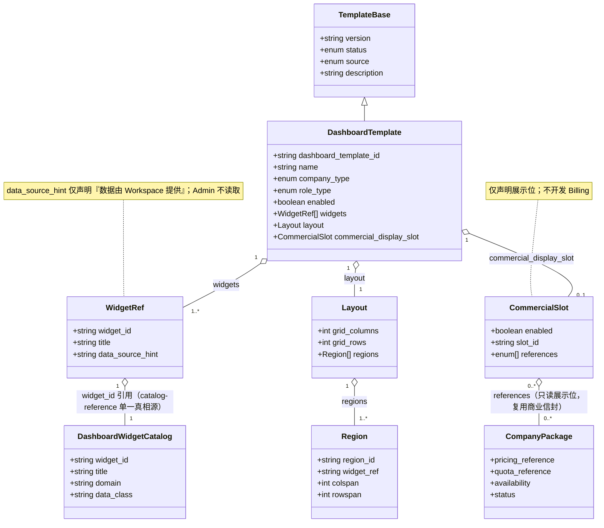
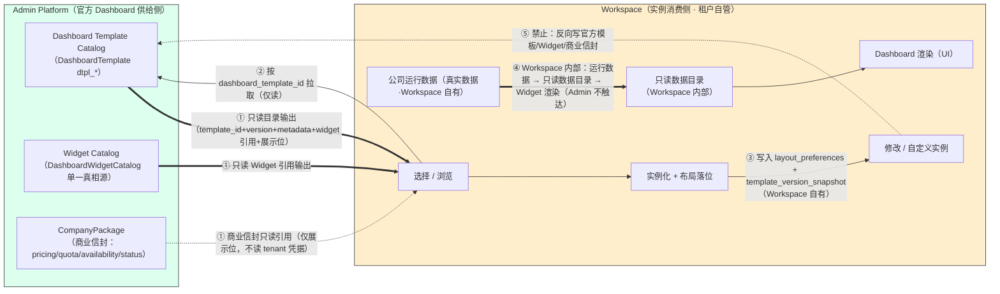
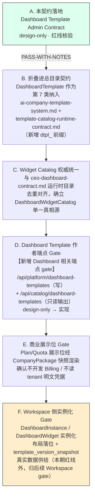

# Dashboard Template Admin Contract（CEO AI Company Dashboard 官方模板 · Admin 供给侧契约）

> **作者**：高见远（架构师，software-architect）
> **主理人**：齐活林（交付总监）
> **阶段**：Phase-1B.5 CEO Dashboard Admin Support Review —— 纯文档（design-only reservation），零代码、零后端改动、零实例化、零 UI
> **对齐**：ADR-0017（仅做 design-only reservation：契约 + 占位，无行为变化、无后端改动）；与 `ai-company-template-system.md`（TemplateBase 公共基类型 / 6 类模板 ID 前缀）、`template-catalog-runtime-contract.md`（TemplateCatalogEntry 只读输出协议）、`template-versioning-policy.md`（SemVer + 快照隔离）、`admin-workspace-template-boundary.md`（两条铁律 + 数据流单向性）、`company-package-contract.md`（CapabilityPackage 商业信封）、`ceo-dashboard-contract.md`（Workspace 运行时 Dashboard 契约）保持一致
> **范围说明**：本契约为 **Admin Platform 如何向 Workspace 提供「官方 Dashboard Template（CEO AI Company Dashboard 官方模板）」与商业展示支持** 的契约层定义。它只定义供给侧（官方模板 / 官方 Widget 目录引用 / Plan·Quota 展示位），**不实例化、不渲染、不读 Workspace 运行态、不开发 Billing / Marketplace / UI**。

---

## 0. 文档定位与引用

- 本契约是 Admin 视角的 **DashboardTemplate 供给契约**。它把「官方 CEO 驾驶舱模板」作为第 7 类官方模板目录对象纳入既有模板体系（现有 6 类：`ct_`/`dt_`/`et_`/`wt_`/`st_`/`tt_`），新增 `dtpl_` 前缀。
- **与 `ceo-dashboard-contract.md` 的关系**：该契约为 **Workspace 运行时视角**（定义 `DashboardInstance` / `DashboardWidget` / 运行时 Widget Catalog），本契约为 **Admin 供给侧视角**（定义官方 `DashboardTemplate` + 官方 Widget 目录引用 + 商业展示位）。两者互补、不冲突：Workspace 契约的 `DashboardTemplate.layout_schema` / `default_widget_types` 在 Admin 侧对应 `layout` / `widgets`（详见 §4 映射）。
- **与 TemplateBase 的关系**：`version` / `status` 直接复用 `ai-company-template-system.md` §1 公共字段；`source` 复用其枚举。DashboardTemplate 是 TemplateBase 的第 7 个子类。
- **与 TemplateCatalogEntry 的关系**：运行时 Admin 对外输出为 `DashboardTemplateEntry`（第 7 类 catalog entry），字段形状与 `template-catalog-runtime-contract.md` §1 完全一致（`template_id`/`version`/`name`/`description`/`source`/`status`/`metadata`）。
- **widget 引用模式**：沿用 Skill/Tool 的 **catalog-reference 包装**（官方统一能力目录单一真相源）：Admin 只声明 widget 引用，不内嵌实现、不重复定义能力。
- **商业展示位**：沿用 CompanyPackage 商业信封（`pricing_reference`/`quota_reference`/`availability`/`status`），Admin 只提供「展示位契约」，不开发 Billing。

---

## 1. Dashboard Template Contract（DashboardTemplate 数据契约）

### 1.1 与 TemplateBase 的继承关系

`DashboardTemplate` 继承 TemplateBase 的 4 个公共字段，并新增 Admin 供给侧专属字段（分类维度 `company_type`/`role_type`、Widget 引用数组 `widgets`、布局 `layout`、商业展示位 `commercial_display_slot`）。

| 字段 | 来源 | 必填 | 说明 |
|------|------|------|------|
| `version` | TemplateBase | 否（默认 `1.0.0`） | SemVer，遵循 TemplateBase 版本策略 |
| `status` | TemplateBase | **是** | `draft`/`active`/`disabled`/`archived` |
| `source` | TemplateBase | **是** | `official`/`tenant_private`/`marketplace`；官方模板恒为 `official` |
| `description` | TemplateBase | 否 | 展示/帮助文本；参与 catalog 输出 `description` |
| `dashboard_template_id` | 本契约（强制） | **是** | `dtpl_` 前缀主键 |
| `name` | 本契约（强制） | **是** | 展示名 |
| `company_type` | 本契约（强制） | **是** | 公司类型分类（可扩展枚举：ai_rd / ai_content / ai_commercial / ai_content_ops / generic） |
| `role_type` | 本契约（强制） | **是** | 角色分类（可扩展枚举；本期仅 ceo） |
| `role_visibility` | 本契约（Admin 内部） | 否 | 可见角色数组（如 `["ceo"]`），落表为 `role_visibility_json`；与 `role_type` 互补：`role_type` 分类、`role_visibility` 实例可见性 |
| `widgets` | 本契约（强制） | **是** | Widget 引用数组（catalog-reference） |
| `layout` | 本契约（强制） | **是** | Grid 区域定义（不涉及 UI 实现） |
| `data_source_refs` | 本契约（新增） | 否 | 数据来源引用数组（如 `["projects","employees"]`）；Admin 仅声明「数据由 Workspace 提供」，不读取该源（落表为 `data_source_refs_json`） |
| `commercial_display_slot` | 本契约（新增） | 否 | Plan/Quota 展示位契约（复用 CompanyPackage 商业信封） |
| `enabled` | 本契约（Admin 内部） | 否 | 生命周期布尔标志，与 `status` 并存（落表时待工程决议） |
| `created_at` / `updated_at` | 本契约（Admin 内部） | 否 | 生命周期时间戳 |

> **强制字段（任务要求）共 8 个**：`dashboard_template_id`、`name`、`company_type`、`role_type`、`widgets`、`layout`、`version`、`status`。其上 `source`/`description` 由 TemplateBase 继承补齐，`commercial_display_slot`/`enabled`/`created_at`/`updated_at` 为 Admin 供给侧补充。

### 1.2 DashboardTemplate JSON Schema（强制字段集 + 继承字段）

```json
{
  "$schema": "http://json-schema.org/draft-07/schema#",
  "title": "DashboardTemplate",
  "type": "object",
  "additionalProperties": false,
  "required": [
    "dashboard_template_id", "name", "company_type", "role_type",
    "widgets", "layout", "version", "status"
  ],
  "properties": {
    "dashboard_template_id": {
      "type": "string", "pattern": "^dtpl_[a-z0-9_-]+$",
      "description": "官方 Dashboard Template 主键；dtpl_ 前缀，纳入 6 类模板 ID 命名空间扩展"
    },
    "name": { "type": "string", "description": "展示名，如『AI 研发公司 CEO 驾驶舱』" },
    "company_type": {
      "type": "string", "enum": ["ai_rd", "ai_content", "ai_commercial", "ai_content_ops", "generic"],
      "description": "公司类型分类（可扩展枚举；Phase-1 新增 ai_content / ai_commercial）"
    },
    "role_type": {
      "type": "string", "enum": ["ceo"],
      "description": "角色分类（可扩展枚举；本期仅 ceo）"
    },
    "role_visibility": {
      "type": "array", "items": { "type": "string" }, "default": ["ceo"],
      "description": "可见角色数组（落表为 role_visibility_json）；实例级可见性控制，与 role_type 互补"
    },
    "widgets": {
      "type": "array",
      "description": "Widget 引用列表，指向官方 Widget 目录（DashboardWidgetCatalog）",
      "items": {
        "type": "object",
        "additionalProperties": false,
        "required": ["widget_id", "title", "data_source_hint"],
        "properties": {
          "widget_id": {
            "type": "string", "pattern": "^[a-z0-9_]+$",
            "description": "指向 DashboardWidgetCatalog 的 catalog-reference（单一真相源）"
          },
          "title": { "type": "string", "description": "CEO 可读展示标题（可覆盖目录默认 title）" },
          "data_source_hint": {
            "type": "string",
            "description": "数据来源提示，仅声明『数据由 Workspace 提供』；Admin 不读取该源"
          }
        }
      }
    },
    "data_source_refs": {
      "type": "array", "items": { "type": "string" }, "default": [],
      "description": "数据来源引用数组（如 [\"projects\",\"employees\",\"value_events\"]）；Admin 仅声明『数据由 Workspace 提供』，不读取该源（落表为 data_source_refs_json）"
    },
    "layout": {
      "type": "object",
      "additionalProperties": false,
      "description": "布局描述（grid 区域定义），不涉及具体 UI 实现",
      "properties": {
        "grid_columns": { "type": "integer", "minimum": 1, "description": "网格列数" },
        "grid_rows": { "type": "integer", "minimum": 1, "description": "网格行数" },
        "regions": {
          "type": "array",
          "items": {
            "type": "object",
            "additionalProperties": false,
            "required": ["region_id", "widget_ref"],
            "properties": {
              "region_id": { "type": "string" },
              "widget_ref": { "type": "string", "description": "引用 widgets[].widget_id" },
              "colspan": { "type": "integer", "minimum": 1, "default": 1 },
              "rowspan": { "type": "integer", "minimum": 1, "default": 1 }
            }
          }
        },
        "note": { "type": "string", "description": "仅 grid 区域定义，不含 UI 实现；Widget 实例由 Workspace 实例化时按此布局落位" }
      }
    },
    "version": {
      "type": "string", "pattern": "^\\d+\\.\\d+\\.\\d+$", "default": "1.0.0",
      "description": "复用 TemplateBase.version（SemVer）"
    },
    "status": {
      "type": "string", "enum": ["draft", "active", "disabled", "archived"], "default": "draft",
      "description": "复用 TemplateBase.status"
    },
    "source": {
      "type": "string", "enum": ["official", "tenant_private", "marketplace"], "default": "official",
      "description": "复用 TemplateBase.source；官方模板恒为 official"
    },
    "description": { "type": "string", "default": "", "description": "展示/帮助文本；参与 TemplateCatalogEntry.description" },
    "commercial_display_slot": {
      "type": "object",
      "additionalProperties": false,
      "description": "Plan/Quota 展示位契约（复用 CompanyPackage 商业信封）；Admin 仅声明展示位，不开发 Billing",
      "properties": {
        "enabled": { "type": "boolean", "default": true, "description": "是否在官方模板中预留商业展示位" },
        "slot_id": { "type": "string", "default": "plan_quota_panel", "description": "展示位稳定 ID" },
        "references": {
          "type": "array",
          "items": { "enum": ["pricing_reference", "quota_reference", "availability", "status"] },
          "default": ["pricing_reference", "quota_reference", "availability", "status"],
          "description": "指向 CompanyPackage 商业信封字段（只读引用）"
        },
        "display_hint": {
          "type": "string",
          "description": "由 Workspace 基于 CompanyPackage 当前快照渲染 Plan/Quota 面板；Admin 仅声明展示位"
        }
      }
    },
    "enabled": { "type": "boolean", "default": true, "description": "Admin 内部生命周期标志（与 status 并存，落表时待工程决议）" },
    "created_at": { "type": "string", "format": "date-time" },
    "updated_at": { "type": "string", "format": "date-time" }
  },
  "examples": [
    {
      "dashboard_template_id": "dtpl_ai_rd_ceo_dashboard",
      "name": "AI 研发公司 CEO 驾驶舱",
      "company_type": "ai_rd",
      "role_type": "ceo",
      "widgets": [
        { "widget_id": "project_progress", "title": "项目进度", "data_source_hint": "数据由 Workspace 提供（Project / WorkflowRun 运行态）；Admin 仅声明引用，不读取" },
        { "widget_id": "employee_status", "title": "员工状态", "data_source_hint": "数据由 Workspace 提供（EmployeeInstance 状态聚合）；Admin 仅声明引用，不读取" },
        { "widget_id": "token_cost", "title": "Token 成本", "data_source_hint": "数据由 Workspace 提供（UsageEvent token 聚合，ai_cost 域，非账单）；Admin 仅声明引用，不读取" },
        { "widget_id": "tech_risk", "title": "技术风险", "data_source_hint": "数据由 Workspace 提供（Project/WorkflowRun blocked/failed 派生事实）；Admin 仅声明引用，不读取" }
      ],
      "layout": {
        "grid_columns": 2, "grid_rows": 2,
        "regions": [
          { "region_id": "r1", "widget_ref": "project_progress", "colspan": 1, "rowspan": 1 },
          { "region_id": "r2", "widget_ref": "employee_status", "colspan": 1, "rowspan": 1 },
          { "region_id": "r3", "widget_ref": "token_cost", "colspan": 1, "rowspan": 1 },
          { "region_id": "r4", "widget_ref": "tech_risk", "colspan": 1, "rowspan": 1 }
        ],
        "note": "2×2 grid；仅区域定义，不含 UI 实现"
      },
      "version": "1.0.0",
      "status": "active",
      "source": "official",
      "description": "面向 AI 研发公司 CEO 的运营驾驶舱：项目进度、员工状态、Token 成本、技术风险。",
      "commercial_display_slot": {
        "enabled": true, "slot_id": "plan_quota_panel",
        "references": ["pricing_reference", "quota_reference", "availability", "status"],
        "display_hint": "由 Workspace 基于 CompanyPackage 当前快照渲染 Plan/Quota 面板"
      }
    },
    {
      "dashboard_template_id": "dtpl_ai_content_ops_ceo_dashboard",
      "name": "AI 内容运营公司 CEO 驾驶舱",
      "company_type": "ai_content_ops",
      "role_type": "ceo",
      "widgets": [
        { "widget_id": "content_output", "title": "内容产出", "data_source_hint": "数据由 Workspace 提供（内容产出计数，Project/WorkflowRun 产出）；Admin 仅声明引用，不读取" },
        { "widget_id": "publish_metrics", "title": "发布数据", "data_source_hint": "数据由 Workspace 提供（发布数据聚合）；Admin 仅声明引用，不读取" },
        { "widget_id": "viral_trend", "title": "爆款趋势", "data_source_hint": "数据由 Workspace 提供（爆款趋势派生事实）；Admin 仅声明引用，不读取" },
        { "widget_id": "operation_cost", "title": "运营成本", "data_source_hint": "数据由 Workspace 提供（ai_cost / UsageEvent 聚合，非账单）；Admin 仅声明引用，不读取" }
      ],
      "layout": {
        "grid_columns": 2, "grid_rows": 2,
        "regions": [
          { "region_id": "r1", "widget_ref": "content_output", "colspan": 1, "rowspan": 1 },
          { "region_id": "r2", "widget_ref": "publish_metrics", "colspan": 1, "rowspan": 1 },
          { "region_id": "r3", "widget_ref": "viral_trend", "colspan": 1, "rowspan": 1 },
          { "region_id": "r4", "widget_ref": "operation_cost", "colspan": 1, "rowspan": 1 }
        ],
        "note": "2×2 grid；仅区域定义，不含 UI 实现"
      },
      "version": "1.0.0",
      "status": "active",
      "source": "official",
      "description": "面向 AI 内容运营公司 CEO 的运营驾驶舱：内容产出、发布数据、爆款趋势、运营成本。",
      "commercial_display_slot": {
        "enabled": true, "slot_id": "plan_quota_panel",
        "references": ["pricing_reference", "quota_reference", "availability", "status"],
        "display_hint": "由 Workspace 基于 CompanyPackage 当前快照渲染 Plan/Quota 面板"
      }
    }
  ]
}
```

### 1.3 官方 Widget 目录（DashboardWidgetCatalog · catalog-reference 单一真相源）

沿用 Skill/Tool 的 catalog-reference 模式：Admin 不内嵌 Widget 实现，只声明引用。下表为官方 Widget 目录（单一真相源），整合 `ceo-dashboard-contract.md` 运行时 Widget Catalog 并补充本契约两个官方模板所需的 Widget。

| widget_id | title | 域 | 数据等级 | 说明 / 数据来源（声明，不读取） | 被官方模板引用 |
|---|---|---|---|---|---|
| `project_progress` | 项目进度 | 项目 | 可聚合 | Project / WorkflowRun 进度 | 示例 A |
| `employee_status` | 员工状态 | 员工 | 可聚合 | EmployeeInstance 状态聚合 | 示例 A |
| `token_cost` | Token 成本 | 成本 | 可聚合（非账单） | UsageEvent token 聚合（ai_cost 域） | 示例 A |
| `tech_risk` | 技术风险 | 项目/风险 | 派生事实（非预测） | Project/WorkflowRun blocked/failed 事实 | 示例 A |
| `content_output` | 内容产出 | 内容 | 可聚合 | 内容产出计数（Project/WorkflowRun 产出） | 示例 B |
| `publish_metrics` | 发布数据 | 内容 | 可聚合 | 发布数据聚合 | 示例 B |
| `viral_trend` | 爆款趋势 | 内容 | 派生事实 | 爆款趋势派生事实 | 示例 B |
| `operation_cost` | 运营成本 | 成本 | 可聚合（非账单） | ai_cost / UsageEvent 聚合 | 示例 B |
| `company_health` | 公司健康 | 公司 | 可聚合 | Company 状态 / 活跃项目 / 阻塞事实 | — |
| `department_overview` | 部门概览 | 公司 | 可聚合 | Department 状态与员工数量 | — |
| `project_risk` | 项目风险 | 项目 | 派生事实 | blocked/failed 事实（与 `tech_risk` 同域，独立调优） | — |
| `employee_load` | 员工负载 | 员工 | 可聚合 | 活跃 Step / Task 数量 | — |
| `employee_growth` | 员工增长 | 员工 | 需定义指标 | 新增实例 / 绑定变化 / 完成统计 | — |
| `token_usage` | Token 用量 | 成本 | 可聚合 | Token 消耗（与 `token_cost` 同域） | — |
| `model_usage` | 模型用量 | 成本 | 可聚合 | 模型调用次数与 Token 分布 | — |
| `ai_cost` | AI 成本 | 成本 | 可聚合（非账单） | estimated_cost 聚合（与 `token_cost`/`operation_cost` 同域） | — |
| `value_event` | 价值事件 | 价值 | 契约预留 | 已记录价值事件 | — |
| `estimated_impact` | 估算影响 | 价值 | 契约预留（非 ROI） | 价值事件估算值及来源 | — |
| `skill_usage` | 技能用量 | 能力 | 部分就绪 | Skill 绑定/执行关联 | — |
| `tool_usage` | 工具用量 | 能力 | 可聚合 | Tool 能力调用归因 | — |
| `knowledge_growth` | 知识增长 | 知识 | 部分就绪 | Project Memory / Knowledge 记录数量与更新时间 | — |

> **单一真相源说明**：`widgets[].widget_id` 必须命中本目录；不内联 Widget 实现、不重复定义能力（与 `ai-company-template-system.md` §2.4/§2.5 完全一致）。
> **去重待办（gate C）**：`token_cost`/`operation_cost` 与 `ai_cost`/`token_usage`、`tech_risk` 与 `project_risk` 同属成本/风险域。本契约为新官方模板引入独立 widget_id 以便 CEO 侧独立调优（标题/默认位置/数据等级）；与 `ceo-dashboard-contract.md` 运行时目录的最终去重统一留待 gate C。

### 1.4 DashboardTemplate 类图（Mermaid）



### 1.5 商业展示位契约（Plan/Quota Display Slot）

`commercial_display_slot` 是 Admin 在官方 Dashboard Template 中预留的 **Plan/Quota 展示位**。它**复用 CompanyPackage 商业信封**（`pricing_reference`/`quota_reference`/`availability`/`status`），Admin 只声明「此处展示当前 Plan/Quota 面板」，渲染由 Workspace 基于 CompanyPackage 当前快照完成。

- **Admin 写权**：仅定义展示位是否存在（`enabled`）、稳定 `slot_id`、`references`（指向 CompanyPackage 信封字段）。
- **Admin 不读/不写**：不读取 tenant_private 明文凭据、不计算账单、不执行收费、不持有价格/配额数值。
- **Workspace 渲染**：实例化时按 `commercial_display_slot.references` 从 CompanyPackage 快照取 `pricing_reference`/`quota_reference`/`availability`/`status` 渲染面板（展示位契约，非 Billing 逻辑）。
- **归属**：展示位定义权 = Admin；展示内容快照权 = Workspace。`ceo-dashboard-contract.md` §"Admin / Workspace 边界" 已确认 Dashboard 不调用 `/api/platform/*`、不计算账单、不读 tenant_private 明文凭据。

---

## 2. Admin / Workspace 边界说明

### 2.1 职责划分矩阵（Admin 供给侧 vs Workspace 消费侧）

| 维度 | **Admin Platform（官方 Dashboard 供给侧）** | **Workspace（租户 · 实例消费侧）** |
| --- | --- | --- |
| 定义官方 Dashboard Template | ✅ 创建 `DashboardTemplate`（`dtpl_*`） | ❌ 不创作官方模板 |
| 发布模板（active） | ✅ 将 `draft` 置 `active` 对外发布 | ❌ 不发布官方模板 |
| 定义官方 Widget 目录 | ✅ 维护 `DashboardWidgetCatalog`（单一真相源） | ❌ 不创作官方 Widget 定义 |
| 声明商业展示位 | ✅ 定义 `commercial_display_slot`（Plan/Quota 展示位契约） | ❌ 不定义官方展示位语义 |
| 读取 Workspace 运行态/数据 | ❌ **禁止读取/修改 Workspace 执行状态与数据** | ✅ 持有并供给自身运行数据 |
| 实例化 Dashboard | ❌ **不实例化**（不生成 DashboardInstance） | ✅ 按 `dashboard_template_id` 拉取 + 快照创建实例 |
| 修改实例/布局 | ❌ **禁止修改已存在用户实例** | ✅ 修改/自定义自身实例（layout_preferences） |
| 版本快照 | ❌ 不持有实例快照 | ✅ 持有 `template_version_snapshot` |
| 渲染 UI / 计算数据 | ❌ **禁止开发 UI** | ✅ 渲染 Dashboard、供给真实运行数据 |
| 开发 Billing / Marketplace | ❌ **禁止开发 Billing / Marketplace** | ❌ Dashboard 不计算账单/收费 |

### 2.2 两条铁律（禁止）

1. **Admin 禁止读取/修改 Workspace 执行状态与数据**：
   - 不得读 `DashboardInstance` / `DashboardWidget` 的运行态；
   - 不得读/改 Workspace 的 Company / Project / Department / Employee / UsageEvent / ValueEvent 真实数据；
   - 不持有、不回写任何实例快照；`template_version_snapshot` 由 Workspace 在实例化时写入。
2. **Workspace 禁止修改官方模板定义**：
   - 不得改 `DashboardTemplate`（`source=official`）；
   - 只能**只读**感知官方目录以自我约束，可自定义的是"实例"（`DashboardInstance.layout_preferences` / `DashboardWidget`）而非"模板"。

### 2.3 数据流单向性（Mermaid）



**数据流释义**：
1. **① 单向发布**：Admin → Workspace，官方 Dashboard Template / Widget 目录 / 商业信封**只读输出**（含 `commercial_display_slot` 展示位声明）。
2. **② 仅读拉取**：Workspace 按 `dashboard_template_id` 从 catalog **只读**拉取模板形状与 Widget 引用。
3. **③ 实例自管**：实例化产生的 `layout_preferences` 与 `template_version_snapshot` 全部落在 Workspace 侧（租户自有存储）。
4. **④ Workspace 内部闭环**：公司运行数据 → Workspace 内部只读数据目录 → Widget 渲染。**Admin 全程不触达此链路**（遵守 §2.2 铁律一）。
5. **⑤ 禁止反向**：Workspace **不得**把任何实例运行态/修改回写 Admin 官方目录或官方实例。

### 2.4 边界确认（写入文档的约束清单）

- **Admin 负责**：官方 Dashboard Template 定义、商业模块展示（Plan/Quota 展示位契约）、官方 Widget 目录引用。
- **Workspace 负责**：Dashboard 实例、用户布局调整、公司运行数据（真实数据由 Workspace 供给 Admin 只读目录——此处"只读目录"指 Workspace 内部只读数据目录，Dashboard 据此渲染；Admin 对该目录无读/写权）。
- **禁止**：
  - ❌ Admin 读取/修改 Workspace 执行状态
  - ❌ Admin 修改 Workspace 数据
  - ❌ 开发 UI
  - ❌ 开发 Billing
  - ❌ 开发 Marketplace

> 注：上"真实数据由 Workspace 供给 Admin 只读目录"沿用任务原文措辞；本契约明确其语义为 **Workspace 内部只读数据目录**（Dashboard 渲染数据源），Admin 对该目录无任何读/写权限，与 §2.2 铁律一及 `ceo-dashboard-contract.md` 边界完全一致。

---

## 3. 官方模板示例（至少 2 个）

### 3.1 示例 A：AI 研发公司 CEO Dashboard

| 字段 | 值 |
|------|----|
| `dashboard_template_id` | `dtpl_ai_rd_ceo_dashboard` |
| `name` | AI 研发公司 CEO 驾驶舱 |
| `company_type` | `ai_rd` |
| `role_type` | `ceo` |
| `version` | `1.0.0` |
| `status` | `active`（官方对外提供的默认 CEO 驾驶舱意图；实际 active 翻转须经 gate D 作者端点，本阶段仅契约声明） |
| `source` | `official` |
| `widgets` | 见下表 |
| `layout` | 2×2 grid：r1=project_progress, r2=employee_status, r3=token_cost, r4=tech_risk |
| `commercial_display_slot` | enabled=true, slot_id=plan_quota_panel, references=[pricing_reference, quota_reference, availability, status] |

**widgets 明细（widget_id + 数据来源提示）**：

| widget_id | title | data_source_hint（仅声明，不读取） |
|-----------|-------|--------------------------------------|
| `project_progress` | 项目进度 | 数据由 Workspace 提供（Project / WorkflowRun 运行态） |
| `employee_status` | 员工状态 | 数据由 Workspace 提供（EmployeeInstance 状态聚合） |
| `token_cost` | Token 成本 | 数据由 Workspace 提供（UsageEvent token 聚合，ai_cost 域，非账单） |
| `tech_risk` | 技术风险 | 数据由 Workspace 提供（Project/WorkflowRun blocked/failed 派生事实） |

### 3.2 示例 B：AI 内容运营公司 CEO Dashboard

| 字段 | 值 |
|------|----|
| `dashboard_template_id` | `dtpl_ai_content_ops_ceo_dashboard` |
| `name` | AI 内容运营公司 CEO 驾驶舱 |
| `company_type` | `ai_content_ops` |
| `role_type` | `ceo` |
| `version` | `1.0.0` |
| `status` | `active`（同上，官方默认模板意图） |
| `source` | `official` |
| `widgets` | 见下表 |
| `layout` | 2×2 grid：r1=content_output, r2=publish_metrics, r3=viral_trend, r4=operation_cost |
| `commercial_display_slot` | enabled=true, slot_id=plan_quota_panel, references=[pricing_reference, quota_reference, availability, status] |

**widgets 明细（widget_id + 数据来源提示）**：

| widget_id | title | data_source_hint（仅声明，不读取） |
|-----------|-------|--------------------------------------|
| `content_output` | 内容产出 | 数据由 Workspace 提供（内容产出计数，Project/WorkflowRun 产出） |
| `publish_metrics` | 发布数据 | 数据由 Workspace 提供（发布数据聚合） |
| `viral_trend` | 爆款趋势 | 数据由 Workspace 提供（爆款趋势派生事实） |
| `operation_cost` | 运营成本 | 数据由 Workspace 提供（ai_cost / UsageEvent 聚合，非账单） |

---

## 4. 与 TemplateCatalogEntry 的运行时映射

### 4.1 DashboardTemplateEntry（第 7 类 catalog entry）

Admin 对外只读目录输出对象，字段形状与 `template-catalog-runtime-contract.md` §1 完全一致。

```json
{
  "$schema": "http://json-schema.org/draft-07/schema#",
  "title": "DashboardTemplateEntry",
  "type": "object",
  "additionalProperties": false,
  "required": ["template_id", "version", "name", "source", "status", "metadata"],
  "properties": {
    "template_id": { "type": "string", "pattern": "^dtpl_[a-z0-9_-]+$" },
    "version":    { "type": "string", "pattern": "^\\d+\\.\\d+\\.\\d+$" },
    "name":       { "type": "string" },
    "description":{ "type": "string", "default": "" },
    "source":     { "type": "string", "enum": ["official", "marketplace"] },
    "status":     { "type": "string", "enum": ["draft", "active", "disabled", "archived"] },
    "metadata": {
      "type": "object",
      "additionalProperties": false,
      "properties": {
        "company_type": { "type": "string", "enum": ["ai_rd", "ai_content_ops", "generic"] },
        "role_type":    { "type": "string", "enum": ["ceo"] },
        "widget_ids":   { "type": "array", "items": { "type": "string" }, "default": [] },
        "layout_summary": { "type": "string", "description": "grid 概要，如 '2x2 grid'" },
        "commercial_slot_ref": { "type": "string", "description": "指向 commercial_display_slot.slot_id（Plan/Quota 展示位）" },
        "tenant_id":    { "type": ["string", "null"], "default": "platform" }
      }
    }
  },
  "examples": [{
    "template_id": "dtpl_ai_rd_ceo_dashboard",
    "version": "1.0.0",
    "name": "AI 研发公司 CEO 驾驶舱",
    "description": "面向 AI 研发公司 CEO 的运营驾驶舱：项目进度、员工状态、Token 成本、技术风险。",
    "source": "official",
    "status": "active",
    "metadata": {
      "company_type": "ai_rd",
      "role_type": "ceo",
      "widget_ids": ["project_progress", "employee_status", "token_cost", "tech_risk"],
      "layout_summary": "2x2 grid",
      "commercial_slot_ref": "plan_quota_panel"
    }
  }]
}
```

### 4.2 字段映射表（DashboardTemplate → DashboardTemplateEntry）

| 输出字段 | Catalog 契约原字段 | 现状 |
|---|---|---|
| `template_id` | `DashboardTemplate.dashboard_template_id`（`dtpl_*`） | ✅ 值不变，仅键名统一为 `template_id` |
| `version` | TemplateBase.version | ✅ 一致 |
| `name` | DashboardTemplate.name | ✅ 一致 |
| `description` | TemplateBase.description | ✅ 一致 |
| `source` | TemplateBase.source | ⚠ 枚举收窄为 `official`/`marketplace`（沿用 catalog 输出协议） |
| `status` | TemplateBase.status | ✅ 一致 |
| `metadata.company_type` | DashboardTemplate.company_type | ✅ 引用 |
| `metadata.role_type` | DashboardTemplate.role_type | ✅ 引用 |
| `metadata.widget_ids` | DashboardTemplate.widgets[].widget_id | ✅ 提取 ID 数组 |
| `metadata.layout_summary` | DashboardTemplate.layout（grid 概要） | ✅ 派生摘要 |
| `metadata.commercial_slot_ref` | DashboardTemplate.commercial_display_slot.slot_id | ✅ 引用 |

> **与 `ceo-dashboard-contract.md` 运行时字段衔接**：Admin 侧 `layout` → Workspace 实例化时落位为 `layout_schema`（模板）/ `layout_preferences`（实例）；Admin 侧 `widgets[].widget_id` → Workspace 实例化为 `DashboardWidget.widget_type`（须命中 Widget Catalog）。本契约为供给侧目录定义，不重定义 Workspace 运行时字段。

---

## 5. Phase-1B.5 支持评估

### 5.1 完成度

| 评估项 | 状态 | 落点 |
|---|---|---|
| DashboardTemplate 数据契约（8 强制字段 + 继承字段） | ✅ 已定义 | §1.1 / §1.2 |
| 官方 Widget 目录（catalog-reference 单一真相源） | ✅ 已定义 | §1.3 |
| 商业展示位契约（复用 CompanyPackage 信封） | ✅ 已定义 | §1.5 |
| 官方模板示例（≥2，含 widget 明细 + layout + 数据来源提示） | ✅ 已定义 | §3 |
| Admin/Workspace 边界（职责矩阵 + 两条铁律 + 数据流单向性） | ✅ 已定义 | §2 |
| TemplateCatalogEntry 运行时映射（dtpl_ 第 7 类） | ✅ 已定义 | §4 |
| 红线核验 | ✅ 通过（见 §5.2） | §5.2 |

**结论**：Phase-1B.5 Admin 侧对 CEO Dashboard 的契约支持 **已完成定义**（design-only）。真实实例化属于后续 Workspace 侧 gate（§5.3 路径 F），不在本期红线内。

### 5.2 红线核验

| 红线 / 禁止区 | 本契约遵守情况 |
|---|---|
| 不开发 UI | ✅ 仅定义 `layout` grid 区域，不含任何 UI 实现 |
| 不开发 Billing / Marketplace | ✅ `commercial_display_slot` 仅声明展示位，复用 CompanyPackage 信封，不开发计费/市场 |
| 不写后端代码 / 不建表 / 不加路由 | ✅ 纯契约文档，零代码、零行为变化（ADR-0017 design-only reservation） |
| 不实例化（不生成 DashboardInstance 等） | ✅ 仅定义官方模板；实例化归 Workspace（gate F） |
| Admin 不读/改 Workspace 执行状态与数据 | ✅ §2.2 铁律一；数据流 §2.3 ④ Admin 不触达运行数据 |
| Admin 不修改用户实例 | ✅ §2.2 铁律一；实例所有权归 Workspace |
| Widget 不重复定义能力（catalog-reference） | ✅ §1.3 单一真相源；Admin 只声明引用 |
| 数据流单向（Admin→Workspace 只读输出） | ✅ §2.3 Mermaid |

### 5.3 Gate 路径（Mermaid + A→F 与 Phase-1B 对齐）



**路径说明（与 Phase-1B Template Runtime Integration Gate 对齐）**：

| Gate | 名称 | 关键动作 | 归属 |
|---|---|---|---|
| **A** | 本契约落地 | Dashboard Template Admin Contract design-only；红线核验 | Admin（本期） |
| **B** | 折叠进总目录契约 | 将 DashboardTemplate 作为第 7 类纳入 `ai-company-template-system.md` 与 `template-catalog-runtime-contract.md`；正式登记 `dtpl_` 前缀 | Admin（目录治理） |
| **C** | Widget Catalog 权威统一 | 与 Workspace 侧 `ceo-dashboard-contract.md` Widget Catalog 去重对齐，确立 `DashboardWidgetCatalog` 单一真相源（含 `token_cost`/`tech_risk`/`content_output`/`publish_metrics`/`viral_trend`/`operation_cost` 归并决策） | Admin + Workspace 协同 |
| **D** | **Dashboard Template 作者端点 Gate（新增 Dashboard 相关端点 gate）** | `/api/platform/dashboard-templates`（Admin 写）+ `/api/catalog/dashboard-templates`（只读输出）；将 design-only 契约转为可落地端点 | Admin（实现） |
| **E** | 商业展示位 Gate | Plan/Quota 展示位经 CompanyPackage 快照渲染；确认仅展示位、不开发 Billing、不读 tenant 明文凭据 | Admin + 商业边界 |
| **F** | Workspace 侧实例化 Gate | `DashboardInstance`/`DashboardWidget` 实例化、布局落位、`template_version_snapshot`、真实数据供给——**本阶段红线外**，归后续 Workspace gate | Workspace |

### 5.4 Gate 结论

> **Phase-1B.5 Gate 结论：✅ PASS-WITH-NOTES**

**理由**：
- Admin 侧对 CEO Dashboard 的**契约支持已完整定义**（DashboardTemplate 数据契约、官方 Widget 目录、商业展示位、边界与铁律、catalog 映射），且**全部守红线**（零代码、零实例化、零 UI、零 Billing/Marketplace、数据流单向）。
- 真实实例化（DashboardInstance / DashboardWidget / 布局落位 / 真实数据供给）属于**后续 Workspace 侧 gate（路径 F）**，不在本期红线与范围内，故本期以 PASS-WITH-NOTES 收口，不阻塞。

**Notes（须在后续 gate 处理）**：
1. **目录折叠（gate B）**：DashboardTemplate 是第 7 类官方模板，须折叠进 `ai-company-template-system.md` 与 `template-catalog-runtime-contract.md`，正式登记 `dtpl_` 前缀（本契约不修改那两份文件，遵守"只产出本契约"范围）。
2. **Widget Catalog 去重（gate C）**：`token_cost`/`operation_cost` 与 `ai_cost`/`token_usage`、`tech_risk` 与 `project_risk` 同域，须与 `ceo-dashboard-contract.md` 运行时目录统一为单一真相源。
3. **商业展示位仅声明（gate E）**：渲染依赖 CompanyPackage 当前快照，Admin 不开发 Billing、不读 tenant 明文凭据。
4. **实例化/布局/真实数据（gate F）**：归 Workspace 侧 gate，本期不触碰。

---

## 6. 验收映射

| # | 验收项 | 落点 |
|---|--------|------|
| 1 | DashboardTemplate 数据契约（强制 8 字段 + 继承字段） | §1.1 / §1.2 |
| 2 | 官方 Widget 目录（catalog-reference 单一真相源） | §1.3 |
| 3 | 商业展示位契约（复用 CompanyPackage 信封） | §1.5 |
| 4 | DashboardTemplate 类图（Mermaid） | §1.4 |
| 5 | Admin / Workspace 职责矩阵 + 两条铁律 | §2.1 / §2.2 |
| 6 | 数据流单向性（Mermaid） | §2.3 |
| 7 | 边界确认（约束清单） | §2.4 |
| 8 | 官方模板示例 A / B（widget 明细 + layout + 数据来源提示） | §3.1 / §3.2 |
| 9 | TemplateCatalogEntry 运行时映射（dtpl_ 第 7 类） | §4 |
| 10 | 完成度评估 | §5.1 |
| 11 | 红线核验 | §5.2 |
| 12 | Gate 路径（A→F，新增 Dashboard 端点 gate D） | §5.3 |
| 13 | Gate 结论（PASS-WITH-NOTES） | §5.4 |

*—— Dashboard Template Admin Contract（纯设计/契约，零代码）。Admin 供给侧 CEO AI Company Dashboard 官方模板 + 商业展示支持契约；与 ADR-0017 及既有模板/目录/边界/版本/包契约一致。*
