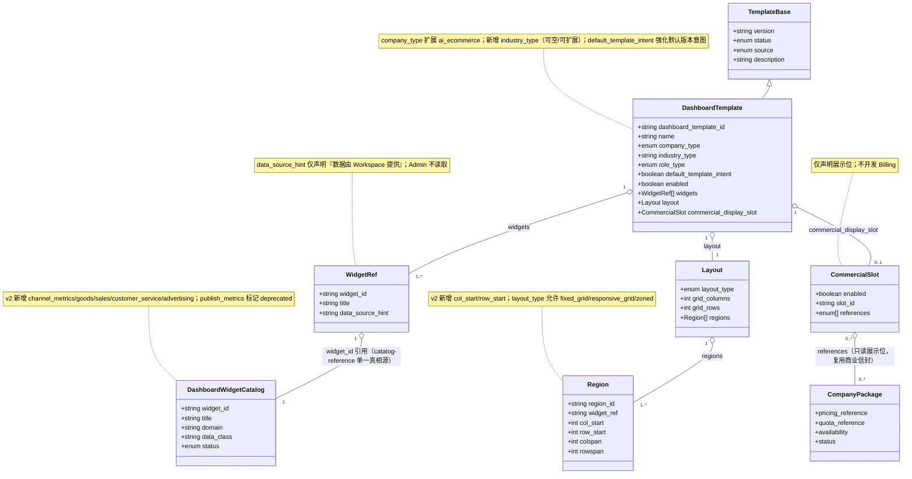
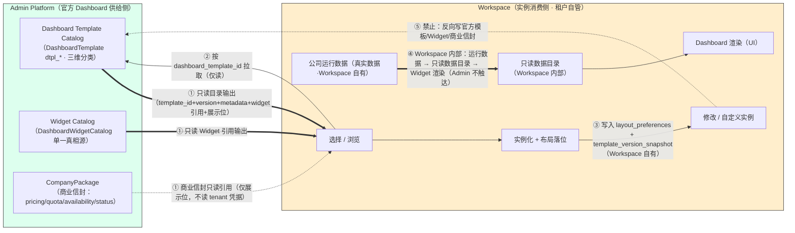
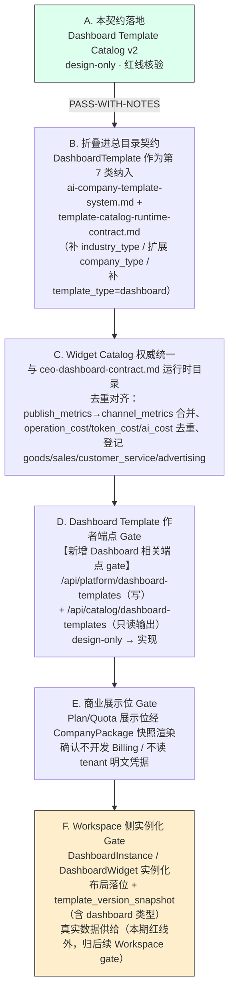

# Dashboard Template Catalog Contract v2（CEO AI Company Dashboard 官方模板目录体系 · v2 扩展契约）

> **作者**：高见远（架构师，software-architect）
> **主理人**：齐活林（交付总监）
> **阶段**：Phase-1C Admin Dashboard Template Support Review —— 纯文档（design-only reservation），零代码、零后端改动、零实例化、零 UI
> **基线**：在 `dashboard-template-admin-contract.md`（v1 契约 · 单份 DashboardTemplate 契约）基础上**扩展为目录体系（catalog v2）**。对齐 `ai-company-template-system.md`（TemplateBase 公共基类型 / 6 类模板 ID 前缀）、`template-catalog-runtime-contract.md`（TemplateCatalogEntry 只读输出协议）、`template-versioning-policy.md`（SemVer + 快照隔离）、`admin-workspace-template-boundary.md`（两条铁律 + 数据流单向性）、`company-package-contract.md`（CapabilityPackage 商业信封）、`ceo-dashboard-contract.md`（Workspace 运行时 Dashboard 契约）保持一致
> **范围说明**：本契约为 **Admin Platform 如何向 Workspace 提供「官方 Dashboard Template（CEO AI Company Dashboard 官方模板）目录体系」与商业展示支持** 的契约层定义。它只定义供给侧（官方模板三维分类 / 官方 Widget 目录引用 / Plan·Quota 展示位），**不实例化、不渲染、不读 Workspace 运行态、不开发 Billing / Marketplace / UI**。本阶段**不写任何代码、不创建任何源文件**，仅产出本契约文档（落盘与提交由主理人负责）。

---

## 0. 文档定位与引用

- 本契约是 Admin 视角的 **DashboardTemplate 目录体系（v2）供给契约**。在 v1「单份 DashboardTemplate 契约」基础上，扩展为**支持 Company / Industry / Role 三维分类的官方模板目录**，并新增第 3 个默认官方模板（AI 电商公司 CEO Dashboard）。
- **与 v1 的关系**：v2 是 v1 的**演进扩展**（evolution），非重写。v1 已用 `dtpl_` 前缀、继承 TemplateBase（`version`/`status`/`source`/`description`）、含 `commercial_display_slot`（复用 CompanyPackage 信封）、`widgets[]`、`layout`。v2 **保留这些**，并：扩展 `company_type` 枚举（新增 `ai_ecommerce`）、**新增 `industry_type` 维度**、让 `layout` 配置更灵活、强化 `version` 管理说明、修订模板 2、新增模板 3。完整演进对照见 §5。
- **与 `ceo-dashboard-contract.md` 的关系**：该契约为 **Workspace 运行时视角**（定义 `DashboardInstance` / `DashboardWidget` / 运行时 Widget Catalog），本契约为 **Admin 供给侧视角**（定义官方 `DashboardTemplate` + 官方 Widget 目录引用 + 商业展示位）。两者互补、不冲突：Workspace 契约的 `DashboardTemplate.layout_schema` / `default_widget_types` 在 Admin 侧对应 `layout` / `widgets`（详见 §4 映射）。
- **与 TemplateBase 的关系**：`version` / `status` / `source` / `description` 直接复用 `ai-company-template-system.md` §1 公共字段。DashboardTemplate 是 TemplateBase 的第 7 个子类（`dtpl_` 前缀）。
- **与 TemplateCatalogEntry 的关系**：运行时 Admin 对外输出为 `DashboardTemplateEntry`（第 7 类 catalog entry），字段形状与 `template-catalog-runtime-contract.md` §1 完全一致；**v2 在 `metadata` 中补 `industry_type`**（见 §4）。
- **widget 引用模式**：沿用 Skill/Tool 的 **catalog-reference 包装**（官方统一能力目录单一真相源）：Admin 只声明 widget 引用，不内嵌实现、不重复定义能力。新增 widget（`channel_metrics`/`goods`/`sales`/`customer_service`/`advertising`）须登记进官方 Widget 目录（§1.3），并标记与 v1 目录已有 widget（`publish_metrics`/`operation_cost`）的关系（去重或新增）。
- **商业展示位**：沿用 CompanyPackage 商业信封（`pricing_reference`/`quota_reference`/`availability`/`status`），Admin 只提供「展示位契约」，不开发 Billing。

---

## 1. Dashboard Template Contract（DashboardTemplate 数据契约 v2）

### 1.1 与 TemplateBase 的继承关系

`DashboardTemplate` 继承 TemplateBase 的 4 个公共字段，并新增 Admin 供给侧专属字段（三维分类 `company_type`/`industry_type`/`role_type`、Widget 引用数组 `widgets`、灵活布局 `layout`、版本意图 `default_template_intent`、商业展示位 `commercial_display_slot`）。

| 字段 | 来源 | 必填 | 说明 |
|------|------|------|------|
| `version` | TemplateBase | 否（默认 `1.0.0`） | SemVer，遵循 TemplateBase 版本策略；v2 强化默认版本意图（见 `default_template_intent`） |
| `status` | TemplateBase | **是** | `draft`/`active`/`disabled`/`archived` |
| `source` | TemplateBase | **是** | `official`/`tenant_private`/`marketplace`；官方模板恒为 `official` |
| `description` | TemplateBase | 否 | 展示/帮助文本；参与 catalog 输出 `description` |
| `dashboard_template_id` | 本契约（强制） | **是** | `dtpl_` 前缀主键 |
| `name` | 本契约（强制） | **是** | 展示名 |
| `company_type` | 本契约（强制） | **是** | 公司类型分类（v2 枚举扩展：`ai_rd`/`ai_content`/`ai_ecommerce`/`generic`，可扩展） |
| `industry_type` | 本契约（v2 新增） | 否（**可空 / 可扩展枚举**） | 垂直行业细分（如 finance/health/retail/education/media/...）；v1 无此维度，本期新增 |
| `role_type` | 本契约（强制） | **是** | 角色分类（可扩展枚举；本期仅 `ceo`） |
| `widgets` | 本契约（强制） | **是** | Widget 引用数组（catalog-reference） |
| `layout` | 本契约（强制） | **是** | 灵活 grid 区域定义（v2 更灵活；不涉及 UI 实现） |
| `default_template_intent` | 本契约（v2 强化） | 否（默认 `false`） | 声明是否为对应 `company_type + role_type` 的 **active 默认模板版本意图**（仅声明；实际 `active` 翻转须经 gate D 作者端点） |
| `commercial_display_slot` | 本契约（新增·沿用 v1） | 否 | Plan/Quota 展示位契约（复用 CompanyPackage 商业信封） |
| `enabled` | 本契约（Admin 内部） | 否 | 生命周期布尔标志，与 `status` 并存（落表时待工程决议） |
| `created_at` / `updated_at` | 本契约（Admin 内部） | 否 | 生命周期时间戳 |

> **强制字段（任务要求）共 8 个**：`dashboard_template_id`、`name`、`company_type`、`role_type`、`widgets`、`layout`、`version`、`status`（与 v1 一致；`industry_type` 为 v2 **可空新增**，不进入强制集以保持向后兼容）。其上 `source`/`description` 由 TemplateBase 继承补齐，`default_template_intent`/`commercial_display_slot`/`enabled`/`created_at`/`updated_at` 为 Admin 供给侧补充。

### 1.2 DashboardTemplate JSON Schema（v2 · 强制字段集 + 继承字段 + 三维分类 + 灵活布局）

```json
{
  "$schema": "http://json-schema.org/draft-07/schema#",
  "title": "DashboardTemplate",
  "type": "object",
  "additionalProperties": false,
  "required": [
    "dashboard_template_id", "name", "company_type", "role_type",
    "widgets", "layout", "version", "status"
  ],
  "properties": {
    "dashboard_template_id": {
      "type": "string", "pattern": "^dtpl_[a-z0-9_-]+$",
      "description": "官方 Dashboard Template 主键；dtpl_ 前缀，纳入 6 类模板 ID 命名空间扩展"
    },
    "name": { "type": "string", "description": "展示名，如『AI 研发公司 CEO 驾驶舱』" },
    "company_type": {
      "type": "string", "enum": ["ai_rd", "ai_content", "ai_ecommerce", "generic"],
      "description": "公司类型分类（v2 枚举扩展：新增 ai_ecommerce；ai_content_ops 重命名为 ai_content；可继续扩展）"
    },
    "industry_type": {
      "type": ["string", "null"],
      "description": "垂直行业细分（v2 新增维度，可空/可扩展枚举：finance/health/retail/education/media/manufacturing/logistics/realestate/...）；留空表示不绑定垂直行业",
      "default": null
    },
    "role_type": {
      "type": "string", "enum": ["ceo"],
      "description": "角色分类（可扩展枚举；本期仅 ceo）"
    },
    "widgets": {
      "type": "array",
      "description": "Widget 引用列表，指向官方 Widget 目录（DashboardWidgetCatalog）",
      "items": {
        "type": "object",
        "additionalProperties": false,
        "required": ["widget_id", "title", "data_source_hint"],
        "properties": {
          "widget_id": {
            "type": "string", "pattern": "^[a-z0-9_]+$",
            "description": "指向 DashboardWidgetCatalog 的 catalog-reference（单一真相源）"
          },
          "title": { "type": "string", "description": "CEO 可读展示标题（可覆盖目录默认 title）" },
          "data_source_hint": {
            "type": "string",
            "description": "数据来源提示，仅声明『数据由 Workspace 提供』；Admin 不读取该源"
          }
        }
      }
    },
    "layout": {
      "type": "object",
      "additionalProperties": false,
      "description": "布局描述（灵活 grid 区域定义），不涉及具体 UI 实现",
      "properties": {
        "layout_type": {
          "type": "string", "enum": ["fixed_grid", "responsive_grid", "zoned"],
          "default": "fixed_grid",
          "description": "布局类型：fixed_grid=固定列行网格；responsive_grid=响应式断点；zoned=分区（允许跨列 hero 区）"
        },
        "grid_columns": { "type": "integer", "minimum": 1, "description": "网格列数（zoned 下为逻辑分区数）" },
        "grid_rows": { "type": "integer", "minimum": 1, "description": "网格行数" },
        "regions": {
          "type": "array",
          "items": {
            "type": "object",
            "additionalProperties": false,
            "required": ["region_id", "widget_ref"],
            "properties": {
              "region_id": { "type": "string" },
              "widget_ref": { "type": "string", "description": "引用 widgets[].widget_id" },
              "col_start": { "type": "integer", "minimum": 1, "description": "起始列（1-based）；与 colspan 并存，支持非连续/跨列定位" },
              "row_start": { "type": "integer", "minimum": 1, "description": "起始行（1-based）" },
              "colspan": { "type": "integer", "minimum": 1, "default": 1 },
              "rowspan": { "type": "integer", "minimum": 1, "default": 1 }
            }
          }
        },
        "note": { "type": "string", "description": "仅 grid 区域定义，不含 UI 实现；Widget 实例由 Workspace 实例化时按此布局落位" }
      }
    },
    "default_template_intent": {
      "type": "boolean", "default": false,
      "description": "v2 强化：声明是否为对应 company_type+role_type 的 active 默认模板版本意图（仅声明；实际 active 翻转须经 gate D 作者端点）"
    },
    "version": {
      "type": "string", "pattern": "^\\d+\\.\\d+\\.\\d+$", "default": "1.0.0",
      "description": "复用 TemplateBase.version（SemVer）；对齐 template-versioning-policy.md"
    },
    "status": {
      "type": "string", "enum": ["draft", "active", "disabled", "archived"], "default": "draft",
      "description": "复用 TemplateBase.status"
    },
    "source": {
      "type": "string", "enum": ["official", "tenant_private", "marketplace"], "default": "official",
      "description": "复用 TemplateBase.source；官方模板恒为 official"
    },
    "description": { "type": "string", "default": "", "description": "展示/帮助文本；参与 TemplateCatalogEntry.description" },
    "commercial_display_slot": {
      "type": "object",
      "additionalProperties": false,
      "description": "Plan/Quota 展示位契约（复用 CompanyPackage 商业信封）；Admin 仅声明展示位，不开发 Billing",
      "properties": {
        "enabled": { "type": "boolean", "default": true, "description": "是否在官方模板中预留商业展示位" },
        "slot_id": { "type": "string", "default": "plan_quota_panel", "description": "展示位稳定 ID" },
        "references": {
          "type": "array",
          "items": { "enum": ["pricing_reference", "quota_reference", "availability", "status"] },
          "default": ["pricing_reference", "quota_reference", "availability", "status"],
          "description": "指向 CompanyPackage 商业信封字段（只读引用）"
        },
        "display_hint": {
          "type": "string",
          "description": "由 Workspace 基于 CompanyPackage 当前快照渲染 Plan/Quota 面板；Admin 仅声明展示位"
        }
      }
    },
    "enabled": { "type": "boolean", "default": true, "description": "Admin 内部生命周期标志（与 status 并存，落表时待工程决议）" },
    "created_at": { "type": "string", "format": "date-time" },
    "updated_at": { "type": "string", "format": "date-time" }
  },
  "examples": [
    {
      "dashboard_template_id": "dtpl_ai_rd_ceo_dashboard",
      "name": "AI 研发公司 CEO 驾驶舱",
      "company_type": "ai_rd",
      "industry_type": null,
      "role_type": "ceo",
      "default_template_intent": true,
      "widgets": [
        { "widget_id": "project_progress", "title": "项目进度", "data_source_hint": "数据由 Workspace 提供（Project / WorkflowRun 运行态）；Admin 仅声明引用，不读取" },
        { "widget_id": "employee_status", "title": "员工状态", "data_source_hint": "数据由 Workspace 提供（EmployeeInstance 状态聚合）；Admin 仅声明引用，不读取" },
        { "widget_id": "tech_risk", "title": "技术风险", "data_source_hint": "数据由 Workspace 提供（Project/WorkflowRun blocked/failed 派生事实）；Admin 仅声明引用，不读取" },
        { "widget_id": "token_cost", "title": "Token 成本", "data_source_hint": "数据由 Workspace 提供（UsageEvent token 聚合，ai_cost 域，非账单）；Admin 仅声明引用，不读取" }
      ],
      "layout": {
        "layout_type": "fixed_grid", "grid_columns": 2, "grid_rows": 2,
        "regions": [
          { "region_id": "r1", "widget_ref": "project_progress", "col_start": 1, "row_start": 1, "colspan": 1, "rowspan": 1 },
          { "region_id": "r2", "widget_ref": "employee_status", "col_start": 2, "row_start": 1, "colspan": 1, "rowspan": 1 },
          { "region_id": "r3", "widget_ref": "token_cost", "col_start": 1, "row_start": 2, "colspan": 1, "rowspan": 1 },
          { "region_id": "r4", "widget_ref": "tech_risk", "col_start": 2, "row_start": 2, "colspan": 1, "rowspan": 1 }
        ],
        "note": "2×2 fixed grid；仅区域定义，不含 UI 实现"
      },
      "version": "1.0.0",
      "status": "active",
      "source": "official",
      "description": "面向 AI 研发公司 CEO 的运营驾驶舱：项目进度、员工状态、技术风险、Token 成本。",
      "commercial_display_slot": {
        "enabled": true, "slot_id": "plan_quota_panel",
        "references": ["pricing_reference", "quota_reference", "availability", "status"],
        "display_hint": "由 Workspace 基于 CompanyPackage 当前快照渲染 Plan/Quota 面板"
      }
    },
    {
      "dashboard_template_id": "dtpl_ai_content_ceo_dashboard",
      "name": "AI 内容公司 CEO 驾驶舱",
      "company_type": "ai_content",
      "industry_type": "media",
      "role_type": "ceo",
      "default_template_intent": true,
      "widgets": [
        { "widget_id": "content_output", "title": "内容产出", "data_source_hint": "数据由 Workspace 提供（内容产出计数，Project/WorkflowRun 产出）；Admin 仅声明引用，不读取" },
        { "widget_id": "channel_metrics", "title": "渠道数据", "data_source_hint": "数据由 Workspace 提供（多渠道分发/触达聚合，替代 v1 publish_metrics）；Admin 仅声明引用，不读取" },
        { "widget_id": "viral_trend", "title": "爆款趋势", "data_source_hint": "数据由 Workspace 提供（爆款趋势派生事实）；Admin 仅声明引用，不读取" }
      ],
      "layout": {
        "layout_type": "fixed_grid", "grid_columns": 3, "grid_rows": 1,
        "regions": [
          { "region_id": "r1", "widget_ref": "content_output", "col_start": 1, "row_start": 1, "colspan": 1, "rowspan": 1 },
          { "region_id": "r2", "widget_ref": "channel_metrics", "col_start": 2, "row_start": 1, "colspan": 1, "rowspan": 1 },
          { "region_id": "r3", "widget_ref": "viral_trend", "col_start": 3, "row_start": 1, "colspan": 1, "rowspan": 1 }
        ],
        "note": "3×1 横向条带（v2 灵活布局示例，非 2×2）；仅区域定义，不含 UI 实现"
      },
      "version": "1.0.0",
      "status": "active",
      "source": "official",
      "description": "面向 AI 内容公司 CEO 的运营驾驶舱：内容产出、渠道数据、爆款趋势（v2 修订：移除运营成本、发布数据→渠道数据）。",
      "commercial_display_slot": {
        "enabled": true, "slot_id": "plan_quota_panel",
        "references": ["pricing_reference", "quota_reference", "availability", "status"],
        "display_hint": "由 Workspace 基于 CompanyPackage 当前快照渲染 Plan/Quota 面板"
      }
    },
    {
      "dashboard_template_id": "dtpl_ai_ecommerce_ceo_dashboard",
      "name": "AI 电商公司 CEO 驾驶舱",
      "company_type": "ai_ecommerce",
      "industry_type": "retail",
      "role_type": "ceo",
      "default_template_intent": true,
      "widgets": [
        { "widget_id": "goods", "title": "商品 / SKU", "data_source_hint": "数据由 Workspace 提供（SKU/商品目录与库存运行态）；Admin 仅声明引用，不读取" },
        { "widget_id": "sales", "title": "销售", "data_source_hint": "数据由 Workspace 提供（订单/交易聚合）；Admin 仅声明引用，不读取" },
        { "widget_id": "customer_service", "title": "客服", "data_source_hint": "数据由 Workspace 提供（工单/会话/满意度聚合）；Admin 仅声明引用，不读取" },
        { "widget_id": "advertising", "title": "广告", "data_source_hint": "数据由 Workspace 提供（广告投放/消耗/ROI 派生，非账单）；Admin 仅声明引用，不读取" }
      ],
      "layout": {
        "layout_type": "responsive_grid", "grid_columns": 2, "grid_rows": 3,
        "regions": [
          { "region_id": "r1", "widget_ref": "goods", "col_start": 1, "row_start": 1, "colspan": 1, "rowspan": 1 },
          { "region_id": "r2", "widget_ref": "customer_service", "col_start": 2, "row_start": 1, "colspan": 1, "rowspan": 1 },
          { "region_id": "r3", "widget_ref": "sales", "col_start": 1, "row_start": 2, "colspan": 2, "rowspan": 1 },
          { "region_id": "r4", "widget_ref": "advertising", "col_start": 1, "row_start": 3, "colspan": 2, "rowspan": 1 }
        ],
        "note": "2×3 响应式（hero 区 sales/advertising 跨 2 列满宽）；v2 灵活布局示例；仅区域定义，不含 UI 实现"
      },
      "version": "1.0.0",
      "status": "active",
      "source": "official",
      "description": "面向 AI 电商公司 CEO 的运营驾驶舱：商品/SKU、销售、客服、广告。",
      "commercial_display_slot": {
        "enabled": true, "slot_id": "plan_quota_panel",
        "references": ["pricing_reference", "quota_reference", "availability", "status"],
        "display_hint": "由 Workspace 基于 CompanyPackage 当前快照渲染 Plan/Quota 面板"
      }
    }
  ]
}
```

### 1.3 官方 Widget 目录（DashboardWidgetCatalog · catalog-reference 单一真相源 · v2）

沿用 Skill/Tool 的 catalog-reference 模式：Admin 不内嵌 Widget 实现，只声明引用。下表为**官方 Widget 目录（v2 单一真相源）**，整合 `ceo-dashboard-contract.md` 运行时 Widget Catalog（15 类基础 widget）并补充本契约三个官方模板所需的 Widget。

| widget_id | title | 域 | 数据等级 | 状态（v2） | 说明 / 数据来源（声明，不读取） | 被官方模板引用 |
|---|---|---|---|---|---|---|
| `project_progress` | 项目进度 | 项目 | 可聚合 | active | Project / WorkflowRun 进度 | 模板 1 |
| `employee_status` | 员工状态 | 员工 | 可聚合 | active | EmployeeInstance 状态聚合 | 模板 1 |
| `token_cost` | Token 成本 | 成本 | 可聚合（非账单） | active | UsageEvent token 聚合（ai_cost 域） | 模板 1 |
| `tech_risk` | 技术风险 | 项目/风险 | 派生事实（非预测） | active | Project/WorkflowRun blocked/failed 事实 | 模板 1 |
| `content_output` | 内容产出 | 内容 | 可聚合 | active | 内容产出计数（Project/WorkflowRun 产出） | 模板 2 |
| `channel_metrics` | 渠道数据 | 内容 | 可聚合 | **NEW（v2）** | 多渠道分发/触达聚合（**替代 v1 `publish_metrics`**） | 模板 2 |
| `viral_trend` | 爆款趋势 | 内容 | 派生事实 | active | 爆款趋势派生事实 | 模板 2 |
| `publish_metrics` | 发布数据 | 内容 | 可聚合 | **DEPRECATED（v2）** | v1 模板 2 使用；**v2 合并入 `channel_metrics`**，保留目录条目以兼容历史 `template_version_snapshot` | —（历史） |
| `operation_cost` | 运营成本 | 成本 | 可聚合（非账单） | retained（退出模板 2） | ai_cost / UsageEvent 聚合；**v2 不再被模板 2 引用**，仍保留为通用成本 widget；去重候选 | —（通用） |
| `company_health` | 公司健康 | 公司 | 可聚合 | active | Company 状态 / 活跃项目 / 阻塞事实 | — |
| `department_overview` | 部门概览 | 公司 | 可聚合 | active | Department 状态与员工数量 | — |
| `project_risk` | 项目风险 | 项目 | 派生事实 | active | blocked/failed 事实（与 `tech_risk` 同域，独立调优） | — |
| `employee_load` | 员工负载 | 员工 | 可聚合 | active | 活跃 Step / Task 数量 | — |
| `employee_growth` | 员工增长 | 员工 | 需定义指标 | active | 新增实例 / 绑定变化 / 完成统计 | — |
| `token_usage` | Token 用量 | 成本 | 可聚合 | active | Token 消耗（与 `token_cost` 同域） | — |
| `model_usage` | 模型用量 | 成本 | 可聚合 | active | 模型调用次数与 Token 分布 | — |
| `ai_cost` | AI 成本 | 成本 | 可聚合（非账单） | active | estimated_cost 聚合（与 `token_cost`/`operation_cost` 同域） | — |
| `value_event` | 价值事件 | 价值 | 契约预留 | active | 已记录价值事件 | — |
| `estimated_impact` | 估算影响 | 价值 | 契约预留（非 ROI） | active | 价值事件估算值及来源 | — |
| `skill_usage` | 技能用量 | 能力 | 部分就绪 | active | Skill 绑定/执行关联 | — |
| `tool_usage` | 工具用量 | 能力 | 可聚合 | active | Tool 能力调用归因 | — |
| `knowledge_growth` | 知识增长 | 知识 | 部分就绪 | active | Project Memory / Knowledge 记录数量与更新时间 | — |
| `goods` | 商品 / SKU | 电商 | 可聚合 | **NEW（v2）** | SKU/商品目录与库存运行态（数据由 Workspace 提供） | 模板 3 |
| `sales` | 销售 | 电商 | 可聚合 | **NEW（v2）** | 订单/交易聚合（数据由 Workspace 提供） | 模板 3 |
| `customer_service` | 客服 | 电商 | 可聚合 | **NEW（v2）** | 工单/会话/满意度聚合（数据由 Workspace 提供） | 模板 3 |
| `advertising` | 广告 | 电商 | 派生事实（非账单） | **NEW（v2）** | 广告投放/消耗/ROI 派生（数据由 Workspace 提供） | 模板 3 |

> **单一真相源说明**：`widgets[].widget_id` 必须命中本目录；不内联 Widget 实现、不重复定义能力（与 `ai-company-template-system.md` §2.4/§2.5 完全一致）。
> **v1→v2 Widget 关系标记**：
> - `publish_metrics` → **合并入 `channel_metrics`**（v2 重命名 + 语义扩展为多渠道触达）；`publish_metrics` 标记 DEPRECATED 但保留目录条目以兼容历史快照。
> - `operation_cost` → **保留目录条目**，但 v2 模板 2 不再引用；与 `ai_cost`/`token_cost`/`token_usage` 同属成本域，最终去重留待 **gate C**。
> - `goods`/`sales`/`customer_service`/`advertising` → **全新注册**（电商域），`data_source_hint` 统一声明「数据由 Workspace 提供」，Admin 不读取。
> **去重待办（gate C）**：`token_cost`/`operation_cost` 与 `ai_cost`/`token_usage`、`tech_risk` 与 `project_risk` 同域，须与 `ceo-dashboard-contract.md` 运行时目录统一为单一真相源。

### 1.4 DashboardTemplate v2 类图（Mermaid）



### 1.5 商业展示位契约（Plan/Quota Display Slot · 沿用 v1，未变更）

`commercial_display_slot` 是 Admin 在官方 Dashboard Template 中预留的 **Plan/Quota 展示位**。它**复用 CompanyPackage 商业信封**（`pricing_reference`/`quota_reference`/`availability`/`status`），Admin 只声明「此处展示当前 Plan/Quota 面板」，渲染由 Workspace 基于 CompanyPackage 当前快照完成。（v2 与此字段定义与 v1 §1.5 完全一致，未变更。）

- **Admin 写权**：仅定义展示位是否存在（`enabled`）、稳定 `slot_id`、`references`（指向 CompanyPackage 信封字段）。
- **Admin 不读/不写**：不读取 tenant_private 明文凭据、不计算账单、不执行收费、不持有价格/配额数值。
- **Workspace 渲染**：实例化时按 `commercial_display_slot.references` 从 CompanyPackage 快照取 `pricing_reference`/`quota_reference`/`availability`/`status` 渲染面板（展示位契约，非 Billing 逻辑）。
- **归属**：展示位定义权 = Admin；展示内容快照权 = Workspace。`ceo-dashboard-contract.md` §"Admin / Workspace 边界" 已确认 Dashboard 不调用 `/api/platform/*`、不计算账单、不读 tenant_private 明文凭据。

---

## 2. Admin / Workspace 边界说明

### 2.1 职责划分矩阵（Admin 供给侧 vs Workspace 消费侧 · v2 强化三维分类职责）

| 维度 | **Admin Platform（官方 Dashboard 供给侧）** | **Workspace（租户 · 实例消费侧）** |
| --- | --- | --- |
| 定义官方 Dashboard Template（三维分类） | ✅ 创建 `DashboardTemplate`（`dtpl_*`），含 **Company / Industry / Role 三维分类** | ❌ 不创作官方模板 |
| 发布模板（active） | ✅ 将 `draft` 置 `active` 对外发布（含 `default_template_intent` 声明） | ❌ 不发布官方模板 |
| 定义官方 Widget 目录 | ✅ 维护 `DashboardWidgetCatalog`（单一真相源；v2 含 5 个新 widget） | ❌ 不创作官方 Widget 定义 |
| 声明商业展示位 | ✅ 定义 `commercial_display_slot`（Plan/Quota 展示位契约） | ❌ 不定义官方展示位语义 |
| 读取 Workspace 运行态/数据 | ❌ **禁止读取/修改 Workspace 执行状态与数据** | ✅ 持有并供给自身运行数据 |
| 实例化 Dashboard | ❌ **不实例化**（不生成 DashboardInstance） | ✅ 按 `dashboard_template_id` 拉取 + 快照创建实例 |
| 修改实例/布局 | ❌ **禁止修改已存在用户实例** | ✅ 修改/自定义自身实例（layout_preferences） |
| 版本快照 | ❌ 不持有实例快照 | ✅ 持有 `template_version_snapshot`（**v2 须补 `dashboard` 类型**，见 §6.4） |
| 渲染 UI / 计算数据 | ❌ **禁止开发 UI** | ✅ 渲染 Dashboard、供给真实运行数据 |
| 开发 Billing / Marketplace | ❌ **禁止开发 Billing / Marketplace** | ❌ Dashboard 不计算账单/收费 |

### 2.2 两条铁律（禁止 · 沿用并强化 v1）

1. **Admin 禁止读取/修改 Workspace 执行状态与数据**：
   - 不得读 `DashboardInstance` / `DashboardWidget` 的运行态；
   - 不得读/改 Workspace 的 Company / Project / Department / Employee / UsageEvent / ValueEvent 真实数据；
   - 不持有、不回写任何实例快照；`template_version_snapshot` 由 Workspace 在实例化时写入。
2. **Workspace 禁止修改官方模板定义**：
   - 不得改 `DashboardTemplate`（`source=official`）；
   - 只能**只读**感知官方目录以自我约束，可自定义的是"实例"（`DashboardInstance.layout_preferences` / `DashboardWidget`）而非"模板"。

### 2.3 数据流单向性（Mermaid）



**数据流释义**（与 v1 §2.3 一致，强化三维分类供给侧）：
1. **① 单向发布**：Admin → Workspace，官方 Dashboard Template（含 Company/Industry/Role 三维分类）/ Widget 目录 / 商业信封**只读输出**（含 `commercial_display_slot` 展示位声明）。
2. **② 仅读拉取**：Workspace 按 `dashboard_template_id` 从 catalog **只读**拉取模板形状与 Widget 引用。
3. **③ 实例自管**：实例化产生的 `layout_preferences` 与 `template_version_snapshot` 全部落在 Workspace 侧（租户自有存储）。
4. **④ Workspace 内部闭环**：公司运行数据 → Workspace 内部只读数据目录 → Widget 渲染。**Admin 全程不触达此链路**（遵守 §2.2 铁律一）。
5. **⑤ 禁止反向**：Workspace **不得**把任何实例运行态/修改回写 Admin 官方目录或官方实例。

### 2.4 边界确认（写入文档的约束清单）

- **Admin 负责**：官方 Dashboard Template 定义（含 **Company / Industry / Role 三维分类**）、官方 Widget 目录、商业模块展示（Plan/Quota 展示位契约）。
- **Workspace 负责**：Dashboard 实例、用户布局调整、公司运行数据（真实数据由 Workspace 供给 Admin 只读目录——此处"只读目录"指 Workspace 内部只读数据目录，Dashboard 据此渲染；**Admin 对该目录无读/写权**）。
- **禁止**：
  - ❌ Admin 读取/修改 Workspace 执行状态
  - ❌ Admin 修改 Workspace 数据
  - ❌ 开发 UI
  - ❌ 开发 Billing
  - ❌ 开发 Marketplace
  - ❌ 修改 Workspace Runtime

> 注：上"真实数据由 Workspace 供给 Admin 只读目录"沿用任务原文措辞；本契约明确其语义为 **Workspace 内部只读数据目录**（Dashboard 渲染数据源），Admin 对该目录无任何读/写权限，与 §2.2 铁律一及 `ceo-dashboard-contract.md` 边界完全一致。

---

## 3. 官方模板定义（3 个默认官方模板）

### 3.1 模板 1：AI 研发公司 CEO Dashboard（沿用 v1 示例 A）

| 字段 | 值 |
|------|----|
| `dashboard_template_id` | `dtpl_ai_rd_ceo_dashboard` |
| `name` | AI 研发公司 CEO 驾驶舱 |
| `company_type` | `ai_rd` |
| `industry_type` | `null`（通用技术型，不绑定垂直行业；字段可空，留待实例按 Company 真实行业补全） |
| `role_type` | `ceo` |
| `version` | `1.0.0` |
| `status` | `active`（官方默认 CEO 驾驶舱意图；实际 active 翻转须经 gate D 作者端点，本阶段仅契约声明） |
| `default_template_intent` | `true` |
| `source` | `official` |
| `widgets` | 见下表 |
| `layout` | 2×2 fixed_grid：r1=project_progress, r2=employee_status, r3=token_cost, r4=tech_risk（各 1×1） |
| `commercial_display_slot` | enabled=true, slot_id=plan_quota_panel, references=[pricing_reference, quota_reference, availability, status] |

**widgets 明细（widget_id + 数据来源提示）**：

| widget_id | title | data_source_hint（仅声明，不读取） |
|-----------|-------|--------------------------------------|
| `project_progress` | 项目进度 | 数据由 Workspace 提供（Project / WorkflowRun 运行态） |
| `employee_status` | 员工状态 | 数据由 Workspace 提供（EmployeeInstance 状态聚合） |
| `tech_risk` | 技术风险 | 数据由 Workspace 提供（Project/WorkflowRun blocked/failed 派生事实） |
| `token_cost` | Token 成本 | 数据由 Workspace 提供（UsageEvent token 聚合，ai_cost 域，非账单） |

### 3.2 模板 2：AI 内容公司 CEO Dashboard（**v2 修订 v1 示例 B**）

> ⚠️ **v1→v2 修订声明（revision）**：本模板是 v1 示例 B（`dtpl_ai_content_ops_ceo_dashboard`，4 widgets：content_output / publish_metrics / viral_trend / operation_cost）的**修订版**。
> - `dashboard_template_id` 重命名：`dtpl_ai_content_ops_ceo_dashboard` → **`dtpl_ai_content_ceo_dashboard`**（company_type `ai_content_ops` → `ai_content`，以便电商独立成类）。
> - **widget_id 变更**：`publish_metrics` → **`channel_metrics`**（发布数据→渠道数据，语义扩展为多渠道触达）。
> - **移除** `operation_cost`（运营成本）。
> - 结果：v2 模板 2 = **3 widgets**（content_output / channel_metrics / viral_trend），非 v1 的 4 widgets。

| 字段 | 值 |
|------|----|
| `dashboard_template_id` | `dtpl_ai_content_ceo_dashboard` |
| `name` | AI 内容公司 CEO 驾驶舱 |
| `company_type` | `ai_content`（v1 为 `ai_content_ops`） |
| `industry_type` | `media`（示例值；可空） |
| `role_type` | `ceo` |
| `version` | `1.0.0` |
| `status` | `active`（官方默认模板意图） |
| `default_template_intent` | `true` |
| `source` | `official` |
| `widgets` | 见下表（**3 个**，修订后） |
| `layout` | 3×1 fixed_grid 横向条带：r1=content_output, r2=channel_metrics, r3=viral_trend（v2 灵活布局示例，非 2×2） |
| `commercial_display_slot` | enabled=true, slot_id=plan_quota_panel, references=[pricing_reference, quota_reference, availability, status] |

**widgets 明细（widget_id + 数据来源提示）**：

| widget_id | title | data_source_hint（仅声明，不读取） | v1 对照 |
|-----------|-------|--------------------------------------|---------|
| `content_output` | 内容产出 | 数据由 Workspace 提供（内容产出计数，Project/WorkflowRun 产出） | 沿用 |
| `channel_metrics` | 渠道数据 | 数据由 Workspace 提供（多渠道分发/触达聚合，替代 v1 publish_metrics） | **替代 `publish_metrics`** |
| `viral_trend` | 爆款趋势 | 数据由 Workspace 提供（爆款趋势派生事实） | 沿用 |

### 3.3 模板 3：AI 电商公司 CEO Dashboard（**v2 新增**）

| 字段 | 值 |
|------|----|
| `dashboard_template_id` | `dtpl_ai_ecommerce_ceo_dashboard` |
| `name` | AI 电商公司 CEO 驾驶舱 |
| `company_type` | `ai_ecommerce`（v2 枚举**新增**） |
| `industry_type` | `retail`（示例值；可空） |
| `role_type` | `ceo` |
| `version` | `1.0.0` |
| `status` | `active`（官方默认模板意图） |
| `default_template_intent` | `true` |
| `source` | `official` |
| `widgets` | 见下表（**4 个全新 widget_id**） |
| `layout` | 2×3 responsive_grid：r1=goods, r2=customer_service, r3=sales（跨 2 列 hero）, r4=advertising（跨 2 列）；v2 灵活布局示例 |
| `commercial_display_slot` | enabled=true, slot_id=plan_quota_panel, references=[pricing_reference, quota_reference, availability, status] |

**widgets 明细（widget_id + 数据来源提示 · 均登记进官方 Widget 目录 §1.3）**：

| widget_id | title | data_source_hint（仅声明，不读取） | 登记状态 |
|-----------|-------|--------------------------------------|---------|
| `goods` | 商品 / SKU | 数据由 Workspace 提供（SKU/商品目录与库存运行态）；Admin 仅声明引用，不读取 | **NEW（v2）** |
| `sales` | 销售 | 数据由 Workspace 提供（订单/交易聚合）；Admin 仅声明引用，不读取 | **NEW（v2）** |
| `customer_service` | 客服 | 数据由 Workspace 提供（工单/会话/满意度聚合）；Admin 仅声明引用，不读取 | **NEW（v2）** |
| `advertising` | 广告 | 数据由 Workspace 提供（广告投放/消耗/ROI 派生，非账单）；Admin 仅声明引用，不读取 | **NEW（v2）** |

### 3.4 三模板三维分类对照表

| 模板 | `dashboard_template_id` | `company_type` | `industry_type` | `role_type` | widgets（数量） | layout |
|------|------------------------|----------------|------------------|-------------|------------------|--------|
| 1 · AI 研发 | `dtpl_ai_rd_ceo_dashboard` | `ai_rd` | `null` | `ceo` | project_progress / employee_status / tech_risk / token_cost（4） | 2×2 fixed |
| 2 · AI 内容（修订） | `dtpl_ai_content_ceo_dashboard` | `ai_content` | `media` | `ceo` | content_output / channel_metrics / viral_trend（3，移除 operation_cost，publish_metrics→channel_metrics） | 3×1 fixed |
| 3 · AI 电商（新增） | `dtpl_ai_ecommerce_ceo_dashboard` | `ai_ecommerce` | `retail` | `ceo` | goods / sales / customer_service / advertising（4，全新） | 2×3 responsive |

---

## 4. 与 TemplateCatalogEntry 的运行时映射（v2）

### 4.1 DashboardTemplateEntry（第 7 类 catalog entry · v2 补 industry_type）

Admin 对外只读目录输出对象，字段形状与 `template-catalog-runtime-contract.md` §1 完全一致；**v2 在 `metadata` 中补 `industry_type`**（对齐本契约三维分类）。

```json
{
  "$schema": "http://json-schema.org/draft-07/schema#",
  "title": "DashboardTemplateEntry",
  "type": "object",
  "additionalProperties": false,
  "required": ["template_id", "version", "name", "source", "status", "metadata"],
  "properties": {
    "template_id": { "type": "string", "pattern": "^dtpl_[a-z0-9_-]+$" },
    "version":    { "type": "string", "pattern": "^\\d+\\.\\d+\\.\\d+$" },
    "name":       { "type": "string" },
    "description":{ "type": "string", "default": "" },
    "source":     { "type": "string", "enum": ["official", "marketplace"] },
    "status":     { "type": "string", "enum": ["draft", "active", "disabled", "archived"] },
    "metadata": {
      "type": "object",
      "additionalProperties": false,
      "properties": {
        "company_type": { "type": "string", "enum": ["ai_rd", "ai_content", "ai_ecommerce", "generic"] },
        "industry_type": { "type": ["string", "null"], "description": "v2 新增：垂直行业细分（可空/可扩展）" },
        "role_type":    { "type": "string", "enum": ["ceo"] },
        "widget_ids":   { "type": "array", "items": { "type": "string" }, "default": [] },
        "layout_summary": { "type": "string", "description": "grid 概要，如 '2x2 grid' / '2x3 responsive'" },
        "commercial_slot_ref": { "type": "string", "description": "指向 commercial_display_slot.slot_id（Plan/Quota 展示位）" },
        "tenant_id":    { "type": ["string","null"], "default": "platform" }
      }
    }
  },
  "examples": [{
    "template_id": "dtpl_ai_ecommerce_ceo_dashboard",
    "version": "1.0.0",
    "name": "AI 电商公司 CEO 驾驶舱",
    "description": "面向 AI 电商公司 CEO 的运营驾驶舱：商品/SKU、销售、客服、广告。",
    "source": "official",
    "status": "active",
    "metadata": {
      "company_type": "ai_ecommerce",
      "industry_type": "retail",
      "role_type": "ceo",
      "widget_ids": ["goods", "sales", "customer_service", "advertising"],
      "layout_summary": "2x3 responsive",
      "commercial_slot_ref": "plan_quota_panel"
    }
  }]
}
```

### 4.2 字段映射表（DashboardTemplate → DashboardTemplateEntry · v2）

| 输出字段 | Catalog 契约原字段 | 现状 |
|---|---|---|
| `template_id` | `DashboardTemplate.dashboard_template_id`（`dtpl_*`） | ✅ 值不变，仅键名统一为 `template_id` |
| `version` | TemplateBase.version | ✅ 一致 |
| `name` | DashboardTemplate.name | ✅ 一致 |
| `description` | TemplateBase.description | ✅ 一致 |
| `source` | TemplateBase.source | ⚠ 枚举收窄为 `official`/`marketplace`（沿用 catalog 输出协议） |
| `status` | TemplateBase.status | ✅ 一致 |
| `metadata.company_type` | DashboardTemplate.company_type | ✅ 引用 |
| `metadata.industry_type` | DashboardTemplate.industry_type | ✅ **v2 新增**（三维分类补全） |
| `metadata.role_type` | DashboardTemplate.role_type | ✅ 引用 |
| `metadata.widget_ids` | DashboardTemplate.widgets[].widget_id | ✅ 提取 ID 数组 |
| `metadata.layout_summary` | DashboardTemplate.layout（grid 概要） | ✅ 派生摘要 |
| `metadata.commercial_slot_ref` | DashboardTemplate.commercial_display_slot.slot_id | ✅ 引用 |

> **与 `ceo-dashboard-contract.md` 运行时字段衔接**：Admin 侧 `layout` → Workspace 实例化时落位为 `layout_schema`（模板）/ `layout_preferences`（实例）；Admin 侧 `widgets[].widget_id` → Workspace 实例化为 `DashboardWidget.widget_type`（须命中 Widget Catalog）。本契约为供给侧目录定义，不重定义 Workspace 运行时字段。`default_template_intent`（Admin 侧声明）不直接出现在 catalog 输出，由 Admin 内部决定 `status=active` 的发布动作。

---

## 5. v1 → v2 演进关系（变更对照表）

| # | 变更项 | v1 | v2 |
|---|--------|----|----|
| 1 | **新增 `industry_type` 维度** | 无此维度 | 新增（可空 / 可扩展枚举：finance/health/retail/education/media/manufacturing/logistics/realestate/...）；不进入强制字段集以保持向后兼容 |
| 2 | **`company_type` 枚举扩展** | `[ai_rd, ai_content_ops, generic]` | `[ai_rd, ai_content, ai_ecommerce, generic]`（**新增 `ai_ecommerce`**；`ai_content_ops` **重命名为 `ai_content`** 以便电商独立成类） |
| 3 | **`layout` 配置更灵活** | 固定 2×2 grid（仅 `colspan`/`rowspan`） | 新增 `layout_type`（`fixed_grid`/`responsive_grid`/`zoned`）+ `col_start`/`row_start` 网格定位，支持跨列 hero 区；**仍不含 UI 实现** |
| 4 | **模板 2 修订** | `dtpl_ai_content_ops_ceo_dashboard`（4 widgets：content_output / publish_metrics / viral_trend / operation_cost） | `dtpl_ai_content_ceo_dashboard`（3 widgets：content_output / **channel_metrics** / viral_trend）；widget_id 变更 `publish_metrics`→`channel_metrics`，**移除 `operation_cost`** |
| 5 | **新增模板 3** | 无 | `dtpl_ai_ecommerce_ceo_dashboard`（company_type=`ai_ecommerce`，4 全新 widgets：goods / sales / customer_service / advertising） |
| 6 | **强化 `version` 管理** | `version` 仅复用 TemplateBase | 新增 `default_template_intent`（声明 active 默认模板版本意图）；对齐 `template-versioning-policy.md`；**快照 `template_type` 枚举须补 `dashboard`**（v1 仅 6 类，见 §6.4） |
| 7 | **Widget 目录扩展** | 21 个 widget（含 `publish_metrics`/`operation_cost`） | 新增 `channel_metrics`/`goods`/`sales`/`customer_service`/`advertising`；`publish_metrics` 标记 **DEPRECATED**（合并入 `channel_metrics`）；`operation_cost` 保留但退出模板 2；去重待 gate C |
| 8 | **TemplateCatalogEntry metadata** | 无 `industry_type` | `metadata` **新增 `industry_type`**（对齐三维分类） |

---

## 6. Phase-1C 支持评估

### 6.1 完成度

| 评估项 | 状态 | 落点 |
|---|---|---|
| DashboardTemplate 数据契约 v2（8 强制字段 + 继承字段 + 三维分类 + 灵活布局 + 版本意图） | ✅ 已定义 | §1.1 / §1.2 |
| 官方 Widget 目录（catalog-reference 单一真相源，含 5 个新 widget + publish_metrics 弃用标记） | ✅ 已定义 | §1.3 |
| 商业展示位契约（复用 CompanyPackage 信封） | ✅ 已定义（沿用 v1） | §1.5 |
| 官方模板定义（**3 个**，含 widget 明细 + layout + 数据来源提示 + 三维分类） | ✅ 已定义 | §3 |
| Admin/Workspace 边界（职责矩阵 + 两条铁律 + 数据流单向性，强化三维分类） | ✅ 已定义 | §2 |
| TemplateCatalogEntry 运行时映射（dtpl_ 第 7 类，v2 补 industry_type） | ✅ 已定义 | §4 |
| v1→v2 演进关系 | ✅ 已定义 | §5 |
| 红线核验 | ✅ 通过（见 §6.2） | §6.2 |

**结论**：Phase-1C Admin 侧对 CEO Dashboard 的契约支持 **已完成定义（design-only）**，在 v1 基础上扩展为支持 Company / Industry / Role 三维分类的官方模板目录体系，并新增 AI 电商公司 CEO 模板。真实实例化属于后续 Workspace 侧 gate（§6.3 路径 F），不在本期红线内。

### 6.2 红线核验

| 红线 / 禁止区 | 本契约遵守情况 |
|---|---|
| 不开发 UI | ✅ 仅定义 `layout` grid 区域（含 layout_type/col_start/row_start），不含任何 UI 实现 |
| 不开发 Billing / Marketplace | ✅ `commercial_display_slot` 仅声明展示位，复用 CompanyPackage 信封，不开发计费/市场 |
| 不写后端代码 / 不建表 / 不加路由 | ✅ 纯契约文档，零代码、零行为变化（ADR-0017 design-only reservation） |
| 不实例化（不生成 DashboardInstance 等） | ✅ 仅定义官方模板；实例化归 Workspace（gate F） |
| Admin 不读/改 Workspace 执行状态与数据 | ✅ §2.2 铁律一；数据流 §2.3 ④ Admin 不触达运行数据 |
| Admin 不修改用户实例 | ✅ §2.2 铁律一；实例所有权归 Workspace |
| Widget 不重复定义能力（catalog-reference） | ✅ §1.3 单一真相源；Admin 只声明引用 |
| 数据流单向（Admin→Workspace 只读输出） | ✅ §2.3 Mermaid |

### 6.3 Gate 路径（Mermaid + A→F，与 v1 §5.3 对齐并补 v2 注解）



**路径说明（与 Phase-1B/1C Template Runtime Integration Gate 对齐）**：

| Gate | 名称 | 关键动作 | 归属 |
|---|---|---|---|
| **A** | 本契约落地 | Dashboard Template Catalog v2 design-only；红线核验 | Admin（本期） |
| **B** | 折叠进总目录契约 | 将 DashboardTemplate 作为第 7 类纳入 `ai-company-template-system.md` 与 `template-catalog-runtime-contract.md`；正式登记 `dtpl_` 前缀；**补 `industry_type` 到 DashboardTemplateEntry.metadata**；**补 `company_type` 枚举（ai_ecommerce / ai_content 重命名）**；**补 `template_type=dashboard` 到 template-versioning-policy 快照枚举** | Admin（目录治理） |
| **C** | Widget Catalog 权威统一 | 与 Workspace 侧 `ceo-dashboard-contract.md` Widget Catalog 去重对齐，确立 `DashboardWidgetCatalog` 单一真相源（含 `publish_metrics`→`channel_metrics` 合并决策、`operation_cost`/`token_cost`/`ai_cost`/`token_usage` 同域归并、`tech_risk`/`project_risk` 同域归并、登记 5 个新 widget） | Admin + Workspace 协同 |
| **D** | **Dashboard Template 作者端点 Gate（新增 Dashboard 相关端点 gate）** | `/api/platform/dashboard-templates`（Admin 写）+ `/api/catalog/dashboard-templates`（只读输出）；将 design-only 契约转为可落地端点 | Admin（实现） |
| **E** | 商业展示位 Gate | Plan/Quota 展示位经 CompanyPackage 快照渲染；确认仅展示位、不开发 Billing、不读 tenant 明文凭据 | Admin + 商业边界 |
| **F** | Workspace 侧实例化 Gate | `DashboardInstance`/`DashboardWidget` 实例化、布局落位、`template_version_snapshot`（含 `dashboard` 类型）、真实数据供给——**本阶段红线外**，归后续 Workspace gate | Workspace |

### 6.4 Gate 结论与 v2 待办

> **Phase-1C Gate 结论：✅ PASS-WITH-NOTES**

**理由**：
- Admin 侧对 CEO Dashboard 的**契约支持已完整定义（v2 目录体系）**：DashboardTemplate 数据契约（三维分类 + 灵活布局 + 版本意图）、3 个官方模板、官方 Widget 目录（含 5 个新 widget）、商业展示位、边界与铁律、catalog 映射、v1→v2 演进，且**全部守红线**（零代码、零实例化、零 UI、零 Billing/Marketplace、数据流单向）。
- 真实实例化（DashboardInstance / DashboardWidget / 布局落位 / 真实数据供给）属于**后续 Workspace 侧 gate（路径 F）**，不在本期红线与范围内，故本期以 PASS-WITH-NOTES 收口，不阻塞。

**Notes / v2 相对 v1 的待办（须在后续 gate 处理）**：

1. **目录折叠（gate B）**：
   - 将 v2 DashboardTemplate（含 `industry_type`、扩展 `company_type` 枚举）作为第 7 类正式纳入 `ai-company-template-system.md` 与 `template-catalog-runtime-contract.md`，登记 `dtpl_` 前缀。
   - **补 `industry_type` 到 `DashboardTemplateEntry.metadata`**（v2 新增，运行时输出侧须同步）。
   - **补 `template_type = "dashboard"` 到 `template-versioning-policy.md` §5 快照枚举**（v1 仅 `company`/`department`/`employee`/`work_flow`/`skill`/`tool` 六类，实例化 DashboardTemplate 时缺 `dashboard` 类型——本契约 design-only，须由 gate F / 版本策略更新补齐）。
2. **Widget Catalog 去重（gate C）**：
   - `publish_metrics` → **合并入 `channel_metrics`**（v2 已完成目录侧标记 DEPRECATED，须与 `ceo-dashboard-contract.md` 运行时目录统一）。
   - `operation_cost` / `token_cost` / `ai_cost` / `token_usage` 同属成本域；`tech_risk` / `project_risk` 同属风险域——须统一为单一真相源。
   - 正式登记 5 个新 widget（`channel_metrics`/`goods`/`sales`/`customer_service`/`advertising`）进 `DashboardWidgetCatalog`。
3. **模板 2 修订落地（gate B/D）**：v2 模板 2 由 v1 `dtpl_ai_content_ops_ceo_dashboard`（4 widgets）修订为 `dtpl_ai_content_ceo_dashboard`（3 widgets，widget_id 变更 + 移除 operation_cost）。若 v1 模板已对外声明，须处理历史 `template_version_snapshot` 兼容（`publish_metrics` 弃用条目保留以兼容快照）。
4. **商业展示位仅声明（gate E）**：渲染依赖 CompanyPackage 当前快照，Admin 不开发 Billing、不读 tenant 明文凭据。
5. **实例化/布局/真实数据（gate F）**：归 Workspace 侧 gate，本期不触碰。

---

## 7. 验收映射

| # | 验收项 | 落点 |
|---|--------|------|
| 1 | DashboardTemplate 数据契约 v2（8 强制字段 + 继承字段 + 三维分类 + 灵活布局 + 版本意图） | §1.1 / §1.2 |
| 2 | 官方 Widget 目录（catalog-reference 单一真相源，含新 widget 与弃用标记） | §1.3 |
| 3 | 商业展示位契约（复用 CompanyPackage 信封） | §1.5 |
| 4 | DashboardTemplate v2 类图（Mermaid） | §1.4 |
| 5 | Admin / Workspace 职责矩阵 + 两条铁律 + 三维分类 | §2.1 / §2.2 |
| 6 | 数据流单向性（Mermaid） | §2.3 |
| 7 | 边界确认（约束清单） | §2.4 |
| 8 | 官方模板 1 / 2（修订）/ 3（新增）（widget 明细 + layout + 数据来源提示 + 三维分类） | §3.1 / §3.2 / §3.3 |
| 9 | 三模板三维分类对照表 | §3.4 |
| 10 | TemplateCatalogEntry 运行时映射（dtpl_ 第 7 类，v2 补 industry_type） | §4 |
| 11 | v1→v2 演进关系 | §5 |
| 12 | 完成度评估 | §6.1 |
| 13 | 红线核验 | §6.2 |
| 14 | Gate 路径（A→F，新增 Dashboard 端点 gate D，补 v2 注解） | §6.3 |
| 15 | Gate 结论（PASS-WITH-NOTES）+ v2 待办 | §6.4 |

*—— Dashboard Template Catalog Contract v2（纯设计/契约，零代码）。Admin 供给侧 CEO AI Company Dashboard 官方模板目录体系（三维分类）+ 商业展示支持契约；与 ADR-0017 及既有模板/目录/边界/版本/包契约一致；在 v1 基础上扩展 industry_type、扩展 company_type 枚举、灵活 layout、强化 version 管理、修订模板 2、新增模板 3。*
