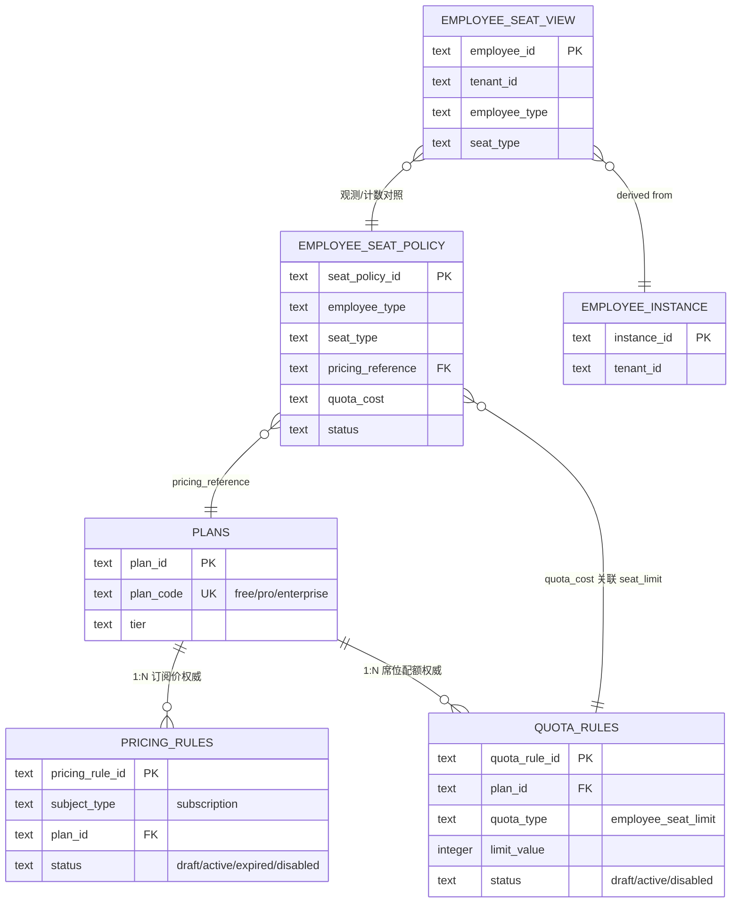

# Employee Seat Commercial Contract（AI 员工商业席位政策契约）

> **作者**：高见远（架构师，software-architect）
> **阶段**：Phase-9A（商业配置契约，纯文档·零代码）
> **定位**：定义 `EmployeeSeatPolicy`——AI 员工商业计量模型（**套餐级配置，Admin 拥有**）。
> **互补关系**：
> - 与 `docs/contracts/employee-seat-contract.md`（Phase-7.7 实例级商业视图）互补：本文定义**套餐级商业配置**，后者定义**实例级商业视图**，二者是两个不同对象（见 §3）。
> - 与 `pricing-rule-contract.md` / `quota-rule-contract.md` / `capability-package-commercial-contract.md` 互补：价格经 `pricing_reference` 指向 `plan_id` 派生（复用 PricingRule 模式），配额成本经 `quota_cost` 关联套餐配额。
> **红线**：禁止任何计费动作、禁止修改 `EmployeeInstance` / Workspace Runtime、禁止 Payment / Invoice。

---

## 1. 概述

`EmployeeSeatPolicy`（AI 员工商业席位政策）是 Admin 可配置的**套餐级商业计量模型**，描述「某一类 AI 员工（`employee_type`）+ 某一种席位（`seat_type`）」在套餐中的**价格引用**与**配额成本**。

- 它是**配置对象**（policy），不是运行实例。它定义"规则"，不计数、不计量、不收费。
- 价格来自 `pricing_reference` 指向的 `plan_id` 的 `pricing_rules`（与 CapabilityPackage 完全一致，单一价格权威）。
- 配额成本 `quota_cost` 是**配置数值**，描述该席位类型在套餐配额中消耗的"成本单位"，**不构成任何计费动作**。
- 本契约**不实现** seat billing / 席位执行拦截 / Employee Runtime 变更（与 Phase-7.7 `employee-seat-contract.md` 的 "Not Approved" 一致）。

---

## 2. 实体字段

| 字段 | 类型 | 约束 / 默认值 | 说明 |
|------|------|--------------|------|
| `seat_policy_id` | TEXT | **PK**，格式 `esp_<uuid>` | 政策唯一主键。 |
| `employee_type` | TEXT | NOT NULL，CHECK ∈ 三类（见 §2.1） | AI 员工商业类型：Standard / Professional / Enterprise AI Employee。 |
| `seat_type` | TEXT | NOT NULL，CHECK ∈ 四类（见 §2.2） | 席位类型：included / additional / trial / reserved。 |
| `pricing_reference` | TEXT | NULLABLE，FK → `plans(plan_id)` | **价格引用**，指向 `plan_id`；席位价格来自该 plan 的 `pricing_rules(subscription)`。 |
| `quota_cost` | TEXT(JSON) | NOT NULL DEFAULT `'{}'` | **配额成本**，描述该席位类型在套餐配额中消耗的单位（见 §2.3）。 |
| `status` | TEXT | NOT NULL DEFAULT `'draft'`，CHECK ∈ `draft`/`active`/`disabled`（见 §5） | 生命周期状态。 |
| `created_at` / `updated_at` | TEXT | DEFAULT current_timestamp | 时间戳。 |

### 2.1 `employee_type` 三类（商业配置层受控词汇）

| 枚举值 | 展示名 | 对齐说明 |
|--------|--------|----------|
| `standard` | Standard AI Employee | 对齐 Plan 三档 `free` |
| `professional` | Professional AI Employee | 对齐 Plan 三档 `pro` |
| `enterprise` | Enterprise AI Employee | 对齐 Plan 三档 `enterprise` |

> ⚠️ **命名差异（待确认/对齐，见 §10）**：Phase-7.7 `employee-seat-contract.md` 实例级视图使用 `standard` / `professional` / `advanced`；本政策商业配置层使用 `enterprise`（对齐 Plan 三档 `free/pro/enterprise`）。两层词汇并存，本契约以配置层词汇为准。

### 2.2 `seat_type` 四类

| 枚举值 | 含义 | 典型 `quota_cost.seat_quota_cost` |
|--------|------|-----------------------------------|
| `included` | 套餐内含席位 | `0`（已含于 `quota_rules.employee_seat_limit`） |
| `additional` | 增购席位 | `1`（每增购 1 席消耗 1 个 seat 额度） |
| `trial` | 试用席位 | `0`（试用不占额度） |
| `reserved` | 预留席位 | `N`（预留占 `N` 个 seat 额度，供企业保留） |

### 2.3 `quota_cost` 结构（JSON 对象）

`quota_cost` 为单一配置字段，承载两种配额成本单位（受控键，缺省均为 `0`）：

| 键 | 类型 | 含义 |
|----|------|------|
| `seat_quota_cost` | integer | 该席位类型消耗的**套餐 seat 额度单位数**（对照 `quota_rules.employee_seat_limit`）。 |
| `token_quota_cost` | integer | 该席位附带的 **token 额度消耗**（多数席位类型 = `0`；预留给"能力包型席位"等未来扩展）。 |

> 示例：`additional` 席位 `quota_cost = {"seat_quota_cost": 1, "token_quota_cost": 0}`；`included` 席位 `quota_cost = {"seat_quota_cost": 0, "token_quota_cost": 0}`。
> **关键定性**：`quota_cost` 是**配置数值**，仅用于"套餐配额消耗建模"与未来计量/观测基线；**不触发任何计费动作、不写 billing_event**。

---

## 3. 与 `EmployeeSeat`（实例）的区别与关系

| 维度 | `EmployeeSeatPolicy`（本文） | `EmployeeSeat`（Phase-7.7 实例视图） |
|------|------------------------------|----------------------------------------|
| 层级 | **套餐级（plan-level）商业配置** | **实例级（per-instance）商业视图** |
| 归属 | Admin 拥有 | 未来由 Admin 计量/展示（派生自 EmployeeInstance） |
| 主键 | `seat_policy_id` | `employee_id` + `tenant_id` |
| 核心字段 | `employee_type` / `seat_type` / `pricing_reference` / `quota_cost` / `status` | `employee_id` / `tenant_id` / `employee_type` / `seat_type` / `plan_binding` / `status` |
| 语义 | 定义"规则"（价格引用 + 配额成本） | 表达"某员工实例被如何计数/未来如何计费" |
| 是否计数/计费 | 否（纯配置） | 否（Phase-7.7 明确 not enforced / not billed） |
| 实现状态 | **design-only**（本契约新增） | 设计态（Phase-7.7 未实现） |

**关系**：
- 二者共享受控词汇 `employee_type` / `seat_type`，但处于不同层级：政策在**套餐级**定义规则，实例视图在**租户级**被观测计数。
- 运行期：Workspace 提供 `EmployeeInstance` 与 active employee count；`EmployeeSeat`（视图）由其实例派生；`EmployeeSeatPolicy` 作为配置，供未来计量/观测时"对照规则"使用（如按 `employee_type + seat_type` 查对应 `quota_cost` 与 `pricing_reference`）。
- **本契约不改变、不创建 `EmployeeSeat` 实例，也不修改 `EmployeeInstance`**。

---

## 4. 商业规则

- **价格引用（单一权威）**：`pricing_reference → plan_id → pricing_rules(plan_id, subject_type='subscription')`。该 plan 当前生效的 `active` 固定价（`pricing_type='fixed'`）即本席位政策的生效价格权威。与 CapabilityPackage 复用同一 PricingRule 来源，**不重复定义价格数值**。
- **配额成本语义**：`quota_cost` 表示该席位类型在套餐配额中的消耗单位。`included` 席位消耗 `0`（已含于 `quota_rules.employee_seat_limit` 观测基线）；`additional` 席位每席消耗 `1` 个 seat 额度；`token_quota_cost` 为可选扩展。纯配置，不触计费。
- **套餐包含数量**：由 `quota_rules(plan_id, employee_seat_limit)` 定义套餐内含 seat 数量（观测基线）；本政策**不重复存储**包含数，仅经 `quota_cost` 描述超额/增购消耗。
- **价格数值来源唯一性**：与既有契约一致，`plans` 镜像列仅展示、非权威；权威价恒在 `pricing_rules`。本政策不持有金额。
- **无计费动作**：本政策只是"配置面"对象——不生成 `billing_event`、不收费、不扣款。

---

## 5. 状态机

```
draft ──activate──▶ active ──disable──▶ disabled
  ▲                      │                  │
  └──────── enable ──────┴──────────────────┘
```
- `draft`：编辑中，未对外生效（不参与价格/配额解析）。
- `active`：已生效，作为该 `(employee_type, seat_type)` 组合的生效政策。
- `disabled`：停用（保留历史，不物理删除）。

> 与 CapabilityPackage 一致：**无**"每 plan 仅一条 active"的覆盖语义——允许多个 policy 按 `employee_type + seat_type` 组合并行 `active`（如 `standard+included`、`standard+additional` 并存）。故无 `_expire` 类方法。

---

## 6. Admin / Workspace 边界表

| 角色 | 职责 | 本文是否实现 |
|------|------|--------------|
| **Admin（平台）** | 管理员工商业规则（seat policy）；配置席位价格（经 `pricing_reference → plan` 的 `pricing_rules`）；配置套餐包含数量（经 `quota_rules.employee_seat_limit` 或 `quota_cost`） | **design-only**（本契约仅设计，不实现表/API） |
| **Workspace（租户）** | 提供 `EmployeeInstance`、active employee count、使用数据（**仅读/观测，不修改**） | 仅观测，不修改 |

> 边界红线：本政策所有读写收敛于 Admin 配置面（`billing_store` 未来表 + `/api/platform/*`）。**不修改** Workspace 执行链 / Credential Vault / Employee Runtime / Usage Event 写入；**不触碰** `/api/workspace/*` private 路由。

---

## 7. 与 `pricing_rules` / `quota_rules` 的关联



政策本身**不持有价格数值/配额数值**，只持有"指向哪个 plan"的引用与配额成本配置，从而复用既有的价格与配额权威来源，保证单一事实来源。

---

## 8. API 设计（摘要，仅设计，全部 `_require_platform_admin`）

> 四类端点，全部位于 `backend/app/main.py` 的 platform 路由区，统一受 `_require_platform_admin` 守卫。该共享守卫对缺令牌 / 令牌不符**统一返回 401**（非 403）。**不提供任何 Workspace / 前台席位价格查询端点**。

| 方法 | 路径 | 说明 | 成功码 |
|------|------|------|--------|
| GET | `/api/platform/employee-seat-policies` | 列表（query：`employee_type` / `seat_type` / `status`） | 200 |
| POST | `/api/platform/employee-seat-policies` | 创建 | 201 |
| GET | `/api/platform/employee-seat-policies/{seat_policy_id}` | 获取单条 | 200 / 404 |
| PUT | `/api/platform/employee-seat-policies/{seat_policy_id}` | 部分更新 | 200 / 404 / 422 |

错误映射：`ValueError` → 422（非法枚举 / 缺字段）、`KeyError` → 404（政策不存在）。

---

## 9. 禁止清单（红线）

本契约**不实现**：
- 任何**计费动作**（生成 `billing_event` / 收费 / 自动扣款 / 出账）。
- 修改 `EmployeeInstance` / Workspace Runtime / Employee Runtime。
- Payment / Invoice / 自动扣款。
- Marketplace 上架 / 分润。
- Value Pricing / ROI 度量 / Promotion 执行。
- 任何对 Workspace 执行链 / Credential Vault / Shared Contract / Usage Event 写入的修改。
- 对 `/api/workspace/*` private 路由的触碰。

---

## 10. 待确认 / 对齐事项

1. **`employee_type` 命名差异**：Phase-7.7 实例视图用 `advanced`，本政策用 `enterprise`（对齐 Plan 三档）。建议未来将 Phase-7.7 枚举 `advanced` 更名为 `enterprise` 以打平两层词汇；在打平前，跨层映射由观测层负责，本契约以配置层词汇（`enterprise`）为准。
2. **`quota_cost` 表示**：本契约以单一 `quota_cost`（JSON）承载 `seat_quota_cost` + `token_quota_cost`。若 PO 要求拆成两列（`seat_quota_cost` / `token_quota_cost`），属 additive 调整，本设计兼容。
3. **套餐包含数量来源**：建议来自 `quota_rules(employee_seat_limit)`（观测基线）；本政策不重复存储包含数，仅经 `quota_cost` 描述超额消耗。
4. **`EmployeeTypeCatalog` 关联**：`employee_type` 枚举未来可由 design-only 的 `EmployeeTemplateCatalog` 提供权威词表；本契约先以受控三值落地。

---

## 11. 验收映射

| 验收项 | 落点 |
|--------|------|
| 1. `employee-seat-commercial-contract.md` | 本文 |
| 2. 实体字段说明 | §2 |
| 3. 与 `EmployeeSeat`（实例）区别与关系 | §3 |
| 4. 商业规则（价格引用 / 配额成本语义） | §4 |
| 5. 状态机 | §5 |
| 6. Admin / Workspace 边界 | §6 |
| 7. 与 `pricing_rules` / `quota_rules` 关联图 | §7 |
| 8. API 摘要 | §8 |
| 9. 禁止清单（红线） | §9 |

*—— Phase-9A EmployeeSeatPolicy 商业契约（纯设计/契约，零代码）。`EmployeeSeatPolicy` 为套餐级商业配置；引用 `pricing_rules` 为价格权威、复用 CapabilityPackage 模式。*
