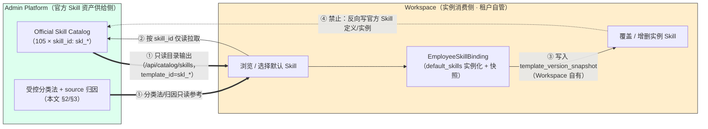
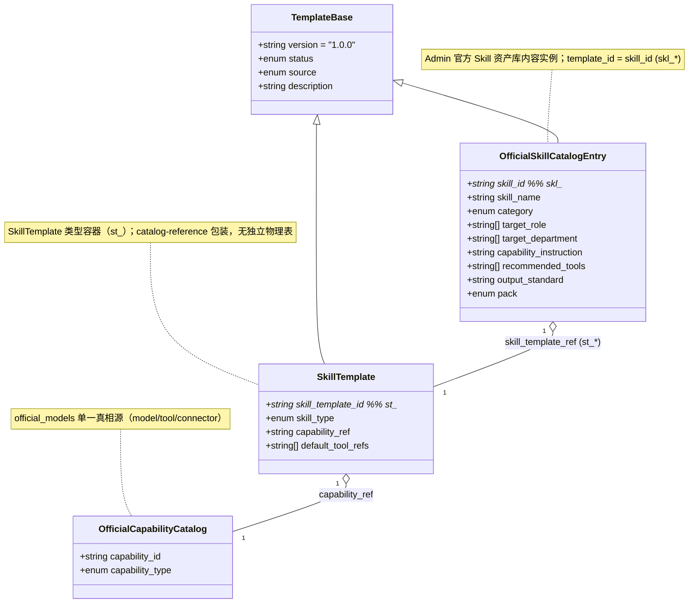
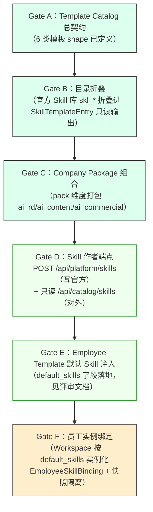

# Official Skill Catalog Contract（官方 Skill 能力库契约 · Admin 供给侧）

> **作者**：高见远（架构师，software-architect）
> **主理人**：齐活林（交付总监）
> **阶段**：Phase-1 Skill Foundation Bootstrap（Design Only · 契约 + 资产文档，零代码、零运行时改动）
> **对齐**：ADR-0017（仅 design-only reservation）；承接 `docs/research/domain/official-skill-catalog-v1.md`（PM 许清楚：105 Skill / 10 字段 / 3 Pack）；与 `ai-company-template-system.md` §2.4（`SkillTemplate` `st_`）、`template-catalog-runtime-contract.md`（TemplateCatalogEntry 输出协议）、`skill-runtime-contract.md`（消费侧运行时）、`admin-workspace-template-boundary.md`（两条铁律 + 数据流单向性）、`template-versioning-policy.md`（SemVer + 快照隔离）、`employee-template-contract.md`（Employee Template `default_skill(s)`）一致
> **范围说明**：本契约把 PM 的 10 字段 Skill 资产**形式化**为官方契约（供给侧资产模型 + 受控分类法 + source 归因 + 与 TemplateBase/Skill Template 关系 + Admin-Workspace 边界 + 红线核验 + Gate 结论）。**本契约是"官方资产目录/供给侧"；`skill-runtime-contract.md` 是"消费侧/Workspace 运行时"，二者互补不矛盾。**

---

## 0. 文档定位与引用

- **素材来源**：PM 的 `official-skill-catalog-v1.md` 是本报告要"形式化"的素材库（105 个 Skill、10 个原始字段、3 个 Pack）。本契约不重述 105 条资产内容，而是定义其**统一模型、分类法、归因规则、与 TemplateBase 的关系**，并在附录 A 给出全量 `skill_id` 映射。
- **与 `SkillTemplate`（`st_`）的关系**：官方 Skill 能力库 = `SkillTemplate`（`st_`）类型的**官方内容实例库**。本目录每条 Skill（`skill_id` = `skl_*`）是 `SkillTemplate` 类型容器的"一个官方内容实例"；`st_` 是模板类型容器命名空间，`skl_` 是本目录的目录稳定标识符。
- **与 `template-catalog-runtime-contract.md` 的关系**：本目录在对外输出时映射为 `TemplateCatalogEntry`，其中 `template_id = skill_id`（`skl_*`），`source = official`，`status` 对齐，`metadata` 含 `pack`/`category`。
- **红线**：不开发 Skill Marketplace、不开发 Skill 交易、不修改 Workspace Runtime、仅建设 Admin 官方 Skill 资产库、零代码。

---

## 1. Skill 资产模型（Asset Model）

### 1.1 字段集（PM 10 字段 + 官方契约 3 字段）

在 PM 的 10 字段基础上，本契约**新增 3 个官方契约字段**：`skill_id`、`status`、`pack`。

| # | 字段 | 类型 | 必填 | 来源 | 说明 |
|---|------|------|------|------|------|
| 1 | `skill_id` | string | 是 | **新增** | 官方 Skill 目录稳定标识符，前缀 `skl_`（如 `skl_ai_rd_python_development`）。见 §1.2 |
| 2 | `skill_name` | string | 是 | PM | Skill 唯一名称（与 v1 目录 heading 一致，如 `python_development`）。人类/代码可读主键 |
| 3 | `category` | string(enum) | 是 | PM + 新增 | 受控分类法二级职能域 key（见 §2）。由 PM 中文类目归一化而来 |
| 4 | `description` | string | 是 | PM | 一句话能力描述 |
| 5 | `target_role` | string[] | 是 | PM | 目标角色（由 PM 斜杠列表解析为数组，如 `["Product Manager","QA"]`） |
| 6 | `target_department` | string[] | 是 | PM | 目标部门（同上解析） |
| 7 | `capability_instruction` | string | 是 | PM | 能力指令：专业知识 + 工作方法 + 执行流程 + 工具建议 + 输出标准（五元结构） |
| 8 | `recommended_tools` | string[] | 否 | PM | 推荐工具（非强制绑定），默认 `[]` |
| 9 | `output_standard` | string | 是 | PM | 交付物格式与质量门槛 |
| 10 | `version` | string | 是 | PM + TemplateBase | SemVer `^\d+\.\d+\.\d+$`，默认 `1.0.0` |
| 11 | `source` | enum | 是 | PM + 新增 | 主来源归因（见 §3），枚举 6 值 |
| 12 | `status` | enum | 是 | **新增** | 复用 `TemplateBase.status`：`draft`/`active`/`disabled`/`archived` |
| 13 | `pack` | enum | 是 | **新增** | 所属 Pack：`ai_rd`/`ai_content`/`ai_commercial`，对齐公司类型 |

### 1.2 `skill_id` 方案（前缀 `skl_`）

- **格式**：`skl_{pack}_{skill_name}`
  - `pack` ∈ `ai_rd`（Pack A · AI 研发公司）/ `ai_content`（Pack B · AI 内容运营）/ `ai_commercial`（Pack C · AI 商业运营）
  - `skill_name` = v1 目录 heading（原样，保证与 PM 资产一一对应）
- **示例**：
  - `skl_ai_rd_python_development`（Pack A，研发）
  - `skl_ai_content_viral_analysis`（Pack B，内容）
  - `skl_ai_commercial_market_analysis`（Pack C，商业）
- **与 `st_`（Skill Template 类型）的关系**：
  - `st_` 是 `SkillTemplate` 模板**类型容器**的命名空间（`ai-company-template-system.md` §2.4）。
  - `skl_` 是本官方目录的**内容实例稳定 ID**（目录级）。
  - 二者为"类型 vs 实例"关系：每个 `skl_*` 对应一个 `st_{skill_name}` 容器（`st_python_development` 等）；`skl_*` 是其实例化内容在 Admin 目录中的稳定键。
  - 在 catalog 输出时，`TemplateCatalogEntry.template_id = skill_id`（`skl_*`）；`st_` 作为类型容器引用存于 `metadata.skill_template_ref`（见 §4）。
  - 说明：`skl_ai_rd_python_dev` 是任务举例中的可读缩写形式；**规范写法为完整 `skill_name`**（`skl_ai_rd_python_development`），缩写仅作展示，不进入标识符。

### 1.3 JSON Schema（draft-07，覆盖全部字段）

```json
{
  "$schema": "http://json-schema.org/draft-07/schema#",
  "title": "OfficialSkillCatalogEntry",
  "type": "object",
  "additionalProperties": false,
  "required": [
    "skill_id", "skill_name", "category", "description",
    "target_role", "target_department", "capability_instruction",
    "recommended_tools", "output_standard", "version",
    "source", "status", "pack"
  ],
  "properties": {
    "skill_id": {
      "type": "string",
      "pattern": "^skl_(ai_rd|ai_content|ai_commercial)_[a-z0-9_]+$",
      "description": "官方 Skill 目录稳定标识符（skl_ 前缀）"
    },
    "skill_name": {
      "type": "string",
      "minLength": 1,
      "description": "Skill 唯一名称，与 PM v1 目录 heading 一致（如 python_development）"
    },
    "category": {
      "type": "string",
      "enum": [
        "product","architecture","development","testing","devops","data","security",
        "content_analysis","topic","content_planning","script","video","design",
        "distribution","data_analysis","operations","copywriting","brand","seo",
        "livestream","audit","promotion",
        "market","user_research","sales","business_plan","finance","pricing",
        "channel","customer_success","growth","fundraising","competition",
        "commercial_ops","commercial_brand"
      ],
      "description": "受控分类法二级职能域 key（见 §2）"
    },
    "description": { "type": "string", "minLength": 1 },
    "target_role": {
      "type": "array", "items": { "type": "string" }, "minItems": 1,
      "description": "目标角色数组（由 PM 斜杠列表解析）"
    },
    "target_department": {
      "type": "array", "items": { "type": "string" }, "minItems": 1
    },
    "capability_instruction": {
      "type": "string", "minLength": 1,
      "description": "能力指令：专业知识+工作方法+执行流程+工具建议+输出标准"
    },
    "recommended_tools": {
      "type": "array", "items": { "type": "string" }, "default": []
    },
    "output_standard": { "type": "string", "minLength": 1 },
    "version": {
      "type": "string", "pattern": "^\\d+\\.\\d+\\.\\d+$", "default": "1.0.0"
    },
    "source": {
      "type": "string",
      "enum": ["MetaGPT SOP","ChatDev workflow","CrewAI example","AutoGen pattern","industry SOP","Curis internal"],
      "description": "主来源归因（每个 Skill 至少标注一个主来源，见 §3）"
    },
    "status": {
      "type": "string",
      "enum": ["draft","active","disabled","archived"],
      "default": "active",
      "description": "复用 TemplateBase.status"
    },
    "pack": {
      "type": "string",
      "enum": ["ai_rd","ai_content","ai_commercial"],
      "description": "所属 Pack，对齐公司类型"
    }
  },
  "examples": [{
    "skill_id": "skl_ai_rd_python_development",
    "skill_name": "python_development",
    "category": "development",
    "description": "使用 Python 实现后端/脚本/算法功能。",
    "target_role": ["Backend Engineer"],
    "target_department": ["研发部"],
    "capability_instruction": "专业知识——掌握 Python 生态、类型注解、虚拟环境与测试。工作方法——以可读性与类型安全优先，遵循 PEP8。执行流程——收接口/任务 → 实现并自测 → 跑单测 → 提交 Code Review。",
    "recommended_tools": ["Git","pytest","ruff","Poetry"],
    "output_standard": "代码通过类型检查与单测；符合团队规范；含必要注释。",
    "version": "1.0.0",
    "source": "ChatDev workflow",
    "status": "active",
    "pack": "ai_rd"
  }]
}
```

---

## 2. category 分类法（Controlled Taxonomy）

分层受控分类法：**一级 = Pack（对齐公司类型）；二级 = 职能域（category key）**。所有 key 由 PM 中文类目归一化而来，全文统一使用 key，label 仅作展示。

### 2.1 一级：Pack（对齐公司类型）

| pack key | 中文 | 对应公司类型 | Skill 数 |
|----------|------|--------------|---------|
| `ai_rd` | AI 研发公司 | software_rnd（研发公司） | 52 |
| `ai_content` | AI 内容运营公司 | 内容运营公司 | 31 |
| `ai_commercial` | AI 商业运营公司 | 商业运营公司 | 22 |

### 2.2 二级：职能域（category key → label 映射）

**Pack A · `ai_rd`（7 类）**

| category key | 中文 label | 数量 |
|---|---|---|
| `product` | 产品 | 10 |
| `architecture` | 架构 | 9 |
| `development` | 开发 | 16 |
| `testing` | 测试 | 6 |
| `devops` | DevOps | 8 |
| `data` | 数据 | 2 |
| `security` | 安全 | 1 |

**Pack B · `ai_content`（15 类）**

| category key | 中文 label | 数量 |
|---|---|---|
| `content_analysis` | 内容分析 | 1 |
| `topic` | 选题 | 2 |
| `content_planning` | 内容策划 | 4 |
| `script` | 脚本 | 1 |
| `video` | 视频 | 2 |
| `design` | 设计 | 2 |
| `distribution` | 分发 | 3 |
| `data_analysis` | 数据分析 | 4 |
| `operations` | 运营 | 4 |
| `copywriting` | 文案 | 3 |
| `brand` | 品牌 | 1 |
| `seo` | SEO | 1 |
| `livestream` | 直播 | 1 |
| `audit` | 审核 | 1 |
| `promotion` | 投放 | 1 |

**Pack C · `ai_commercial`（13 类）**

| category key | 中文 label | 数量 |
|---|---|---|
| `market` | 市场 | 2 |
| `user_research` | 用户研究 | 2 |
| `sales` | 销售 | 2 |
| `business_plan` | 商业计划 | 1 |
| `finance` | 财务 | 3 |
| `pricing` | 定价 | 1 |
| `channel` | 渠道 | 2 |
| `customer_success` | 客户成功 | 2 |
| `growth` | 增长 | 1 |
| `fundraising` | 融资 | 1 |
| `competition` | 竞争 | 1 |
| `commercial_ops` | 运营（商业） | 3 |
| `commercial_brand` | 品牌（商业） | 1 |

> **去重说明**：`运营` 在 Pack B（content `operations`）与 Pack C（commercial `commercial_ops`）并存；`品牌` 在 Pack B（`brand`，内容人设）与 Pack C（`commercial_brand`，商业定位）并存。二者语义不同，故以不同 key 区分，避免跨 Pack 误归类。全文仅使用 key，label 仅展示。

---

## 3. source 归因规则（Attribution Rules）

- **枚举（6 值，必填，每个 Skill 至少标注一个主来源）**：

| source 值 | 含义 | v1 数量 |
|---|---|---|
| `MetaGPT SOP` | 来自 MetaGPT 多智能体 SOP | 10 |
| `ChatDev workflow` | 来自 ChatDev 瀑布/ChatChain workflow | 14 |
| `CrewAI example` | 来自 CrewAI 通用 crew 示例 | 11 |
| `AutoGen pattern` | 来自 AutoGen 多角色协同/人在回路模式 | 2 |
| `industry SOP` | 来自行业通用 SOP（内容营销 7 步、GTM 八步、单位经济、财务建模、SEO、增长等） | 36 |
| `Curis internal` | Curis 平台原生/无直接外部对应、本阶段新定义（与 Runtime/Employee Runtime 强绑定） | 32 |

- **规则**：
  1. 每个 Skill **必须**有且仅有 1 个主 `source`（PM 已逐条标注，本契约沿用）。
  2. `Curis internal` 仅用于"平台原生、无对应外部生态"的能力；不得用它覆盖本应归因到外部生态的能力。
  3. 归因须如实，禁止把外部生态能力标记为 `Curis internal` 以抢占来源。
  4. 未来扩展某 Pack 时，新 Skill 仍须从 6 值中选主来源（可扩展枚举，但须 gate 评审）。

---

## 4. 与 TemplateBase / Skill Template（`st_`）的关系

### 4.1 三层关系

```
官方 Skill 能力库（本契约）
  └── 每条 skill_id = skl_* 是「官方 Skill Template 内容实例」
        └── 对应 SkillTemplate 类型容器 st_{skill_name}   （ai-company-template-system.md §2.4）
              └── SkillTemplate 指向 official capability catalog（capability_type ∈ model/tool/connector）单一真相源
```

- **`skl_*`（本契约）= 官方目录内容实例**：承载 10+3 业务字段，是 Admin 资产库的稳定键。
- **`st_*`（SkillTemplate 类型容器）= 模板类型**：`ai-company-template-system.md` §2.4 定义的 catalog-reference 包装，无独立物理表，指向官方能力目录。
- **`Skill ≡ Capability`**：系统无独立 skill 实体；`SkillTemplate` 仅叠加"技能类型/默认工具引用"等元数据，能力真相源是 `official_models` + `/api/platform/capabilities`。

### 4.2 映射为 TemplateCatalogEntry（catalog 输出协议）

对齐 `template-catalog-runtime-contract.md` §1 统一字段集，官方 Skill 在对外只读输出时映射如下：

| TemplateCatalogEntry 字段 | 本契约来源 | 取值 |
|---|---|---|
| `template_id` | `skill_id` | `skl_*` |
| `version` | `version` | SemVer |
| `name` | `skill_name` | 展示名 |
| `description` | `description` | — |
| `source` | 固定 | `official` |
| `status` | `status` | 对齐（draft/active/disabled/archived） |
| `metadata` | 组合 | 含 `pack` / `category` / `skill_template_ref`(`st_*`) / `target_role` / `target_department` |

> **与 `template-catalog-runtime-contract.md` §3.5 的衔接说明（不矛盾）**：§3.5 的 `SkillTemplateEntry.template_id` 模式为 `^st_`，那是"SkillTemplate 类型容器"的通用形状；本官方库把**官方 Skill 内容**以 `skl_*` 作为 `template_id` 暴露，并在 `metadata.skill_template_ref` 中回指 `st_*` 容器。即：`skl_*` 是"官方目录内容键"，`st_*` 是"模板类型容器键"，二者共存、经 `skill_template_ref` 关联，不冲突。

### 4.3 版本策略对齐

- 所有 `skill_id` 的 `version` 遵循 `template-versioning-policy.md` 的 SemVer。
- Admin 升级 `version`（v1.0.0→v1.1.0）不影响已存在 Workspace 实例（快照隔离，`follow_latest` 默认 false），见 `template-versioning-policy.md` §3。

---

## 5. Admin / Workspace 边界（两条铁律 + 数据流单向性）

沿用 `admin-workspace-template-boundary.md` 的两条铁律与数据流单向性，具体到 Skill 资产：

### 5.1 职责矩阵（Skill 维度）

| 维度 | **Admin Platform（官方资产供给侧）** | **Workspace（租户 · 实例消费侧）** |
|------|---|---|
| 定义官方 Skill 能力库 | ✅ 本契约 + v1 目录（105 条 `skl_*`） | ❌ 不创作官方 Skill |
| 维护分类法 / source 归因 | ✅ 本文 §2 / §3 | ❌ 不修改 |
| 对外只读输出目录 | ✅ `/api/catalog/skills`（只读） | ❌ 不写目录 |
| 绑定 Skill 到员工实例 | ❌ **不做**（属 Workspace 实例面） | ✅ 按 `default_skills` 实例化+快照 |
| 按公司需求组合/覆盖默认 Skill | ❌ 不强制、不修改用户实例 | ✅ Workspace 可整体采用或增删覆盖 |
| 修改用户实例 | ❌ **禁止** | ✅ 实例所有权归 Workspace |

### 5.2 两条铁律（禁止）

1. **Admin 禁止修改用户实例**：不得写 `EmployeeInstance` / `EmployeeSkillBinding` 运行态；不因子库升级改写已存在实例；`template_version_snapshot` 由 Workspace 写入。
2. **Workspace 禁止修改官方模板定义**：不得改官方 `TemplateCatalogEntry`（`source=official`）；只能**只读**感知官方目录，自定义的是"实例"而非"官方 Skill 定义"。

### 5.3 数据流单向性



> 释义：① Admin→Workspace 单向发布官方目录（只读）；② Workspace 仅读拉取 `skill_id`；③ 实例绑定与快照全部落在 Workspace；④ 禁止反向写官方定义。

---

## 6. 红线核验（Red-Line Verification）

- ✅ **未开发 Skill Marketplace**：仅官方资产目录，无 marketplace 交易/上架/购买流程。
- ✅ **未开发 Skill 交易**：无任何付费/计费/交易链路。
- ✅ **未修改 Workspace Runtime**：不碰 EmployeeRuntime / Credential Vault / Usage Event 写入。
- ✅ **仅建设 Admin 官方 Skill 资产库**：本契约 + v1 目录即资产库 v1 内容。
- ✅ **零代码**：未写任何后端代码、未建表、未加 API 路由（端点均为 design-only 标注）、未创建运行时源文件（除本 markdown 及评审文档外）、未执行 git 提交（由主理人落盘与提交）。

---

## 7. Mermaid 图

### 7.1 Skill 资产类图（含 skill_id/skill_name/category/... + 与 Skill Template `st_` 关系）



### 7.2 Admin–Workspace 数据流单向性

（见 §5.3 流程图，已含两条铁律与单向性。）

### 7.3 Gate 路径（A→F，新增 Skill 相关端点 gate）



---

## 8. Gate 结论

- **结论**：**PASS-WITH-NOTES**
  - 理由：本契约完成"官方 Skill 资产供给侧的形式化"（模型/分类法/归因/关系/边界/红线全部闭合），不与任何既有契约矛盾；但**真实绑定/实例化归 Workspace 侧 gate**（Gate E/F），不在本期红线内，故以 PASS-WITH-NOTES 收口。
- **后续 Gate 路径**（建议）：
  - **Gate B（目录折叠）**：将 105 条 `skl_*` 官方 Skill 折叠进 `SkillTemplateEntry` 只读输出（catalog-reference），打通 `/api/catalog/skills`。
  - **Gate D（Skill 作者端点）**：Admin 写端点 `POST /api/platform/skills`（官方资产供给侧写）+ 只读 `GET /api/catalog/skills`（对外）；二者分离，遵循 Admin/Workspace 边界。
  - **Gate E（Employee Template 默认 Skill 注入）**：把 `default_skills` 数组落地到 `EmployeeTemplate`（扩展 §2.3 的 `default_skill` 单数），见 `docs/review/employee-default-skill-mapping.md`。
  - **Gate F（员工实例绑定）**：Workspace 按 `default_skills` 实例化 `EmployeeSkillBinding` + `template_version_snapshot` 快照隔离（`follow_latest` 默认 false）。
- **不在本期红线内**：Marketplace（G3 双签+安全 gate）、交易、Workspace Runtime 改动、任何代码/表/路由。

---

## 附录 A：全量 `skill_id` 映射表（105 条，v1 官方目录）

> 格式：`skill_name` → `skill_id`（`skl_*`）· `pack` · `category`(key) · `category_label` · `status` · `source`

### Pack A · `ai_rd`（52）

| skill_name | skill_id | pack | category | label | status | source |
|---|---|---|---|---|---|---|
| requirement_analysis | skl_ai_rd_requirement_analysis | ai_rd | product | 产品 | active | MetaGPT SOP |
| prd_design | skl_ai_rd_prd_design | ai_rd | product | 产品 | active | MetaGPT SOP |
| user_story_writing | skl_ai_rd_user_story_writing | ai_rd | product | 产品 | active | MetaGPT SOP |
| competitive_analysis | skl_ai_rd_competitive_analysis | ai_rd | product | 产品 | active | MetaGPT SOP |
| product_roadmap | skl_ai_rd_product_roadmap | ai_rd | product | 产品 | active | Curis internal |
| acceptance_criteria_design | skl_ai_rd_acceptance_criteria_design | ai_rd | product | 产品 | active | MetaGPT SOP |
| feature_prioritization | skl_ai_rd_feature_prioritization | ai_rd | product | 产品 | active | Curis internal |
| user_research | skl_ai_rd_user_research | ai_rd | product | 产品 | active | CrewAI example |
| product_metrics_definition | skl_ai_rd_product_metrics_definition | ai_rd | product | 产品 | active | industry SOP |
| release_planning | skl_ai_rd_release_planning | ai_rd | product | 产品 | active | Curis internal |
| system_design | skl_ai_rd_system_design | ai_rd | architecture | 架构 | active | MetaGPT SOP |
| api_design | skl_ai_rd_api_design | ai_rd | architecture | 架构 | active | MetaGPT SOP |
| database_design | skl_ai_rd_database_design | ai_rd | architecture | 架构 | active | MetaGPT SOP |
| tech_selection | skl_ai_rd_tech_selection | ai_rd | architecture | 架构 | active | MetaGPT SOP |
| performance_design | skl_ai_rd_performance_design | ai_rd | architecture | 架构 | active | ChatDev workflow |
| security_design | skl_ai_rd_security_design | ai_rd | security | 安全 | active | Curis internal |
| architecture_review | skl_ai_rd_architecture_review | ai_rd | architecture | 架构 | active | AutoGen pattern |
| microservice_design | skl_ai_rd_microservice_design | ai_rd | architecture | 架构 | active | Curis internal |
| data_modeling | skl_ai_rd_data_modeling | ai_rd | data | 数据 | active | Curis internal |
| integration_design | skl_ai_rd_integration_design | ai_rd | architecture | 架构 | active | Curis internal |
| scalability_design | skl_ai_rd_scalability_design | ai_rd | architecture | 架构 | active | Curis internal |
| python_development | skl_ai_rd_python_development | ai_rd | development | 开发 | active | ChatDev workflow |
| react_development | skl_ai_rd_react_development | ai_rd | development | 开发 | active | Curis internal |
| backend_development | skl_ai_rd_backend_development | ai_rd | development | 开发 | active | ChatDev workflow |
| frontend_development | skl_ai_rd_frontend_development | ai_rd | development | 开发 | active | Curis internal |
| debugging | skl_ai_rd_debugging | ai_rd | development | 开发 | active | ChatDev workflow |
| refactoring | skl_ai_rd_refactoring | ai_rd | development | 开发 | active | ChatDev workflow |
| code_review | skl_ai_rd_code_review | ai_rd | development | 开发 | active | AutoGen pattern |
| concurrency_programming | skl_ai_rd_concurrency_programming | ai_rd | development | 开发 | active | Curis internal |
| algorithm_implementation | skl_ai_rd_algorithm_implementation | ai_rd | development | 开发 | active | Curis internal |
| api_implementation | skl_ai_rd_api_implementation | ai_rd | development | 开发 | active | MetaGPT SOP |
| sql_development | skl_ai_rd_sql_development | ai_rd | development | 开发 | active | Curis internal |
| test_driven_development | skl_ai_rd_test_driven_development | ai_rd | development | 开发 | active | ChatDev workflow |
| typescript_development | skl_ai_rd_typescript_development | ai_rd | development | 开发 | active | Curis internal |
| git_workflow | skl_ai_rd_git_workflow | ai_rd | development | 开发 | active | Curis internal |
| mobile_development | skl_ai_rd_mobile_development | ai_rd | development | 开发 | active | Curis internal |
| documentation_writing | skl_ai_rd_documentation_writing | ai_rd | development | 开发 | active | Curis internal |
| data_pipeline_development | skl_ai_rd_data_pipeline_development | ai_rd | data | 数据 | active | Curis internal |
| test_design | skl_ai_rd_test_design | ai_rd | testing | 测试 | active | ChatDev workflow |
| automated_testing | skl_ai_rd_automated_testing | ai_rd | testing | 测试 | active | ChatDev workflow |
| performance_testing | skl_ai_rd_performance_testing | ai_rd | testing | 测试 | active | ChatDev workflow |
| integration_testing | skl_ai_rd_integration_testing | ai_rd | testing | 测试 | active | Curis internal |
| regression_testing | skl_ai_rd_regression_testing | ai_rd | testing | 测试 | active | ChatDev workflow |
| test_retrospective | skl_ai_rd_test_retrospective | ai_rd | testing | 测试 | active | ChatDev workflow |
| dockerization | skl_ai_rd_dockerization | ai_rd | devops | DevOps | active | ChatDev workflow |
| cicd_pipeline | skl_ai_rd_cicd_pipeline | ai_rd | devops | DevOps | active | ChatDev workflow |
| deployment | skl_ai_rd_deployment | ai_rd | devops | DevOps | active | ChatDev workflow |
| monitoring | skl_ai_rd_monitoring | ai_rd | devops | DevOps | active | Curis internal |
| canary_release | skl_ai_rd_canary_release | ai_rd | devops | DevOps | active | Curis internal |
| infrastructure_as_code | skl_ai_rd_infrastructure_as_code | ai_rd | devops | DevOps | active | Curis internal |
| log_analysis | skl_ai_rd_log_analysis | ai_rd | devops | DevOps | active | Curis internal |
| incident_response | skl_ai_rd_incident_response | ai_rd | devops | DevOps | active | Curis internal |

### Pack B · `ai_content`（31）

| skill_name | skill_id | pack | category | label | status | source |
|---|---|---|---|---|---|---|
| viral_analysis | skl_ai_content_viral_analysis | ai_content | content_analysis | 内容分析 | active | industry SOP |
| topic_planning | skl_ai_content_topic_planning | ai_content | topic | 选题 | active | CrewAI example |
| content_planning | skl_ai_content_content_planning | ai_content | content_planning | 内容策划 | active | CrewAI example |
| script_writing | skl_ai_content_script_writing | ai_content | script | 脚本 | active | industry SOP |
| video_optimization | skl_ai_content_video_optimization | ai_content | video | 视频 | active | industry SOP |
| data_retrospective | skl_ai_content_data_retrospective | ai_content | data_analysis | 数据分析 | active | industry SOP |
| cover_design_advice | skl_ai_content_cover_design_advice | ai_content | design | 设计 | active | industry SOP |
| title_optimization | skl_ai_content_title_optimization | ai_content | copywriting | 文案 | active | industry SOP |
| multi_platform_distribution | skl_ai_content_multi_platform_distribution | ai_content | distribution | 分发 | active | industry SOP |
| fan_operation | skl_ai_content_fan_operation | ai_content | operations | 运营 | active | Curis internal |
| livestream_script | skl_ai_content_livestream_script | ai_content | livestream | 直播 | active | Curis internal |
| seo_optimization | skl_ai_content_seo_optimization | ai_content | seo | SEO | active | industry SOP |
| content_calendar | skl_ai_content_content_calendar | ai_content | content_planning | 内容策划 | active | industry SOP |
| hook_writing | skl_ai_content_hook_writing | ai_content | copywriting | 文案 | active | industry SOP |
| copywriting | skl_ai_content_copywriting | ai_content | copywriting | 文案 | active | CrewAI example |
| brand_voice | skl_ai_content_brand_voice | ai_content | brand | 品牌 | active | Curis internal |
| thumbnail_strategy | skl_ai_content_thumbnail_strategy | ai_content | design | 设计 | active | industry SOP |
| content_series_planning | skl_ai_content_content_series_planning | ai_content | content_planning | 内容策划 | active | industry SOP |
| trend_research | skl_ai_content_trend_research | ai_content | topic | 选题 | active | industry SOP |
| editing_guidance | skl_ai_content_editing_guidance | ai_content | video | 视频 | active | industry SOP |
| community_management | skl_ai_content_community_management | ai_content | operations | 运营 | active | Curis internal |
| content_audit | skl_ai_content_content_audit | ai_content | audit | 审核 | active | industry SOP |
| content_repurposing | skl_ai_content_content_repurposing | ai_content | distribution | 分发 | active | industry SOP |
| platform_algorithm_research | skl_ai_content_platform_algorithm_research | ai_content | data_analysis | 数据分析 | active | industry SOP |
| email_newsletter | skl_ai_content_email_newsletter | ai_content | distribution | 分发 | active | industry SOP |
| ugc_campaign | skl_ai_content_ugc_campaign | ai_content | operations | 运营 | active | Curis internal |
| influencer_collab | skl_ai_content_influencer_collab | ai_content | operations | 运营 | active | CrewAI example |
| content_performance_dashboard | skl_ai_content_content_performance_dashboard | ai_content | data_analysis | 数据分析 | active | industry SOP |
| paid_promotion | skl_ai_content_paid_promotion | ai_content | promotion | 投放 | active | CrewAI example |
| competitor_content_watch | skl_ai_content_competitor_content_watch | ai_content | data_analysis | 数据分析 | active | CrewAI example |
| content_brief_writing | skl_ai_content_content_brief_writing | ai_content | content_planning | 内容策划 | active | industry SOP |

### Pack C · `ai_commercial`（22）

| skill_name | skill_id | pack | category | label | status | source |
|---|---|---|---|---|---|---|
| market_analysis | skl_ai_commercial_market_analysis | ai_commercial | market | 市场 | active | CrewAI example |
| user_research_biz | skl_ai_commercial_user_research_biz | ai_commercial | user_research | 用户研究 | active | CrewAI example |
| sales_strategy | skl_ai_commercial_sales_strategy | ai_commercial | sales | 销售 | active | CrewAI example |
| business_plan | skl_ai_commercial_business_plan | ai_commercial | business_plan | 商业计划 | active | industry SOP |
| financial_analysis | skl_ai_commercial_financial_analysis | ai_commercial | finance | 财务 | active | industry SOP |
| pricing_strategy | skl_ai_commercial_pricing_strategy | ai_commercial | pricing | 定价 | active | industry SOP |
| channel_management | skl_ai_commercial_channel_management | ai_commercial | channel | 渠道 | active | industry SOP |
| customer_success | skl_ai_commercial_customer_success | ai_commercial | customer_success | 客户成功 | active | industry SOP |
| growth_hacking | skl_ai_commercial_growth_hacking | ai_commercial | growth | 增长 | active | industry SOP |
| fundraising_materials | skl_ai_commercial_fundraising_materials | ai_commercial | fundraising | 融资 | active | industry SOP |
| competitor_monitoring | skl_ai_commercial_competitor_monitoring | ai_commercial | competition | 竞争 | active | CrewAI example |
| gtm_strategy | skl_ai_commercial_gtm_strategy | ai_commercial | market | 市场 | active | industry SOP |
| icp_definition | skl_ai_commercial_icp_definition | ai_commercial | user_research | 用户研究 | active | industry SOP |
| unit_economics | skl_ai_commercial_unit_economics | ai_commercial | finance | 财务 | active | industry SOP |
| revenue_operations | skl_ai_commercial_revenue_operations | ai_commercial | commercial_ops | 运营（商业） | active | industry SOP |
| churn_analysis | skl_ai_commercial_churn_analysis | ai_commercial | customer_success | 客户成功 | active | industry SOP |
| partnership_development | skl_ai_commercial_partnership_development | ai_commercial | channel | 渠道 | active | Curis internal |
| brand_strategy_biz | skl_ai_commercial_brand_strategy_biz | ai_commercial | commercial_brand | 品牌（商业） | active | Curis internal |
| business_kpi_design | skl_ai_commercial_business_kpi_design | ai_commercial | commercial_ops | 运营（商业） | active | industry SOP |
| sales_enablement | skl_ai_commercial_sales_enablement | ai_commercial | sales | 销售 | active | industry SOP |
| crm_management | skl_ai_commercial_crm_management | ai_commercial | commercial_ops | 运营（商业） | active | Curis internal |
| financial_modeling | skl_ai_commercial_financial_modeling | ai_commercial | finance | 财务 | active | industry SOP |

*—— Official Skill Catalog Contract（纯设计/契约，零代码）。与 ADR-0017 一致，仅 design-only reservation。*
