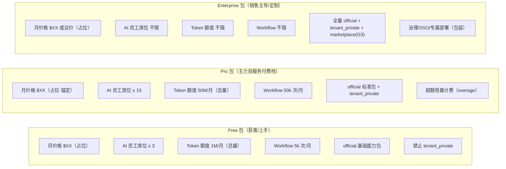
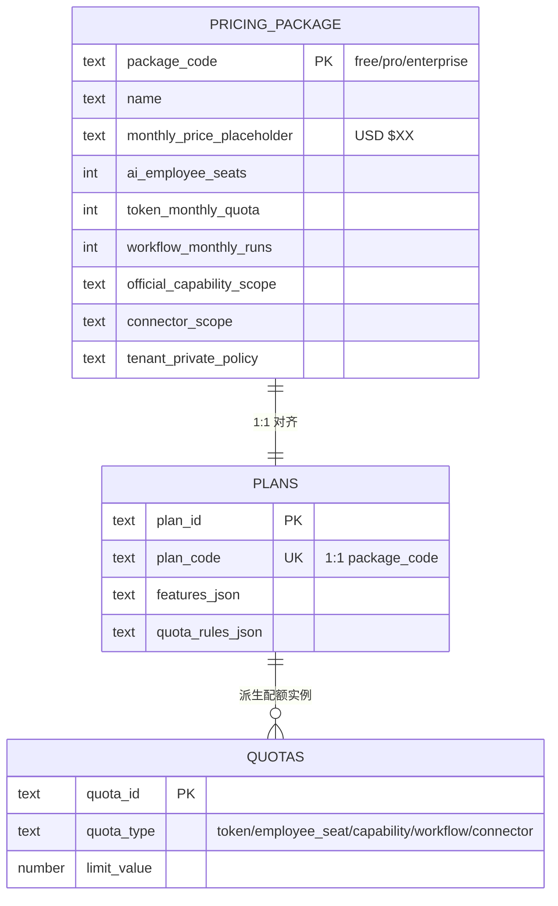

# Pricing Package Contract（定价包契约）

Status: **Phase-8.5 Commercial Readiness** · 纯契约（无代码）
Owner: Admin Platform（套餐包装层）。本文档定义面向客户的"产品包装"，不重定义 Plan 管理契约。
作者：架构师 高见远（software-architect）

---

## 0. 文档定位与引用

本契约定义 **Free / Pro / Enterprise 三个定价包（Pricing Package）**，是面向客户的"产品包装"视图，与 `plans` 表（`plan_code ∈ {free, pro, enterprise}`）**1:1 对齐**，但**不重定义** Plan 管理契约（status 四态机、版本化、CRUD 见 `admin-plan-management-contract.md`）。

> - 商业模型与套餐字段基线来自 `docs/contracts/pricing-contract.md`（Phase-7.6 冻结的 Hybrid 模型与 Plan Structure / Suggested Tier Shape）。
> - Plan 治理契约来自 `docs/contracts/admin-plan-management-contract.md`（`plan_code` ↔ `plan_tier` 1:1、status 四态机、版本化）。
> - 配额字段结构来自 `docs/design/phase8-billing-mvp-design.md` §8（`quota_rules_json` = `{token_monthly_limit, seat_limit, capability_sources[], workflow_monthly_limit, overage:{...}, currency}`）。
> - 价格占位（`$XX`）约定来自 `docs/research/domain/pricing-model-research.md` Part B §A.6 / §C.3（实际价格带待总控决策席填充）。
> - 私有能力边界来自 `docs/contracts/admin-capability-package-contract.md`（tenant_private → Workspace 自管，Admin 不管理明文）。
> - 本契约不重复上述文档已定义的字段语义，仅补充 **客户视角的"产品包装 → plans 落点"映射**。

---

## 1. 定价包总览（客户视角）

---

## 2. 三档定价包字段矩阵（逐字段）

> 价格一律以占位符 `$XX` 标出，**不写死真实数字**，待总控决策席填。所有额度为"含包量"（included），超出部分走 `billing-rule-contract.md` 的 overage 计费。

| 字段 | Free | Pro | Enterprise | 落到 Phase-8 的位置 |
| --- | --- | --- | --- | --- |
| **月价格（占位）** | `$XX` | `$XX` | `$XX` / 议价 | 未来 `plans.monthly_price`（G1 禁止区；Phase-8 未建列，本期仅占位） |
| **AI Employee 席位上限** | 3 | 15 | 不限（0=不限） | `plans.quota_rules.seat_limit` |
| **Token 额度（月度）** | 1,000,000 | 50,000,000 | 不限（0=不限） | `plans.quota_rules.token_monthly_limit`（**总量**，跨模型统一计数） |
| **Workflow 额度（月度运行次数）** | 5,000 | 50,000 | 不限（0=不限） | `plans.quota_rules.workflow_monthly_limit` |
| **Capability 额度（official 可挂载）** | 官方基础包（starter） | 官方标准包（pro pack） | 全量 official 包 | `plans.quota_rules.capability_sources` 含 `'official'` + `capability_packages` 绑定（见 §3.5） |
| **Connector 额度（可挂载）** | 官方基础 connector | 官方标准 connector | 全量 + marketplace(G3) | `capability_sources` 白名单 + 未来 `quotas.quota_type='connector_limit'`（见 §3.6） |
| **私有能力限制（tenant_private）** | 禁止 | 允许（数量受 Admin 不管理明文约束） | 允许（治理） | `plans.quota_rules.capability_sources` 含 `'tenant_private'` |
| **超额单价（overage）** | 全部 $0 | token `$0.002`/千、seat `$9`、workflow `$0.01`、capability `$0` | 全部 $0（包干） | `plans.quota_rules.overage{...}` |
| **重置周期** | monthly | monthly | annual（Enterprise 默认 annual） | `plans.billing_interval` |
| **来源白名单** | `[official]` | `[official, tenant_private]` | `[official, tenant_private, marketplace]` | `plans.quota_rules.capability_sources` |

---

## 3. 字段逐一说明与映射

### 3.1 月价格（占位 `$XX`）
- **说明**：套餐基础月费，是混合定价（Hybrid）的"订阅基底"。本阶段**仅为占位**，不触发任何资金动作（无支付/扣款/发票）。
- **落点**：未来 `plans.monthly_price` 列（属 G1 禁止区）。Phase-8 Billing MVP 的 `plans` 表**未建价格列**，仅持有 `quota_rules_json`；本期价格占位由总控决策席在 G1 解锁前填充决策，不写入实现。

### 3.2 AI Employee 席位上限
- **说明**：套餐含包的可运行 AI 员工角色数（`0` = 不限，仅 Enterprise）。席位计数来源为 `employee_instances(enabled=1)`（Phase-4 后转 Workspace 权威计量；Admin 现仅只读观测）。
- **落点**：`plans.quota_rules.seat_limit` → 派生 per-tenant `quotas(quota_type=employee_seat, limit_value=seat_limit)`。

### 3.3 Token 额度（月度，**总量**）
- **说明**：套餐含包的模型 Token 总量（prompt+completion 合并，按 `total_tokens` 计）。**本阶段为总量计数，不按模型拆分**（model_scope 按模型细分属未来扩展）；超额部分进入 overage 计费。
- **落点**：`plans.quota_rules.token_monthly_limit` → `quotas(quota_type=token, limit_value=token_monthly_limit)`；`current_usage` 由 `usage_event.total_tokens` 读时聚合派生（与期末重算同源）。

### 3.4 Workflow 额度（月度运行次数）
- **说明**：套餐含包的 Workflow 运行次数（按月计数，非时长）。超额进入 overage（按次计费）。
- **落点**：`plans.quota_rules.workflow_monthly_limit` → `quotas(quota_type=workflow, limit_value=workflow_monthly_limit)`；`current_usage` 由 `workflow_runs` 期内计数只读派生。

### 3.5 Capability 额度（official 可挂载）
- **说明**：本阶段 capability 额度以**「来源白名单 + 官方包绑定」**表达，**不按个数硬计数**。Free/Pro/Enterprise 的差异体现在可绑定的 `official` 能力包集合（starter / pro pack / 全量）与是否允许 `tenant_private`。
- **落点**：
  - 来源白名单 → `plans.quota_rules.capability_sources`（含 `'official'`）。
  - 具体 official 包 → Admin 经 `admin-capability-package-contract.md` 将 `official` 包绑定到 Plan 的 `capability_packages`；Workspace 经 catalog 只读感知白名单，自我约束。

### 3.6 Connector 额度（可挂载）
- **说明**：Connector 属 `capability_type=connector` 的能力。本阶段其额度同样以**白名单 + 未来 `connector_limit` 配额**表达。
- **落点**：来源白名单含 `'official'`（connector 由 official 提供）；未来在 `quotas` 表 additive 增加 `quota_type='connector_limit'`（Phase-8 MVP 的 `quotas.quota_type` 检查当前仅含 `token/employee_seat/capability/workflow` 四类，connector 须扩展，对齐 `billing-domain-contract.md` 五类）。

### 3.7 私有能力限制（tenant_private）
- **说明**：是否允许租户挂载 `tenant_private` 私有能力包，以及数量/类型边界。Free 禁止，Pro/Enterprise 允许。
- **落点**：`plans.quota_rules.capability_sources` 含 `'tenant_private'` 即允许。
- **铁律（对齐 `admin-capability-package-contract.md`）**：`tenant_private` 包由 Workspace/CEO 自管，Admin **不 CRUD、不读取其明文**（`default_instructions`/`metadata_json`/`credential_ref` 不可见），仅经 `usage_event` 观测存在性与计量。本契约不定义 tenant_private 包的内容管理。

---

## 4. 与 Phase-8 实现的映射

| 定价包字段 | Phase-8 `plans` 落点 | Phase-8 `quotas` 落点 | 备注 |
| --- | --- | --- | --- |
| 月价格 | `plans.quota_rules`（价格列待 G1 加） | — | 占位 `$XX`，无资金动作 |
| AI 员工席位 | `plans.quota_rules.seat_limit` | `quota_type=employee_seat, limit_value=seat_limit` | Phase-4 后权威计量 |
| Token 额度 | `plans.quota_rules.token_monthly_limit` | `quota_type=token, limit_value=...` | 读时聚合派生 current_usage |
| Workflow 额度 | `plans.quota_rules.workflow_monthly_limit` | `quota_type=workflow, limit_value=...` | 只读聚合 |
| Capability（official） | `plans.quota_rules.capability_sources` + `capability_packages` | `quota_type=capability, source_scope_json` | 白名单，非硬计数 |
| Connector | `capability_sources` + 未来 `connector_limit` | 未来 `quota_type=connector_limit` | 须 additive 扩展 |
| 私有能力 | `capability_sources` 含 `tenant_private` | — | Admin 不管理明文 |
| 超额单价 | `plans.quota_rules.overage{...}` | — | 非权威估算，仅计量/估算 |
| 重置周期 | `plans.billing_interval` | `quotas.period` | monthly / annual |

> 映射口径与 `phase8-billing-mvp-design.md` §3.3 三档默认 Plan seed 完全一致（free: 1M token/3 seat；pro: 50M/15 seat/50k workflow；enterprise: 0=不限）。

---

## 5. 横切：与既有契约的对齐引用

| 维度 | 对齐契约 | 说明 |
| --- | --- | --- |
| 套餐结构与分层 | `pricing-contract.md` | Free/Pro/Enterprise 目标与商业含义沿用；不重定义 Plan Structure。 |
| Plan 治理（status/版本/1:1） | `admin-plan-management-contract.md` | 本契约只做"包装视图"，Plan 的生命周期/版本化由该契约负责。 |
| 配额字段结构 | `phase8-billing-mvp-design.md` §8 | `quota_rules_json` 结构与本契约字段一一对应。 |
| 私有能力边界 | `admin-capability-package-contract.md` | tenant_private 不进 official 目录、Admin 不读明文。 |
| 价格占位 | `pricing-model-research.md` Part B §C.3 | `$XX` 占位，待总控决策席填充。 |

---

## 6. 边界声明 + 结论与 gate 边界

### 6.1 边界声明（五条禁止均满足）
1. **零代码**：本契约不创建任何表、不修改任何 `.py` 源文件、不写计费/支付代码，仅作产品包装定义。
2. **不开发支付**：无支付通道、无订阅扣款。
3. **不开发自动扣款**：价格仅为占位 `$XX`，不触发任何资金动作。
4. **不开发 Invoice**：不生成发票/单据；`billing_event` 的 `issued` 仅状态占位（见 `billing-rule-contract.md`）。
5. **不开发 Marketplace**：marketplace 能力包仅作 Enterprise 白名单占位，治理与分润须 **G3 双签**（见 `admin-capability-package-contract.md` §5）。
6. **不开发 Value Pricing**：价值/ROI 计费属 L6 愿景，本契约不涉及（见 `billing-rule-contract.md`）。

### 6.2 结论与 gate 边界
- **三档定价包已定义（客户视角包装）**：Free/Pro/Enterprise 与 `plans.plan_code` 1:1 对齐，逐字段映射到 `plans.features` / `plans.quota_rules` / `quotas`，且字段口径与 Phase-8 三档默认 Plan seed 完全一致。
- **价格为占位、不触发资金动作**：`$XX` 仅作商业包装占位，真实价格带待总控决策席在 G1 前填充决策；本契约不写入任何价格实现。
- **Marketplace 不在本契约范围**：仅 Enterprise 白名单占位，治理/分润须 G3 双签后定义。
- **tenant_private 不进官方管理**：Admin 仅经 `usage_event` 观测私有能力存在性与计量，不管理其明文。
- **Gate 边界**：定价包包装定义可在 G1 前先行（仅目录/占位）；价格生效与真实 overage 计费须 **G1 gate 解锁**；marketplace 能力须 **G3 双签**。

*—— Phase-8.5 Commercial Readiness · Pricing Package Contract（纯设计/契约，无代码）。*
