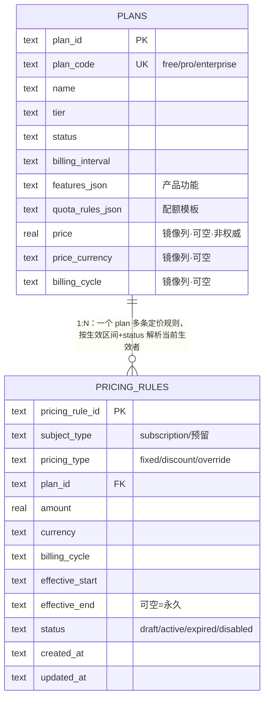

# Pricing Rule Contract（定价规则契约）

> **作者**：高见远（架构师，software-architect）
> **阶段**：Phase-9A P0 Subscription Pricing Rule（设计 + 契约阶段，零代码）
> **归属**：Admin Platform 线（商业配置面）；**不触及 Workspace / Shared Contract**
> **定位**：本契约定义 `pricing_rules(subscription)` 作为**订阅价格权威来源**；`plans.price` 仅作展示/镜像字段，不得为唯一价格来源。把"价格管理从硬编码升级为 Admin 可配置"。

---

## 0. 引用基线（来自真实代码扫描）

| 真实落点 | 证据 | 说明 |
| --- | --- | --- |
| `plans` 表（三档 seed 可配） | `backend/app/database.py:746` | 列：`plan_id, plan_code, name, tier, status, version, billing_interval, features_json, quota_rules_json`；**确认无 `price` / `billing_cycle` 列**（Phase-8.6 审计识别的**唯一 P0 缺口**） |
| `quotas` 表 | `database.py:763` | 租户配额实例；含 `is_unlimited`（Phase-9A additive 加列模式） |
| `BillingStore` | `backend/app/billing_store.py` | 纯 SQL 数据访问层，`?` 占位、row→dict（`_xxx_dto`）、零出站调用 |
| Platform 路由守卫 | `backend/app/main.py:1044` `_require_platform_admin` | 所有 `/api/platform/*` 商业写路由均受此守卫 |
| Quota API 透传写法 | `main.py:1508-1552` | `QuotaCreateIn` / `QuotaUpdateIn` + `create_platform_quota` / `update_platform_quota` 透传 `billing.*` |
| 商业配置契约 | `docs/contracts/commercial-configuration-contract.md` §2 | PricingRule 对象定义（本契约是其订阅价维度的落地细化） |
| P0 缺口审计 | `docs/review/phase86-admin-commercial-hardcode-audit.md` | 确认 `plans` 表**无 price 列**为唯一 P0 缺口 |
| 线归属冻结 | `docs/pmo/source-control-baseline-freeze.md` | 本 Issue 归属 **Admin Platform**，不碰 Workspace / Shared Contract |

---

## 1. PricingRule 字段（权威价格对象）

> `pricing_rules` 表是**价格权威来源**。一条 PricingRule 表达"某 subject 在某时段以某价格生效"。

| 字段 | 类型 | 必填 | 说明 |
| --- | --- | --- | --- |
| `pricing_rule_id` | TEXT PK | ✅ | 规则主键；seed 用确定性 ID（如 `pr_default_free`），业务新建用 `pr_<uuid>` |
| `subject_type` | TEXT | ✅ | **定价主体类型**（见枚举）；本 Issue 仅实现 `subscription` |
| `pricing_type` | TEXT | ✅ | **价格类型**（见枚举）：`fixed`（固定价）/ `discount`（折扣价）/ `override`（覆盖价） |
| `plan_id` | TEXT | ✅ | 关联 `plans.plan_id`（订阅价场景即套餐 ID） |
| `amount` | REAL | ✅ | 金额数值（不含货币符号） |
| `currency` | TEXT | ✅ | 货币（默认 `USD`，ISO 4217） |
| `billing_cycle` | TEXT | ✅ | 计费周期（见枚举）：`month` / `year` / `one_time` |
| `effective_start` | TEXT | ✅ | 生效开始（ISO-8601 UTC） |
| `effective_end` | TEXT | ⬜ | 生效结束（ISO-8601 UTC）；`NULL` = 永久生效 |
| `status` | TEXT | ✅ | 生命周期状态（见枚举）：`draft` / `active` / `expired` / `disabled` |
| `created_at` | TEXT | 内部 | 创建时间（默认 `current_timestamp`） |
| `updated_at` | TEXT | 内部 | 更新时间（默认 `current_timestamp`） |

### 1.1 枚举定义

**`subject_type`（定价主体）**
- `subscription` — **本 Issue 实现**（套餐订阅价，`plan_id` 指向 `plans`）
- 预留（**本 Issue 不实现**）：`capability` / `employee` / `connector` / `template`

**`pricing_type`（价格类型）**
- `fixed` — 固定标价（本 Issue 主用）
- `discount` — 折扣价（如活动价、企业客户折扣，未来由 Promotion/TenantPolicy 联动）
- `override` — 覆盖价（特殊主体覆盖默认价）

**`status`（生命周期）**
- `draft` — 草稿，未生效
- `active` — 生效中（参与价格解析）
- `expired` — 已过期（历史记录，**保留不删**）
- `disabled` — 已禁用（人工关停，保留不删）

**`billing_cycle`（计费周期）**
- `month` / `year` / `one_time`（可扩展：`quarter` 等未来 additive 增加）

---

## 2. 数据模型关系（Plan ↔ PricingRule 一对多）

> **职责切分原则**：
> - **Plan 负责**：产品定义 / 功能（`features_json`）/ 配额模板（`quota_rules_json`）/ 能力关联。Plan **不负责**历史价 / 特殊价 / 活动价。
> - **PricingRule 负责**：当前价 / 历史价 / 特殊价 / 活动价。是价格的**唯一权威来源**。



**关键关系**：`Plan 1 ── N PricingRule`。同一个 plan 可存在多条规则（历史价、活动价、企业客户价并存）。**当前生效价**通过 §3 解析策略从多条规则中挑出唯一一条，写入 `plans` 镜像列供展示。

---

## 3. 价格解析策略（当前生效价算法）

> 核心不变量：**历史价格保留不删；新规则覆盖旧规则（通过状态流转而非改历史）。**

### 3.1 当前生效固定价（权威查询）

```
当前生效价 = 满足以下全部条件的最新一条 PricingRule：
  subject_type = 'subscription'
  AND pricing_type = 'fixed'
  AND status = 'active'
  AND effective_start <= now
  AND (effective_end IS NULL OR effective_end >= now)
排序：effective_start DESC, created_at DESC → 取第一条
```

- 返回 `None` 表示该 plan **当前无生效订阅价**（典型：Enterprise 不设默认订阅价，待 TenantPricingPolicy 处理）。
- `discount` / `override` 类型不在本 Issue 的"基础订阅价解析"中使用，预留给 Promotion / Tenant Pricing Policy（§6）。

### 3.2 新规则覆盖旧规则（写时语义，create 与 update 一致）

当 Admin 创建一条 **`pricing_type='fixed' AND status='active'`** 的新规则时：
1. 先将**同 `plan_id` + 同 `subject_type` + `pricing_type='fixed'` + `status='active'`** 的旧规则置为 `status='expired'`，并回填 `effective_end = now`。
2. 再插入新规则（`status='active'`, `effective_start=now`）。
3. **旧规则记录保留不删**（历史可追溯）。

> **【P0 发现 B 采纳】`update_pricing_rule` 现具备同等覆盖语义**：当一次 `PUT` 更新使某条规则**进入 `status='active' AND pricing_type='fixed'` 状态**（即从非 active-fixed 转变而来，如 `draft→active` 且 `pricing_type=fixed`）时，会先把**同 `plan_id` + 同 `subject_type` + `pricing_type='fixed'` + `status='active'` + `pricing_rule_id != 当前规则`** 的其它记录置为 `status='expired'` 并回填 `effective_end=now`，随后才把当前规则置为 `active`。由此保证"同 plan 任意时刻至多一条 active 固定价"（唯一生效价不变量）。历史记录同样**保留不删**。触发条件与边界见 §4.3。

### 3.3 禁止事项

- ❌ **禁止修改已生效（`active`）历史记录的金额**：已 `active` 的规则金额只读；要改价只能 `expire` 旧规则后**新建**新规则。
- ❌ **禁止物理删除历史价格**：`expired` / `disabled` 记录一律保留（审计 / 历史回溯需要）。

---

## 4. API 设计（全部 `_require_platform_admin`，禁止 Workspace 访问）

> 四类端点，全部位于 `backend/app/main.py` 的 platform 路由区，统一受 `_require_platform_admin` 守卫。注：该共享守卫对缺令牌 / 令牌不符**统一返回 401**（与全部既有 `/api/platform/*` 路由一致），非 403。**不提供任何 Workspace / 前台价格查询端点**。

### 4.1 `GET /api/platform/pricing-rules`

- **Query**：`plan_id?`(TEXT)、`subject_type?`(枚举，默认 `subscription`)、`status?`(枚举)
- **Response 200**：
  ```json
  { "pricing_rules": [ PricingRule, ... ] }
  ```
- **Response 401**：非 platform admin

### 4.2 `POST /api/platform/pricing-rules`

- **Body（`PricingRuleCreateIn`）**：
  ```json
  {
    "plan_id": "plan_pro",
    "subject_type": "subscription",
    "pricing_type": "fixed",
    "amount": 99.0,
    "currency": "USD",
    "billing_cycle": "month",
    "effective_start": "2025-01-01T00:00:00Z",
    "effective_end": null,
    "status": "draft"
  }
  ```
- **Response 201**：返回创建后的 `PricingRule`
- **Response 422**：非法枚举 / 参数校验失败
- **Response 401**：非 platform admin

### 4.3 `PUT /api/platform/pricing-rules/{rule_id}`

- **Body（`PricingRuleUpdateIn`，全部可选）**：`pricing_type?` / `amount?` / `currency?` / `billing_cycle?` / `effective_start?` / `effective_end?` / `status?`
- **语义**：仅改 `draft` / 未生效记录的可变字段；**已 `active` 记录不允许改 `amount`**（返回 422，提示先 expire 后新建）。
- **【P0 发现 B 采纳】激活固定价时的覆盖**：当本次更新使该规则**变为 `status='active'` 且 `pricing_type='fixed'`**（即把一条固定价规则激活）时，会先把**同 `plan_id` 的其它 `active` 固定价规则**置为 `expired`（回填 `effective_end`），与 `POST /api/platform/pricing-rules` 的覆盖语义完全一致；当前规则随后被置为 `active`。覆盖时**排除规则自身**（`pricing_rule_id != 当前规则`）、**不删除任何历史价格**。若更新后 `status≠active` 或 `pricing_type≠fixed`，则不触发覆盖（沿用既有可变字段更新语义）。
- **Response 200**：返回更新后的 `PricingRule`
- **Response 404**：`rule_id` 不存在
- **Response 422**：已生效记录改金额 / 非法枚举
- **Response 401**：非 platform admin

### 4.4 `GET /api/platform/plans/{plan_id}/pricing`

- **Query**：`sync?`(bool，默认 `false`) — 是否在返回前将 active rule 派生写回 `plans` 镜像列
- **Response 200**：
  ```json
  {
    "plan_id": "plan_pro",
    "active_rule": { /* PricingRule 或 null */ },
    "mirror_price": 99.0,
    "mirror_currency": "USD",
    "mirror_billing_cycle": "month"
  }
  ```
  - `active_rule = null` 表示当前无生效订阅价（如 Enterprise）。
- **Response 401**：非 platform admin

---

## 5. 数据库设计（`pricing_rules` 表）

> 支持：**生效时间段**、**历史价格保留**、**状态机管理**、**plan 关联**。禁止删除历史价格；用"新增覆盖"而非"改历史"。

```sql
create table if not exists pricing_rules (
  pricing_rule_id  text primary key,
  subject_type     text not null
                    check (subject_type in
                      ('subscription','capability','employee','connector','template')),
  pricing_type     text not null
                    check (pricing_type in ('fixed','discount','override')),
  plan_id          text not null,
  amount           real not null default 0,
  currency         text not null default 'USD',
  billing_cycle    text not null default 'month'
                    check (billing_cycle in ('month','year','one_time')),
  effective_start  text not null,
  effective_end    text,
  status           text not null default 'draft'
                    check (status in ('draft','active','expired','disabled')),
  created_at       text not null default current_timestamp,
  updated_at       text not null default current_timestamp
);

create index if not exists idx_pricing_rules_plan_status
  on pricing_rules(plan_id, status);
create index if not exists idx_pricing_rules_subject
  on pricing_rules(subject_type);
```

**设计要点**
- `subject_type` CHECK 预置 5 类（含未来 `capability/employee/connector/template`），属 forward-compatible 预留；**本 Issue 实现/写入仅用 `subscription`**，其余类型由未来 Issue 填充，无需再次 ALTER。
- `effective_end IS NULL` = 永久生效；配合 `status='active'` + 时间区间实现"当前生效"判定（§3.1）。
- 历史价不删：覆盖/过期只改 `status` + `effective_end`，记录永久留存。
- 索引 `idx_pricing_rules_plan_status(plan_id, status)` 支撑"按 plan 解析当前 active 价"的高频查询；`idx_pricing_rules_subject(subject_type)` 支撑未来多维扩展查询。

---

## 6. 未来兼容（subject_type 扩展）

| `subject_type` | 本 Issue 状态 | 未来承载 |
| --- | --- | --- |
| `subscription` | ✅ **实现**（套餐订阅价） | 当前唯一落地维度 |
| `capability` | ⬜ 预留 | Capability Pricing（能力包价，设计态） |
| `employee` | ⬜ 预留 | 员工席位特殊价（设计态） |
| `connector` | ⬜ 预留 | Connector 计量价（设计态） |
| `template` | ⬜ 预留 | 模板/Workflow 特殊价（设计态） |

**本 Issue 仅实现 `subscription`**。以下对象**仅预留不实现**：
- **Promotion Rule**（促销活动价）：设计态，须 Phase-9C gate 解锁。
- **Tenant Pricing Policy**（企业客户特殊价/折扣）：Enterprise 订阅价本 Issue 不设默认规则，未来由 TenantPricingPolicy 处理。
- **Capability Pricing**：未来 additive 扩展 `subject_type='capability'`。

---

## 7. 边界与禁止（红线）

> 本 Issue 严格限于"**订阅价格的可配置化**"，不向任何资金/交易/运行时链路延伸。

**不实现（禁止区）**
- ❌ Payment / Invoice / Billing 结算 / 自动扣款
- ❌ Promotion Engine（促销执行）
- ❌ Marketplace（能力包销售/分润，须 G3 双签）
- ❌ Value Pricing / ROI 度量
- ❌ 用户购买流程 / 前台价格页 / 订阅开通链路
- ❌ 任何触发资金动作的副作用

**不修改（隔离区）**
- ❌ Workspace 执行链（`workflow_runtime` / `orchestrator` / `employee_instances` 写入）
- ❌ Credential Vault（明文语义不动）
- ❌ Workflow / Employee Runtime / Usage Event（`evolution_events` / `workflow_runs`）
- ❌ **Shared Contract**：`plans` 镜像列（`price` / `price_currency` / `billing_cycle`）属 **Admin 管理表**（`plans` 本就是 Admin 商业表），仅 `platform admin` 路由可写，**不改变 `plans` 的契约语义、不影响 Workspace 读取** —— 见 §2 与实现设计文档"镜像列判定"。

---

## 8. 验收映射（交付物 ↔ 验收要求）

| 验收要求 | 本 Issue 交付物 | 落点 |
| --- | --- | --- |
| **契约文档** | 本文档（§1–§7） | `docs/contracts/pricing-rule-contract.md` |
| **数据模型说明** | Plan↔PricingRule 一对多关系、价格解析策略、镜像列判定 | 本文档 §2 / §3；实现设计 §2 |
| **API 说明** | 4 个 platform 端点（list/create/update/plan-pricing）请求响应字段 | 本文档 §4；实现设计 §4 |
| **数据库设计** | `pricing_rules` DDL + 索引 + `plans` 镜像列 ALTER | 本文档 §5；实现设计 §1 / §2 |
| **给工程师的执行蓝图** | DDL / BillingStore 方法 / 路由 / seed / 测试 | `docs/design/phase9a-p0-pricing-implementation-design.md` |
| **测试** | CRUD / active 解析 / 历史保留 / 状态流转 / admin-only 守卫 / 镜像同步 / Enterprise 无默认 | 实现设计 §6 |
| **更新覆盖语义（P0 发现 B 采纳）** | `update_pricing_rule` 激活 fixed 规则时覆盖同 plan 旧 active 固定价（与 create 对齐、排除自身、不删历史）已契约化 | 本文档 §3.2 / §4.3 |
| **提交纪律** | 仅 Admin 线源码 + 本契约 + 实现设计；一个 issue 一个提交 | `docs/pmo/source-control-baseline-freeze.md` §5 |

---

*—— Phase-9A P0 Subscription Pricing Rule Contract（纯设计/契约，无代码）。`pricing_rules(subscription)` 为价格权威；`plans.price` 仅镜像。*
