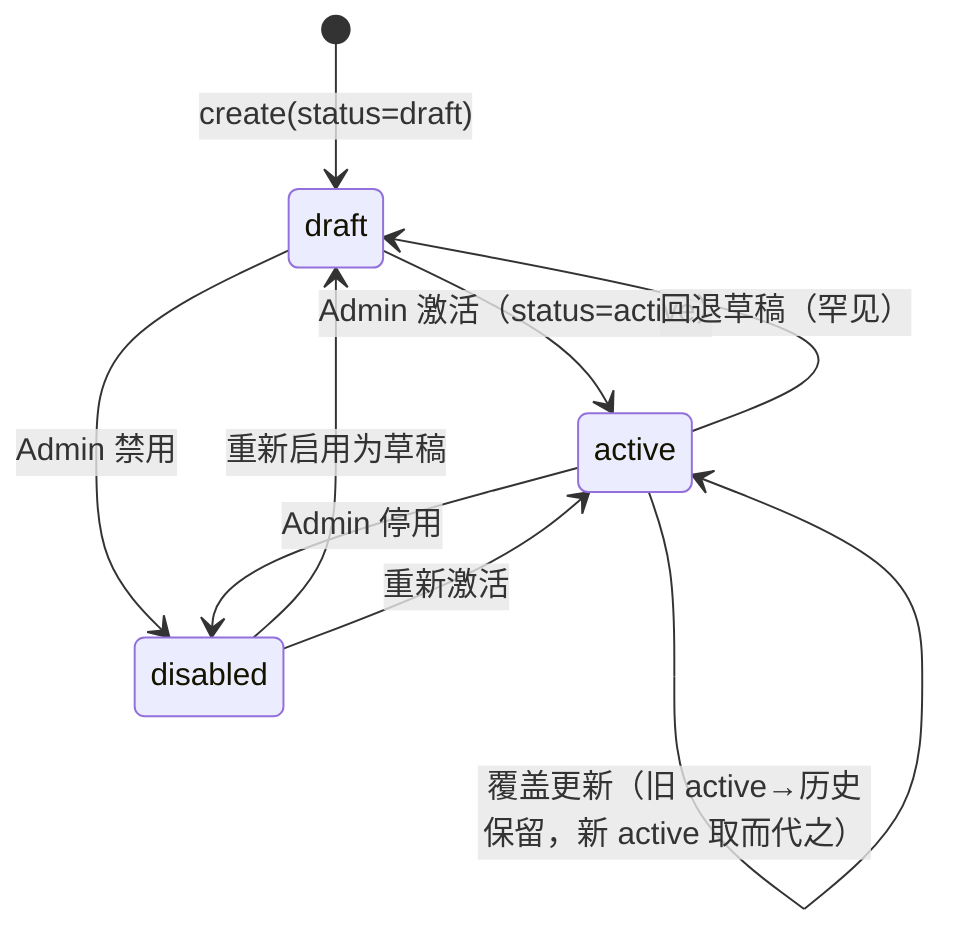
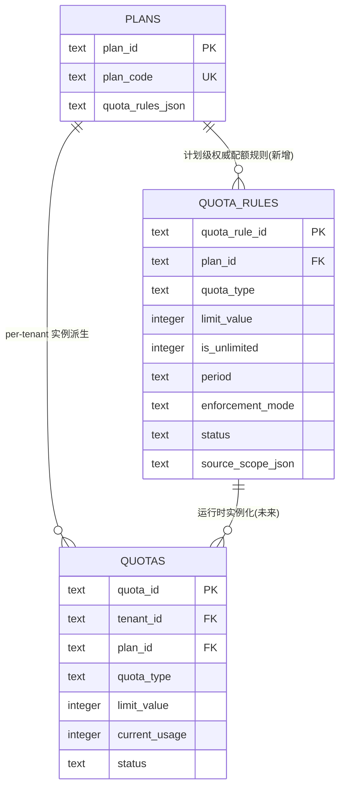

# QuotaRule Contract（配额规则实体契约）

> **⚠️ 文档关系声明（reconciliation 决策，必读）**
> 本文件**取代 Phase-8.5 的 `quota-rule-contract.md`**（旧版为「Admin Quota 策略层补全」，仅定义 `block/degrade/bill/notify` 语义矩阵，**无 QuotaRule 实体字段**）。
> 现定位为 **QuotaRule 实体契约（权威版）**：定义计划级配额规则的字段、状态机、执行策略枚举与 Plan–Quota 关系。
> 旧版的「策略语义矩阵」已**并入本文件 §4 `enforcement_mode`**，不再单独维护旧版；如需追溯旧策略内容，见本仓库 git 历史中本文件路径的 Phase-8.5 版本。
> 本文件与 `docs/contracts/admin-quota-contract.md`（四类配额「模板→per-tenant 实例」两层模型）互补：admin-quota-contract 谈「per-tenant 实例层怎么计数/重算」，本契约谈「计划级配额规则（quota_rules）实体定义」。

Status: **Phase-9A P1 · QuotaRule Configuration（实体契约）**
Owner: Admin Platform（配额规则定义层）
作者：架构师 高见远（software-architect）

---

## 0. 文档定位与引用

本契约定义 **QuotaRule 实体**——即 Admin 可配置、以 `plan_id` 为归属的**计划级配额规则**。它是配额配置的**权威来源（plan-level authoritative source）**，与 per-tenant 的 `quotas` 实例层（Phase-8 MVP）分离。

> 引用关系：
> - 五类 `quota_type` 规范名来自 `docs/contracts/billing-domain-contract.md` §Quota Contract（`token_limit` / `employee_seat_limit` / `workflow_limit` / `capability_limit` / `connector_limit`）。
> - 「模板(Admin) → per-tenant 实例」两层模型来自 `docs/contracts/admin-quota-contract.md`（本文档是「模板/规则定义层」的实体化）。
> - 状态机风格参考 `docs/contracts/pricing-rule-contract.md`（draft/active/disabled，新覆盖旧）。
> - 实现设计见 `docs/design/phase9a-p1-quota-implementation-design.md`（DDL / Store 方法 / 路由 / seed / 测试矩阵）。
> - 超限执行语义（block/throttle/notify/billing_only）吸收自旧版（Phase-8.5）`quota-rule-contract.md` 策略矩阵，见 §4。

---

## 1. QuotaRule 实体字段定义

`quota_rules` 表每行 = 一条「某套餐 + 某配额类型」的计划级规则。

| 字段 | 类型 | 约束 / 默认值 | 说明 |
| --- | --- | --- | --- |
| `quota_rule_id` | text | **PK**，格式 `qr_<uuid>` | 规则唯一主键。 |
| `plan_id` | text | NOT NULL，**FK → plans(plan_id)** | 归属套餐。配额规则不写死进 Plan 表列，而以本表按 `plan_id` 关联（与 P0「价格不写死 Plan」同哲学）。 |
| `quota_type` | text | NOT NULL，CHECK ∈ 五类（见 §2） | 配额类型。 |
| `limit_value` | integer | **可 NULL** | 数值上限；`NULL` 表示「不限」（配合 `is_unlimited=1`）。数值型配额（token/employee_seat/workflow）使用；准入型（capability/connector）恒为 `NULL`。 |
| `is_unlimited` | integer | NOT NULL DEFAULT 0（0/1） | 是否不限量。`1` 时 `limit_value` 视为无效。与 `limit_value=NULL` 语义一致，二者并存以满足「如不限可用 NULL 或 is_unlimited 标记」。 |
| `period` | text | NOT NULL DEFAULT `'monthly'`，CHECK ∈ `daily`/`monthly`/`annual`/`none` | 额度周期（与 `plans.billing_interval` 对齐）。`none` 表示无周期（永久/一次性额度）。 |
| `enforcement_mode` | text | NOT NULL DEFAULT `'notify'`，CHECK ∈ 四值（见 §4） | 超限执行策略（语义定义；**本 Issue 仅存储语义，不实现拦截**）。 |
| `status` | text | NOT NULL DEFAULT `'draft'`，CHECK ∈ `draft`/`active`/`disabled`（见 §5） | 规则状态机。 |
| `source_scope_json` | text | NOT NULL DEFAULT `'[]'` | **准入型配额专用**：允许的能力来源白名单（∈ `official`/`tenant_private`/`marketplace`）。仅 `capability_limit` / `connector_limit` 使用；数值型恒为 `[]`。见 §6 设计决策说明。 |
| `created_at` | text | NOT NULL DEFAULT `current_timestamp` | 创建时间（ISO-8601 UTC）。 |
| `updated_at` | text | NOT NULL DEFAULT `current_timestamp` | 更新时间（写时刷新）。 |

> **唯一性约束**：同一 `(plan_id, quota_type)` **仅允许一条 `status='active'`**。通过**部分唯一索引** `idx_quota_rules_plan_type_active ON quota_rules(plan_id, quota_type) WHERE status='active'` 在 DB 层强制；历史草稿/停用记录可并存（新覆盖旧，不物理删除，与 pricing_rules 一致）。

---

## 2. `quota_type` 五类（规范名）

| `quota_type` | 类别 | 计量单位 | 使用 `limit_value` | 使用 `source_scope_json` | 计数来源（仅说明，本 Issue 不实现） |
| --- | --- | --- | --- | --- | --- |
| `token_limit` | 数值型 | token（总量） | ✅ | ❌ `[]` | `usage_event.total_tokens` 聚合 |
| `employee_seat_limit` | 数值型 | 个（AI 员工席位） | ✅ | ❌ `[]` | `employee_instances(enabled=1)` 计数 |
| `workflow_limit` | 数值型 | 次（运行） | ✅ | ❌ `[]` | `workflow_runs` 期内计数 |
| `capability_limit` | 准入型 | 来源维度（非硬计数） | ❌ `NULL` | ✅ 白名单 | `capability_source` 白名单命中 |
| `connector_limit` | 准入型 | 个/次 | ❌ `NULL`（或计数，未来） | ✅ 白名单 | connector 调用（`capability_type=connector`） |

> **命名对齐说明**：Phase-8 MVP `quotas.quota_type` 列使用短名 `'token'/'employee_seat'/'capability'/'workflow'`（缺 `connector`）。本 QuotaRule 实体统一采用 `billing-domain-contract.md` 的 `_limit` 规范名（含 `connector_limit`）。per-tenant `quotas` 实例表短名**本 Issue 不改**（见 §6 边界），未来 Issue 再统一映射。

---

## 3. `period` 额度周期

| 值 | 含义 | 适用 |
| --- | --- | --- |
| `daily` | 按日重置 | token 等高频额度（未来可配） |
| `monthly` | 按月重置（默认） | 与 `plans.billing_interval='monthly'` 对齐 |
| `annual` | 按年重置 | 与 `plans.billing_interval='annual'`（Enterprise）对齐 |
| `none` | 无周期（永久/一次性） | 席位上限等不随账期重置的资源 |

---

## 4. `enforcement_mode` 执行策略（吸收旧版策略矩阵）

> 四种策略语义定义如下。**本 Issue 仅存储该配置与语义，不实现任何拦截/计费逻辑**；真实拦截/降级/计费由 G1 后配额中间件（未来工程）承担。

| `enforcement_mode` | 语义（原策略矩阵映射） | 本阶段默认 | 未来实现归属 |
| --- | --- | --- | --- |
| `notify` | 仅提醒：超限预警、看板展示 `current_usage`，**不限制**。（原 `notify`） | 数值型默认 | Phase-8 已实现看板/预警 |
| `throttle` | 降速/降质：超限后限速或降级继续。（原 `degrade`） | 数值型可选 | G1 后中间件 |
| `block` | 拒绝执行：超限拒绝新请求 / 白名单外来源请求被拒（准入阻断）。（原 `block`） | 准入型默认 | G1 后中间件（准入边界已由 Workspace 自我约束） |
| `billing_only` | 仅计费：超限部分生成 `billing_event`（overage），不阻断。（原 `bill`） | — | G1 后计费作业（**本 Issue 不实现 BillingEvent**） |

**逐类默认 `enforcement_mode`（建议 seed 值）**：
- `token_limit` / `employee_seat_limit` / `workflow_limit`（数值型）：默认 `notify`（未来可升 `throttle`/`billing_only`/`block`）。
- `capability_limit` / `connector_limit`（准入型）：默认 `block`（白名单外即拒；属 Admin 配置边界语义，Workspace 自我约束）。

> 矩阵完整性（旧版决策矩阵精简版）：数值型 = `notify` → `billing_only`(未来) → `block`(未来)；准入型 = `block`(准入) → `notify` → `billing_only`(未来)。`throttle` 为数值型未来可选降级策略。

---

## 5. `status` 状态机

参考 `pricing_rule` 状态机（精简版：draft / active / disabled）。



| 状态 | 含义 | 是否参与运行期配额判定 |
| --- | --- | --- |
| `draft` | 草稿，未生效 | 否（`get_active_quota_rule` 不返回） |
| `active` | 已生效，权威规则 | 是（每 `plan_id+quota_type` 唯一一条） |
| `disabled` | 已停用 | 否 |

**覆盖语义**：激活一条新 `active` 规则时，同 `plan_id+quota_type` 的旧 `active` 规则被置为历史（不删除，仅不再被 `get_active_quota_rule` 选中）。与 `pricing_rules`「新覆盖旧」一致。

---

## 6. Plan–Quota 关系（权威来源 vs 实例层边界）



| 层 | 实体 | 定义方 | 含义 | 本 Issue 处理 |
| --- | --- | --- | --- | --- |
| **计划级权威** | `quota_rules(plan_id)` | **Admin** | 某套餐的配额规则定义（5 类、limit、period、enforcement、status） | ✅ **本 Issue 新增并落库** |
| 计划镜像（遗留） | `plans.quota_rules_json` | Admin | Phase-9A plan-config-adjust 写入的配额 JSON（含 `capability_sources` 等） | 保留作展示/历史回退；**新写入以 `quota_rules` 为准** |
| **per-tenant 实例** | `quotas(tenant_id, plan_id)` | 系统派生 | 运行时租户配额实例（实时计数 `current_usage`） | ❌ **本 Issue 不改结构**（仅确认边界） |

**设计决策（待确认项见 §10）**：
1. **不把配额字段写死进 Plan 表列**——与 P0「价格不写死 Plan」一致；配额规则全部走 `quota_rules` 表按 `plan_id` 关联。
2. **`source_scope_json` 列（准入型专用）**：capability/connector 为「白名单准入」而非数值上限，需承载允许来源列表。为避免把配额字段塞回 Plan，本契约在 `quota_rules` 增加可选 `source_scope_json` 列（数值型恒 `[]`）。该列将逐步取代 `plans.quota_rules_json.capability_sources` 的权威地位。
3. `quotas` 实例表结构**本 Issue 保持不变**；未来由 Usage Meter / 实例化作业读取 `quota_rules` 派生 per-tenant 实例（不在本 Issue 实现）。

---

## 7. Usage Meter 关联（链路可达性，仅说明）

确认未来链路**可达**：
```
Plan (plan_id) → QuotaRule (quota_rules, 计划级权威) → Usage Event (usage_event / employee_instances / workflow_runs) → Usage Meter 读时聚合
```
- `quota_rules` 提供「某套餐允许多少 / 什么来源」的权威定义；
- Usage Meter 未来可据 `Plan → QuotaRule` 读取额度，对 `Usage Event` 做读时聚合与超限判定（**检测逻辑本 Issue 不实现**）。
- 本 Issue 仅确认链路可达，**不新增/不修改** Usage Event 写入、Employee Runtime、Credential Vault、Workspace 执行链。

---

## 8. 边界声明（禁止清单，五条均满足）

1. **不实现 BillingEvent 生成**：`enforcement_mode='billing_only'` 仅语义占位，不写计费逻辑。
2. **不实现超额收费 / Payment / Invoice**：无任何扣费、支付通道、发票。
3. **不实现 Marketplace**：`marketplace` 来源仅作 `source_scope_json` 白名单数据，不触 G3 双签流程。
4. **不实现 Value Pricing**：价值/ROI 计费属 L6 愿景，不在范围。
5. **不修改 Workspace / Credential Vault / Shared Contract / Employee Runtime / Usage Event 写入**：本 Issue 仅新增 `quota_rules` 表 + Admin 配置 API，零触及上述执行链。

---

## 9. 与旧 `quota-rule-contract.md`（Phase-8.5）的关系（显式 reconciliation）

| 维度 | 旧版（Phase-8.5） | 本版（Phase-9A P1） |
| --- | --- | --- |
| 定位 | 策略层补全（block/degrade/bill/notify 矩阵） | QuotaRule **实体契约**（字段 + 状态机 + 策略枚举） |
| 有无实体字段 | 无（谈语义） | 有（`quota_rules` 全字段） |
| 与 admin-quota-contract 关系 | 其「策略层补全」 | 其「计划级规则定义层」实体化 |
| 现状 | **已被本文件取代** | **权威版** |

> 旧版策略内容已并入 §4 `enforcement_mode`，无内容丢失。工程师以**本文件**为 QuotaRule 实现依据；旧版不再单独维护。

---

## 10. 待明确事项

1. **`source_scope_json` 列扩展**（本契约已采用，建议确认）：为让 `quota_rules` 对 5 类完全权威，新增了准入型专用列。若 PO 坚持严格按「7 字段清单」不加列，则 capability/connector 白名单仍暂留 `plans.quota_rules_json`，`quota_rules` 对这两类仅作「治理标记（enforcement_mode=block + is_unlimited=1）」。两种方案本设计均兼容，推荐采用 `source_scope_json` 列方案。
2. **`period` 取值**：本契约含 `annual` 以向前兼容 Enterprise 年付；若需严格限于 `daily/monthly/none`，可移除 `annual`（需同步改 DDL CHECK）。
3. **seed 占位数值**：Free/Pro/Enterprise 各 5 类 `limit_value` 为**合理占位**（如 Free token=1,000,000 / seat=3 / workflow 不限），**非真实业务数值**，全部须经 Admin API 可改写。最终占位值以设计文档 §8 为准。
4. **`quotas` 实例表短名（`token` 等）与 `quota_rules` 规范名（`token_limit` 等）映射**：本 Issue 不统一，留待未来 Issue 处理（见 §6 边界）。

*—— Phase-9A P1 QuotaRule Configuration · QuotaRule 实体契约（取代 Phase-8.5 策略层占位）。*
