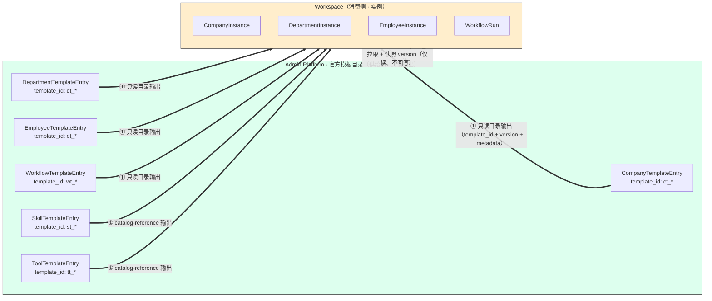

# Template Catalog Runtime Contract（模板目录运行时输出契约 · Admin 对外只读目录输出协议）

> **作者**：高见远（架构师，software-architect）
> **主理人**：齐活林（交付总监）
> **阶段**：Phase-1B Template Runtime Integration Gate（Admin 侧）—— 纯文档（design-only reservation），零代码、零后端改动
> **继承**：在 `docs/contracts/ai-company-template-system.md`（6 类模板 Catalog 总契约）基础上，定义 **Admin 对外输出的运行时契约形状**（Workspace 据此选择/实例化）
> **对齐**：ADR-0017（仅 design-only reservation）；与 `company-package-runtime-contract.md`（本文 §2 输出的 6 类 `template_id` 被其引用）、`template-versioning-policy.md`、`admin-workspace-template-boundary.md` 一致
> **范围说明**：本契约是 **Admin → Workspace 的只读目录输出协议（read-only catalog output protocol）**。它描述 Admin 把官方模板"暴露给 Workspace"时的对象形状；**不包含实例化逻辑、不生成任何 EmployeeInstance / DepartmentInstance / 公司激活**。

---

## 0. 文档定位与引用

- **本契约是「输出形状」契约，不是「存储形状」契约**。它回答一个问题：当 Workspace 向 Admin 目录请求"可用模板清单"时，Admin 返回的每个对象长什么样？
- 对象统一为 `TemplateCatalogEntry`，由 6 个具体子类（对应 6 类官方模板）实现。每个 entry 仅包含**稳定的目录展示 + 引用 + 类型专属元数据摘要**，不含任何运行态。
- 本契约 **100% 引用** `ai-company-template-system.md` §2 的字段，不重定义；`metadata` 内字段即 §2 各模板 schema 的"字段摘要"，保证两侧字段同源。

---

## 1. 统一运行时对象字段（TemplateCatalogEntry）

所有 9 类模板运行时输出对象（含 `pt_`/`wl_*`/`dtpl_*`）均继承以下 **统一字段**（对齐 `TemplateBase` + 任务规定的运行时统一字段集）：

| 字段 | 类型 | 必填 | 约束 | 说明 |
|------|------|------|------|------|
| `template_id` | string | 是 | 沿用既有前缀 `^ct_|dt_|et_|wt_|st_|tt_|pt_|wl_|dtpl_[a-z0-9_-]+$` | **统一 ID**。本运行时层把各模板自身 id（`id`/`skill_template_id`/`tool_template_id`）统一抽象为 `template_id`，便于 Workspace 用单一键引用 |

  > **前缀扩展说明（2026-07-11 Gate C/D/E/F 登记）**：
  > 原 6 类（`ct_/dt_/et_/wt_/st_/tt_`）扩展为 9 类，新增 `pt_`（PersonaTemplate，Variant A）、
  > `wl_`（Workflow 内容实例，Variant B，折叠进 `metadata.workflow_template_ref`）、
  > `dtpl_`（DashboardTemplate，Variant A，第 7+ 类目录项）。
  > **`ccp_*` 不在此正则内**：Company Package 是聚合包（Gate B §2.4 变体 C），走独立商业目录，
  > **不进** `TemplateCatalogEntry` 只读目录（单一目录主键语义不适用多资产聚合）。本输出协议 §3 仍为 9 类 entry。
| `version` | string | 是 | SemVer `^\d+\.\d+\.\d+$` | 模板版本；与 `ai-company-template-system.md` §1 `TemplateBase.version` 同源 |
| `name` | string | 是 | — | 展示名 |
| `description` | string | 否 | 默认 `""` | 展示/帮助文本 |
| `source` | enum | 是 | `official` / `marketplace`（预留） | **输出协议收窄**：Admin 对外发布的目录仅暴露 `official`（及未来 `marketplace` 预留）；`tenant_private` 不进入 Admin 发布目录（属租户侧，不在此输出协议内） |
| `status` | enum | 是 | `draft` / `active` / `disabled` / `archived` | 生命周期状态（见 `ai-company-template-system.md` §1.1） |
| `metadata` | object | 是 | 类型专属（见 §3 各子类） | **模板类型专属元数据摘要**，引用 §2 各模板 schema 的字段子集 |

> **`template_id` 抽象说明**：在 `ai-company-template-system.md` 中 6 类模板的 id 字段名不统一（`id` / `skill_template_id` / `tool_template_id`）。本运行时输出协议将它们统一为 `template_id`，**值本身不变**（仍是 `ct_*`/`dt_*`/`et_*`/`wt_*`/`st_*`/`tt_*`），仅为输出层提供单一键。映射见 §4。
>
> **`source` 收窄说明**：`ai-company-template-system.md` §1 的 `source` 枚举为 `official`/`tenant_private`/`marketplace`。本输出协议作为"Admin 对外发布目录"，只承载 Admin 拥有写权限的 `official` 与预留的 `marketplace`；`tenant_private` 由租户自管、不进入 Admin 发布目录，故从输出枚举中移除（不表示其不存在，只是不在本只读输出协议范围）。

---

## 2. 组合关系（Admin 目录 → Workspace 消费）



**数据流释义**：
1. **① 只读目录输出**：Admin 把 6 类官方模板以 `TemplateCatalogEntry` 形状对外发布（经 catalog 端点只读暴露）。Workspace 据此浏览、选择、拉取。
2. **② 快照拉取（单向、仅读）**：Workspace 实例化时按 `template_id` 拉取对应 entry，并把其 `version` 与 `metadata` 写入实例快照（见 `template-versioning-policy.md`）。**禁止** Workspace 把任何实例运行态回写 Admin 目录。

---

## 3. 九类模板运行时对象 JSON Schema（输出形状）

> 九类模板运行时对象（Company / Department / Employee / Workflow / Skill / Tool / Persona / WorkflowContent / Dashboard）。`ccp_*` 出目录（见 §1 说明）。

> 以下 `metadata` 内的字段均为 `ai-company-template-system.md` §2 对应模板 schema 的**字段摘要**（引用而非重定义）。所有外键以 ID 字符串数组表达。

### 3.1 CompanyTemplateEntry（公司模板运行时输出）

```json
{
  "$schema": "http://json-schema.org/draft-07/schema#",
  "title": "CompanyTemplateEntry",
  "type": "object",
  "additionalProperties": false,
  "required": ["template_id","version","name","source","status","metadata"],
  "properties": {
    "template_id":  { "type": "string", "pattern": "^ct_[a-z0-9_-]+$" },
    "version":      { "type": "string", "pattern": "^\\d+\\.\\d+\\.\\d+$" },
    "name":         { "type": "string" },
    "description":  { "type": "string", "default": "" },
    "source":       { "type": "string", "enum": ["official","marketplace"] },
    "status":       { "type": "string", "enum": ["draft","active","disabled","archived"] },
    "metadata": {
      "type": "object",
      "additionalProperties": false,
      "properties": {
        "slug":                    { "type": "string" },
        "departments":            { "type": "array", "items": { "type": "string", "pattern": "^dt_[a-z0-9_-]+$" }, "default": [] },
        "employees":              { "type": "array", "items": { "type": "string", "pattern": "^et_[a-z0-9_-]+$" }, "default": [] },
        "workflows":              { "type": "array", "items": { "type": "string", "pattern": "^wt_[a-z0-9_-]+$" }, "default": [] },
        "capability_packages":     { "type": "array", "items": { "type": "string", "pattern": "^cp_[a-z0-9_-]+$" }, "default": [] },
        "default_goals":          { "type": "array", "items": { "type": "string" }, "default": [] },
        "tenant_id":              { "type": ["string","null"], "default": "platform" }
      }
    }
  },
  "examples": [{
    "template_id": "ct_ai_software_company",
    "version": "1.0.0",
    "name": "AI Software Company",
    "description": "标准 AI 软件公司蓝图：研发部 + 6 类研发员工 + 研发 SOP + 内容运营包。",
    "source": "official",
    "status": "active",
    "metadata": {
      "slug": "ai-software-company",
      "departments": ["dt_engineering"],
      "employees": ["et_backend_engineer","et_frontend_engineer","et_architect","et_tech_lead","et_product_manager","et_qa_engineer"],
      "workflows": ["wt_software_rnd_sop"],
      "capability_packages": ["cp_content_ops"],
      "default_goals": ["deliver AI software products"]
    }
  }]
}
```

### 3.2 DepartmentTemplateEntry

```json
{
  "$schema": "http://json-schema.org/draft-07/schema#",
  "title": "DepartmentTemplateEntry",
  "type": "object",
  "additionalProperties": false,
  "required": ["template_id","version","name","source","status","metadata"],
  "properties": {
    "template_id":  { "type": "string", "pattern": "^dt_[a-z0-9_-]+$" },
    "version":      { "type": "string", "pattern": "^\\d+\\.\\d+\\.\\d+$" },
    "name":         { "type": "string" },
    "description":  { "type": "string", "default": "" },
    "source":       { "type": "string", "enum": ["official","marketplace"] },
    "status":       { "type": "string", "enum": ["draft","active","disabled","archived"] },
    "metadata": {
      "type": "object",
      "additionalProperties": false,
      "properties": {
        "slug":                    { "type": "string" },
        "department_type":         { "type": "string", "description": "引用 department_types.type_key" },
        "roles":                   { "type": "array", "items": { "type": "string" }, "default": [] },
        "employee_template_refs":  { "type": "array", "items": { "type": "string", "pattern": "^et_[a-z0-9_-]+$" }, "default": [] },
        "workflow_template_refs":  { "type": "array", "items": { "type": "string", "pattern": "^wt_[a-z0-9_-]+$" }, "default": [] },
        "default_capability_types": { "type": "array", "items": { "enum": ["model","tool","connector"] }, "default": ["model","tool","connector"] },
        "tenant_id":               { "type": ["string","null"], "default": "platform" }
      }
    }
  }
}
```

### 3.3 EmployeeTemplateEntry

```json
{
  "$schema": "http://json-schema.org/draft-07/schema#",
  "title": "EmployeeTemplateEntry",
  "type": "object",
  "additionalProperties": false,
  "required": ["template_id","version","name","source","status","metadata"],
  "properties": {
    "template_id":  { "type": "string", "pattern": "^et_[a-z0-9_-]+$" },
    "version":      { "type": "string", "pattern": "^\\d+\\.\\d+\\.\\d+$" },
    "name":         { "type": "string" },
    "description":  { "type": "string", "default": "" },
    "source":       { "type": "string", "enum": ["official","marketplace"] },
    "status":       { "type": "string", "enum": ["draft","active","disabled","archived"] },
    "metadata": {
      "type": "object",
      "additionalProperties": false,
      "properties": {
        "slug":                     { "type": "string" },
        "role":                     { "type": "string", "description": "角色标签，如 Backend Engineer" },
        "department_type":          { "type": "string", "default": "software_rnd" },
        "persona":                  { "type": "string", "description": "员工人设/角色定位描述" },
        "responsibility":           { "type": "string", "default": "" },
        "default_skill":            { "type": ["string","null"], "pattern": "^st_[a-z0-9_-]+$" },
        "default_tool":             { "type": ["string","null"], "pattern": "^tt_[a-z0-9_-]+$" },
        "default_capability_types": { "type": "array", "items": { "enum": ["model","tool","connector"] }, "default": ["model"] },
        "default_model_policy":     { "type": "object", "default": {} },
        "guardrails":               { "type": "array", "items": { "type": "string" }, "default": [] },
        "tenant_id":                { "type": ["string","null"], "default": "platform" }
      }
    }
  },
  "examples": [{
    "template_id": "et_backend_engineer",
    "version": "1.0.0",
    "name": "Backend Engineer AI",
    "description": "负责后端服务开发与接口实现。",
    "source": "official",
    "status": "active",
    "metadata": {
      "slug": "backend-engineer-ai",
      "role": "Backend Engineer",
      "department_type": "software_rnd",
      "persona": "严谨、注重接口契约与可观测性的后端工程师。",
      "default_skill": "st_backend_coding",
      "default_tool": "tt_code_executor",
      "default_capability_types": ["model","tool"]
    }
  }]
}
```

### 3.4 WorkflowTemplateEntry

```json
{
  "$schema": "http://json-schema.org/draft-07/schema#",
  "title": "WorkflowTemplateEntry",
  "type": "object",
  "additionalProperties": false,
  "required": ["template_id","version","name","source","status","metadata"],
  "properties": {
    "template_id":  { "type": "string", "pattern": "^wt_[a-z0-9_-]+$" },
    "version":      { "type": "string", "pattern": "^\\d+\\.\\d+\\.\\d+$" },
    "name":         { "type": "string" },
    "description":  { "type": "string", "default": "" },
    "source":       { "type": "string", "enum": ["official","marketplace"] },
    "status":       { "type": "string", "enum": ["draft","active","disabled","archived"] },
    "metadata": {
      "type": "object",
      "additionalProperties": false,
      "properties": {
        "slug":            { "type": "string" },
        "department_type": { "type": "string", "default": "software_rnd" },
        "process_type":    { "type": "string", "enum": ["sequential","gated","horizontal"], "default": "sequential" },
        "step_templates":  { "type": "array", "items": { "type": "string", "pattern": "^ws_[a-z0-9_-]+$" }, "default": [] },
        "tenant_id":       { "type": ["string","null"], "default": "platform" }
      }
    }
  }
}
```

### 3.5 SkillTemplateEntry（catalog-reference 包装）

```json
{
  "$schema": "http://json-schema.org/draft-07/schema#",
  "title": "SkillTemplateEntry",
  "type": "object",
  "additionalProperties": false,
  "required": ["template_id","version","name","source","status","metadata"],
  "properties": {
    "template_id":  { "type": "string", "pattern": "^st_[a-z0-9_-]+$" },
    "version":      { "type": "string", "pattern": "^\\d+\\.\\d+\\.\\d+$" },
    "name":         { "type": "string" },
    "description":  { "type": "string", "default": "" },
    "source":       { "type": "string", "enum": ["official","marketplace"] },
    "status":       { "type": "string", "enum": ["draft","active","disabled","archived"] },
    "metadata": {
      "type": "object",
      "additionalProperties": false,
      "properties": {
        "slug":                    { "type": "string" },
        "skill_type":              { "type": "string", "enum": ["planning","analysis","architecture","frontend","backend","qa","tool_operation"] },
        "default_capability_types":{ "type": "array", "items": { "enum": ["model","tool","connector"] }, "default": ["model"] },
        "default_tool_refs":       { "type": "array", "items": { "type": "string", "pattern": "^tt_[a-z0-9_-]+$" }, "default": [] },
        "capability_ref":          { "type": ["string","null"], "description": "指向 official_models.capability_id（单一真相源）" },
        "tenant_id":               { "type": ["string","null"], "default": "platform" }
      }
    }
  }
}
```

### 3.6 ToolTemplateEntry（catalog-reference 包装）

```json
{
  "$schema": "http://json-schema.org/draft-07/schema#",
  "title": "ToolTemplateEntry",
  "type": "object",
  "additionalProperties": false,
  "required": ["template_id","version","name","source","status","metadata"],
  "properties": {
    "template_id":  { "type": "string", "pattern": "^tt_[a-z0-9_-]+$" },
    "version":      { "type": "string", "pattern": "^\\d+\\.\\d+\\.\\d+$" },
    "name":         { "type": "string" },
    "description":  { "type": "string", "default": "" },
    "source":       { "type": "string", "enum": ["official","marketplace"] },
    "status":       { "type": "string", "enum": ["draft","active","disabled","archived"] },
    "metadata": {
      "type": "object",
      "additionalProperties": false,
      "properties": {
        "slug":           { "type": "string" },
        "capability_ref": { "type": "string", "description": "指向 official_models.capability_id（capability_type='tool'）" },
        "tool_type":      { "type": "string" },
        "entry":          { "type": "string", "default": "", "description": "内部 entry 引用，绝不含有密钥" },
        "credential_ref": { "type": ["string","null"], "default": null, "description": "仅不透明引用 scheme:reference；明文凭证仅 Credential Vault 解析" },
        "tenant_id":      { "type": ["string","null"], "default": "platform" }
      }
    }
  }
}
```

---

### 3.7 PersonaTemplateEntry（Persona 内容实例，Variant A，Gate E）

```json
{
  "$schema": "http://json-schema.org/draft-07/schema#",
  "title": "PersonaTemplateEntry",
  "type": "object",
  "additionalProperties": false,
  "required": ["template_id","version","name","source","status","metadata"],
  "properties": {
    "template_id": { "type": "string", "pattern": "^pt_[a-z0-9_-]+$" },
    "version":     { "type": "string", "pattern": "^\\d+\\.\\d+\\.\\d+$" },
    "name":        { "type": "string" },
    "description": { "type": "string", "default": "" },
    "source":      { "type": "string", "enum": ["official","marketplace"] },
    "status":      { "type": "string", "enum": ["draft","active","disabled","archived"] },
    "metadata": {
      "type": "object", "additionalProperties": false,
      "properties": {
        "slug":                  { "type": "string" },
        "archetype":             { "type": "string" },
        "traits":                { "type": "array", "items": { "type": "string" }, "default": [] },
        "applicable_roles":      { "type": "array", "items": { "type": "string" }, "default": [] },
        "tenant_id":             { "type": ["string","null"], "default": "platform" }
      }
    }
  },
  "examples": [{ "template_id": "pt_supportive_coach", "version": "1.0.0", "name": "Supportive Coach",
    "source": "official", "status": "active",
    "metadata": { "archetype": "supportive_coach", "applicable_roles": ["product_manager","qa_engineer"] } }]
}
```

### 3.8 Workflow 内容实例折叠（Variant B，对齐 Skill/Tool）

- `wt_*` 为 WorkflowTemplate 类型容器（Variant A，entry.template_id = wt_*）。
- `wl_*` 为官方 Workflow **内容实例**（预留，Task 4 共 36 条真实 id），折叠为
  `template_id = wl_*` 的独立 entry，`metadata.workflow_template_ref = wt_{对应类型容器}`，
  `metadata.step_templates` 仍为 `ws_*` 数组引用。
- 即 Workflow 同时有 Variant A（wt_* 容器）与 Variant B（wl_* 内容）两种 entry 形态。

### 3.9 DashboardTemplateEntry（Dashboard 内容实例，Variant A，第 8+ 类目录项）

```json
{
  "$schema": "http://json-schema.org/draft-07/schema#",
  "title": "DashboardTemplateEntry",
  "type": "object",
  "additionalProperties": false,
  "required": ["template_id","version","name","source","status","metadata"],
  "properties": {
    "template_id": { "type": "string", "pattern": "^dtpl_[a-z0-9_-]+$" },
    "version":     { "type": "string", "pattern": "^\\d+\\.\\d+\\.\\d+$" },
    "name":        { "type": "string" },
    "description": { "type": "string", "default": "" },
    "source":      { "type": "string", "enum": ["official","marketplace"] },
    "status":      { "type": "string", "enum": ["draft","active","disabled","archived"] },
    "metadata": {
      "type": "object", "additionalProperties": false,
      "properties": {
        "company_type":     { "type": "string", "enum": ["ai_rd","ai_content","ai_content_ops","ai_commercial","generic"] },
        "role_visibility":  { "type": "array", "items": { "type": "string" }, "default": ["ceo"] },
        "widget_ids":       { "type": "array", "items": { "type": "string", "pattern": "^[a-z0-9_]+$" }, "default": [] },
        "layout_summary":   { "type": "string", "default": "" },
        "data_source_refs": { "type": "array", "items": { "type": "string" }, "default": [] },
        "commercial_slot_ref": { "type": ["string","null"], "default": null },
        "tenant_id":        { "type": ["string","null"], "default": "platform" }
      }
    }
  },
  "examples": [{ "template_id": "dtpl_ai_rd_ceo_cockpit", "version": "1.0.0",
    "name": "AI 研发公司 CEO 驾驶舱", "source": "official", "status": "active",
    "metadata": { "company_type": "ai_rd", "role_visibility": ["ceo"],
      "widget_ids": ["company_health","project_progress","ai_cost","employee_status"] } }]
}
```

---

## 4. 与 ai-company-template-system.md §2 字段映射（输出层 vs Catalog 契约）

| 输出字段 `template_id` 抽象 | Catalog 契约原字段名 | 现状 |
|---|---|---|
| `CompanyTemplateEntry.template_id` | `CompanyTemplate.id`（`ct_*`） | ✅ 值不变，仅键名统一 |
| `DepartmentTemplateEntry.template_id` | `DepartmentTemplate.id`（`dt_*`） | ✅ 值不变 |
| `EmployeeTemplateEntry.template_id` | `EmployeeTemplate.id`（`et_*`） | ✅ 值不变 |
| `WorkflowTemplateEntry.template_id` | `WorkflowTemplate.id`（`wt_*`） | ✅ 值不变 |
| `SkillTemplateEntry.template_id` | `SkillTemplate.skill_template_id`（`st_*`） | 键名统一 |
| `ToolTemplateEntry.template_id` | `ToolTemplate.tool_template_id`（`tt_*`） | 键名统一 |
| `*.metadata.*` | 各模板 §2 schema 属性子集 | ✅ 引用，不重定义 |
| `*.source` | `TemplateBase.source` | ⚠ 枚举收窄为 `official`/`marketplace`（见 §1 说明） |
| `*.status` | `TemplateBase.status` | ✅ 一致 |
| `*.version` | `TemplateBase.version` | ✅ 一致 |

> **衔接点**：本契约是 `ai-company-template-system.md` 的**输出投影（projection）**——同一份官方模板，Catalog 侧存全字段（含 `created_at`/`updated_at`/`enabled` 等 Admin 内部字段），运行时输出侧仅暴露 `template_id`+`version`+`name`+`description`+`source`+`status`+`metadata`。Workspace 永远拿不到 Admin 内部字段。

---

## 5. 红线与禁止区（本契约遵守）

- **不开发** UI / Marketplace / 支付 / 购买流程。
- **不写** 任何后端代码、不建表、不加 API 路由、不碰 Workspace 执行链 / Credential Vault / EmployeeRuntime / Usage Event 写入。
- **本契约是只读输出协议**：Admin 对外暴露目录；**不生成任何 EmployeeInstance / DepartmentInstance / 公司激活**。
- **Skill/Tool 不重复定义能力**：`metadata.capability_ref` 仅指向官方能力目录（单一真相源）。

---

## 6. 验收映射

| # | 验收项 | 落点 |
|---|--------|------|
| 1 | 6 类模板运行时输出契约（统一 `template_id` + 字段集） | 本文 §1 / §3 |
| 2 | 统一字段集（template_id/version/name/description/source/status/metadata） | §1 |
| 3 | 类型专属 `metadata`（引用 §2 字段摘要） | §3 |
| 4 | Admin→Workspace 契约引用关系（Mermaid） | §2 |
| 5 | 与 Catalog 契约字段映射 + 差异标注 | §4 |
| 6 | 红线遵守 | §5 |

*—— Template Catalog Runtime Contract（纯设计/契约，零代码）。Admin 对外只读目录输出协议；与 ADR-0017 一致。*
