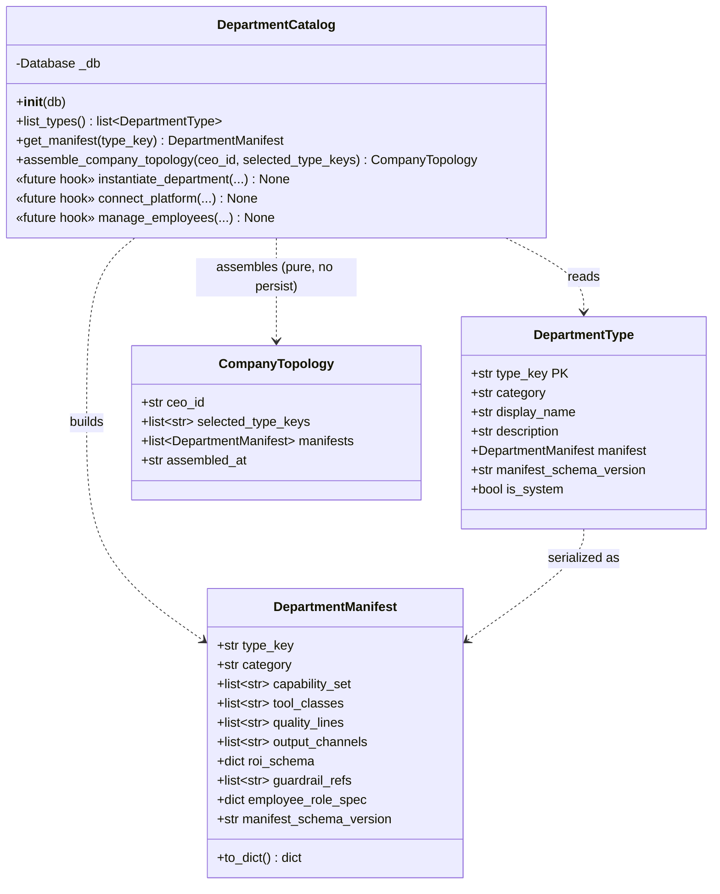
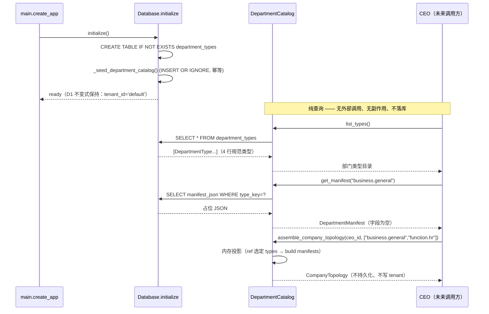
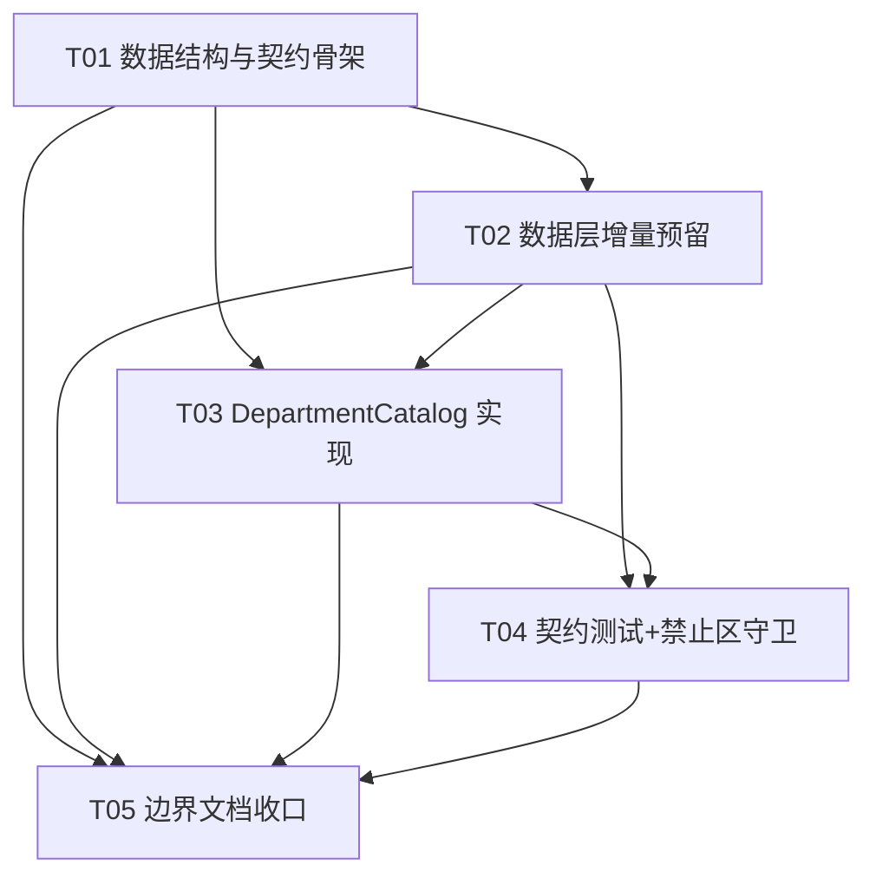

# ADR-0023: D2 部门目录通用化（业务型 + 职能型）— Boundary

Date: 2026-07-07

Status: Proposed — boundary for D2 (ADR-0017 Sub-decision D2); pending 总控决策席 gate approval → 质量运行席 verification + 产品规划席 acceptance → implementation.

Source gate: `issues/050_adr0017_future_gate_submission_package.md` (option a accepted by 总控决策席, 2026-07-07)
Carried-forward decisions: `docs/decisions/ADR-0017-multitenant-department-catalog.md` (Proposed, D2 节), `docs/decisions/ADR-0016-execution-substance-initiative.md` (Accepted), `docs/decisions/ADR-0022-d1-tenant-id-reservation-boundaries.md` (D1 边界, Proposed, 待 accept)
Slice issue: `issues/052_adr0017_d2_department_catalog.md`

## Context

ADR-0017 option a 已接受：「多租户 CEO + 部门目录」未来阶段 gate 已 OPEN，D1（`tenant_id` 设计预留）已实现并验证 PASS（参考 ADR-0022），正等待 产品规划席 accept。D1 之所以获批，是因为它只是「加列 + resolver stub」的零行为变化预留，而非真实多租户落地。

D2 是 ADR-0017 的第二个子决策：**部门目录通用化（业务型 + 职能型）**。其远景是：

- 每个部门 = 一份 **Manifest** 配置单元，字段：`能力集 · 可用工具类 · 质量线 · 输出通道 · ROI schema · 护栏引用 · 员工角色 spec`。
- 部门分两类，共用同一套 Manifest 缝：
  - **业务型（对外）**：业务部及其平台通道（抖音 / 小红书 / 微信 / 头条 / 番茄 / 起点…），对应集成网格 + 异步长时编排。
  - **职能型（对内）**：人事部 / 行政部 / BI 部 /（可扩展财务、法务、客服…），在系统内部运维公司自身。
- 系统级维护「**部门类型目录**」（建一次、全员可用）；每个 CEO 从目录中挑选子集组成自己的**公司拓扑**。

**关键约束（来自 AGENTS.md 当前 gate）**：当前上线范围仍是 AI Task Executor MVP v0.1，**严格禁止**：L5 公司组织、L6 经济/ROI、Employee CRUD、多 Agent、外部服务、复杂 UI。因此 D2 在当前阶段**只能做设计预留 / 数据模型骨架**——即与 D1 同源的「加表 + 契约 stub」式零行为变化预留，**不得实现**真正的部门实例化、外部平台集成、L6 ROI 度量、Employee CRUD。

本边界契约将 D2 拆为「现在可做的设计预留」与「未来 gate 放开后才能做的实现」两半，并用边界线明确标注。预留部分严格保持**不实例化真实部门、不接外部平台、不做员工管理**。

## Decision (Boundary Contract)

> ### ════════ 边界线：现在可做的「设计预留」（reservation）｜ 未来 gate 放开后才能做的「实现」════════

---

### 第一部分：现在可做的「设计预留」（D2-reservation slice，零行为变化）

仅做 schema 骨架 + 契约位置 + 只读查询 facade，**不接线、不实例化、不改任何读/写路径语义、不新建 API endpoint**。

#### 1. 部门类型目录：`department_types` 表（系统级共享，建一次、全员可用）

复用既有 `_ensure_column()` / `executescript` 增量迁移风格，新增一张**系统级**目录表。`department_types` 为**跨租户共享注册表**（与 D1 中 `tools` 表同理，**不做 tenant_id 隔离**），供所有 CEO 从中挑选子集：

```sql
-- 系统级共享，不做 tenant_id 隔离（与 tools 表同层）
create table if not exists department_types (
    type_key                text primary key,   -- 'business.general' / 'function.hr' ...
    category                text not null,      -- 'business' | 'function'
    display_name            text not null,
    description             text,
    manifest_json           text not null default '{}',  -- 该类型的 Manifest 骨架（占位，不消费）
    manifest_schema_version text not null default '0.0',
    is_system               integer not null default 1
);
```

- **幂等种子（bounded + idempotent）**：在 `Database.initialize()` 末尾调用 `_seed_department_catalog(connection)`，以 `INSERT OR IGNORE` 填充**最小规范类型集**（不预支过多槽位，满足 ADR-0017「不预支过多部门类型槽位」）：

  | type_key | category | display_name | 说明 |
  |---|---|---|---|
  | `business.general` | `business` | 业务部 | 业务型（对外），平台通道留作 future hook |
  | `function.hr` | `function` | 人事部 | 职能型（对内），员工层留作 future hook |
  | `function.admin` | `function` | 行政部 | 职能型（对内），L6 ROI 度量留作 future hook |
  | `function.bi` | `function` | BI 部 | 职能型（对内），L6 可视化留作 future hook |

  种子行即「建一次、全员可用」的目录；`manifest_json` 仅含**占位结构**（空列表/空对象），不含任何真实平台凭证、ROI 数据或员工数据。
- **不建立**从 `tasks` 到 `department_types` 的 FK 约束，避免提前耦合。
- 该表**仅承载类型定义（type），不承载部门实例（instance）**——`departments` 聚合根表不存在，本 slice 不创建、不 CRUD。

#### 2. Manifest 缝数据结构（契约定义，声明但不消费）

新增模块 `backend/app/department_manifest.py`，以 `dataclass` + 常量形式**声明** Manifest 缝的字段契约与 JSON Schema，供未来 slice 引用：

```python
# backend/app/department_manifest.py (reservation only — 声明结构，不解析/校验/消费)
from __future__ import annotations
from dataclasses import dataclass, field, asdict

MANIFEST_FIELDS: dict[str, type] = {
    "capability_set":     list,   # 能力集
    "tool_classes":       list,   # 可用工具类
    "quality_lines":      list,   # 质量线
    "output_channels":    list,   # 输出通道
    "roi_schema":         dict,   # ROI schema（仅定义结构，L6 禁止回填）
    "guardrail_refs":     list,   # 护栏引用
    "employee_role_spec": dict,   # 员工角色 spec（仅定义结构，Employee CRUD 禁止）
}

@dataclass
class DepartmentManifest:
    type_key: str
    category: str
    capability_set: list[str] = field(default_factory=list)
    tool_classes: list[str] = field(default_factory=list)
    quality_lines: list[str] = field(default_factory=list)
    output_channels: list[str] = field(default_factory=list)
    roi_schema: dict = field(default_factory=dict)        # 占位，不回填
    guardrail_refs: list[str] = field(default_factory=list)
    employee_role_spec: dict = field(default_factory=dict)  # 占位，不 CRUD
    manifest_schema_version: str = "0.0"
```

- 本 slice **不解析、不校验、不消费**上述字段；仅固定其命名与位置，使未来实现有稳定接缝。
- **不在 `tasks` 或其它表新增 manifest JSON 列**（按需留给未来 slice，避免预支未定结构）。

#### 3. 只读 `DepartmentCatalog` 模块（纯查询能力 + future hook）

新增模块 `backend/app/department_catalog.py`，暴露**纯查询**能力，所有方法只读、无副作用、不触外部 I/O（除本地 SQLite 读）。外部执行 / 凭证 / 员工操作仅声明为 **future hook**（不实现、不引用）：

```python
# backend/app/department_catalog.py (reservation only — 只读 facade)
from __future__ import annotations
from dataclasses import dataclass
from .database import Database
from .department_manifest import DepartmentManifest

@dataclass
class DepartmentType:
    type_key: str
    category: str
    display_name: str
    description: str
    manifest: DepartmentManifest
    manifest_schema_version: str
    is_system: bool

@dataclass
class CompanyTopology:
    ceo_id: str
    selected_type_keys: list[str]
    manifests: list[DepartmentManifest]   # 纯内存投影，不持久化
    assembled_at: str

class DepartmentCatalog:
    def __init__(self, database: Database):
        self.database = database

    def list_types(self) -> list[DepartmentType]:
        """列出系统级部门类型目录（全员可用）。"""

    def get_manifest(self, type_key: str) -> DepartmentManifest | None:
        """取某类型的 Manifest 骨架（占位结构）。"""

    def assemble_company_topology(self, ceo_id: str, selected_type_keys: list[str]) -> CompanyTopology:
        """CEO 从目录挑选子集，组装公司拓扑——纯内存投影，不持久化、不写 tenant。"""

    # ── future hook（本 slice 不实现、不引用，供 D2.impl 接）──
    # def instantiate_department(self, ...) -> None: ...   # 部门实例化（L5）
    # def connect_platform(self, ...) -> None: ...          # 外部平台凭证（安全边界席）
    # def manage_employees(self, ...) -> None: ...          # Employee CRUD（L2/L5）
```

- `list_types()` / `get_manifest()`：仅读 `department_types`，返回占位 Manifest（字段为空）。
- `assemble_company_topology()`：纯内存投影——`ref` 选定 type_key、从目录 build `DepartmentManifest` 列表，**不建 `companies`/`company_topology` 表、不写 tenant、不落库**。CEO 持久化其拓扑为未来 slice。
- 三个 future hook 仅签名占位，明确不在本 slice 实现。

#### 4. Invariant（代码 + 测试强制）

- 经 `Database().initialize()` 后，`department_types` 表存在且含既定列（`type_key`, `category`, `display_name`, `description`, `manifest_json`, `manifest_schema_version`, `is_system`）。
- `department_types` 初始化后含**且仅含**最小规范类型集（4 行），`manifest_json` 全为占位结构（无真实凭证/ROI/员工数据）。
- `backend/app/department_manifest.py` 声明 `MANIFEST_FIELDS`，含 7 个既定键（capability_set / tool_classes / quality_lines / output_channels / roi_schema / guardrail_refs / employee_role_spec）。
- `DepartmentCatalog.list_types()` 返回一个非空目录；`get_manifest(k)` 对规范 key 返回占位 Manifest；`assemble_company_topology()` 返回内存 `CompanyTopology`（不落库）。
- **全代码库无 `WHERE department_id = ?` 读路径过滤**（部门作用域留待 D2.impl）。
- **无新增 API endpoint**，既有 API 语义不变（diff 扫描路由注册）。
- `TenantContext.current_tenant_id()` 仍为 `'default'`、`is_multi_tenant()` 仍为 `False`（D1 不变式不被破坏）。
- 后端回归（含 D1 既有测试）全绿；**无任何既有测试被修改**。

---

### 第二部分：未来 gate 放开后才能做的「实现」（明确排除于本 reservation slice）

以下**不在本 D2-reservation slice 内**，且**必须**等待 总控决策席 批准独立的未来 gate（建议 `D2.impl`）后方可实施，并**触发 安全边界席 review**：

1. **部门实例化**（Departments 聚合根）：创建 `departments` 表、部门 CRUD、从 `department_types` 目录挑选并组合公司拓扑（持久化 `company_topology` manifest）。
2. **业务型部门外部平台集成**：抖音 / 小红书 / 微信 / 头条 / 番茄 / 起点等通道接入、凭证、异步长时编排（集成网格）。
3. **职能型部门元循环**（D3 承接）：人事部（Employee 增删/角色/技能）、行政部（L6 ROI/token 产出比）、BI 部（L6 可视化）消费公司运营数据并反哺 CEO 驾驶舱 / Evolution Governor。
4. **L6 经济 / ROI 度量与回流**：`roi_schema` 真实回填、token 消耗产出比统计、经济驱动编排。
5. **Employee CRUD 与员工层开放**：L2/L5 员工层、角色/技能配置事实接口。
6. **Manifest 真实解析与消费**：对第 2 节声明的字段做运行时校验、驱动工具调度或质量线。
7. **发布安全状态机、外部平台凭证与合规面**：均属 安全边界席 管辖，本 slice 零触碰。

## Forbidden Scope（本 reservation slice 全局禁止范围）

- 真实部门实例化（创建 `departments` 表、部门 CRUD、公司拓扑持久化）。
- 外部平台集成（抖音 / 小红书 / 微信 / 头条 / 番茄 / 起点等通道、凭证、集成网格、异步长时编排）。
- L6 经济 / ROI 度量、token 消耗产出比、可视化分析回流。
- Employee CRUD / 员工层（L2/L5）开放、角色/技能配置事实接口。
- 多 Agent、Agent 抽象。
- 外部服务、外部平台凭证、合规面（安全边界席领地）。
- 复杂 UI / dashboard 超出最小证据展示。
- API 语义变更——**因此本 slice 不新增任何 API endpoint**。
- 解除自动改码禁令 / human-approval gate。
- 在任意读路径加 `WHERE department_id = ?` 过滤或任何读路径作用域化。
- 改动任何既有 INSERT/读路径语义；`department_types` 之外预支未必要结构（如 `tasks.department_id` 列、manifest JSON 列）——除非主理人确认。
- 向量数据库、embeddings、外部记忆服务、隐藏记忆存储。

## Verification Plan

质量运行席 以标准 diff 与 forbidden-scope 守卫 + slice 专属断言验证（建议后端用例 `backend/tests/test_d2_department.py`，参照 D1 风格）：

```bash
git diff --name-only HEAD -- backend frontend
git diff --check
# forbidden-scope keyword scan on changed backend/app files
```

Plus slice-specific assertions（覆盖于 `backend/tests/test_d2_department.py`）：

- `department_types` 在 `Database().initialize()` 后存在，含既定列。
- 初始化后 `department_types` 含**且仅含**最小规范类型集（4 行）；`manifest_json` 解析为占位结构（无真实凭证/ROI/员工数据）。
- `backend/app/department_manifest.py` 存在并声明 `MANIFEST_FIELDS`，含 7 个既定键。
- `DepartmentCatalog.list_types()` 返回非空目录；`get_manifest("business.general")` 返回占位 `DepartmentManifest`；`assemble_company_topology(ceo_id, [...])` 返回内存 `CompanyTopology` 且**不落库**（无 `companies`/`company_topology` 表被创建）。
- **全代码库无 `WHERE department_id` 过滤**（forbidden-scope 守卫）。
- **无新增 API endpoint**，既有 API 语义不变（diff 扫描路由注册）。
- `TenantContext.current_tenant_id()` 仍为 `'default'`、`is_multi_tenant()` 仍为 `False`。
- 后端回归（含 D1 既有测试）全绿；**无任何既有测试被修改**；forbidden-scope 扫描干净。

## Consequences

- **Easier**：系统在 L5 边界上拥有了部门类型目录的 schema 骨架、Manifest 缝的稳定契约位置、以及一个只读 `DepartmentCatalog` facade——与 D1 的 `tenant_id` 预留同构，未来开启 D2 实现只是「填充真实 Manifest + 建 departments 表 + 接线 + 实现 future hook」，而非重写。
- **Easier**：未来 `D2.impl` slice 拥有干净、已测试、受契约断言守护的接缝。
- **Harder / cost**：1 张系统级目录表 + 幂等种子（4 行占位）+ 2 个新模块（manifest 结构 + catalog facade）+ 1 个测试文件；小且可 review 的 diff；需 总控决策席 为 reservation 单独开 gate。
- **No behavior change today**：刻意的「占位」——目录仅供读取、Manifest 字段不消费、拓扑不落库；类型与实例均不触发任何真实业务行为。
- **明确非目标**：不解除自动改码禁令；现在不实现部门实例化、外部平台集成、L6 经济回流、Employee CRUD——均留待对应未来 gate，并触发 安全边界席 review。

---

## System Design（系统设计交付物）

> 本节为 D2 reservation slice 的**完整架构设计**（设计-only，不写实现代码）。后续 Engineer 按「任务列表」落地。

### 1. 实现方案 + 框架选型

| 维度 | 选型 / 说明 |
|---|---|
| 核心技术挑战 | 部门是 L5 概念，当前 gate 禁止实例化；需在不触发 forbidden zone 的前提下为未来 D2 实现预留稳定接缝。 |
| 总体策略 | **设计-only 增量预留**（与 D1 同构）：加表 + 契约 stub + 只读 facade，零行为变化、可逆、不破坏既有测试。 |
| 语言 / 存储 | 复用现有栈：**Python + SQLite**（经 `database.py`），不引入新数据库或 ORM。 |
| Web 框架 | 复用 **FastAPI**（仅既有 endpoint，**不新增**任何路由）。 |
| 结构定义 | 复用标准库 `dataclasses` + `json` 声明 Manifest / 目录 / 拓扑结构；**不依赖 Pydantic 校验消费**（保持最小 diff）。 |
| 架构模式 | 与现有模块一致：`DepartmentCatalog` 为**只读查询 facade**（类比 `RoleContextReference` 的 read-only 模式、`EvolutionEventLog` 的写受限模式）；种子逻辑类比 `main.py` 的 `_register_default_tools` 幂等注册。 |
| 外部依赖 | 无新增第三方包（见「依赖包列表」）。 |

### 2. 文件清单（相对路径）

| 文件 | 状态 | 职责 |
|---|---|---|
| `backend/app/department_manifest.py` | 新增 | Manifest 缝字段契约（`MANIFEST_FIELDS`）+ `DepartmentManifest` dataclass + JSON Schema 常量。 |
| `backend/app/department_catalog.py` | 新增 | 只读 `DepartmentCatalog` facade（`list_types` / `get_manifest` / `assemble_company_topology`）+ `DepartmentType` / `CompanyTopology` dataclass；future hook 仅签名占位。 |
| `backend/app/database.py` | 修改（仅增量） | `initialize()` 中 `executescript` 增加 `department_types` 建表；新增 `_seed_department_catalog()` 幂等种子（INSERT OR IGNORE）。 |
| `backend/tests/test_d2_department.py` | 新增 | reservation 契约测试 + forbidden-scope 守卫（无 `WHERE department_id`、无新 endpoint）。 |
| `docs/decisions/ADR-0023-d2-department-catalog-boundaries.md` | 本文件 | 边界 ADR + 系统设计。 |
| `issues/052_adr0017_d2_department_catalog.md` | 新增 | D2 reservation slice issue。 |

### 3. 数据结构与接口（类图 + JSON Schema）

#### 3.1 类图（Mermaid）



#### 3.2 Manifest JSON Schema（结构化描述）

```json
{
  "$schema": "http://json-schema.org/draft-07/schema#",
  "title": "DepartmentManifest",
  "type": "object",
  "properties": {
    "type_key":                { "type": "string" },
    "category":               { "type": "string", "enum": ["business", "function"] },
    "capability_set":         { "type": "array", "items": { "type": "string" } },
    "tool_classes":           { "type": "array", "items": { "type": "string" } },
    "quality_lines":          { "type": "array", "items": { "type": "string" } },
    "output_channels":        { "type": "array", "items": { "type": "string" } },
    "roi_schema":             { "type": "object", "description": "仅结构占位，L6 禁止回填" },
    "guardrail_refs":         { "type": "array", "items": { "type": "string" } },
    "employee_role_spec":     { "type": "object", "description": "仅结构占位，Employee CRUD 禁止" },
    "manifest_schema_version":{ "type": "string", "default": "0.0" }
  },
  "required": ["type_key", "category"]
}
```

### 4. 程序调用流程（时序图）



### 5. 任务列表（有序、含依赖、按实现顺序）

> 供后续 Engineer 落地的 D2 reservation slice 实现任务（设计-only 已由本 ADR 定义，此处为执行分解）。

| Task ID | 任务名称 | 源文件 | 依赖 | 优先级 |
|---|---|---|---|---|
| **T01** | 数据结构与契约骨架 | `backend/app/department_manifest.py`（new）、`backend/app/department_catalog.py`（new, 接口契约 + dataclass）、`backend/tests/test_d2_department.py`（new, scaffold） | — | P0 |
| **T02** | 数据层增量预留（表 + 幂等种子） | `backend/app/database.py`（modify, additive：`department_types` 建表 + `_seed_department_catalog`） | T01 | P0 |
| **T03** | DepartmentCatalog 只读查询实现 | `backend/app/department_catalog.py`（实现 `list_types`/`get_manifest`/`assemble_company_topology`）、`backend/app/department_manifest.py`（wire `to_dict`） | T01, T02 | P0 |
| **T04** | 契约测试 + 禁止区守卫 | `backend/tests/test_d2_department.py`（完整断言 + forbidden-scope 扫描：无 `WHERE department_id`、无新 endpoint） | T02, T03 | P0 |
| **T05** | 边界文档收口 | `docs/decisions/ADR-0023-...md`（finalize）、`issues/052_adr0017_d2_department_catalog.md` | T01–T04 | P1 |

**依赖关系图（Mermaid）**：



### 6. 依赖包列表

- **无新增第三方包**。复用现有依赖：Python 3 标准库（`dataclasses`、`json`、`sqlite3`）、既有 `backend/app/database.py`、`fastapi`/`pydantic`（已随项目存在，但 reservation 不依赖 Pydantic 校验消费）。

### 7. 共享知识（跨文件约定）

- **Manifest 字段命名**：统一 7 键（`MANIFEST_FIELDS`），任何未来 slice 不得改名，仅扩展。
- **`department_types` 为系统级共享表**：不做 `tenant_id` 隔离（与 `tools` 同层）；全员可读。
- **只读纪律**：`DepartmentCatalog` 所有方法只读、无副作用、不触外部 I/O（除本地 SQLite 读）。
- **幂等种子**：种子走 `INSERT OR IGNORE`，`initialize()` 可重复调用；种子仅含最小规范类型集（4 行），`manifest_json` 恒为占位结构。
- **future hook 纪律**：`instantiate_department` / `connect_platform` / `manage_employees` 仅声明签名、不实现、不引用，留作 D2.impl + 安全边界席。
- **版本占位**：`manifest_schema_version` 形如 `"0.0"`（占位）。
- **测试约定**：forbidden-scope 扫描关键词 `WHERE department_id`、`app.get("/api/department"`、`app.post("/api/department"` 等，确保无读路径过滤、无新 endpoint。
- **增量迁移**：复用 `_ensure_column` / `executescript` 风格，不写 `DROP`/`ALTER` 破坏既有结构。

### 8. 待明确事项

1. **种子范围**：reservation 是否直接幂等种子 4 个规范类型（`business.general` / `function.hr` / `function.admin` / `function.bi`），还是仅预留空表、种子留待独立的「类型目录」gate slice？本设计默认**种子最小规范集**（贴合「建一次、全员可用」），但建议在 gate 时由 总控决策席 确认。
2. **新增类型治理**：超出规范集的新增部门类型，仍须走 gate + ADR（ADR-0017 D4）。reservation 不预设规范集之外的类型。
3. **`department_id` 聚合根列**：是否在本 reservation 预留 `tasks.department_id`（嵌套于 tenant 之下）？本设计默认**不**纳入 reservation，留待 `D2.impl`；如主理人要求最小化 diff 可后置。
4. **`company_topology` 持久化**：`assemble_company_topology` 本次仅返回内存投影，不建 `companies`/`company_topology` 表、不写 tenant。CEO 持久化其拓扑为未来 slice。
5. **Manifest 字段消费**：本次仅声明结构，不解析/校验/驱动调度。`roi_schema` 仅占位，不回填 L6 数据；`employee_role_spec` 仅占位，不 CRUD。
6. **与外部平台/凭证的边界**：业务部真实平台接入、凭证、发布状态机属 安全边界席，本次零触碰。

---

## Gate 要求与边界席触发（明确标注）

| 项目 | 要求 |
|------|------|
| **本 reservation slice 开 gate** | 须由 **总控决策席** 作为 D2 第一阶段（reservation）单独开 gate 批准；可参照 D1 的「零行为变化预留」获批逻辑（加表 + stub，无行为变更）。 |
| **真正 D2 实现开 gate** | 部门实例化、外部平台集成、L6 ROI、Employee CRUD 等**必须**由 总控决策席 批准**独立的未来 gate**（建议 `D2.impl`），**不可**借本 reservation slice 夹带落地。 |
| **安全边界席触发** | 一旦开启「部门类型目录填充真实 Manifest」「业务部外部平台凭证」「合规面」「发布安全状态机」任一实现 slice，必须触发 **安全边界席 review**（ADR-0017 Relations 已声明）。 |
| **类型级扩展治理** | 新增一个部门类型（`type_key`）仍走 gate + ADR（ADR-0017 D4），本 reservation 仅含最小规范集。 |
| **实例级扩展治理** | 某 CEO 启用/停用部门、增删平台账号、调整质量线为「配置 + 审计日志」，仅未来 gate 放开后生效；human-in-loop 中的「人」即该 CEO 本人。 |
| **演进边界** | Evolution Governor 演进范围被限制在单个部门 manifest 内部，不得越界改其他部门（ADR-0017 D4）。 |
| **禁止解除** | 本 reservation **不解除**自动改码禁令、human-approval gate；不预支过多部门类型槽位。 |

## Relations / Triggers

- **依赖**：ADR-0016（执行实质化：runtime role 接入 / Governor 沙箱 / 追加写事件日志）、ADR-0022（D1 `tenant_id` 预留；`department_types` 为系统级共享、与 `tasks.tenant_id` 互补而非嵌套过滤）。
- **触发 总控决策席**：是否开放 D2 reservation gate；以及未来 `D2.impl` 独立 gate。
- **触发 安全边界席**：部门类型目录真实 Manifest 填充、业务部外部平台凭证与合规、发布安全状态机（任意实现 slice 开启时）。
- **承接 ADR-0017 D2/D3/D4**：本 reservation 仅覆盖 D2 的骨架；D3 元循环与自可观测、D4 两级治理为未来 gate 内容。
