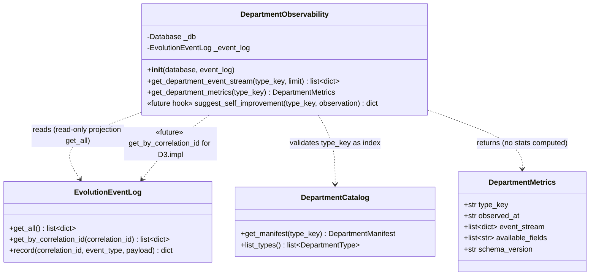
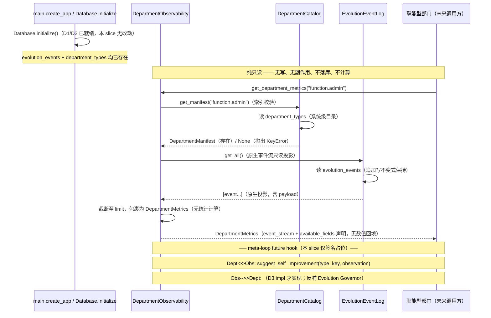
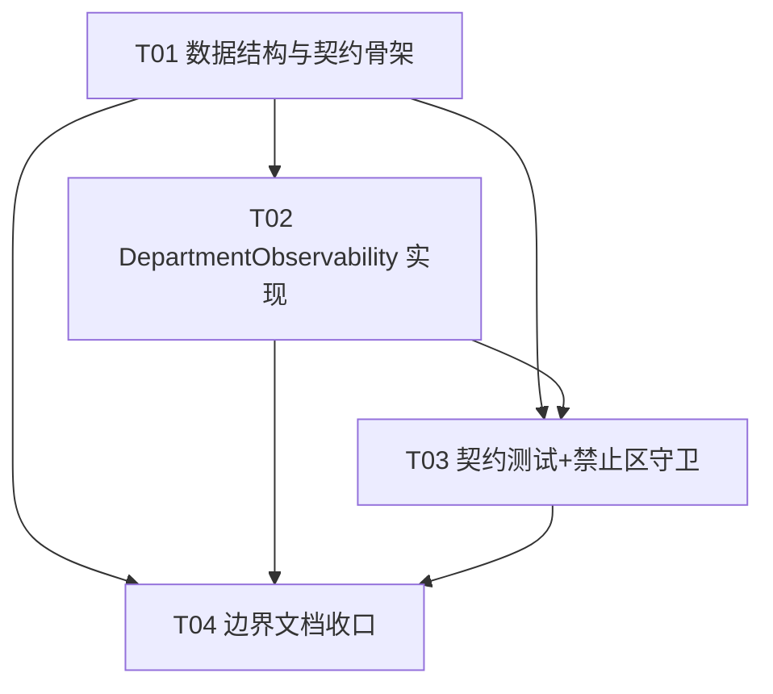

# ADR-0024: D3 职能型部门「自可观测 / 元循环」（Self-Observability / Meta-Loop）— Boundary

Date: 2026-07-08

Status: Proposed — boundary for D3 (ADR-0017 Sub-decision D3); pending 主理人（产品规划席 delegation）accept + gate → 质量运行席 verification + 系统交付席 implementation → 主理人 accept.（ADR-0017 option a 已 OPEN，D3 属预授权 reservation 路线，沿用 D1/D2 自主管线。）

Source gate: `issues/050_adr0017_future_gate_submission_package.md` (option a accepted by 总控决策席, 2026-07-07)
Carried-forward decisions: `docs/decisions/ADR-0017-multitenant-department-catalog.md` (Proposed, D3 节), `docs/decisions/ADR-0016-execution-substance-initiative.md` (Accepted, D3 追加写事件日志), `docs/decisions/ADR-0022-d1-tenant-id-reservation-boundaries.md` (D1 边界, Accepted), `docs/decisions/ADR-0023-d2-department-catalog-boundaries.md` (D2 边界, ACCEPTED / CLOSED).
Slice issue: `issues/054_adr0017_d3_self_observability.md`

## Context

ADR-0017 option a 已接受：「多租户 CEO + 部门目录」未来阶段 gate 已 OPEN。D1（`tenant_id` 预留）已 ACCEPTED（ADR-0022，69 tests green），D2（部门目录通用化 reservation）已 CLOSED（ADR-0023 + issues/052，81 tests green，Kou 实现 c8a30781，Yan 验证 reviews/053 PASS-WITH-NOTES）。D3 是 ADR-0017 的第三个子决策：**职能型部门「元循环」与自可观测**。

ADR-0017 D3 的远景是：职能型部门（人事部 / 行政部 / BI 部）消费公司运营数据（Tasks / Employees / Tokens / Platforms / Assets / **EvolutionLog**），产出 ROI 统计、角色/技能配置、可视化分析，反哺 CEO 驾驶舱与 Evolution Governor 的经济驱动编排。这把 **ADR-0016 D3（追加写演进/度量事件日志 + correlation id）** 从「审计 nice-to-have」**升级为硬依赖**——行政部/BI 部要算 token 产出比、做可视化，系统就必须把自身运行数据作为一等可查询数据暴露。

⚠️ **关键区分（务必注意）**：ADR-0016 的 D3 是「追加写事件日志」（已落地，`evolution_events` 表 + `EvolutionEventLog` 类 + governor correlation id 链路，事件日志保持追加写不变式）。**本 ADR-0017 D3 不是重写 ADR-0016 D3**，而是把「自可观测」升级为职能型部门的**硬依赖**——部门能读取**自己**的运行指标/事件，形成 meta-loop。本边界聚焦 ADR-0017 D3 的**设计预留（reservation）**，复用 ADR-0016 D3 已经就绪的 `evolution_events` 只读能力，不重写、不新增写。

**关键约束（来自 AGENTS.md 当前 gate）**：当前上线范围仍是 AI Task Executor MVP v0.1，**严格禁止**：L5 公司组织、L6 经济/ROI、Employee CRUD、多 Agent、外部服务、复杂 UI。因此 D3 在当前阶段**只能做设计预留**——即与 D1/D2 同源的「只读 facade + 索引占位」式零行为变化预留，**不得实现**真正的指标关联统计、可视化、meta-loop 自愈。

本边界契约将 D3 拆为「现在可做的设计预留」与「未来 gate 放开后才能做的实现」两半，并用边界线明确标注。预留部分严格保持：**只读投影、不计算统计/BI、不实例化真实部门、不接外部平台、不新增写路径、不新增 API endpoint**。

## Decision (Boundary Contract)

> ### ════════ 边界线：现在可做的「设计预留」（reservation）｜ 未来 gate 放开后才能做的「实现」════════

---

### 第一部分：现在可做的「设计预留」（D3-reservation slice，零行为变化）

仅做**只读查询 facade + 索引校验占位 + meta-loop future hook 签名**，复用 ADR-0016 D3 的 `evolution_events` 与 ADR-0023 D2 的 `department_types` / `DepartmentCatalog` 作为索引，**不接线、不计算、不改任何读/写路径语义、不新增 API endpoint、不新增/修改任何表**。

#### 1. 只读 `DepartmentObservability` facade（类比 D2 的 `DepartmentCatalog`）

新增模块 `backend/app/department_observability.py`，暴露**纯只读**能力。所有公开方法只读取现有 `evolution_events`（经 `EvolutionEventLog.get_all()` 只读投影）与现有 `department_types`（经 `DepartmentCatalog` 校验 type_key 索引），**无副作用、不触外部 I/O（除本地 SQLite 读）**。统计/BI/可视化仅声明为 future hook（不实现、不引用）：

```python
# backend/app/department_observability.py (reservation only — 只读 facade)
from __future__ import annotations

import json
from dataclasses import dataclass, field
from datetime import datetime, timezone
from typing import Any

from .database import Database
from .evolution_event_log import EvolutionEventLog
from .department_catalog import DepartmentCatalog


@dataclass
class DepartmentMetrics:
    """部门自可观测指标「只读投影」封装（reservation）。

    仅包裹原生事件流的只读投影 + 声明未来可计算字段，**不计算**任何
    均值/率/趋势（call_count / success_rate / quality_line_hits 均为
    D3.impl 未来职责，本 slice 仅静态声明、不回填）。
    """
    type_key: str
    observed_at: str
    event_stream: list[dict[str, Any]] = field(default_factory=list)
    available_fields: list[str] = field(
        default_factory=lambda: ["call_count", "success_rate", "quality_line_hits"]
    )
    schema_version: str = "0.0"


class DepartmentObservability:
    def __init__(self, database: Database, event_log: EvolutionEventLog) -> None:
        self.database = database
        self.event_log = event_log

    def get_department_event_stream(self, type_key: str, limit: int = 50) -> list[dict[str, Any]]:
        """返回某部门（经 catalog 索引校验）的**原生事件流只读投影**。

        - 先经 DepartmentCatalog.get_manifest(type_key) 校验 type_key 存在于
          系统级部门类型目录（索引角色）；未知 type_key 抛 KeyError。
        - 内部仅调 EvolutionEventLog.get_all() 的只读投影，截断至 limit（最近 N 条）。
        - 不做按部门的真实关联查询（部门→事件映射留作 D3.impl）；不计算统计。
        """

    def get_department_metrics(self, type_key: str) -> DepartmentMetrics:
        """返回部门自可观测指标「只读投影」封装。

        - 内部调 get_department_event_stream（只读投影），包裹为 DepartmentMetrics。
        - **不计算** call_count / success_rate / quality_line_hits —— available_fields
          仅静态声明这些字段未来可计算，本 slice 不回填任何数值。
        """

    # ── future hook（本 slice 不实现、不引用，供 D3.impl / meta-loop 接）──
    # def suggest_self_improvement(self, type_key, observation) -> dict: ...
    #     """Meta-loop：部门基于观测触发「自我建议」（仅签名占位，不实现）。"""
```

- `get_department_event_stream(type_key, limit)`：经 `DepartmentCatalog` 校验 `type_key` 在目录中（索引），再调 `EvolutionEventLog.get_all()` 取全量事件只读投影，截断至最近 `limit` 条返回。**不新增任何写、不计算统计、不建立部门→事件的真实关联**（该映射为 D3.impl 未来职责）。
- `get_department_metrics(type_key)`：调 `get_department_event_stream` 取只读投影，包裹为 `DepartmentMetrics`。`available_fields` 仅静态声明 `["call_count", "success_rate", "quality_line_hits"]` 为**未来可计算**字段；本 slice 不计算、不回填任何数值——严格遵守「只读投影、不计算均值/率/趋势」禁止区。
- 三个 future hook（真实指标关联、统计/BI、meta-loop `suggest_self_improvement`）仅签名占位，明确不在本 slice 实现。

#### 2. 复用既有基座（ADR-0016 D3 + ADR-0023 D2），零新增持久化

- **事件只读投影**：直接复用 `EvolutionEventLog`（已落地，追加写不变式不变）。`get_department_event_stream` 内部仅调其 `get_all()`（及概念上 `get_by_correlation_id` 作为 D3.impl 的未来关联路径）；**本 slice 不调用 `record`、不新增任何写路径**，事件日志追加写不变式保持。
- **索引校验**：复用 `DepartmentCatalog.get_manifest(type_key)` 校验 `type_key` 存在于 `department_types`（系统级目录，建一次、全员可用）。**不新增 `departments` 表、不扩展 `department_types` 持久化、不建部门→事件 FK**。
- **无 `database.py` 改动**：`evolution_events` 与 `department_types` 均已存在；本 reservation 不需要任何 schema 增量，使 D3 比 D1/D2 更轻、更可逆。

#### 3. Invariant（代码 + 测试强制）

- 经 `Database().initialize()` 后，现有 `evolution_events` / `department_types` 表不变（`database.py` 无改动）；`DepartmentObservability` 仅消费既有表。
- `DepartmentObservability.get_department_event_stream(type_key, limit)` 对目录中存在的 `type_key` 返回 `list[dict]`（原生事件流只读投影，截断至 `limit`，字段含 `event_id` / `correlation_id` / `event_type` / `payload` / `created_at`）；对不存在的 `type_key` 抛 `KeyError`。
- `DepartmentObservability.get_department_metrics(type_key)` 返回 `DepartmentMetrics`，其 `event_stream` 为只读投影，`available_fields == ["call_count","success_rate","quality_line_hits"]`，**且不包含任何已计算的数值字段**（无 `call_count`/`success_rate`/`quality_line_hits` 的回填值）。
- `DepartmentObservability` 模块内**无任何 `EvolutionEventLog.record` 调用**（只读），**无任何 `INSERT/UPDATE/DELETE` 语句**（forbidden-scope 扫描）。
- **全代码库无新增读路径 `WHERE department_id = ?` 过滤**（部门作用域留待 D3.impl）。
- **无新增 API endpoint**，既有 API 语义不变（diff 扫描路由注册）。
- `TenantContext.current_tenant_id()` 仍为 `'default'`、`is_multi_tenant()` 仍为 `False`（D1 不变式不被破坏）。
- 后端回归（含 D1/D2 既有测试）全绿；**无任何既有测试被修改**。

---

### 第二部分：未来 gate 放开后才能做的「实现」（明确排除于本 reservation slice）

以下**不在本 D3-reservation slice 内**，且**必须**等待 总控决策席 批准独立的未来 gate（建议 `D3.impl`）后方可实施，并**触发 安全边界席 review**：

1. **真实指标关联**：建立「部门类型/实例 → 事件/任务」的真实关联（correlation_id 映射、部门作用域过滤、`WHERE department_id = ?` 读路径），本 reservation 不做。
2. **统计 / 聚合 / BI**：`call_count` / `success_rate` / `quality_line_hits` 的**真实计算**（均值/率/趋势）、token 消耗产出比（L6 经济层）。
3. **可视化 / 仪表盘 / 图表**：将指标渲染为 CEO 驾驶舱视图（复杂 UI）。
4. **Meta-loop 自愈**：`suggest_self_improvement` 真实实现——部门基于观测触发自我建议并反哺 Evolution Governor 经济驱动编排。
5. **部门实例化**：创建 `departments` 表、部门 CRUD（与 D2 同源，属 L5）。
6. **外部平台 / 凭证 / 合规面**：业务部真实平台接入、发布安全状态机（均属 安全边界席 管辖）。
7. **Employee CRUD / L2L5 员工层 / 角色技能配置事实接口**。

## Forbidden Scope（本 reservation slice 全局禁止范围）

- 真实统计/聚合/BI/可视化/图表：`get_department_metrics` **仅返回原生事件流的只读投影**，不得算均值/率/趋势/call_count/success_rate/quality_line_hits。
- 不实例化真实部门、不建 `departments` 表、不扩展 `department_types` 持久化、不建部门→事件 FK。
- 不做 L6 经济/ROI 计算，不碰 token-output-ratio。
- 不接外部平台、不碰凭证、不触合规面（安全边界席领地）。
- 不做 Employee CRUD；`employee_role_spec` 仅作占位契约字段，不消费。
- 不新增写路径：事件日志保持 ADR-0016 追加写不变式，D3 只读（`get_department_event_stream` / `get_department_metrics` 不调 `record`）。
- 不新增 API endpoint、不改既有读/写语义、不破坏现有 81 测试。
- 不做多 Agent、不抽象 agent、不做复杂 UI/dashboard、不用向量库/embedding。
- 不动 D1 的 `TenantContext` 不变式（单租户哨兵 `'default'`）。
- 在任意读路径加 `WHERE department_id = ?` 过滤或任何读路径作用域化；`database.py` 之外的预支未必要结构。
- 解除自动改码禁令 / human-approval gate。

## Verification Plan

质量运行席 以标准 diff 与 forbidden-scope 守卫 + slice 专属断言验证（建议后端用例 `backend/tests/test_d3_observability.py`，参照 D1/D2 风格）：

```bash
git diff --name-only HEAD -- backend frontend
git diff --check
# forbidden-scope keyword scan on changed backend/app files
```

Plus slice-specific assertions（覆盖于 `backend/tests/test_d3_observability.py`）：

- `backend/app/department_observability.py` 存在并声明 `DepartmentObservability` 类，含 `get_department_event_stream` / `get_department_metrics` 方法及 `suggest_self_improvement` future hook 占位。
- `DepartmentObservability.get_department_event_stream("function.admin", 10)` 返回 `list[dict]`，长度 ≤ 10，元素含 `event_id` / `correlation_id` / `event_type` / `payload` / `created_at`（原生事件流只读投影）；对 `"unknown.dept"` 抛 `KeyError`。
- `DepartmentObservability.get_department_metrics("function.bi")` 返回 `DepartmentMetrics`，`available_fields == ["call_count","success_rate","quality_line_hits"]`，且**结果中不含任何已计算的数值指标字段**（无 `call_count`/`success_rate`/`quality_line_hits` 键或回填值）。
- **全代码库无 `WHERE department_id` 读路径过滤**（forbidden-scope 守卫）。
- **无新增 API endpoint**（diff 扫描路由注册；forbidden-scope 扫描 `app.get("/api/observ"`, `app.post("/api/observ"` 零命中）。
- `backend/app/department_observability.py` 内**无任何 `record(` 调用 / 无任何写语句**（forbidden-scope 扫描 `\.record\(`, `insert into`, `update `, `delete from` 零命中）。
- `TenantContext.current_tenant_id()` 仍为 `'default'`、`is_multi_tenant()` 仍为 `False`。
- 后端回归（含 D1/D2 既有测试）全绿；**无任何既有测试被修改**；forbidden-scope 扫描干净。
- `git diff --name-only -- backend/app/database.py` 输出为空（本 slice 零 schema 增量，可逆性证明）。

## Consequences

- **Easier**：系统在「自可观测」边界上拥有了一个只读 `DepartmentObservability` facade——复用 ADR-0016 D3 的 `evolution_events` 与 ADR-0023 D2 的 `department_types`/`DepartmentCatalog` 索引，未来开启 D3 实现只是「填充真实关联 + 计算指标 + 实现 meta-loop hook」，而非重写。
- **Easier**：未来 `D3.impl` slice 拥有干净、已测试、受契约断言守护的接缝；`evolution_events` 追加写不变式与 `department_types` 目录索引均无需改动。
- **Harder / cost**：1 个新模块（只读 facade）+ 1 个测试文件；**零 schema 增量、零 `database.py` 改动**（比 D1/D2 更轻、更可逆）；小且可 review 的 diff；需 总控决策席（预授权路线下由 主理人 accept+gate）为 reservation 单独开 gate。
- **No behavior change today**：刻意的「只读投影」——facade 校验索引、包裹原生事件流、声明未来字段，但**不计算、不写、不实例化、不接外部**。部门与事件的真实关联与指标计算均留待 D3.impl。
- **明确非目标**：不解除自动改码禁令；现在不实现真实指标关联、统计/BI、可视化、meta-loop 自愈、Employee CRUD——均留待对应未来 gate，并触发 安全边界席 review。

---

## System Design（系统设计交付物）

> 本节为 D3 reservation slice 的**完整架构设计**（设计-only，不写实现代码）。后续 Engineer 按「任务列表」落地。

### 1. 实现方案 + 框架选型

| 维度 | 选型 / 说明 |
|---|---|
| 核心技术挑战 | 自可观测是 L6 概念（部门读自己运行数据），当前 gate 禁止统计/可视化；需在不触发 forbidden zone 的前提下，复用既有 `evolution_events` 与 `department_types` 为未来 D3 实现预留稳定只读接缝。 |
| 总体策略 | **设计-only 增量预留**（与 D1/D2 同构）：只读 facade + 索引校验占位 + meta-loop future hook，零行为变化、可逆、不破坏既有测试。 |
| 语言 / 存储 | 复用现有栈：**Python + SQLite**（经 `database.py`）；**本 slice 零 schema 增量**（不触碰 `evolution_events` / `department_types`，不新建表）。 |
| Web 框架 | 复用 **FastAPI**（仅既有 endpoint，**不新增**任何路由）。 |
| 结构定义 | 复用标准库 `dataclasses` + `json` 声明 `DepartmentMetrics` 投影结构；**不依赖 Pydantic 校验消费**（保持最小 diff）。 |
| 架构模式 | 与现有模块一致：`DepartmentObservability` 为**只读查询 facade**（类比 D2 `DepartmentCatalog` 的 read-only 模式、`EvolutionEventLog` 的写受限模式）；依赖注入 `EvolutionEventLog` 与 `Database`（类比 `EvolutionGovernor(store, event_log)` / `ResultStore(database, event_log)`）。 |
| 索引来源 | 复用 D2 `DepartmentCatalog.get_manifest(type_key)` 作为「部门类型 → 索引」校验点（本 slice 不做真实关联，仅校验存在性）。 |
| 外部依赖 | 无新增第三方包（见「依赖包列表」）。 |

### 2. 文件清单（相对路径）

| 文件 | 状态 | 职责 |
|---|---|---|
| `backend/app/department_observability.py` | 新增 | 只读 `DepartmentObservability` facade（`get_department_event_stream` / `get_department_metrics`）+ `DepartmentMetrics` dataclass；future hook `suggest_self_improvement` 仅签名占位。 |
| `backend/tests/test_d3_observability.py` | 新增 | reservation 契约测试 + forbidden-scope 守卫（无 `WHERE department_id`、无新 endpoint、facade 内无写、无统计计算）。 |
| `docs/decisions/ADR-0024-d3-self-observability-boundaries.md` | 本文件 | 边界 ADR + 系统设计。 |
| `issues/054_adr0017_d3_self_observability.md` | 新增 | D3 reservation slice issue。 |

> 注：`backend/app/database.py` **不在本 slice 允许文件内**——D3 reservation 不需要任何 schema 增量（`evolution_events` 与 `department_types` 均已存在），因此零持久化改动、完全可逆。

### 3. 数据结构与接口（类图 + JSON Schema）

#### 3.1 类图（Mermaid）



#### 3.2 DepartmentMetrics JSON Schema（结构化描述）

```json
{
  "$schema": "http://json-schema.org/draft-07/schema#",
  "title": "DepartmentMetrics",
  "type": "object",
  "properties": {
    "type_key": { "type": "string", "description": "经 DepartmentCatalog 校验存在的部门类型 key" },
    "observed_at": { "type": "string", "format": "date-time", "description": "本次观测调用时间（UTC ISO8601），非业务指标" },
    "event_stream": {
      "type": "array",
      "items": {
        "type": "object",
        "properties": {
          "event_id": { "type": "integer" },
          "correlation_id": { "type": "string" },
          "event_type": { "type": "string" },
          "payload": { "type": "object" },
          "created_at": { "type": "string" }
        },
        "required": ["event_id", "correlation_id", "event_type", "payload", "created_at"]
      },
      "description": "原生事件流只读投影（截断至 limit），不计算均值/率/趋势"
    },
    "available_fields": {
      "type": "array",
      "items": { "type": "string", "enum": ["call_count", "success_rate", "quality_line_hits"] },
      "description": "本 reservation 仅静态声明；真实度量由 D3.impl 计算（禁止区外）"
    },
    "schema_version": { "type": "string", "default": "0.0" }
  },
  "required": ["type_key", "observed_at", "event_stream", "available_fields", "schema_version"]
}
```

### 4. 程序调用流程（时序图 — meta-loop 示意）



### 5. 任务列表（有序、含依赖、按实现顺序）

> 供后续 Engineer 落地的 D3 reservation slice 实现任务（设计-only 已由本 ADR 定义，此处为执行分解）。参考 D2 的 T01–T04 风格，因本 slice 零 schema 增量，故无「数据层增量」任务。

| Task ID | 任务名称 | 源文件 | 依赖 | 优先级 |
|---|---|---|---|---|
| **T01** | 数据结构与契约骨架 | `backend/app/department_observability.py`（new, 接口契约 + `DepartmentMetrics` dataclass + future hook 占位）、`backend/tests/test_d3_observability.py`（new, scaffold） | — | P0 |
| **T02** | DepartmentObservability 只读查询实现 | `backend/app/department_observability.py`（实现 `get_department_event_stream`/`get_department_metrics`，经 `DepartmentCatalog` 索引校验 + `EvolutionEventLog.get_all()` 只读投影；`suggest_self_improvement` 抛 `NotImplementedError`） | T01 | P0 |
| **T03** | 契约测试 + 禁止区守卫 | `backend/tests/test_d3_observability.py`（完整断言 + forbidden-scope 扫描：无 `WHERE department_id`、无新 endpoint、facade 内无写、无统计计算） | T01, T02 | P0 |
| **T04** | 边界文档收口 | `docs/decisions/ADR-0024-...md`（finalize）、`issues/054_adr0017_d3_self_observability.md` | T01–T03 | P1 |

**依赖关系图（Mermaid）**：



### 6. 依赖包列表

- **无新增第三方包**。复用现有依赖：Python 3 标准库（`dataclasses`、`json`、`sqlite3`、`datetime`）、既有 `backend/app/database.py`、`backend/app/evolution_event_log.py`（ADR-0016 D3）、`backend/app/department_catalog.py`（ADR-0023 D2）。本 slice 不引入任何新库。

### 7. 共享知识（跨文件约定）

- **只读纪律**：`DepartmentObservability` 所有公开方法只读、无副作用、不触外部 I/O（除本地 SQLite 读）；**绝不调用 `EvolutionEventLog.record`**，事件日志追加写不变式保持。
- **索引复用**：部门类型索引统一走 `DepartmentCatalog.get_manifest(type_key)`（D2 目录）；未知 `type_key` 抛 `KeyError`，与 `ResultStore.get_task` 一致。
- **只读投影语义**：`get_department_metrics` 返回的 `DepartmentMetrics.event_stream` 为 **ADR-0016 `evolution_events` 的原生投影**（字段同 `EvolutionEventLog.get_all`）；`available_fields` 仅静态声明未来可计算字段，**本 slice 不回填任何数值**。
- **future hook 纪律**：`suggest_self_improvement`（meta-loop 自我建议）仅声明签名、抛 `NotImplementedError`、不引用，留作 D3.impl + 安全边界席。
- **版本占位**：`schema_version` 形如 `"0.0"`（占位）。
- **测试约定**：forbidden-scope 扫描关键词 `WHERE department_id`、`app.get("/api/observ"`、`app.post("/api/observ"`、`\.record\(`、`insert into`、`update `、`delete from`，确保无读路径过滤、无新 endpoint、facade 内无写、无统计计算（`statistics.`/`mean(`/`success_rate =` 等亦应零命中）。
- **零 schema 增量**：本 slice 不改动 `database.py`、不新建表；`git diff --name-only -- backend/app/database.py` 应为空（可逆性证明）。
- **D1 不变式**：`TenantContext` 单租户哨兵 `'default'` 不被触碰。

### 8. 待明确事项

1. **事件→部门映射粒度**：本 reservation 的 `get_department_event_stream` 仅返回 `EvolutionEventLog.get_all()` 的全局只读投影（截断至 `limit`），**不建立部门→事件的真实关联**（无 `department_id` 字段）。是否需要在 D3.reservation 阶段就为 `evolution_events` 预留一个 `department_type_key` 占位列（与 D1 `tenant_id` 同构的「加列预留」），还是把真实关联完全留待 `D3.impl`？本设计默认**不预留列、留待 D3.impl**，以最小 diff 原则；如主理人要求「先占位列」可后置。
2. **`get_department_metrics` 是否应接受 `limit`**：用户给定签名为 `get_department_metrics(type_key)`（无 limit）。本设计内部以默认 `limit=50` 调 `get_department_event_stream`；如未来需要可调，建议 D3.impl 再扩展参数。
3. **meta-loop 触发边界**：`suggest_self_improvement` 真实实现将「反哺 Evolution Governor 经济驱动编排」，属 L6 + 自动演进面，必须独立 gate + 安全边界席；本 reservation 仅占位。
4. **`quality_line_hits` 数据来源**：真实质量线命中需解析事件 payload 并与质量线定义关联，属 D3.impl 统计职责；本 reservation 不解析 payload 内容。
5. **与 ADR-0016 D3 的关系澄清**：ADR-0016 D3 = 追加写事件日志（已落地）；本 ADR-0017 D3 = 把「自可观测」升级为部门硬依赖（读侧 reservation）。两者不复用同一张表之外的关系——本 slice 只读消费 ADR-0016 D3 的 `evolution_events`，不重写其写路径。
6. **外部平台/凭证边界**：业务部真实平台接入、凭证、发布安全状态机属 安全边界席，本 reservation 零触碰。

---

## Gate 要求与边界席触发（明确标注）

| 项目 | 要求 |
|------|------|
| **本 reservation slice 开 gate** | 须由 **总控决策席** 作为 D3 第一阶段（reservation）单独开 gate 批准（预授权路线下由 主理人 代表 accept+gate）；可参照 D1/D2 的「零行为变化预留」获批逻辑（只读 facade + 索引占位，无行为变更、零 schema 增量）。 |
| **真正 D3 实现开 gate（强制小 gate）** | 真实指标关联 / 统计 / 可视化 / meta-loop 自愈 **必须各自独立小 gate**，由 **总控决策席** 批准（建议 `D3.impl`），**不可**借本 reservation slice 夹带落地。 |
| **安全边界席触发（强制）** | 一旦开启「部门→事件真实数据关联」「外部系统接入」「发布安全状态机」「L6 经济/ROI 回流」任一实现 slice，必须触发 **安全边界席 review**（ADR-0017 Relations 已声明）。 |
| **类型级扩展治理** | 新增一个部门类型（`type_key`）仍走 gate + ADR（ADR-0017 D4）；本 reservation 仅消费 D2 已种子的最小规范集。 |
| **演进边界** | Evolution Governor 演进范围被限制在单个部门 manifest 内部，不得越界改其他部门（ADR-0017 D4）。 |
| **禁止解除** | 本 reservation **不解除**自动改码禁令、human-approval gate；不预支过多部门类型槽位、不预支未定关联结构。 |

## Relations / Triggers

- **依赖**：ADR-0016（执行实质化：D3 追加写事件日志 `evolution_events` + correlation id 链路——本 slice 只读消费，不重写写路径）、ADR-0022（D1 `tenant_id` 预留；单租户哨兵不变式）、ADR-0023（D2 `department_types` 系统级目录 + `DepartmentCatalog` 索引——本 slice 用作部门类型校验索引）。
- **触发 总控决策席**：是否开放 D3 reservation gate；以及未来 `D3.impl` 各独立小 gate（真实关联/统计/可视化/meta-loop）。
- **触发 安全边界席**：部门→事件真实数据关联、外部系统接入、发布安全状态机、L6 经济/ROI 回流（任意实现 slice 开启时）。
- **承接 ADR-0017 D3/D4**：本 reservation 仅覆盖 D3 的只读 facade 骨架；D3 真实实现（meta-loop 自愈/可视化）与 D4 两级治理为未来 gate 内容。
- **与 ADR-0016 D3 的区别（明确）**：ADR-0016 D3 = 写侧「追加写事件日志」（已落地，不变式保持）；本 ADR-0017 D3 = 读侧「把自可观测升级为部门硬依赖」（reservation，复用写侧基座，只读消费）。本 slice 不重写 ADR-0016 D3。
