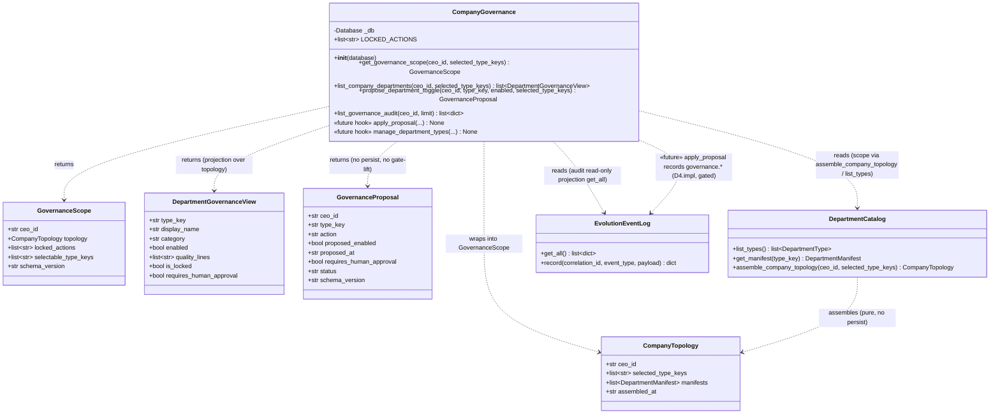
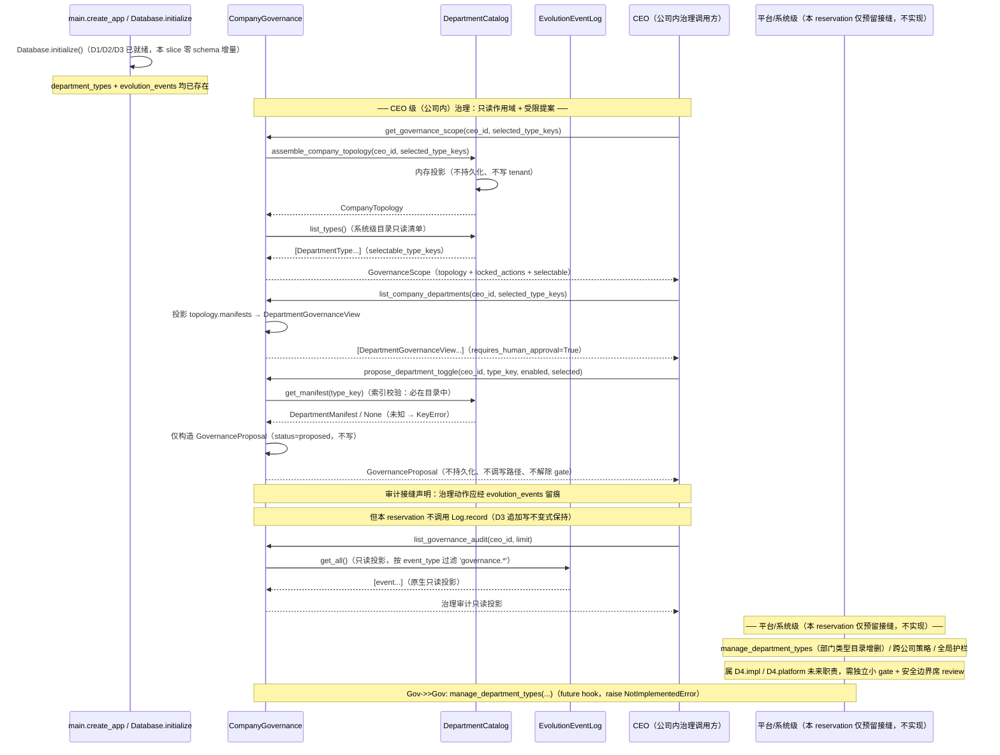
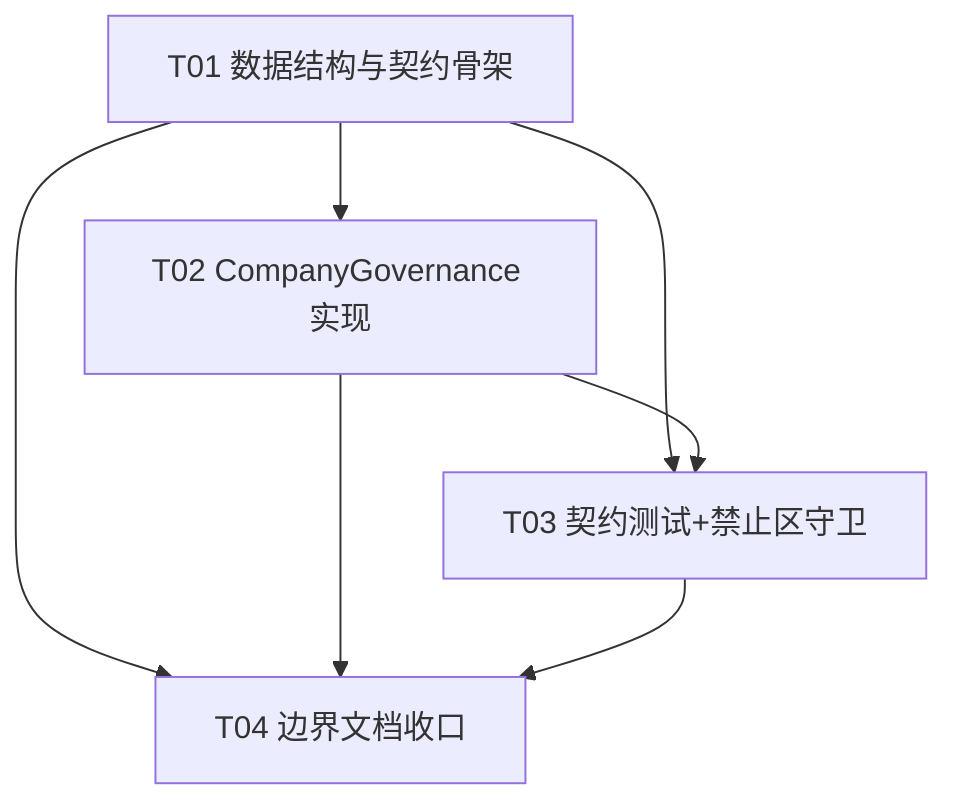

# ADR-0025: D4 两级治理（Two-Tier Governance）— Boundary

Date: 2026-07-08

Status: Proposed — boundary for D4 (ADR-0017 Sub-decision D4); pending 主理人（产品规划席 delegation）accept + gate → 质量运行席 verification + 系统交付席 implementation → 主理人 accept.（ADR-0017 option a 已 OPEN，D4 属预授权 reservation 路线，沿用 D1/D2/D3 自主管线。）

Source gate: `issues/050_adr0017_future_gate_submission_package.md` (option a accepted by 总控决策席, 2026-07-07)
Carried-forward decisions: `docs/decisions/ADR-0017-multitenant-department-catalog.md` (Proposed, D4 节), `docs/decisions/ADR-0016-execution-substance-initiative.md` (Accepted, D3 追加写事件日志), `docs/decisions/ADR-0022-d1-tenant-id-reservation-boundaries.md` (D1 边界, Accepted), `docs/decisions/ADR-0023-d2-department-catalog-boundaries.md` (D2 边界, CLOSED), `docs/decisions/ADR-0024-d3-self-observability-boundaries.md` (D3 边界, CLOSED).
Slice issue: `issues/055_adr0017_d4_two_tier_governance.md`

## Context

ADR-0017 option a 已接受：「多租户 CEO + 部门目录」未来阶段 gate 已 OPEN。D1（`tenant_id` 预留）已 ACCEPTED（ADR-0022，69 tests green），D2（部门目录通用化 reservation）已 CLOSED（ADR-0023 + issues/052，81 tests green，Kou c8a30781，Yan reviews/053 PASS-WITH-NOTES），D3（职能型部门自可观测 reservation）已 CLOSED（ADR-0024 + issues/054，90 tests green，零 schema 增量，Kou 22c5cd55，Yan reviews/055 PASS-WITH-NOTES）。D4 是 ADR-0017 的**第四个（最后一个）子决策**：**两级治理（Two-Tier Governance）**。

ADR-0017 D4 的远景是：把「治理」明确拆为两个层级——
- **① CEO 级（公司内）**：在每个 CEO 自身的 `CompanyTopology` 内拥有「配置 + 审计」级别的治理权（启用/停用某部门类型、调整质量线、选/卸插件、查看治理审计）；但变更作用域被锁在自己公司内，**不得改其他 CEO 的拓扑、不得改部门类型目录（系统级）、不得解除 human-approval gate、不得自动改码**。
- **② 平台/系统级**：保留对「部门类型目录」（`department_types`）增删、跨公司策略、全局护栏的治理权——本 reservation **仅预留该层级的「存在性/接缝」，不实现平台管理后台**。

⚠️ **关键区分（务必注意）**：本 ADR-0017 D4 reservation **不是实现任何治理动作**，而是复用 D2 已就绪的 `DepartmentCatalog.assemble_company_topology(ceo_id, selected_type_keys)` 返回的 `CompanyTopology` 作为 **CEO 级治理的作用域边界**，并预留一个「只读 / 受限提案」的治理 facade（类比 D2 `DepartmentCatalog` / D3 `DepartmentObservability`）。本 reservation **不持久化任何治理状态、不解除 gate、不自动改码、不实例化真实部门、不接外部平台**。

**关键约束（来自 AGENTS.md 当前 gate）**：当前上线范围仍是 AI Task Executor MVP v0.1，**严格禁止**：L5 公司组织、L6 经济/ROI、Employee CRUD、多 Agent、外部服务、复杂 UI、自动改码。因此 D4 在当前阶段**只能做设计预留**——即与 D1/D2/D3 同源的「只读/受限提案 facade + 作用域边界封装 + 治理不变式」式零行为变化预留，**不得实现**真正的平台级管理后台、跨公司策略引擎、真实公司持久化。

本边界契约将 D4 拆为「现在可做的设计预留」与「未来 gate 放开后才能做的实现」两半，并用边界线明确标注。预留部分严格保持：**只读作用域 + 提案占位、不持久化、不解除 gate、不自动改码、不触碰系统级 department_types 增删、不新增写路径、不新增 API endpoint**。

## Decision (Boundary Contract)

> ### ════════ 边界线：现在可做的「设计预留」（reservation）｜ 未来 gate 放开后才能做的「实现」════════

---

### 第一部分：现在可做的「设计预留」（D4-reservation slice，零行为变化）

仅做**只读作用域封装 + 受限提案 facade + 治理不变式断言**，复用 D2 的 `DepartmentCatalog` / `CompanyTopology` 作为 CEO 级治理作用域边界，复用 ADR-0016 D3 的 `evolution_events` 作为治理审计的「只读投影接缝」，**不接线、不持久化、不落地提案、不改任何读/写路径语义、不新增 API endpoint、不新增/修改任何表**。

#### 1. 只读作用域封装：`GovernanceScope`（CEO 级治理边界）

复用 D2 `DepartmentCatalog.assemble_company_topology(ceo_id, selected_type_keys)` 返回的 `CompanyTopology` 作为 CEO 级治理的作用域边界。本 reservation **不持久化** `CompanyTopology`，但预留「公司内配置变更 = 仅作用于该 `CompanyTopology` 投影」的不变量：

```python
# backend/app/governance.py (reservation only — 只读作用域封装)
from __future__ import annotations

from dataclasses import dataclass, field

@dataclass
class GovernanceScope:
    """CEO 级治理作用域边界（只读投影，封装其 CompanyTopology）。

    本 reservation 不持久化 topology；仅声明「公司内配置变更 = 仅作用于
    该 CompanyTopology 投影」的不变量。``locked_actions`` 声明本 reservation
    锁定的动作（平台级 / 解除 gate / 自动改码等），``selectable_type_keys``
    为系统级目录全量 key 的**只读清单**（CEO 可选/卸，但不得增删类型）。
    """
    ceo_id: str
    topology: "CompanyTopology"          # 复用 D2 内存投影，不持久化
    locked_actions: list[str] = field(default_factory=list)
    selectable_type_keys: list[str] = field(default_factory=list)
    schema_version: str = "0.0"
```

- `topology`：来自 `DepartmentCatalog.assemble_company_topology` 的内存投影（不落库、不写 tenant），是 CEO 级治理变更的唯一作用域。
- `locked_actions`：声明本 reservation 锁定的动作集合，例如 `["manage_department_types", "lift_human_approval_gate", "auto_modify_code", "cross_company_policy"]`——这些动作**不允许**在 CEO 级触发。
- `selectable_type_keys`：经 `DepartmentCatalog.list_types()` 取系统级目录全量 key 的**只读清单**；CEO 可从中选/卸（组装自身拓扑），但**不得**增删类型（增删属平台级）。

#### 2. 受限提案 facade：`CompanyGovernance`（类比 D2 `DepartmentCatalog` / D3 `DepartmentObservability`）

新增模块 `backend/app/governance.py`，暴露**只读作用域 + 受限提案**能力。所有公开方法只读取既有 `department_types`（经 `DepartmentCatalog` 索引校验）与既有 `evolution_events`（经 `EvolutionEventLog.get_all()` 只读投影），**无副作用、不触外部 I/O（除本地 SQLite 读）**。落地/平台级动作仅声明为 future hook（不实现、不引用）：

```python
# backend/app/governance.py (reservation only — 只读作用域 + 受限提案 facade)
from __future__ import annotations

from dataclasses import dataclass, field
from datetime import datetime, timezone
from typing import Any

from .database import Database
from .department_catalog import DepartmentCatalog


@dataclass
class DepartmentGovernanceView:
    """公司内某部门的治理视图（只读投影 + 提案态，不持久化）。"""
    type_key: str
    display_name: str
    category: str
    enabled: bool                       # 本 reservation 中 selected=enabled
    quality_lines: list[str] = field(default_factory=list)  # 占位结构，不消费
    is_locked: bool = False             # human-approval gate 等锁定项
    requires_human_approval: bool = True  # 任何变更需人工批准（本 reservation 不解除）


@dataclass
class GovernanceProposal:
    """治理变更提案（仅提案/审计，不持久化、不解除 gate、不调写路径）。"""
    ceo_id: str
    type_key: str
    action: str                         # 'toggle_department' 等
    proposed_enabled: bool
    proposed_at: str
    requires_human_approval: bool = True  # 恒 True（本 reservation 不解除 gate）
    status: str = "proposed"            # 本 reservation 不落地（无 apply）
    schema_version: str = "0.0"


class CompanyGovernance:
    """CEO 级治理 facade（只读作用域 + 受限提案）。

    所有方法仅读取既有 ``department_types`` 与 ``evolution_events``，无副作用、
    不触外部 I/O。提案仅构造内存对象、不持久化、不调 ``EvolutionEventLog.record``、
    不解除 human-approval gate、不自动改码。落地/平台级动作仅以 future hook 占位。
    """
    LOCKED_ACTIONS: list[str] = field(default_factory=lambda: [
        "manage_department_types",      # 平台级：部门类型目录增删
        "lift_human_approval_gate",     # 解除人工批准 gate
        "auto_modify_code",             # 自动改码
        "cross_company_policy",         # 跨公司策略
    ])

    def __init__(self, database: Database) -> None:
        self.database = database

    def get_governance_scope(self, ceo_id: str, selected_type_keys: list[str]) -> GovernanceScope:
        """返回 CEO 级治理作用域：封装 CompanyTopology + 锁定动作 + 目录只读清单。
        不持久化、不写 tenant。"""

    def list_company_departments(self, ceo_id: str, selected_type_keys: list[str]) -> list[DepartmentGovernanceView]:
        """返回公司内各部门的治理视图（投影 topology.manifests）。
        每个视图 ``requires_human_approval=True``（gate 不解除）。"""

    def propose_department_toggle(self, ceo_id: str, type_key: str, enabled: bool, selected_type_keys: list[str]) -> GovernanceProposal:
        """提案启用/停用某部门类型（仅提案/审计）。

        - 经 DepartmentCatalog.get_manifest(type_key) 校验 type_key 存在于
          系统级目录（索引角色）；未知 type_key 抛 KeyError。
        - 仅构造 GovernanceProposal（status='proposed'），**不持久化、不调写路径、
          不解除 gate、不触碰 department_types 增删**。
        - 治理不变式：提案绑定 (ceo_id, selected_type_keys) 作用域，不得逃逸
          出自身 CompanyTopology、不得改其他 CEO 拓扑、不得改系统级 department_types。
        """

    def list_governance_audit(self, ceo_id: str, limit: int = 50) -> list[dict[str, Any]]:
        """治理审计只读投影（复用 ADR-0016 D3 evolution_events）。

        - 经 EvolutionEventLog.get_all() 取全量事件只读投影，按 event_type 以
          'governance.' 前缀过滤，截断至最近 limit 条。
        - 本 reservation **不新增任何写**：治理动作留痕为「未来 impl 职责」，
          仅声明接缝；D3 追加写不变式保持。
        """

    # ── future hook（本 slice 不实现、不引用，供 D4.impl / 平台级接）──
    def apply_proposal(self, *args: Any, **kwargs: Any) -> None:
        """Future hook: 落地提案（需 human-approval gate）。本 reservation 不实现。"""

    def manage_department_types(self, *args: Any, **kwargs: Any) -> None:
        """Future hook: 平台/系统级治理——部门类型目录增删（安全边界席领地）。本 reservation 不实现。"""
```

- `get_governance_scope(ceo_id, selected_type_keys)`：调 `DepartmentCatalog.assemble_company_topology` 得 `CompanyTopology`，调 `DepartmentCatalog.list_types()` 得系统级目录全量 key 只读清单，封装为 `GovernanceScope`（含 `locked_actions` 锁定声明）。**不持久化、不写 tenant**。
- `list_company_departments(ceo_id, selected_type_keys)`：投影 `CompanyTopology.manifests` 为 `DepartmentGovernanceView` 列表；每个视图 `requires_human_approval=True`（gate 不解除）、`quality_lines` 仅占位结构（不消费）。
- `propose_department_toggle(ceo_id, type_key, enabled, selected_type_keys)`：经 `DepartmentCatalog.get_manifest(type_key)` 校验 `type_key` 在系统级目录中（未知 → `KeyError`）；仅构造 `GovernanceProposal`（`status='proposed'`、`requires_human_approval=True`、`proposed_at=UTC ISO8601`），**不持久化、不调 `EvolutionEventLog.record`、不解除 gate、不触碰 `department_types` 增删**。
- `list_governance_audit(ceo_id, limit)`：经 `EvolutionEventLog.get_all()` 只读投影，按 `event_type` 以 `'governance.'` 前缀过滤、截断至 `limit`。**不新增任何写**，仅声明「治理动作应经事件日志留痕」的接缝（D3 追加写不变式保持）。
- 两个 future hook（`apply_proposal` / `manage_department_types`）仅签名占位，明确不在本 reservation 实现。

#### 3. 复用既有基座（ADR-0016 D3 + ADR-0023 D2），零新增持久化

- **作用域边界**：直接复用 `DepartmentCatalog.assemble_company_topology`（D2，纯内存投影）作为 CEO 级治理作用域；本 reservation 不新建 `company_topology` 表、不持久化 CEO 拓扑。
- **索引校验**：复用 `DepartmentCatalog.get_manifest(type_key)` / `list_types()` 校验 `type_key` 存在于 `department_types`（系统级目录）。
- **审计接缝**：复用 `EvolutionEventLog.get_all()`（ADR-0016 D3，追加写不变式不变）作只读投影；**本 reservation 不调用 `record`、不新增任何写路径**，事件日志追加写不变式保持。
- **无 `database.py` 改动**：`department_types` 与 `evolution_events` 均已存在；本 reservation 不需要任何 schema 增量，使 D4 与 D3 同构——零 schema 增量、完全可逆。

#### 4. 治理不变式（代码 + 测试强制）

- 经 `Database().initialize()` 后，现有 `department_types` / `evolution_events` 表不变（`database.py` 无改动）；`CompanyGovernance` 仅消费既有表。
- `get_governance_scope(ceo_id, selected_type_keys)` 返回 `GovernanceScope`，其 `topology` 为 D2 内存 `CompanyTopology`（不落库），`locked_actions` 非空（声明平台级/gate-lift 锁定），`selectable_type_keys` 等于 `DepartmentCatalog.list_types()` 全量 key（只读清单）。
- `list_company_departments(ceo_id, selected_type_keys)` 返回 `list[DepartmentGovernanceView]`，元素数与 `selected_type_keys` 一致；每个 `requires_human_approval == True`（gate 不解除）。
- `propose_department_toggle(ceo_id, type_key, enabled, selected_type_keys)` 对目录中存在的 `type_key` 返回 `GovernanceProposal`（`status == 'proposed'`、`requires_human_approval == True`、`proposed_at` 为 UTC ISO8601）；对不存在的 `type_key` 抛 `KeyError`。
- `GovernanceProposal` **不持久化**：`propose_department_toggle` 模块内**无任何 `EvolutionEventLog.record` 调用**（只读/提案）、**无任何 `INSERT/UPDATE/DELETE` 语句**（forbidden-scope 扫描），**无任何对 `department_types` 的写**（不增删类型）。
- **全代码库无新增读路径 `WHERE department_id = ?` 过滤**（部门作用域留待 D4.impl）。
- **无新增 API endpoint**，既有 API 语义不变（diff 扫描路由注册）。
- `TenantContext.current_tenant_id()` 仍为 `'default'`、`is_multi_tenant()` 仍为 `False`（D1 不变式不被破坏）。
- 后端回归（含 D1/D2/D3 既有测试）全绿；**无任何既有测试被修改**。

---

### 第二部分：未来 gate 放开后才能做的「实现」（明确排除于本 reservation slice）

以下**不在本 D4-reservation slice 内**，且**必须**等待 总控决策席 批准独立的未来 gate（建议 `D4.impl` / `D4.platform`）后方可实施，并**触发 安全边界席 review**：

1. **提案落地（apply_proposal）**：把 `GovernanceProposal` 真正落地（持久化 CEO 拓扑、调 `EvolutionEventLog.record` 留痕、触发 human-approval 审批流）。本 reservation 仅提案占位。
2. **平台/系统级治理后台（manage_department_types 真实实现）**：部门类型目录（`department_types`）增删、跨公司策略引擎、全局护栏配置——属平台级，本 reservation 仅以 future hook 占位。
3. **真实公司持久化**：`companies` / `company_topology` 表、CEO 拓扑持久化（与 D2.impl 同源，属 L5）。
4. **解除任何 gate**：human-approval gate、自动改码禁令均**不解除**；真实落地必须保留人工批准入口。
5. **真实跨租户数据关联**：多 CEO 拓扑隔离、跨公司策略执行、租户凭证作用域——属 安全边界席 管辖。
6. **外部平台 / 凭证 / 合规面 / 发布安全状态机**：业务部真实平台接入、凭证、发布状态机（均属 安全边界席 管辖）。
7. **Employee CRUD / L2L5 员工层 / 角色技能配置事实接口**。

## Forbidden Scope（本 reservation slice 全局禁止范围）

- 平台级管理后台 / 跨公司策略引擎实现：`manage_department_types` 仅声明为 future hook，本 reservation 不实现；部门类型目录（`department_types`）增删属平台级，本 reservation **仅预留接缝、不实现、不写**。
- 解除 human-approval gate、解除自动改码禁令、自动改码：任何治理变更 `requires_human_approval == True`；`apply_proposal` 仅为 future hook。
- 不实例化真实部门、不建 `departments` / `companies` / `company_topology` 表；`CompanyTopology` 仍仅内存投影（与 D2 一致）。
- 不接外部平台、不碰凭证、不触合规面（安全边界席领地）。
- 不做 L6 经济/ROI 计算，不碰 token-output-ratio。
- 不做 Employee CRUD；`employee_role_spec` 仅作占位契约字段，不消费。
- 不新增写路径：事件日志保持 ADR-0016 追加写不变式，D4 只读/提案（`propose_department_toggle` 不调 `record`）。
- 不新增 API endpoint、不改既有读/写语义、不破坏现有 90 测试。
- 不做多 Agent、不抽象 agent、不做复杂 UI/dashboard、不用向量库/embedding。
- 不动 D1 的 `TenantContext` 不变式（单租户哨兵 `'default'`）。
- 不得触碰系统级 `department_types` 的增删（即不得调用任何对该表的写）；`database.py` 之外的预支未必要结构。
- 在任意读路径加 `WHERE department_id = ?` 过滤或任何读路径作用域化。

## Verification Plan

质量运行席 以标准 diff 与 forbidden-scope 守卫 + slice 专属断言验证（建议后端用例 `backend/tests/test_d4_governance.py`，参照 D1/D2/D3 风格）：

```bash
git diff --name-only HEAD -- backend frontend
git diff --check
# forbidden-scope keyword scan on changed backend/app files
```

Plus slice-specific assertions（覆盖于 `backend/tests/test_d4_governance.py`）：

- `backend/app/governance.py` 存在并声明 `CompanyGovernance` 类，含 `get_governance_scope` / `list_company_departments` / `propose_department_toggle` / `list_governance_audit` 方法及 `apply_proposal` / `manage_department_types` future hook 占位。
- `get_governance_scope(ceo_id, ["business.general","function.hr"])` 返回 `GovernanceScope`，其 `topology` 为 D2 内存 `CompanyTopology`（不落库）；`locked_actions` 非空（含 `manage_department_types` / `lift_human_approval_gate` / `auto_modify_code` / `cross_company_policy`）；`selectable_type_keys` 等于 `DepartmentCatalog.list_types()` 全量 key（只读清单）。
- `list_company_departments(ceo_id, ["business.general","function.hr"])` 返回 `list[DepartmentGovernanceView]`（长度 2），每个 `requires_human_approval == True`。
- `propose_department_toggle(ceo_id, "function.hr", False, selected)` 返回 `GovernanceProposal`（`status == "proposed"`、`requires_human_approval == True`、`proposed_at` 为 UTC ISO8601）；对 `"unknown.dept"` 抛 `KeyError`。
- **`propose_department_toggle` 模块内无任何 `record(` 调用 / 无任何写语句 / 无任何对 `department_types` 的写**（forbidden-scope 扫描 `\.record\(`, `insert into`, `update `, `delete from` 零命中）。
- **全代码库无 `WHERE department_id` 读路径过滤**（forbidden-scope 守卫）。
- **无新增 API endpoint**（diff 扫描路由注册；forbidden-scope 扫描 `app.get("/api/govern"`, `app.post("/api/govern"` 零命中）。
- `backend/app/governance.py` 内**无 `manage_department_types` / `apply_proposal` 的真实调用**（二者仅为 future hook，抛 `NotImplementedError`）。
- `TenantContext.current_tenant_id()` 仍为 `'default'`、`is_multi_tenant()` 仍为 `False`。
- 后端回归（含 D1/D2/D3 既有测试）全绿；**无任何既有测试被修改**；forbidden-scope 扫描干净。
- `git diff --name-only -- backend/app/database.py` 输出为空（本 slice 零 schema 增量，可逆性证明）。

## Consequences

- **Easier**：系统在「两级治理」边界上拥有了一个只读作用域封装 + 受限提案 facade——复用 D2 的 `CompanyTopology` 作为 CEO 级治理作用域边界、复用 ADR-0016 D3 的 `evolution_events` 作为审计只读接缝，未来开启 D4 实现只是「落地提案（apply_proposal + record 留痕 + human-approval）+ 实现平台级 manage_department_types」，而非重写。
- **Easier**：未来 `D4.impl` / `D4.platform` slice 拥有干净、已测试、受契约断言守护的接缝；`department_types` 目录索引与 `evolution_events` 追加写不变式均无需改动。
- **Harder / cost**：1 个新模块（只读作用域 + 受限提案 facade）+ 1 个测试文件；**零 schema 增量、零 `database.py` 改动**（与 D3 同构，比 D1/D2 更轻、更可逆）；小且可 review 的 diff；需 总控决策席（预授权路线下由 主理人 accept+gate）为 reservation 单独开 gate。
- **No behavior change today**：刻意的「只读 + 提案占位」——facade 封装作用域、校验索引、构造提案对象、声明审计接缝，但**不持久化、不落地、不写、不解除 gate、不自动改码、不实例化、不接外部**。真实落地与平台级管理后台均留待 D4.impl / D4.platform。
- **明确非目标**：不解除自动改码禁令、不解除 human-approval gate；现在不实现平台级管理后台、跨公司策略引擎、真实公司持久化、Employee CRUD、外部平台——均留待对应未来 gate，并触发 安全边界席 review。

---

## System Design（系统设计交付物）

> 本节为 D4 reservation slice 的**完整架构设计**（设计-only，不写实现代码）。后续 Engineer 按「任务列表」落地。

### 1. 实现方案 + 框架选型

| 维度 | 选型 / 说明 |
|---|---|
| 核心技术挑战 | 两级治理是 L5 概念（公司内治理 + 平台级治理），当前 gate 禁止实例化/平台后台；需在不触发 forbidden zone 的前提下，复用 D2 `CompanyTopology` 作用域边界与 ADR-0016 D3 `evolution_events` 审计接缝，为未来 D4 实现预留稳定「只读作用域 + 受限提案」接缝。 |
| 总体策略 | **设计-only 增量预留**（与 D1/D2/D3 同构）：只读作用域封装 + 受限提案 facade + 治理不变式断言，零行为变化、可逆、不破坏既有测试。 |
| 语言 / 存储 | 复用现有栈：**Python + SQLite**（经 `database.py`）；**本 slice 零 schema 增量**（不触碰 `department_types` / `evolution_events`，不新建表）。 |
| Web 框架 | 复用 **FastAPI**（仅既有 endpoint，**不新增**任何路由）。 |
| 结构定义 | 复用标准库 `dataclasses` + `json` 声明 `GovernanceScope` / `DepartmentGovernanceView` / `GovernanceProposal` 结构；**不依赖 Pydantic 校验消费**（保持最小 diff）。 |
| 架构模式 | 与现有模块一致：`CompanyGovernance` 为**只读作用域 + 受限提案 facade**（类比 D2 `DepartmentCatalog` 的 read-only 模式、D3 `DepartmentObservability` 的只读投影模式）；依赖注入 `Database`（类比 `DepartmentObservability(database, event_log)`）。 |
| 作用域边界来源 | 复用 D2 `DepartmentCatalog.assemble_company_topology(ceo_id, selected_type_keys)` 返回的 `CompanyTopology` 作为 CEO 级治理作用域（不持久化）；索引复用 `DepartmentCatalog.get_manifest` / `list_types`。 |
| 审计接缝来源 | 复用 ADR-0016 D3 `EvolutionEventLog.get_all()` 只读投影（按 `event_type` 以 `'governance.'` 前缀过滤）；**不调 `record`**，D3 追加写不变式保持。 |
| 外部依赖 | 无新增第三方包（见「依赖包列表」）。 |

### 2. 文件清单（相对路径）

| 文件 | 状态 | 职责 |
|---|---|---|
| `backend/app/governance.py` | 新增 | 只读作用域封装（`GovernanceScope`）+ 受限提案 facade（`CompanyGovernance`：`get_governance_scope` / `list_company_departments` / `propose_department_toggle` / `list_governance_audit`）+ `DepartmentGovernanceView` / `GovernanceProposal` dataclass；future hook `apply_proposal` / `manage_department_types` 仅签名占位。 |
| `backend/tests/test_d4_governance.py` | 新增 | reservation 契约测试 + forbidden-scope 守卫（无 `WHERE department_id`、无新 endpoint、facade 内无写、无 gate 解除、无 `department_types` 写）。 |
| `docs/decisions/ADR-0025-d4-two-tier-governance-boundaries.md` | 本文件 | 边界 ADR + 系统设计。 |
| `issues/055_adr0017_d4_two_tier_governance.md` | 新增 | D4 reservation slice issue。 |

> 注：`backend/app/database.py` **不在本 slice 允许文件内**——D4 reservation 不需要任何 schema 增量（`department_types` 与 `evolution_events` 均已存在），因此零持久化改动、完全可逆（与 D3 同构）。

### 3. 数据结构与接口（类图 + JSON Schema）

#### 3.1 类图（Mermaid）



#### 3.2 GovernanceProposal JSON Schema（结构化描述）

```json
{
  "$schema": "http://json-schema.org/draft-07/schema#",
  "title": "GovernanceProposal",
  "type": "object",
  "properties": {
    "ceo_id": { "type": "string", "description": "提案所属 CEO（作用域边界，不得逃逸）" },
    "type_key": { "type": "string", "description": "经 DepartmentCatalog 校验存在的部门类型 key" },
    "action": { "type": "string", "enum": ["toggle_department"], "description": "本 reservation 仅支持 toggle；其他动作 future hook" },
    "proposed_enabled": { "type": "boolean", "description": "提案的目标启用状态" },
    "proposed_at": { "type": "string", "format": "date-time", "description": "提案生成时间（UTC ISO8601）" },
    "requires_human_approval": { "type": "boolean", "default": true, "description": "恒 True——本 reservation 不解除 human-approval gate" },
    "status": { "type": "string", "enum": ["proposed"], "default": "proposed", "description": "本 reservation 不落地（无 apply）" },
    "schema_version": { "type": "string", "default": "0.0" }
  },
  "required": ["ceo_id", "type_key", "action", "proposed_enabled", "proposed_at", "requires_human_approval", "status"]
}
```

#### 3.3 GovernanceScope JSON Schema（结构化描述）

```json
{
  "$schema": "http://json-schema.org/draft-07/schema#",
  "title": "GovernanceScope",
  "type": "object",
  "properties": {
    "ceo_id": { "type": "string" },
    "topology": {
      "type": "object",
      "description": "复用 D2 CompanyTopology 内存投影（不持久化）",
      "properties": {
        "ceo_id": { "type": "string" },
        "selected_type_keys": { "type": "array", "items": { "type": "string" } },
        "manifests": { "type": "array", "items": { "type": "object" } },
        "assembled_at": { "type": "string" }
      },
      "required": ["ceo_id", "selected_type_keys", "manifests", "assembled_at"]
    },
    "locked_actions": {
      "type": "array",
      "items": { "type": "string", "enum": ["manage_department_types", "lift_human_approval_gate", "auto_modify_code", "cross_company_policy"] },
      "description": "本 reservation 锁定的动作（平台级 / 解除 gate / 自动改码 / 跨公司策略）"
    },
    "selectable_type_keys": {
      "type": "array",
      "items": { "type": "string" },
      "description": "系统级目录全量 key 的只读清单（CEO 可选/卸，但不得增删类型）"
    },
    "schema_version": { "type": "string", "default": "0.0" }
  },
  "required": ["ceo_id", "topology", "locked_actions", "selectable_type_keys", "schema_version"]
}
```

### 4. 程序调用流程（时序图 — 两级治理示意）



### 5. 任务列表（有序、含依赖、按实现顺序）

> 供后续 Engineer 落地的 D4 reservation slice 实现任务（设计-only 已由本 ADR 定义，此处为执行分解）。参考 D3 的 T01–T04 风格，因本 slice 零 schema 增量，故无「数据层增量」任务。

| Task ID | 任务名称 | 源文件 | 依赖 | 优先级 |
|---|---|---|---|---|
| **T01** | 数据结构与契约骨架 | `backend/app/governance.py`（new, 接口契约 + `GovernanceScope` / `DepartmentGovernanceView` / `GovernanceProposal` dataclass + future hook 占位）、`backend/tests/test_d4_governance.py`（new, scaffold） | — | P0 |
| **T02** | CompanyGovernance 只读作用域 + 受限提案实现 | `backend/app/governance.py`（实现 `get_governance_scope` / `list_company_departments` / `propose_department_toggle` / `list_governance_audit`，经 `DepartmentCatalog` 作用域封装 + 索引校验；`apply_proposal` / `manage_department_types` 抛 `NotImplementedError`） | T01 | P0 |
| **T03** | 契约测试 + 禁止区守卫 | `backend/tests/test_d4_governance.py`（完整断言 + forbidden-scope 扫描：无 `WHERE department_id`、无新 endpoint、facade 内无写、无 gate 解除、无 `department_types` 写） | T01, T02 | P0 |
| **T04** | 边界文档收口 | `docs/decisions/ADR-0025-...md`（finalize）、`issues/055_adr0017_d4_two_tier_governance.md` | T01–T03 | P1 |

**依赖关系图（Mermaid）**：



### 6. 依赖包列表

- **无新增第三方包**。复用现有依赖：Python 3 标准库（`dataclasses`、`json`、`sqlite3`、`datetime`）、既有 `backend/app/database.py`、`backend/app/department_catalog.py`（ADR-0023 D2）、`backend/app/evolution_event_log.py`（ADR-0016 D3，仅 `get_all` 只读投影）。本 slice 不引入任何新库。

### 7. 共享知识（跨文件约定）

- **只读作用域纪律**：`CompanyGovernance` 所有公开方法只读/受限提案、无副作用、不触外部 I/O（除本地 SQLite 读）；**绝不调用 `EvolutionEventLog.record`**，事件日志追加写不变式保持。
- **作用域边界复用**：CEO 级治理作用域统一走 `DepartmentCatalog.assemble_company_topology(ceo_id, selected_type_keys)`（D2 内存投影）；提案绑定 `(ceo_id, selected_type_keys)`，不得逃逸出自身 `CompanyTopology`。
- **索引复用**：部门类型索引统一走 `DepartmentCatalog.get_manifest(type_key)`（D2 目录）；未知 `type_key` 抛 `KeyError`，与 D3 `DepartmentObservability` 一致。
- **提案占位纪律**：`propose_department_toggle` 仅构造 `GovernanceProposal`（`status='proposed'`、`requires_human_approval=True`），**不持久化、不写 `department_types`、不解除 gate**。落地为 `apply_proposal` future hook（D4.impl）。
- **平台级锁定声明**：`LOCKED_ACTIONS` 声明本 reservation 锁定的动作（`manage_department_types` / `lift_human_approval_gate` / `auto_modify_code` / `cross_company_policy`）；这些动作不得在本 reservation 内触发。
- **审计接缝声明**：治理动作应经 `evolution_events` 留痕（命名约定 `event_type` 以 `'governance.'` 前缀），但本 reservation 仅 `list_governance_audit` 只读投影、不新增写；真实留痕为 D4.impl 职责。
- **future hook 纪律**：`apply_proposal`（提案落地）/ `manage_department_types`（平台级治理）仅声明签名、抛 `NotImplementedError`、不引用，留作 D4.impl / D4.platform + 安全边界席。
- **版本占位**：`schema_version` 形如 `"0.0"`（占位）。
- **测试约定**：forbidden-scope 扫描关键词 `WHERE department_id`、`app.get("/api/govern"`、`app.post("/api/govern"`、`\.record\(`、`insert into`、`update `、`delete from`、`manage_department_types(`、`apply_proposal(`，确保无读路径过滤、无新 endpoint、facade 内无写、无 gate 解除、无 `department_types` 写。
- **零 schema 增量**：本 slice 不改动 `database.py`、不新建表；`git diff --name-only -- backend/app/database.py` 应为空（可逆性证明）。
- **D1 不变式**：`TenantContext` 单租户哨兵 `'default'` 不被触碰。

### 8. 待明确事项

1. **提案落地机制**：`propose_department_toggle` 仅返回内存 `GovernanceProposal`，不持久化、不写 `evolution_events`、不解除 gate。真实落地（`apply_proposal`）是否应在 D4.impl 接 `EvolutionEventLog.record` 留痕（命名约定 `governance.propose` / `governance.apply`）并触发 human-approval 审批流？本设计默认落地为独立小 gate（建议 `D4.impl`），且必须保留人工批准入口；本 reservation 仅预留接缝。
2. **CEO 选定集持久化**：本 reservation 与 D2 一致，`selected_type_keys` 由调用方传入（公司拓扑不持久化）；CEO 持久化其拓扑为 `D2.impl` 职责。D4 治理作用域绑定于传入的 `selected_type_keys`，不引入新持久化。是否需要在 D4 reservation 阶段就为 `company_topology` 预留占位列？本设计默认**不预留、留待 `D4.impl`**，以最小 diff 原则。
3. **平台级治理接缝粒度**：`manage_department_types`（部门类型目录增删）仅声明为 future hook（不在本 reservation 实现），属平台/系统级治理。是否需为平台级预留独立的 `PlatformGovernance` facade 或将平台级接缝抽离为独立模块？本设计默认以 `CompanyGovernance.manage_department_types` future hook 占位，平台级后台实现为独立 gate（建议 `D4.platform`）+ 安全边界席 review。
4. **治理审计载体**：本 reservation 声明「治理动作应经 `evolution_events` 留痕」，但 `list_governance_audit` 仅为只读投影（按 `event_type` 以 `'governance.'` 前缀过滤），不新增写。是否需在 `evolution_events` 显式约定治理事件类型枚举？本设计默认以命名约定（前缀 `governance.`）声明，不新增 schema、不新增写。`list_governance_audit` 的 `ceo_id` 参数在本 reservation（单租户哨兵 `'default'`）仅作接口对称、不参与过滤——真实按 CEO 过滤为 D4.impl 职责。
5. **human-approval gate 形态**：本 reservation 严格不解除 gate；任何变更 `requires_human_approval=True`。真实 gate（人工批准入口、审批流、批准/驳回状态机）形态不在本 reservation 定义，属 D4.impl + 安全边界席 review 领地。
6. **与外部平台/凭证/合规边界**：真实公司跨租户关联、凭证、发布安全状态机属 安全边界席，本 reservation 零触碰。

---

## Gate 要求与边界席触发（明确标注）

| 项目 | 要求 |
|------|------|
| **本 reservation slice 开 gate** | 须由 **总控决策席** 作为 D4 第一阶段（reservation）单独开 gate 批准（预授权路线下由 主理人 代表 accept+gate）；可参照 D1/D2/D3 的「零行为变化预留」获批逻辑（只读作用域 + 受限提案 facade，无行为变更、零 schema 增量）。 |
| **真正 D4 实现开 gate（强制小 gate）** | 平台级管理后台 / 跨公司策略引擎 / 真实公司持久化（`companies`/`company_topology`）/ 解除任何 gate（human-approval）/ 提案落地写 `evolution_events` **必须各自独立小 gate**，由 **总控决策席** 批准（建议 `D4.impl` / `D4.platform`），**不可**借本 reservation slice 夹带落地。 |
| **安全边界席触发（强制）** | 一旦开启「真实公司跨租户数据关联」「外部系统接入 / 凭证」「发布安全状态机」「跨公司策略引擎」「部门类型目录真实增删（平台级）」任一实现 slice，必须触发 **安全边界席 review**（ADR-0017 Relations 已声明）。 |
| **类型级扩展治理** | 新增一个部门类型（`type_key`）仍走 gate + ADR（ADR-0017 D4）；本 reservation 仅消费 D2 已种子的规范集，不增删类型。 |
| **演进边界** | Evolution Governor 演进范围被限制在单个部门 manifest 内部，不得越界改其他部门（ADR-0017 D4）。 |
| **治理不变式** | CEO 级变更不得逃逸出自身 CompanyTopology；不得触碰系统级 `department_types`（增删属平台级，不在本 reservation）；不得调用任何自动改码/解除 gate 的路径。 |
| **禁止解除** | 本 reservation **不解除**自动改码禁令、human-approval gate；不预支过多部门类型槽位、不预支未定关联结构。 |

## Relations / Triggers

- **依赖**：ADR-0016（执行实质化：D3 追加写事件日志 `evolution_events` + correlation id 链路——本 reservation 的治理审计接缝声明只读复用，不重写写路径）、ADR-0022（D1 `tenant_id` 预留；单租户哨兵不变式）、ADR-0023（D2 `department_types` 系统级目录 + `DepartmentCatalog` + `CompanyTopology` 作用域边界——本 reservation 复用为 CEO 级治理作用域）、ADR-0024（D3 `DepartmentObservability` 只读 facade 模式——本 reservation 同构）。
- **触发 总控决策席**：是否开放 D4 reservation gate；以及未来 `D4.impl`（提案落地/真实公司持久化）/ `D4.platform`（平台级管理后台/跨公司策略）各独立小 gate。
- **触发 安全边界席**：真实公司跨租户数据关联、外部系统接入/凭证、发布安全状态机、跨公司策略引擎、部门类型目录真实增删（任意实现 slice 开启时）。
- **承接 ADR-0017 D4**：本 reservation 仅覆盖 D4 的「两级治理设计预留 + 接缝」——CEO 级只读作用域/受限提案 + 平台级存在性/接缝占位；平台级管理后台与真实实现为未来 gate 内容。
- **与 D1–D3 的衔接**：D1 提供单租户哨兵不变式（`TenantContext` `'default'`，本 reservation 不触碰）；D2 提供 `department_types` 目录 + `CompanyTopology` 作用域（本 reservation 直接复用为 CEO 级治理边界）；D3 提供 `evolution_events` 追加写基座（本 reservation 声明治理审计接缝、只读投影、不新增写）。
