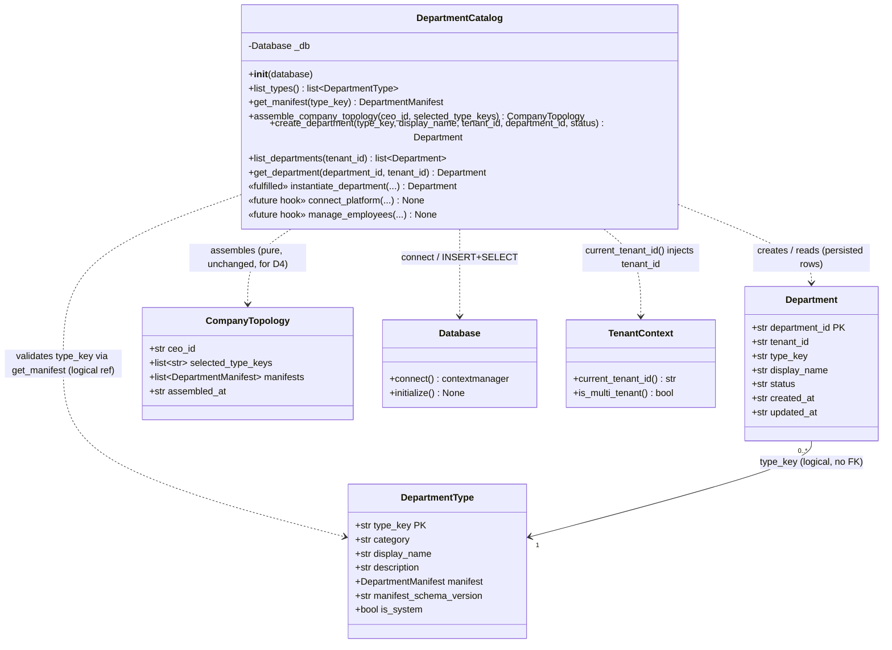
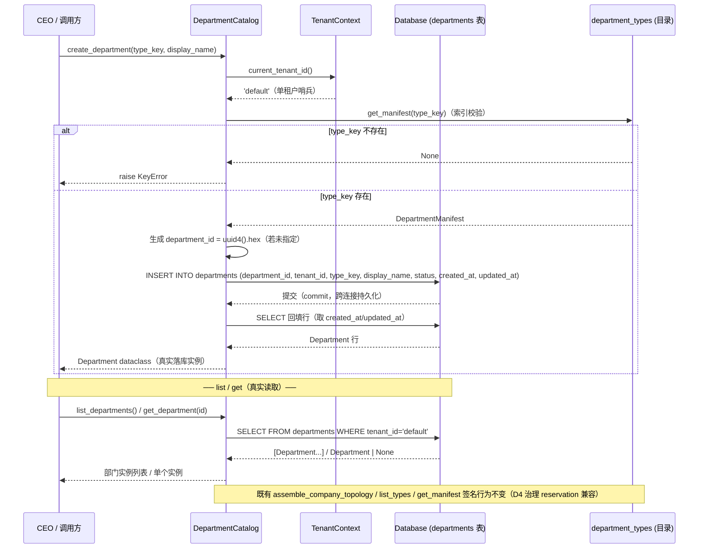
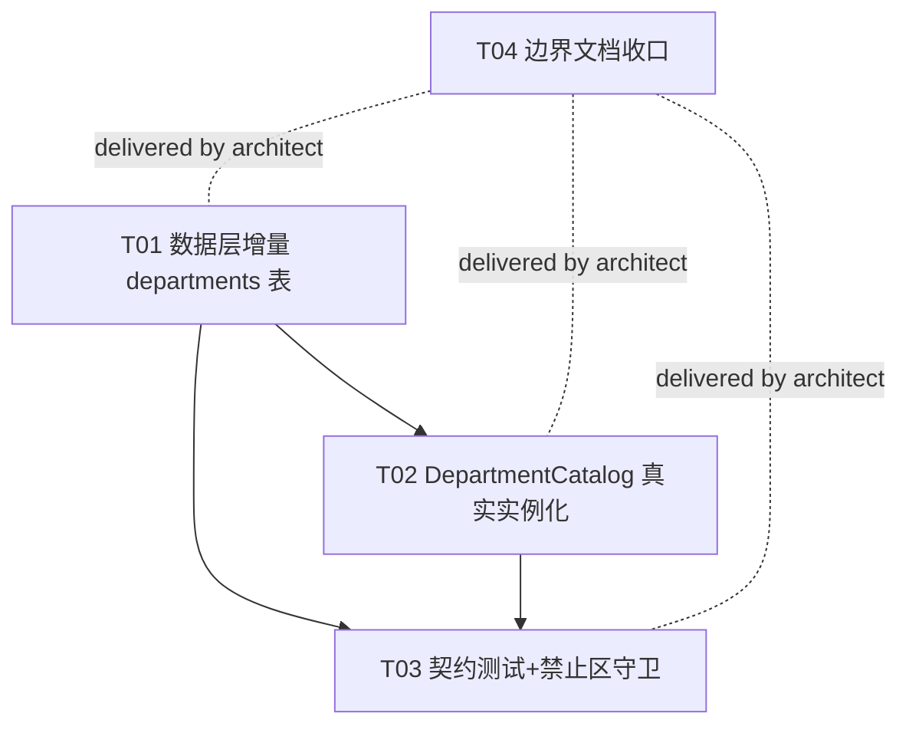

# ADR-0026: D2.impl 部门真实实例化（Department Instantiation）— Boundary + Gate 提交包

Date: 2026-07-08

Status: Proposed — boundary for D2.impl (ADR-0017 Sub-decision D2 真实实例化切片); **超出 ADR-0017 option-a 预授权**，须 **总控决策席批准 + 安全边界席 review** 后方可进入实现（独立小 gate 提交包）。

Source gate: `issues/050_adr0017_future_gate_submission_package.md` (option a accepted by 总控决策席, 2026-07-07)
Carried-forward decisions: `docs/decisions/ADR-0017-multitenant-department-catalog.md` (Proposed, D2 节), `docs/decisions/ADR-0022-d1-tenant-id-reservation-boundaries.md` (D1 边界, Accepted), `docs/decisions/ADR-0023-d2-department-catalog-boundaries.md` (D2 reservation, **CLOSED**), `docs/decisions/ADR-0025-d4-two-tier-governance-boundaries.md` (D4 边界, CLOSED, 含 4 个 LOCKED_ACTIONS).
Slice issue: `issues/056_adr0017_d2_impl_department_instantiation.md`

## Context

ADR-0017 option a 已接受：「多租户 CEO + 部门目录」未来阶段 gate 已 OPEN，并预授权了 D1/D2/D3/D4 的 **design-only reservation** 路线（零行为变化预留）。其中 D2 reservation（ADR-0023 + issues/052，已 CLOSED，81 tests green，Kou c8a30781）落地了：

- 系统级共享目录表 `department_types`（4 行规范类型，`manifest_json='{}'` 占位）；
- `DepartmentManifest` 契约（`MANIFEST_FIELDS` 7 键，仅声明不消费）；
- 只读 `DepartmentCatalog` facade（`list_types` / `get_manifest` / `assemble_company_topology`）+ `DepartmentType` / `CompanyTopology` dataclass；
- 3 个 future hook（`instantiate_department` / `connect_platform` / `manage_employees`）全部 `raise NotImplementedError`。

D2 reservation 的 `assemble_company_topology` 是**纯内存组装、不持久化**——CEO 的公司拓扑（哪些部门被实例化）只活在调用方传入的 `selected_type_keys` 里，没有任何「部门实例」真正落库。

**为何要做真实实例化**：部门是 ADR-0017 的核心一等实体（L5）。只做目录与内存投影，意味着系统至今没有任何「真实存在的部门」——所有上层能力（D3 自可观测、D4 治理、未来业务/职能型部门运行）都缺一个持久化的实例层作为锚点。把「部门实例」真正落库，是 D2 从 reservation 走向实现的**最小、最必要**一步。

**为何超出预授权、需新 gate**：ADR-0017 option a 的预授权范围是「**design-only reservation**」——即加表 + 契约 stub + 只读 facade，明确**禁止**真实实例化（`departments` 表建表、部门 CRUD、公司拓扑持久化，均列为 ADR-0023「第二部分：未来 gate 放开后才能做的实现」第 1 条）。本切片首次**落库部门实例**，构造并写入了此前仅占位的数据，已越出 option-a 的 reservation 边界。因此本产物**不借 reservation 路线夹带落地**，而是作为**独立小 gate 的提交包**，待 总控决策席 + 安全边界席 审批后，工程师才能动手写代码。

**本切片的最小目标**：仅做「从既有类型实例化部门并持久化」——新增 `departments` 表 + `DepartmentCatalog` 真实创建/列举/读取方法；**类型字典本身的管理（增删改 `department_types`）仍锁定**。`DepartmentCatalog` 从「纯内存组装」演进为「可真实创建/列举/读取部门实例」，但保留既有的只读方法签名与 `assemble_company_topology` 内存视图（供 D4 治理 reservation 继续复用，接口不被破坏）。

## Decision (Boundary Contract)

> ### ════════ 边界线：本切片允许的真实实例化（落库部门实例）｜ 明确排除（仍锁定的 forbidden zone）════════

---

### 第一部分：本切片允许的「真实实例化」（最小落库，additive）

仅新增一张**公司级部门实例表** + `DepartmentCatalog` 的真实写/读方法；复用 D1 的 `tenant_id` 预留列（单租户哨兵 `'default'`）、复用 D2 已就绪的 `department_types` 目录索引做校验。**不接线到任何外部平台、不引入新表关系网、不新增 API endpoint、不触碰既有 facade 的既有接口。**

#### 1. 部门实例表：`departments`（公司级聚合根，新增）

复用既有 `_ensure_column` / `executescript` 增量迁移风格，在 `Database.initialize()` 的 `executescript` 中新增一张**公司级部门实例表**。本表与 `department_types`（系统级共享、无 `tenant_id`）不同——它是**公司内的实例数据**，故沿用 D1 预留的 `tenant_id` 列：

```sql
-- 公司级部门实例表（D2.impl 新增聚合根）。沿用 D1 tenant_id 预留列，当前恒为 'default'（单租户）。
-- 逻辑引用 department_types(type_key)，不建 FOREIGN KEY 约束（与 ADR-0023 不建 FK 的风格一致，避免提前耦合）。
create table if not exists departments (
    department_id   text primary key,                       -- 实例主键（系统生成 uuid4().hex，或由调用方显式指定）
    tenant_id       text not null default 'default',        -- 沿用 D1 预留列；当前单租户，恒 'default'
    type_key        text not null,                           -- 逻辑引用 department_types.type_key（索引校验在应用层）
    display_name    text not null,                           -- 部门实例名（如「华东业务部」），可异于 type 的 display_name
    status          text not null default 'active',         -- 'active' | 'inactive'（仅状态位，最小集）
    created_at      text not null default current_timestamp,
    updated_at      text not null default current_timestamp
);
```

- **无 seed**：`departments` 为运行时实例数据（CEO 从目录挑选类型实例化），**不预置任何行**；与 `department_types`（建一次、全员可用）语义不同。
- **无 FK 约束**：`type_key` 仅在应用层经 `DepartmentCatalog.get_manifest(type_key)` 校验存在性（未知 → `KeyError`），与 ADR-0023 不建 FK 的风格一致。
- **单租户纪律**：`tenant_id` 由 `TenantContext.current_tenant_id()` 注入（当前恒 `'default'`），本切片**不引入**任何按 `tenant_id` 的隔离/过滤逻辑，`is_multi_tenant()` 仍为 `False`。

#### 2. `DepartmentCatalog` 演进：新增真实实例化方法（保留只读兼容）

在现有 `backend/app/department_catalog.py` 中**增量新增**一个 `Department` dataclass 与 3 个真实方法；既有的 `list_types` / `get_manifest` / `assemble_company_topology` 签名与行为**完全不变**（D3 自可观测、D4 治理 reservation 继续复用，接口不被破坏）：

```python
# backend/app/department_catalog.py (D2.impl — 增量演进，保留只读兼容)

@dataclass
class Department:
    """公司内一个真实部门实例（落库 departments 表的一行）。"""
    department_id: str
    tenant_id: str
    type_key: str
    display_name: str
    status: str
    created_at: str
    updated_at: str


class DepartmentCatalog:
    def __init__(self, database: Database):
        self.database = database

    # ── 既有只读方法（签名/行为不变，D3/D4 reservation 继续复用）──
    def list_types(self) -> list[DepartmentType]: ...
    def get_manifest(self, type_key: str) -> DepartmentManifest | None: ...
    def assemble_company_topology(self, ceo_id: str, selected_type_keys: list[str]) -> CompanyTopology: ...
    #   ↑ 仍返回纯内存 CompanyTopology（不落库、不写 tenant），D4 治理 reservation 作用域边界不变

    # ── D2.impl 新增：真实实例化（落库 departments 表）──
    def create_department(
        self,
        type_key: str,
        display_name: str,
        tenant_id: str | None = None,
        department_id: str | None = None,
        status: str = "active",
    ) -> Department:
        """从既有目录类型实例化一个真实部门，持久化到 departments 表。

        - tenant_id 缺省时取 TenantContext.current_tenant_id()（当前恒 'default'，单租户纪律）；
        - 经 get_manifest(type_key) 校验 type_key 存在于 department_types，未知 → KeyError；
        - department_id 缺省时系统生成 uuid4().hex；status 仅 'active'|'inactive'；
        - 写入后返回 Department dataclass（含 DB 回填的时间戳）。
        """

    def list_departments(self, tenant_id: str | None = None) -> list[Department]:
        """列出某租户（缺省 'default'）下的全部部门实例（真实落库数据）。"""

    def get_department(self, department_id: str, tenant_id: str | None = None) -> Department | None:
        """按实例主键取单个部门；不存在返回 None。"""

    # ── future hook 演进 ──
    def instantiate_department(self, *args, **kwargs) -> Department:
        """D2.impl 已落地：委派给 create_department（不再 raise NotImplementedError）。"""
        # 兼容旧 future-hook 签名，转调 create_department
        ...

    def connect_platform(self, *args, **kwargs) -> None:
        """Future hook: 外部平台凭证接入（安全边界席领地）。仍 raise NotImplementedError。"""

    def manage_employees(self, *args, **kwargs) -> None:
        """Future hook: Employee CRUD（L2/L5）。仍 raise NotImplementedError（本切片禁止）。"""
```

- `create_department`：注入 `tenant_id = TenantContext.current_tenant_id()`（单租户哨兵），校验 `type_key` 经 `get_manifest` 存在（未知 → `KeyError`，与 D3/D4 索引校验风格一致），生成/采用 `department_id`，`INSERT` 落库，返回 `Department`。
- `list_departments` / `get_department`：真实 `SELECT` `departments` 表，返回 `Department` / `None`。
- `instantiate_department` future hook **被本切片落实**（委派 `create_department`）；`connect_platform` / `manage_employees` **仍** `raise NotImplementedError`（仍属 forbidden zone）。
- `assemble_company_topology` **保持不变**：继续返回纯内存 `CompanyTopology`，作为 D4 治理 reservation 的 CEO 级作用域边界——「演进为基于持久化 departments 表的真实拓扑」体现为：系统现在有了 `list_departments`/`get_department` 这一真实实例源，而内存投影助手被保留以兼容 D4 reservation（无需改动 D4 facade）。

#### 3. 依赖顺序与既有基座复用

- **复用** `Database`（`connect()` 上下文管理器 + `executescript` 增量建表），不引入 ORM / 新数据库。
- **复用** `TenantContext.current_tenant_id()`（D1）注入 `tenant_id`，断言单租户。
- **复用** `DepartmentCatalog.get_manifest`（D2 目录）做 `type_key` 索引校验。
- **不触碰** `department_observability.py`（D3）、`governance.py`（D4）、`tenant_context.py`（D1）、`evolution_event_log.py`：本切片不写 `evolution_events`，D3 追加写不变式与 D4 只读 facade 接口均不受影响。

---

### 第二部分：明确排除于本切片（仍锁定的 forbidden zone，零触碰）

以下**不在本 D2.impl 切片内**，且**保持锁定**：

1. **Employee CRUD / 员工层（L2/L5）**：`manage_employees` 仍 `raise NotImplementedError`；不建员工表、不配角色/技能。绝对禁止。
2. **外部服务 / 平台接入与凭证**：`connect_platform` 仍 `raise NotImplementedError`；不接抖音/小红书/微信等通道、不碰凭证、不建集成网格、不做发布安全状态机（安全边界席领地）。
3. **真实多租户隔离**：仍为单租户 `'default'`；仅沿用 D1 `tenant_id` 预留列填充哨兵，不引入按租户隔离/过滤/`is_multi_tenant()=True` 的任何逻辑。
4. **L6 经济 / ROI 计算**：不回填 `roi_schema`、不算 token 产出比、不做可视化。
5. **自动改码（auto_modify_code）**：仍禁止；本切片无任何自动改码路径。
6. **复杂 UI / 前端改动**：本切片纯后端数据层 + facade，不新增 API endpoint、不动前端。
7. **向量库 / embedding / 外部记忆**：零触碰。
8. **ADR-0025 已锁死的 4 个 LOCKED_ACTIONS 继续保持锁定**：
   - `manage_department_types` —— **本切片是「从既有类型实例化部门」，不是「管理类型定义」**，故类型目录的增删改仍锁定（`department_types` 表不写）；该动作仍仅以 D4 `CompanyGovernance.manage_department_types` future hook 占位。
   - `lift_human_approval_gate` —— 不解除 human-approval gate。
   - `auto_modify_code` —— 不自动改码。
   - `cross_company_policy` —— 不跨公司策略。
9. **不写 `evolution_events`**：本切片不新增任何对事件日志的写路径（D3 追加写不变式保持；审计留痕（如 `governance.department.created`）为未来 D4.impl / D2.impl.v2 受控增强，不在本切片最小范围）。
10. **不新增 API endpoint、不破坏既有读/写路径语义、不改动既有 `department_types` 种子**。

## Forbidden Scope（本切片全局禁止范围，零触碰）

- **Employee CRUD / 员工层（L2/L5）**：`manage_employees` 仍 `raise NotImplementedError`；不建员工表、不配角色/技能；严禁任何员工增删改查代码。
- **外部服务 / 平台接入与凭证**：`connect_platform` 仍 `raise NotImplementedError`；不接外部平台、不碰凭证、不建集成网格、不触合规面（安全边界席领地）。
- **真实多租户隔离**：仍为单租户 `'default'`；仅填充 D1 `tenant_id` 预留列哨兵，不引入按租户隔离/过滤逻辑，`TenantContext.is_multi_tenant()` 仍为 `False`。
- **L6 经济 / ROI 计算**：不回填 `roi_schema`、不算 token 产出比、不做可视化分析回流。
- **自动改码（auto_modify_code）**：不触发任何自动改码路径。
- **复杂 UI / 前端改动**：纯后端数据层 + facade；不新增任何 API endpoint、不动前端。
- **向量库 / embedding / 外部记忆服务**：零触碰。
- **ADR-0025 的 4 个 LOCKED_ACTIONS 继续锁定**：`manage_department_types`（类型目录增删改——实例化 ≠ 类型管理，本切片不写 `department_types`）、`lift_human_approval_gate`、`auto_modify_code`、`cross_company_policy`。
- **不写 `evolution_events`**：不新增任何对事件日志的写路径（D3 追加写不变式保持）。
- **不破坏既有 facade 接口**：`DepartmentCatalog.list_types` / `get_manifest` / `assemble_company_topology` 签名与行为不变；`DepartmentObservability`（D3）/ `CompanyGovernance`（D4）模块不被修改、其公开方法签名不被破坏。
- **不改动既有 `department_types` 种子、不预支未必要结构**（如 `tasks.department_id` 列、`company_topology` 表）——本切片仅新增 `departments` 表。
- **不做多 Agent、不抽象 agent**。

## Verification Plan

质量运行席 以标准 diff + forbidden-scope 守卫 + slice 专属断言验证（建议后端用例 `backend/tests/test_d2_impl_department.py`）：

```bash
git diff --name-only HEAD -- backend frontend
git diff --check
# forbidden-scope keyword scan on changed backend/app files
```

Plus slice-specific assertions（覆盖于 `backend/tests/test_d2_impl_department.py`）：

- 经 `Database().initialize()` 后，`departments` 表存在且含既定列（`department_id` / `tenant_id` / `type_key` / `display_name` / `status` / `created_at` / `updated_at`）；无 `FOREIGN KEY` 约束；`department_types` 种子不变（仍 4 行，未被改写）。
- `create_department("business.general", "华东业务部")` 返回 `Department`，其 `tenant_id == 'default'`、`type_key == 'business.general'`、`status == 'active'`、`department_id` 非空、`created_at`/`updated_at` 非空。
- **真实落库验证**：新建连接 `Database().connect()` 后，`list_departments()` 含该实例、`get_department(id)` 返回该实例（跨连接 round-trip，非内存假象）。
- `create_department` 对未知 `type_key`（如 `"unknown.dept"`）抛 `KeyError`（索引校验，与 D3/D4 一致）。
- `assemble_company_topology` / `list_types` / `get_manifest` 签名行为与 reservation 一致（D4 治理 reservation 兼容）：`DepartmentObservability`（D3）与 `CompanyGovernance`（D4）可被 import 且其公开方法签名未变。
- **单租户不变式**：`TenantContext.current_tenant_id()` 仍为 `'default'`、`is_multi_tenant()` 仍为 `False`；所有 `departments` 行 `tenant_id == 'default'`。
- **forbidden-scope 独立扫描**（关键守卫）：
  - 无 Employee CRUD：扫描 `manage_employees(` 仅 `raise NotImplementedError`；无员工表建表、无员工写路径。
  - 无外部平台：`connect_platform(` 仅 `raise NotImplementedError`；无 credential/secret/外部 SDK 代码。
  - 无 L6/ROI：无 `roi_schema` 回填、无 token-output-ratio 计算。
  - 无 auto_modify_code：`auto_modify_code` 词零命中（或仅作锁名声明）。
  - 无 `manage_department_types(` 的真实调用（仅 D4 future hook 占位）；无 `department_types` 写语句。
  - 无新 API endpoint：路由注册 diff 扫描 `app.get("/api/depart"`, `app.post("/api/depart"` 零命中。
  - 无 `evolution_events` 写：`insert into evolution_events` / `\.record\(` 在变更文件中零命中。
  - 无向量/embedding 关键词。
- 后端回归（含 D1–D4 既有测试）全绿；**无任何既有测试被修改**；forbidden-scope 扫描干净。
- `git diff --name-only -- backend/app/department_observability.py backend/app/governance.py backend/app/tenant_context.py backend/app/evolution_event_log.py backend/app/department_manifest.py` 输出为空（这些既有 facade/基座不被本切片改动）。

## Consequences

- **Easier**：系统首次拥有「真实存在的部门实例」持久化层——`departments` 表 + `DepartmentCatalog` 真实 `create/list/get`，为 D3 自可观测（按部门投影事件）、D4 治理（对真实实例启用/停用/审计）、未来业务/职能型部门运行提供了稳定的实例锚点。D2 从「目录 + 内存投影」正式演进为「目录 + 真实实例」。
- **Easier**：类型字典（`department_types`）与实例（`departments`）职责清晰分离——实例化复用既有类型索引，新实例不污染系统级目录；未来 D4.impl 落地「提案落地 + 审计留痕」时已有干净接缝。
- **No break**：D3 `DepartmentObservability` 与 D4 `CompanyGovernance` 的公开方法签名与 import 路径完全不变；`assemble_company_topology` 仍返回纯内存 `CompanyTopology`（D4 治理作用域边界不变），D2.impl 仅「增加」真实实例源，不「替换」既有内存视图。
- **Harder / cost**：1 张增量表（`departments`，additive 建表）+ `DepartmentCatalog` 增量 3 方法 + 1 新 dataclass + 1 测试文件；`database.py` 仅 additive（executescript 内加 `CREATE TABLE IF NOT EXISTS departments`），完全可逆（DROP 即可回退）；小且可 review 的 diff。
- **明确非目标**：不实例化员工、不接平台、不解除 gate、不自动改码、不跨租户、不写事件日志、不新增 API endpoint——均留待对应未来 gate（建议 D2.impl.v2 / D4.impl / D4.platform / 外部平台 gate），并触发 安全边界席 review。

---

## System Design（系统设计交付物）

> 本节为 D2.impl 切片（真实部门实例化）的**完整架构设计**（设计-only，不写实现代码）。后续 Engineer 按「任务列表」落地。

### 1. 实现方案 + 框架选型

| 维度 | 选型 / 说明 |
|---|---|
| 核心技术挑战 | 把「部门实例」真正落库，而 reservation 阶段仅内存投影；须在不触碰 forbidden zone 的前提下，复用 D1 `tenant_id` 预留列 + D2 `department_types` 目录索引，做最小真实实例化。 |
| 总体策略 | **增量真实实例化**（additive）：新增 `departments` 表 + `DepartmentCatalog` 真实写/读方法，保留既有只读 facade 与内存投影（D4 兼容）。 |
| 语言 / 存储 | 复用现有栈：**Python + SQLite**（经 `database.py`）；不引入新数据库或 ORM。`department_id` 生成用标准库 `uuid`（无新第三方包）。 |
| 结构定义 | 复用标准库 `dataclasses` 声明 `Department` 实例结构；`DepartmentCatalog` 沿用既有 facade 模式。 |
| 架构模式 | 与现有模块一致：`DepartmentCatalog` 从「只读 facade」演进为「读写 facade」（新增 `create_department`/`list_departments`/`get_department`）；`assemble_company_topology` 等只读方法保持原状。 |
| 单租户纪律 | `tenant_id` 由 `TenantContext.current_tenant_id()` 注入（当前恒 `'default'`）；本切片不引入隔离逻辑。 |
| 索引复用 | `type_key` 校验统一走 `DepartmentCatalog.get_manifest(type_key)`（D2 目录）；未知 `type_key` 抛 `KeyError`，与 D3/D4 一致。 |
| 外部依赖 | 无新增第三方包（见「依赖包列表」）。 |

### 2. 文件清单（相对路径）

| 文件 | 状态 | 职责 |
|---|---|---|
| `backend/app/database.py` | 修改（仅增量） | `initialize()` 的 `executescript` 内新增 `CREATE TABLE IF NOT EXISTS departments`（列：`department_id`/`tenant_id`/`type_key`/`display_name`/`status`/`created_at`/`updated_at`）；无 seed、无 FK、不改动既有表。 |
| `backend/app/department_catalog.py` | 修改（增量） | 新增 `Department` dataclass；新增 `create_department`/`list_departments`/`get_department`；`instantiate_department` 委派 `create_department`（落实 hook）；`connect_platform`/`manage_employees` 仍 `raise NotImplementedError`；既有 `list_types`/`get_manifest`/`assemble_company_topology` 签名行为不变。 |
| `backend/tests/test_d2_impl_department.py` | 新增 | 实例化契约测试 + 真实落库 round-trip + 单租户不变式 + forbidden-scope 守卫（无 Employee CRUD / 无平台 / 无多租户 / 无 L6 / 无 auto_modify_code / 无新 endpoint / 无 evolution_events 写 / D3·D4 facade 接口不变）。 |
| `docs/decisions/ADR-0026-d2-impl-department-instantiation.md` | 本文件 | 边界 ADR + 系统设计 + gate 提交包。 |
| `issues/056_adr0017_d2_impl_department_instantiation.md` | 新增 | D2.impl 切片 issue。 |

> 注：`backend/app/department_observability.py`（D3）、`backend/app/governance.py`（D4）、`backend/app/tenant_context.py`（D1）、`backend/app/evolution_event_log.py`、`backend/app/department_manifest.py`、`backend/app/employee.py` **均不在本切片允许文件内**——本切片不修改这些既有模块（D3/D4 facade 接口不变、D1 不变式不变、D2 类型目录不写、员工层零触碰）。

### 3. 数据结构与接口（类图 + JSON Schema）

#### 3.1 类图（Mermaid）



#### 3.2 Department（departments 表行）JSON Schema

```json
{
  "$schema": "http://json-schema.org/draft-07/schema#",
  "title": "Department",
  "type": "object",
  "description": "公司级部门实例（departments 表的一行）",
  "properties": {
    "department_id": { "type": "string", "description": "实例主键；系统生成 uuid4().hex 或调用方显式指定" },
    "tenant_id": { "type": "string", "default": "default", "description": "沿用 D1 预留列；当前单租户，恒 'default'" },
    "type_key": { "type": "string", "enum": ["business.general", "function.hr", "function.admin", "function.bi"], "description": "逻辑引用 department_types.type_key（索引校验）" },
    "display_name": { "type": "string", "description": "部门实例名，可异于 type 的 display_name" },
    "status": { "type": "string", "enum": ["active", "inactive"], "default": "active" },
    "created_at": { "type": "string", "description": "ISO8601 / SQLite current_timestamp" },
    "updated_at": { "type": "string", "description": "ISO8601 / SQLite current_timestamp" }
  },
  "required": ["department_id", "tenant_id", "type_key", "display_name", "status", "created_at", "updated_at"]
}
```

#### 3.3 create_department 入参 JSON Schema

```json
{
  "$schema": "http://json-schema.org/draft-07/schema#",
  "title": "CreateDepartmentRequest",
  "type": "object",
  "properties": {
    "type_key": { "type": "string", "description": "必填；须存在于 department_types（否则 KeyError）" },
    "display_name": { "type": "string", "description": "必填；部门实例名" },
    "tenant_id": { "type": "string", "description": "可选；缺省取 TenantContext.current_tenant_id()（当前 'default'）" },
    "department_id": { "type": "string", "description": "可选；缺省由系统生成 uuid4().hex" },
    "status": { "type": "string", "enum": ["active", "inactive"], "default": "active" }
  },
  "required": ["type_key", "display_name"]
}
```

#### 3.4 create_department 出参（= Department，同 3.2）

出参为 3.2 的 `Department` 结构（含 DB 回填的 `created_at`/`updated_at`）。

### 4. 程序调用流程（时序图 — create_department 真实落库）



### 5. 任务列表（有序、含依赖、按实现顺序，全部 additive）

> 供后续 Engineer 落地的 D2.impl 实现任务（本 ADR 为 gate 提交包，工程师须待 gate 放行后动工）。T04 边界文档由本 ADR + issue 056 交付（architect），T01–T03 为工程师实现任务。

| Task ID | 任务名称 | 源文件 | 依赖 | 优先级 |
|---|---|---|---|---|
| **T01** | 数据层增量（departments 表） | `backend/app/database.py`（modify, additive：`executescript` 内 `CREATE TABLE IF NOT EXISTS departments`；无 seed、无 FK） | — | P0 |
| **T02** | DepartmentCatalog 真实实例化方法 + Department dataclass | `backend/app/department_catalog.py`（新增 `Department` dataclass + `create_department`/`list_departments`/`get_department`；`instantiate_department` 委派 `create_department`；`connect_platform`/`manage_employees` 仍 `raise NotImplementedError`；保留 `list_types`/`get_manifest`/`assemble_company_topology` 不变） | T01 | P0 |
| **T03** | 契约测试 + 禁止区守卫 | `backend/tests/test_d2_impl_department.py`（真实落库 round-trip + 单租户不变式 + `type_key` KeyError + forbidden-scope 扫描：无 Employee CRUD / 无平台 / 无多租户 / 无 L6 / 无 auto_modify_code / 无新 endpoint / 无 evolution_events 写 / D3·D4 facade 接口不变） | T01, T02 | P0 |
| **T04** | 边界文档收口（本 gate 提交包） | `docs/decisions/ADR-0026-d2-impl-department-instantiation.md`（本文件）、`issues/056_adr0017_d2_impl_department_instantiation.md` | — | P1 |

**依赖关系图（Mermaid）**：



### 6. 依赖包列表

- **无新增第三方包**。复用现有依赖：Python 3 标准库（`dataclasses`、`json`、`sqlite3`、`datetime`、`uuid`）、既有 `backend/app/database.py`（D1/D2 基座）、`backend/app/department_catalog.py`（ADR-0023 D2）、`backend/app/tenant_context.py`（ADR-0022 D1）。本切片不引入任何新库。

### 7. 共享知识（跨文件约定）

- **实例 vs 类型分离**：`department_types` = 系统级类型目录（建一次、全员可用、本切片不写）；`departments` = 公司级实例（运行时从类型实例化，落库）。实例化 ≠ 类型管理（`manage_department_types` 仍锁定）。
- **单租户纪律**：`departments.tenant_id` 由 `TenantContext.current_tenant_id()` 注入（当前恒 `'default'`）；本切片不引入按租户隔离/过滤逻辑。
- **索引校验一致性**：`type_key` 校验统一走 `DepartmentCatalog.get_manifest(type_key)`，未知 → `KeyError`，与 D3 `DepartmentObservability` / D4 `CompanyGovernance` 一致。
- **`department_id` 生成**：缺省 `uuid.uuid4().hex`（标准库，无新依赖）；可由调用方显式指定（须保证唯一性）。
- **`status` 最小集**：仅 `'active'` | `'inactive'`（状态位，不含启用/停用治理语义——治理作用域仍由 D4 reservation 的 `CompanyTopology` 承担）。
- **只读兼容纪律**：`list_types` / `get_manifest` / `assemble_company_topology` 签名与行为**不得变更**，以保证 D3/D4 reservation facade 接口不被破坏。
- **future hook 纪律**：`connect_platform`（外部平台）/`manage_employees`（员工）仍 `raise NotImplementedError`；`instantiate_department` 本切片落实为委派 `create_department`。
- **不写事件日志**：本切片不向 `evolution_events` 写记录（D3 追加写不变式保持）；审计留痕为未来受控增强。
- **测试约定**：forbidden-scope 扫描关键词 `manage_employees(`（仅 NotImplementedError）、`connect_platform(`（仅 NotImplementedError）、`WHERE department_id`、`app.get("/api/depart"`、`app.post("/api/depart"`、`insert into evolution_events`、`\.record\(`、`manage_department_types(`（仅 D4 future hook）、`auto_modify_code`（仅锁名）、`vector`/`embedding`；确保无员工写、无平台、无新 endpoint、无事件日志写、无类型目录写。
- **增量迁移**：复用 `executescript` 风格新增 `departments` 表（`CREATE TABLE IF NOT EXISTS`），不写 `DROP`/`ALTER` 破坏既有结构；`git diff --name-only -- backend/app/database.py` 仅显示 additive 建表。

### 8. 待明确事项

1. **本切片是否写 `evolution_events` 审计留痕**：本设计默认**不写**（保持最小、D3 追加写不变式不变）。若 总控决策席 / 安全边界席 要求在实例化时留痕（如 `governance.department.created`），可置于未来受控增强（D2.impl.v2 / D4.impl），须经 review。建议本切片维持零事件日志写。
2. **`status` 是否需 D4 治理联动**：本切片的 `status` 仅为实例状态位（active/inactive），**不承载** D4 治理的「启用/停用提案落地」语义（D4 仍 reservation）。二者未来在 D4.impl 通过 `apply_proposal` 关联，本切片不联动。
3. **多实例同类型**：本设计允许同一 `type_key` 在单租户下实例化多个部门（如「华东业务部」「华南业务部」均为 `business.general`），`department_id` 唯一区分。若主理人要求「每类型单实例」，可在 `create_department` 加唯一约束——本设计默认允许多实例（更贴合真实公司）。
4. **`department_id` 生成策略**：默认 `uuid4().hex`（无语义）；如需可读/可追溯 id（如 `dept_<type_key>_<seq>`），可后置，本切片保持 uuid 最小方案。
5. **与 D4 reservation 的衔接**：D4 `list_company_departments` 当前投影 `CompanyTopology.manifests`（内存）；本切片不改动 D4。未来 D4.impl 可改为投影 `list_departments()` 真实实例——但属 D4.impl gate，不在本切片。
6. **外部平台/凭证/合规边界**：业务部真实平台接入、凭证、发布安全状态机属 安全边界席，本切片零触碰（`connect_platform` 仍 NotImplementedError）。

---

## Gate 要求与边界席触发（明确标注 —— 本切片超出 ADR-0017 option-a 预授权）

| 项目 | 要求 |
|------|------|
| **超出预授权声明** | ADR-0017 option-a 预授权范围仅为 **design-only reservation**（加表 + 契约 stub + 只读 facade，明确禁止真实实例化）。本切片**首次落库部门实例**（`departments` 表建表 + 部门 CRUD），已越出 reservation 边界，**不可**借 option-a 预授权夹带落地。 |
| **独立小 gate 提交包** | 本产物（`docs/decisions/ADR-0026` + `issues/056`）即作为 **D2.impl 独立小 gate 的提交包**。 |
| **总控决策席批准（必须）** | 进入实现前，须由 **总控决策席** 单独批准本 D2.impl gate（确认「从既有类型实例化部门」的最小范围与 forbidden zone 边界可接受）。 |
| **安全边界席 review（必须）** | 因本切片首次将部门数据**真实持久化**（写入新表、产生真实业务数据），须触发 **安全边界席 review**：确认单租户纪律（`tenant_id` 恒 `'default'`）、无外部平台/凭证、无跨租户、无自动改码、4 个 LOCKED_ACTIONS 仍锁定、对员工层零触碰。 |
| **Allowed Files（gate 放行后工程师允许触碰）** | `backend/app/database.py`（仅 additive 新增 `departments` 表建表，含 `tenant_id` 沿用 D1 预留列）、`backend/app/department_catalog.py`（增量新增 `Department` dataclass + `create_department`/`list_departments`/`get_department`，落实 `instantiate_department`，保留只读方法）、`backend/tests/test_d2_impl_department.py`（新增）、`docs/decisions/ADR-0026-...md` 与 `issues/056_adr0017_d2_impl_department_instantiation.md`（本 gate 包）。 |
| **Forbidden Files（工程师禁止触碰）** | `backend/app/department_observability.py`（D3 facade，接口不变）、`backend/app/governance.py`（D4 facade，含 `manage_department_types` 锁定，接口不变）、`backend/app/tenant_context.py`（D1 单租户不变式）、`backend/app/evolution_event_log.py`（不写事件日志）、`backend/app/department_manifest.py`（不消费 Manifest 字段）、`backend/app/employee.py`（员工层零触碰）、所有前端文件（无 UI 改动）、`backend/app/main.py` 及路由注册（无新 API endpoint）。 |
| **类型级扩展治理** | 新增/修改一个部门类型（`type_key`）仍走 gate + ADR（ADR-0017 D4）；本切片**不写 `department_types`**（`manage_department_types` 仍锁定）。 |
| **演进边界** | Evolution Governor 演进范围仍被限制在单个部门 manifest 内部，不得越界改其他部门（ADR-0017 D4）。 |
| **禁止解除** | 本切片**不解除**自动改码禁令、human-approval gate；不预支未必要结构（`company_topology` 表、`tasks.department_id` 列等留待未来 gate）。 |
| **独立扫描门禁** | gate 放行后，质量运行席须以「forbidden-scope 独立扫描」为硬性门禁：任一 forbidden 关键词命中即驳回。 |

## Relations / Triggers

- **依赖**：ADR-0017（D2 节：部门目录通用化；本切片是其「真实实例化」第一步）、ADR-0022（D1 `tenant_id` 预留——`departments.tenant_id` 沿用该预留列，单租户哨兵不变式）、ADR-0023（D2 reservation——本切片演进其 `DepartmentCatalog` 从「纯内存组装」到「真实实例化」，复用 `department_types` 目录索引与 `DepartmentType`/`CompanyTopology` 结构）、ADR-0025（D4 边界——本切片保持 4 个 LOCKED_ACTIONS 锁定、保持 D4 只读 facet 接口不变）。
- **触发 总控决策席**：是否批准本 D2.impl 独立小 gate（超出 ADR-0017 option-a 预授权的真实实例化范围）。
- **触发 安全边界席**：因首次真实持久化部门数据，须 review 单租户纪律 / 无外部平台 / 无跨租户 / 无自动改码 / 员工层零触碰。
- **承接 ADR-0017 D2**：本切片仅覆盖 D2 的「真实实例化」（departments 表 + 实例化方法）；业务部外部平台集成（D2 第 2 条）、职能型部门元循环（D3）、L6 经济/ROI、Employee CRUD 均为未来 gate 内容。
- **与 D3/D4 的衔接**：D3 `DepartmentObservability`（D3 reservation，读 `department_types`+`evolution_events`）与 D4 `CompanyGovernance`（D4 reservation，复用 `assemble_company_topology` 内存投影）的接口与 import 路径**不被本切片破坏**；`assemble_company_topology` 保留以支持 D4 治理 reservation 兼容。未来 D3/D4 实现对真实 `departments` 实例的投影/治理，将基于本切片新增的 `list_departments`/`get_department` 接缝。
