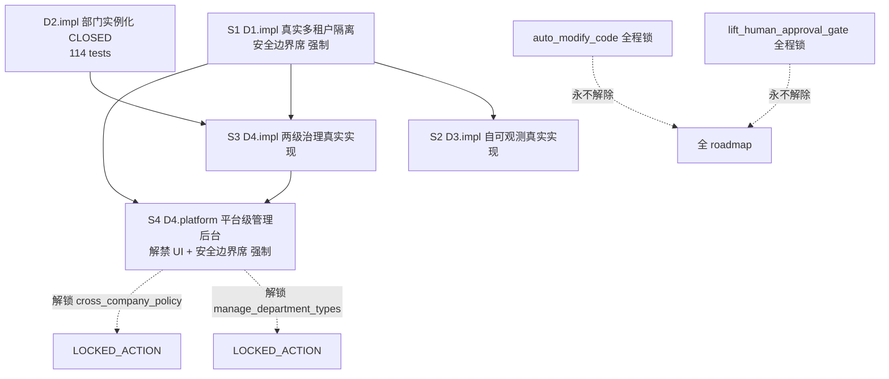

# ADR-0027: D-series 真实实现（real-impl）Roadmap 总纲 — 边界 + Gate 提交包集合

Date: 2026-07-08

Status: Proposed — 总纲 roadmap ADR for the D-series real-impl roadmap (ADR-0017 Sub-decisions D1/D3/D4 的真实实现切片 + D4 平台级管理后台); **PENDING 总控决策席 批准 + 安全边界席 review** 后方可逐切片放开实现（各切片为独立小 gate 提交包，详见 issues/057–060）。

Source gate: `issues/050_adr0017_future_gate_submission_package.md` (option a accepted by 总控决策席, 2026-07-07)
Carried-forward decisions:
- `docs/decisions/ADR-0017-multitenant-department-catalog.md` (Proposed, 总纲)
- `docs/decisions/ADR-0022-d1-tenant-id-reservation-boundaries.md` (D1 边界, Accepted, 69 tests)
- `docs/decisions/ADR-0023-d2-department-catalog-boundaries.md` (D2 reservation, CLOSED)
- `docs/decisions/ADR-0024-d3-self-observability-boundaries.md` (D3 边界, CLOSED, 90 tests, 零 schema 增量)
- `docs/decisions/ADR-0025-d4-two-tier-governance-boundaries.md` (D4 边界, CLOSED, 100 tests, 零 schema 增量; 含 4 个 LOCKED_ACTIONS)
- `docs/decisions/ADR-0026-d2-impl-department-instantiation.md` (D2.impl, CLOSED, 114 tests) — **本 roadmap 的模板范式**
Slice issues: `issues/057_adr0017_d1_impl_multitenant_isolation.md`、`issues/058_adr0017_d3_impl_self_observability.md`、`issues/059_adr0017_d4_impl_two_tier_governance.md`、`issues/060_adr0017_d4_platform_management_console.md`

> ⚠️ **窗口纪律（本 ADR 为 design-only 草拟）**：本窗口（自主推进窗口 2026-07-08 03:05 → 10:00）仅产出「设计 + gate 提交包」，**不写任何 backend 代码、不改 `database.py`、不新增测试、不碰 `evolution_events`、不 commit**。所有实现待对应切片 gate 由 总控决策席 批准 + 安全边界席 review 后，工程师方可动手。

---

## Context

ADR-0017 四个 reservation 子决策已全部 CLOSED（设计-only 预留，零 schema 增量或最小列预留）：D1 `tenant_id` 预留（仅列 + `TenantContext` stub，单租户哨兵 `'default'`）、D2 部门目录 reservation（建 `department_types` + 只读 `DepartmentCatalog`）、D3 自可观测 reservation（只读 `DepartmentObservability` facade，不计算指标）、D4 两级治理 reservation（只读 `CompanyGovernance` facade + 4 个 LOCKED_ACTIONS）。

首个真实实现切片 **D2.impl 部门真实实例化**已 CLOSED（ADR-0026 + issue 056，commit `7617ed2c` + 主理人一致性修复 `4ec02a59`，114 tests；QA `reviews/059` PASS-WITH-NOTES，主理人 accept）。它证明了「reservation → real-impl」的范式可行：每个真实实现切片**越出 option-a 的 design-only 预授权**，作为**独立小 gate 提交包**，待 总控决策席 + 安全边界席 审批后落地。

本 ADR-0027 是后续真实实现切片的**总纲 roadmap**：明确 D1/D3/D4 的真实实现切片（D1.impl / D3.impl / D4.impl）与 D4 平台级管理后台（D4.platform）的**顺序、各自边界、gate 矩阵、LOCKED_ACTIONS 解锁映射**。每个切片对应一个独立小 gate 提交包（issues/057–060），本 ADR 不重复其内部细节，仅定序与定界。

---

## 1. Roadmap 总览（四个真实实现切片，按依赖定序）

| # | 切片 | 解锁的 reservation（设计-only → 真实） | 越过的 reservation 边界 | 依赖（须先 CLOSED/批准） | 独立小 gate | 安全边界席触发 |
|---|------|----------------------------------------|--------------------------|--------------------------|-------------|----------------|
| **S1** | **D1.impl 真实多租户隔离** | D1：`tenant_id` 预留列 + `TenantContext` stub → 真实按 tenant 解析/过滤/隔离 + 凭证隔离架构 | D1 reservation 的「无真实隔离 / 无 `WHERE tenant_id` / 无按租户凭证隔离」 | —（基础切片，最优先） | 1（含凭证隔离设计子审查） | **强制**（隔离模型 + 凭证/密钥隔离架构） |
| **S2** | **D3.impl 自可观测真实实现** | D3：只读 facade → 真实指标关联/聚合/埋点 + 自反馈闭环 | D3 reservation 的「只读投影 / 无统计 / 无部门→事件关联 / 无 meta-loop」 | D1.impl（tenant 作用域注入） | 1（可视化 + meta-loop 为独立下游 gate） | 视自反馈写路径判定（默认不写 evolution_events → 不触发；写则需 review） |
| **S3** | **D4.impl 两级治理真实实现** | D4：只读/提案 facade → 真实治理执行（`apply_proposal` + 公司拓扑持久化 + 治理事件留痕 + 人工批准流） | D4 reservation 的「仅提案 / 无落地 / 无真实公司持久化 / 无治理事件写」 | D2.impl（CLOSED）+ D1.impl（租户作用域） | 1（状态变更类 gate） | **建议触发**（状态变更 + 人工批准流 + 治理事件写，确认 gate 不被解除） |
| **S4** | **D4.platform 平台级管理后台** | D4：平台级 `manage_department_types` 真实实现 + 跨公司策略 + 管理 UI/API | D4 reservation 的「无平台级后台 / 无类型目录增删 / 无跨公司策略」+ **复杂 UI 禁令** | D1.impl（租户模型）+ D4.impl（治理模型） | 1（**须 gate 显式解禁 UI 复杂度**） | **强制**（平台级 / 跨公司 / 类型目录增删） |

---

## 2. ADR-0025 四个 LOCKED_ACTIONS 在 roadmap 中的解锁映射

| LOCKED_ACTION | D1.impl | D3.impl | D4.impl | D4.platform | 全程纪律 |
|---|:---:|:---:|:---:|:---:|---|
| `manage_department_types`（平台级类型目录增删） | 🔒 | 🔒 | 🔒 | 🔓 **解锁**（须 安全边界席） | D4.platform 前锁定；D4.platform gate 显式解锁且经 安全边界席 review |
| `lift_human_approval_gate`（解除人工批准 gate） | 🔒 | 🔒 | 🔒 | 🔒 | **全 roadmap 全程锁定，永不解除**（任何治理/代码变更均须人工批准） |
| `auto_modify_code`（自动改码） | 🔒 | 🔒 | 🔒 | 🔒 | **全 roadmap 全程锁定，永不解除** |
| `cross_company_policy`（跨公司策略） | 🔒 | 🔒 | 🔒 | 🔓 **解锁**（须 安全边界席 + 依赖 D1.impl 租户模型） | D4.platform 前锁定；依赖 S1 租户边界就绪 |

> 说明：`apply_proposal`（D4 reservation 的 future hook）**不是** LOCKED_ACTION，由 **D4.impl** 真实落地；`suggest_self_improvement`（D3 reservation 的 future hook）由 **D3.impl**（或独立下游 meta-loop gate）真实落地。LOCKED_ACTIONS 仅 `manage_department_types` 与 `cross_company_policy` 在 S4 解锁，且须 安全边界席。

---

## 3. 定序与依赖理由（为何 D1.impl 最先）

1. **D1.impl 是基础翻转**：当前 `TenantContext.is_multi_tenant() == False`，全系统单租户哨兵 `'default'`。D1.impl 首次将 `is_multi_tenant()` 翻为 `True` 并引入真实 `WHERE tenant_id = ?` 过滤与按请求 `scope()` 注入。后续 S2/S3/S4 的数据（事件、部门、治理状态）均已带 `tenant_id`，在 D1.impl 之后可由构造即 tenant-scoped；若先实现 S2/S3 再回头 retrofit 过滤，成本高且易漏。故 **D1.impl 定序第一**。
2. **D3.impl 依赖 D1.impl 的租户作用域**：真实指标关联须按 `tenant_id` + `department_id` 作用域聚合；D1.impl 提供该作用域原语后，D3.impl 的聚合查询天然 tenant-isolated。
3. **D4.impl 依赖 D2.impl（已 CLOSED）+ D1.impl**：真实治理执行作用于 D2.impl 落库的 `departments` 真实实例，且治理状态须按 `tenant_id`（CEO）隔离——D1.impl 提供隔离原语。
4. **D4.platform 依赖 D1.impl + D4.impl**：平台级类型目录增删（`manage_department_types`）与跨公司策略（`cross_company_policy`）本质是**跨租户**操作，必须以 D1.impl 的租户边界为前置；且其治理语义与 D4.impl 的公司级治理模型衔接。

> 备选：若主理人希望先用低安全风险的切片验证「real-impl gate 流水线」，可把 D3.impl 提前到 D1.impl 之前（单租户下先做真实指标，D1.impl 批准后再加 `WHERE tenant_id`）。但本 roadmap 推荐 **S1→S2→S3→S4** 以最小化 retrofit。最终顺序待 总控决策席 在 roadmap gate 确认。

---

## 4. 全局 Forbidden Scope / Preservation（硬约束 —— 写入每个包：ADR-0027 + issues/057–060）

下列为**全 roadmap 全程禁止区**，任何切片实现（含本窗口之外）均须逐切片、逐 gate 解锁；**本窗口（2026-07-08 03:05→10:00）不得执行任何实现**：

- **Employee CRUD / 员工扩张**：不建员工表、不配角色/技能、不碰 `employee.py`（L2/L5）。
- **外部平台凭证 / 外部服务接入**：不接抖音/小红书/微信等通道、不碰凭证、不建集成网格、不触合规面——**除非该切片 gate 显式批准且经 安全边界席**（D4.platform 可解禁但须 review）。
- **真实多租户隔离的凭证/密钥落地**：D1.impl 建立隔离机制与按租户凭证**隔离架构**（须 安全边界席 review），但**实际外部平台凭证的持久化落地**仍属 forbidden，除非该子 gate 显式批准 + 安全边界席。
- **L6 经济 / ROI 实现**：不回填 `roi_schema`、不算 token 产出比、不做经济可视化。
- **自动改码（`auto_modify_code`，ADR-0025 LOCKED）**：全程锁定，永不解除。
- **复杂 UI**：本 roadmap 除 **D4.platform** 外禁止复杂 UI；D4.platform **须其 gate 显式解禁 UI 复杂度**方可引入管理后台前端。
- **向量库 / embedding 内存**：零触碰。
- **写 `evolution_events`**：除「该切片 gate 明确批准」的受控写路径（如 D4.impl 的 `governance.*` 留痕、D3.impl 自反馈经批准的观测写）外，禁止向 `evolution_events` 写入；ADR-0016 D3 追加写不变式全程保持。
- **ADR-0025 四个 LOCKED_ACTIONS 全程锁定**，除非对应 gate 显式解锁：`manage_department_types` / `lift_human_approval_gate` / `auto_modify_code` / `cross_company_policy`。
- **单租户纪律**：在 D1.impl gate 批准前必须保持（`tenant_id` 恒 `'default'`、`is_multi_tenant()==False`）；D1.impl 一旦批准即进入 安全边界席 审查范围。

---

## 5. 各切片边界摘要（详情见对应 issue）

### S1 — D1.impl 真实多租户隔离（issue 057）
- **解锁**：`TenantContext.scope()` 实体化（按请求注入真实 tenant，如 JWT/session claim 或 `tenants` 表解析）、`is_multi_tenant()` → `True`、所有读路径加 `WHERE tenant_id = ?`（tasks / evolution_events / departments）、事件/任务 tenant 传播。
- **边界外（仍禁）**：实际外部平台凭证持久化落地（须子 gate + 安全边界席）；`cross_company_policy` 仍锁；不解除 human-approval / auto_modify_code。
- **gate**：总控决策席 批准 + **安全边界席 强制 review**（隔离模型 = 共享 DB + 列隔离；按租户凭证隔离架构）。

### S2 — D3.impl 自可观测真实实现（issue 058）
- **解锁**：`DepartmentObservability` 从「只读投影」→ 真实指标关联（`department_id`/`type_key` 关联 + `correlation_id` 映射）、真实聚合（`call_count` / `success_rate` / `quality_line_hits`）、自反馈闭环（持久化观测快照表，additive）。
- **边界外（仍禁）**：可视化/dashboard（复杂 UI，须独立 gate 解禁）、meta-loop 反哺 Evolution Governor 自动演进（须独立下游 gate + 安全边界席）、默认不写 `evolution_events`（若自反馈需写须 gate 显式批准）。
- **gate**：总控决策席 批准；安全边界席 视自反馈写路径判定（默认不触发）。

### S3 — D4.impl 两级治理真实实现（issue 059）
- **解锁**：`apply_proposal` 真实落地（持久化 CEO 公司拓扑/部门启用态 + 写 `governance.*` 事件经 gate 批准 + 执行 enabled/disabled 于 D2.impl 真实 `departments`）、人工批准流作为**门控步骤**（不解除 gate）、治理审计读/写。
- **边界外（仍禁）**：`manage_department_types`（S4）、`lift_human_approval_gate` / `auto_modify_code` / `cross_company_policy`（全程锁）、L6 ROI、外部平台、Employee CRUD、复杂 UI。
- **gate**：总控决策席 批准 + **安全边界席 建议 review**（状态变更类、确认 human-approval 不被解除）。

### S4 — D4.platform 平台级管理后台（issue 060）
- **解锁**：`manage_department_types` 真实实现（`department_types` 增删）、跨公司策略（`cross_company_policy`）、平台级管理 UI/API（**须 gate 显式解禁 UI 复杂度**）。
- **边界外（仍禁）**：`lift_human_approval_gate` / `auto_modify_code`（全程锁）、L6 ROI、外部平台凭证落地（除非子 gate + 安全边界席）、Employee CRUD。
- **gate**：总控决策席 批准（**显式解禁 UI**）+ **安全边界席 强制 review**（平台级 / 跨公司 / 类型目录增删）。

---

## 6. Gate 矩阵（roadmap 级）

| 切片 | 总控决策席 | 安全边界席 | 须显式解禁 | 备注 |
|------|:---:|:---:|---|---|
| S1 D1.impl | ✅ 必须 | ✅ 强制 | — | 隔离模型 + 凭证隔离架构 review |
| S2 D3.impl | ✅ 必须 | ⚠️ 视写路径 | — | 可视化/meta-loop 为独立下游 gate |
| S3 D4.impl | ✅ 必须 | ✅ 建议 | — | 状态变更 + 人工批准流，确认 gate 不解除 |
| S4 D4.platform | ✅ 必须 | ✅ 强制 | **复杂 UI 禁令** | 平台级 + 跨公司 + 类型目录增删 |

> 每条切片 gate 放行后，质量运行席 须以「forbidden-scope 独立扫描」为硬性门禁：任一 forbidden 关键词命中即驳回（参照 D2.impl `reviews/059` 套路）。

---

## 7. Roadmap 依赖图（Mermaid）

---

## 8. Relations / Triggers

- **依赖**：ADR-0017（D-series 总纲，option-a 预授权为 design-only reservation）、ADR-0022（D1 边界）、ADR-0023（D2 reservation）、ADR-0024（D3 边界）、ADR-0025（D4 边界 + 4 LOCKED_ACTIONS）、ADR-0026（D2.impl，模板范式）。
- **触发 总控决策席**：批准本 roadmap gate（定序 S1→S2→S3→S4）+ 各切片独立小 gate。
- **触发 安全边界席**：D1.impl（隔离模型 + 凭证隔离架构，强制）、D4.impl（状态变更，建议）、D4.platform（平台级/跨公司/类型目录，强制）。
- **承接 D2.impl**：S3 真实治理执行作用于 S2(D2.impl) 落库的 `departments` 实例。
- **窗口纪律**：本 ADR-0027 + issues/057–060 为 design-only 草拟；不写代码、不改 `database.py`、不新增测试、不碰 `evolution_events`、不 commit。

---

## 9. 待明确事项（roadmap 级）

1. **最终定序**：本 roadmap 推荐 S1→S2→S3→S4；若主理人希望先以低风险切片（D3.impl）验证 real-impl gate 流水线，可调整为 S3.impl 提前——待 总控决策席 在 roadmap gate 确认。
2. **D1.impl 凭证隔离落地点**：本 roadmap 将「按租户凭证隔离架构」纳入 D1.impl（安全边界席 review），但「实际外部平台凭证持久化」仍 forbidden——是否需在 D1.impl 内预留一个 `tenant_credentials` 占位列（encrypted-at-rest）由 安全边界席 定。
3. **D3.impl 自反馈写路径**：默认不写 `evolution_events`（用 additive `department_observations` 表）；若自反馈须 emit `governance.observation` 事件，须 D3.impl gate 显式批准（保持 ADR-0016 D3 追加写不变式）。
4. **D4.platform UI 解禁粒度**：复杂 UI 禁令解禁须 gate 显式声明（仅管理后台必要 UI，不含 CEO 驾驶舱可视化大屏——后者可能仍属 forbidden 或独立 gate）。
