# Commercial Operation Roadmap（商业配置开发路线）

> **作者**：高见远（架构师，software-architect）
> **阶段**：Phase-8.6 Admin Commercial Configuration Audit + Design（设计审计阶段，零代码）
> **目的**：定义 Phase-9 商业配置开发路线，逐 phase 标注 **Gate** 与**禁止范围**，并给出落地优先级建议。
> **引用**：`commercial-configuration-contract.md`（8 对象现状）、`phase86-admin-commercial-hardcode-audit.md`（P0/P1/P2 缺口）、`admin-workspace-commercial-boundary.md`（边界）、`phase9a-commercial-design-freeze.md`（G1 状态）。

---

## 0. 总览：四阶段与 Gate

```mermaid
flowchart LR
    A9A["Phase-9A<br/>Commercial Configuration<br/>(Plan/Pricing/Quota/CapabilityPackage)"]
    G1["G1 Billing Gate<br/>✅ Phase-8 已通过"]
    A9B["Phase-9B<br/>Billing Launch<br/>(Invoice/Payment)"]
    G2["G2 席位计费 Gate"]
    A9C["Phase-9C<br/>Marketplace<br/>(能力包/Template 销售+分成)"]
    G3["G3 双签 Gate"]
    A9D["Phase-9D<br/>Value Pricing<br/>(Value Event 商业化)"]
    G4["G4-L6 禁止区 Gate"]

    G1 --> A9A
    A9A -->|"订阅价生效"| A9B
    A9B -->|"席位真实计费"| G2
    G2 --> A9C
    A9C -->|"市场包分润"| G3
    G3 --> A9D
    A9D -->|"价值计费"| G4

    style A9A fill:#dfe,stroke:#333
    style A9B fill:#fec,stroke:#333
    style A9C fill:#efe,stroke:#333
    style A9D fill:#fee,stroke:#333
```

> **本阶段（8.6）红线重申**：不开发支付 / 自动扣款 / Invoice / Marketplace 交易 / Promotion 执行系统 / Billing 自动结算 / ROI。下列 **9B / 9C / 9D 均列为独立 gate**，未解锁前不得实现。

---

## 1. Phase-9A Commercial Configuration（商业配置基座）

**Gate**：无新 gate（复用 G1 已通过）；本阶段为"配置面补全"。
**目标**：接 Phase-9A 套餐调整成果，补 `price/billing_cycle`、结构化 `QuotaRule`、组合 `CapabilityPackage` 目录。
**禁止范围**：不触发任何资金动作；不实现 Invoice/Payment；不实现 Marketplace 交易。

### 1.1 落地对象（来自契约 §9）

| 对象 | 动作 | 缺口来源 |
| --- | --- | --- |
| **Plan** | 补订阅价：新增 `pricing_rules`(subject_type=subscription) 或 `plans.price`+`billing_cycle` | 契约 §1.2（P0） |
| **PricingRule** | 新增 `pricing_rules` 结构化表；迁移 `quota_rules.overage` 为 `token_usage/employee_seat/workflow/capability` 行 | 契约 §2（P0/P1） |
| **QuotaRule** | 新增 `plan_quota_rules` 表（含 `enforcement_mode`，默认 `notify`）；迁移 `quota_rules_json` | 契约 §3（P1） |
| **CapabilityPackage** | 新增组合包对象/API（`capability_ids/connector_ids/workflow_ids/employee_templates/pricing_reference`） | 契约 §4（P1） |

### 1.2 不落地（留待后续 gate）

- `PromotionRule`、`TenantPricingPolicy` 的价格/折扣部分（依赖 9B gate）。
- `enforcement_mode` 的 throttle/block 真实拦截（G1 后工程）。
- 模型价配置面（9B）。

---

## 2. Phase-9B Billing Launch（计费/发票/支付启动）

**Gate**：**G2 席位计费 Gate**（独立裁决，未解锁不实现）。接 G1 计量能力，激活真实出账。
**目标**：Billing Event 生效 → Invoice 生成 → Payment 通道。
**禁止范围（本 8.6 阶段明确禁止，须 9B gate 解锁后方可）**：
- ❌ 不开发支付 / 自动扣款
- ❌ 不生成真实 Invoice
- ❌ 不实现 Billing 自动结算

### 2.1 落地对象

| 对象 | 动作 |
| --- | --- |
| **PricingRule（订阅价生效）** | 订阅基底价正式计费 |
| **TenantPricingPolicy** | 企业客户特殊价格 / 折扣策略（`plan_override`/`discount_override`） |
| **BillingEvent → Invoice** | `billing_events.issued` 触发出账（gate 解锁后） |
| **Model 价配置面** | `pricing_rules`(subject_type=model) 或模型价列 |

---

## 3. Phase-9C Marketplace（能力包 / 模板销售 + 分成）

**Gate**：**G3 双签 Gate**（总控决策席 + 安全边界席双签，未解锁不实现）。
**目标**：Capability Package 销售、Template 销售、收益分成。
**禁止范围（本 8.6 阶段明确禁止）**：
- ❌ 不实现 Marketplace 交易
- ❌ 不实现 Promotion 执行系统（PromotionRule 仅设计态）
- ❌ tenant_private 未经审核直接成为 official（须走审核流程）

### 3.1 落地对象

| 对象 | 动作 |
| --- | --- |
| **CapabilityPackage（marketplace）** | marketplace 包审核队列 + 绑定 Plan + 收益分成（`billing_events.marketplace_revenue_share`） |
| **EmployeeTemplateCatalog / WorkflowTemplateCatalog** | 官方模板上架销售（Admin 作者 API 落地） |
| **PromotionRule** | 新用户/限时/节日/企业客户优惠执行（设计态→实现） |

---

## 4. Phase-9D Value Pricing（价值计费商业化）

**Gate**：**G4-L6 禁止区 Gate**（远景，独立裁决）。
**目标**：Value Event 商业化（基于 `value_event` 的价值计费）。
**禁止范围（本 8.6 阶段明确禁止）**：
- ❌ 不实现 Value Pricing
- ❌ `usage_event` 不混入 `value_type`/`estimated_value`/ROI

### 4.1 落地对象

| 对象 | 动作 |
| --- | --- |
| **ValueEvent** | 价值事件计量与商业化（独立 gate 解锁后） |

---

## 5. Phase-9 开发建议（优先级 / 顺序 / 落点）

### 5.1 建议实施顺序

1. **P0 优先（9A 内）**：补订阅价落点（`pricing_rules` subscription 或 `plans.price`）—— 这是唯一 P0 缺口，阻塞真实收费。
2. **结构化 QuotaRule（9A）**：`plan_quota_rules` + `enforcement_mode`，消除 JSON blob 歧义。
3. **组合 CapabilityPackage（9A）**：让"内容运营包"等可配，无需改 Workspace（满足场景2）。
4. **PricingRule 统一表（9A）**：收敛散落价格，支撑 9B 订阅价生效。
5. **9B gate 解锁后**：TenantPricingPolicy + Invoice + Payment + Model 价。
6. **9C gate 解锁后**：Marketplace + Template 销售 + PromotionRule 执行。
7. **9D gate 解锁后**：ValueEvent 商业化。

### 5.2 对象 → Phase 落点矩阵

| 对象 | Phase-9A | Phase-9B | Phase-9C | Phase-9D |
| --- | --- | --- | --- | --- |
| Plan（含订阅价） | ✅ 补 price | ➡ 生效 | | |
| PricingRule | ✅ 结构化 | ✅ 订阅价生效 + Model 价 | | |
| QuotaRule（结构化+enforcement_mode） | ✅ 表+notify | ➡ throttle/block | | |
| CapabilityPackage（组合包） | ✅ official 组合 | | ✅ marketplace 销售 | |
| EmployeeTemplateCatalog | ➡ 作者 API 设计 | | ✅ 上架销售 | |
| WorkflowTemplateCatalog | ➡ 作者 API 设计 | | ✅ 上架销售 | |
| PromotionRule | 设计态 | | ✅ 执行 | |
| TenantPricingPolicy | 设计态 | ✅ 特殊价格/折扣 | | |
| BillingEvent/Invoice/Payment | 非权威估算 | ✅ 出账 | | |
| ValueEvent | ❌ 禁止 | ❌ 禁止 | | ✅ 商业化 |

> ✅ = 本 phase 落地；➡ = 本 phase 起步/设计；❌ = 本阶段红线禁止。

---

## 6. 运营场景 → Phase Gate 映射（无需改码验证）

> 完整逐条证明见 `commercial-configuration-contract.md` §10。此处给出 gate 映射。

| 场景 | 依赖对象 / API | 当前状态 | 具备所需 Phase / Gate |
| --- | --- | --- | --- |
| **场景1：运营创建新套餐** | `POST /api/platform/plans` | ✅ exists | 现已具备（零代码） |
| **场景2：运营创建能力包**（内容运营包） | `CapabilityPackage`（`/api/platform/capability-packages`） | ⚠️ design-only | **Phase-9A** 落地后具备（无需改 Workspace） |
| **场景3：企业客户特殊价格** | `TenantPricingPolicy` + `PricingRule` | ⚠️ design-only | **Phase-9B**（G2 gate）落地后具备 |
| **场景4：促销活动 30 天优惠** | `PromotionRule`（设计态） | ⚠️ design-only | **Phase-9C**（G3 gate）落地后具备（无需重新发布） |

> **结论**：场景 1 现已可运营；场景 2/3/4 在对应 Phase gate 落地后，运营经 Admin 后台配置即可达成，**全程无需修改代码、无需重新发布**。本路线即为这些场景的 gate 解锁路径。

---

## 7. 决策建议（送总控决策席）

| # | 决策项 | 建议 | 阻塞 |
| --- | --- | --- | --- |
| D1 | 订阅价落点方案 | 采用 `pricing_rules`(subscription) 为主 + 可选 `plans.price` 镜像 | 否（9A 内可定） |
| D2 | Pro 锚定超量价最终值 | 维持 `null` 占位，G1 出账激活前由决策席填 | 否 |
| D3 | QuotaRule 是否结构化 | 建议 9A 提升为 `plan_quota_rules`（消除 JSON blob 歧义） | 否 |
| D4 | 组合能力包是否 9A 落地 | 建议 9A 落地（支撑场景2，无 Workspace 改动） | 否 |
| D5 | 9B/9C/9D gate 授权路线 | 作为独立 gate 子项单独裁决（沿用 freeze §6.2） | 否（不在 8.6 范围） |

---

*—— Phase-8.6 Commercial Operation Roadmap（纯设计/路线，无代码）。9A 补配置面（P0 订阅价）；9B/9C/9D 为独立 gate，未解锁禁止实现。*
