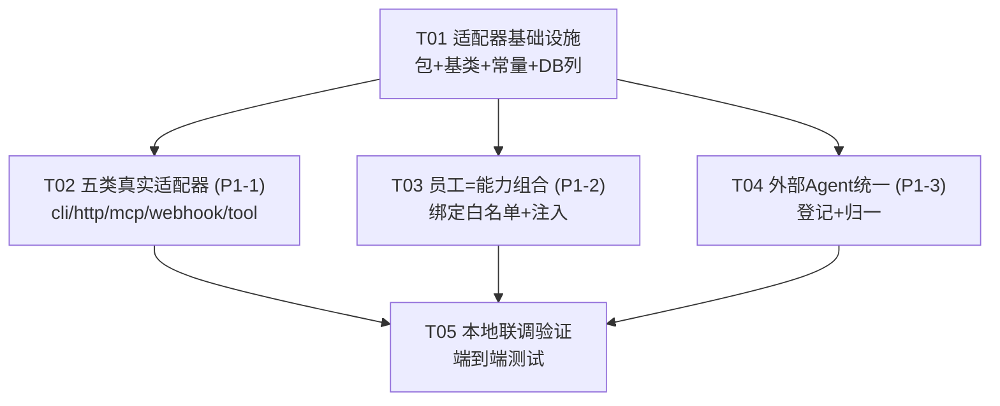

# System Design: P1 增量 — 适配器抽象（CLI/HTTP/MCP/Webhook/Local）+ 员工=能力组合 + 外部 Agent 统一接入

> **架构师**：Bob（software-architect-2）
> **团队**：`software-p1-adapters`
> **输入基准**：`docs/product/curis-product-vision-current-stage.md` §4（P1-1/P1-2/P1-3）+ 对 `backend/app/` 源码实地核查
> **复用基座**：P0 后端核心（`capability_catalog.py` / `capability_resolver.py` / `dev_agent.py` / `catalog_constants.py` / `employee_templates.py` 的 `employee_capability_bindings`）

> **范围说明（重要）**：团队 `software-p1-adapters` 的 assignment 消息为空，本设计依据「团队描述 + 产品愿景 P1 节 + 既有代码现状」推断范围，对应 `docs/architecture/curis-backend-core-arch.md` 中标记为「本阶段边界、不实现」的 **T08 / T09 / T10**。如团队负责人对该范围有调整，请直接告知，我将即时修订。

---

## 0. 工程现状核查（复用而非重写）

| 现状（实测 `backend/app/`） | 结论 |
|---|---|
| `dev_agent.py` 已有 `DevAgent` Protocol（`execute(prompt)->dict`）+ 5 适配器（Claude/OpenAI-Codex/WorkBuddy-API/Codex-CLI/WorkBuddy-CLI），且各适配器自带 `no_api_key`/CLI→SDK 优雅降级 | ✅ 复用协议，适配器泛化为标准 Capability（P1-3） |
| `catalog_constants.CAPABILITY_TYPE` = `[model, tool, connector, skill, mcp, api, cli, webhook, workflow]`（已 9 类） | ✅ P1-1 仅补「真实执行适配器」，类型枚举已齐 |
| `capability_catalog.py` 的 `CapabilityCatalog` 已是统一注册表，落 `official_models`，含 `runtime_meta_json`（cost/io/permissions/credentials_ref/backup_chain/live_status） | ✅ 扩展 `adapter_config_json` 承载连接配置 |
| `capability_resolver.py` 的 `DevAgentFactory.build(cap)` 对非 model 类型返回 `NullDevAgent` 占位（不触网） | 🎯 **P1-1 核心**：用真实适配器替换 `NullDevAgent` 分支 |
| `employee_templates.py` 已有 `employee_capability_bindings` 表 + `set/list/preferred_capability_for_employee`；但 `capability_type` 白名单仅 `{model, tool, connector}` | 🎯 **P1-2**：扩展白名单到全类型 + 运行时注入 `prefer_employee_bindings` |
| `CapabilityRequirement.prefer_employee_bindings` 已存在，resolver `_select_primary` 已读取该字段 | ✅ P1-2 仅需把员工绑定接进来 |
| `credential_vault.py` 已实现 `resolve(credential_ref)->secret`（scheme:reference，绝不落明文） | ✅ 适配器鉴权重用，不重复造 |

**唯一策略**：复用 `DevAgent` 协议与 `CapabilityCatalog`/`CapabilityResolver`/`CapabilityHandle`，只补「5 类真实执行适配器」+「员工能力组合接线」+「外部 Agent 登记为 capability」。零新第三方依赖。

---

## Part A: System Design

### 1. Implementation Approach

#### 1.1 核心难点与对策

| 难点 | 说明 | 对策 |
|---|---|---|
| **统一执行契约** | 5 类适配器语义差异大（CLI 子进程 / HTTP 请求 / MCP JSON-RPC / Webhook 推送 / 本地进程），但 resolver 只认 `execute(prompt)->dict` | 定义 `CapabilityAdapter` 抽象基类（实现 `DevAgent` 协议），统一 `execute(prompt)` 签名与返回结构（`{output, status, model_gateway_id, model_name, total_tokens, estimated_cost}`），`status` 复刻 `no_api_key`/`cli_not_found`/`timeout`/`error:*` 降级信号 |
| **适配器配置来源** | 适配器需要知道命令/URL/方法/鉴权，不能硬编码 | `official_models` 新增 `adapter_config_json` 列存放每类连接配置；`DevAgentFactory.build(cap)` 读 `cap["adapter_config"]` 构造对应适配器 |
| **鉴权不落明文** | cli/api/mcp/webhook 都需要凭证，但 DB 只存 `scheme:reference` | 适配器执行时调 `credential_vault.resolve(ref)` 取 secret，注入 env/headers；配置里只存引用 |
| **MCP 协议复杂度** | MCP 是 JSON-RPC over stdio/http，全量实现过重 | P1 实现**最小可用 MCP stdio 客户端**（spawn 进程 → `initialize` → `tools/call`），足以驱动一个本地 MCP server；http 传输预留 |
| **Local ≡ `tool` 类型映射** | 团队描述写「Local」，但 `CAPABILITY_TYPE` 无 `local` 类型 | 将「Local Process」映射到既有 `tool` 类型（本地进程/工具），由 `LocalProcessAdapter` 执行；如需独立 `local` 类型，仅 `catalog_constants.CAPABILITY_TYPE` 加一行（已注明为可选） |
| **员工=能力组合接线** | 绑定表已有，但运行时未把员工首选能力喂给 resolver | 新增 `EmployeeCapabilityService.get_preferred_capabilities(employee_id)` → `prefer_employee_bindings`，在 `PipelineRuntime`/`TaskGraph` 解析节点需求时注入 |

#### 1.2 架构模式

- **策略工厂（Strategy + Factory）**：`DevAgentFactory.build(cap)` 按 `cap.type` 分发到具体 `CapabilityAdapter` 子类；resolver 不感知具体类型。
- **适配器模式**：所有执行型能力统一实现 `DevAgent` 协议，`CapabilityHandle` 包装后供运行层调用。
- **配置外置**：连接配置存 `adapter_config_json`，能力定义与执行解耦（新增一种外部 Agent = 登记一条 catalog 记录，无需改代码）。
- **最小变更**：`dev_agent.py` 的 5 适配器保留（model 类型外部 Agent 路径）；`CapabilityResolver` / `CapabilityHandle` 不动接口，仅扩展 `DevAgentFactory`。

#### 1.3 框架选型（零新依赖）

| 维度 | 选型 | 理由 |
|---|---|---|
| HTTP | 复用 `httpx`（已在 `dev_agent.py` lazy import） | 不新增客户端 |
| 子进程 | `subprocess`（stdlib） | CLI / Local / MCP-stdio 统一 |
| JSON-RPC | `json` + `subprocess` stdio（stdlib） | MCP 最小实现 |
| 持久化 | `Database` + `official_models.adapter_config_json` 新列（`_ensure_column` 迁移） | 同 P0 模式 |
| 鉴权 | `credential_vault.resolve`（已存在） | 不落明文 |

---

### 2. File List（均位于 `backend/app/` 或 `backend/tests/`）

#### 新增文件

| 文件 | 说明 |
|---|---|
| `backend/app/capability_adapters/__init__.py` | 适配器包导出 |
| `backend/app/capability_adapters/base.py` | `CapabilityAdapter` 抽象基类（实现 `DevAgent` 协议，含凭证解析/结果构造/超时/降级信号工具） |
| `backend/app/capability_adapters/cli_adapter.py` | `CliAdapter`（`cli` 类型）：执行外部 CLI |
| `backend/app/capability_adapters/http_adapter.py` | `HttpApiAdapter`（`api` 类型）：HTTP 请求 |
| `backend/app/capability_adapters/mcp_adapter.py` | `McpAdapter`（`mcp` 类型）：MCP stdio JSON-RPC 最小客户端 |
| `backend/app/capability_adapters/webhook_adapter.py` | `WebhookAdapter`（`webhook` 类型）：出站 Webhook |
| `backend/app/capability_adapters/local_process_adapter.py` | `LocalProcessAdapter`（`tool` 类型 = Local Process）：本地进程/工具 |
| `backend/app/capability_adapters/external_agent_adapter.py` | `ExternalAgentAdapter`（P1-3）：把外部 Agent（CLI/HTTP 形态）归一为标准 Capability，输出标准化 |
| `backend/tests/test_p1_adapters.py` | P1-1/3 适配器单测 + 本地联调（echo cli / 本地 mock HTTP / webhook） |
| `backend/tests/test_employee_capability.py` | P1-2 员工能力组合单测 |

#### 修改文件

| 文件 | 修改点 |
|---|---|
| `backend/app/catalog_constants.py` | 新增 `ADAPTER_CONFIG_SCHEMA`（每类型必需/可选字段）+ `is_valid_adapter_config(type, cfg)` 校验；可选：在 `CAPABILITY_TYPE` 加 `local`（若团队选择独立类型） |
| `backend/app/database.py` | `official_models` 增 `adapter_config_json` 列（迁移）；`employee_capability_bindings` 放宽 type 校验 + 索引；新增 `save/get/list adapter_config` 读写 |
| `backend/app/capability_catalog.py` | `create()` / `update()` 支持 `adapter_config`；写 `adapter_config_json`；`list()` 反序列化；校验调 `is_valid_adapter_config` |
| `backend/app/capability_resolver.py` | `DevAgentFactory.build()` 按类型构造真实适配器（cli/api/mcp/webhook/tool），model 维持既有 5 适配器，skill/workflow/connector 维持 `NullDevAgent` |
| `backend/app/employee_templates.py` | 扩展 `preferred_capability_for_employee` / `set_employee_capability_bindings` 的 `capability_type` 白名单到全 `CAPABILITY_TYPE`；新增 `EmployeeCapabilityService`（或方法）`get_preferred_capabilities(employee_id)` |
| `backend/app/pipeline_runtime.py` | 节点执行前，按 `node.owner_employee_id` 取员工首选能力 → 注入 `CapabilityRequirement.prefer_employee_bindings` |
| `backend/app/task_graph.py` | `TaskNode.to_requirement()` 透传 `prefer_employee_bindings`（已从节点/payload 读取） |
| `backend/app/issue_pipeline_api.py` | 复用既有 capability 端点；新增 `POST /api/catalog/capabilities/seed-external-agents`（登记 5 个外部 Agent） |
| `backend/app/main.py` | 启动 seed 外部 Agent（可选，幂等）；保持 `CapabilityResolver` 装配 |

---

### 3. Data Structures and Interfaces

```mermaid
classDiagram
    %% ── 执行契约 ──
    class DevAgent {
        <<Protocol>>
        +execute(prompt: str) dict
    }

    class CapabilityAdapter {
        <<abstract>>
        #dict config
        #str cap_key
        #str cap_type
        +execute(prompt: str) dict
        #_resolve_credentials(refs: dict) dict
        #_build_result(output, status, **kw) dict
        #_run_subprocess(cmd, input, cwd, timeout) tuple
    }
    CapabilityAdapter ..|> DevAgent : 实现

    class CliAdapter {
        +execute(prompt) dict
    }
    class HttpApiAdapter {
        +execute(prompt) dict
    }
    class McpAdapter {
        +execute(prompt) dict
        -_spawn_server() process
        -_jsonrpc(method, params) dict
    }
    class WebhookAdapter {
        +execute(prompt) dict
    }
    class LocalProcessAdapter {
        +execute(prompt) dict
    }
    class ExternalAgentAdapter {
        +execute(prompt) dict
        -_delegate() CapabilityAdapter
    }

    CliAdapter --|> CapabilityAdapter
    HttpApiAdapter --|> CapabilityAdapter
    McpAdapter --|> CapabilityAdapter
    WebhookAdapter --|> CapabilityAdapter
    LocalProcessAdapter --|> CapabilityAdapter
    ExternalAgentAdapter --|> CapabilityAdapter

    %% ── 工厂 / 注册表 / 解析器（复用 P0） ──
    class DevAgentFactory {
        +build(cap: dict) DevAgent
    }
    class CapabilityCatalog {
        +create(capability_key, type, ..., adapter_config) dict
        +get(key) dict
        +list(type_filter, include_inactive) list
    }
    class CapabilityResolver {
        +resolve(req: CapabilityRequirement, exclude_keys) CapabilityHandle
    }
    class CapabilityHandle {
        +key: str
        +type: str
        +adapter: DevAgent
        +backup_keys: list
        +execute(prompt) dict
    }
    class CapabilityRequirement {
        +cap_type: str
        +io_schema: dict
        +permissions: list
        +prefer_employee_bindings: list
    }

    DevAgentFactory ..> CapabilityAdapter : 构造
    CapabilityResolver --> CapabilityCatalog : 查
    CapabilityResolver --> DevAgentFactory : 用
    CapabilityResolver --> CapabilityHandle : 返回
    CapabilityHandle ..> DevAgent : 包装

    %% ── 员工=能力组合（P1-2） ──
    class EmployeeCapabilityService {
        +get_preferred_capabilities(employee_id) list~str~
        +list_bindings(employee_id) list~dict~
    }
    class EmployeeTemplate {
        +set_employee_capability_bindings(employee_id, bindings) dict
        +preferred_capability_for_employee(employee_id) dict
    }
    class EmployeeCapabilityBinding {
        +tenant_id: str
        +employee_id: str
        +capability_source: str
        +capability_type: str
        +capability_id: str
        +priority: int
        +enabled: bool
    }

    EmployeeCapabilityService --> EmployeeTemplate : 读
    EmployeeTemplate --> EmployeeCapabilityBinding : 持久化
    CapabilityResolver ..> CapabilityRequirement : 输入(含员工偏好)
    EmployeeCapabilityService ..> CapabilityRequirement : 注入 prefer_employee_bindings

    %% ── 运行层接线 ──
    class PipelineRuntime {
        +run_node(node, graph) NodeResult
    }
    class TaskGraph {
        +ready_nodes(done) list
    }
    class TaskNode {
        +id: str
        +owner_employee_id: str
        +cap_requirement: dict
    }

    PipelineRuntime --> CapabilityResolver : resolve(含员工偏好)
    TaskNode --> CapabilityRequirement : 转
    PipelineRuntime --> TaskGraph : 取节点
```



**`adapter_config_json` 字段约定（按类型）**

| type | `adapter_config` 关键字段 |
|---|---|
| `cli` | `bin`, `args_template: list[str]`（`{prompt}`/`{prompt_file}` 占位）, `cwd?`, `env_refs: dict[name->scheme:ref]`, `timeout`, `filesystem_mutating?` |
| `api` | `method`, `url`, `headers_ref: dict[name->scheme:ref]`, `body_template: dict`（`{prompt}` 占位）, `response_path: str`（dot path 取 output）, `timeout` |
| `mcp` | `transport: stdio|http`, `command: list[str]`（stdio）或 `url`（http）, `tool_name`, `init_timeout`, `timeout` |
| `webhook` | `url`, `method`（默认 POST）, `payload_template: dict`（`{prompt}` 占位）, `await_response: bool`, `timeout` |
| `tool`（Local Process） | `command: list[str]`, `cwd?`, `input_mode: stdin|arg|file`, `timeout`, `io_contract: {output: stdout}` |

---

### 4. Program Call Flow

#### 4.1 注册一个真实能力（Admin / seed）

```mermaid
sequenceDiagram
    participant Admin as Admin/Seed
    participant Cat as CapabilityCatalog
    participant DB as Database
    participant EV as EvolutionEventLog

    Admin->>Cat: create(capability_key="wb-cli", type="cli",
           adapter_config={bin:"codebuddy", args_template:[...], env_refs:{...}},
           runtime_meta={backup_chain:[...], credentials_ref:"env:CODEBUDDY_API_KEY"})
    Cat->>Cat: is_valid_adapter_config("cli", cfg)
    Cat->>DB: save_official_model(..., adapter_config_json=cfg)
    Cat->>EV: record("capability.created")
    Cat-->>Admin: {capability_key, type, adapter_config, ...}
```

#### 4.2 运行时：解析 → 构造适配器 → 执行（含员工能力组合 P1-2）

```mermaid
sequenceDiagram
    participant PR as PipelineRuntime
    participant ECS as EmployeeCapabilityService
    participant RES as CapabilityResolver
    participant CAT as CapabilityCatalog
    participant FAC as DevAgentFactory
    participant AD as CapabilityAdapter(Cli/Http/Mcp/...)
    participant CV as CredentialVault

    PR->>PR: run_node(node, graph)
    PR->>ECS: get_preferred_capabilities(node.owner_employee_id)
    ECS-->>PR: ["wb-cli", "openai-gpt4o"]
    PR->>RES: resolve(CapabilityRequirement(cap_type=node.type,
           prefer_employee_bindings=["wb-cli","openai-gpt4o"]))

    RES->>CAT: list(type_filter) + get(primary/backup)
    CAT-->>RES: 候选能力(含 adapter_config, live_status)
    RES->>RES: _select_primary (员工偏好优先) → _build_chain(backup_chain)
    RES->>FAC: build(chosen_cap)
    FAC->>FAC: 按 cap.type 构造 CliAdapter/HttpApiAdapter/...
    FAC-->>RES: adapter 实例
    RES-->>PR: CapabilityHandle(adapter=adapter, backup_keys=[...])

    PR->>AD: handle.execute(prompt)
    alt 需要鉴权
        AD->>CV: resolve("env:CODEBUDDY_API_KEY")
        CV-->>AD: secret
        AD->>AD: 注入 env/headers
    end
    AD->>AD: 执行（subprocess / httpx / mcp stdio / webhook）
    AD-->>PR: {output, status:"success", total_tokens, estimated_cost}
    PR->>PR: ResultReviewer.review(result)
```

#### 4.3 外部 Agent 统一接入（P1-3）：登记即能力

```mermaid
sequenceDiagram
    participant Seed as seed_external_agents()
    participant Cat as CapabilityCatalog
    participant DB as Database

    Seed->>Cat: create("workbuddy-cli", type="cli",
           adapter_config={bin:"codebuddy", args_template:["run","--agent","{agent}","--prompt-file","{prompt_file}"],
           env_refs:{"CODEBUDDY_API_KEY":"env:CODEBUDDY_API_KEY"}, filesystem_mutating:true})
    Seed->>Cat: create("anthropic-claude", type="api",
           adapter_config={method:"POST", url:"https://api.anthropic.com/v1/messages",
           headers_ref:{"x-api-key":"env:ANTHROPIC_API_KEY","anthropic-version":"2023-06-01"},
           body_template:{model:"claude-sonnet-4...", messages:[{role:"user",content:"{prompt}"}]},
           response_path:"content.0.text"})
    Note over Seed,DB: codex-cli / openai-codex / workbuddy-api 同理登记<br/>→ 外部 Agent 不再需要 bespoke DevAgent 类即可被 resolver 调度
    Cat->>DB: save_official_model(...)
```

> 注：`dev_agent.py` 的 5 个适配器**保留**作为 `model` 类型的「文件系统变更型外部 Agent」路径（`mutates_filesystem=True`，走 git diff 回滚）；P1-3 同时将它们登记为 catalog 能力，使「外部 Agent」成为一等公民。CLI/HTTP 形态的外部 Agent 直接由 `CliAdapter`/`HttpApiAdapter` 驱动，无需新增代码。

---

### 5. Anything UNCLEAR

1. **「Local」类型命名**：团队描述写「Local」，但 `CAPABILITY_TYPE` 无 `local` 类型。本设计将 Local Process 映射到既有 `tool` 类型（由 `LocalProcessAdapter` 执行）。若团队要求独立 `local` 类型，`catalog_constants.CAPABILITY_TYPE` 加一行即可（已注明为可选变更）。
2. **MCP 范围**：P1 仅实现最小 stdio MCP 客户端（`initialize` + `tools/call`）。若需 http transport / resources / prompts，列为后续（不影响接口）。
3. **Webhook 响应语义**：默认 `await_response=false`（fire-and-forget，status=`dispatched`）；若 `await_response=true` 读同步响应体作为 output。异步回调（外部 Agent 回传结果）超出 P1，列为后续。
4. **`tool` 类型与既有 `tl_*` 工具模板的关系**：既有 `tool` 模板（`tl_ai_rd_ci_runner` 等）是「模板」层；本设计的 `tool` capability 是「可执行能力」层，二者通过 `employee_capability_bindings.capability_id` 关联。P1 只打通 capability → adapter 执行，不改动 `tl_*` 模板定义。
5. **员工绑定写入入口**：`employee_templates.set_employee_capability_bindings` 已存在；P1-2 仅需放宽 `capability_type` 白名单并新增读取 service。是否需要新增 Admin API 由 team-lead 决定（建议复用既有绑定端点，仅放开 type 校验）。

---

## Part B: Task Decomposition

### 6. Required Packages

零新第三方依赖。全部复用既有：
```
httpx>=0.27.0        # 已在 dev_agent.py lazy import，HTTP/MCP-http 适配器复用
fastapi>=0.104.0     # API 层（复用）
pydantic>=2.0.0      # 请求/响应模型（复用）
# 标准库：subprocess / json / uuid / threading / sqlite3（Database）
```

---

### 7. Task List（ordered by dependency，≤5 任务）

| Task ID | Task Name | Source Files | Dependencies | Priority |
|---|---|---|---|---|
| **T01** | 适配器基础设施（包 + 抽象基类 + 类型/配置常量 + DB 列） | `backend/app/capability_adapters/__init__.py`, `backend/app/capability_adapters/base.py`, `backend/app/catalog_constants.py`, `backend/app/database.py` | 无 | P0 |
| **T02** | 五类真实适配器实现（P1-1 核心） | `backend/app/capability_adapters/cli_adapter.py`, `backend/app/capability_adapters/http_adapter.py`, `backend/app/capability_adapters/mcp_adapter.py`, `backend/app/capability_adapters/webhook_adapter.py`, `backend/app/capability_adapters/local_process_adapter.py`, `backend/app/capability_resolver.py` | T01 | P0 |
| **T03** | 员工=能力组合模型（P1-2） | `backend/app/employee_templates.py`, `backend/app/pipeline_runtime.py`, `backend/app/task_graph.py`, `backend/app/database.py` | T01 | P0 |
| **T04** | 外部 Agent 统一适配器接入（P1-3） | `backend/app/capability_adapters/external_agent_adapter.py`, `backend/app/capability_catalog.py`, `backend/app/issue_pipeline_api.py`, `backend/app/main.py` | T01 | P0 |
| **T05** | 本地联调验证（端到端） | `backend/tests/test_p1_adapters.py`, `backend/tests/test_employee_capability.py`, `backend/app/main.py` | T02, T03, T04 | P0 |

#### T01 适配器基础设施

- **源文件**：`capability_adapters/__init__.py`, `capability_adapters/base.py`, `catalog_constants.py`, `database.py`
- **依赖**：无
- **内容**：
  1. 新建 `capability_adapters/` 包，`__init__.py` 导出所有适配器 + `CapabilityAdapter`。
  2. `base.py` 定义 `CapabilityAdapter`（实现 `DevAgent` 协议）：
     - 构造：`__init__(self, cap_key, cap_type, config: dict, credential_vault=None)`
     - 抽象 `execute(self, prompt: str) -> dict`（子类实现）
     - 工具 `#_resolve_credentials(refs)`：调 `credential_vault.resolve` 把 `scheme:ref` 映射为真实值；`#_build_result(output, status, **kw)`：统一返回结构；`#_run_subprocess(cmd, input, cwd, timeout)`：统一子进程执行 + 超时 + `cli_not_found`/`timeout` 降级信号。
  3. `catalog_constants.py`：新增 `ADAPTER_CONFIG_SCHEMA`（每类型必需/可选字段表）+ `is_valid_adapter_config(type, cfg)` 校验（缺 `bin`/`url` 等必要字段即 `ValueError`）；可选在 `CAPABILITY_TYPE` 追加 `"local"`。
  4. `database.py`：`official_models` 增 `adapter_config_json` 列（`_ensure_column` 幂等迁移）；新增 `save_adapter_config` / `get_adapter_config`；`employee_capability_bindings` 放宽 type 校验并补索引。
- **验收**：包可 import；`CapabilityAdapter` 可被 `runtime_checkable(DevAgent)` 识别；`is_valid_adapter_config` 对合法/非法配置分别通过/抛错；`adapter_config_json` 列迁移成功、可写读。

#### T02 五类真实适配器实现（P1-1 核心）

- **源文件**：5 个 adapter 文件 + `capability_resolver.py`
- **依赖**：T01
- **内容**：
  1. `CliAdapter`（type=`cli`）：按 `args_template` 渲染命令（`{prompt}` → 临时文件或直接 arg），`subprocess` 执行，`cwd`/`env_refs`/超时；`filesystem_mutating` 时输出为真实 git diff（复用 `git -C cwd diff` 思路）。
  2. `HttpApiAdapter`（type=`api`）：`httpx.request(method, url, headers=解析后, json=body_template 渲染)`；按 `response_path`（dot path）抽取 output；超时/非 2xx → `status=error:*`。
  3. `McpAdapter`（type=`mcp`）：spawn `command`（stdio），发 `initialize` → `tools/call(tool_name, {prompt})` JSON-RPC，解析结果；`init_timeout`/`timeout` 保护。
  4. `WebhookAdapter`（type=`webhook`）：`httpx.post(url, json=payload_template 渲染)`；`await_response=false` → `{status:"dispatched", output:"ok"}`；`true` → 取响应体为 output。
  5. `LocalProcessAdapter`（type=`tool`=Local Process）：同 CLI 思路但语义为「本地工具/进程」，`input_mode` 决定 prompt 注入方式（stdin/arg/file），`io_contract.output=stdout`。
  6. `capability_resolver.py` → `DevAgentFactory.build(cap)`：按 `cap.type` 分发：`cli`→`CliAdapter`、`api`→`HttpApiAdapter`、`mcp`→`McpAdapter`、`webhook`→`WebhookAdapter`、`tool`→`LocalProcessAdapter`、`model`→维持既有 5 适配器（启发式）、`skill/workflow/connector`→维持 `NullDevAgent`。构造时传入 `adapter_config` 与 `credential_vault`（从 `runtime_meta.credentials_ref` 解析）。
- **验收**：`DevAgentFactory.build` 对 5 类返回真实适配器而非 `NullDevAgent`；CliAdapter 执行 `echo` 返回 prompt 回显；HttpApiAdapter 打到本地 mock 返回解析后 output；McpAdapter 能驱动一个最小 echo MCP server；各适配器在缺凭证/命令不存在/超时时返回正确 `status` 降级信号（供 resolver 探活）。

#### T03 员工=能力组合模型（P1-2）

- **源文件**：`employee_templates.py`, `pipeline_runtime.py`, `task_graph.py`, `database.py`
- **依赖**：T01
- **内容**：
  1. `employee_templates.py`：放宽 `preferred_capability_for_employee` / `set_employee_capability_bindings` 的 `capability_type` 白名单由 `{model,tool,connector}` 扩展到全 `CAPABILITY_TYPE`；新增 `EmployeeCapabilityService.get_preferred_capabilities(employee_id) -> list[str]`（按 priority 取 enabled 绑定的 `capability_id`/`capability_key`）。
  2. `task_graph.py`：`TaskNode.to_requirement()` 透传 `prefer_employee_bindings`（已从节点/payload 读取，保持既有逻辑）。
  3. `pipeline_runtime.py`：`run_node` 中按 `node.owner_employee_id` 调 `EmployeeCapabilityService.get_preferred_capabilities` → 填入 `CapabilityRequirement.prefer_employee_bindings`，再 `resolver.resolve(req)`。
  4. `database.py`：`employee_capability_bindings` 索引补全（tenant_id + employee_id）。
- **验收**：可将一个 employee 绑定 `cli`/`api`/`mcp` 等多种能力；resolver 解析时员工首选能力排在 primary；解绑/禁用后不再优先。

#### T04 外部 Agent 统一适配器接入（P1-3）

- **源文件**：`capability_adapters/external_agent_adapter.py`, `capability_catalog.py`, `issue_pipeline_api.py`, `main.py`
- **依赖**：T01（概念依赖 T02 的 Cli/Http 适配器，但仅用基类与 catalog，可仅依赖 T01）
- **内容**：
  1. `external_agent_adapter.py`：`ExternalAgentAdapter` 包装一个 `cli`/`api` 形态的外部 Agent，内部委托对应适配器，并将外部 Agent 常见返回（JSON `{"result":...}` / 纯文本）归一为 `{output, status}`。
  2. `capability_catalog.py`：新增 `seed_external_agents()`（幂等），登记 5 个外部 Agent 为 catalog 能力：`workbuddy-cli`(cli)、`codex-cli`(cli)、`anthropic-claude`(api)、`openai-codex`(api/model)、`workbuddy-api`(api)；`adapter_config` 取自 `dev_agent.py` 既有的端点/命令。
  3. `issue_pipeline_api.py`：新增 `POST /api/catalog/capabilities/seed-external-agents`（幂等调用 `seed_external_agents`）。
  4. `main.py`：startup 幂等 seed（可选）；确认 `CapabilityResolver` 已装配 `credential_vault` 给 `DevAgentFactory`。
- **验收**：seed 后 5 个外部 Agent 出现在 `CapabilityCatalog.list()`；resolver 能按 type 解析并构造对应适配器；`ExternalAgentAdapter` 对 CLI/HTTP 形态外部 Agent 输出归一化。

#### T05 本地联调验证（端到端）

- **源文件**：`backend/tests/test_p1_adapters.py`, `backend/tests/test_employee_capability.py`, `main.py`
- **依赖**：T02, T03, T04
- **内容**：
  1. `test_p1_adapters.py`：
     - **场景 A（CLI）**：登记 `echo` cli 能力 → resolver.resolve(cli) → `CliAdapter.execute("hello")` → 断言 output 含 `hello`。
     - **场景 B（HTTP）**：起本地 `httpx` mock server（或 `unittest.mock`）→ 登记 api 能力 → 断言 `response_path` 抽出 output。
     - **场景 C（Webhook）**：登记 webhook（指向本地 mock）→ 断言 `status=dispatched`。
     - **场景 D（降级）**：首选 cli 能力命令不存在（`cli_not_found`）→ resolver 静默切 backup_chain 下一个 → 断言返回降级后 handle。
     - **场景 E（MCP）**：起最小 echo MCP stdio server → `McpAdapter` 调 `tools/call` → 断言 output。
  2. `test_employee_capability.py`：
     - 绑定 employee → `cli`/`api` 多能力 → 断言 `get_preferred_capabilities` 顺序；resolver 注入后 primary 命中员工首选。
  3. `main.py`：确保 seed 外部 Agent 在测试/启动路径可用；提供 `python -m backend.app.capability_adapters` 冒烟脚本（可选）。
- **验收**：全部场景通过；验证「目标→解析→执行→降级」最小闭环在真实适配器下跑通（非 `NullDevAgent`）。

---

### 8. Shared Knowledge（跨文件约定）

| 约定 | 说明 |
|---|---|
| **执行契约** | 所有执行型能力实现 `DevAgent.execute(prompt)->dict`，返回 `{output, status, model_gateway_id, model_name, total_tokens, estimated_cost}`；`status` 必须含 `no_api_key`/`cli_not_found`/`timeout`/`error:*`（resolver 探活唯一依据） |
| **适配器配置位置** | 连接配置存 `official_models.adapter_config_json`；`CapabilityCatalog.create/update` 读写；`DevAgentFactory.build` 读取并构造 |
| **类型→适配器映射** | `cli`→CliAdapter / `api`→HttpApiAdapter / `mcp`→McpAdapter / `webhook`→WebhookAdapter / `tool`→LocalProcessAdapter / `model`→dev_agent 5 适配器 / `skill`·`workflow`·`connector`→NullDevAgent（P1 后置） |
| **Local ≡ tool** | 「Local Process」映射到 `tool` 类型（如无独立 `local` 类型）；如选独立类型，`CAPABILITY_TYPE` 加 `"local"` 并在 factory 加分支 |
| **凭证不落明文** | 鉴权只存 `scheme:reference`（如 `env:OPENAI_API_KEY`）；执行时 `credential_vault.resolve(ref)` 取 secret 注入 env/headers |
| **`{prompt}` 占位** | `args_template`/`body_template`/`payload_template` 中 `{prompt}`（或 `{prompt_file}`）在执行时由 prompt 渲染；文件模式写临时文件传路径 |
| **员工能力注入** | 运行时由 `EmployeeCapabilityService.get_preferred_capabilities(employee_id)` 取得 → 注入 `CapabilityRequirement.prefer_employee_bindings` → resolver `_select_primary` 优先 |
| **降级默认** | 沿用 P0 `AUTO_DEGRADE_SILENT=True`：首选不可用静默切 backup_chain；耗尽/硬卡点升级（与既有 resolver 行为一致） |
| **审计** | 能力增删/状态变更/降级沿用 `capability.*` 事件（`EvolutionEventLog`） |
| **DB 迁移** | 新增列一律 `_ensure_column` 幂等；禁止破坏性 `ALTER`；新表含 `tenant_id` |

#### 适配器 `execute` 返回结构（统一）

```python
{
    "output": "<适配器执行结果文本>",
    "status": "success" | "no_api_key" | "cli_not_found" | "timeout" | "dispatched" | "error:*",
    "model_gateway_id": "<capability_key>",
    "model_name": "<cap_type>",
    "total_tokens": 0,
    "estimated_cost": 0.0,
}
```

---

### 9. Task Dependency Graph


