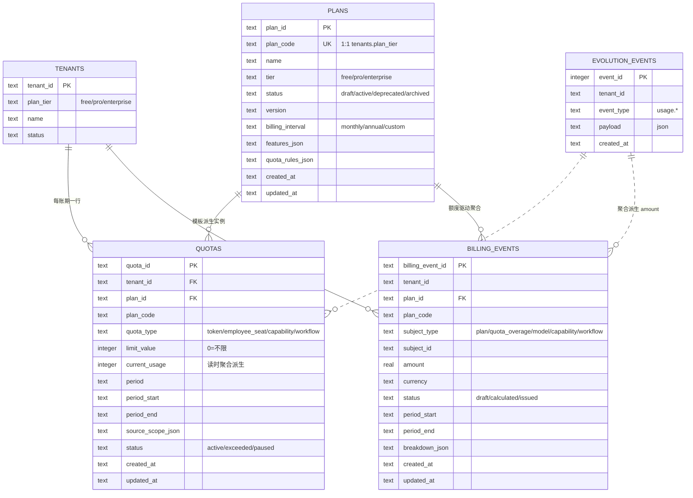
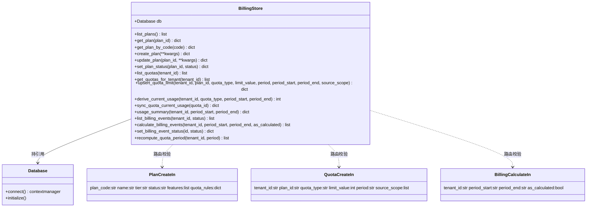
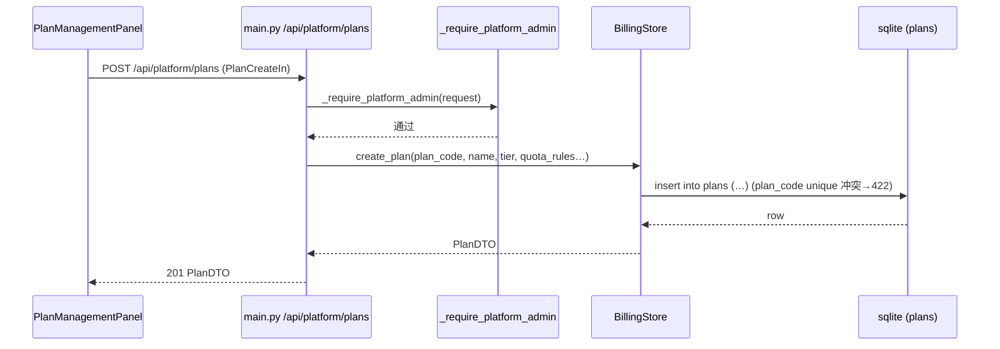
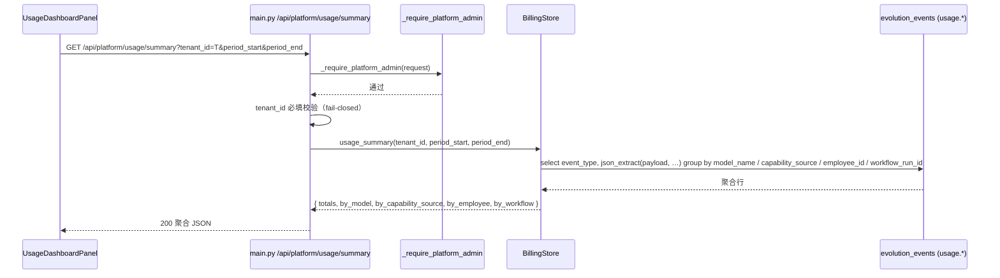
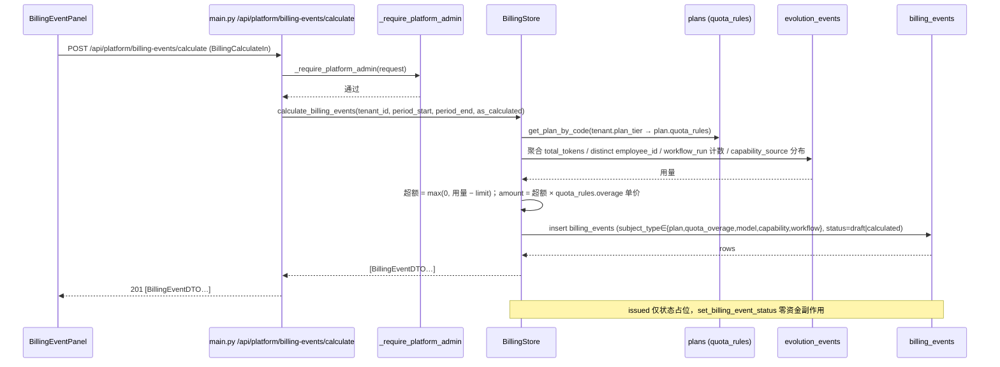

# Phase-8 Billing MVP Admin 实现设计

> 设计就绪文档 · 作者：架构师高见远（software-architect）
> 状态：**G1 Billing Gate 通过 → 进入 Phase-8 Billing MVP Admin 开发**
> 范围：Plan Management / Quota Management / Usage Dashboard / Billing Event 管理（四模块）
> 非目标（硬禁止）：不实现 payment / invoice / 自动扣款 / 配额硬阻断 / Marketplace / ROI 收费 / 修改 Workspace · Credential Vault · tenant_private

---

## 0. 设计就绪声明（一句话）

本设计在**不触碰任何禁止代码**的前提下，把 `plans` / `quotas` / `billing_events` 三个一等实体与既有 `usage_event`（evolution_events）聚合读出式挂钩，给出可落地的 Admin 侧计量与配置底座，所有新端点的写权都收敛在 `_require_platform_admin` 守卫下的 `/api/platform/*`。

---

## 1. 实现方案 + 框架选型

### 1.1 技术栈（沿用现状，零新依赖）

| 层 | 选型 | 说明 |
| --- | --- | --- |
| 后端 | FastAPI + sqlite3 + pydantic（**无 ORM**） | 与 `main.py` / `database.py` 既有模式一致；新增数据访问收敛到新模块 `billing_store.py` |
| 前端 | Next.js 16 App Router + React 19（**纯 JavaScript**，非 TS） | 面板 `export default function XxxPanel({ apiFetch, onMessage })`，Tailwind + 原生 `<table>`，不引入 MUI / recharts / 图表库 |
| 鉴权 | `CURIS_PLATFORM_ADMIN_TOKEN`（Bearer / `X-Platform-Admin-Token`） | 复用 `main.py` 现有 `_require_platform_admin` |

### 1.2 架构模式

- **分层**：`main.py`（路由 + pydantic 请求模型 + `_require_platform_admin` 守卫） → `BillingStore`（数据访问，持 `Database` 引用，纯 SELECT/INSERT/UPDATE，零出站） → `sqlite3`（既有的 `curis.sqlite`）。
- **计量范式**：`current_usage` 采用**读时聚合（query-time aggregation）**而非 Workspace 写入式递增计数。即 Admin 查询时，对 `evolution_events`（token / capability / employee / workflow 派生源）做 `GROUP BY + SUM` 得到实时用量。**这与「期末从原始事件重算」同源、天然一致**，且不需要在 Workspace 执行链注入任何写入钩子（严守不修改 Workspace 的红线）。期末重算作业仅作为 `BillingStore.recompute_quota_period()` 接口方法预留，MVP 不调度。
- **数据所有权**：Admin 只写 `plans` / `quotas`（配置）与 `billing_events`（聚合结果）；`usage_event` / `employee_instances` / `workflow_runs` 一律**只读**，不 mutation。
- **状态机**：`plans.status` ∈ {draft → active → deprecated → archived}（本期实现 draft/active/deprecated + 归档接口可加）；`billing_events.status` ∈ {draft → calculated → issued}，`issued` 仅占位、零资金副作用。

---

## 2. 文件列表及相对路径

### 2.1 后端

| 路径 | 动作 | 说明 |
| --- | --- | --- |
| `backend/app/database.py` | **修改** | 在 `initialize()` 中 `create table if not exists plans / quotas / billing_events` + 幂等 seed 三档默认 Plan（plan_code = free/pro/enterprise）；**不**改 `tenants` 表结构（plan_id 为 G1 后 additive，本期不加）。 |
| `backend/app/billing_store.py` | **新增** | `class BillingStore`：plans CRUD、quotas 配置 + current_usage 派生、usage 聚合、billing_event 聚合 + 状态机。所有方法持 `Database` 引用，纯 SQL。 |
| `backend/app/main.py` | **修改** | 新增 pydantic 请求模型（Plan*/Quota*/BillingCalculate*）+ 在 `create_app()` 内注册 12 个 `/api/platform/*` 路由，全部 `_require_platform_admin` 守卫；实例化 `billing = BillingStore(database)`。 |

### 2.2 前端

| 路径 | 动作 | 说明 |
| --- | --- | --- |
| `frontend/app/platform/PlanManagementPanel.js` | **新增** | P8-1 Plan 管理面板（创建/查看/修改/启用·停用）。 |
| `frontend/app/platform/QuotaManagementPanel.js` | **新增** | P8-2 配额配置 + 实时计数面板（token/employee_seat/capability/workflow）。 |
| `frontend/app/platform/UsageDashboardPanel.js` | **新增** | P8-3 Usage 只读聚合面板（调 `/api/platform/usage/summary`）。 |
| `frontend/app/platform/BillingEventPanel.js` | **新增** | P8-4 Billing Event 查询 + calculate 面板。 |
| `frontend/app/platform/page.js` | **修改** | 引入 4 个新面板，在 `TABS` 注册 4 个新 tab 并渲染；`apiFetch` / 令牌 / `onMessage` 约定全部复用现状。 |

> 仅新建 / 修改上述 8 个文件；不触碰 `/api/workspace/*`、`credential_vault.py`、Workflow Runtime、`tenant_private` 相关代码。

---

## 3. 数据结构和接口（ER 图 + 建表 SQL）

### 3.1 ER 图（Mermaid erDiagram）



> 注：本 MVP **不**在 `tenants` 表新增 `plan_id` 列（属 G1 后 additive）。`plans.plan_code` 与既有 `tenants.plan_tier` 文本字段 1:1 对齐，现有 Admin 按 `plan_tier` 筛选 / 编辑契约零改动。

### 3.2 完整建表 SQL（幂等，挂 `database.initialize()`）

```sql
-- ── Phase-8 Billing MVP (issue P8): 三张一等实体表 ──
create table if not exists plans (
  plan_id           text primary key,
  plan_code         text not null unique,   -- 1:1 tenants.plan_tier: free/pro/enterprise
  name              text not null,
  tier              text not null check (tier in ('free','pro','enterprise')),
  status            text not null default 'draft'
                      check (status in ('draft','active','deprecated','archived')),
  version           text not null default '1.0.0',
  billing_interval  text not null default 'monthly'
                      check (billing_interval in ('monthly','annual','custom')),
  features_json     text not null default '[]',    -- 对齐 issue: features
  quota_rules_json  text not null default '{}',    -- 对齐 issue: quota_rules（含 limit + overage 单价）
  created_at        text not null default current_timestamp,
  updated_at        text not null default current_timestamp
);
create index if not exists idx_plans_code on plans(plan_code);

create table if not exists quotas (
  quota_id        text primary key,
  tenant_id       text not null,
  plan_id         text not null,
  plan_code       text not null default 'free',
  quota_type      text not null
                    check (quota_type in ('token','employee_seat','capability','workflow')),
  limit_value     integer not null default 0,    -- 0 = 不限
  current_usage   integer not null default 0,    -- 读时聚合派生（缓存），权威值来自聚合
  period          text not null default 'monthly',
  period_start    text not null default '',
  period_end      text not null default '',
  source_scope_json text not null default '[]',  -- capability 白名单 / 其它元数据
  status          text not null default 'active'
                    check (status in ('active','exceeded','paused')),
  created_at      text not null default current_timestamp,
  updated_at      text not null default current_timestamp
);
create index if not exists idx_quotas_tenant on quotas(tenant_id, quota_type, period_start);

create table if not exists billing_events (
  billing_event_id text primary key,
  tenant_id        text not null,
  plan_id          text not null,
  plan_code        text not null default 'free',
  subject_type     text not null,   -- plan | quota_overage | model | capability | workflow
  subject_id       text not null default '',
  amount           real not null default 0,
  currency         text not null default 'USD',
  status           text not null default 'draft'
                    check (status in ('draft','calculated','issued')),
  period_start     text not null default '',
  period_end       text not null default '',
  breakdown_json   text not null default '{}',   -- 聚合明细（审计用）
  created_at       text not null default current_timestamp,
  updated_at       text not null default current_timestamp
);
create index if not exists idx_billing_events_tenant_period
  on billing_events(tenant_id, period_start);
```

### 3.3 三档默认 Plan 幂等 seed（对齐 tenants.plan_tier 默认 `free`）

```sql
insert or ignore into plans
  (plan_id, plan_code, name, tier, status, version, billing_interval, features_json, quota_rules_json)
values
  ('plan_free', 'free', 'Free', 'free', 'active', '1.0.0', 'monthly', '["task_execution","tenant_private_capabilities"]',
   '{"token_monthly_limit":1000000,"seat_limit":3,"capability_sources":["official"],"workflow_monthly_limit":0,"overage":{"token_unit_price_per_1k":0,"seat_unit_price":0,"workflow_unit_price":0,"capability_unit_price":0},"currency":"USD"}'),
  ('plan_pro', 'pro', 'Pro', 'pro', 'active', '1.0.0', 'monthly', '["task_execution","workflow_sop","tenant_private_capabilities","admin_usage_observability"]',
   '{"token_monthly_limit":50000000,"seat_limit":15,"capability_sources":["official","tenant_private"],"workflow_monthly_limit":50000,"overage":{"token_unit_price_per_1k":0.002,"seat_unit_price":9,"workflow_unit_price":0.01,"capability_unit_price":0},"currency":"USD"}'),
  ('plan_enterprise', 'enterprise', 'Enterprise', 'enterprise', 'active', '1.0.0', 'annual', '["task_execution","workflow_sop","tenant_private_capabilities","admin_usage_observability","team_management","priority_support"]',
   '{"token_monthly_limit":0,"seat_limit":0,"capability_sources":["official","tenant_private","marketplace"],"workflow_monthly_limit":0,"overage":{"token_unit_price_per_1k":0,"seat_unit_price":0,"workflow_unit_price":0,"capability_unit_price":0},"currency":"USD"}');
```

> `quota_rules_json` 同时承载「四类配额 limit」与「usage-based overage 单价」（后者经用户明确授权允许用于 MVP `calculate`；金额仅作非权威估算，不触发任何资金动作）。

### 3.4 类图（Mermaid classDiagram · 服务层与请求模型）



---

## 4. 程序调用流程（时序图）

### 4.1 主流程 A：Admin 创建 Plan



### 4.2 主流程 B：Admin 查询 Usage 聚合



### 4.3 主流程 C：Admin calculate Billing Event



---

## 5. API 端点规格

> 通用约定：所有端点均 `_require_platform_admin(request)` 守卫；请求体为 JSON；失败返回 `{detail}`；**Workspace 不调用任何 `/api/platform/*`**。
> DTO 字段：`PlanDTO{plan_id,plan_code,name,tier,status,version,billing_interval,features,quota_rules,created_at,updated_at}`；`QuotaDTO{quota_id,tenant_id,plan_id,plan_code,quota_type,limit_value,current_usage,period,period_start,period_end,source_scope,status,created_at,updated_at}`；`BillingEventDTO{billing_event_id,tenant_id,plan_id,plan_code,subject_type,subject_id,amount,currency,status,period_start,period_end,breakdown,created_at,updated_at}`。

### 5.1 Plan Management

| method & path | request body | response | guard |
| --- | --- | --- | --- |
| `GET /api/platform/plans` | — | `{ plans: [PlanDTO] }` | admin |
| `POST /api/platform/plans` (201) | `PlanCreateIn{plan_code,name,tier,status?='draft',version?='1.0.0',billing_interval?='monthly',features?=[],quota_rules?={}}` | `PlanDTO` | admin |
| `GET /api/platform/plans/{plan_id}` | — | `PlanDTO` (404 若不存在) | admin |
| `PUT /api/platform/plans/{plan_id}` | `PlanUpdateIn{name?,tier?,status?,version?,billing_interval?,features?,quota_rules?}` | `PlanDTO` | admin |
| `POST /api/platform/plans/{plan_id}/toggle` | `{action:'enable'|'disable'}` | `PlanDTO`（`enable`→active，`disable`→deprecated） | admin |

### 5.2 Quota Management

| method & path | request body | response | guard |
| --- | --- | --- | --- |
| `GET /api/platform/quotas?tenant_id=` | query `tenant_id?` | `{ quotas: [QuotaDTO] }` | admin |
| `POST /api/platform/quotas` (201) | `QuotaCreateIn{tenant_id,plan_id,quota_type,limit_value?=0,period?='monthly',period_start?='',period_end?='',source_scope?=[]}` | `QuotaDTO`（实例不存在则按 plan 派生创建；存在则仅更新 limit） | admin |
| `GET /api/platform/quotas/{tenant_id}` | — | `{ tenant_id, quotas: [QuotaDTO(current_usage 已派生)] }` | admin |
| `PUT /api/platform/quotas/{quota_id}` | `{limit_value,period?,period_start?,period_end?,source_scope?}` | `QuotaDTO` | admin |

### 5.3 Usage 聚合

| method & path | request body | response | guard |
| --- | --- | --- | --- |
| `GET /api/platform/usage/summary?tenant_id=&period_start=&period_end=` | query（**tenant_id 必填**，缺失 → 422 fail-closed） | `{ tenant_id, period, totals:{total_tokens,total_cost,event_count}, by_model:[{model_name,total_tokens,total_cost,count}], by_capability_source:[{capability_source,count,total_tokens}], by_employee:[{employee_id,count,total_tokens}], by_workflow:[{workflow_run_id,count,total_tokens}] }` | admin |

> 保留既有 `GET /api/platform/usage`（原始事件投影），供 `UsageProjectionPanel` 继续使用；新增 `/summary` 仅做只读聚合，不返回 `credential_id` 之外任何明文凭证；`tenant_private` 仅在 `capability_source` 维度出现为存在性标记。

### 5.4 Billing Event 管理

| method & path | request body | response | guard |
| --- | --- | --- | --- |
| `GET /api/platform/billing-events?tenant_id=&status=` | query | `{ billing_events: [BillingEventDTO] }` | admin |
| `POST /api/platform/billing-events/calculate` (201) | `BillingCalculateIn{tenant_id,period_start,period_end,as_calculated?=true}` | `{ billing_events: [BillingEventDTO(status='draft'\|'calculated')] }` | admin |

> `calculate` 仅基于 `usage_event` 聚合 + `plan.quota_rules` overage 单价生成 **draft/calculated**；`issued` 状态仅作占位（经 `PUT`/专用接口切换），**不触发任何支付 / 发票 / 扣款**。

---

## 6. 任务列表（有序、含依赖、按实现顺序）

> 对齐 P8-1 ~ P8-4；每项标注依赖、涉及文件、验收点。

### T01 · 基础设施与数据层（P8 底座）
- **依赖**：无
- **涉及文件**：`backend/app/database.py`（修改：建表 + seed 三档 Plan）、`backend/app/billing_store.py`（新增：BillingStore 全量数据访问方法）
- **验收点**：`initialize()` 后 `plans/quotas/billing_events` 表存在且三档默认 Plan 已 seed；`list_plans()` / `usage_summary()` / `derive_current_usage()` / `calculate_billing_events()` 单元测试通过；不改动 `tenants` 表结构、不触碰 Workspace。

### T02 · Plan 管理 API + 面板（P8-1）
- **依赖**：T01
- **涉及文件**：`backend/app/main.py`（修改：Plan* 请求模型 + 5 个 plan 路由）、`frontend/app/platform/PlanManagementPanel.js`（新增）、`frontend/app/platform/page.js`（修改：注册 tab）
- **验收点**：可创建/查看/修改/启用·停用 Free/Pro/Enterprise；`plan_code` 与 `plan_tier` 1:1 不破坏现有租户筛选；不引入任何支付/扣费/折扣字段；Workspace 不调用 `/api/platform/plans`。

### T03 · Quota 管理 API + 面板（P8-2）
- **依赖**：T01（引用 `plan_id` 派生配额实例）
- **涉及文件**：`backend/app/main.py`（修改：Quota* 请求模型 + 4 个 quota 路由）、`frontend/app/platform/QuotaManagementPanel.js`（新增）、`frontend/app/platform/page.js`（修改）
- **验收点**：可为租户配置 token/employee_seat/capability/workflow 的 `limit_value` + `period`；`current_usage` 由读时聚合派生，与期末重算同源；**仅计量不阻断**；employee_seat 来自 `employee_instances(enabled=1)` 计数、workflow 来自 `workflow_runs`（期内）计数——均为只读聚合；前端对 Phase-4/6 来源标注「只读观测」。

### T04 · Usage 只读聚合 API + 面板（P8-3）
- **依赖**：T01（直接读 `evolution_events`）
- **涉及文件**：`backend/app/main.py`（修改：usage/summary 路由）、`frontend/app/platform/UsageDashboardPanel.js`（新增）、`frontend/app/platform/page.js`（修改）
- **验收点**：按 tenant 聚合 token/model/capability/employee/workflow；响应仅含脱敏字段（`credential_id`/`credential_ref_digest`），不暴露明文凭证；`tenant_id` 缺失 fail-closed；不改 `usage_event` schema、不新增写路径。

### T05 · Billing Event 聚合 + 状态机 API + 面板（P8-4）
- **依赖**：T03（用量聚合）、T01/T02（plan / quota 规则）
- **涉及文件**：`backend/app/main.py`（修改：billing-events 路由 + BillingCalculateIn）、`frontend/app/platform/BillingEventPanel.js`（新增）、`frontend/app/platform/page.js`（修改）
- **验收点**：状态机 `draft→calculated→issued` 合法可审计；`draft/calculated` 可生成；`issued` 仅占位无资金副作用；`billing_event` 不含明文凭证 / 原始 provider 响应 / `tenant_private` 内容；`amount` 显式标记为非权威估算（`estimated_cost` 同源）；可引用 `usage_event` 但不反向改写。

---

## 7. 依赖包列表

- **后端**：**不引入任何新依赖**。沿用 `fastapi`、`pydantic`、`sqlite3`（标准库）。`BillingStore` 仅依赖现有 `Database`。
- **前端**：**不引入任何新依赖**。沿用 Next.js 16 + React 19 + Tailwind；面板仅用 `react` 的 `useState/useEffect/useCallback`，原生 `<table>`，不引入 MUI / recharts / 图表库。
- **环境变量**：复用既有 `CURIS_PLATFORM_ADMIN_TOKEN`（无新增）。

---

## 8. 共享知识（跨文件约定）

- **`apiFetch` 约定**（前端）：`apiFetch(path, opts)` 封装 `baseURL(NEXT_PUBLIC_API_BASE)` + `Authorization: Bearer <token>` + `Content-Type: application/json`，返回已解析 JSON；非 2xx 抛 `Error(payload.detail)`；`onMessage(msg)` 用于顶部提示。所有新面板 `export default function XxxPanel({ apiFetch, onMessage })`。
- **Admin 守卫**：所有新端点挂 `/api/platform/*`，首行 `_require_platform_admin(request)`；令牌来自 `CURIS_PLATFORM_ADMIN_TOKEN`（默认 `platform-admin-dev`）。Workspace 运行时**不得**调用 `/api/platform/*`。
- **plan_code ↔ plan_tier 对齐规则**：`plans.plan_code ∈ {free,pro,enterprise}` 与 `tenants.plan_tier` 文本字段 1:1；MVP 不新增 `tenants.plan_id` 列；配额 / 账单聚合时以 `tenant.plan_tier` 反查 `plans.plan_code` 取 `quota_rules`。
- **status 枚举值**：
  - `plans.status`：`draft` / `active` / `deprecated` / `archived`（启用·停用 = active↔deprecated）。
  - `quotas.status`：`active` / `exceeded` / `paused`（MVP 仅配置 + 计量，`exceeded` 仅作展示标记，不阻断）。
  - `billing_events.status`：`draft` / `calculated` / `issued`（`issued` 占位、无资金动作）。
- **quota_rules_json 约定**：`{token_monthly_limit, seat_limit, capability_sources[], workflow_monthly_limit, overage:{token_unit_price_per_1k, seat_unit_price, workflow_unit_price, capability_unit_price}, currency}`。
- **current_usage 派生规则（读时聚合，fail-closed by tenant_id）**：
  - `token` ← `sum(json_extract(payload,'$.total_tokens))` from `evolution_events` where `event_type like 'usage.%'` and `tenant_id=?` and period。
  - `capability` ← `count(*)` where `capability_source ∈ plan.capability_sources`（白名单命中计数）。
  - `employee_seat` ← `count(*)` from `employee_instances` where `tenant_id=? and enabled=1`。
  - `workflow` ← `count(*)` from `workflow_runs` where `tenant_id=? and created_at between period_start and period_end`。
  - 防御：若源表不存在（理论上已存在），回退 `current_usage=0` 并在前端标「待数据源解禁」。
- **SQL 风格**：sqlite3 占位符统一 `?`；聚合字段用 `json_extract(payload, '$.x')`；所有写用参数化，杜绝拼接注入。
- **Mermaid 安全**：仅用 `flowchart` / `erDiagram` / `sequenceDiagram` / `classDiagram`；**禁用 `quadrantChart` 配中文轴标签**（会渲染失败）。
- **脱敏铁律**：用量 / 账单响应只暴露 `credential_id` / `credential_ref_digest`，绝不读取或返回 `tenant_private` 明文、`credential_vault` 内容、provider 原始密钥。

---

## 9. 待明确事项 / 风险

| 项 | 状态 / 决策 |
| --- | --- |
| 币种默认值 | 默认 `USD`；多币种本期不支持，`currency` 全域统一。 |
| 初始 Plan 数据 seed | **是**：迁移脚本 `INSERT OR IGNORE` 三档默认 Plan（plan_code=free/pro/enterprise），与现有 `plan_tier` 默认 `free` 对齐；已存在则跳过（幂等）。 |
| Phase-4/Phase-6 数据源 | `employee_instances` 与 `workflow_runs` 表**已存在**，`current_usage` 可真实只读派生，无需 `=0` 占位。Phase-4/6「解禁计量」指 Workspace 侧主动计量；Admin 只读聚合属「仅观测」不违反边界。前端对 seat/workflow 标注「Admin 只读观测，权威计量待 Phase-4/6」。 |
| `issued` 状态与 G1 | 用户已明确 G1 通过、进入开发；但本 MVP **仍不实现** payment/invoice/自动扣款/配额硬阻断。`issued` 仅作状态机占位，`set_billing_event_status` 仅更新状态列、零副作用。 |
| catalog 只读通道 | 本期仅 Admin 写通道 `/api/platform/plans`；Workspace 消费的 `/api/catalog/plans` 属 G1 后，本期不实现。 |
| marketplace 来源 | `capability_sources` 可含字符串 `"marketplace"`（Enterprise 默认），但 Admin **不实现** marketplace 治理；仅作白名单占位，不进入计费 / 不分润（须 G3）。 |
| ROI / value_event | `billing_event` 仅基于 `usage_event` × `quota_rules` overage，`amount` 为非权威估算；绝不引用 `value_event`、不计算 ROI。 |

---

## 10. 关键决策落实（回应任务 5 项必答）

1. **Plan 与 plan_tier 共存**：`plans` 是一等实体，`plan_code ∈ {free,pro,enterprise}` 与 `tenants.plan_tier` 文本字段 **1:1 对齐**（见 §3.1/§3.3）。迁移脚本 `INSERT OR IGNORE` 三档默认 Plan，现有按 `plan_tier` 筛选 / 编辑的 Admin 契约零改动；`tenants.plan_id` FK 留作 G1 后 additive，本期不加。
2. **Quota current_usage 推导**：采用**读时聚合**（§8 派生规则）。token 来自 `usage_event.total_tokens` 聚合（现已可）；employee_seat 来自 `employee_instances(enabled=1)` 计数（表已存在，Phase-4 后转 Workspace 权威计量）；capability 来自 `capability_source` 白名单命中计数；workflow 来自 `workflow_runs`（期内）计数（表已存在，Phase-6 后转权威）。「实时计数 + 期末重算」在本 MVP 收敛为同一聚合查询（`recompute_quota_period()` 预留接口，不调度），天然同源、fail-closed。
3. **Usage Dashboard 聚合**：**新增** `GET /api/platform/usage/summary`（按 tenant/model/capability/employee/workflow 分组聚合），保留原始 `/api/platform/usage` 给 `UsageProjectionPanel`。聚合 SQL 见 §4.2：`select event_type, json_extract(payload,'$.total_tokens') … group by json_extract(payload,'$.model_name')` 等，全部 `where tenant_id = ?` 防跨租户。
4. **Billing Event 的 calculate 边界**：`POST /api/platform/billing-events/calculate` 仅基于 `usage_event` 聚合 + `plan.quota_rules` overage 单价生成 **draft/calculated** `billing_event`（`amount = 超额用量 × plan 配置单价`，非权威估算）。`subject_type/subject_id` 取值：`plan`（整体）、`quota_overage`（超额维度）、`model`（按模型）、`capability`（按来源）、`workflow`（按运行）。**严禁**支付/发票/自动扣款/ROI 价值计费；`issued` 仅状态占位、不触发任何资金动作。
5. **严格禁止的落地保障**（代码层面）：① 所有新端点挂 `/api/platform/*` 且 `_require_platform_admin`，不引入任何 `/api/workspace/*` 写；② `billing_store.py` **不 import `credential_vault`**、不读 `tenant_private` 明文，仅聚合脱敏字段；③ 不改 `database.py` 中 Workspace 相关表结构、不碰 `result_store.py` / `evolution_event_log.py` 写入路径（仅 SELECT）；④ `capability_sources` 中 `marketplace` 仅占位、不实现治理；⑤ `calculate` 只引用 `usage_event`、不引用 `value_event`、不计算 ROI；⑥ `issued` 状态切换零资金副作用，无 payment/invoice 端点，无配额硬阻断中间件。

---

## 11. 越界保障 · 六项禁止逐条核对

| # | 禁止项 | 落地保障 |
| --- | --- | --- |
| 1 | 不修改 Workspace（`/api/workspace/*`、tenant_private 写） | 新端点全部 `/api/platform/*` + admin 守卫；`billing_store` 仅 SELECT `usage_event/employee_instances/workflow_runs`，零写；不新增 / 改动任何 `/api/workspace/*`。 |
| 2 | 不管理 tenant_private 明文能力 | 配额 / 计划仅消费 `capability_source` 维度标记，绝不读取 `tenant_private` 内容；不提供任何 tenant_private CRUD。 |
| 3 | 不修改 Credential Vault | `billing_store` 不 import `credential_vault`；用量 / 账单响应仅含 `credential_id`/`credential_ref_digest` 脱敏字段。 |
| 4 | 不实现 Marketplace | 不新增 marketplace 治理 / 分润逻辑；`capability_sources` 含 `"marketplace"` 仅作白名单字符串占位（Enterprise 默认），不进入计费。 |
| 5 | 不实现 ROI 收费 | `billing_event` 仅由 `usage_event × quota_rules.overage` 估算生成；不引用 `value_event`、不计算 ROI、不出现 value_type/estimated_value。 |
| 6 | 暂不实现 payment / invoice / 自动扣款 / 配额硬阻断 | 无 payment/invoice 端点；`issued` 仅状态占位、无资金动作；`current_usage` 仅展示/预警、不阻断执行；无配额中间件。 |

---

## 12. 结论

**结论：设计就绪，可交付工程师实现。** 四模块（Plan / Quota / Usage / Billing Event）的设计在严格守住六条禁止红线的前提下完整自洽：新增三张一等实体表 + 一个 `BillingStore` 数据层 + 12 个受 `_require_platform_admin` 守卫的 `/api/platform/*` 端点 + 4 个纯 JS 面板，复用既有 `apiFetch` / 鉴权 / Tailwind 约定，零新依赖。

**明确越界检查（6 项禁止均满足）**：✅ 不修改 Workspace · ✅ 不管理 tenant_private · ✅ 不修改 Credential Vault · ✅ 不实现 Marketplace · ✅ 不实现 ROI 收费 · ✅ 暂不实现 payment/invoice/自动扣款/配额硬阻断。
