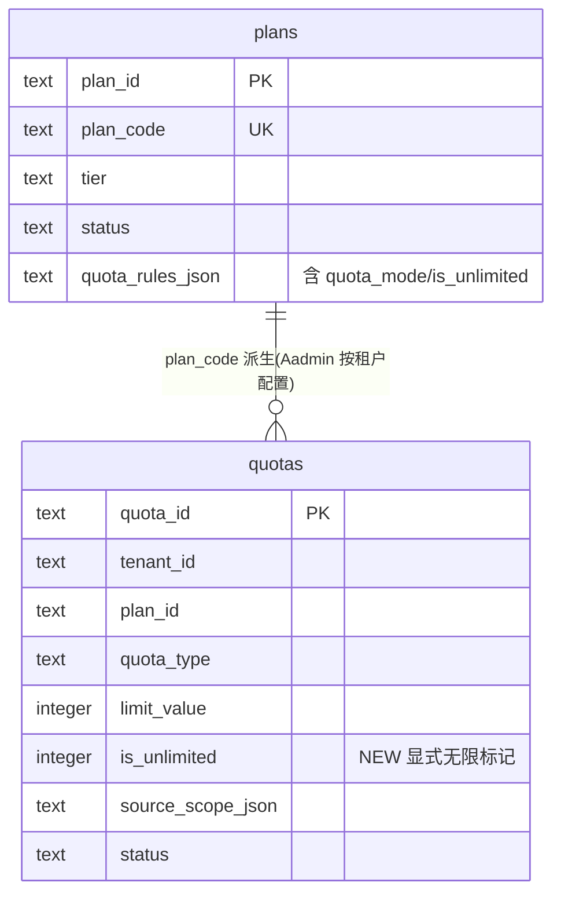
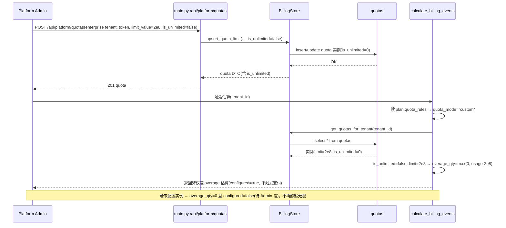

# Phase-9A 套餐设计调整设计文档

> **作者**：高见远（架构师，software-architect-2）
> **关联阶段**：Phase-9A 套餐限制/价格 Admin 可配置化 + 两处合规缺口修正
> **状态**：设计稿（仅设计 + 精确改动清单，业务代码由工程师执行）
> **红线约束**：不开发 payment / invoice / Marketplace / ROI / Value Pricing；不修改 Workspace / tenant_private 明文 / Credential Vault；套餐限制与价格不得写死在代码。

---

## 0. 文档导航

| 章节 | 内容 |
|------|------|
| 1 | 配置能力矩阵（四类 Admin 配置现状 + 缺口） |
| 2 | 修正方案（Enterprise custom quota、价格占位、超量逻辑） |
| 3 | 精确代码改动清单（database.py / billing_store.py / main.py / 前端） |
| 4 | Schema 变更决策（新增列/表取舍） |
| 5 | 待确认 / 待决策事项（需总控决策席拍板） |
| 附录 A | ER 图（关键变更） |
| 附录 B | 时序图（Enterprise custom quota 配置 + 估算） |

---

## 1. 配置能力矩阵

系统须支持四类 Admin 配置：**Plan / Quota Rule / Feature / Capability Package**。下表逐项核对现状、指向的具体 API 与 Store 方法，并标注缺口与建议。

| # | 配置类别 | 当前 Admin 可配性 | 具体路由 / 方法 | 缺口 | 建议 |
|---|----------|-------------------|----------------|------|------|
| 1 | **Plan 配置** | ✅ 已满足 | `GET/POST/PUT /api/platform/plans`、`POST /api/platform/plans/{id}/toggle`（均 `_require_platform_admin`）；`BillingStore.create_plan / update_plan / set_plan_status` | 无 | 维持；`quota_rules_json` 已是整体覆盖，可承载 `quota_mode` 等新增 key |
| 2 | **Quota Rule 配置** | ✅ 基本满足（需补 `is_unlimited`） | `GET/POST /api/platform/quotas`、`GET/PUT /api/platform/quotas/{tenant_id|quota_id}`；`upsert_quota_limit / update_quota` | `quotas` 表无显式"无限"标记，`limit=0` 被逻辑误读为无限 | **新增 `quotas.is_unlimited` 列**（见 §3.1、§4） |
| 3 | **Feature 配置** | ⚠️ 部分满足 | Feature 仅作为 `plans.features_json` 内的 freeform `list[str]`（如 `["task_execution","workflow_sop"]`），经 `PUT /api/platform/plans` 整体覆盖可改 | 无独立 feature 目录表 / 枚举校验；Admin 输入无受控白名单 | Phase-9A **保持 plan-embedded 数组**（已可配）；是否引入独立 `feature_catalog` 推迟决策（见 §5） |
| 4 | **Capability Package 配置** | ✅ 已满足 | `GET/POST /api/platform/capabilities`、`PUT /api/platform/capabilities/{key}`；`CapabilityCatalog.list/create/set_status` | 无 | 复用既有 `capability_catalog`（表 + 端点即"能力包目录"）；`quota_rules.capability_sources` 引用其 `capability_key` |

**关键结论**：四类配置中，Plan / Quota / Capability Package 的 Admin 可配面**已经具备**（Quota 仅缺 `is_unlimited` 标记）；Feature 已是 plan 内可配数组。本次 Phase-9A 的核心是**修正语义**（Enterprise 不再 0=无限、价格占位）与**补 `is_unlimited`**，而非重建配置面。

---

## 2. 修正方案

### 2.1 Enterprise「custom quota」建模（核心合规修正）

**问题根因**：`billing_store.calculate_billing_events` 用 `if limit and limit > 0 else 0` 判断超量，使 `limit==0` 被静默当作"无限/无超量"。Enterprise seed 将所有 limit 置 0，等于**固定为无限**，违反用户禁令。

**设计：引入两层显式语义，使 0 不再承载"无限"含义。**

1. **plan 模板层（`plans.quota_rules_json`）新增 `quota_mode`**（JSON key，无需 DDL）：
   - `plan_default`：使用模板内 `token_monthly_limit / seat_limit / workflow_monthly_limit` 作为默认上限（Free / Pro）。
   - `custom`：模板不提供默认上限（limit 置 `null`），**必须**由 Admin 按租户在 `quotas` 表设具体实例（Enterprise）。
   - `unlimited`：显式无限（本阶段不用于任何默认套餐）。
   - 同时保留 `is_unlimited: bool` 作为 plan 级兜底开关（默认 `false`）。

2. **租户配额实例层（`quotas` 表新增 `is_unlimited INTEGER DEFAULT 0`）**：
   - Admin 为企业租户经 `POST /api/platform/quotas` 显式创建配额实例：`limit_value` 为具体上限，`is_unlimited=false`；或显式 `is_unlimited=true`（**经 Admin 主动决策**，而非静默默认）。

**语义区分表**：

| 场景 | `quota_mode` / `is_unlimited` | `limit_value` | `calculate_billing_events` 行为 |
|------|-------------------------------|---------------|----------------------------------|
| Free / Pro 默认 | `plan_default`, `is_unlimited=false` | 模板具体值（>0） | `overage_qty = max(0, usage - limit)` |
| Enterprise 未配置 | `custom`（模板 limit=null） | 实例缺失 | `overage_qty = 0`（**标注"待 Admin 配置"，非无限**） |
| Enterprise 已配置（有限） | `custom` + 实例 | 实例具体值 | `overage_qty = max(0, usage - limit)` |
| Enterprise 显式无限（Admin 主动） | 实例 `is_unlimited=true` | 任意 | `overage_qty = 0`（明确、可审计） |

**seed 中 Enterprise `quota_rules` 写法**（不再用 0 当无限）：
```json
{
  "quota_mode": "custom",
  "is_unlimited": false,
  "token_monthly_limit": null,
  "seat_limit": null,
  "capability_sources": ["official","tenant_private","marketplace"],
  "workflow_monthly_limit": null,
  "overage": {"token_unit_price_per_1k": null, "seat_unit_price": null, "workflow_unit_price": null, "capability_unit_price": null},
  "currency": "USD"
}
```
> `null` 明确表示"由 Admin 按企业单独设置"，而非 0=无限。

**Admin 为企业租户设置具体配额**：
```
POST /api/platform/quotas
{ "tenant_id":"t_xxx", "plan_id":"plan_enterprise", "quota_type":"token",
  "limit_value":200000000, "period":"annual", "is_unlimited":false,
  "source_scope":["official","tenant_private","marketplace"] }
```
（可对 `employee_seat`、`workflow` 重复调用；如需真正无限，显式传 `is_unlimited:true`。）

**`calculate_billing_events` 如何区分"0=未配置"与"显式无限"**：
- 读取 plan 的 `quota_mode`；`custom` 模式**改从租户 `quotas` 实例派生** `limit_value` 与 `is_unlimited`（见 §3.2 代码）。
- 判定顺序：`is_unlimited → True` 则 0；否则 `limit>0` 才计算超量；`limit<=0` 一律 0（无论模板还是实例），且对 `custom` 未配置场景在 breakdown 标记 `"configured": false`。

### 2.2 价格占位（禁止写死真实价格）

- **Pro 超量价**（`token_unit_price_per_1k / seat_unit_price / workflow_unit_price`）由真实数字 `0.002 / 9 / 0.01` 改为 **`null` 占位**，并加 SQL 注释「由总控决策席后续配置，$XX，非写死真实价格」。
- `calculate_billing_events` 读取价用 `float(overage.get(..., 0) or 0)`，`null` → `0`，不产生超量金额，行为与占位一致。
- **确认无 plan 级订阅价被写死**：`plans` 表无 price 列，全系统无任何"订阅价/计划价"字段被硬编码；超量单价已位于 `quota_rules`（Admin 可配，经 `PUT /api/platform/plans` 可整体覆盖）。价格字段本身已是 Admin 可配。
- Free 超量价保持 `0`（免费档，真实 0，非占位）。

### 2.3 修正超量逻辑

将 `if limit and limit > 0 else 0` 替换为基于显式 `is_unlimited` / `quota_mode` 的语义（见 §3.2 完整片段）。核心不变式：
> **`limit==0` 不再等价于无限。** 无限必须经由 `is_unlimited=true` 显式声明；未配置（`custom` 无实例 / `limit<=0`）仅产生 0 估算并标记待配置。

---

## 3. 精确代码改动清单

> 行号为当前源码参考；工程师执行时以实际文件为准。所有 SQL 用 `?` 占位符（沿用既有风格）。

### 3.1 `backend/app/database.py`

#### 3.1.1 新增 `quotas.is_unlimited` 列（兼容既有库）

在 `initialize()` 的 `executescript` **之后**追加幂等迁移（既有库不会重跑建表语句，必须单独 ALTER）：

```python
# ── Phase-9A 迁移：quotas 新增 is_unlimited 标记（additive，兼容既有库）──
with connection:  # 复用上方 connection（initialize 内）
    cols = {r["name"] for r in connection.execute("pragma table_info(quotas)")}
    if "is_unlimited" not in cols:
        connection.execute(
            "alter table quotas add column is_unlimited integer not null default 0"
        )
```

> 说明：建表语句（`create table if not exists quotas`，约 763–780 行）可同步补列定义，便于全新库一致：
> ```sql
> is_unlimited      integer not null default 0,
> ```

#### 3.1.2 三档 seed 的 `quota_rules_json`（约 806–818 行）

将原有 `insert or ignore` 的 `values` 段替换为：

```sql
insert or ignore into plans
  (plan_id, plan_code, name, tier, status, version, billing_interval, features_json, quota_rules_json)
values
  -- Free：plan_default，固定默认上限；超量价 0（免费档，真实 0）
  ('plan_free', 'free', 'Free', 'free', 'active', '1.0.0', 'monthly', '["task_execution","tenant_private_capabilities"]',
   '{"quota_mode":"plan_default","is_unlimited":false,"token_monthly_limit":1000000,"seat_limit":3,"capability_sources":["official"],"workflow_monthly_limit":0,"overage":{"token_unit_price_per_1k":0,"seat_unit_price":0,"workflow_unit_price":0,"capability_unit_price":0},"currency":"USD"}'),
  -- Pro：plan_default；超量单价占位为 null（由总控决策席后续配置 $XX，非写死真实价格）
  ('plan_pro', 'pro', 'Pro', 'pro', 'active', '1.0.0', 'monthly', '["task_execution","workflow_sop","tenant_private_capabilities","admin_usage_observability"]',
   '{"quota_mode":"plan_default","is_unlimited":false,"token_monthly_limit":50000000,"seat_limit":15,"capability_sources":["official","tenant_private"],"workflow_monthly_limit":50000,"overage":{"token_unit_price_per_1k":null,"seat_unit_price":null,"workflow_unit_price":null,"capability_unit_price":null},"currency":"USD"}'),
  -- Enterprise：custom quota（自定义配额，不固定为无限）；limit 留 null 待 Admin 按企业单独设置
  ('plan_enterprise', 'enterprise', 'Enterprise', 'enterprise', 'active', '1.0.0', 'annual', '["task_execution","workflow_sop","tenant_private_capabilities","admin_usage_observability","team_management","priority_support"]',
   '{"quota_mode":"custom","is_unlimited":false,"token_monthly_limit":null,"seat_limit":null,"capability_sources":["official","tenant_private","marketplace"],"workflow_monthly_limit":null,"overage":{"token_unit_price_per_1k":null,"seat_unit_price":null,"workflow_unit_price":null,"capability_unit_price":null},"currency":"USD"}');
```

**⚠️ 既有库迁移提示**：`insert or ignore` 对已存在的 `plan_free/pro/enterprise` 会跳过，新 JSON **不会自动覆盖**。需工程师对既有部署执行一次性 UPDATE（或经 `PUT /api/platform/plans/{id}` 由 Admin 重配）：

```sql
-- 仅作用于默认 seed 三档（plan_id 固定），幂等可重复执行
update plans set quota_rules_json = '{"quota_mode":"plan_default","is_unlimited":false,"token_monthly_limit":1000000,"seat_limit":3,"capability_sources":["official"],"workflow_monthly_limit":0,"overage":{"token_unit_price_per_1k":0,"seat_unit_price":0,"workflow_unit_price":0,"capability_unit_price":0},"currency":"USD"}' where plan_id = 'plan_free';
update plans set quota_rules_json = '{"quota_mode":"plan_default","is_unlimited":false,"token_monthly_limit":50000000,"seat_limit":15,"capability_sources":["official","tenant_private"],"workflow_monthly_limit":50000,"overage":{"token_unit_price_per_1k":null,"seat_unit_price":null,"workflow_unit_price":null,"capability_unit_price":null},"currency":"USD"}' where plan_id = 'plan_pro';
update plans set quota_rules_json = '{"quota_mode":"custom","is_unlimited":false,"token_monthly_limit":null,"seat_limit":null,"capability_sources":["official","tenant_private","marketplace"],"workflow_monthly_limit":null,"overage":{"token_unit_price_per_1k":null,"seat_unit_price":null,"workflow_unit_price":null,"capability_unit_price":null},"currency":"USD"}' where plan_id = 'plan_enterprise';
```

### 3.2 `backend/app/billing_store.py`

#### 3.2.1 `_quota_dto`（约 210–226 行）— 携带 `is_unlimited`

```python
def _quota_dto(self, row: "Any") -> dict[str, Any]:
    return {
        "quota_id": row["quota_id"],
        "tenant_id": row["tenant_id"],
        "plan_id": row["plan_id"],
        "plan_code": row["plan_code"],
        "quota_type": row["quota_type"],
        "limit_value": _coerce_int(row["limit_value"], 0),
        "is_unlimited": bool(row["is_unlimited"]) if "is_unlimited" in (row.keys() if hasattr(row, "keys") else []) else False,
        "current_usage": _coerce_int(row["current_usage"], 0),
        "period": row["period"],
        "period_start": row["period_start"],
        "period_end": row["period_end"],
        "source_scope": _parse_json(row["source_scope_json"], []),
        "status": row["status"],
        "created_at": row["created_at"],
        "updated_at": row["updated_at"],
    }
```

#### 3.2.2 `upsert_quota_limit`（约 255–324 行）— 新增 `is_unlimited` 入参与写入

签名增加 `is_unlimited: bool = False`；insert 分支与 update 分支均写入该列：

```python
def upsert_quota_limit(
    self,
    tenant_id: str,
    plan_id: str,
    quota_type: str,
    limit_value: int = 0,
    period: str = "monthly",
    period_start: str = "",
    period_end: str = "",
    source_scope: "list[str] | None" = None,
    is_unlimited: bool = False,          # ── NEW ──
) -> dict[str, Any]:
    if quota_type not in _VALID_QUOTA_TYPES:
        raise ValueError(f"非法的 quota_type: {quota_type!r}")
    source_scope = source_scope or []
    u_flag = 1 if is_unlimited else 0
    with self.db.connect() as connection:
        plan_row = connection.execute(
            "select plan_code from plans where plan_id = ?", (plan_id,)
        ).fetchone()
        plan_code = plan_row["plan_code"] if plan_row is not None else "free"
        existing = connection.execute(
            "select * from quotas where tenant_id = ? and quota_type = ? and plan_id = ?",
            (tenant_id, quota_type, plan_id),
        ).fetchone()
        source_scope_json = json.dumps(source_scope, ensure_ascii=False)
        if existing is None:
            quota_id = f"quota_{uuid.uuid4().hex}"
            connection.execute(
                "insert into quotas "
                "(quota_id, tenant_id, plan_id, plan_code, quota_type, limit_value, "
                "is_unlimited, period, period_start, period_end, source_scope_json) "
                "values (?, ?, ?, ?, ?, ?, ?, ?, ?, ?, ?)",
                (
                    quota_id, tenant_id, plan_id, plan_code, quota_type,
                    _coerce_int(limit_value, 0), u_flag,
                    period, period_start, period_end, source_scope_json,
                ),
            )
            row = connection.execute("select * from quotas where quota_id = ?", (quota_id,)).fetchone()
        else:
            connection.execute(
                "update quotas set limit_value = ?, is_unlimited = ?, period = ?, "
                "period_start = ?, period_end = ?, source_scope_json = ?, "
                "updated_at = current_timestamp where quota_id = ?",
                (
                    _coerce_int(limit_value, 0), u_flag, period,
                    period_start, period_end, source_scope_json, existing["quota_id"],
                ),
            )
            row = connection.execute("select * from quotas where quota_id = ?", (existing["quota_id"],)).fetchone()
    return self._quota_dto(row)
```

#### 3.2.3 `update_quota`（约 326–362 行）— 新增 `is_unlimited` 可选更新

```python
def update_quota(
    self,
    quota_id: str,
    limit_value: int,
    period: "str | None" = None,
    period_start: "str | None" = None,
    period_end: "str | None" = None,
    source_scope: "list[str] | None" = None,
    is_unlimited: "bool | None" = None,   # ── NEW ──
) -> dict[str, Any]:
    sets: list[str] = ["limit_value = ?"]
    params: list[Any] = [_coerce_int(limit_value, 0)]
    if period is not None:
        sets.append("period = ?"); params.append(period)
    if period_start is not None:
        sets.append("period_start = ?"); params.append(period_start)
    if period_end is not None:
        sets.append("period_end = ?"); params.append(period_end)
    if source_scope is not None:
        sets.append("source_scope_json = ?"); params.append(json.dumps(source_scope, ensure_ascii=False))
    if is_unlimited is not None:
        sets.append("is_unlimited = ?"); params.append(1 if is_unlimited else 0)   # ── NEW ──
    sets.append("updated_at = current_timestamp"); params.append(quota_id)
    with self.db.connect() as connection:
        connection.execute(f"update quotas set {', '.join(sets)} where quota_id = ?", params)
        row = connection.execute("select * from quotas where quota_id = ?", (quota_id,)).fetchone()
    if row is None:
        raise KeyError(quota_id)
    return self._quota_dto(row)
```

#### 3.2.4 `calculate_billing_events` 超量逻辑（约 683–742 行）— 核心修正

**变更点**：`custom` 模式改从租户 `quotas` 实例派生 `limit/is_unlimited`；判定基于显式 `is_unlimited`，`limit<=0` 一律 0 并标记 `configured`。

```python
        usage_by_dim = {
            "token": self.derive_current_usage(tenant_id, "token", period_start, period_end),
            "employee_seat": self.derive_current_usage(tenant_id, "employee_seat", period_start, period_end),
            "workflow": self.derive_current_usage(tenant_id, "workflow", period_start, period_end),
            "capability": self.derive_current_usage(tenant_id, "capability", period_start, period_end),
        }

        dimensions = [
            ("token", _coerce_int(rules.get("token_monthly_limit"), 0), float(overage.get("token_unit_price_per_1k", 0) or 0), "per_1k"),
            ("employee_seat", _coerce_int(rules.get("seat_limit"), 0), float(overage.get("seat_unit_price", 0) or 0), "each"),
            ("workflow", _coerce_int(rules.get("workflow_monthly_limit"), 0), float(overage.get("workflow_unit_price", 0) or 0), "each"),
        ]

        # ── Phase-9A 修正：基于显式 quota_mode / is_unlimited 语义（不再用 limit==0 代表无限）──
        quota_mode = rules.get("quota_mode", "plan_default")  # plan_default | custom | unlimited
        is_plan_unlimited = bool(rules.get("is_unlimited", False))
        quota_instances: dict[str, Any] = {}
        if quota_mode == "custom":
            for q in self.get_quotas_for_tenant(tenant_id):  # 派生自 quotas 表，Admin 按企业配置
                quota_instances[q["quota_type"]] = q

        created_ids: list[str] = []
        plan_dimensions: dict[str, Any] = {}
        total_amount = 0.0
        with self.db.connect() as connection:
            for dim_name, plan_limit, price, unit in dimensions:
                # 解析该维度 limit 与 is_unlimited（custom 模式取租户实例）
                if quota_mode == "custom":
                    inst = quota_instances.get(dim_name)
                    if inst is None:
                        limit, is_unlimited, configured = 0, False, False  # 未配置：不产生超量，待 Admin 设置
                    else:
                        limit = inst["limit_value"]
                        is_unlimited = bool(inst.get("is_unlimited", False))
                        configured = True
                else:
                    limit, is_unlimited, configured = plan_limit, is_plan_unlimited, True

                usage = usage_by_dim[dim_name]
                # ── 核心修正：显式 is_unlimited 才为 0；limit<=0 一律 0 但非"无限"──
                if is_unlimited:
                    overage_qty = 0
                elif limit and limit > 0:
                    overage_qty = max(0, usage - limit)
                else:
                    overage_qty = 0
                amount = 0.0
                if overage_qty > 0:
                    amount = (overage_qty / 1000.0) * price if unit == "per_1k" else overage_qty * price
                amount = round(amount, 6)
                plan_dimensions[dim_name] = {
                    "limit": limit,
                    "usage": usage,
                    "overage": overage_qty,
                    "unit_price": price,
                    "amount": amount,
                    "currency": currency,
                    "configured": configured,          # ── NEW：标记是否已由 Admin 配置
                    "is_unlimited": is_unlimited,      # ── NEW
                }
                if amount > 0 and overage_qty > 0:
                    billing_event_id = f"be_{uuid.uuid4().hex}"
                    connection.execute(
                        "insert into billing_events "
                        "(billing_event_id, tenant_id, plan_id, plan_code, subject_type, subject_id, "
                        "amount, currency, status, period_start, period_end, breakdown_json) "
                        "values (?, ?, ?, ?, ?, ?, ?, ?, ?, ?, ?, ?)",
                        (
                            billing_event_id, tenant_id, plan["plan_id"], plan_code,
                            "quota_overage", dim_name, amount, currency, status,
                            period_start, period_end,
                            json.dumps({
                                "quota_type": dim_name, "limit": limit, "usage": usage,
                                "overage": overage_qty, "unit_price": price, "currency": currency,
                                "estimated": True, "configured": configured, "is_unlimited": is_unlimited,
                            }, ensure_ascii=False),
                        ),
                    )
                    created_ids.append(billing_event_id)
                    total_amount += amount
            # Plan 级汇总事件（subject_type='plan'）逻辑不变，附 plan_dimensions（含 configured/is_unlimited）
            ...
```

> `derive_current_usage` **无需修改**（仅做 Quota 派生读时聚合，与本次语义无关）。

### 3.3 `backend/app/main.py`

#### 3.3.1 Pydantic 模型（约 292–310 行）

```python
class QuotaCreateIn(BaseModel):
    tenant_id: str
    plan_id: str
    quota_type: str
    limit_value: int = 0
    period: str = "monthly"
    period_start: str = ""
    period_end: str = ""
    source_scope: list[str] = []
    is_unlimited: bool = False          # ── NEW ──

class QuotaUpdateIn(BaseModel):
    limit_value: int
    period: str | None = None
    period_start: str | None = None
    period_end: str | None = None
    source_scope: list[str] | None = None
    is_unlimited: bool | None = None    # ── NEW ──
```

#### 3.3.2 路由透传

`create_platform_quota`（约 1506–1522 行）调用补充 `is_unlimited=payload.is_unlimited`：
```python
quota = billing.upsert_quota_limit(
    tenant_id=payload.tenant_id, plan_id=payload.plan_id, quota_type=payload.quota_type,
    limit_value=payload.limit_value, period=payload.period,
    period_start=payload.period_start, period_end=payload.period_end,
    source_scope=payload.source_scope, is_unlimited=payload.is_unlimited,   # ── NEW ──
)
```

`update_platform_quota`（约 1532–1548 行）调用补充 `is_unlimited=payload.is_unlimited`：
```python
quota = billing.update_quota(
    quota_id, payload.limit_value, period=payload.period,
    period_start=payload.period_start, period_end=payload.period_end,
    source_scope=payload.source_scope, is_unlimited=payload.is_unlimited,   # ── NEW ──
)
```

#### 3.3.3 新增配置端点（可选，非强制）

- **Feature 目录端点**：若 §5 决策引入独立 `feature_catalog`，则新增 `GET/POST/PUT /api/platform/features`（`_require_platform_admin` 守卫，复用 CapabilityCatalog 同类模式）。**Phase-9A 默认不新增**，Feature 经 `PUT /api/platform/plans` 改 `features` 数组即可。
- Capability Package 端点已存在（`/api/platform/capabilities`），**无需新增**。

### 3.4 前端（可选，本次优先后端）

| 文件 | 是否需改 | 说明 |
|------|----------|------|
| `frontend/app/platform/PlanManagementPanel.js` | 可选 | 若展示 `quota_rules`，建议新增 `quota_mode` 下拉（plan_default/custom/unlimited）与"价格占位"提示；API 契约向后兼容（新字段可选），不改也能跑。 |
| `frontend/app/platform/QuotaManagementPanel.js` | 可选 | 建议新增 `is_unlimited` 开关与"custom 待配置"状态提示；新增字段为可选，不改也能跑。 |
| 其余 `*Panel.js` | 无需 | 不依赖本次变更。 |

> 结论：前端**无强制联动**（后端新增字段均为可选、向后兼容），标注为可选，不阻塞后端交付。

---

## 4. Schema 变更决策

| 变更项 | 决策 | 理由 |
|--------|------|------|
| `quotas.is_unlimited` 列 | **✅ 新增（additive ALTER）** | 必须显式区分"未配置(custom,需 Admin 设)"与"显式无限"，支撑 Enterprise 不固定为无限且可由 Admin 主动授予无限。additive 列，零破坏既有读写。 |
| `quota_mode`（位于 `quota_rules_json`） | **✅ 新增（JSON key，无 DDL）** | 驱动 `calculate_billing_events` 在 `plan_default`（用模板 limit）与 `custom`（派生租户 quota 实例）间分流；无需迁移表结构。 |
| `feature_catalog` 表 | **❌ Phase-9A 不新增** | Feature 已是 plan-embedded freeform 数组且经 `PUT /api/platform/plans` 可配；独立目录表收益有限、迁移成本高，建议推迟（见 §5）。 |
| `capability_package_catalog` 表 | **❌ 不新增** | 复用既有 `capability_catalog`（表 + `/api/platform/capabilities` 端点）即"能力包目录"，已满足 Capability Package 配置需求。 |
| plan 级订阅价 / 计划价 列 | **❌ 本次不新增** | 当前无任何订阅价被写死；若未来需支持订阅价，再单独决策新增列（见 §5）。 |

**复用结论**：通过"JSON 内 `quota_mode` + `quotas.is_unlimited` 列"两处最小变更，即可在不重建配置面的前提下完成合规修正，符合"简单、可配、不写死"原则。

---

## 5. 待确认 / 待决策事项（需总控决策席拍板）

| # | 事项 | 当前设计中的占位处理 | 决策需求 |
|---|------|----------------------|----------|
| D1 | **Pro 锚定超量价 $XX 具体值** | seed 用 `null` 占位 + 注释"由总控决策席配置" | 总控决策席给出 `token_unit_price_per_1k / seat_unit_price / workflow_unit_price` 最终值后回填（仍经 Admin 配置，不在代码写死）。 |
| D2 | **Enterprise 默认占位上限值** | seed `custom` 模式 limit 为 `null`，待 Admin 按企业设 | 是否需给一个"建议初始上限"（如 token 2 亿/年）作为 Admin 配置参考？或由决策席定为"纯 custom、无默认"。 |
| D3 | **是否引入独立 `feature_catalog` 表** | Phase-9A 维持 plan-embedded 数组 | 若需受控 feature 白名单/枚举校验，则立项新增；建议推迟。 |
| D4 | **是否新增 plan 级订阅价/计划价列** | 当前无订阅价被写死，超量价已在 `quota_rules` 内可配 | 若商业模式需"订阅费"，需单独决策新增列与计费逻辑（注意红线：不开发 payment/invoice）。 |

> 除上述 D1–D4 外，本设计**不引入任何写死的限制数值或真实价格**，所有默认值均为 seed 占位且可被 Admin 覆盖。

---

## 附录 A：ER 图（关键变更）



## 附录 B：时序图（Enterprise custom quota 配置 + 估算）


