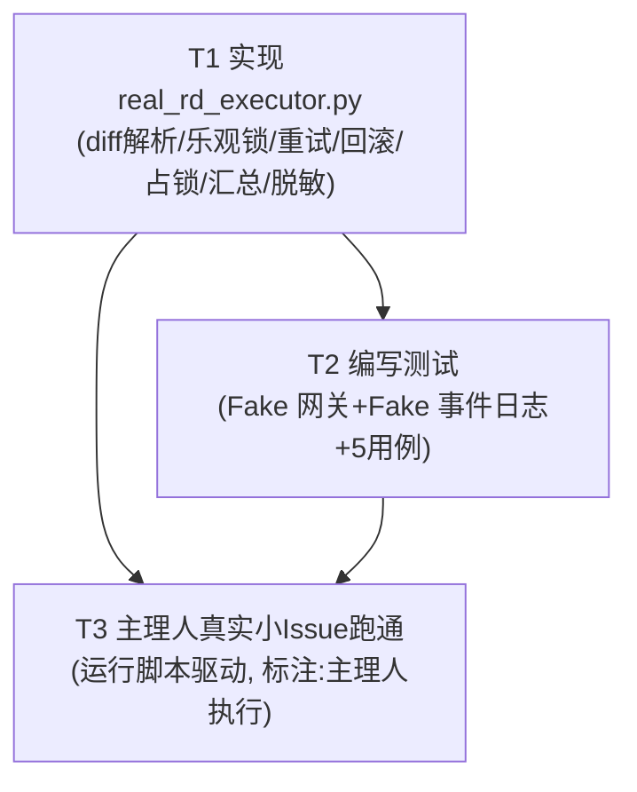

# 真实研发工具闭环（Issue 驱动）增量架构设计 + 任务分解

> 作者：架构师高见远（software-architect）
> 范围：D1 `execute()` 范围 A/B 闭环之后的下一阶段 —— 用**一个真实小 Issue** 证明 AI 能「读代码 → 改代码 → 跑测试 → 交付 Diff」。
> 约束：**不重写任何受保护文件**，仅新增 `backend/app/real_rd_executor.py`，复用既有 `LocalRDToolset` / `ModelGatewayAdapter` / `EvolutionEventLog`。
> 语言：简体中文。本文档只含设计与任务清单，**不含实现代码**。

---

## 1. 实现方案 + 框架选型

### 1.1 核心难点

| 难点 | 说明 | 处理策略 |
|------|------|----------|
| Issue 驱动 vs 硬编码场景 | D1 `D1SingleModelToolchain.execute()` 固定了目标/测试/query，本次要参数化 | 新增独立模块 `RealRDExecutor.run(issue_spec)`，不改动 D1 文件 |
| 真实模型调用 | 真实网关是本地 New API（`http://127.0.0.1:3000`，`deepseek-v4-pro`），D1 里硬编码的 `R3_*` 公网常量与之不匹配 | **不复用 `R3_*` 常量**，直接用 `ModelGatewayAdapter()` 无参构造（读 `CURIS_MODEL_GATEWAY_*` 环境） |
| 事务化写 + 乐观锁 | 多轮重试必须保证「改坏能回滚、并发不冲突」 | 复用 `LocalRDToolset._apply_diff_transactional` 返回的 `rollback`；preimage 取自 `read_file` 的 `sha256` 做乐观锁 |
| 受控性（铁律） | 路径白名单 + 脱敏 + 沙箱 + 单主占锁 | 全部复用 `LocalRDToolset` 既有 `_reject_forbidden_path` / `_reject_sensitive` / `run_test` 沙箱 / D1 `_claim_once` 的 `begin immediate` 锁 |
| 交付 Diff 文本（非仅 hash） | D1 当年只回 hash，本次要回真实 diff 文本作为「交付物」 | `git_read(operation="diff")` 的 `output["output"]` 即真实 diff；脱敏已由 `_safe_process_output` 担保 |
| 脱敏红线 | 不回传路径/堆栈/Key/参数；diff 文本允许（受控产物） | prompt 与回传均经既有 `_reject_sensitive`；返回 schema 仅含相对路径与 hash |

### 1.2 框架/库选型

- **零新依赖**：纯标准库（`json` / `hashlib` / `re` / `threading` 等）+ 既有项目模块。
- **复用清单**：
  - `backend/app/local_rd_toolset.py` —— `LocalRDToolset`、`LocalRDToolScope`（受保护，禁止重写）。
  - `backend/app/model_gateway.py` —— `ModelGatewayAdapter`（受保护，无参构造即读环境网关）。
  - `backend/app/evolution_event_log.py` —— `EvolutionEventLog.record(correlation_id, event_type, tenant_id, idempotency_key, payload)`（受保护）。
  - D1 的 `_claim_once` 单主占锁模式（`event_log.database.connect()` + `begin immediate`）—— 借鉴实现，不改动 D1 文件。
- **架构模式**：单入口工具编排器（Orchestrator），组合三个 `LocalRDToolset` 实例（read / write / git）与模型网关，每轮闭环。无 HTTP 端点、无 UI（保持最小变更）。

### 1.3 三个 LocalRDToolset 实例的作用域划分

为与 D1 对齐且保持受控，构造三个 scope：

| 实例 | `allowed_paths` | `command_registry` | 职责 |
|------|------------------|---------------------|------|
| `read_tools` | `issue_spec["allow_paths"]`（含 target_files + 测试文件） | 空 | 读目标文件与测试文件内容（取 sha256） |
| `write_tools` | `issue_spec["allow_paths"]`（含 target + 测试路径，与 read 同宽） | `{test_command_id: pytest_tuple}` | 事务化 apply_diff + run_test |
| `git_tools` | `issue_spec["target_files"]`（仅目标，更窄） | 空 | `git_read(operation="diff")` 取真实 diff |

> `write_tools` 的 `allowed_paths` 须包含测试文件路径，因为 `LocalRDToolset._validate_command_registry` 要求 `test_path in self.allowed_paths`。写动作本身仍由 `preimage_hashes` 限定在 target_files，不会误改测试文件。

---

## 2. 文件列表（相对路径）

仅新增 2 个文件，全部位于既有 `backend/` 内：

```
backend/app/real_rd_executor.py        # 新增：RealRDExecutor + RealRDExecutorError + 构建辅助函数
backend/tests/test_real_rd_executor.py # 新增：FakeModelGatewayAdapter + FakeEvolutionEventLog + 5 个用例
```

不触碰任何受保护文件（`local_rd_toolset.py` / `model_gateway.py` / `evolution_event_log.py` / `d1_execute.py` / `d1_single_model_toolchain.py` / `d1_config.py`）。

---

## 3. 数据结构与接口

### 3.1 `issue_spec` 输入 Schema（JSON Schema）

```json
{
  "$schema": "http://json-schema.org/draft-07/schema#",
  "title": "IssueSpec",
  "type": "object",
  "required": ["issue_id", "target_files", "test_command_id", "test_command_argv", "instructions", "allow_paths"],
  "properties": {
    "issue_id":        { "type": "string", "description": "Issue 唯一标识，同时作为 audit 的 correlation_id" },
    "target_files":    { "type": "array", "items": { "type": "string" }, "description": "允许读取且可能被修改的文件（相对 backend/ 的路径，如 tools/verify_x.py）" },
    "test_command_id": { "type": "string", "description": "注册到 write_tools.command_registry 的命令 id" },
    "test_command_argv": { "type": "array", "items": { "type": "string" }, "description": "形如 [\"pytest\",\"tests/test_x.py\"]；执行器内部映射为受验元组 (\"backend/.venv/bin/python\",\"-m\",\"pytest\",\"-q\",\"backend/tests/test_x.py\")" },
    "instructions":    { "type": "string", "description": "Issue 描述 / 给模型的任务说明" },
    "max_rounds":      { "type": "integer", "default": 3, "minimum": 1 },
    "allow_paths":     { "type": "array", "items": { "type": "string" }, "description": "read/write 白名单（backend/app 内、非受保护/敏感文件）；须覆盖 target_files 与测试文件路径" }
  }
}
```

### 3.2 `run()` 返回 Schema（脱敏，含真实 diff 文本）

```json
{
  "title": "RunResult",
  "type": "object",
  "properties": {
    "issue_id":          { "type": "string" },
    "status":            { "type": "string", "enum": ["succeeded", "failed"] },
    "rounds":            { "type": "integer", "description": "实际执行的模型轮数（1..max_rounds）" },
    "diff_text":         { "type": "string", "description": "真实 git diff 文本（受控产物）；失败/无改动时为 \"\"" },
    "test_exit_code":    { "type": ["integer", "null"], "description": "最后一轮测试退出码；从未跑测试为 null" },
    "files":             { "type": "array", "description": "每目标文件的 preimage/postimage hash 列表",
                           "items": { "type": "object",
                             "properties": {
                               "path":            { "type": "string" },
                               "preimage_hash":   { "type": "string" },
                               "postimage_hash":  { "type": "string" }
                             } } },
    "total_tokens":      { "type": "integer" },
    "estimated_cost":    { "type": "number" },
    "audit_event_count": { "type": "integer", "description": "受控工具调用次数（read/apply/test/git 各 +1）；真实落库审计行 ≈ 2× 此值" },
    "model_gateway_id":  { "type": ["string", "null"] },
    "model_name":        { "type": ["string", "null"] }
  }
}
```

### 3.3 关键类图（Mermaid）

见 `class-diagram.mermaid`。要点：
- `RealRDExecutor` 组合 3 个 `LocalRDToolset`（read/write/git），调用 `ModelGatewayAdapter`，向 `EvolutionEventLog` 写审计与汇总事件，构造 `LocalRDToolScope`。
- `RealRDExecutorError(RuntimeError)` 为脱敏异常：仅携带固定 `failure_code`，绝不带路径/堆栈/Key/参数。
- `LocalRDToolset` 每次调用经 `EvolutionEventLog.record` 自动审计（既有行为，不改动）。

---

## 4. 程序调用流程（时序图，Mermaid）

见 `sequence-diagram.mermaid`。文字概述（每轮）：

1. **占锁**：`run()` 调 `_claim_once(issue_id)` —— 复用 D1 模式，`event_log.database.connect()` + `begin immediate`，若已存在 `real_rd.run.started` 事件则抛脱敏 `issue_already_running`；否则写入 started 标记，防同 Issue 重入。
2. **读**：`read_tools.read_file(json.dumps({"path": f}))` 取内容 + `sha256`（preimage）。
3. **构 prompt**：`_build_prompt(instructions, 文件内容, last_failure)` —— 要求模型**只输出目标文件的原始 unified diff，无 Markdown/解释**；第二轮起追加上一轮测试失败输出。
4. **调模型**：`ModelGatewayAdapter.execute(prompt)` 真实调用（环境网关），返回 `{output, total_tokens, estimated_cost, ...}`。
5. **解析 diff**：`_parse_diff(output)` —— 剥离 ```diff 围栏；校验以 `--- a/<target>` 开头、路径在 target_files 内；失败则视为本轮失败、喂回模型重试。
6. **事务写**：`write_tools._apply_diff_transactional(json.dumps({"diff":..., "preimage_hashes": {path: sha256}}))` → `(result, rollback)`，乐观锁由 preimage 担保。
7. **跑测试**：`write_tools.run_test(json.dumps({"command_id": test_command_id}))`。
   - 通过（exit_code=0）→ 跳出循环，`status=succeeded`。
   - 失败（`LocalRDToolError("command_failed")`）→ 记录 `last_failure`，调 `rollback()` 回滚本轮 diff，进入下一轮。
8. **取真实 diff**：成功分支 `git_tools.git_read(json.dumps({"operation":"diff"}))` → `output["output"]` 即交付用真实 diff 文本（已脱敏）。
9. **汇总事件**：无论成败，`_record_run_summary(issue_id, status, meta)` 落一条 `real_rd.run.<status>` 事件（含 total_tokens / estimated_cost / rounds）。
10. **返回**：脱敏 `RunResult` dict。失败且轮次耗尽时确保 `rollback()` 已执行、无残留改动。

---

## 5. 有序任务清单（按实现顺序）

| 任务 | 名称 | 源文件 | 依赖 | 优先级 |
|------|------|--------|------|--------|
| **T1** | 实现 `real_rd_executor.py`（含 diff 解析、乐观锁、多轮重试、回滚、单主占锁、汇总事件、脱敏异常） | `backend/app/real_rd_executor.py` | 无（仅依赖既有模块） | P0 |
| **T2** | 编写测试（FakeModelGatewayAdapter + FakeEvolutionEventLog + 临时/内存 DB，覆盖 5 类用例） | `backend/tests/test_real_rd_executor.py` | T1 | P0 |
| **T3** | 主理人用**真实小 Issue** 跑通（运行脚本驱动，不走 D1 闸门） | 无代码改动（主理人执行） | T1, T2 | P1（标注：主理人执行） |

> 说明：任务粒度为团队负责人显式指定的「单模块 + 单测试 + 主理人验证」三段式，刻意不套用通用「最多 5 任务/每组≥3 文件」模板 —— 本特性是在既有工程上的增量单模块，无新建项目基础设施。

**T2 必覆盖用例**：
1. 成功单轮：Fake 模型首轮即返回合法 diff → 测试通过 → `status=succeeded`、`diff_text` 非空、`rounds=1`。
2. 多轮重试：Fake 模型首轮返回「测试失败」的 diff，次轮返回正确 diff → `status=succeeded`、`rounds=2`、且首轮 rollback 生效（target 无残留）。
3. 测试失败耗尽轮次：Fake 始终返回错误 diff → `rounds=max_rounds`、`status=failed`、`diff_text=""`、最终 rollback 无残留。
4. 路径越界被拒：issue_spec 的 `allow_paths` 不含某 target / 含 `.env` 或父目录逃逸 → 执行器经 `LocalRDToolset` 抛脱敏 `RealRDExecutorError`（无原始路径泄漏）。
5. 脱敏 grep：断言返回 dict 与所有 `event_log.record` 的 payload `grep` 不含 `api_key`/`Bearer`/`.env`/`secret|token|password`/绝对路径（`/Users/...`）。

---

## 6. 依赖包列表

**空。** 纯 Python 标准库 + 既有 `backend/app/` 模块，无 `pip install`、无新第三方依赖、无新增前端/构建链。

---

## 7. 共享知识（跨文件约定）

- **preimage_hashes 来源**：必须取自 `read_file` 返回的 `output["sha256"]`（非重新计算），再与文件路径一起喂给 `apply_diff` 的 `preimage_hashes`，作为乐观锁。
- **apply_diff 输入格式**：`json.dumps({"diff": <unified diff 字符串>, "preimage_hashes": {相对路径: sha256}})`，且 `diff` 必须以 `--- a/<target>\n+++ b/<target>\n` 开头（与 `LocalRDToolset._build_changes` 校验一致）。
- **correlation_id = issue_id**：所有 `event_log.record` 调用（含每轮每工具自动审计、单主占锁 started 标记、`real_rd.run.<status>` 汇总事件）统一以 `issue_id` 为 `correlation_id`，便于按 Issue 聚合复盘。
- **command_registry 受验元组**：内部固定构造 `("backend/.venv/bin/python", "-m", "pytest", "-q", <backend/tests/...>)`；`test_command_argv` 仅作提示，真正注册值由执行器按上述模板生成，且测试文件路径必须出现在 `allow_paths`。
- **Tenancy 字段**：`LocalRDToolScope` 的 `tenant_id/project_id/task_id/run_id/allowed_paths` 须完整（frozen dataclass 校验），`run_id` 可复用 `issue_id` 或拼接前缀；本模块不读取 `TenantContext` 身份（区别于 D1 的 owner/ceo 前置校验），仅受 `LocalRDToolset` 既有作用域约束。
- **脱敏口径**：`diff_text` 允许返回（受控产物），但其内容已被 `git_read` → `_safe_process_output` → `_reject_sensitive` 过滤；prompt 与回传不得含绝对路径、`.env`、密钥。
- **单主占锁降级**：若注入的 `event_log` 无 `.database`（如内存 Fake），`_claim_once` 自动跳过 DB 锁（仅测试态）；**真实运行必须传入绑定了 SQLite 的 `EvolutionEventLog`**。
- **审计计数口径**：`audit_event_count` = 受控工具方法（read/apply/test/git）调用次数本地计数；因 `LocalRDToolset._execute` 每次调用另落 1 条 `started` + 1 条 terminal 审计，真实落库事件行 ≈ 2× 该值，观测侧需对齐。

---

## 8. 待明确事项

1. **真实小 Issue 的选取**（T3）：具体目标文件、`instructions` 文案、测试文件由主理人选定；本架构不预设。建议选一个「测试已存在且当前失败 / 或一行逻辑缺陷」的小文件，确保 `max_rounds=3` 内可解。
2. **环境变量注入**：`ModelGatewayAdapter()` 无参构造依赖 `CURIS_MODEL_GATEWAY_BASE_URL` / `CURIS_MODEL_GATEWAY_API_KEY` / `CURIS_MODEL_GATEWAY_MODEL`（来自 `deploy/new-api/.env`）。T3 运行脚本必须在 `source` 该 `.env` 后启动；若缺失，`run()` 首轮 `model.execute` 抛 `RuntimeError`（非脱敏类），由运行脚本捕获并提示「网关未注入」。需确认 `deepseek-v4-pro` 在本地 New API 已就绪且可用额度充足。
3. **多目标文件语义**：当前设计 `diff_text` 为 `git_tools.git_read(diff)` 对 `target_files` 全量的真实 diff 拼接；`files` 数组逐文件返回 preimage/postimage hash。若未来需「一次只修一个文件」，可在 issue_spec 增加 `per_file_rounds` 维度（本版不做）。
4. **`run_id` 取值**：默认建议 `run_id = f"real-rd:{issue_id}"`，与 D1 的 `D1_RUN_ID` 命名空间隔离，避免 `correlation_id` 冲突；最终由 T1 实现时以常量模板固化。
5. **与 D1 闸门的关系**：`RealRDExecutor.run()` 完全绕过 `D1ToolchainConfig.frozen/execute_enabled` 闸门（按团队负责人指示「不自建 HTTP 端点、不走 D1 闸门」），由主理人脚本直接驱动；若日后要纳入统一权限，可再追加 `TenantContext` 前置校验（本版不做）。

---

## 附录：任务依赖图（Mermaid）


