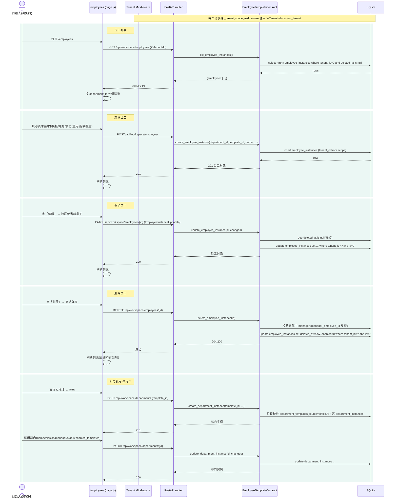

# 架构设计 · Workspace 端「员工目录」最小版本（v1 自用）

- **文档状态**：设计稿 v1（架构师 高见远 产出，供工程师按序实现）
- **关联 PRD**：`docs/prd/workspace-employee-directory.md`
- **关联决议**：07-12 自用决议 —— Workspace v1 真实员工实例，不触发 L2 Gate，团队自主推进
- **红线约束**：仅 `selfuse` 单租户；不写 Admin 资产工厂写链路；不碰 Credential Vault 明文；不写死商业规则；部门模板只读 GET，绝不反向写 Admin

---

## 0. 探索结论与对 PM 描述的修正

以下结论均经 Read/Grep 代码核实（非假设），并对 PM 描述中的偏差做了标注。

### 0.1 后端真实情况（已核实）

| 项 | 文件:行 | 结论 |
|---|---|---|
| 员工列表/新增 | `backend/app/main.py:1475`（`GET /employees`）、`:1479`（`POST /employees`） | 已存在，调用 `EmployeeTemplateContract.list_employee_instances / create_employee_instance` |
| 员工能力/技能/工具绑定 | `main.py:1494`–`1541` | 已存在（`PUT /employees/{id}/capabilities|skills|tools`） |
| 部门 列表/新增/详情/编辑 | `main.py:1437/1441/1457/1464` | 已存在，含 `PATCH /departments/{id}` |
| 部门模板只读 | `main.py:1371`（`GET /department-templates`）→ `list_department_templates` | 已存在，无鉴权，纯读 |
| 员工模板只读 | `main.py:1268`（`GET /employee-templates`） | 已存在 |
| **员工编辑** | — | **缺失**：缺 `PATCH /employees/{id}` 与 `EmployeeTemplateContract.update_employee_instance` |
| **员工删除** | — | **缺失**：缺 `DELETE /employees/{id}` 与 `delete_employee_instance` |
| **部门删除** | — | **缺失**（P1）：缺 `DELETE /departments/{id}` 与 `delete_department_instance` |

服务层 `EmployeeTemplateContract`（`backend/app/employee_templates.py`）现有方法：`list_employee_templates / list_department_templates / create_department_instance / list_department_instances / get_department_instance / update_department_instance / ensure_engineering_department / create_employee_instance / list_employee_instances / get_employee_instance / default_employee_for_task / set_employee_capability_bindings / list_employee_capability_bindings / list_employee_tool_bindings / set_employee_tool_bindings / preferred_capability_for_employee / get_employee_persona`。**确认缺 `update_employee_instance / delete_employee_instance / delete_department_instance`**，与 PRD §5 一致。

### 0.2 对 PM 描述的修正（重要）

1. **前端 tenant 取值非硬编码 `selfuse`**：`ceo-office/page.js:10-11` 实际为
   `const API_BASE = process.env.NEXT_PUBLIC_API_BASE || "http://127.0.0.1:8000"`
   `const TENANT_ID = process.env.NEXT_PUBLIC_CURIS_TENANT_ID || "selfuse"`
   请求头为 `{ "X-Tenant-Id": TENANT_ID }`。功能等价于 `X-Tenant-Id: selfuse`，但本页应**原样复用该 env 取值模式**（不要写死字符串）。
2. **`globals.css` 仅有 `ceo-*` 族类，无 `ws-*` 类**（已 grep 核实）。PRD 建议用 `ws-*` 区分运行态，但为避免新增 CSS 且保持最小改动，**本设计决策：直接复用 `ceo-*` 暗色设计语言**；若确需区分，仅在确有新视觉需求时再补充 `ws-*` 类，否则一律复用 `ceo-*`。
3. **`department_templates` 表 `source` 列取值含 `official / tenant_private / marketplace`**（`database.py:639`），`list_department_templates` 返回全部。前端「套用官方模板」下拉应**仅筛选 `source='official'`**，不得展示 tenant_private/marketplace。
4. **`company_id` 在 self-use 下自动解析为默认公司**：`create_employee_instance / create_department_instance` 的 `company_id` 参数可选，缺省经 `_resolve_company_id` 落到默认公司。**前端表单无需传 `company_id`**。
5. **租户隔离已由中间件统一注入**：`main.py:767` `_tenant_scope_middleware` 对每个请求用 `X-Tenant-Id` 解析并 `TenantContext.scope(...)` 包裹；服务层全部经 `TenantContext.current_tenant_id()` 落库/过滤。新增 PATCH/DELETE 端点**自动继承隔离**，无需额外写隔离代码（此点是「铁律」落地的现实保障）。
6. **软删除字段方案决策见 §3.3**：选「新增 `deleted_at` 列」而非复用 `status='disabled'+enabled=0`（理由见下）。

### 0.3 关键事实（供实现直接引用）

- 员工 `status` 枚举：`idle / assigned / disabled`（`employee_templates.py:210`）。
- 部门 `status` 枚举：`draft / active / disabled / archived`（`database.py:655`）。
- 员工实例列（含可编辑最小集）：`name, role(冻结自模板), instructions_override, status, enabled`；不可编辑 `department_id / template_id / role / persona_ref / default_skill / default_tool`（后三者为实例化时冻结快照）。
- 迁移机制：`database.py` 的 `_ensure_column(connection, table, col, type)` 幂等，用于补列（已有 `persona_ref/default_skill/default_tool/created_from_template_id` 先例）。

---

## 1. 实现方案 + 框架选型

**不引入任何新框架 / 新依赖**，完全沿用现有栈：

- 后端：FastAPI + SQLite（文件库），SQLite 通过 `Database` 封装的事务连接；服务模式为 `EmployeeTemplateContract`（已落地）。
- 前端：Next.js 16 App Router + React 19 + Tailwind；页面为 `"use client"` 组件，复用 `ceo-*` 暗色设计语言。
- 路由落地：`frontend/app/employees`（目录已存在且为空，天然落点） → URL `/employees`，作为 `ceo-office` / `secret-vault` 的兄弟页。
- 数据落库：复用 `employee_instances` / `department_instances` 表，**不新建表**（仅按需补 `deleted_at` 列）。

实现策略：后端以「服务层补齐 + router 暴露 + 迁移补列」三步走；前端以「单页 + 抽屉表单 + 删除确认」实现可写补全页。

---

## 2. 文件列表及相对路径

### 2.1 后端改动

| 文件 | 改动类型 | 内容 |
|---|---|---|
| `backend/app/database.py` | 修改 | 在 `_ensure_schema` 迁移块中新增两行 `_ensure_column(..., "employee_instances", "deleted_at", "text")` 与 `"department_instances", "deleted_at", "text"`（幂等，向后兼容旧库）。 |
| `backend/app/employee_templates.py` | 修改 | 新增 `update_employee_instance`、`delete_employee_instance`、`delete_department_instance` 三方法；改写 `list_employee_instances / get_employee_instance / list_department_instances / get_department_instance` 以过滤/识别 `deleted_at`；在 `_employee_instance_from_row / _department_instance_from_row` 中透传 `deleted_at`。 |
| `backend/app/main.py` | 修改 | ① 新增 schema `EmployeeInstanceUpdateIn`；② 新增 `PATCH /api/workspace/employees/{employee_id}`；③ 新增 `DELETE /api/workspace/employees/{employee_id}`；④ 新增 `DELETE /api/workspace/departments/{department_id}`（P1）。 |

### 2.2 前端改动

| 文件 | 改动类型 | 内容 |
|---|---|---|
| `frontend/app/employees/page.js` | **新增** | 员工目录页：部门分组列表 + 新增/编辑抽屉表单 + 删除确认；部门卡片区（含「套用官方模板」下拉）+ 部门编辑；复用 `ceo-*` 类。 |
| `frontend/app/ceo-office/page.js` | 修改 | 新增「前往员工目录」入口（顶部行动按钮或侧栏「员工」改为指向 `/employees` 的链接）。 |

> 说明：侧栏 `ceo-sidebar` 在 `ceo-office` 中为内联 `<aside>`，本页同样内联复用，保持 self-contained，不抽共享组件（最小改动原则）。

---

## 3. 数据结构与接口

### 3.1 表结构（复用现有表，仅补 `deleted_at`）

**`employee_instances`** （`database.py:614`，新增列 `deleted_at text`）
| 列 | 类型 | 说明 |
|---|---|---|
| id | text PK | `emp-<uuid>` |
| tenant_id | text | 经 `TenantContext` 注入，固定 `selfuse` |
| company_id | text | 默认公司（自动解析） |
| department_id | text | 单部门归属（v1） |
| template_id | text | 引用员工模板（不可改） |
| created_from_template_id | text | 冻结来源 |
| name / role / instructions_override / status / enabled | 见 §0.3 | `name/instructions_override/status/enabled` 为 P0 可编辑 |
| persona_ref / default_skill / default_tool | text | 实例化时冻结快照（只读） |
| **deleted_at** | **text** | **新增：软删除标记；NULL=未删** |
| created_at | text | — |

**`department_instances`**（`database.py:645`，新增列 `deleted_at text`）
| 列 | 类型 | 说明 |
|---|---|---|
| id / tenant_id / company_id / template_id / name / department_type / manager_employee_id / mission / status / created_from_template_id / enabled_employee_template_ids_json / enabled / created_at / updated_at | 见现有 | 同现有 |
| **deleted_at** | **text** | **新增：软删除标记；NULL=未删** |

### 3.2 软删除方案决策（§6 Q4 收敛）

**决策：新增 `deleted_at` 列（软删除），不复用 `status='disabled'+enabled=0`。**

理由：
- `status='disabled'` 是一个**合法的非删除态**（员工/部门可被再次启用、仍在列表中可见）；若用它表达删除，将破坏「列表默认过滤已删除」语义，且无法区分「停用但可见」与「已删且隐藏」。
- `enabled` 字段语义应保持不变（启用/停用开关），不应被删除语义绑架。
- 新增列只是**增加一列，不新建表**，符合红线「复用表，不新建表」。

规则：
- 列表（`list_*`）：`where ... and deleted_at is null`，默认过滤已删。
- 详情（`get_*`）：`deleted_at is not null` 视为不存在 → 返回 `None`（下游端点统一 404/KeyError）。
- 删除（`delete_*`）：置 `deleted_at = current_timestamp` **且** `enabled = 0`（双重保险：运行态查询按 `enabled=1` 过滤时也不会再选中已删对象）。
- 编辑（`update_*`）：仅对 `deleted_at is null` 的对象生效；已删对象编辑返回 404。

### 3.3 REST 接口清单（Workspace 命名空间，无额外鉴权）

**已有（沿用，列于此便于完整性）**
| 方法 | 路径 | 用途 |
|---|---|---|
| GET | `/api/workspace/employees` | 员工列表（本设计改为过滤已删） |
| POST | `/api/workspace/employees` | 新增员工 |
| GET | `/api/workspace/employees/{id}/capabilities` | 能力绑定（P1 编辑用） |
| PUT | `/api/workspace/employees/{id}/capabilities` | 写能力绑定 |
| GET/PUT | `/api/workspace/employees/{id}/skills` | 技能绑定（P1） |
| GET/PUT | `/api/workspace/employees/{id}/tools` | 工具绑定（P1） |
| GET | `/api/workspace/departments` | 部门列表（本设计改为过滤已删） |
| POST | `/api/workspace/departments` | 套用模板建部门实例 |
| GET | `/api/workspace/departments/{id}` | 部门详情 |
| PATCH | `/api/workspace/departments/{id}` | 部门编辑（已存在） |
| GET | `/api/workspace/employee-templates` | 员工模板（只读） |
| GET | `/api/workspace/department-templates` | 部门模板（只读，前端筛 source='official'） |

**新增（本设计补齐）**
| 方法 | 路径 | 入参 | 行为 | 优先级 |
|---|---|---|---|---|
| **PATCH** | `/api/workspace/employees/{employee_id}` | `EmployeeInstanceUpdateIn`（见下） | 编辑员工（name/instructions_override/status/enabled） | **P0** |
| **DELETE** | `/api/workspace/employees/{employee_id}` | — | 软删除员工；若其为某部门 `manager_employee_id` 则 422 拦截 | **P0** |
| **DELETE** | `/api/workspace/departments/{department_id}` | — | 软删除部门；若有在职（enabled 且未删）员工则 422 拦截 | P1 |

**`EmployeeInstanceUpdateIn`**（新增 schema，`main.py`）
```python
class EmployeeInstanceUpdateIn(BaseModel):
    name: str | None = None
    instructions_override: str | None = None
    status: str | None = None          # idle / assigned / disabled
    enabled: bool | None = None
```

**`update_employee_instance` 字段级规则（避免 status/enabled 冲突）**
- 若 `status` 提供：校验 ∈ `{idle, assigned, disabled}`；并派生 `enabled = (status != 'disabled')`。
- 若仅 `enabled` 提供：提供 `enabled=False` → `status='disabled'`；`enabled=True` → 若当前 `status=='disabled'` 则置 `'idle'`，否则保持原 status。
- `name` 非空校验（strip 后不可为空）。
- `instructions_override` 直接写入（允许空串，表示清除覆盖）。
- **不可改** `department_id / template_id / role`（违反约束 → 422）。

### 3.4 删除前置校验

- 员工删除：`select 1 from department_instances where tenant_id=? and deleted_at is null and manager_employee_id=?` 命中 → 抛 `ValueError("employee is a department manager; reassign first")` → 端点 422。
- 部门删除（P1）：`select 1 from employee_instances where tenant_id=? and deleted_at is null and enabled=1 and department_id=?` 命中 → 422「department still has active employees」。

---

## 4. 程序调用流程（Mermaid 时序图）



---

## 5. 任务列表（有序 · 含依赖 · 按实现顺序）

> 优先级：P0 = 最小版本必须；P1 = 建议；P2 = 可选。依赖用「→」表示。

### P0（最小版本，团队自主推进）

- **T1 · DB 迁移补列** （P0，无依赖，最先做）
  `backend/app/database.py` 迁移块新增 `employee_instances.deleted_at`、`department_instances.deleted_at` 两行 `_ensure_column`。
  验收：旧库启动后两表含 `deleted_at` 列且为 NULL。

- **T2 · 服务层：员工编辑/删除 + 列表/详情过滤** （P0，依赖 T1）
  在 `employee_templates.py` 新增 `update_employee_instance`、`delete_employee_instance`；改写 `list_employee_instances / get_employee_instance` 过滤/识别 `deleted_at`；`_employee_instance_from_row` 透传 `deleted_at`。
  验收：编辑仅改最小集；删除置 `deleted_at+enabled=0`；已删对象 `get` 返回 None；列表不含已删。

- **T3 · 服务层：部门删除 + 列表/详情过滤** （P0，依赖 T1；与 T2 可并行）
  新增 `delete_department_instance`（校验无在职员工）；改写 `list_department_instances / get_department_instance` 过滤 `deleted_at`；`_department_instance_from_row` 透传。
  验收：删除部门前若无在职员工则拦截 422；已删部门不出列表。

- **T4 · Router：PATCH/DELETE 员工 + DELETE 部门 + 新 schema** （P0，依赖 T2、T3）
  `main.py`：新增 `EmployeeInstanceUpdateIn`；新增 `PATCH /api/workspace/employees/{id}`、`DELETE /api/workspace/employees/{id}`；新增 `DELETE /api/workspace/departments/{id}`（P1 端点但同批落地，受 T3 依赖）。
  验收：三端点经 TenantContext 自动隔离；员工删除若其为 manager 返回 422；部门删除若有在职员工返回 422。

- **T5 · 前端 员工目录列表页 + 新增/编辑/删除** （P0，依赖 T4 后端就绪）
  `frontend/app/employees/page.js`：复用 `ceo-*` 暗色类；部门分组列表（按 `department_id`）；空/错误/加载态对齐 `ceo-office`；新增/编辑抽屉（部门下拉来自 `GET /departments`、模板下拉来自 `GET /employee-templates`）；删除确认。
  验收：列表、新增、编辑、删除全链路跑通；tenant 头复用 `NEXT_PUBLIC_CURIS_TENANT_ID` 模式。

- **T6 · 前端 ceo-office 入口** （P0，依赖 T5，可与 T5 并行收尾）
  `frontend/app/ceo-office/page.js` 增加「前往员工目录」入口（按钮/侧栏「员工」链到 `/employees`）。

### P1（建议）

- **T7 · 员工字段丰富度（P1，依赖 T4）**：列表/表单纳入 `role`（只读快照）、技能/能力/工具绑定编辑（复用已有 `/employees/{id}/skills|capabilities|tools`）。
- **T8 · 列表搜索/筛选（P1，依赖 T5）**：按姓名/角色/部门/状态过滤。
- **T9 · 部门层级/汇报关系（P1，依赖 T3）**：用 `manager_employee_id` 表达单层汇报；如需部门树，评估新增 `parent_department_id`（需总控确认，见 §7）。

### P2（可选）

- **T10 · 员工-Workflow 关联（P2）**：从目录跳转查看该员工 workflow 运行/任务。
- **T11 · 成本归属（P2）**：聚合 `usage_events`（只读、不计费）。

**实现顺序建议**：T1 →（T2 ∥ T3）→ T4 → T5 →（T6 ∥ T7/T8）。T4 是 P0 交付的关键闸门。

---

## 6. 依赖包列表

**无新增依赖。** 后端沿用 FastAPI / SQLite / Pydantic（schema 仅新增 `EmployeeInstanceUpdateIn`）；前端沿用 Next.js 16 / React 19 / Tailwind，无新 npm 包。CSS 复用 `globals.css` 既有 `ceo-*` 类，不新增样式依赖。

---

## 7. 共享知识（跨文件约定）

- **租户头透传**：所有请求经 `main.py:767` `_tenant_scope_middleware` 用 `X-Tenant-Id` 解析并 `TenantContext.scope(...)`；服务层一律 `TenantContext.current_tenant_id()` 落库/过滤。**写操作不得绕过隔离**（铁律）。前端请求头固定 `{ "X-Tenant-Id": TENANT_ID }`，`TENANT_ID = process.env.NEXT_PUBLIC_CURIS_TENANT_ID || "selfuse"`。
- **统一响应结构**：成功返回资源对象或 `{tenant_id, employees|departments: [...]}` 包裹；列表用 `{tenant_id, employees:[...]}` / `{tenant_id, departments:[...]}`。
- **错误码约定（沿用现有模式）**：
  - `404`：`get_*` 返回 None（对象不存在或已软删）→ 端点抛 `KeyError`/`HTTPException(404)`。
  - `422`：`ValueError`（业务校验失败，如枚举非法、manager 冲突、部门仍有在职员工、禁用模板）→ `HTTPException(422, detail=str(e))`。
  - `201`：创建成功；`200`：更新成功；删除返回 `200`（带对象）或 `204`。
- **软删除共识**：`deleted_at is null` = 可见；删除 = `deleted_at=now and enabled=0`；列表默认过滤已删；`get` 对已删返回 None。
- **部门模板只读**：`GET /department-templates` 纯读；前端仅筛 `source='official'` 供「套用」；**任何写 Admin 资产（platform 端点、admin 令牌）均不触碰**。
- **不可改引用**：员工 `department_id / template_id / role / persona_ref / default_skill / default_tool` 实例化后冻结，编辑不改。

---

## 8. 待明确事项

以下为 PRD §6 待确认项的最终架构收敛结论；除标注「建议总控确认」外，其余已按最小版本默认决策锁定，**无需阻塞实现**：

1. **员工最小字段集**：锁定 `name / instructions_override / status / enabled`（P0）。`role`、技能/能力/工具绑定纳入 P1（T7），不在主编辑表单。→ 已定，可推进。
2. **部门模板引用方式**：锁定「严格只读 GET + 以其 template_id 建实例」，禁止复制为 `tenant_private`、禁止反向写 Admin。→ 已定，可推进。
3. **员工多部门归属**：锁定 v1 单部门（`department_id` 单列）。→ 已定，可推进。
4. **删除语义**：**架构决策 = 新增 `deleted_at` 列软删除**（见 §3.2），非 `status='disabled'+enabled=0`。→ 已定，可推进。
5. **调动部门**：锁定 v1 编辑不改 `department_id`；调动走「删建」或 P1。→ 已定，可推进。
6. **数据落库位置**：锁定复用 `employee_instances / department_instances`，不新建表（仅补列）。→ 已定，可推进。
7. **部门层级/汇报关系**：汇报关系用 `manager_employee_id`（单层）落地；**若需「部门树（parent_department_id）」建议总控确认是否进入 P1**，当前不新增该列。→ 建议总控确认（仅影响 P1/T9，不阻塞 P0）。
8. **与 CEO Office 关系**：锁定在 `ceo-office` 加「前往员工目录」入口（T6）。→ 已定，可推进。

> 治理声明：本设计范围内功能均属 07-12 自用决议授权的 Workspace v1 真实员工实例能力，不触发 L2 Gate；不引入多租户/计费/Marketplace 商业化逻辑，不改动 Admin 资产工厂写链路与 Credential Vault 明文语义。

---

*架构师：高见远 · 产出日期：2026-07-13 · 路径：`docs/design/workspace-employee-directory.md`*
