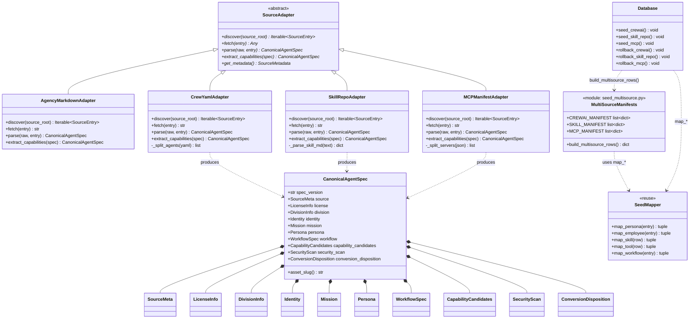
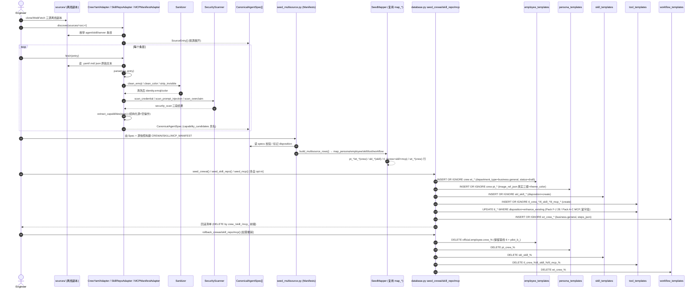

# Agent 拆解转换引擎 V1 — 多源扩展：实现设计 + 任务分解

> **版本**：Multi-Source Implementation Design v1.0（架构师交付，标准 SOP 第二棒）
> **作者**：架构师 高见远（software-architect）
> **上游输入**：`docs/plan/agent-conversion-multisource-prd.md`（范围/验收）、`docs/research/agent-conversion-multisource-research.md`（逐源评估）、试点 B 三件套（PRD·设计·评审）、`docs/research/agent-conversion-engine-v1-report.md`（章节 4/5）、真实 `backend/app/database.py` DDL、既有 `backend/app/agent_conversion/`。
> **前置裁定（已生效）**：总控已扩展 L2 #4 暂停四项 #4 解冻范围至多源；本任务走标准 SOP 规划+实现，受控推进。
> **红线**：本文**仅设计与任务分解，不写实现代码、不 seed**；所有资产 draft 态、可回滚；不接入凭证、不建 marketplace、不 instantiation（ADR-0017 仍锁）。所有映射严格对齐真实 `database.py` DDL（§0 勘误）。

---

## 0. 与真实 `database.py` DDL 的二次核对（最高权威）

本设计在动手前**逐表核对**了 `backend/app/database.py` 真实 `CREATE TABLE` / `_ensure_column` 与试点 B 已落地 seed 函数。相比研究稿与 PRD 附 B，显式确认 **8 处真实偏差**（与试点 B 评审一致，本任务直接复用、不重蹈）：

| # | PRD/研究假设 | 真实 `database.py` 事实 | 对本设计的影响 |
|---|---|---|---|
| ① | `et_*`/`pt_*` 有 `(tenant_id, slug)` 唯一约束 | 仅 `skill_templates`(行695)/`tool_templates`(行1894) 有 `unique(tenant_id,slug)`；`employee_templates`(594)/`persona_templates`(898) **仅主键，无 (tenant_id,slug)** | 幂等靠**主键** + `INSERT OR IGNORE`；slug 仅可读性。 |
| ② | `pt_*.image_ref_json` = `{avatar_emoji, identity_description, theme_color}` | 真实三键 = `{avatar, nickname, identity}` + `theme_color`（行1080 注入） | `pt_*.image_ref_json` 复用真实三键（avatar=清洗 emoji）；新增 `theme_color`。 |
| ③ | `decision_style` 受 4 值枚举约束 | 真实 DDL（行907）`decision_style text not null default 'consultative'`，**无 CHECK** | 自由文本；按既有词汇或自由写入。 |
| ④ | `department_types` 含 5 个 business.* | 真实仅 4 个（行393 起）：`business.general`/`function.hr`/`function.admin`/`function.bi`；试点 B 另补 5 个 business.*（product/marketing/sales/support/finance） | **本任务 CrewAI `et_*` 复用 `business.general`（已存在，不新建）**；其余源 `skl_*`/`tl_*` 无 `department_type` 列，无需补 type。 |
| ⑤ | `skl`/`tl` `status` CHECK 含 `'candidate'` | 真实 CHECK = `('draft','active','disabled','archived')`，**不含 `'candidate'`**（行691/723） | 全链路统一 `status='draft'`。 |
| ⑥ | 基线技能 = 52 | 真实基线 = **55**（行1083 注释 + 评审确认） | 校验基线用 55。 |
| ⑦ | 基线 6 个 `official.employee.*` | 真实已含 6 个（tech_lead/product_manager/architect/frontend_engineer/backend_engineer/qa_engineer，department_type=software_rnd） | `official.employee.%` 种子后 = 6 + 本任务 new；回滚按 `crew_` 前缀不影响基线 6。 |
| ⑧ | `business.general` 不存在 | 真实**已含** `business.general` | 回滚仅删本任务新增类型（本任务不新增 type），保留 `business.general` 与试点 B 5 个 type。 |

> **本任务新增 department_types 决策**：**不新增任何 `department_types`**。CrewAI `et_*` 复用既有 `business.general`；`skl_*`/`tl_*` 表本身无 `department_type` 列。这把 T8 复杂度降到最低，且与 §0④ 红线（缺则补）不冲突（无需补）。若主理人希望 CrewAI 独立归类，可在 T8 追加 1 个 `business.rnd`（见 §8 待明确 #3）。

**复用既有 seed 模式（来自试点 B，行2568–2801）**：
- `seed_agent_conversion_pilot_b()` 公开薄封装 → 先 `initialize()`（幂等保基线）→ `_seed_*()` 写叠加层，`INSERT OR IGNORE`，不挂默认 `initialize()` 链。
- `rollback_agent_conversion_pilot_b()` 按 id 前缀范围 `DELETE`，保留基线 6 et / 115 工具 / 55 技能 / 6 persona / `business.general`。
- 写顺序：`department_types → personas → employees → skills → tools → workflows → departments`。

---

## 1. 实现方案 + 框架选型

### 1.1 技术难点

1. **多源异构 → 统一归一**：CrewAI(YAML role/goal/backstory/tools) / skill 仓库(目录+SKILL.md) / MCP(server manifest JSON) 三种形态差异大，须各自解析但归一为同一 `CanonicalAgentSpec`。
2. **结构化源跳过 NLP 抽取**：与试点 B（agency 自然语言需抽取）不同，本批三源均为**结构化高保真**源，`tools`/`steps` 已是显式字段，可跳过 `extract_capabilities` 的 NLP 抽取，直接命中 `tl_*` 候选。
3. **「增强而非新建」纪律**：与既有资产（Pack F-J 28 条 `tl_*`、Pack A/C 已 seed MCP 工具）重叠者判定 `enhance_existing`（UPDATE 富字段，不新建重复行）；净新增聚焦 `skl_*` 方法论与未覆盖工具。
4. **零运行时外网**：三源离线落 `sources/`（clone / WebFetch），运行期不拉网络。
5. **安全三段 + 许可闸门 + 跨源零冲突**：credential/prompt-injection/overclaim 零漏报；copyleft/无 LICENSE 源拒绝；每源独立 id 前缀 + 入库前冲突校验。

### 1.2 框架与库选型

| 维度 | 选型 | 理由 |
|------|------|------|
| 语言 | Python 3.11+（对齐 `backend/app`） | 复用 `Database` 类与 seed 模式 |
| 解析层 | 新增 `backend/app/agent_conversion/` 三适配器 + `seed_multisource.py` | 与业务/试点 B 代码解耦；纯函数 + dataclass，可单测 |
| YAML 解析 | **`pyyaml`（试点 B 已引入，复用）** | CrewAI YAML 结构化解析 |
| JSON 解析 | 标准库 `json` | MCP manifest 为 JSON |
| Markdown | 标准库 `re` + 自写 frontmatter/章节切分（试点 B 已验证） | skill 仓库 SKILL.md |
| emoji/color 清洗 | 标准库 `unicodedata` + `re`（`sanitize.py` 复用） | 白名单 Unicode 区段 |
| 安全扫描 | 标准库 `re`（`security_scan.py` 三段正则复用） | credential/prompt-injection/overclaim |
| DB 写通道 | `database.py` 内新增 3 个 opt-in seed + 3 个 rollback 函数 | 与 `seed_agent_conversion_pilot_b` 同模式 |
| 测试 | `pytest`（已依赖）+ 独立 `test_multisource_agent_conversion.py` | 复用 `Database(path=temp)` 模式 |

> **无新增第三方依赖**：`pyyaml` 由试点 B 引入；其余全为标准库。本任务依赖包清单见 §6。

### 1.3 架构模式

- **Adapter 模式 + 中间表示（Canonical）**：每个新源实现 `SourceAdapter` ABC → 输出 `CanonicalAgentSpec` → `SeedMapper.map_*` 映射到 Curis 真实表。源解析与映射彻底解耦（延续规划稿章节 5.1）。
- **Manifest 驱动的权威快照**：`seed_multisource.py` 持 `CREWAI_MANIFEST`/`SKILL_MANIFEST`/`MCP_MANIFEST`（同 `PILOT_B_MANIFEST` 形状 + `disposition` 字段），为种子权威数据源；各 Adapter 仅作"可重新解析"证明（T9 管线一致性校验）。**最大化复用试点 B 的 `SeedMapper.map_*` 纯函数**。
- **additive opt-in seed**：所有写操作集中在 `database.py` 薄函数，`INSERT OR IGNORE` 幂等 + `enhance_existing` 走 `UPDATE`，opt-in 触发，按源前缀可回滚。
- **离线优先**：解析数据源在 seed 前已落 `sources/`，运行期不触外网。

---

## 2. 文件列表及相对路径（新增 vs 修改）

> 标注：`[新]` 本次新建；`[改]` 既有文件上仅 additive 新增函数，不改既有逻辑/不挂默认 `initialize()` 链；不重复试点 B 已建文件。

### 2.1 解析层（新增，`backend/app/agent_conversion/`）

| 文件 | 类型 | 职责 |
|------|------|------|
| `backend/app/agent_conversion/crew_adapter.py` | [新] | `CrewYamlAdapter`：YAML role/goal/backstory/tools → CanonicalAgentSpec（结构化直映射，跳过 NLP） |
| `backend/app/agent_conversion/skill_adapter.py` | [新] | `SkillRepoAdapter`：遍历 skill 仓库 SKILL.md → skill→`skl_*` 语义、工具引用→`tl_*` 候选 |
| `backend/app/agent_conversion/mcp_adapter.py` | [新] | `MCPManifestAdapter`：解析 MCP server manifest → tools→`tl_*` 候选（纯工具源） |
| `backend/app/agent_conversion/seed_multisource.py` | [新] | `CREWAI_MANIFEST` / `SKILL_MANIFEST` / `MCP_MANIFEST`（同 PILOT_B_MANIFEST 形状 + `disposition`） + `build_multisource_rows()`（复用 `SeedMapper.map_*`） |

### 2.2 数据源离线副本（新增，`backend/app/agent_conversion/sources/`）

| 目录 | 类型 | 内容 |
|------|------|------|
| `sources/crewai/*.yaml` | [新] | 克隆 CrewAI 示例 crew（含 agents/tools/tasks），离线副本 |
| `sources/skill/*/SKILL.md` | [新] | 克隆 curispeng22-coder/skill 各 skill 目录 |
| `sources/mcp/*.json` | [新] | 抓取 MCP Registry / 各 server manifest 离线副本 |

### 2.3 DB 层（修改，`database.py`）

| 文件 | 类型 | 修改点 |
|------|------|------|
| `backend/app/database.py` | [改] | additive 新增 `seed_crewai()` / `seed_skill_repo()` / `seed_mcp()` 公开薄封装 + `_seed_*` 内部 + `rollback_crewai()` / `rollback_skill_repo()` / `rollback_mcp()`。**不挂默认 `initialize()` 链、不改任何既有 seed 函数**。不新增 `department_types`（复用 `business.general`）。 |

### 2.4 校验（新增测试）

| 文件 | 类型 | 职责 |
|------|------|------|
| `backend/tests/test_multisource_agent_conversion.py` | [新] | 独立测试：三源候选落库字段校验、与基线 6 et/115 工具/55 技能零冲突、跨源零冲突、安全三段零漏报、许可闸门、可回滚（T9） |

### 2.5 复用（importable，不改）

`canonical.py` / `adapter_base.py` / `sanitize.py` / `security_scan.py` / `seed.py`（`SeedMapper.map_persona/map_employee/map_skill/map_tool/map_workflow` 纯函数直接复用）/ `agency_adapter.py` / `seed_pilot_b.py`（CLI 范式参照）。

---

## 3. 数据结构与接口

### 3.1 既有契约（复用，不变）

- `CanonicalAgentSpec`（落 `canonical.py`，§3.1 完整 dataclass）：`spec_version` / `source`(SourceMeta) / `license`(LicenseInfo) / `division`(DivisionInfo) / `identity`(Identity) / `mission`(Mission) / `persona`(Persona) / `workflow`(WorkflowSpec) / `capability_candidates`(CapabilityCandidates) / `security_scan`(SecurityScan) / `conversion_disposition`(ConversionDisposition，含 `employee_action ∈ {create,enhance_existing,skip}` + `existing_official_id` + `star_rating`)。**本任务不改动该 schema**。
- `SourceAdapter` ABC（落 `adapter_base.py`，§3.2）：`discover / fetch / parse / extract_capabilities / get_metadata`，输出 `CanonicalAgentSpec`，不读写 DB。

### 3.2 新增三适配器（接口签名，设计态、非实现）

各适配器继承 `SourceAdapter`，复用 `sanitize` / `security_scan` / `seed.SeedMapper`。**签名与试点 B 一致，仅 `discover`/`parse` 内部逻辑按源形态差异实现**。关键约定：

- **`CrewYamlAdapter`**：`discover(source_root)` 遍历 `sources/crewai/*.yaml`，对每个 crew 文件 `yaml.safe_load` 后**按 agent 展开**为 `SourceEntry`（entry_id=`crew:<file>:<agent_role>`，raw_ref={file, agent_index}）；`fetch(entry)` 读文件文本；`parse(raw, entry)` 定位 agent → 填 `Identity(role=agent['role'], ...)`、`Mission(summary=agent['goal'], ...)`、`Persona`（由 division/archetype 派生，CrewAI 无 division 故用 `business.general` 派生 archetype）、`WorkflowSpec`（来自 crew `tasks`）、`CapabilityCandidates`（agent['tools'] 具名列表→`tool_candidates`）；`extract_capabilities` **基本为空操作**（结构化源无需 NLP，工具已具名）；`security_scan` 对 backstory/goal 初扫。
- **`SkillRepoAdapter`**：`discover(source_root)` 遍历 `sources/skill/*/SKILL.md`，每目录 1 `SourceEntry`（entry_id=`skill:<dir>`）；`fetch` 读 SKILL.md；`parse` 解析 frontmatter(name/description) + 章节(步骤/工具引用) → `Identity(name=skill_name)`、`Mission(summary=description)`、`CapabilityCandidates`（SKILL.md 引用的具体工具→`tool_candidates`）；`conversion_disposition` 标记本 skill 是否对应 Pack F-J 28 条（`enhance_existing` + `existing_id`）还是净新增 `skl_*`；`extract_capabilities` 空操作（已结构化）。
- **`MCPManifestAdapter`**：`discover(source_root)` 遍历 `sources/mcp/*.json`，按 server 展开 `SourceEntry`（entry_id=`mcp:<file>:<server_name>`）；`fetch` 读 JSON；`parse` 定位 server → `Identity(name=server_name)`、`CapabilityCandidates`（server['tools'] 具名→`tool_candidates`，含 `input_schema`→evidence）；`extract_capabilities` 空操作；`conversion_disposition` 标记是否与 Pack A/C 已 seed MCP 工具重叠（`enhance_existing` + `existing_id`）。

> **`disposition` 字段约定**（落 manifest entry）：每个 `tl_*`/`skl_*` manifest 行带 `disposition: "create" | "enhance_existing" | "skip"` 与 `existing_id`（enhance 时填既有 id）。seed 函数据此分支：`create`→`INSERT OR IGNORE`；`enhance_existing`→`UPDATE` 富字段（description/instruction_excerpt/source_attribution）；`skip`→忽略。

### 3.3 类图（Mermaid）

> 完整可渲染类图同步存于 `docs/plan/agent-conversion-multisource-class-diagram.mermaid`。

---

## 4. 程序调用流程（时序图）

新源 seed 主流程（与试点 B 一致：sources→Adapter.discover/fetch/parse/extract→security_scan→映射→database.py opt-in seed→校验）；含 `enhance_existing` 分支与回滚路径。

> 完整可渲染时序图同步存于 `docs/plan/agent-conversion-multisource-sequence-diagram.mermaid`。

---

## 5. 任务列表（核心，有序、含依赖、按实现顺序）

> 全部 draft 态；真实 seed 经各源 opt-in 函数执行；不 active 全量、不碰 Instance/Runtime。
> 复用试点 B 已验证 T1–T9 切片结构（主理人转达 SOP 第二棒）。每项含任务名 / 产出文件 / 依赖 / 验收点。
> **命名空间**：`crew_`（CrewAI）/ `skill_`（skill 仓库）/ `mcp_`（MCP）；`et_*=official.employee.crew_<slug>`、`pt_*=pt_crew_<slug>`、`skl_*=skl_skill_<name>`、`tl_*=tl_crew_*/tl_skill_*/tl_mcp_*`、`wt_*=wt_crew_<slug>`。

### T1 — `CrewYamlAdapter` + CrewAI 候选 manifest（高保真首源）
- **产出文件**：`agent_conversion/crew_adapter.py`、`sources/crewai/*.yaml`（离线克隆）、`agent_conversion/seed_multisource.py`（`CREWAI_MANIFEST` 草案片段）、`agent_conversion/README.md`（更新数据源获取说明）
- **依赖**：无（复用 `canonical`/`sanitize`/`security_scan`/`adapter_base`/`seed.SeedMapper`）
- **验收点**：`CrewYamlAdapter.discover` 返回 N 个 agent `SourceEntry`（按 crew 文件展开）；`parse` 产出 `CanonicalAgentSpec`（`spec_version/source/license/division/identity/security_scan` 齐全）；`identity.emoji/color` 经清洗（CrewAI 多缺省置空）；`extract_capabilities` 由 `agent['tools']` 具名列表产出 `tool_candidates`（无 NLP）；`CREWAI_MANIFEST` 草案字段形状对齐 `map_employee`/`map_persona`（含 `asset_slug`/`slug`/`department_type=business.general`/`role`/`responsibility`/`default_instructions`(含 backstory)/`guardrails`/`emoji`/`color`/`workflow`）。

### T2 — `SkillRepoAdapter` + Skill 仓库候选 manifest + 许可 gate
- **产出文件**：`agent_conversion/skill_adapter.py`、`sources/skill/*/SKILL.md`（离线克隆 curispeng22-coder/skill）、`seed_multisource.py`（`SKILL_MANIFEST`：skl_* 净新增 + 28 条 Pack F-J `tl_*` `enhance_existing` 映射）、许可确认记录（`docs/plan/` 或 README）
- **依赖**：T1（复用适配器骨架）；**许可确认（blocker，见 §8 #1）前置**——确认前 `SkillRepoAdapter` 仅产设计态/不 seed
- **验收点**：`discover` 遍历 skill 目录每 `SKILL.md` 1 条目；`parse` 产出 spec（`Identity.name=skill名`、`Mission.summary=description`、`CapabilityCandidates.tool_candidates=工具引用`）；`SKILL_MANIFEST` 含 `skl_*` 净新增（约 10–20，视仓库 tree 精确判定）+ 28 条 Pack F-J `tl_*` `enhance_existing`（`existing_id` 自 catalog/tool_templates 读取）；许可闸门扫 SPDX，无 LICENSE 源标记 `skip`；`extract_capabilities` 空操作。

### T3 — `MCPManifestAdapter` + MCP 候选 manifest
- **产出文件**：`agent_conversion/mcp_adapter.py`、`sources/mcp/*.json`（离线抓取 registry/manifest）、`seed_multisource.py`（`MCP_MANIFEST`：tl_* 净新增 + 已 seed MCP 工具 `enhance_existing` 映射）
- **依赖**：T1
- **验收点**：`discover` 遍历 server manifest 每 server 1 条目；`parse` 产出 spec（`CapabilityCandidates.tool_candidates=server tools`，evidence 含 `input_schema` 摘要）；`MCP_MANIFEST` 含 `tl_mcp_*` 净新增（精选 10–15 高价值 server）+ 与 Pack A/C 已 seed MCP 工具重叠者 `enhance_existing`（`existing_id` 自 catalog 读取）；许可扫描（官方 MIT / 社区混杂，copyleft 拒绝）；纯工具源不产 `et_*`/`skl_*`/`pt_*`/`wt_*`。

### T4 — 各源 `et_*`/`pt_*` 抽取 + `persona_ref` 关联（CrewAI 为主；skill/MCP 无）
- **产出文件**：`seed_multisource.py`（`CREWAI_MANIFEST` 的 persona/employee 字段填全）、`seed.py`（复用 `map_persona`/`map_employee`）
- **依赖**：T1
- **验收点**：CrewAI 每个 agent → 1 `pt_crew_<slug>`（`archetype` ∈ 6 值 CHECK；`image_ref_json` 真实三键 `{avatar,name,identity}` + `theme_color`）+ 1 `et_*`（`id=official.employee.crew_<slug>`、`persona_ref=pt_crew_<slug>`、`persona_overrides_json={}`）；`department_type=business.general`（复用既有，不新建 type）；skill/MCP 源不产生 `et_*`/`pt_*`。

### T5 — `et_*` 字段填充（按源 manifest，draft 态）
- **产出文件**：`seed_multisource.py`（各 manifest 的 `et_*` 字段）
- **依赖**：T4
- **验收点**：所有 `et_*` `status='draft'`、`source='official'`、`tenant_id='platform'`、`department_type` 合法（`business.general`）、`default_instructions` 非空（含 backstory）、`guardrails_json` 有值、`default_capability_types_json` 含 `"model"`、`persona_ref` 指向存在的 `pt_*`、`slug`=kebab(asset_slug)。

### T6 — `skl_*`/`tl_*` candidate 抽取 + 安全审查 + 许可合规
- **产出文件**：`seed_multisource.py`（`SKILL_MANIFEST` `skl_*` + 各源 `tl_*`）、全字段安全扫描
- **依赖**：T1, T2, T3
- **验收点**：`skl_*`（`default_capability_types_json='["model"]'` + additive `category`=pack）净新增；`tl_*` 来自 CrewAI tools / skill 工具引用 / MCP servers；与现有 115 工具命中者判 `enhance_existing`（不新建重复 `tl_*`）；安全三段（credential 剥离 / prompt-injection 清洗打回 / overclaim 降级）零漏报；许可合规（`license.spdx` + `attribution_required` 记录，copyleft 拒绝）；所有候选 `status='draft'`。

### T7 — `wt_*` 草稿 + 汇总评审稿
- **产出文件**：`seed_multisource.py`（`CREWAI_MANIFEST` workflow → `wt_crew_*`）、`docs/plan/agent-conversion-multisource-review.md`（汇总评审稿）
- **依赖**：T4, T5, T6
- **验收点**：CrewAI `tasks` → `wt_crew_*`，`department_type=business.general`、`steps_json` 补 `expected_output`+`owner_role`（缺省=该 agent role）；`dt_*` **不新建**（复用 `business.general`，无新 department_types）；汇总稿含三源候选清单（按源/资产类型分组）、安全/许可/去重结论、星级（★1–5）、与 Pack F-J 28 条/ Pack A-C MCP 的 `enhance_existing` 明细、零冲突声明。

### T8 — 各源 opt-in seed 函数 + 幂等 + 回滚 + `department_types` 补
- **产出文件**：`database.py`（新增 `seed_crewai`/`seed_skill_repo`/`seed_mcp` + `_seed_*` 内部 + `rollback_crewai`/`rollback_skill_repo`/`rollback_mcp`）、`seed_multisource.py`（`build_multisource_rows()`）
- **依赖**：T4, T5, T6, T7
- **验收点**：三函数**各自 opt-in**（不挂默认 `initialize()` 链外的其他）；先 `initialize()` 保基线再 `_seed_*`；写顺序 `personas→employees→skills→tools→workflows`；`create` 走 `INSERT OR IGNORE`（按主键幂等），`enhance_existing` 走 `UPDATE` 富字段（description/instruction_excerpt/source_attribution，不新建重复行）；`rollback_*` 按 `crew_`/`skill_`/`mcp_` 前缀整批 `DELETE`，保留基线 6 et / 115 工具 / 55 技能 / 6 persona / `business.general` / 试点 B 5 business.*；默认 `initialize()` 仍 6 `et_*`（不破既有 test）。

### T9 — 各源校验脚本（独立 pytest）
- **产出文件**：`backend/tests/test_multisource_agent_conversion.py`
- **依赖**：T8
- **验收点**：三源候选落库字段校验（`et_*`/`pt_*`/`skl_*`/`tl_*`/`wt_*` id 命名空间、`status='draft'`、`department_type` 合法、`default_instructions` 非空、`persona_ref` 指向存在 `pt_*`）；与基线零冲突（前缀 `crew_`/`skill_`/`mcp_` 不命中 `pilot_b_` / `official.employee.{6 baseline}` / 115 工具 / 55 技能）；**跨源零冲突**（三源前缀互不重叠）；安全三段零漏报（credential 未持久化、prompt-injection 已清洗/打回、overclaim 已降级）；许可闸门单测（copyleft / 无 LICENSE 源判 `skip`/`reject`）；可回滚（跑 `rollback_*` 后各源计数归零、基线不变）。

---

## 6. 依赖包列表

| 包 | 版本 | 用途 | 是否新增 |
|----|------|------|----------|
| `pyyaml` | `^6.0` | 解析 CrewAI `.yaml`（结构化 agents/tools/tasks） | **复用试点 B 已引入**（backend/requirements.txt） |
| `pytest` | `^8.4.1` | T9 校验（已依赖） | 复用 |
| 标准库 `re` / `json` / `unicodedata` / `pathlib` / `glob` | — | 清洗/扫描/IO/章节切分 | 复用 |
| `yaml`（MCP 为 JSON，无需额外） | — | MCP manifest 解析走 `json` | 复用 |

> **结论**：本任务**零新增第三方依赖**。所有新源解析均落在已引入的 `pyyaml` 与标准库之上。

---

## 7. 共享知识（跨文件约定）

### 7.1 `CanonicalAgentSpec` → Curis 列映射（引用试点 B 设计 §4.3 / 规划稿章节 4.3）
- `et_*.id` ← `official.employee.crew_<asset_slug>`；`slug` ← kebab；`persona_ref` ← `pt_crew_<asset_slug>`。
- `et_*.department_type` ← `business.general`（CrewAI 复用，不新建 type）。
- `et_*.default_capability_types_json` ← `["model"]` + 命中工具的 `["tool"]`。
- `pt_*.image_ref_json` 真实形态：`{"avatar":"<emoji>","nickname":"<persona 名>","identity":"<身份描述>","theme_color":"<#RRGGBB>"}`。
- `skill_templates` 默认 `default_capability_types_json='["model"]'` + additive `category={pack}`；`tool_templates` 默认 `'["tool"]'` + `tool_type`（无 CHECK）。
- `wt_*.department_type=business.general`、`steps_json` 形状 `{"step_order":int,"name":str,"owner_role":str,"instruction_excerpt":str,"expected_output":str}`。

### 7.2 命名空间（跨源零冲突）
| 源 | 前缀 | `et_*` | `pt_*` | `skl_*` | `tl_*` | `wt_*` |
|------|------|--------|--------|---------|--------|---------|
| CrewAI | `crew_` | `official.employee.crew_<slug>` | `pt_crew_<slug>` | — | `tl_crew_<name>` | `wt_crew_<slug>` |
| skill 仓库 | `skill_` | — | — | `skl_skill_<name>` | `tl_skill_<name>`（净新增）/ Pack F-J 28 条 `enhance_existing` | — |
| MCP | `mcp_` | — | — | — | `tl_mcp_<server_tool>`（净新增）/ Pack A-C MCP `enhance_existing` | — |

> 与试点 B（`pilot_b_` 前缀）、基线 6 `official.employee.*`（software_rnd）、115 工具、55 技能**全部零冲突**（前缀正交 + 入库前冲突校验）。

### 7.3 emoji/color 清洗白名单（复用 `sanitize.py`）
- emoji 限 `U+1F300–1FAFF / 2600–26FF / 2700–27BF / 2190–21FF / 25A0–25FF`，grapheme ≤1；超 2 code point 拒收置空。
- color 严格 `#RRGGBB`（拒绝具名色/CSS 表达式）。CrewAI/skill/MCP 多缺省→`pt_*.image_ref_json.avatar=""`、`theme_color=""`。

### 7.4 安全三段正则（复用 `security_scan.py`）
- `CREDENTIAL_PAT` / `PROMPT_INJECTION_PAT` / `OVERCLAIM_PAT`；`scan_all` 聚合，`is_clean` 判定。
- 命中即剥离/清洗/降级，**模板永不持久化凭证**；全字段（goal/backstory/description/instruction_excerpt）零漏报。

### 7.5 许可合规闸门
- 关卡①逐源扫 SPDX：`copyleft`（GPL/AGPL/CC-BY-SA）**拒绝 harvest**；`Apache-2.0` 保留 `NOTICE`；`MIT` 记录 attribution。
- **无 LICENSE 个人仓库（curispeng22）须先确认授权**（§8 #1），未确认前 `SkillRepoAdapter` 仅产设计态、不 seed。
- `license.spdx` / `commercial_use` / `copyleft` / `attribution_required` 落 `SourceMetadata` 供评审消费。

### 7.6 「增强而非新建」纪律（与 Pack F-J 28 条 / Pack A-C MCP 去重）
- **重叠判定**：skill 仓库 / MCP 与既有 `tl_*` 命中（按 slug/name 归一）→ `disposition="enhance_existing"` + `existing_id`（自 catalog/tool_templates 读取）。
- **落库策略（默认）**：`enhance_existing` 走 `UPDATE` 富字段（`description`/`instruction_excerpt`/`source_attribution` 补全），**不新建重复 `tl_*` 行**（避免重复主键/slug 冲突）。
- **净新增**：仅 skill 仓库的 `skl_*` 方法论、超出 Pack F-J 28 条的新工具、CrewAI/MCP 未覆盖工具 → `tl_*`（前缀 `crew_`/`skill_`/`mcp_`）`create`。
- **`skl_*` 与 `tl_*` 配对**：允许 `skl_*` 独立存在（软关联经 `capability`），不强制一一配对（见 §8 #5）。

### 7.7 `status` / `source` / 幂等
- 全链路 `status='draft'`（真实 CHECK 不含 `'candidate'`，见 §0⑤）；`source='official'`、`tenant_id='platform'`、主键幂等 + `INSERT OR IGNORE`。
- 不激活、不 instantiation、不接凭证、不建 marketplace（ADR-0017 仍锁）。

---

## 8. 待明确事项（需总控 / 主理人裁定）

1. **【blocker】curispeng22 许可授权**：该仓库多为个人仓库、无明确 LICENSE。catalog 已部分入库 28 条属历史决策；规模化 harvest 前是否取得明确授权？**未确认前 `SkillRepoAdapter`（T2）仅产设计态、不 seed**；T2 余下工作可在授权后解锁。
2. **首批源数量**：确认首批为 3 源（CrewAI + skill 仓库 + MCP）还是先 2 源（CrewAI + MCP，延迟 skill 至授权确认后）？本研究推荐 3 源但受 #1 制约。本设计按 3 源展开 T1–T9，若降为 2 源则 T2 整体后移至授权后。
3. **CrewAI `department_type`**：默认复用 `business.general`（零新增 type，最低风险）；若主理人希望 CrewAI 独立归类，可在 T8 追加 1 个 `business.rnd`（须在 §0④ 框架下「缺则补」，回滚同步删该 type）。
4. **`enhance_existing` 落库策略**：默认 `UPDATE` 富字段（不新建重复行）；若评审希望「另建 draft 候选待覆盖」则改为 `create` + `disposition` 标记——本设计按默认 `UPDATE` 实现，避免重复行与 slug 冲突。
5. **`skl_*` 与 `tl_*` 配对粒度**：允许 `skl_*` 独立存在，与 `tl_*` 软关联（经 capability），不强制一一配对；影响净新增 `skl_*` 数量（按仓库 tree 精确判定）。

> 以上 5 项除 #1（blocker，阻塞 T2 的 seed 部分）外，均可在工程层按本设计默认处置推进，无需阻塞 T1/T3/T4–T9。

---

## 附录：约束遵守声明
- ✅ 本文**仅含 schema / 接口签名 / docstring / 设计说明与任务分解**，无实现逻辑代码（§3 为接口契约描述，供工程师落地）。
- ✅ **未 seed、未修改** `database.py` 既有 seed 逻辑；仅规划新增 additive opt-in 函数。
- ✅ 未触碰 L2 红线：所有资产 draft 态、可回滚；不接入凭证、不建 marketplace、不 instantiation。
- ✅ 所有映射严格对齐二次核对的真实 DDL（§0 勘误已显式纠偏）。
- ✅ 新增三适配器均继承既有 `SourceAdapter` ABC，输出合规 `CanonicalAgentSpec`，复用 `canonical`/`sanitize`/`security_scan`/`seed.SeedMapper`，未改动试点 B 已验证链路。
