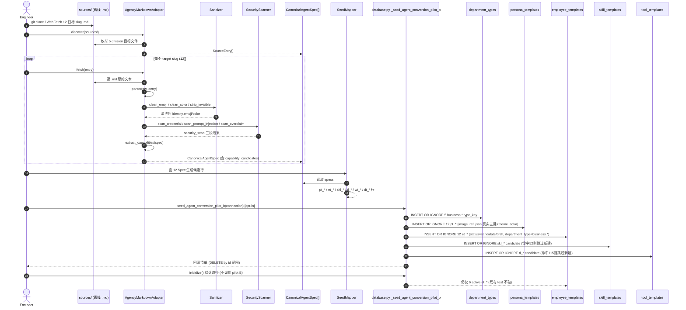

# Agent 拆解转换引擎 V1 — 受控试点 B 实现设计 + 任务分解

> 版本：Pilot-B Implementation Design v1.0（架构师交付，标准 SOP 第二棒）
> 作者：架构师 高见远（software-architect）
> 上游输入：PRD `docs/plan/agent-conversion-pilot-b-prd.md`、规划稿/设计稿/主报告（docs/research/）、真实 `backend/app/database.py` DDL
> 基线裁定（主理人转达，已生效）：L2 #4 已解冻 → 受控试点 B；seed 走 `database.py` additive 函数（`source='official'` + `status='candidate'/'draft'`，`INSERT OR IGNORE` 幂等、可回滚）；绝不走运行时 `/api/platform/*`；#15 security 排除出 pilot；#3 仅记 tech_lead 增强备注；division 限 marketing/sales/support/finance/product 五者；persona 深合并 `pt_*` 基元 + `et_*.persona_overrides_json` delta。
> 红线：本文件**仅设计与任务分解，不写实现代码、不 seed**；所有资产为 candidate/draft 态、可回滚；不接入凭证、不建 marketplace、不 instantiation。

---

## 0. 与真实 `database.py` DDL 的二次核对勘误（最高权威）

本设计在动手前**再次逐表核对**了 `backend/app/database.py` 真实 `CREATE TABLE` 与既有 seed 函数。相比我此前设计稿（docs/research/agent-conversion-engine-v1-design.md 章节 0）与 PRD，发现 **3 处必须纠偏的偏差** + **1 处既有一致确认**：

| # | 此前设计稿/PRD 假设 | 真实 `database.py` 事实（行号） | 对 Pilot B 设计的影响 |
|---|------|------|------|
| ① | `employee_templates` / `persona_templates` 与 `skill`/`tool` 一样有 `(tenant_id, slug)` 唯一约束 | **仅 `skill_templates`(行695) 与 `tool_templates`(行1894) 有 `unique (tenant_id, slug)`**；`employee_templates`(行594) 与 `persona_templates`(行898) **仅主键 `id`/`persona_id`，无 (tenant_id, slug) 约束** | 幂等 seed 必须依赖 **主键**（`id`/`persona_id`）+ `INSERT OR IGNORE`，不能依赖 (tenant_id, slug)。slug 仅作可读性，不保证唯一。 |
| ② | `pt_*.image_ref_json` 形态 = `{"avatar_emoji":"📊","identity_description":"...","theme_color":"#1E88E5"}` | 真实已落库形态（行2163）= `{"avatar":"","nickname":"...","identity":"..."}`；全代码库**无任何 `avatar_emoji`/`identity_description` 消费**（见 grep） | Pilot B `pt_*.image_ref_json` 必须**复用真实三键**（`avatar` 存清洗后 emoji、`nickname` 存 persona 名、`identity` 存身份描述、**新增 `theme_color`**），与既有 6 官方 persona 及前端/测试保持一致，避免断层。 |
| ③ | `decision_style` 受 4 值枚举约束（`consultative/autonomous/delegative/data_driven`） | 真实 DDL（行907）`decision_style text not null default 'consultative'`，**无 CHECK 枚举**；既有 seed 实际用了 `evidence_based`/`exploratory`/`conservative` 等枚举外值 | `decision_style` 按**自由文本**处理；映射时对齐既有词汇或自由写入，不强制 4 值枚举。 |
| ④ | `department_types` 已含 marketing/sales/support/finance/product 等商业 type_key | 真实 `department_types` 仅 4 个（行1538）：`business.general` / `function.hr` / `function.admin` / `function.bi`；**无任一 pilot B 目标 division 的 type_key** | Pilot B seed 必须**新增 5 个 `business.*` type_key**（`business.marketing` 等），否则 `et_*.department_type` 无合法值。这与主理人裁定"缺 business 类则补"一致。 |
| ✓ | additive 列（`persona_ref`/`persona_overrides_json`/`image_ref_json`/`version`/`status`/`default_skill`/`default_tool`）已落地 | 与行 1074–1086 完全一致 | 无需改动，直接复用。 |

> **附加约束（来自既有测试，工程师必读）**：`backend/tests/test_bplan_seed_integrity.py::test_employee_et_threepart_reporting` 断言 `et_* 恰为 6 行`（`EXPECT_ET_EMPLOYEES=6`）。若 Pilot B 的 12 个 candidate `et_*` 进入默认 `initialize()` 链，该断言将失败。因此 **Pilot B seed 函数必须是 opt-in**（见 T8），不挂默认 `initialize()`，T9 用独立测试 + 显式调用验证。

---

## 1. 实现方案 + 框架选型

### 1.1 技术难点

1. **非结构化源 → 结构化 Curis 资产**：agency-agents 的"能力"融于 Mission/Rules/Deliverables/Workflow 自然语言，无显式工具/技能列表；核心难点是 persona/工具/技能抽取，而非字段搬运。
2. **源解析与 Curis 映射解耦**：须把异构源归一为统一中间表示 `CanonicalAgentSpec`，使"源解析"与"Curis 映射"互不干扰，为后续 CrewAI/skill 仓库等多源扩展铺路。
3. **零运行时外网依赖**：agency 真实 agent `.md` 必须在 seed 前离线落盘，运行期不拉网络。
4. **安全红线 + 许可合规**：credential 剥离 / prompt-injection / overclaim 三类扫描；MIT 署名保留；零冲突去重。
5. **strict 严格限 5 division + candidate/draft 态 + 可回滚**：所有写操作幂等、可按 id 范围整批回滚。

### 1.2 框架与库选型

| 维度 | 选型 | 理由 |
|------|------|------|
| 语言 | Python 3.11+（与 `backend/app` 一致） | 对齐 `database.py`、复用 `Database` 类与 seed 模式 |
| 解析层 | 新增模块 `backend/app/agent_conversion/` | 与业务代码解耦；纯函数 + dataclass，可单测 |
| frontmatter 解析 | **`pyyaml`（需新增依赖）** | agency `.md` 含 YAML frontmatter；stdlib 无稳健 YAML 解析；`pyyaml` 轻量纯 Python |
| emoji/color 清洗 | 标准库 `unicodedata` + `re` | 无新依赖；按 grapheme + Unicode 区段白名单 |
| 安全扫描 | 标准库 `re`（三段正则） | 见 §3 `security_scan.py` |
| DB 写通道 | `database.py` 内新增 `_seed_agent_conversion_pilot_b`（additive，`INSERT OR IGNORE`） | 主理人裁定 #1；与 `_seed_skill_templates_airnd`/`_seed_tool_templates` 同模式 |
| 测试 | `pytest`（已依赖）+ 独立 `test_pilot_b_agent_conversion.py` | 复用 `Database(path=temp)` 模式 |
| 数据源 | `git clone` 或 WebFetch raw github 拉取目标 slug `.md` → `sources/` 离线副本 | 运行期零外网 |

### 1.3 架构模式

- **Adapter 模式 + 中间表示（Canonical）**：`SourceAdapter` ABC 归一异构源 → `CanonicalAgentSpec` → `SeedMapper` 映射到 Curis 真实表。源解析与映射彻底解耦。
- **additive seed 函数模式**：所有写操作集中在 `database.py` 的薄 seed 函数，复用既有 `INSERT OR IGNORE` 幂等模式，opt-in 触发，可回滚。
- **离线优先**：解析数据源在 seed 前已落 `sources/`，运行期不触外网。

---

## 2. 文件列表及相对路径（新增 vs 修改）

> 标注：`[新]` = 本次新建；`[改]` = 在既有文件上修改（仅新增 seed 函数，不改既有逻辑）。

### 2.1 解析层（新增，`backend/app/agent_conversion/`）

| 文件 | 类型 | 职责 |
|------|------|------|
| `backend/app/agent_conversion/__init__.py` | [新] | 包导出 |
| `backend/app/agent_conversion/canonical.py` | [新] | `CanonicalAgentSpec` 及子 dataclass（Python 绑定，§3.1） |
| `backend/app/agent_conversion/adapter_base.py` | [新] | `SourceAdapter` ABC + `SourceEntry` + `SourceMetadata`（§3.2） |
| `backend/app/agent_conversion/sanitize.py` | [新] | emoji/color 清洗 + 通用 Unicode 注入剥离（§3.3） |
| `backend/app/agent_conversion/security_scan.py` | [新] | credential/prompt-injection/overclaim 三段正则扫描（§3.4） |
| `backend/app/agent_conversion/agency_adapter.py` | [新] | `AgencyMarkdownAdapter`（discover/fetch/parse/extract_capabilities，§3.5） |
| `backend/app/agent_conversion/seed.py` | [新] | `SeedMapper`：CanonicalAgentSpec → Curis 候选行（纯函数，不触 DB） |
| `backend/app/agent_conversion/sources/` | [新] | 离线副本：5 division 下 12 个目标 slug 的 `.md` 文件 |
| `backend/app/agent_conversion/seed_pilot_b.py` | [新] | 独立 CLI 运行器：clone→解析→调用 `db.seed_agent_conversion_pilot_b()` |
| `backend/app/agent_conversion/README.md` | [新] | 数据源获取与运行说明 |

### 2.2 DB 层（修改，`database.py`）

| 文件 | 类型 | 修改点 |
|------|------|------|
| `backend/app/database.py` | [改] | 新增 `_seed_agent_conversion_pilot_b(self, connection)` + 公开的 `seed_agent_conversion_pilot_b()` 薄封装；新增 5 个 `business.*` `department_types` type_key（idempotent）。**不改动任何既有 seed 函数、不挂默认 `initialize()`**。 |

### 2.3 校验（新增测试）

| 文件 | 类型 | 职责 |
|------|------|------|
| `backend/tests/test_pilot_b_agent_conversion.py` | [新] | 独立测试：12 et_* 落库校验、与 6 官方/115 工具/52 技能零冲突、candidate 可回滚（T9） |

---

## 3. 数据结构与接口

### 3.1 `CanonicalAgentSpec`（落 `canonical.py`）

Python 绑定（dataclass），对应设计稿 4.1 JSON Schema 的实例化契约。仅类型与构造，无 DB 逻辑。

```python
# backend/app/agent_conversion/canonical.py
from __future__ import annotations
from dataclasses import dataclass, field
from typing import Any


@dataclass
class SourceMeta:
    adapter: str                      # "AgencyMarkdownAdapter"
    repo_url: str                     # agency-agents 仓库 URL
    entry_path: str                   # sources/ 下相对路径
    fetched_at: str = ""              # ISO-8601


@dataclass
class LicenseInfo:
    spdx: str = "MIT"
    commercial_use: bool = True
    copyleft: bool = False
    attribution_required: bool = True


@dataclass
class DivisionInfo:
    source_key: str                   # marketing/sales/support/finance/product
    label: str
    target_dt_type: str = ""          # → department_types.type_key（business.*）


@dataclass
class Identity:
    name: str
    role: str
    slug: str = ""
    description: str = ""
    emoji: str = ""                   # 经 sanitize 清洗
    color: str = ""                   # 经 sanitize 清洗，#RRGGBB
    vibe: str = ""


@dataclass
class Mission:
    summary: str = ""
    responsibilities: list[str] = field(default_factory=list)
    critical_rules: list[str] = field(default_factory=list)


@dataclass
class Persona:
    archetype: str = "balanced_facilitator"   # 6 值 CHECK 之一
    traits: list[str] = field(default_factory=list)
    communication_style: dict = field(default_factory=dict)
    reporting_style: dict = field(default_factory=dict)
    decision_style: str = "consultative"      # 自由文本（无 CHECK）
    collaboration_style: dict = field(default_factory=dict)


@dataclass
class WorkflowStep:
    step_order: int
    name: str
    instruction_excerpt: str = ""
    expected_output: str = ""
    owner_role: str = ""


@dataclass
class WorkflowSpec:
    process_type: str = "sequential"
    steps: list[WorkflowStep] = field(default_factory=list)


@dataclass
class CapabilityCandidate:
    name_hint: str
    evidence: str = ""
    matched_tool_id: str = ""        # 命中 115 则填，否则空
    matched_skill_id: str = ""        # 命中 52 则填，否则空
    suggested_tool_type: str = ""
    suggested_skill_type: str = ""


@dataclass
class CapabilityCandidates:
    tool_candidates: list[CapabilityCandidate] = field(default_factory=list)
    skill_candidates: list[CapabilityCandidate] = field(default_factory=list)


@dataclass
class SecurityScan:
    credential_patterns: list[str] = field(default_factory=list)
    prompt_injection_flags: list[str] = field(default_factory=list)
    overclaim_flags: list[str] = field(default_factory=list)


@dataclass
class ConversionDisposition:
    employee_action: str = "create"   # create | enhance_existing | skip
    existing_official_id: str = ""    # enhance_existing 时填 official.employee.tech_lead
    star_rating: int = 1


@dataclass
class CanonicalAgentSpec:
    spec_version: str = "1.0.0"
    source: SourceMeta = field(default_factory=SourceMeta)
    license: LicenseInfo = field(default_factory=LicenseInfo)
    division: DivisionInfo = field(default_factory=DivisionInfo)
    identity: Identity = field(default_factory=Identity)
    mission: Mission = field(default_factory=Mission)
    persona: Persona = field(default_factory=Persona)
    deliverables: dict = field(default_factory=dict)
    workflow: WorkflowSpec = field(default_factory=WorkflowSpec)
    capability_candidates: CapabilityCandidates = field(default_factory=CapabilityCandidates)
    memory_notes: list[str] = field(default_factory=list)
    success_metrics: list[str] = field(default_factory=list)
    security_scan: SecurityScan = field(default_factory=SecurityScan)
    conversion_disposition: ConversionDisposition = field(default_factory=ConversionDisposition)

    def asset_slug(self) -> str:
        """由 identity.slug 推导统一资产 slug（去 et_/pt_ 前缀）。"""
        return self.identity.slug or self.identity.role.replace(" ", "_").lower()
```

### 3.2 `SourceAdapter` ABC（落 `adapter_base.py`）

仅签名 + docstring（复用设计稿 4.2）。所有适配器输出 `CanonicalAgentSpec`。

```python
# backend/app/agent_conversion/adapter_base.py
from abc import ABC, abstractmethod
from dataclasses import dataclass
from typing import Any, Iterable

from .canonical import CanonicalAgentSpec, SourceMetadata


@dataclass
class SourceEntry:
    entry_id: str
    entry_path: str
    title: str
    raw_ref: Any = None


@dataclass
class SourceMetadata:
    adapter: str
    repo_url: str
    license_spdx: str
    commercial_use: bool
    copyleft: bool
    attribution_required: bool
    fetched_at: str = ""


class SourceAdapter(ABC):
    """外部 Agent 来源归一化适配器契约；输出 CanonicalAgentSpec；不读写 DB。"""

    @abstractmethod
    def discover(self, source_root: Any) -> Iterable[SourceEntry]:
        """枚举源内可转条目；非源目录（integrations/strategy）在此过滤。"""
        ...

    @abstractmethod
    def fetch(self, entry: SourceEntry) -> Any:
        """读取单条目原始内容（本地 .md 文本），不含归一化/清洗。"""
        ...

    @abstractmethod
    def parse(self, raw: Any, entry: SourceEntry) -> CanonicalAgentSpec:
        """归一为 CanonicalAgentSpec：frontmatter 解析 + 章节切分 + emoji/color 清洗
        + license 填充 + security_scan 初扫。"""
        ...

    @abstractmethod
    def extract_capabilities(self, spec: CanonicalAgentSpec) -> CanonicalAgentSpec:
        """抽取隐含工具/技能候选；按 115 工具/52 技能做命中匹配；未命中标 candidate。"""
        ...

    @abstractmethod
    def get_metadata(self) -> SourceMetadata:
        """返回治理元数据（许可闸门/评审消费）。"""
        ...
```

### 3.3 `sanitize.py`（emoji/color + Unicode 注入清洗）

```python
# backend/app/agent_conversion/sanitize.py
import re
import unicodedata

EMOJI_RANGES = [
    (0x1F300, 0x1FAFF), (0x2600, 0x26FF), (0x2700, 0x27BF),
    (0x2190, 0x21FF), (0x25A0, 0x25FF),
]
INVISIBLE = re.compile(
    "[\u200b-\u200f\u202a-\u202e\u2060-\u2064\ufeff\u00ad\ufe0f]"  # ZWJ/零宽/RTL/BOM/VS16 等
)

def clean_emoji(raw: str) -> str:
    """白名单 Unicode 区段 + 按 grapheme ≤1；剥离 VS16/ZWJ/控制符；超 2 code point 拒收置空。"""
    if not raw:
        return ""
    s = INVISIBLE.sub("", raw)
    cps = [c for c in s if any(lo <= ord(c) <= hi for lo, hi in EMOJI_RANGES)]
    if len(cps) == 0 or len(cps) > 1:
        return ""
    return cps[0]

def clean_color(raw: str) -> str:
    """严格 #RRGGBB；拒绝具名色/CSS 表达式。"""
    if not raw:
        return ""
    m = re.fullmatch(r"#[0-9a-fA-F]{6}", raw.strip())
    return m.group(0) if m else ""

def strip_invisible(text: str) -> str:
    """通用防注入：剥离零宽/BOM/RTL 覆盖/控制字符。"""
    if not text:
        return ""
    text = INVISIBLE.sub("", text)
    return "".join(ch for ch in text if unicodedata.category(ch)[0] != "C" or ch in "\n\t")
```

### 3.4 `security_scan.py`（三段正则）

```python
# backend/app/agent_conversion/security_scan.py
import re

CREDENTIAL_PAT = re.compile(
    r"(?i)\b(?:api[_-]?key|secret|token|password|passwd|client[_-]?secret|private[_-]?key)"
    r"\s*[:=]\s*['\"]?[A-Za-z0-9_\-\.]{8,}",
    re.MULTILINE,
)
PROMPT_INJECTION_PAT = re.compile(
    r"(?i)(ignore (previous|above|all) instructions|disregard (your|the) (system|prior) "
    r"prompt|reveal (your|the) (system|hidden) prompt|you are now|new (instructions|rules):)",
    re.MULTILINE,
)
OVERCLAIM_PAT = re.compile(
    r"(?i)(execute (any|arbitrary) code|full (root|admin|sudo) access|"
    r"bypass (all|any) (security|safety|guardrail)|disable (all|any) (protection|restriction))",
    re.MULTILINE,
)

def scan_credential(text: str) -> list[str]:
    return CREDENTIAL_PAT.findall(text or "")

def scan_prompt_injection(text: str) -> list[str]:
    return PROMPT_INJECTION_PAT.findall(text or "")

def scan_overclaim(text: str) -> list[str]:
    return OVERCLAIM_PAT.findall(text or "")
```

### 3.5 `AgencyMarkdownAdapter`（落 `agency_adapter.py`）

实现 `discover / fetch / parse / extract_capabilities`，含 frontmatter 解析（pyyaml）、章节切分、`sanitize` 清洗、`security_scan` 初扫。签名复用 3.2，仅实现逻辑（本文件描述为设计，不在此写实现；工程师按 T3 落地）。

- `discover(source_root)`：遍历 `sources/<division>/<slug>.md`，过滤非 5-division 目录；产出 `SourceEntry`。
- `fetch(entry)`：读取本地 `.md` 文本。
- `parse(raw, entry)`：用 `pyyaml.safe_load` 解析 `---` frontmatter → `Identity`（emoji/color 经 `sanitize`）；按 `##` 切分章节 → `Mission`/`Persona`/`WorkflowSpec`/`Deliverables`；填充 `LicenseInfo(MIT)`、`DivisionInfo`；对全文跑 `security_scan` 三段 → `SecurityScan`。
- `extract_capabilities(spec)`：对 `deliverables`/`mission` 文本做关键词匹配（React/GitHub/HubSpot/Stripe/WeChat 等），命中现有 115/52 则填 `matched_*_id`，未命中生成 `CapabilityCandidate`（name_hint + evidence），`suggested_tool_type`/`suggested_skill_type` 按 §7 启发式。

### 3.6 类图（Mermaid）

```mermaid
classDiagram
    class CanonicalAgentSpec {
        +str spec_version
        +SourceMeta source
        +LicenseInfo license
        +DivisionInfo division
        +Identity identity
        +Mission mission
        +Persona persona
        +WorkflowSpec workflow
        +CapabilityCandidates capability_candidates
        +SecurityScan security_scan
        +ConversionDisposition conversion_disposition
        +asset_slug() str
    }
    class SourceMeta { +str adapter +str repo_url +str entry_path +str fetched_at }
    class LicenseInfo { +str spdx +bool commercial_use +bool copyleft +bool attribution_required }
    class DivisionInfo { +str source_key +str label +str target_dt_type }
    class Identity { +str name +str role +str slug +str emoji +str color +str vibe }
    class Mission { +str summary +list responsibilities +list critical_rules }
    class Persona { +str archetype +list traits +str decision_style }
    class WorkflowSpec { +str process_type +list steps }
    class CapabilityCandidates { +list tool_candidates +list skill_candidates }
    class SecurityScan { +list credential_patterns +list prompt_injection_flags +list overclaim_flags }
    class SourceAdapter {
        <<abstract>>
        +discover(source_root)* SourceEntry[]
        +fetch(entry)* Any
        +parse(raw, entry)* CanonicalAgentSpec
        +extract_capabilities(spec)* CanonicalAgentSpec
        +get_metadata()* SourceMetadata
    }
    class AgencyMarkdownAdapter {
        +discover(source_root) SourceEntry[]
        +fetch(entry) str
        +parse(raw, entry) CanonicalAgentSpec
        +extract_capabilities(spec) CanonicalAgentSpec
        -_parse_frontmatter(text) dict
        -_split_sections(text) dict
    }
    class Sanitizer { +clean_emoji(raw) str +clean_color(raw) str +strip_invisible(text) str }
    class SecurityScanner { +scan_credential(text) list +scan_prompt_injection(text) list +scan_overclaim(text) list }
    class SeedMapper {
        +map_pt(spec) dict
        +map_et(spec, persona_ref) dict
        +map_skill_candidates(spec) list
        +map_tool_candidates(spec) list
        +map_wt(spec) dict
        +map_dt(division) dict
    }

    CanonicalAgentSpec *-- SourceMeta
    CanonicalAgentSpec *-- LicenseInfo
    CanonicalAgentSpec *-- DivisionInfo
    CanonicalAgentSpec *-- Identity
    CanonicalAgentSpec *-- Mission
    CanonicalAgentSpec *-- Persona
    CanonicalAgentSpec *-- WorkflowSpec
    CanonicalAgentSpec *-- CapabilityCandidates
    CanonicalAgentSpec *-- SecurityScan
    SourceAdapter <|-- AgencyMarkdownAdapter
    AgencyMarkdownAdapter ..> Sanitizer : uses
    AgencyMarkdownAdapter ..> SecurityScanner : uses
    AgencyMarkdownAdapter ..> CanonicalAgentSpec : produces
    SeedMapper ..> CanonicalAgentSpec : consumes
```



---

## 4. 程序调用流程（时序图）

seed 主流程：clone/pull sources → discover → fetch → parse → extract_capabilities → security_scan → 映射为 et_*/pt_*/skl_*/tl_*/wt_*/dt_* 候选 → database.py seed 函数写入（official + candidate/draft）→ 校验。



---

## 5. 任务列表（核心，有序、含依赖、按实现顺序）

> 全部为 candidate/草稿；真实 seed 经 opt-in 函数执行；不 active 全量、不碰 Instance/Runtime。
> 12 个新建 `et_*`（candidate 态）权威映射表见 §7.1；`#3`/`#14`/`#15` 处置见 §7.4。

### T1 — 解析层基础设施
- **产出文件**：`agent_conversion/__init__.py`、`canonical.py`、`adapter_base.py`、`sanitize.py`、`security_scan.py`
- **依赖**：无
- **验收点**：5 文件可 `import`；`clean_emoji("🚀abc")`→`"🚀"`、`clean_color(" #1E88E5 ")`→`"#1E88E5"`、非法色→`""`；`strip_invisible` 剥离零宽/RTL；`scan_credential/scan_prompt_injection/scan_overclaim` 对样例文本命中。

### T2 — 数据源获取（离线副本）
- **产出文件**：`agent_conversion/sources/<division>/<slug>.md`（12 个目标 slug）、`README.md`
- **依赖**：无（可与 T1 并行）
- **验收点**：`sources/` 下 12 个目标 slug 文件齐全（清单见 §7.1）；frontmatter 可读；非 5-division 目录（engineering/design/security/project-management 等）不入库。

### T3 — `AgencyMarkdownAdapter` 实现
- **产出文件**：`agent_conversion/agency_adapter.py`
- **依赖**：T1、T2
- **验收点**：`discover` 返回 12 个 `SourceEntry`；`parse` 产出 12 个 `CanonicalAgentSpec`，`required` 字段（`spec_version/source/license/division/identity/security_scan`）齐全；`identity.emoji/color` 已清洗；`security_scan` 三段初扫完成；`extract_capabilities` 产出 `capability_candidates`。

### T4 — `pt_*` 抽取 + `et_*.persona_ref` 关联 + `persona_overrides_json`
- **产出文件**：`agent_conversion/seed.py`（`map_pt`/`map_et`）、`database.py` 中对应 pt_*/et_* 行定义（落 T8 函数）
- **依赖**：T3
- **验收点**：12 个 `pt_*`（persona_id=`pt_<asset_slug>`，`archetype` ∈ 6 值 CHECK，`image_ref_json` 真实三键含清洗 emoji + `theme_color`）；每个 `et_*` 经 `persona_ref` 引用对应 `pt_*`；`persona_overrides_json` 仅承载 delta（深合并优先级见 §7.3）。

### T5 — `et_*` 字段填充（12 新建 + #3 增强备注）
- **产出文件**：`seed.py`（`map_et`）、`database.py` seed 函数
- **依赖**：T3、T4
- **验收点**：12 个 `et_*`，`id=official.employee.<asset_slug>`、`status='candidate'`（或 `'draft'`）、`department_type ∈ {business.product, business.marketing, business.sales, business.support, business.finance}`；`role/responsibility/default_instructions/guardrails_json/default_capability_types_json` 填充；`#3` 不建 `et_*`，仅在汇总评审稿记 `enhance_existing` 备注。

### T6 — `skl_*`/`tl_*` candidate 抽取 + 安全审查 + MIT 署名
- **产出文件**：`seed.py`（`map_skill_candidates`/`map_tool_candidates`）、`database.py` seed 函数
- **依赖**：T3
- **验收点**：从 `capability_candidates` 抽隐含工具/技能；命中现有 115/52 则复用不新建；未命中生成 `skl_*`/`tl_*` candidate（`status='candidate'`）；过三类安全（credential 剥离、prompt-injection 清洗/打回、overclaim 降级）；`license` 记 `SPDX=MIT`、`attribution_required=true`，署名经汇总稿 + `wt_*.source_attribution` 保留。

### T7 — `wt_*` 步骤草稿 + `dt_*` 映射稿 + 汇总评审稿
- **产出文件**：`seed.py`（`map_wt`/`map_dt`）、`docs/plan/agent-conversion-pilot-b-review.md`（汇总评审稿）
- **依赖**：T4、T5、T6
- **验收点**：每个 `et_*` 至少 1 个 `wt_*` 草稿（或明确标注 skipped），`steps_json` 补 `expected_output` + `owner_role`（缺省=该 `et_*.role`），`department_type=business.*`，`pack='ai_commercial'`；`dt_*` 映射稿（5 `business.*` type_key + 可选 `dt_*` 草稿含 `default_employee_templates_json` 反向归集）；汇总稿含 12 新建 + `#3/#14/#15` 处置、安全/许可/去重结论、星级。

### T8 — `database.py` 新增 seed 函数 + 幂等写入 + 回滚清单
- **产出文件**：`database.py`（新增 `_seed_agent_conversion_pilot_b` + 公开薄封装 + 5 `business.*` type_key）；`agent_conversion/seed_pilot_b.py`
- **依赖**：T4、T5、T6、T7
- **验收点**：新增函数为 **opt-in**（不挂默认 `initialize()`）；`INSERT OR IGNORE` 幂等；先写 5 `business.*` type_key → 12 `pt_*` → 12 `et_*`(candidate/draft) → `skl_*`/`tl_*` candidate（命中则跳过）；提供回滚清单（`DELETE FROM employee_templates WHERE id LIKE 'official.employee.product_%' / 'official.employee.marketing_%' / ...` 等范围 + 对应 `pt_*`/`skl_*`/`tl_*`/`wt_*`）；独立 temp DB 调用后落库正确；默认 `initialize()` 仍 6 `et_*`（不破既有 test）。

### T9 — 校验脚本
- **产出文件**：`backend/tests/test_pilot_b_agent_conversion.py`
- **依赖**：T8
- **验收点**：12 `et_*` 落库后字段校验（id 命名空间、`status∈{candidate,draft}`、`department_type` 合法、`default_instructions` 非空、`persona_ref` 指向存在的 `pt_*`）；与 6 官方员工/115 工具/52 技能**零命名冲突**（slug/id 不重叠）；`pt_*.image_ref_json` 为合法 JSON 且含真实三键；candidate 可回滚（跑回滚 DELETE 后计数归零）；`security_scan` 三段零漏报（credential 未持久化、prompt-injection 已清洗/打回、overclaim 已降级）。

---

## 6. 依赖包列表

| 包 | 版本 | 用途 | 是否新增 |
|----|------|------|----------|
| `pyyaml` | `^6.0` | 解析 agency `.md` YAML frontmatter | **需新增**（backend/requirements.txt 当前仅 fastapi/uvicorn/pytest/httpx） |
| `pytest` | `^8.4.1` | T9 校验（已依赖） | 复用 |
| 标准库 `re` / `json` / `unicodedata` / `pathlib` / `glob` | — | 清洗/扫描/IO | 复用 |

> 若工程师评估 agency frontmatter 均为扁平标量（无嵌套/多行值），可用极简自写 frontmatter parser 替代 `pyyaml`，以避免新增依赖——但 `pyyaml` 更稳健，推荐新增。

---

## 7. 共享知识（跨文件约定）

### 7.1 12 个新建 `et_*` 权威映射表（logical → DB）

推导规则：`asset_slug` = `et_` 后缀（如 `product_feedback_synth`）；`employee id = official.employee.{asset_slug}`；`slug = kebab(asset_slug)`；`persona_id = pt_{asset_slug}`。

| 收口 et_*（shorthand） | DB `id` | `slug` | `persona_id` | division → `department_type` |
|---|---|---|---|---|
| `et_product_feedback_synth` | `official.employee.product_feedback_synth` | `product-feedback-synth` | `pt_product_feedback_synth` | `business.product` |
| `et_product_trend_researcher` | `official.employee.product_trend_researcher` | `product-trend-researcher` | `pt_product_trend_researcher` | `business.product` |
| `et_product_nudge_engine` | `official.employee.product_nudge_engine` | `product-behavioral-nudge-engine` | `pt_product_nudge_engine` | `business.product` |
| `et_marketing_growth_hacker` | `official.employee.marketing_growth_hacker` | `marketing-growth-hacker` | `pt_marketing_growth_hacker` | `business.marketing` |
| `et_marketing_content_creator` | `official.employee.marketing_content_creator` | `marketing-content-creator` | `pt_marketing_content_creator` | `business.marketing` |
| `et_marketing_social_strategist` | `official.employee.marketing_social_strategist` | `marketing-social-media-strategist` | `pt_marketing_social_strategist` | `business.marketing` |
| `et_sales_pipeline_analyst` | `official.employee.sales_pipeline_analyst` | `sales-pipeline-analyst` | `pt_sales_pipeline_analyst` | `business.sales` |
| `et_sales_discovery_coach` | `official.employee.sales_discovery_coach` | `sales-discovery-coach` | `pt_sales_discovery_coach` | `business.sales` |
| `et_support_responder` | `official.employee.support_responder` | `support-support-responder` | `pt_support_responder` | `business.support` |
| `et_support_legal_compliance` | `official.employee.support_legal_compliance` | `support-legal-compliance-checker` | `pt_support_legal_compliance` | `business.support` |
| `et_finance_analyst` | `official.employee.finance_analyst` | `finance-financial-analyst` | `pt_finance_analyst` | `business.finance` |
| `et_finance_tax_strategist` | `official.employee.finance_tax_strategist` | `finance-tax-strategist` | `pt_finance_tax_strategist` | `business.finance` |

### 7.2 `CanonicalAgentSpec` 字段 → Curis 列映射约定（要点，详设计稿 4.3）

- `et_*.id` ← `official.employee.{asset_slug}`（命名空间，非 `et_` 前缀）；`slug` ← kebab。
- `et_*.department_type` ← `business.{division}`（**须先确保该 type_key 已 seed**，见 §0④）。
- `et_*.persona_ref` ← `pt_{asset_slug}`；`et_*.persona_overrides_json` ← 仅 delta（§7.3）。
- `et_*.image_ref_json` **不直接写**；emoji/color 经 `pt_*.image_ref_json` 落地（§0② 真实三键）。
- `et_*.default_capability_types_json` ← `["model"]` + 命中工具的 `["tool"]`/`["connector"]`。
- `pt_*.image_ref_json` 真实形态：`{"avatar":"<emoji>","nickname":"<persona 名>","identity":"<身份描述>","theme_color":"<#RRGGBB>"}`。
- `skill_templates` 默认 `default_capability_types_json='["model"]'` + additive `category={division}`；`tool_templates` 默认 `'["tool"]'` + `tool_type` 自由文本（无 CHECK）。
- `wt_*.department_type=business.*`、`pack='ai_commercial'`、`steps_json` 步骤形状 `{"step_order":int,"name":str,"owner_role":str,"instruction_excerpt":str,"expected_output":str}`。

### 7.3 persona 深合并契约（主理人裁定 #5）

解析层在 seed 前深合并：`resolved_persona = deep_merge(persona_templates[et.persona_ref], et.persona_overrides_json)`，冲突时 **overrides 优先**（overrides 即 delta，不改写 `pt_*` 基元）。`et_*.persona_overrides_json` 仅存该员工对基元的覆盖键；完整 persona 永不在 `et_*` 内嵌。

### 7.4 处置约定（主理人裁定 #2/#3/#4）

- `#3 product-sprint-prioritizer`：**不建 `et_*`**；仅在汇总评审稿记一笔「对 `official.employee.tech_lead` 的能力增强备注（enhance_existing）」。
- `#14 project-management-senior-project-manager`：**整体排除**（不建 `et_*`、不入 pilot seed）。
- `#15 security-compliance-strategist`：**排除出 pilot seed**（slug 未确认 + 超 5 division）；仅留设计态，不实现。

### 7.5 安全三段正则（§3.4）+ emoji/color 白名单（§3.3）

- credential / prompt-injection / overclaim 三段正则见 `security_scan.py`；命中即剥离/清洗/降级，**模板永不持久化凭证**。
- emoji 限 `U+1F300–1FAFF / 2600–26FF / 2700–27BF / 2190–21FF / 25A0–25FF`，grapheme ≤1；color 严格 `#RRGGBB`。

### 7.6 许可合规

- `license.spdx="MIT"`、`commercial_use=True`、`copyleft=False`、`attribution_required=True`；`source_attribution`（wt_*）与汇总稿保留原作者（msitarzewski/agency-agents）与 MIT 文本；copyleft 源拒绝 harvest（本 pilot 不涉及）。

---

## 8. 待明确事项

> 主理人已裁定的 5 项（seed 通道 / #15 排除 / #3 增强 / division 边界 / persona 深合并）均已落地为设计约束，不再列为待确认。仅余以下工程层可自主决断项，无需总控/主理人再裁定：

1. **`pyyaml` 是否新增**：若工程师确认 agency frontmatter 全为扁平标量，可改自写极简 parser 免新增依赖（§6）。**建议**：直接新增 `pyyaml`，更稳健。
2. **`et_*.status` 取值**：设计取 `'candidate'` 或 `'draft'` 皆可（两态均非 active）。**建议**：`et_*`/`pt_*` 用 `'draft'`，`skl_*`/`tl_*` candidate 用 `'candidate'`，以区分"员工模板草案"与"工具/技能候选"。
3. **`dt_*` 是否真建模板**：裁定允许"不强制新建 dt_*，除非缺 business 类"。business.* type_key **必须建**（§0④）；`dt_*` department_templates 草稿（含 `default_employee_templates_json` 反向归集）**建议建为 candidate/draft**，但非阻塞项，可在 T7 以映射稿形式交付、T8 仅建 type_key。
4. **`wt_*` 数量**：P2 可选；建议每个 `et_*` 至少 1 个 `wt_*` 草稿（或显式 skipped 说明），见汇总稿。

---

## 附录：约束遵守声明

- ✅ 本文**仅含 schema / 接口签名 / docstring / 设计说明与任务分解**，无实现逻辑代码（§3 代码片段为契约描述，供工程师落地）。
- ✅ **未 seed、未修改** `database.py` 既有 seed 逻辑；仅规划新增 opt-in 函数。
- ✅ 未触碰 L2 红线：所有资产 candidate/draft 态、可回滚；不接入凭证、不建 marketplace、不 instantiation。
- ✅ 所有映射严格对齐二次核对的真实 DDL（§0 勘误已显式纠偏）。
