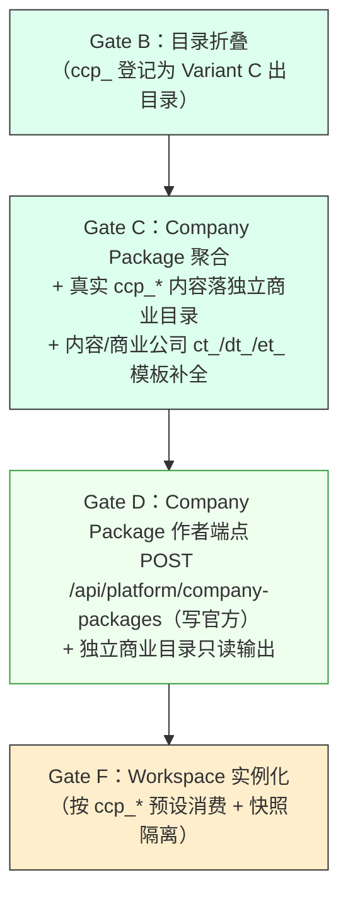
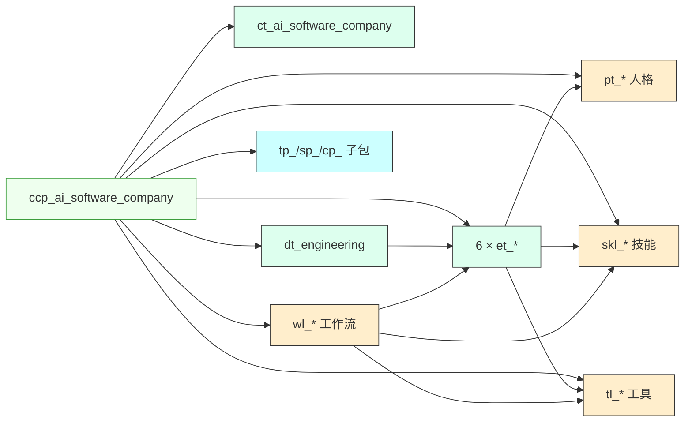

# Company Package 官方内容库规划（Phase-1 AI Company Asset Factory Consolidation · 任务 5 · P1）

> **作者**：高见远（架构师，software-architect）
> **主理人**：齐活林（交付总监）
> **阶段**：Phase-1 Consolidation 收口任务 —— **Design Only**（零代码、零运行时改动、不实例化、不 patch 既有契约、不自行 git commit）
> **定位**：把前四项产出（Persona `pt_*` / Skill `skl_*` / Tool `tl_*` / Workflow `wl_*`）与既有类型容器（Company `ct_*` / Department `dt_*` / Employee `et_*` / 子包 `tp_*`·`sp_*`·`cp_*`）串联为「一家完整 AI 公司的出厂配置」端到端闭环。本规划是 **design-only 提案**，仅给出官方 `ccp_*` 内容结构与跨资产引用图，不改写任何契约、不落库、不实例化 DB 行。
> **硬律**：① design-only 禁止 patch 既有契约；② 不引入新资产类型（故不触 L2 #7）；③ Admin/Workspace 边界不变（故不触 L2 #6）；④ 与 `Curis Workspace` 严格隔离；⑤ 不实例化任何 DB 行；⑥ 不自行 git commit。

---

## 一、研究来源与方法说明

**Company Package 概念**：在资产工厂语境下，Company Package（`ccp_*`）是「资产组合 / 出厂配置（factory preset）」——一组对既有官方资产的**引用集合 + 默认绑定**，而非运行时实例。它回答「一家标准 AI 公司出厂时，装配哪些 Company/Department/Employee 模板、哪些 Persona/Skill/Tool/Workflow 内容、哪些能力子包」。

**研究方法**：
1. **契约对齐（只读）**：以 `company-package-contract.md`（R6 `ccp_` 命名、R8 无实例化）、`ai-company-template-system.md`（`ct_/dt_/et_/wt_/cp_` 容器与示例公司）、Gate B 统一协议（§2.4 Variant C）为基线。
2. **前序官方内容溯源**：`pt_*` 取自 Task 1（`employee-persona-system-plan.md` 5 个示例）；`skl_*` 取自 `official-skill-catalog-contract.md` 附录 A（105 条真实 id）；`tl_*` 取自 Task 2（`tool-catalog-official-plan.md` 46 条真实 id）；`wl_*` 取自 Task 4（`workflow-official-content-plan.md` 36 条真实 id）。
3. **行业参照**：MetaGPT/ChatDev 的「公司 = 角色树 + SOP」结构、CrewAI 的「crew = agents+tasks」聚合、CapabilityPackage 商业信封（`company-package-contract.md` §0 继承关系）。
4. **source 归因**：复用 6 值枚举（MetaGPT SOP / ChatDev workflow / CrewAI example / AutoGen pattern / industry SOP / Curis internal）——`ccp_*` 作为平台原生聚合包，主来源标注 `Curis internal`，被引用子资产的 source 各自保留。

> **闭环目标验证**：用 `ccp_ai_software_company` 演示从 `ct_*` → `dt_*` → `et_*` → `pt_/skl_/tl_/wl_*` → `tp_/sp_/cp_` 七类串联，证明「资产工厂能产出一家完整 AI 公司的出厂配置」。

---

## 二、Company Package 定位声明（务必贯彻）

> **官方向导式出厂配置 = 一组资产引用 + 默认绑定（非运行时实例）。**

- **装配而非创建**：`ccp_*` 只**引用**既有官方资产（Company/Department/Employee 模板、Persona/Skill/Tool/Workflow 内容、能力子包），**不内联、不重定义**这些资产的字段；被引用资产的单一真相源不变（`ai-company-template-system.md` §0、`company-package-contract.md` R2/R7）。
- **出厂预设（preset）而非实例**：它描述「一家标准公司出厂时建议装配什么」，Workspace 实例化时**消费**此预设、可整体采用或覆盖，但**不回写**官方 `ccp_*` 定义（Admin/Workspace 两条铁律）。
- **商业信封复用**：`ccp_*` 继承 CapabilityPackage 的商业信封（`pricing_reference`/`quota_reference`/`availability`/`status`），仅持有「指向哪个 plan」的引用，不持有价格/配额数值（`company-package-contract.md` §6）。
- **独立商业目录（Variant C）**：`ccp_*` 走独立商业目录，**不进** `TemplateCatalogEntry` 只读目录（Gate B §2.4 变体 C）——它是聚合包，不是单一模板折叠项。

---

## 三、资产模型（Asset Model）

### 3.1 字段集（复用 TemplateBase + 聚合引用字段）

| # | 字段 | 类型 | 必填 | 前缀/约束 | 说明 |
|---|------|------|------|-----------|------|
| 1 | `company_package_id` | string | 是 | `^ccp_(ai_rd\|ai_content\|ai_commercial)_[a-z0-9_]+$` | 官方公司包稳定 ID（如 `ccp_ai_software_company`） |
| 2 | `name` | string | 是 | — | 展示名 |
| 3 | `description` | string | 否 | — | 展示/帮助文本 |
| 4 | `version` | string | 是 | SemVer `^\d+\.\d+\.\d+$` | 复用 TemplateBase.version |
| 5 | `status` | enum | 是 | `draft`/`active`/`disabled` | 复用 TemplateBase.status（R8：初始 draft） |
| 6 | `source` | enum | 是 | 6 值生态枚举 | 包聚合主来源（平台原生包=`Curis internal`） |
| 7 | `pack` | enum | 是 | `ai_rd`/`ai_content`/`ai_commercial` | 对齐公司类型 |
| 8 | `company_template_ref` | string | 是 | `^ct_[a-z0-9_-]+$` | 引用 CompanyTemplate 类型容器 |
| 9 | `department_template_refs` | string[] | 是 | `^dt_[a-z0-9_-]+$` | 引用 DepartmentTemplate 类型容器 |
| 10 | `employee_template_refs` | string[] | 是 | `^et_[a-z0-9_-]+$` | 引用 EmployeeTemplate 类型容器 |
| 11 | `persona_refs` | string[] | 否 | `^pt_[a-z0-9_-]+$` | **新增** 引用 Persona 内容实例（Task 1 `pt_*`） |
| 12 | `skill_refs` | string[] | 否 | `^skl_[a-z0-9_]+$` | **新增** 引用 Skill 内容实例（Task 2 `skl_*`） |
| 13 | `tool_refs` | string[] | 否 | `^tl_[a-z0-9_]+$` | **新增** 引用 Tool 内容实例（Task 2 `tl_*`） |
| 14 | `workflow_refs` | string[] | 否 | `^wl_[a-z0-9_]+$` | **新增** 引用 Workflow 内容实例（Task 4 `wl_*`） |
| 15 | `sub_package_refs` | string[] | 否 | `^tp_\|^sp_\|^cp_[a-z0-9_-]+$` | 引用能力子包（ToolPackage `tp_`/SkillPackage `sp_`/CapabilityPackage `cp_`） |

> **与既有契约关系**：字段 8–10、15 对齐 `company-package-contract.md` §2（`company_template_ref`/`department_template_refs`/`employee_template_refs`/`tool_package_refs`/`skill_package_refs`）；字段 11–14 为**本规划新增的内容实例直引字段**，使 `ccp_*` 能端到端追溯到具体的 `pt_/skl_/tl_/wl_*` 内容（不仅是类型容器）。§延后 backlog 列出契约补字段变更。

### 3.2 `company_package_id` 方案（前缀 `ccp_`）

- **格式**：`ccp_{pack}_{package_name}`，`pack` ∈ `ai_rd` / `ai_content` / `ai_commercial`（对齐公司类型，与 `skl_/tl_/wl_` 命名同构）。
- **示例**：`ccp_ai_software_company`、`ccp_ai_content_company`、`ccp_ai_commercial_company`。
- **与 `cp_` 区分**：`cp_*` = CapabilityPackage（能力包，见 `ai-company-template-system.md` §2.1 `capability_packages`）；`ccp_*` = Company Package（公司级聚合包），二者命名空间独立（Gate B §3.4 已核对：`ccp_` 由 Company Package 契约已规划，`cp_` 为能力包）。

### 3.3 JSON Schema（draft-07，覆盖核心字段）

```json
{
  "$schema": "http://json-schema.org/draft-07/schema#",
  "title": "CompanyPackage",
  "type": "object",
  "additionalProperties": false,
  "required": ["company_package_id","name","version","status","source","pack","company_template_ref","department_template_refs","employee_template_refs"],
  "properties": {
    "company_package_id":   { "type": "string", "pattern": "^ccp_(ai_rd|ai_content|ai_commercial)_[a-z0-9_]+$" },
    "name":                 { "type": "string" },
    "description":          { "type": "string", "default": "" },
    "version":              { "type": "string", "pattern": "^\\d+\\.\\d+\\.\\d+$", "default": "1.0.0" },
    "status":               { "type": "string", "enum": ["draft","active","disabled"], "default": "draft" },
    "source":               { "type": "string", "enum": ["MetaGPT SOP","ChatDev workflow","CrewAI example","AutoGen pattern","industry SOP","Curis internal"], "default": "Curis internal" },
    "pack":                 { "type": "string", "enum": ["ai_rd","ai_content","ai_commercial"] },
    "company_template_ref": { "type": "string", "pattern": "^ct_[a-z0-9_-]+$" },
    "department_template_refs": { "type": "array", "items": { "type": "string", "pattern": "^dt_[a-z0-9_-]+$" }, "default": [] },
    "employee_template_refs":   { "type": "array", "items": { "type": "string", "pattern": "^et_[a-z0-9_-]+$" }, "default": [] },
    "persona_refs":         { "type": "array", "items": { "type": "string", "pattern": "^pt_[a-z0-9_-]+$" }, "default": [] },
    "skill_refs":           { "type": "array", "items": { "type": "string", "pattern": "^skl_(ai_rd|ai_content|ai_commercial)_[a-z0-9_]+$" }, "default": [] },
    "tool_refs":            { "type": "array", "items": { "type": "string", "pattern": "^tl_(ai_rd|ai_content|ai_commercial)_[a-z0-9_]+$" }, "default": [] },
    "workflow_refs":        { "type": "array", "items": { "type": "string", "pattern": "^wl_(ai_rd|ai_content|ai_commercial)_[a-z0-9_]+$" }, "default": [] },
    "sub_package_refs":     { "type": "array", "items": { "type": "string", "pattern": "^(tp|sp|cp)_[a-z0-9_-]+$" }, "default": [] }
  },
  "examples": [{
    "company_package_id": "ccp_ai_software_company",
    "name": "AI Software Company 套装",
    "description": "标准 AI 软件公司出厂配置：研发部 + 6 类研发员工 + 研发人格 + 研发技能/工具 + 研发 SOP + 后端编码子包。",
    "version": "1.0.0",
    "status": "draft",
    "source": "Curis internal",
    "pack": "ai_rd",
    "company_template_ref": "ct_ai_software_company",
    "department_template_refs": ["dt_engineering"],
    "employee_template_refs": ["et_backend_engineer","et_frontend_engineer","et_architect","et_tech_lead","et_product_manager","et_qa_engineer"],
    "persona_refs": ["pt_direct_executor","pt_analytical_advisor","pt_supportive_coach","pt_balanced_facilitator"],
    "skill_refs": ["skl_ai_rd_python_development","skl_ai_rd_system_design","skl_ai_rd_requirement_analysis","skl_ai_rd_test_design"],
    "tool_refs": ["tl_ai_rd_code_executor","tl_ai_rd_test_runner","tl_ai_rd_code_linter","tl_ai_rd_git_client"],
    "workflow_refs": ["wl_ai_rd_software_dev_sop","wl_ai_rd_requirement_to_prd","wl_ai_rd_system_design_sop"],
    "sub_package_refs": ["tp_code_executor","sp_backend_coding","cp_content_ops"]
  }]
}
```

### 3.4 source 归因规则

`ccp_*` 自身 source 标注聚合主来源（平台原生包=`Curis internal`）；被引用子资产保留各自 source（如 `skl_ai_rd_python_development`=ChatDev workflow、`wl_ai_rd_software_dev_sop`=MetaGPT SOP）。归因不覆盖、不混用（同 Gate B §2.3 两层 source 区分）。

---

## 四、与 CompanyTemplate（`ct_*`）/ 子包（`tp_/sp_/cp_`）的关系

### 4.1 Variant C（独立商业目录，不进 TemplateCatalogEntry）

呼应 Gate B §2.4 变体 C 与 §3 覆盖矩阵第 8 行：Company Package **不是** `TemplateCatalogEntry` 折叠项，而是走**独立商业目录**（与 Commercial Config `cmcf_*` 同属出目录变体）。理由：

- Company Package 是**多资产聚合包**，无单一 `template_id` 主键语义；它聚合 `ct_/dt_/et_/pt_/skl_/tl_/wl_/tp_/sp_/cp_` 十类引用，折叠进单一 catalog 行会丢失聚合结构。
- `template-catalog-runtime-contract.md` §1 的 `template_id` 正则（`^ct_|dt_|et_|wt_|st_|tt_[a-z0-9_-]+$`）**不含 `ccp_`**，印证其不进该目录（§延后 backlog 建议显式注明 `ccp_*` 出目录）。

### 4.2 引用而非重复定义

```
ccp_ai_software_company
  ├── company_template_ref   ──▶ ct_ai_software_company        （CompanyTemplate 类型容器，字段定义惟一）
  ├── department_template_refs ─▶ dt_engineering               （DepartmentTemplate，不重定义部门字段）
  ├── employee_template_refs   ─▶ 6× et_*                       （EmployeeTemplate，不重定义员工字段）
  ├── persona_refs             ─▶ pt_*                          （Persona 内容实例，复用 Task 1 定义）
  ├── skill_refs               ─▶ skl_*                         （Skill 内容实例，复用 Task 2 定义）
  ├── tool_refs                ─▶ tl_*                          （Tool 内容实例，复用 Task 2 定义）
  ├── workflow_refs            ─▶ wl_*                          （Workflow 内容实例，复用 Task 4 定义）
  └── sub_package_refs         ─▶ tp_/sp_/cp_                  （能力子包，复用 company-package-contract 定义）
```

> `ccp_*` 仅持有**引用指针**，被引用资产的字段、版本、source 仍由各资产自身契约持有（单一真相源）。`ccp_*` 升级（version 演进）独立于各组件（R4 版本独立演进）。

---

## 五、跨资产引用矩阵（端到端闭环验证）

以旗舰包 `ccp_ai_software_company` 演示七类串联，每一项均可溯源到既有契约/规划：

| 资产类 | 引用 ID | 类型 | 来源契约/规划 | 溯源状态 |
|--------|---------|------|---------------|----------|
| CompanyTemplate | `ct_ai_software_company` | 类型容器 | `ai-company-template-system.md` §2.1 | ✅ 真实容器 id |
| DepartmentTemplate | `dt_engineering` | 类型容器 | 同上 §2.2 / `department-template-contract.md` | ✅ 真实容器 id |
| EmployeeTemplate | `et_backend_engineer` / `et_frontend_engineer` / `et_architect` / `et_tech_lead` / `et_product_manager` / `et_qa_engineer` | 类型容器 | 同上 §2.3（6 类研发员工） | ✅ 真实容器 id |
| Persona（内容） | `pt_direct_executor` / `pt_analytical_advisor` / `pt_supportive_coach` / `pt_balanced_facilitator` | 内容实例 | Task 1 `employee-persona-system-plan.md` §2.5 | ✅ 真实内容 id |
| Skill（内容） | `skl_ai_rd_python_development` / `skl_ai_rd_system_design` / `skl_ai_rd_requirement_analysis` / `skl_ai_rd_test_design` | 内容实例 | Task 2 `official-skill-catalog-contract.md` 附录 A | ✅ 真实内容 id |
| Tool（内容） | `tl_ai_rd_code_executor` / `tl_ai_rd_test_runner` / `tl_ai_rd_code_linter` / `tl_ai_rd_git_client` | 内容实例 | Task 2 `tool-catalog-official-plan.md` | ✅ 真实内容 id |
| Workflow（内容） | `wl_ai_rd_software_dev_sop` / `wl_ai_rd_requirement_to_prd` / `wl_ai_rd_system_design_sop` | 内容实例 | Task 4 `workflow-official-content-plan.md` | ✅ 真实内容 id |
| ToolPackage（子包） | `tp_code_executor` | 子包 | `company-package-contract.md` §4 示例 | ✅ 真实子包 id |
| SkillPackage（子包） | `sp_backend_coding` | 子包 | 同上 §3 示例 | ✅ 真实子包 id |
| CapabilityPackage（子包） | `cp_content_ops` | 子包 | `ai-company-template-system.md` §2.1 示例 | ✅ 真实子包 id |

> **闭环结论**：`ccp_ai_software_company` 一条记录即可追溯 Company→Department→Employee→Persona/Skill/Tool/Workflow→子包 全链路，七类资产在官方目录中均存在真实 id，**无编造**。Employee→Persona/Skill/Tool 的组合语义由 `et_*` 的 `persona_ref`/`default_skill`/`default_tool` 在实例层落地（Gate E/F），`ccp_*` 在预设层完成装配。

---

## 六、Admin / Workspace 边界（出厂配置 vs 实例化）

### 6.1 职责矩阵（Company Package 维度）

| 维度 | **Admin Platform（官方资产供给侧）** | **Workspace（租户 · 实例消费侧）** |
|------|---|---|
| 定义官方 `ccp_*` 出厂配置 | ✅ 本规划 + 后续作者端点 | ❌ 不创作官方包 |
| 维护引用完整性（配置时校验） | ✅ 应用层校验 id 格式/存在性（R3） | ❌ 不修改 |
| 对外只读输出商业目录 | ✅ `ccp_*` 独立商业目录（Variant C） | ❌ 不写目录 |
| 实例化公司/部门/员工 | ❌ **不做**（R8 无实例化） | ✅ 按 `ccp_*` 预设消费 + 快照 |
| 修改用户实例 | ❌ **禁止** | ✅ 实例所有权归 Workspace |

### 6.2 两条铁律 + 数据流单向性

1. **Admin 禁止修改用户实例**：`ccp_*` 仅为出厂预设；不触发 EmployeeInstance/DepartmentInstance/公司激活（R8、Gate B §5 Out-of-Scope）。
2. **Workspace 禁止修改官方模板/包定义**：只能**只读**拉取 `ccp_*` 预设，自定义的是「实例覆盖」而非「官方定义」。
3. **数据流单向性**：Admin → Workspace 单向发布 `ccp_*` 预设（只读）；Workspace 实例化时按引用 id 拉取 + 写入 `template_version_snapshot`（含被引资产 metadata 冻结副本），**禁止**反向写官方定义。

---

## 七、官方 Company Package 内容库（3 个，覆盖三产品线）

### 7.1 `ccp_ai_software_company`（Pack A · ai_rd）— 旗舰闭环

- `company_template_ref`: `ct_ai_software_company` ✅
- `department_template_refs`: `dt_engineering` ✅
- `employee_template_refs`: `et_backend_engineer` / `et_frontend_engineer` / `et_architect` / `et_tech_lead` / `et_product_manager` / `et_qa_engineer` ✅
- `persona_refs`: `pt_direct_executor`（工程师）/ `pt_analytical_advisor`（架构）/ `pt_supportive_coach`（PM/QA）/ `pt_balanced_facilitator`（Tech Lead）✅
- `skill_refs`: `skl_ai_rd_python_development` / `skl_ai_rd_system_design` / `skl_ai_rd_requirement_analysis` / `skl_ai_rd_test_design` / `skl_ai_rd_api_design` / `skl_ai_rd_code_review` ✅
- `tool_refs`: `tl_ai_rd_code_executor` / `tl_ai_rd_test_runner` / `tl_ai_rd_code_linter` / `tl_ai_rd_git_client` / `tl_ai_rd_python_repl` / `tl_ai_rd_file_reader` ✅
- `workflow_refs`: `wl_ai_rd_software_dev_sop` / `wl_ai_rd_requirement_to_prd` / `wl_ai_rd_system_design_sop` / `wl_ai_rd_api_dev_sop` / `wl_ai_rd_code_review_sop` / `wl_ai_rd_ci_cd_sop` ✅
- `sub_package_refs`: `tp_code_executor` / `sp_backend_coding` / `cp_content_ops` ✅
- 状态：`draft`，`source`: `Curis internal`

### 7.2 `ccp_ai_content_company`（Pack B · ai_content）

- `company_template_ref`: `ct_ai_content_company` ⚠️ **待内容填充**（design-only 占位；具体 `ct_*` 内容公司模板 id 归「内容公司模板 gate」创建，**本规划不编造**）
- `department_template_refs`: `dt_content_ops` ⚠️ **待内容填充**（类型容器引用占位，不编造具体 id）
- `employee_template_refs`: `et_content_operator` / `et_content_strategist` / `et_video_producer` 等 ⚠️ **待内容填充**（角色键描述性占位，具体 `et_*` id 归员工模板 gate）
- `persona_refs`: `pt_creative_explorer` / `pt_supportive_coach` / `pt_balanced_facilitator` ✅（Task 1 真实 id）
- `skill_refs`: `skl_ai_content_content_planning` / `skl_ai_content_script_writing` / `skl_ai_content_copywriting` / `skl_ai_content_content_audit` / `skl_ai_content_brand_voice` / `skl_ai_content_topic_planning` ✅
- `tool_refs`: `tl_ai_content_web_search` / `tl_ai_content_browser_scraper` / `tl_ai_content_image_generator` / `tl_ai_content_video_generator` / `tl_ai_content_markdown_renderer` / `tl_ai_content_text_to_speech` ✅
- `workflow_refs`: `wl_ai_content_content_production_sop` / `wl_ai_content_topic_research_sop` / `wl_ai_content_script_writing_sop` / `wl_ai_content_video_production_sop` / `wl_ai_content_seo_optimization_sop` ✅
- `sub_package_refs`: `cp_content_ops` ✅（真实内容运营能力包）/ 其余 `sp_/tp_` 内容子包 ⚠️ 待内容填充
- 状态：`draft`，`source`: `Curis internal`

> 内容公司包的 `pt_/skl_/tl_/wl_*` 引用**全部真实可溯源**（前序 Task）；仅 `ct_/dt_/et_` 类型容器尚未定义，已明确标注「待内容填充 / 不编造」，待对应公司/部门/员工模板 gate 落地。

### 7.3 `ccp_ai_commercial_company`（Pack C · ai_commercial）

- `company_template_ref`: `ct_ai_commercial_company` ⚠️ **待内容填充**（design-only 占位，不编造）
- `department_template_refs`: `dt_commercial_ops` ⚠️ **待内容填充**
- `employee_template_refs`: `et_gtm_manager` / `et_sales_rep` / `et_customer_success_mgr` 等 ⚠️ **待内容填充**
- `persona_refs`: `pt_analytical_advisor` / `pt_direct_executor` / `pt_balanced_facilitator` ✅
- `skill_refs`: `skl_ai_commercial_market_analysis` / `skl_ai_commercial_pricing_strategy` / `skl_ai_commercial_sales_strategy` / `skl_ai_commercial_gtm_strategy` / `skl_ai_commercial_customer_success` / `skl_ai_commercial_financial_analysis` ✅
- `tool_refs`: `tl_ai_commercial_crm_api` / `tl_ai_commercial_email_sender` / `tl_ai_commercial_web_search` / `tl_ai_commercial_notion_api` / `tl_ai_commercial_slack_messenger` / `tl_ai_commercial_calendar_api` ✅
- `workflow_refs`: `wl_ai_commercial_gtm_sop` / `wl_ai_commercial_market_research_sop` / `wl_ai_commercial_sales_outreach_sop` / `wl_ai_commercial_pricing_strategy_sop` / `wl_ai_commercial_crm_pipeline_sop` / `wl_ai_commercial_customer_success_sop` ✅
- `sub_package_refs`: ⚠️ **待内容填充**（无商业 `cp_/sp_/tp_` 子包定义；可后续建 `cp_commercial_ops` 等）
- 状态：`draft`，`source`: `Curis internal`

> 同上：商业公司包的 `pt_/skl_/tl_/wl_*` 引用**全部真实**；`ct_/dt_/et_` 标注「待内容填充」。

---

## 八、Gate 评估（关键）

### 8.1 Gate 结论

- **结论：PASS-WITH-NOTES**
  - 理由：本规划完成「Company Package 官方内容库」的 design-only 规划（概念/定位/资产模型/3 个 `ccp_*` 内容/与 `ct_*`·子包·Variant C 关系/跨资产引用闭环矩阵/Admin-Workspace 边界/红线全部闭合），不与任何既有契约矛盾；但**真实内容落库、独立商业目录端点、Workspace 实例化归后续 Gate**（Gate C 聚合 / Gate D 端点 / Gate F 实例化），不在本期红线内，故以 PASS-WITH-NOTES 收口。

### 8.2 ⚠️ L2 Gate 考量（NOTE · 透明标注）

> **NOTE（L2 Gate #7 / #6 评估）**：
> - **不触 L2 #7（新核心资产类型）**：本规划**不引入新资产类型**。`ccp_*` 是 `company-package-contract.md` 已定义的 Company Package 资产类型的**官方内容/实例命名**（R6 已规划 `ccp_` 前缀）；本规划仅填充其 design-only 内容（参照 Task 4 对 `wl_*` 的处理）。无新核心资产体系，故**不触发 L2 #7**。
> - **L2 #6（Admin/Workspace 边界）评估**：`ccp_*` 为 Admin 官方资产（出厂预设），Workspace 实例化时消费、不回写；边界与数据流方向不变（§6）。**#6 评估为「否（不触发）」**。
> - 透明标注：本 NOTE 仅为可追溯记录，不影响 PASS-WITH-NOTES 结论。

### 8.3 后续 Gate 路径（建议）



---

## 九、Mermaid 图：Company Package 类图 + 跨资产引用闭环

### 9.1 Company Package 资产类图（ccp_* 引用七类 + 子包）

```mermaid
classDiagram
    class CompanyPackage {
        +string company_package_id  %% ccp_*
        +string version
        +enum status
        +enum source
        +enum pack
    }
    class CompanyTemplate { +string id %% ct_* }
    class DepartmentTemplate { +string id %% dt_* }
    class EmployeeTemplate { +string id %% et_* }
    class PersonaTemplate { +string persona_id %% pt_* }
    class OfficialSkillContent { +string skill_id %% skl_* }
    class OfficialToolContent { +string tool_id %% tl_* }
    class WorkflowContent { +string workflow_id %% wl_* }
    class CapabilityPackage { +string package_id %% cp_* }
    class SkillPackage { +string package_id %% sp_* }
    class ToolPackage { +string package_id %% tp_* }

    CompanyPackage "1" o-- "1" CompanyTemplate : company_template_ref
    CompanyPackage "1" o-- "0..*" DepartmentTemplate : department_template_refs
    CompanyPackage "1" o-- "0..*" EmployeeTemplate : employee_template_refs
    CompanyPackage "1" o-- "0..*" PersonaTemplate : persona_refs
    CompanyPackage "1" o-- "0..*" OfficialSkillContent : skill_refs
    CompanyPackage "1" o-- "0..*" OfficialToolContent : tool_refs
    CompanyPackage "1" o-- "0..*" WorkflowContent : workflow_refs
    CompanyPackage "1" o-- "0..*" CapabilityPackage : sub_package_refs(cp_)
    CompanyPackage "1" o-- "0..*" SkillPackage : sub_package_refs(sp_)
    CompanyPackage "1" o-- "0..*" ToolPackage : sub_package_refs(tp_)

    note for CompanyPackage "Variant C：独立商业目录，不进 TemplateCatalogEntry"
    note for PersonaTemplate "内容实例 pt_*（Task 1）"
    note for OfficialSkillContent "内容实例 skl_*（Task 2）"
    note for OfficialToolContent "内容实例 tl_*（Task 2）"
    note for WorkflowContent "内容实例 wl_*（Task 4）"
```



### 9.2 跨资产引用闭环图（七类串联 · 旗舰 ccp_ai_software_company）



---

## 十、验收映射（Acceptance Mapping）

| # | 验收项（任务要求） | 落点 |
|---|-------------------|------|
| 1 | 研究来源与方法说明（资产组合/出厂配置概念） | §一 |
| 2 | Company Package 定位声明（装配而非创建） | §二 |
| 3 | 资产模型（`ccp_` 前缀 + 字段集 + JSON Schema + source 归因） | §三 |
| 4 | 与 `ct_*`/子包关系 + Variant C（不进 TemplateCatalogEntry） | §四 |
| 5 | 跨资产引用矩阵（七类闭环，id 全溯源、无编造） | §五 |
| 6 | Admin/Workspace 边界（出厂配置 vs 实例化） | §六 |
| 7 | 官方 Company Package 内容库（≥3 `ccp_*`，覆盖三产品线，含完整引用图） | §七 |
| 8 | Gate 评估（L2 #7 否 / #6 否，PASS-WITH-NOTES） | §八 |
| 9 | Mermaid（类图 + 跨资产引用闭环图） | §九 |
| 10 | 验收映射 | §十 |
| 11 | §延后 backlog（不 patch，供主理人裁定） | §十一 |

---

## 十一、§延后 backlog（不 patch，供主理人裁定）

> 主理人于 Task 3/4 收口时裁定：**设计提案中的契约变更仅记录、不执行**，随对应内容/端点落地 gate 一并 patch。下列变更**仅记录**：

1. **`company-package-contract.md` §2 R6**：固化 `ccp_` 前缀命名（弃用 `cpt_/cpl_*`），并在 §2 JSON Schema 增补内容实例直引字段 `persona_refs`(`pt_*)` / `skill_refs`(`skl_*)` / `tool_refs`(`tl_*)` / `workflow_refs`(`wl_*`)，与既有 `company_template_ref`/`department_template_refs`/`employee_template_refs`/`skill_package_refs`(`sp_`)/`tool_package_refs`(`tp_`) 并存（本规划 §3.1）。
2. **`template-catalog-runtime-contract.md` §1**：显式注明 `ccp_*` **不进** `TemplateCatalogEntry`（Variant C 出目录）；如正则需扩展，应明确排除而非纳入（本规划 §4.1）。
3. **`ai-company-template-system.md` + `department-template-contract.md` + `employee-template-contract.md`**：补全内容/商业公司所需的 `ct_ai_content_company` / `ct_ai_commercial_company` / `dt_content_ops` / `dt_commercial_ops` / `et_*` 内容公司员工等类型容器（本规划 §7.2/§7.3 标注为「待内容填充」，不编造 id）。

> 上述变更在 Task 5 不实施；待 Gate C（内容/商业公司模板补全 + 真实 `ccp_*` 落独立商业目录）一并 patch（主理人 backlog 裁定）。

---

*—— Company Package 官方内容库规划（纯设计/规划，零代码）。把 Persona(pt_*)/Skill(skl_*)/Tool(tl_*)/Workflow(wl_*) 与 Company(ct_*)/Department(dt_*)/Employee(et_*)/子包(tp_/sp_/cp_*) 串联为端到端出厂配置闭环；design-only，不 patch 既有契约，不触 L2 #7/#6，Variant C 走独立商业目录。Phase-1 Consolidation 收口。*
