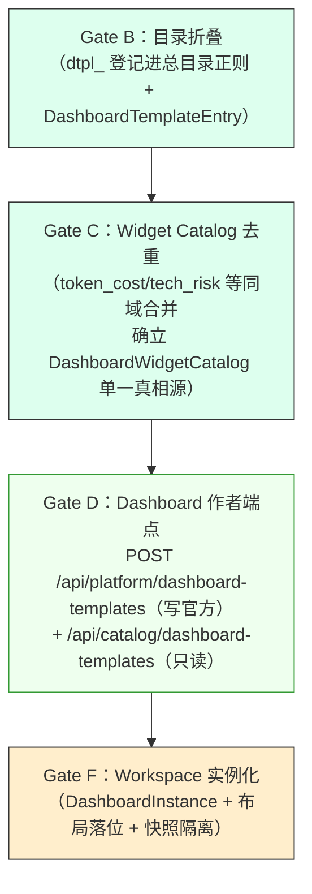
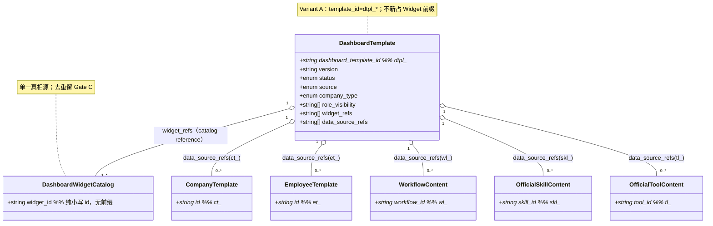
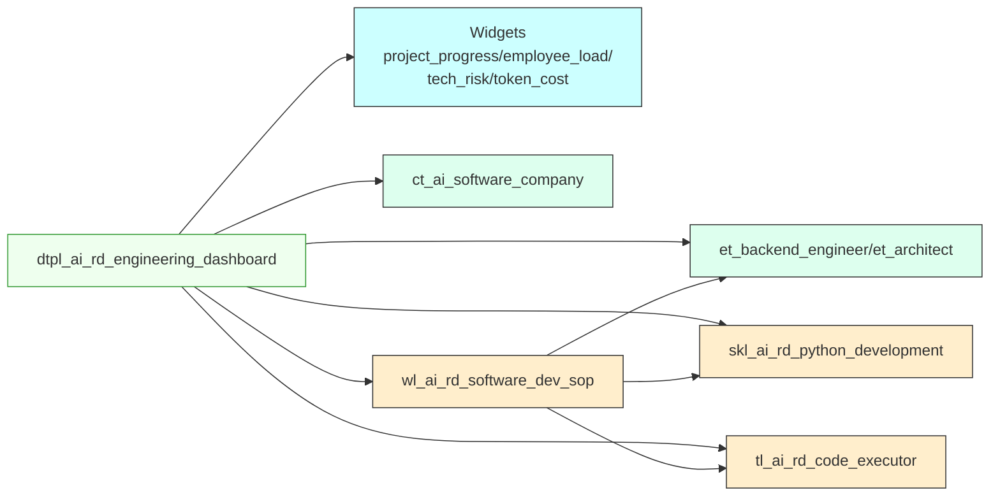

# Dashboard 官方内容库规划（Phase-1 AI Company Asset Factory Consolidation · 任务 6 · P2）

> **作者**：高见远（架构师，software-architect）
> **主理人**：齐活林（交付总监）
> **阶段**：Phase-1 Consolidation 收官任务 —— **Design Only**（零代码、零运行时改动、不实例化、不 patch 既有契约、不自行 git commit）
> **定位**：补齐 10 类资产中最后一类尚无官方内容规划的 **Dashboard（`dtpl_*`）**，闭合「10 类资产均有官方内容/容器」的整理目标。本规划是 **design-only 提案**，仅给出官方 `dtpl_*` 内容结构与跨资产引用图，不改写任何契约、不落库、不实例化 Widget/DB 行。
> **硬律**：① design-only 禁止 patch 既有契约；② 不引入新资产类型（故不触 L2 #7）；③ Admin/Workspace 边界不变（故不触 L2 #6）；④ 与 `Curis Workspace` 严格隔离；⑤ 不实例化任何 DB 行 / Widget 实例；⑥ 不自行 git commit。

---

## 一、研究来源与方法说明

**Dashboard 概念**：在资产工厂语境下，官方 Dashboard（`dtpl_*`）是「AI 公司可复用的可视化经营看板资产」——一组 **Widget 引用 + 布局 + 数据绑定声明（非运行时实例）**。它回答「一家标准 AI 公司出厂时，CEO/管理者看板装配哪些 Widget、如何布局、数据由哪些既有资产（Workflow/Employee/Skill/Tool）供给」。

**研究方法**：
1. **契约对齐（只读）**：以 `dashboard-template-admin-contract.md`（`dtpl_` 第 8 个 TemplateBase 子类、字段、`DashboardWidgetCatalog`）为基线；`ceo-dashboard-contract.md`（Workspace 运行时 Widget Catalog、`token_cost`/`tech_risk`/`content_output` 同域字段）为去重参照；Gate B §2.4/§3.4 确认 Dashboard 走 **Variant A**（`template_id=dtpl_*`）。
2. **前序官方内容溯源**：`wl_*` 取自 Task 4（36 条真实 id）、`skl_*` 取自 Task 2 目录（真实 id）、`tl_*` 取自 Task 2 计划（真实 id）、`ct_/et_*` 取自 `ai-company-template-system.md`（真实容器 id）。
3. **行业参照**：SaaS 经营驾驶舱范式（CEO 驾驶舱 = 进度/人力/成本/风险四宫格；增长看板 = 产出/发布/爆款/成本；营收看板 = 成本/模型用量/客户健康）——行业 SOP 来源标注 `industry SOP`，平台原生组装标注 `Curis internal`。
4. **Widget 命名不新占前缀**：沿用 `dashboard-template-admin-contract.md` §1.3 既有 `DashboardWidgetCatalog` 的纯小写下划线 id（如 `project_progress`/`token_cost`），**不发明 `widget_*` 前缀**。

---

## 二、Dashboard 定位声明（务必贯彻）

> **官方 Dashboard = 一组 Widget 引用 + 布局 + 数据绑定声明（非运行时实例）。**

- **装配而非创建**：`dtpl_*` 只**引用** `DashboardWidgetCatalog` 中的既有 Widget（catalog-reference 单一真相源），定义 grid 布局与「数据由 Workspace 提供」的声明（`data_source_hint`），**不内嵌 Widget 实现、不持有/不读取任何运行数据**（`dashboard-template-admin-contract.md` §0/§2.2）。
- **出厂预设（preset）而非实例**：描述「一家标准公司出厂时建议装配什么看板」，Workspace 实例化时**消费**此预设（`DashboardInstance`/`DashboardWidget`），可自定义布局与显隐，但**不回写**官方 `dtpl_*` 定义（Admin/Workspace 两条铁律）。
- **商业展示位复用**：`dtpl_*` 可声明 `commercial_display_slot`（复用 CompanyPackage 商业信封 `pricing_reference`/`quota_reference`/`availability`/`status`），仅展示位、不开发 Billing（`dashboard-template-admin-contract.md` §1.5）。
- **Variant A（类型仅容器）**：`dtpl_*` 是单一模板折叠项（非 Company Package 式聚合包），`template_id=dtpl_*`，折叠进 `DashboardTemplateEntry` 只读目录（Gate B §2.4 变体 A）。

---

## 三、资产模型（Asset Model）

### 3.1 字段集（复用 TemplateBase + 聚合引用字段）

| # | 字段 | 类型 | 必填 | 前缀/约束 | 说明 |
|---|------|------|------|-----------|------|
| 1 | `dashboard_template_id` | string | 是 | `^dtpl_(ai_rd\|ai_content\|ai_commercial)_[a-z0-9_]+$` | 官方 Dashboard 稳定 ID（如 `dtpl_ai_rd_engineering_dashboard`） |
| 2 | `name` | string | 是 | — | 展示名 |
| 3 | `description` | string | 否 | — | 展示/帮助文本 |
| 4 | `version` | string | 是 | SemVer `^\d+\.\d+\.\d+$` | 复用 TemplateBase.version |
| 5 | `status` | enum | 是 | `draft`/`active`/`disabled`/`archived` | 复用 TemplateBase.status |
| 6 | `source` | enum | 是 | 6 值生态枚举 | 看板设计主来源（SaaS 范式=`industry SOP`，原生=`Curis internal`） |
| 7 | `company_type` | enum | 是 | `ai_rd`/`ai_content_ops`/`generic`（注①） | 公司类型分类（契约枚举） |
| 8 | `role_visibility` | string[] | 是 | 角色键数组（如 `ceo`/`cto`/`pm`） | **新增** 可见角色（契约 `role_type` 升级为可见角色集合） |
| 9 | `widget_refs` | string[] | 是 | `^[a-z0-9_]+$`（命中 `DashboardWidgetCatalog`） | 引用 Widget（纯小写 id，无前缀） |
| 10 | `layout` | object | 是 | grid 区域定义 | 布局（不涉及 UI 实现） |
| 11 | `data_source_refs` | string[] | 否 | 引用 `ct_/et_/wl_/skl_/tl_*` | **新增** 跨资产数据源声明（轻量闭环） |
| 12 | `commercial_display_slot` | object | 否 | 复用 CompanyPackage 信封 | 商业展示位（可选） |

> 注①：**`company_type` 枚举对齐待办** —— 本规划 id 用 pack `ai_content`/`ai_commercial`（与 skl_/tl_/wl_/ccp_ 同构），但 `dashboard-template-admin-contract.md` §1.2 现有枚举为 `ai_rd`/`ai_content_ops`/`generic`，**缺 `ai_commercial`、且 `ai_content` 写作 `ai_content_ops`**。§延后 backlog 建议扩展该枚举（不影响本规划成立）。
> 字段 8/11 为**本规划在契约基础上新增的内容层字段**（使 `dtpl_*` 能声明可见角色与跨资产数据源），契约原 `widgets`/`layout`/`role_type` 语义被 `widget_refs`/`layout`/`role_visibility` 吸收。

### 3.2 `dashboard_template_id` 方案（前缀 `dtpl_`）

- **格式**：`dtpl_{pack}_{dashboard_name}`，`pack` ∈ `ai_rd` / `ai_content` / `ai_commercial`（对齐公司类型，与 skl_/tl_/wl_/ccp_ 命名同构）。
- **示例**：`dtpl_ai_rd_engineering_dashboard`、`dtpl_ai_content_ops_growth_dashboard`、`dtpl_ai_commercial_revenue_dashboard`。
- **与 `dl_*` 区分**：Gate B §3.4 将 `dl_*` 预留给 **DashboardInstance**（Workspace 运行时实例）；`dtpl_*` 是 Admin 官方 Dashboard 模板（类型容器 + 官方内容，Variant A），二者命名空间独立、不冲突。

### 3.3 JSON Schema（draft-07，覆盖核心字段）

```json
{
  "$schema": "http://json-schema.org/draft-07/schema#",
  "title": "DashboardTemplateOfficialContent",
  "type": "object",
  "additionalProperties": false,
  "required": ["dashboard_template_id","name","version","status","source","company_type","role_visibility","widget_refs","layout"],
  "properties": {
    "dashboard_template_id": { "type": "string", "pattern": "^dtpl_(ai_rd|ai_content|ai_commercial)_[a-z0-9_]+$" },
    "name":                 { "type": "string" },
    "description":          { "type": "string", "default": "" },
    "version":              { "type": "string", "pattern": "^\\d+\\.\\d+\\.\\d+$", "default": "1.0.0" },
    "status":               { "type": "string", "enum": ["draft","active","disabled","archived"], "default": "draft" },
    "source":               { "type": "string", "enum": ["MetaGPT SOP","ChatDev workflow","CrewAI example","AutoGen pattern","industry SOP","Curis internal"], "default": "Curis internal" },
    "company_type":         { "type": "string", "enum": ["ai_rd","ai_content_ops","generic"] },
    "role_visibility":      { "type": "array", "items": { "type": "string" }, "default": ["ceo"] },
    "widget_refs":          { "type": "array", "items": { "type": "string", "pattern": "^[a-z0-9_]+$" }, "default": [] },
    "layout": {
      "type": "object",
      "additionalProperties": false,
      "properties": {
        "grid_columns": { "type": "integer", "minimum": 1 },
        "grid_rows": { "type": "integer", "minimum": 1 },
        "regions": {
          "type": "array",
          "items": {
            "type": "object",
            "additionalProperties": false,
            "required": ["region_id","widget_ref","colspan","rowspan"],
            "properties": {
              "region_id": { "type": "string" },
              "widget_ref": { "type": "string" },
              "colspan": { "type": "integer", "minimum": 1, "default": 1 },
              "rowspan": { "type": "integer", "minimum": 1, "default": 1 }
            }
          }
        }
      }
    },
    "data_source_refs": {
      "type": "array",
      "items": { "type": "string", "pattern": "^(ct_|et_|wl_|skl_|tl_)[a-z0-9_]+$" },
      "default": []
    },
    "commercial_display_slot": {
      "type": "object",
      "additionalProperties": false,
      "properties": {
        "enabled": { "type": "boolean", "default": true },
        "slot_id": { "type": "string", "default": "plan_quota_panel" },
        "references": { "type": "array", "items": { "enum": ["pricing_reference","quota_reference","availability","status"] }, "default": ["pricing_reference","quota_reference","availability","status"] }
      }
    }
  },
  "examples": [{
    "dashboard_template_id": "dtpl_ai_rd_engineering_dashboard",
    "name": "AI 研发公司 研发交付看板",
    "description": "面向研发管理者的交付驾驶舱：项目进度、员工负载、技术风险、Token 成本。",
    "version": "1.0.0",
    "status": "draft",
    "source": "Curis internal",
    "company_type": "ai_rd",
    "role_visibility": ["ceo","cto","tech_lead"],
    "widget_refs": ["project_progress","employee_load","tech_risk","token_cost"],
    "layout": {
      "grid_columns": 2, "grid_rows": 2,
      "regions": [
        { "region_id": "r1", "widget_ref": "project_progress", "colspan": 1, "rowspan": 1 },
        { "region_id": "r2", "widget_ref": "employee_load", "colspan": 1, "rowspan": 1 },
        { "region_id": "r3", "widget_ref": "tech_risk", "colspan": 1, "rowspan": 1 },
        { "region_id": "r4", "widget_ref": "token_cost", "colspan": 1, "rowspan": 1 }
      ]
    },
    "data_source_refs": ["ct_ai_software_company","wl_ai_rd_software_dev_sop","et_backend_engineer","et_architect","skl_ai_rd_python_development","tl_ai_rd_code_executor"],
    "commercial_display_slot": { "enabled": true, "slot_id": "plan_quota_panel", "references": ["pricing_reference","quota_reference","availability","status"] }
  }]
}
```

### 3.4 source 归因规则

`dtpl_*` 自身 `source` 标注看板设计主来源（SaaS 四宫格范式=`industry SOP`，平台原生组装=`Curis internal`）。注意与 Gate B §2.3 两层 source 区分：本 `source` 是**内容归因**（6 值），catalog 输出层 `DashboardTemplateEntry.source` 恒为 `official`（与 `skl_*`/`tl_*` 的 `metadata.source_attribution` 同构）。

---

## 四、与 DashboardTemplate（`dtpl_`）/ Widget Catalog 的关系

### 4.1 Variant A（类型仅容器，template_id=dtpl_*）

呼应 Gate B §2.4 变体 A 与 §3 覆盖矩阵第 9 行：Dashboard 是**单一模板折叠项**，`template_id = dtpl_*`（类型容器即目录主键），折叠进 `DashboardTemplateEntry` 只读输出。它**不是** Company Package 式聚合包（Variant C），故走 Variant A。

```
fold(DashboardTemplate) -> DashboardTemplateEntry:
    entry.template_id = dashboard_template_id   // dtpl_*
    entry.version     = version
    entry.metadata.company_type / role_type / widget_ids / layout_summary / commercial_slot_ref
```

### 4.2 `dtpl_*` 与 Widget（不新占前缀）

- **Widget 命名沿用既有**：`widget_refs[]` 中的 id 直接命中 `dashboard-template-admin-contract.md` §1.3 `DashboardWidgetCatalog`（纯小写下划线 id，如 `project_progress`/`token_cost`/`content_output`/`viral_trend`），**本规划不发明 `widget_*` 前缀**（遵守任务铁律）。
- **Widget Catalog 单一真相源去重留待 Gate C**：`token_cost`/`operation_cost` 与 `ai_cost`/`token_usage`、`tech_risk` 与 `project_risk` 同域，须与 `ceo-dashboard-contract.md` 运行时目录统一去重（Gate B/contract §1.3 已标注）。本任务**仅规划 Dashboard 内容层**，去重归 Gate C，不在此处理。

---

## 五、跨资产引用（轻量闭环）

官方 Dashboard 通过 `data_source_refs` 引用既有真实 id 作为数据源/职责归属，**全部取自既有契约/规划，无编造**：

| Dashboard | 引用类型 | 真实 id | 溯源 |
|-----------|---------|---------|------|
| `dtpl_ai_rd_engineering_dashboard` | Company | `ct_ai_software_company` | `ai-company-template-system.md` |
| 同上 | Workflow | `wl_ai_rd_software_dev_sop` | Task 4 |
| 同上 | Employee | `et_backend_engineer` / `et_architect` | `ai-company-template-system.md` §2.3 |
| 同上 | Skill | `skl_ai_rd_python_development` | Task 2 目录 |
| 同上 | Tool | `tl_ai_rd_code_executor` | Task 2 计划 |
| `dtpl_ai_rd_quality_dashboard` | Workflow | `wl_ai_rd_code_review_sop` / `wl_ai_rd_test_design_sop` | Task 4 |
| 同上 | Employee | `et_qa_engineer` | 同上 |
| 同上 | Skill/Tool | `skl_ai_rd_test_design` / `tl_ai_rd_test_runner` | Task 2 |
| `dtpl_ai_content_ops_growth_dashboard` | Workflow | `wl_ai_content_content_production_sop` | Task 4 |
| 同上 | Skill/Tool | `skl_ai_content_seo_optimization` / `tl_ai_content_web_search` | Task 2 |
| `dtpl_ai_commercial_revenue_dashboard` | Workflow | `wl_ai_commercial_gtm_sop` | Task 4 |
| 同上 | Skill/Tool | `skl_ai_commercial_revenue_operations` / `tl_ai_commercial_crm_api` | Task 2 |
| `dtpl_ai_commercial_customer_success_dashboard` | Workflow | `wl_ai_commercial_customer_success_sop` | Task 4 |
| 同上 | Skill/Tool | `skl_ai_commercial_customer_success` / `tl_ai_commercial_crm_api` | Task 2 |

> 内容/商业公司看板的 `ct_/et_*` 公司/员工容器（如 `ct_ai_content_company`/`et_content_operator`）尚未定义，沿用 Task 5 标注「**待内容填充 / 不编造**」；`wl_/skl_/tl_*` 引用**全部真实**。

---

## 六、Admin / Workspace 边界（出厂模板 vs 实例化）

### 6.1 职责矩阵（Dashboard 维度）

| 维度 | **Admin Platform（官方 Dashboard 供给侧）** | **Workspace（租户 · 实例消费侧）** |
|------|---|---|
| 定义官方 `dtpl_*` 模板 | ✅ 本规划 + 后续作者端点 | ❌ 不创作官方模板 |
| 维护 `DashboardWidgetCatalog`（单一真相源） | ✅ 定义 Widget 引用目录 | ❌ 不创作官方 Widget |
| 声明布局 / 商业展示位 | ✅ `layout` / `commercial_display_slot` | ❌ 不定义官方语义 |
| 读取 Workspace 运行态/数据 | ❌ **禁止读取/修改** | ✅ 持有并供给自身运行数据 |
| 实例化 Dashboard | ❌ **不实例化**（不生成 DashboardInstance） | ✅ 按 `dtpl_*` 预设消费 + 快照 |
| 修改用户实例 | ❌ **禁止** | ✅ 实例所有权归 Workspace |

### 6.2 两条铁律 + 数据流单向性

1. **Admin 禁止读取/修改 Workspace 执行状态与数据**：`dtpl_*` 仅声明 `data_source_hint`（数据由 Workspace 提供），Admin 不持有/不回写任何实例快照（`dashboard-template-admin-contract.md` §2.2 铁律一）。
2. **Workspace 禁止修改官方模板定义**：只能**只读**感知官方 `dtpl_*` 目录，自定义的是「实例」（`DashboardInstance.layout_preferences`/`DashboardWidget`）而非「模板」。
3. **数据流单向性**：Admin → Workspace 单向发布 `dtpl_*` 只读目录（含 Widget 引用 + 展示位）；Workspace 实例化时按引用拉取 + 写入 `template_version_snapshot`，**禁止**反向写官方定义。

---

## 七、官方 Dashboard 内容库（8 个，覆盖三产品线）

> 其中 `dtpl_ai_rd_ceo_dashboard` / `dtpl_ai_content_ops_ceo_dashboard` 为 `dashboard-template-admin-contract.md` §3 既有真实示例（直接复用）；其余 6 个为本规划新增提案。

### 7.1 AI 软件公司（Pack A · ai_rd）

| # | `dashboard_template_id` | 看板 | `role_visibility` | `widget_refs`（真实 id） | `data_source_refs`（真实 id） | `source` |
|---|---|---|---|---|---|---|
| 1 | `dtpl_ai_rd_ceo_dashboard` ✅既有 | CEO 驾驶舱 | `[ceo]` | project_progress / employee_status / token_cost / tech_risk | ct_ai_software_company / wl_ai_rd_software_dev_sop | industry SOP |
| 2 | `dtpl_ai_rd_engineering_dashboard` | 研发交付看板 | `[ceo,cto,tech_lead]` | project_progress / employee_load / tech_risk / token_cost | ct_ai_software_company / wl_ai_rd_software_dev_sop / et_backend_engineer / et_architect / skl_ai_rd_python_development / tl_ai_rd_code_executor | Curis internal |
| 3 | `dtpl_ai_rd_quality_dashboard` | 质量看板 | `[cto,qa]` | tech_risk / project_risk / employee_load / token_cost | wl_ai_rd_code_review_sop / wl_ai_rd_test_design_sop / et_qa_engineer / skl_ai_rd_test_design / tl_ai_rd_test_runner | Curis internal |

### 7.2 AI 内容公司（Pack B · ai_content → company_type `ai_content_ops`）

| # | `dashboard_template_id` | 看板 | `role_visibility` | `widget_refs`（真实 id） | `data_source_refs`（真实 id） | `source` |
|---|---|---|---|---|---|---|
| 4 | `dtpl_ai_content_ops_ceo_dashboard` ✅既有 | CEO 驾驶舱 | `[ceo]` | content_output / publish_metrics / viral_trend / operation_cost | ct_ai_content_company⚠️待填充 / wl_ai_content_content_production_sop | industry SOP |
| 5 | `dtpl_ai_content_ops_operations_dashboard` | 运营看板 | `[ceo,ops]` | content_output / publish_metrics / operation_cost / employee_load | wl_ai_content_content_production_sop / skl_ai_content_content_planning / tl_ai_content_web_search | Curis internal |
| 6 | `dtpl_ai_content_ops_growth_dashboard` | 增长看板 | `[ceo,growth]` | viral_trend / publish_metrics / content_output / token_usage | wl_ai_content_content_production_sop / skl_ai_content_seo_optimization / tl_ai_content_web_search | industry SOP |

### 7.3 AI 商业公司（Pack C · ai_commercial → company_type 待扩枚举）

| # | `dashboard_template_id` | 看板 | `role_visibility` | `widget_refs`（真实 id） | `data_source_refs`（真实 id） | `source` |
|---|---|---|---|---|---|---|
| 7 | `dtpl_ai_commercial_revenue_dashboard` | 营收看板 | `[ceo,cfo]` | ai_cost / token_usage / model_usage / operation_cost | ct_ai_commercial_company⚠️待填充 / wl_ai_commercial_gtm_sop / skl_ai_commercial_revenue_operations / tl_ai_commercial_crm_api | industry SOP |
| 8 | `dtpl_ai_commercial_customer_success_dashboard` | 客户看板 | `[ceo,cs]` | company_health / department_overview / employee_status / ai_cost | wl_ai_commercial_customer_success_sop / skl_ai_commercial_customer_success / tl_ai_commercial_crm_api | Curis internal |

> ⚠️ 内容/商业公司看板的 `ct_ai_content_company`/`ct_ai_commercial_company` 与内容/商业公司 `et_*` 容器尚未定义，标注「待内容填充 / 不编造」（同 Task 5）；`wl_/skl_/tl_*` 与 Widget 引用**全部真实可溯源**。

---

## 八、Gate 评估（关键）

### 8.1 Gate 结论

- **结论：PASS-WITH-NOTES**
  - 理由：本规划完成「Dashboard 官方内容库」的 design-only 规划（概念/定位/资产模型/8 个 `dtpl_*` 内容/Variant A 关系/跨资产轻量闭环/Admin-Workspace 边界/红线全部闭合），不与任何既有契约矛盾；但**真实内容落库、Widget Catalog 去重、Dashboard 作者端点、Workspace 实例化归后续 Gate**（Gate C 去重 / Gate D 端点 / Gate F 实例化），不在本期红线内，故以 PASS-WITH-NOTES 收口。

### 8.2 ⚠️ L2 Gate 考量（NOTE · 透明标注）

> **NOTE（L2 Gate #7 / #6 评估）**：
> - **不触 L2 #7（新核心资产类型）**：本规划**不引入新资产类型**。`dtpl_*` 是 `dashboard-template-admin-contract.md` 已定义的 DashboardTemplate 资产类型的**官方内容实例命名**（第 8 个 TemplateBase 子类，Gate B §3.4 已登记）；本规划仅填充其 design-only 内容。无新核心资产体系，故**不触发 L2 #7**。
> - **L2 #6（Admin/Workspace 边界）评估**：`dtpl_*` 为 Admin 官方资产（出厂预设），Workspace 实例化时消费、不回写；边界与数据流方向不变（§6）。**#6 评估为「否（不触发）」**。
> - 透明标注：本 NOTE 仅为可追溯记录，不影响 PASS-WITH-NOTES 结论。

### 8.3 后续 Gate 路径（建议）



---

## 九、Mermaid 图：Dashboard 类图 + 跨资产引用图

### 9.1 Dashboard 资产类图（dtpl_* 引用 Widget + 跨资产）



### 9.2 跨资产引用闭环图（旗舰 dtpl_ai_rd_engineering_dashboard）



---

## 十、验收映射（Acceptance Mapping）

| # | 验收项（任务要求） | 落点 |
|---|-------------------|------|
| 1 | 研究来源与方法说明（Dashboard 概念 + 行业 SaaS 范式） | §一 |
| 2 | Dashboard 定位声明（装配 Widget 而非创建数据） | §二 |
| 3 | 资产模型（`dtpl_` 前缀 + 字段集 + JSON Schema + source 归因 + Widget 关系） | §三 |
| 4 | 与 `dtpl_*`/Widget Catalog 关系 + Variant A（Gate B §2.4） | §四 |
| 5 | 跨资产引用（轻量闭环，id 全溯源、无编造） | §五 |
| 6 | Admin/Workspace 边界（出厂模板 vs 实例化） | §六 |
| 7 | 官方 Dashboard 内容库（≥6 `dtpl_*`，覆盖三产品线，含 Widget 引用图） | §七 |
| 8 | Gate 评估（L2 #7 否 / #6 否，PASS-WITH-NOTES） | §八 |
| 9 | Mermaid（类图 + 跨资产引用图） | §九 |
| 10 | 验收映射 | §十 |
| 11 | §延后 backlog（不 patch，供主理人裁定） | §十一 |

---

## 十一、§延后 backlog（不 patch，供主理人裁定）

> 主理人于 Task 3/4/5 收口时裁定：**设计提案中的契约变更仅记录、不执行**，随对应内容/端点落地 gate 一并 patch。下列变更**仅记录**：

1. **`template-catalog-runtime-contract.md` §1**：`template_id` 正则扩展增补 `dtpl_`（当前为 `^ct_|dt_|et_|wt_|st_|tt_[a-z0-9_-]+$`），并新增 §3.9 `DashboardTemplateEntry`（Gate B §3.5 变更 1 已涵盖 `pt_`/`dtpl_`，本任务确认 `dtpl_` 落地项）。
2. **`dashboard-template-admin-contract.md` §1.2**：`company_type` 枚举扩展增补 `ai_content` 与 `ai_commercial`（对齐 skl_/tl_/wl_/ccp_ 的 pack 命名；当前仅 `ai_rd`/`ai_content_ops`/`generic`，缺 `ai_commercial` 且 `ai_content` 写作 `ai_content_ops`）。
3. **Widget Catalog 去重（Gate C）**：`token_cost`/`operation_cost` 与 `ai_cost`/`token_usage`、`tech_risk` 与 `project_risk` 同域，须与 `ceo-dashboard-contract.md` 运行时目录统一为单一真相源（本任务 §四/§七 已引用真实 widget id，去重逻辑归 Gate C）。
4. **`dashboard-template-admin-contract.md`**：本规划新增字段 `role_visibility`（升级 `role_type` 为可见角色集合）与 `data_source_refs`（跨资产数据源声明）建议补入 DashboardTemplate 供给侧字段（本任务 §3.1）。

> 上述变更在 Task 6 不实施；待 Gate C（Widget Catalog 去重）/ Gate D（Dashboard 作者端点，真实 `dtpl_*` 落库）一并 patch（主理人 backlog 裁定）。`dl_*` 预留给 DashboardInstance（运行时），本任务不涉及。

---

*—— Dashboard 官方内容库规划（纯设计/规划，零代码）。把 Dashboard(dtpl_*) 与 Widget Catalog / Company(ct_*)/Employee(et_*)/Workflow(wl_*)/Skill(skl_*)/Tool(tl_*) 串联为轻量闭环，补齐 10 类资产最后一类官方内容；design-only，不 patch 既有契约，不触 L2 #7/#6，Variant A 走 TemplateCatalogEntry。Phase-1 Consolidation 收官。*
