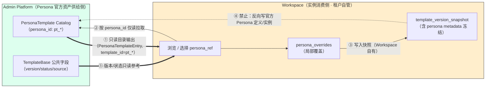
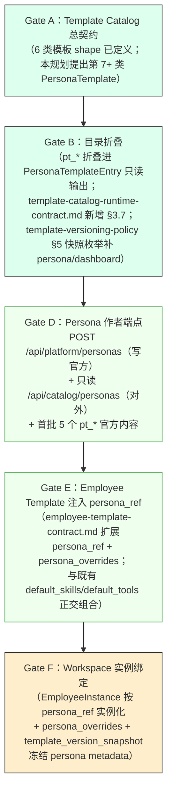

# Employee Persona System 规划（Phase-1 AI Company Asset Factory Consolidation · 任务 1）

> **作者**：高见远（架构师，software-architect）
> **主理人**：齐活林（交付总监）
> **阶段**：Phase-1 AI Company Asset Factory Consolidation —— **Design Only 规划**（零代码、零运行时改动、不开发 UI/Billing/Marketplace、不修改 Workspace Runtime）
> **对齐**：`employee-template-contract.md` / `ai-company-template-system.md` / `official-skill-catalog-contract.md` / `skill-runtime-contract.md` / `tool-runtime-contract.md` / `template-catalog-runtime-contract.md` / `template-versioning-policy.md` / `admin-workspace-template-boundary.md` / `employee-default-skill-mapping.md`
> **范围说明**：本规划为「Employee Persona System」的 **design-only 规划**（Product Gap Proposal + 资产设计 + 一致性 + 红线 + Gate 评估 + Consolidation 路线）。本任务由 CEO（总控决策席）亲自下发，属已批准的 **AI Company Asset Factory Consolidation** 方向内。本规划**不开发 UI / Billing / Marketplace、不修改 Workspace Runtime、不写任何代码、不建表、不提交**；真实实现归后续各 Gate（Gate B/D/E/F）。所有新类型登记与目录折叠均标注为待 Gate 项。

---

## 0. 摘要（Executive Summary）

当前 AI 员工模型为 **Role（岗位）+ Skill（能力）+ Tool（能力）** 三段式（`employee-template-contract.md` 仅有 `role` / `default_skill` / `default_tool` 引用，`ai-company-template-system.md` §2.3 仅有 `persona` 自由文本字符串）。本规划提出将其升级为**完整数字员工五元模型**：

> **岗位（Role） + 能力（Capability: Skill+Tool） + 人格（Persona） + 沟通方式（Communication Style） + 汇报风格（Reporting Style）**

**核心结论**：推荐 **方案 (B)** —— 引入独立的 **PersonaTemplate 资产类型**（`pt_` 前缀），由 EmployeeTemplate 以 `persona_ref` 引用，并在 Employee 层提供 `persona_overrides` 覆盖能力。理由：Persona 可复用、可跨员工共享、可组合，且作为官方第 7+ 类核心资产纳入 `TemplateBase` 体系，与既有 6 类模板同构、可统一 catalog 输出与版本策略。现行 `persona` 字符串保留为兼容自由文本，结构化的「人格/沟通/汇报/决策/协作」由 `pt_` 承载。

L2 Gate 考量见 §5 的 **NOTE**（触 v2 运行规则 L2 Gate #7 新核心资产类型；若 Employee Template 扩展改变 Admin/Workspace 边界则触 #6）——因指令来自总控且属已批准方向，本规划按**预授权**推进，最终是否升级由主理人/总控裁定。

---

## §1 Product Gap Proposal（产品规划席发现的缺口）

### 1.1 当前 AI 员工模型现状（Role + Skill + Tool）

依据 `employee-template-contract.md` 与 `ai-company-template-system.md` §2.3，当前 Employee Template 实际字段仅覆盖「岗位 + 能力」：

| 维度 | 当前落地字段 | 说明 |
|------|-------------|------|
| 岗位（Role） | `role` / `responsibility` / `department_type` | 角色标签与职责（CEO 可读） |
| 能力（Capability） | `default_skill`（`st_`）/ `default_tool`（`tt_`）、`default_capability_types` | 默认 Skill/Tool 引用（见 `employee-default-skill-mapping.md` 13 类员工默认 Skill 绑定） |
| 人设（Persona，弱） | `persona`（自由文本字符串） | 仅一句 CEO 可读语义描述，如「严谨、注重接口契约的后端工程师」，**无结构化维度** |
| 沟通方式 | ❌ 缺失 | 无字段 |
| 汇报风格 | ❌ 缺失 | 无字段 |
| 决策风格 | ❌ 缺失 | 无字段 |
| 协作风格 | ❌ 缺失 | 无字段 |

> 即：当前模型只能回答「这个 AI 员工**做什么**（岗位 + 技能 + 工具）」，不能回答「这个 AI 员工**怎么说话、怎么汇报、怎么做决定、怎么协作**」。

### 1.2 目标模型（完整数字员工五元）

```
完整数字员工 =
    岗位 Role            （做什么：角色/职责/部门）
  + 能力 Capability       （怎么做：Skill + Tool，已有 default_skills/default_tools）
  + 人格 Persona          （是谁：原型 + 特质）
  + 沟通方式 CommStyle     （怎么说：语气/主动度/举例偏好/详略）
  + 汇报风格 ReportingStyle（怎么汇报：数据驱动/叙事/要点/风险优先）
  [+ 决策风格 DecisionStyle + 协作风格 CollaborationStyle]   ← 人格的资产内子维度
```

目标：让 AI 员工从「功能组件」成为「**一致、可信、可协作的数字同事**」。

### 1.3 Gap 分析：缺哪三块，为什么影响「数字员工」体验

| 缺口 | 缺的字段 | 对数字员工体验的影响 |
|------|---------|---------------------|
| **① 人格（Persona）** | 结构化 `persona`（仅当前自由文本） | **一致性**：同一角色在不同任务中应表现出稳定的人格基调；当前每次对话都从零「猜」风格，体验割裂。 |
| **② 沟通方式（Communication Style）** | `communication_style`（语气/主动度/举例/详略） | **可信度**：用户期望「被理解」——鼓励式 vs 直接式、详尽 vs 精简，直接影响信任与采纳。 |
| **③ 汇报风格（Reporting Style）** | `reporting_style`（数据驱动/叙事/要点/风险优先） | **协作效率**：向 CEO/同事汇报时，要点式 vs 数据驱动 vs 风险优先显著减少返工与误解。 |

> 三者共同构成「行为一致性层」。缺少它们，AI 员工即便能力正确，也会显得「每次都不一样」「答非所问」「不会看人下菜」，难以被当作**可长期协作的数字员工**。

### 1.3.1 AI 员工默认 CEO 汇报标准

所有 Persona 的 `reporting_style` 必须继承 `docs/ai-development-organization/ceo-reporting-standard.md`：默认中文白话，固定采用“结论 / 原因 / 建议”。Persona 可以改变语气和详略，但不能取消结论先行、隐藏风险或把技术细节堆给 CEO。

### 1.4 在 9 类资产体系中的定位

资产规划席主动维护的 9 类资产为（含已建/规划中）：

`Company Template` / `Department Template` / `Employee Template` / **`Persona Template`（本规划新增）** / `Skill` / `Tool` / `Workflow Template` / `Company Package` / `Dashboard Template`（规划中）

- **定位**：PersonaTemplate 是**第 7+ 类官方核心资产**，与 Skill/Tool 同属「员工可引用的官方能力/行为资产」，但语义正交——**Skill/Tool = 能力（what to do），Persona = 行为人格（how to be / how to communicate）**。
- 它挂接在 **Employee Template → `persona_ref`** 上，是「完整数字员工」五元中缺失的三块（人格/沟通/汇报，外加决策/协作）的承载资产。

---

## §2 Persona System 设计

### 2.1 方案对比：(A) 内联扩字段 vs (B) 独立 PersonaTemplate 资产

| 维度 | (A) 在 EmployeeTemplate 内直接扩字段 | (B) 引入独立 PersonaTemplate（`pt_`）由 Employee 引用 ✅ |
|------|--------------------------------------|--------------------------------------------------------|
| 复用性 | 每类员工重复定义沟通/汇报字段，易漂移 | **一份 Persona 被多类员工共享**（如 `pt_supportive_coach` 适用于 PM/QA/Content Operator） |
| 跨员工共享 | 不支持（每模板一份副本） | **支持**（引用同一 `pt_`） |
| 可组合 | 难（字段焊死在员工上） | **可组合**（员工 `persona_ref` + `persona_overrides` 局部覆盖） |
| 资产体系一致性 | 破坏「TemplateBase 六类」的统一 catalog/版本模型 | **与既有 6 类模板同构**，继承 `TemplateBase`（version/status/source/description），可统一 catalog 输出 |
| Admin/Workspace 边界 | 扩 employee 字段即触碰员工边界 | Persona 是**独立官方资产**，边界清晰（供给侧写、消费侧引用+覆盖），不污染员工模板核心 |
| 未来扩展（新人设） | 需改 employee schema | 仅增 `pt_*` 条目，零侵入 |
| 目录折叠 / 版本策略 | 无法单独版本化「人格」 | 复用 `template-catalog-runtime-contract.md` + `template-versioning-policy.md`，人格可独立 SemVer 演进 |

**结论：推荐 (B)**。理由：(B) 满足产品规划席「可复用、可跨员工共享、可组合」三要求，且与既有资产体系（TemplateBase / TemplateCatalogEntry / 版本策略 / Admin-Workspace 边界）完全同构，新增成本最低、扩展性最好。当前 `employee-template-contract.md` 的 `persona` 自由文本字段**保留为兼容自由文本**，结构化的「人格 + 沟通 + 汇报 + 决策 + 协作」由 `pt_` 承载。

### 2.2 PersonaTemplate 数据契约（JSON Schema draft-07）

```json
{
  "$schema": "http://json-schema.org/draft-07/schema#",
  "title": "PersonaTemplate",
  "type": "object",
  "additionalProperties": false,
  "required": [
    "persona_id", "slug", "name", "archetype", "traits",
    "communication_style", "reporting_style", "decision_style",
    "collaboration_style", "version", "status", "source"
  ],
  "properties": {
    "persona_id": {
      "type": "string", "pattern": "^pt_[a-z0-9_-]+$",
      "description": "Persona Template 稳定 ID（pt_ 前缀），如 pt_supportive_coach"
    },
    "slug": { "type": "string", "description": "稳定 URL/目录键" },
    "name": { "type": "string", "description": "人设展示名，如 Supportive Coach" },
    "archetype": {
      "type": "string",
      "enum": ["supportive_coach","direct_executor","analytical_advisor","creative_explorer","balanced_facilitator","risk_aware_guardian"],
      "description": "人格原型（受控枚举，可扩展须 gate）"
    },
    "traits": {
      "type": "array", "items": { "type": "string" }, "default": [],
      "description": "人格特质数组，如 empathetic / concise / rigorous / proactive"
    },
    "communication_style": {
      "type": "object", "additionalProperties": false,
      "description": "沟通方式：语气 / 主动度 / 举例偏好 / 详略",
      "properties": {
        "tone":            { "type": "string", "enum": ["direct","tactful","encouraging","formal"], "description": "语气：直接/委婉/鼓励式/严谨" },
        "proactivity":     { "type": "string", "enum": ["proactive","reactive","balanced"], "description": "主动度" },
        "example_preference": { "type": "string", "enum": ["concrete_examples","abstract_principles","analogies","minimal"], "description": "举例偏好" },
        "verbosity":       { "type": "string", "enum": ["concise","detailed","adaptive"], "description": "详略" }
      }
    },
    "reporting_style": {
      "type": "object", "additionalProperties": false,
      "description": "汇报风格：格式 / 粒度 / 强调维度",
      "properties": {
        "format":     { "type": "string", "enum": ["data_driven","narrative","bullet_points","risk_first"], "description": "汇报格式：数据驱动/叙事式/要点式/风险优先" },
        "granularity":{ "type": "string", "enum": ["summary","detailed","adaptive"], "description": "粒度" },
        "emphasis":   { "type": "array", "items": { "type": "string" }, "default": [], "description": "强调维度，如 metrics/risks/next_steps" }
      }
    },
    "decision_style": {
      "type": "string", "enum": ["consensus","decisive","data_driven","consultative"],
      "description": "决策风格：共识/果断/数据驱动/协商"
    },
    "collaboration_style": {
      "type": "object", "additionalProperties": false,
      "description": "协作风格：自主度 / 交接方式 / 冲突处理",
      "properties": {
        "ownership":        { "type": "string", "enum": ["autonomous","collaborative","supervised"], "description": "自主/协作/受监督" },
        "handoff":          { "type": "string", "enum": ["async_doc","sync_meeting","adaptive"], "description": "交接方式" },
        "conflict_handling":{ "type": "string", "enum": ["avoid","confront","mediate"], "description": "冲突处理" }
      }
    },
    "version":  { "type": "string", "pattern": "^\\d+\\.\\d+\\.\\d+$", "default": "1.0.0", "description": "复用 TemplateBase.version（SemVer）" },
    "status":   { "type": "string", "enum": ["draft","active","disabled","archived"], "default": "draft", "description": "复用 TemplateBase.status" },
    "source":   {
      "type": "string",
      "enum": ["MetaGPT SOP","ChatDev workflow","CrewAI example","AutoGen pattern","industry SOP","Curis internal"],
      "description": "对齐 official-skill-catalog-contract.md §3 source 归因（6 值）"
    },
    "description": { "type": "string", "default": "", "description": "继承 TemplateBase.description（展示/帮助文本）" },
    "applicable_roles": { "type": "array", "items": { "type": "string" }, "default": [], "description": "建议适用角色键（可选，便于目录检索与推荐，如 Product Manager/QA）" },
    "tenant_id": { "type": ["string","null"], "default": "platform" },
    "created_at": { "type": "string", "format": "date-time" },
    "updated_at": { "type": "string", "format": "date-time" }
  },
  "examples": [{
    "persona_id": "pt_supportive_coach",
    "slug": "supportive-coach",
    "name": "Supportive Coach",
    "archetype": "supportive_coach",
    "traits": ["empathetic","encouraging","patient","constructive"],
    "communication_style": { "tone": "encouraging", "proactivity": "balanced", "example_preference": "concrete_examples", "verbosity": "detailed" },
    "reporting_style": { "format": "narrative", "granularity": "detailed", "emphasis": ["next_steps","growth"] },
    "decision_style": "consultative",
    "collaboration_style": { "ownership": "collaborative", "handoff": "async_doc", "conflict_handling": "mediate" },
    "version": "1.0.0",
    "status": "draft",
    "source": "Curis internal",
    "description": "以鼓励与建设性反馈为主的教练型人设，适合辅导/评审类岗位。",
    "applicable_roles": ["Product Manager","QA Engineer","Content Operator"]
  }]
}
```

### 2.3 Employee Template 扩展设计

在 `employee-template-contract.md` 与 `ai-company-template-system.md` §2.3 的 EmployeeTemplate 上**新增/调整**如下字段（既有字段保留，不破坏）：

| 字段 | 类型 | 必填 | 说明 | 与 `pt_` 关系 |
|------|------|------|------|--------------|
| `persona_ref` | string（pattern `^pt_[a-z0-9_-]+$`）nullable | 否 | **新增**，引用 PersonaTemplate 的 `persona_id` | 主引用：人格/沟通/汇报/决策/协作由被引 `pt_` 提供 |
| `persona_overrides` | object nullable | 否 | **新增**，局部覆盖被引 Persona 的子项 | Employee 可覆盖 `communication_style` / `reporting_style` / `decision_style` / `collaboration_style` 的任意子集；不覆盖时继承 `pt_` |
| `persona` | string（既有） | 否 | **保留**为兼容自由文本（CEO 可读人设摘要） | 与 `persona_ref` 互补：自由文本存「人设一句话」，结构化维度存 `pt_` |

**组合语义**：
- 沟通方式 / 汇报风格（以及决策/协作）**由 Persona 提供**（`persona_ref` 指向 `pt_`）。
- **Employee 可覆盖**：`persona_overrides` 允许某岗位在共享人设基础上微调（如「同一 Supportive Coach 人设，但后端工程师汇报偏 data_driven」）。
- 能力组合关系保持不变：`default_skills`（`skl_*`/`st_*`）+ `default_tools`（`tt_*`）继续与 `persona_ref` 正交组合。

> 扩展仅新增引用字段（`persona_ref` / `persona_overrides`），**不删不改**既有的 `role` / `default_skill(s)` / `default_tool` / `persona`，故不触碰既有种子表结构，属 design-only 预留（Gate E 落地）。

### 2.4 与 TemplateBase / TemplateCatalogEntry 的关系

- **继承 TemplateBase**：PersonaTemplate 作为新资产类型，复用 `version` / `status` / `source` / `description` 公共字段（与 6 类模板同构）。
- **catalog 输出映射（TemplateCatalogEntry）**：在 `template-catalog-runtime-contract.md` 新增 §3.7 `PersonaTemplateEntry`，映射规则：

| TemplateCatalogEntry 字段 | 来源 | 取值 |
|--------------------------|------|------|
| `template_id` | `persona_id` | `pt_*`（并扩展 §1 的 `template_id` pattern 为 `^ct_\|dt_\|et_\|wt_\|st_\|tt_\|pt_[a-z0-9_-]+$`） |
| `version` | `version` | SemVer |
| `name` | `name` | 展示名 |
| `description` | `description` | — |
| `source` | 固定 | `official` |
| `status` | `status` | 对齐 |
| `metadata` | 组合 | 含 `archetype` / `traits` / `communication_style` / `reporting_style` / `decision_style` / `collaboration_style` / `applicable_roles` |

- **快照枚举补齐**：`template-versioning-policy.md` §5 的 `template_type` 枚举须补 `persona`（及 `dashboard`/`tool`/`workflow` 等），并扩展 §5 `template_id` pattern 含 `pt_`。**标注为待 Gate B 折叠项**（见 §5 / §6）。

### 2.5 Benefit：示例 Persona（各配适用岗位）

| persona_id | archetype | 一句话说明 | 适用岗位示例 |
|-----------|-----------|-----------|-------------|
| `pt_supportive_coach` | supportive_coach | 以鼓励与建设性反馈为主，辅导/评审类岗位首选 | Product Manager / QA / Content Operator |
| `pt_direct_executor` | direct_executor | 直接、简洁、重结果，少寒暄，交付导向 | Backend / Frontend / DevOps Engineer |
| `pt_analytical_advisor` | analytical_advisor | 数据驱动、严谨、给结论前先给证据 | Architect / Data Engineer / Security Engineer |
| `pt_creative_explorer` | creative_explorer | 发散、举例丰富、鼓励尝试，适合内容/增长 | Content Operator / Growth-Commercial |
| `pt_balanced_facilitator` | balanced_facilitator | 平衡各方、协商决策、文档化交接 | Tech Lead / SRE-Platform |

> 以上 5 个为建议首批官方 `pt_` 内容（design-only 规划，不建表、不写库）；真实内容创作归 Gate D 作者端点。

---

## §3 对齐与一致性

### 3.1 与 TemplateBase 公共字段语义对齐

| TemplateBase 字段 | PersonaTemplate 取值 | 对齐说明 |
|-------------------|---------------------|---------|
| `version` | SemVer `^\d+\.\d+\.\d+$` | 与 6 类模板完全一致；人格可独立版本演进 |
| `status` | draft/active/disabled/archived | 复用统一状态机（`ai-company-template-system.md` §1.1） |
| `source` | 6 值（对齐 skill 归因） | 与 `official-skill-catalog-contract.md` §3 同源，便于归因统计 |
| `description` | 自由文本 | 展示/帮助 |

### 3.2 与 capability 模型互补（能力 vs 人格 正交）

```
能力维度（what to do）          人格维度（how to be）
  Skill (st_/skl_*)    ──┐        Persona (pt_*)  ──┐
  Tool  (tt_*)         ──┤ 正交    communication_style ──┤
                         ├── 组合   reporting_style      ──┤ → EmployeeTemplate 组合
  default_skills[]     ──┘        decision_style        ──┘
  default_tools[]               collaboration_style    ──┘
```

- **能力 = Skill/Tool**（来自官方能力目录单一真相源，`skill-runtime-contract.md` / `tool-runtime-contract.md`）。
- **人格 = Persona**（`pt_`，本规划新增）。
- 二者**正交、可独立演进、在 EmployeeTemplate 组合**：同一 `pt_supportive_coach` 可被不同能力集的员工复用。

### 3.3 与 admin-workspace-template-boundary.md 两条铁律 + 数据流单向性

- **铁律 1（Admin 禁止修改用户实例）**：Persona 是**官方资产**（供给侧）；Workspace 实例仅**采用/覆盖**（`persona_ref` 引用 + `persona_overrides`），Admin 不读不改任何 `EmployeeInstance`。
- **铁律 2（Workspace 禁止修改官方模板定义）**：Workspace 只能**只读**感知官方 `pt_*`（经 catalog 输出）；自定义的是「实例覆盖」而非「官方 Persona 定义」。
- **数据流单向性**：Admin → Workspace 只读发布 `PersonaTemplateEntry`；Workspace 按 `persona_ref` 拉取 + 写入 `template_version_snapshot`（含 persona metadata 冻结副本）。

### 3.4 template-versioning-policy.md §5 快照枚举补齐

- §5 `template_type` 枚举当前仅 `company/department/employee/workflow/skill/tool`，**缺 persona（及 dashboard）**。
- **本规划要求补 `persona`**（标注为**待 Gate B 折叠项**，由主理人/总理裁定是否随 Dashboard 一并登记）。
- 补 `persona` 后，EmployeeInstance 快照可冻结当时 `pt_*` 的 `communication_style` / `reporting_style` 等，保证已存在实例不随官方人格升级而漂移（快照隔离，`follow_latest` 默认 false）。



---

## §4 红线核验（Red-Line Verification）

| 红线项 | 是否遵守 | 说明 |
|--------|---------|------|
| 不开发 UI | ✅ | 仅 markdown 规划文档，无前端/组件 |
| 不开发 Billing | ✅ | 未涉及任何计费/账单/支付 |
| 不开发 Marketplace | ✅ | Persona 为官方资产目录，无上架/交易/购买流程 |
| 不修改 Workspace Runtime | ✅ | 未碰 EmployeeRuntime / Credential Vault / Usage Event 写入 |
| 零代码 | ✅ | 未写任何后端代码、未建表、未加 API 路由（端点均为 design-only 标注） |
| 仅规划（design-only） | ✅ | 仅契约/资产设计 + 占位，无行为变化 |
| 不执行 git 提交 | ✅ | 由主理人落盘与提交 |
| 不触碰 Admin/Workspace 边界铁律 | ✅ | Persona 为官方资产；Workspace 仅采用/覆盖，Admin 不读不改实例 |

---

## §5 Gate 评估（关键）

### 5.1 Gate 结论

- **结论：PASS-WITH-NOTES**
  - 理由：本规划完成「Employee Persona System」的 design-only 规划（Gap 分析 / 方案对比 / `pt_` 数据契约 / EmployeeTemplate 扩展 / 与 TemplateBase·Catalog·版本策略·Admin-Workspace 边界的一致性 / 红线全部闭合），不与任何既有契约矛盾。但**真实实现（建表、作者端点、实例注入与绑定）归后续各 Gate**，不在本期红线内，故以 PASS-WITH-NOTES 收口。

### 5.2 ⚠️ L2 Gate 考量（NOTE · 透明标注）

> **NOTE（L2 Gate #7 / #6 预授权）**：
> - 引入 **PersonaTemplate 作为新核心资产类型（`pt_`）** 触及 v2 运行规则 **L2 Gate #7**（新增核心资产类型 / 新核心资产体系须升级评审）。
> - 若 EmployeeTemplate 扩展（`persona_ref` / `persona_overrides`）**改变 Admin/Workspace 边界语义**，则额外触及 **L2 Gate #6**（Admin/Workspace 边界变更须评审）。
> - **预授权说明**：本任务由 **CEO（总控决策席）亲自下发**，属已批准的 **AI Company Asset Factory Consolidation** 方向内。按 v2 运行规则，视作**已预授权**推进本规划。
> - **透明标注**：如严格按 L2 #7 字面，新资产类型理论上需升级评审；但因指令来自总控且属批准方向，**本规划按预授权推进，不因此停止产出**。最终是否需正式升级 L2，由**主理人（齐活林）/ 总控（CEO）裁定**；本 NOTE 仅为透明记录，供 Gate 评审追溯。

### 5.3 后续 Gate 路径（建议）



> 不在本期红线内：Billing / Marketplace / Workspace Runtime 改动 / 任何代码·表·路由。

---

## §6 后续 Asset Factory Consolidation 路线（主动发现下一步缺口）

### 6.1 9 类资产建设状态审计矩阵

站在产品规划席视角，审计 9 类资产当前建设状态（已建契约 / 已建内容 / 缺口）：

```mermaid
flowchart TD
    subgraph BUILT["已建契约 + 已建内容"]
        SK["Skill<br/>契约✅ + 105 条内容✅"]
        TL["Tool<br/>运行时契约✅ + 官方目录✅"]
    end
    subgraph CONTRACT["已建契约（design-only，缺官方内容）]
        EM["Employee<br/>契约✅ + 种子✅ + 13类默认Skill✅"]
        DP["Department<br/>契约✅ + 种子✅"]
        WF["Workflow<br/>契约✅ + 种子✅"]
        CP["Company Package<br/>契约✅"]
        CT["Company<br/>契约✅（Reserved,无表）"]
    end
    subgraph GAP["缺口（待 Consolidation）"]
        PT2["Persona ✅本规划新增（契约+内容规划）<br/>待 Gate B/D/E/F"]
        DB["Dashboard<br/>仅引用，无契约/无内容"]
        TL2["Tool 官方内容库<br/>仅有运行时契约，缺官方 Tool 目录内容"]
        WF2["Workflow 官方内容<br/>有类型，缺官方 SOP 内容"]
        CP2["Company Package 官方内容<br/>契约有，缺内容"]
    end
```

| # | 资产类型 | 契约状态 | 官方内容状态 | 主要缺口 | 建议下一步 Gate |
|---|---------|---------|------------|---------|----------------|
| 1 | Company Template | ✅ 已定义（Reserved） | ⚠ 仅蓝图示例 | 无 `company_templates` 表/API | Gate D（Phase-5+） |
| 2 | Department Template | ✅ 已定义 + 种子 | ✅ 种子存在 | Admin 写 API 缺失 | Gate B |
| 3 | Employee Template | ✅ 已定义 + 种子 + `default_skills` | ✅ 13 类默认 Skill | **缺 persona_ref/persona_overrides 扩展** | **Gate E（本规划驱动）** |
| 4 | **Persona Template** | 🆕 **本规划新增（design-only）** | 🆕 5 个示例规划 | 无表/无内容/无 catalog 输出 | **Gate B → D → E → F** |
| 5 | Skill | ✅ 已定义（catalog-reference） | ✅ **105 条内容**（3 Pack） | 目录折叠进 catalog 输出 | Gate B |
| 6 | Tool | ✅ 运行时契约 + 官方目录读 | ⚠ **缺官方 Tool 内容库** | 仅有运行时契约，缺官方 Tool 目录内容（如 `tt_*` 清单与归因） | Gate B + 内容创作 |
| 7 | Workflow Template | ✅ 已定义 + 种子 | ⚠ 缺官方 SOP 内容 | 有类型，缺官方内容（如 `wt_software_rnd_sop` 完整步骤） | Gate B + 内容创作 |
| 8 | Company Package | ✅ 已定义（CapabilityPackage 升级） | ⚠ 缺官方内容 | 契约有，缺官方组合包内容（如 `cp_content_ops` 实体） | Gate C |
| 9 | Dashboard Template | ⚠ 仅被引用 | ❌ 无契约/无内容 | 无 `DashboardTemplate` 契约、无目录 | 待独立规划 + Gate B |

### 6.2 剩余缺口与优先级建议

| 优先级 | 缺口 | 说明 |
|--------|------|------|
| **P0** | **Persona Template 落地链路**（Gate B/D/E/F） | 本规划已给出方案，闭环「完整数字员工」五元，应优先推进 |
| **P1** | 所有新类型（Dashboard / Skill / Persona）在 `ai-company-template-system.md` 与 `template-catalog-runtime-contract.md` 的**目录折叠** | Gate B 统一折叠 `pt_*`/`st_*`/`tt_*`/`wt_*`/`dt_*`/`ct_*`/`dashboard` 只读输出 |
| **P1** | `template-versioning-policy.md` §5 **快照枚举补齐** | 补 `persona` / `dashboard` / `tool` / `workflow`（当前仅 6 类） |
| **P2** | **Tool 官方内容库** | 目前仅有运行时契约，缺官方 Tool 目录内容（`tt_*` 清单 + source 归因 + capability_ref 映射） |
| **P2** | **Workflow Template 官方内容目录** | 6 模板系统有类型，缺官方 SOP 内容 |
| **P2** | **Company Package 官方内容** | 契约有，缺内容（如 `cp_content_ops` 实体与组件绑定） |
| **P3** | **Dashboard Template 独立规划** | 仅被引用，需独立契约 + 内容（归后续 Consolidation 任务） |

### 6.3 建议推进序列（不执行，仅规划）

```
序列①  Persona System 闭环（本规划）
        Gate B（目录折叠 pt_*）→ Gate D（Persona 作者端点 + 5 个官方内容）
        → Gate E（Employee 注入 persona_ref/overrides）→ Gate F（Workspace 实例绑定 + 快照）

序列②  目录折叠统一（Gate B 横切）
        将 Skill/Tool/Workflow/Persona/Dashboard 全部折叠进 TemplateCatalogEntry 只读输出；
        同步补齐 template-versioning-policy §5 快照枚举

序列③  官方内容库补全（P2）
        Tool 官方内容库 → Workflow 官方 SOP 内容 → Company Package 官方内容

序列④  Dashboard Template 独立规划（P3，归下一 Consolidation 任务）
```

---

## §7 验收映射（Acceptance Mapping）

| # | 验收项（任务要求） | 落点 |
|---|-------------------|------|
| 1 | §1 Product Gap Proposal（现状/目标/Gap/定位） | §1 |
| 2 | §2 方案对比，推荐 (B) 并说明理由 | §2.1 |
| 3 | PersonaTemplate JSON Schema（含 persona_id/name/archetype/traits/communication_style/reporting_style/decision_style/collaboration_style/version/status/source） | §2.2 |
| 4 | Employee Template 扩展（persona_ref + 可覆盖 + 与 default_skills/tools 组合） | §2.3 |
| 5 | 与 TemplateBase / TemplateCatalogEntry 关系（新增 PersonaTemplateEntry，template_id=pt_*） | §2.4 |
| 6 | Benefit：≥2–3 个示例 Persona（supportive_coach / direct_executor / analytical_advisor 等） | §2.5 |
| 7 | §3 对齐与一致性（TemplateBase / capability 正交 / Admin-Workspace 铁律 + 单向性 / 版本快照枚举补 persona） | §3 |
| 8 | §4 红线核验（无 UI/Billing/Marketplace/Runtime/零代码/仅规划） | §4 |
| 9 | §5 Gate 结论（PASS-WITH-NOTES）+ L2 #7 预授权 NOTE + 后续 Gate 路径 | §5 |
| 10 | §6 Consolidation 路线（9 类资产审计矩阵 + 缺口优先级 + 推进序列） | §6 |
| 11 | Mermaid 图（类图 / 数据流 / Gate 路径 / 资产审计矩阵） | §2.2+§3.4 / §3.4 / §5.3 / §6.1 |

---

*—— Employee Persona System 规划（纯设计/规划，零代码）。与 ADR-0017 一致，仅 design-only reservation；真实实现归后续 Gate B/D/E/F。由 CEO 总控预授权推进，L2 #7 考量见 §5.2 NOTE。*
